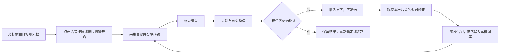

# F17-B：自有语音输入与本机词库（后续需求）

更新日期：2026-10-16\
状态：用户已明确从 M7 拆出，后续开发，阶段编号与排期待定。本文保存原完整方案供技术验证，不是 M7 的当前执行范围。\
当前交付阶段：[M7：Typeless 语音输入接入](M7_Typeless语音输入接入.md)\
技术依据：[Typeless 逆向与模型调研](M7_Typeless技术调研.md)

## 1. 与 M7 的边界

F17 分成两个子需求：F17-A 在 M7 先唤起本机 Typeless，F17-B 在后续提供 SmartDD 自己的录音、识别、整理、输入及词库学习。用户将另开终端验证自有方案；模型验证不阻塞 M7，不由 M7 提前接入产品。

自有模块保留两个核心目标：语音识别与忠实整理后输入到光标位置；明确修正如 `cloud → claw` 能写入本机词库并改善下次结果。先不做多端词库同步。触发入口沿用页面按钮与可配置快捷键，原先的 Option 单键要求不再强制。

本地 Whisper／Qwen 与云端模型均保留为候选，具体模式和模型由后续验证确定。用户指定的 Model Hub 是云端候选来源；本机 M4 Max、128 GB 可用于本地模型试验，尚无性能验收结论。后续里程碑不自动命名为 M8，也不绑定应用 tag。

## 2. 首版功能范围

下表保存自有语音模块的候选需求；页面入口和快捷键沿用 M7 接入层，后续自有录音控制、模型及兼容范围在技术验证后定稿。以下均不属于 M7 验收。

| 编号 | 功能 | 首版行为与完成条件 |
| --- | --- | --- |
| F17-B-F01 | 全局录音开关 | 复用 M7 的页面按钮和可配置全局快捷键；自有录音支持开始、结束和取消。不再将 Option 单键作为必做要求，组合键防重复和冲突需验证 |
| F17-B-F02 | 录音浮层 | 显示录音状态、时长和处理状态，可取消；浮层不抢走目标输入框焦点。明确区分正在录音、正在处理、已取消、失败 |
| F17-B-F03 | 语音识别 | 先保证中文与中英混说、开发术语；录音期间可分块上传，结束后尽快获得最终文本。模型与传输方式以实测选择 |
| F17-B-F04 | 智能整理 | 整理标点、口语重复及明确的自我修正，保留原意、否定、数字、文件路径、专名和用户的约束。默认产生可直接输入的完整表达；压缩成短摘要作为独立输出模式待后续细化 |
| F17-B-F05 | 光标处输入 | 将最终文本插入开始录音时选定的目标输入位置；不自动按 Enter。目标已切换或无法确认时保留结果，提示用户重新指定位置或复制 |
| F17-B-F06 | 本机词库 | 支持手动新增、搜索、编辑、删除；区分手动与自动来源，保存正确词及必要的误识别线索。重启后保留，允许撤销误学习 |
| F17-B-F07 | 修改学习 | 仅在本次插入后的短时间内，比较同一输入框中本次插入片段的修改。明确的词语修正自动记忆并提示；无法确定关联时提供建议或跳过 |
| F17-B-F08 | 模型与设备设置 | 选择麦克风、快捷键、ASR 服务及整理模型；密钥沿用 safeStorage 加密存储；展示配置检查和真实请求错误 |
| F17-B-F09 | 恢复与结果保留 | 网络／模型失败可重试；取消后迟到的结果不得写入；插入失败提供复制与重新插入。无声、权限不足、设备拔出均有明确反馈 |

不纳入 F17-B：会议采集和纪要工作流（F18）、插件化集成（F19）、定时任务实际调度（F16）、账号及词库多端同步、多人会议、移动端、翻译、对选中文本执行语音命令。Windows／Linux 的语音功能另行适配，不随已有安装包自动宣布支持。

运行中的任务仍使用终端；新增语音输入不改变 M6 中央工作区的约定，也不代替终端中用户确认执行命令的动作。

## 3. 完整用户流程

建议的状态机：`idle → recording → finalizing → inserting → idle`，另有 `cancelled / failed / result-ready`。一个请求绑定一个录音 ID 和目标位置快照；取消、切换任务或重新录音后，旧请求不可覆盖新请求。首版处理期间不叠加第二段录音，先允许取消，再重新开始。

主窗口隐藏后仍可使用的前提是 SmartDD 进程正在运行、用户已启用语音能力；真正退出应用后不响应快捷键。首次开启时完成必要权限检查。安装包必须验证麦克风与辅助功能授权，是否另需输入监控权限由最终原生实现实测确定。

## 4. 词库与纠错规则

“本机词库”指词条与学习记录以本机 SQLite 为唯一来源，没有云端账号词库和跨设备同步。使用云端模型时，允许在该次请求中携带相关术语作为提示；应在设置中说明这一点，不把“本机保存”描述成“任何词语都不会上传”。

建议采用以下规则：

- 记录本次插入的文本范围、输入框身份和短时修改差异，不长期监听其他输入内容；受保护输入框不读取、不学习。
- 仅学习明确的局部词语替换；新增句子、清空全文、提交消息、整段改写、切换输入框不作为纠错词条。
- 高置信替换自动加入，显示“已记住 claw · 撤销”；有歧义时列为建议，不默默生成强制替换规则。
- 正确词 `claw` 可作为识别热词或整理提示；`cloud → claw` 只是带上下文的修正证据，不能让以后正常说的“cloud 云服务”一律变成 `claw`。
- 为后续请求提供词库时，根据服务支持选择单次热词、提示文本或整理阶段参考；模型不支持热词不等于本机词库不可用。
- 本次先不使用需要持续保存到供应商词库的 `vocabulary_id` 方案；这与本机实现的范围不同。CSV 导入导出可作为后续便利项，不阻塞核心闭环。

Typeless 客户端有约 15 秒的编辑观察计时，编辑可重置计时；SmartDD 可据此做探针，但不把这一参数直接视为用户要求或准确率保证。不支持可靠读取修改的输入控件，应明确提示可手动补词，不能据此宣称自动学习已覆盖全部应用。

## 5. 技术方案与复用

### 5.1 可复用与需补齐的部分

| 模块 | 处理方式 |
| --- | --- |
| 设置、主题、词库列表、状态提示 | 沿用 M6 的界面规范和已有组件，不另建一套产品风格 |
| SQLite、迁移、密钥与 RPC | 复用 SmartDD 的 Db／SecretsStore／SettingsStore 和 typed RPC；词库与语音设置采用新业务实体 |
| Yoda 的语音入口 | 本地代码只负责打开 Typeless 和触发其快捷键，可参考快捷键表示及错误处理；不能当成 SmartDD 自有录音识别能力 |
| 全局键与跨应用输入 | 优先验证已有原生事件库；不足时实现小型 macOS helper，负责必要的键盘事件、焦点／选择范围、输入和剪贴板保护。分别验证 arm64、x64 打包 |
| 音频与传输 | 采集线程与界面分离；按模型要求采样、编码。支持流式服务时边录边发，短文件接口作为可比较或降级路线 |
| 整理模型 | 使用直接模型 API；复用密钥存储，不把 CC／Codex 的 CLI 配置误当成音频 HTTP 配置。ASR 与整理模型可独立选择 |

Typeless 的安装包用于理解架构和行为；SmartDD 自行实现相应模块。复用 Yoda 等已有代码时按本项目约定保留来源和许可说明。

现有开发任务仍通过 Codex／Claude Code CLI 执行；F17-B 的音频处理使用模型 API。这两类配置和任务分别管理，不改变 PRD 中开发运行器“只用 CLI”的约定。

### 5.2 延迟是模型选型的前置条件

安装包已证实 Typeless 有提前连接、录音期间分块上传、默认 Opus 压缩和最终结果直接插入的流程。能证明客户端在录音期间传输音频；云端何时识别、用了几个模型，客户端无法完全确认。

当前 Model Hub 公开目录中的 `fun-asr` 与 `qwen3-asr-flash-filetrans` 是**音频 URL + 异步任务轮询**接口。必须解决音频上传、任务排队及结果拉取，才是完整链路；不能只看到模型名字就承诺 Typeless 的速度。公开资料暂未核实 Model Hub 是否另有实时语音转写接入，需技术探针确认。

建议比较以下路线，用户新提供的全本地方案也纳入 F17-B-0：

1. 支持实时接口的服务：持续上传音频，停止后收尾，再执行必要的忠实整理。优先确认 Model Hub 是否可接；若不能，在支持直接接入的供应商中选型。
2. Model Hub 的短文件／异步路线：音频上传到模型可读取的位置，创建任务、轮询、读取结果、整理。若延迟明显不满足要求，不以这一条路线完成就宣布核心体验达标。
3. 全本地路线：Whisper large-v3／turbo 做识别，本地 Qwen 等模型做文字整理，词库继续保存在本机。可复用 MLX Whisper／whisper.cpp 和 Ollama。用户截图里的 `Qwen3.6 35B` 是候选，具体版本、大小与量化格式尚未确定。本机 M4 Max、128 GB 具备试验条件，需比较冷／热启动、端到端延迟、准确率及资源占用；详见 [本地路线调研](M7_Typeless技术调研.md#61-用户截图补充whisper--qwen-全本地路线)。

若最终选择全本地模式，音频、转写、整理和词库均留在本机，运行时不自动回退云端，并增加断网验收。当前是技术路线讨论，原先的云端选型方向不被自动视为已经取消；也不据截图把翻译增加为首版功能。

先不自建服务端。若最终采用的服务必须有上传代理或令牌中转，再根据探针确定最小服务端范围。模型提供的临时上传接口不能未经验证就套用到 Model Hub；也不通过暴露本机目录来提供音频 URL。

### 5.3 结果、音频和上下文

建议首版默认仅暂存本次音频，成功后删除；失败时短期保留供重试，设置明确最长时长和清理规则，具体数值在探针后确定。结果在失败／未插入状态下保留至用户处理；长期音频历史不列为首版必做。

诊断默认记录阶段耗时、错误码与请求 ID，不记录音频、密钥或输入框正文。云端默认仅接收音频、本次转写和相关词语；不默认上传整个屏幕、无关文档或输入框全文。

## 6. 开发顺序与阶段退出条件

| 子阶段 | 工作 | 退出条件 |
| --- | --- | --- |
| F17-B-0 技术探针 | 按钮／快捷键与自有录音衔接、无焦点浮层、录音采集、目标插入；模型可用性、音频上传与延迟；纠错读取可行性 | 打包后的 Mac 应用走通最小闭环，拿到分阶段实测数据，确定模型与首批兼容应用，再冻结正式方案 |
| F17-B-1 语音输入闭环 | 状态机、分块传输／文件适配、整理、取消、插入及重试 | 完成 F17-B-A01–A06；真实音频和真实页面验证，不能以 mock 替代 |
| F17-B-2 词库与学习 | 词库 CRUD、局部修改识别、自动记忆／撤销、热词或整理提示 | 完成 F17-B-A07–A08，正反例都通过，重启后词库仍有效 |
| F17-B-3 设置及安装验收 | 设置、权限引导、后台运行、文档、打包与回归 | 完成全部验收，记录平台和限制；是否发版按用户开发指令与 AGENTS 执行 |

不先承诺日历工期。主要不确定项是 macOS 输入控件兼容性、Model Hub 上传／实时协议和端到端时延，F17-B-0 先解决这些问题。

## 7. 测试与验收计划

| 编号 | 实际验收场景 |
| --- | --- |
| F17-B-A01 | 按钮及快捷键起止、长按、防重复、组合键冲突；与 Typeless 同时安装时不擅自改对方设置，能说明快捷键冲突 |
| F17-B-A02 | 真实麦克风录音、无声、权限拒绝与撤销、设备拔出、默认设备切换；主窗口隐藏后可用，退出后停止 |
| F17-B-A03 | 中文、中英混说、claw／cloud、AIS／SmartDD／Codex 等术语；否定、数字、路径、自我修正被正确保留 |
| F17-B-A04 | TextEdit、浏览器文本框、VS Code、SmartDD 输入框及终端逐项验收插入、选择区替换、焦点切换、无自动回车、剪贴板恢复；终端需验证粘贴语义，不能把文本输入变成自动执行 |
| F17-B-A05 | 取消、超时、断网、接口鉴权失败、模型出错、流式中断及迟到返回；同一段文字不重复插入，不写入新的目标框 |
| F17-B-A06 | 在约定网络下，10 秒／30 秒／120 秒语音重复采样，分别记录采集启动、最后一块上传、ASR 最终结果、整理完成、实际插入耗时；报告停止到插入的 p50／p95、失败率、准确率和成本 |
| F17-B-A07 | `cloud → claw` 的明确纠错能自动学到，下次同类语境改善；“cloud 云服务”不被错误替换；新增句子、清空、整段重写和切换应用不产生词条 |
| F17-B-A08 | 手工增删改查、自动／手动来源、撤销学习、删除后不再生效、重启持久化；不支持自动学习的控件给出真实说明 |
| F17-B-A09 | 从打包应用验证权限、原生 helper、录音、插入、词库；Mac 两种架构分别记录验收状态；现有项目／配置／终端流程回归不丢功能 |

建议的初步体验目标（尚非实测承诺）：在约定网络和样本下，10–30 秒口述的停止到插入 p50 不超过 2 秒、p95 不超过 5 秒；120 秒另列结果。F17-B-0 对照可复现的 Typeless 样本后定稿。样本数和网络条件必须写入记录，不能用单次最快结果代替整体体验。

当前已完成的是需求整理、安装包静态分析与公开接口调查；尚未进行真实音频调用、按键／插入原生探针或性能对比。文档不将上述验收项标记为已通过。
