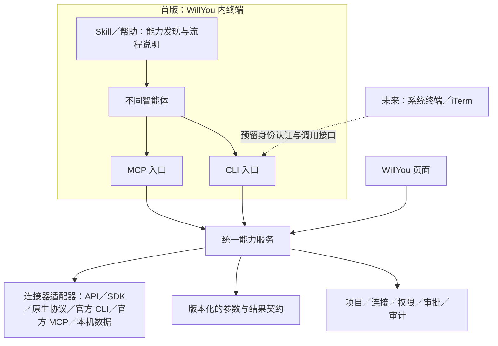

# F19-D · 应用接入标准与 CLI／MCP 双入口备忘

状态：2026-11-01 已承接为 [M11 应用接入标准化](里程碑/M11_应用接入标准化/README.md)，沿用需求池 F19-D。用户最新明确：应用以 Skill／SOP 指导 Agent，按应用声明选择 MCP 或 CLI；两种入口共用能力、权限和结果底座，上游官方 MCP／CLI 优先复用，产品继续称“应用”。首版服务 WillYou 内终端，未来系统终端／iTerm 的 CLI 使用只预留架构接口。具体阶段需求统一维护在 [M11 需求 R0.3](里程碑/M11_应用接入标准化/需求.md)，尚未开始生产开发。本文保留前期讨论与调研来源，不改变 M10 权威用例或验收范围。聊天中的“CRI”按前文命令行入口的上下文暂理解为 CLI。

2026-11-01 用户确认编号互换：应用接入标准化由原 M12 调整为 M11，定时任务由原 M11 顺延为 M12；开发分支仍为 `feature/0.1.0`。

用户最初要求先完成 [M10 测试](里程碑/M10_三方应用接入/README.md)，再决定本项具体实施方式；本轮要求按正式需求流程推进。下文是讨论与调研记录，详细规则和后续变更以 M11 需求为准，不维护第二份阶段业务基线。

## 已确认的原则

- 统一底层应用能力、权限和结果格式；应用提供由 Skill 承载的 SOP，Agent 按应用声明选择受管 MCP 或 CLI。最新澄清不强制 CLI 优先，两种入口均是正式支持目标。
- 同一操作共用业务实现、连接、项目作用域、审批及审计，避免两套业务逻辑分别演进。
- 底层适配按应用实际能力选择官方 API、SDK、CLI 或 MCP；本机邮件继续复用已验证的本地读取能力。
- 已有官方 MCP 可评估直接接入；需要纳入 WillYou 统一权限、结果和审批时，明确相应的能力映射与管理边界。
- 优先不修改官方 MCP／CLI 本身，在 WillYou 侧增加声明与适配；满足版本、认证、参数与结果条件时争取只配映射，有缺口时增加薄适配代码。上游接入方式与 Agent 入口分开。
- Nacos、Redis、RabbitMQ 是后续验证标准的候选对象，本文不表示已经接入或完成验证。

## 2026-11-01 确认的使用边界

- **首版面向 WillYou 内启动的终端与智能体。** 用户希望后续 Cloud Code 配 DeepSeek、Codex 等组合发现同一套应用 SOP／Skill，并按应用声明调用 MCP 或 CLI，使用同一套能力、授权和结果契约。实际 Agent／版本支持矩阵仍需验证。
- **外部终端只预留接口。** 将来可能从系统终端、iTerm 等通过 CLI 访问；本轮不实现外部登录、配对、后台常驻服务或独立运行。这项预留是设计约束，不是当前支持承诺。
- 后续外部 CLI 是连接正在运行的 WillYou，还是要求关闭窗口／退出应用后仍可使用，尚未决定；预留接口不自动包含常驻服务。首版设计以 WillYou 运行期间提供能力为建议边界。
- 任意智能体是扩展目标，不表示现有实现已自动适配所有 Runner。支持 MCP 的智能体需要配置交付与发现适配；通过 CLI 调用需要能够执行本地命令，并获得受管调用上下文及使用说明。两种入口都需要实际验证。
- 现有“真实 Agent 测试只用 Codex”的用户要求继续有效；此处讨论其他智能体不构成新增测试授权。

## 整体调整思路

将 **Agent 调用 WillYou 的入口** 与 **WillYou 连接三方系统的方式** 分开。前者按应用 SOP／声明选择受管 MCP 或 CLI；后者首批通用适配覆盖官方 MCP／CLI，既有 API、本机数据与 SMTP 服务继续复用。前期调研列出的 SDK、协议和事件等仍是其他可行接入方式，不表示全部纳入本期新增标准。



此图是建议结构，CLI 入口及外部终端接口尚未实现。权限与结果契约是统一能力服务的组成部分，每个入口都须执行；图中的分支不表示可以绕过权限直接访问适配器。Skill／帮助说明使用流程，执行与授权由实际服务完成。

命名确认：产品入口继续叫“应用”。技术讨论可用“连接器／适配器”指接入实现及能力声明；“连接”指一次具体配置，例如某个禅道地址、账号与环境。同一应用可配置多个连接。现有内部标识与存储兼容约定沿用，不因本次命名讨论更改。

## 接入方式调研：不只有 MCP 与 CLI

2026-11-01 核对官方资料后，能够确认存在下列接入方式。表格用于说明适配范围，不是本期全部实现清单，也不是互斥的协议分类：SDK 可以封装协议，CLI 可以调用 HTTP API，MCP 也可以使用 HTTP 传输。

| 方式 | 已核对事实与来源 | 对本标准的影响／建议 |
| --- | --- | --- |
| 直接调用服务 API | RabbitMQ 提供 [HTTP API](https://www.rabbitmq.com/docs/http-api-reference)；Nacos 3.2 分别提供 [Client API](https://nacos.io/en/docs/v3.2/manual/user/open-api/) 与 [Admin API](https://nacos.io/en/docs/v3.2/manual/admin/admin-api/) | 无需第三方先提供 MCP／CLI；按能力和部署版本选接口，不能把 Nacos 运行时单项读取当作完整管理接口 |
| 原生协议与 SDK | Redis 客户端通过 [RESP](https://redis.io/docs/latest/develop/reference/protocol-spec/) 通信；RabbitMQ 支持 [AMQP 等消息协议](https://www.rabbitmq.com/docs/protocols)；Nacos Client API 文档说明业务应用宜选 SDK | 允许连接器通过协议客户端或 SDK 实现能力；SDK 是封装方式，不另算一种网络协议 |
| 官方 CLI | [rabbitmqadmin](https://www.rabbitmq.com/docs/management-cli) 是 HTTP API 命令行客户端；Redis 提供 [redis-cli](https://redis.io/docs/latest/develop/tools/cli/) | CLI 常是已有接口的封装；是否复用取决于功能、版本、输出稳定性、认证和取消能力，不强制所有适配都启动命令行进程 |
| 官方／可信来源 MCP | [MCP 架构](https://modelcontextprotocol.io/docs/learn/architecture) 定义客户端／服务端及工具、资源等能力交换，并提供 stdio／Streamable HTTP 传输 | 可作为上游接入方式，也可作为 WillYou 对 Agent 的入口；两侧职责与身份需要区分，不能因工具可发现就认定已纳入统一权限 |
| 事件推送 | [GitHub Webhooks](https://docs.github.com/en/webhooks/about-webhooks) 可在事件发生时向订阅端投递数据 | 属于系统主动推送方向，和 Agent 主动调用互补；接收端可达性、订阅授权与后续任务触发需要另定范围，本期不实现 |
| 本机数据读取 | 仓库现有 [Foxmail 适配](../src/main/core/applications/providers/foxmail-source.ts) 读取本机账号目录、数据库元数据和邮件文件；发送另经 [SMTP 适配](../src/main/core/applications/providers/smtp.ts) | 继续作为连接器的一种实现，不要求 Foxmail 先提供 MCP 或 CLI |

行业命名参考：[Microsoft 自定义连接器](https://learn.microsoft.com/en-us/connectors/custom-connectors/) 同样围绕 REST／SOAP API 包装触发器与动作。“连接器”可用于多种系统接入，并不限定 MCP／CLI。

以上是文档与源码调研，不是对用户部署环境的连通性、兼容性或业务验收。Nacos 本次参考 3.2 文档、RabbitMQ 页面标注 4.4；实际接入仍需核对部署版本。未核实候选系统的 MCP 来源、版本与权限覆盖，不将其写成“官方 MCP 已可直接复用”。

## 现有 Foxmail／禅道可复用的基础

M10 已有 UI 与 Agent 共用的数据服务、连接和项目选用、稳定引用、资源分块、调用记录；MCP 包提供版本化的工具契约。禅道适配真实 API，Foxmail 适配本机数据，邮件发送另经 SMTP 与既有审批流程。

实现依据：[禅道数据服务](../src/main/core/applications/zentao-data-service.ts)、[应用控制器](../src/main/core/applications/controller.ts)、[工具调用与审计](../src/main/core/applications/activity-service.ts)。这些基础不等于外部 CLI 已完成授权或可独立运行。

现有 [私有应用 Broker](../src/main/core/applications/private-broker.ts) 已有宿主代次、运行绑定、单次启动票据及撤销机制；[桥客户端](../src/main/core/applications/bridge-client.ts) 用这些机制连接现有 MCP 通道。它们是复用候选，现有票据与桥实例绑定，不能直接作为未来通用 CLI 的公开认证接口。[Agent 适配器](../src/main/core/applications/agent-adapter-registry.ts) 也按平台、CLI 版本和固定快照校验，不能据此承诺所有终端智能体均已支持。

禅道原始字段与 UI 展示说明目前分开；固定 Agent v1 输出保留原结构。后续需明确 CLI／MCP 中原始值、可读名称、枚举说明、来源修订、完整性与缺项的表达方式，通过版本演进保持兼容，不能静默改变 v1。

## 为未来外部终端预留的边界

以下为架构建议，需要在正式技术方案中确定具体接口与字段；目前不新增代码接口、占位命令或数据库结构。

| 预留边界 | 首版设计应满足的约束 | 后续外部 CLI 扩展方向 |
| --- | --- | --- |
| 能力发现与执行 | CLI／MCP 都调用同一能力服务；业务接口不直接依赖 Electron 窗口对象、PTY 对象或某款 Agent 的配置格式 | 增加外部调用入口，复用能力、参数与结果契约 |
| 调用身份与上下文 | 服务端从有效受管身份解析项目、连接、权限上限及生命周期；命令中的项目参数只是选择请求，不产生授权 | 加入独立配对／登录及撤销流程，产生同样受校验的调用上下文；不伪造现有受管 run |
| 通信与宿主生命周期 | 通信层和业务执行分开；取消、超时、断连、宿主退出的结果明确 | 可评估复用运行中的 WillYou，或另设后台服务；不在本轮锁定实现 |
| 凭据、审批与结果 | 三方凭据继续由安全存储与连接服务管理；每次调用执行统一权限检查，写动作沿用相应审批，结果和错误有版本 | 外部终端使用自己的受限访问授权，不复制三方凭据或直接复用内部 MCP 启动票据 |

“只支持 WillYou 内终端”是首版支持范围，不能仅凭环境变量、当前目录或父进程名称判断授权。未来身份种类增加时仍须经过服务端验证；具体验证机制需代码分析与正式设计。上游官方 MCP／CLI 的复用也须明确能力映射、凭据及审批边界，才能对纳管能力承诺统一权限和结果。

## 前期契约清单（后续以 M11 需求为准）

| 方面 | 需要明确的内容 |
| --- | --- |
| 能力声明 | 应用与能力标识、版本、参数 schema、结果 schema、支持环境和第三方版本 |
| 上下文 | 经认证的调用身份、项目、连接、环境及应用资源范围，如 namespace／vhost；避免静默借用其他项目或生产环境 |
| 权限 | 逐项定义读写语义、调用身份及权限上限；CLI、MCP、页面执行同样的检查 |
| 凭据 | 复用安全存储；不把三方密码／Token 写进 Skill、命令参数或普通日志；首版受管身份与未来外部 CLI 认证分开，预留统一撤销语义 |
| 写操作 | 审阅内容、批准对象、固定修订、幂等、并发冲突，以及超时后结果未知的处理 |
| 结果 | 稳定机器字段、原始值与显示说明、来源／修订、完整性、分页、受控错误与可重试性 |
| CLI | 首版受管终端的命令交付与调用上下文；命令层级、帮助与能力发现、JSON stdout、诊断 stderr、退出码、取消与超时 |
| MCP | 工具发现与参数映射、第三方 MCP 版本／权限及结果适配；明确直连与纳管的边界 |
| 验收 | 同一操作跨入口核对数据、作用域、修订、错误、审批及审计；分别覆盖失败、恢复和撤销 |

建议形态示例，尚未实现：

```sh
willyou zentao bugs list --project demo --json
willyou nacos config get --project demo --env test --json
willyou rabbitmq queues list --project demo --env test --json
```

## 改动规模与尚未决定的边界

现有两项应用的业务适配预计以复用为主；CLI 命令、执行上下文、权限与审计接入是主要新增工作，整体属于中等规模框架补充。以下决定会显著影响工作量，尚不作工期承诺：

首版使用范围已按本轮确认收窄，不再将“是否立即支持独立终端”列为待决项。尚需明确：

1. 首批纳入标准的能力清单、读写范围、目标平台，以及旧工具契约的兼容策略。
2. 受管终端 CLI 的交付方式、身份校验与会话生命周期；不同 Agent 的能力发现及 MCP 配置交付方式。
3. 官方 MCP 哪些能力纳管、如何映射结果和权限；用户自行配置的直连与纳管能力如何区分。
4. 后续外部终端的认证／配对与后台服务方案；只作为扩展记录，不阻塞首版内部终端方案。

已建立 M11 需求、技研、界面影响与首批用例初稿，先确定接入标准与兼容边界，再验证受管 CLI 和上游适配机制。是否用一个真实新应用验证、首批 CLI 读写清单及目标平台，统一在 M11 评审；不因此直接接入生产系统。

本次调研来源见“接入方式调研”表。正式设计时再补逐能力的接口、输入输出、数据结构、状态、异常与验证方案，不把本文建议当作已经定稿的协议或实现。
