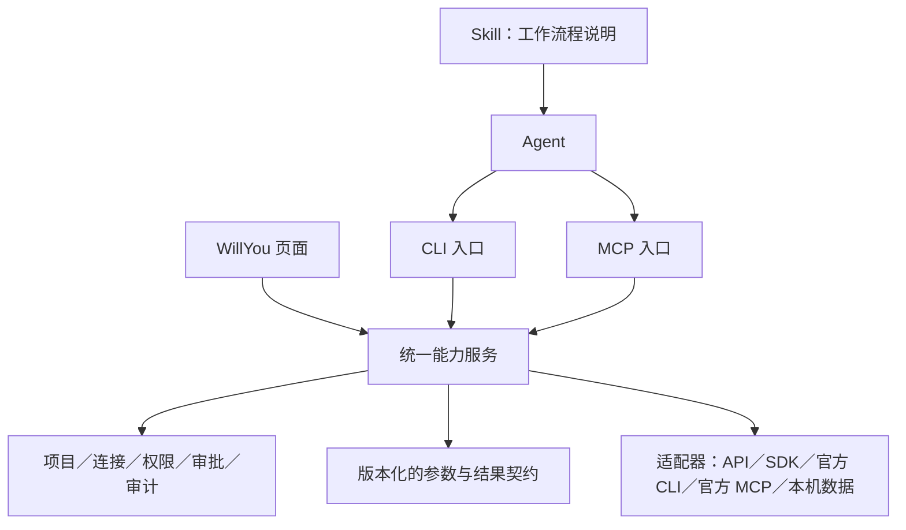

# F19-D · 应用接入标准与 CLI／MCP 双入口备忘

状态：2026-10-31 沟通备忘，原则已确认，细节待 M10 完成后评审；未安排 M 阶段、未授权实施。本文不改变 M10 R1.6＋§12.21 的需求、权威用例或验收范围。聊天中的“CRI”按前文命令行入口的上下文暂理解为 CLI。

用户要求先完成 [M10 测试](里程碑/M10_三方应用接入/README.md)，再决定本项具体实施方式。本次只保存讨论结果与待决边界。

## 已确认的原则

- 统一底层应用能力、权限和结果格式，同时提供 CLI 与 MCP 入口。
- 同一操作共用业务实现、连接、项目作用域、审批及审计，避免两套业务逻辑分别演进。
- 底层适配按应用实际能力选择官方 API、SDK、CLI 或 MCP；本机邮件继续复用已验证的本地读取能力。
- 已有官方 MCP 可评估直接接入；需要纳入 WillYou 统一权限、结果和审批时，明确相应的能力映射与管理边界。
- Nacos、Redis、RabbitMQ 是后续验证标准的候选对象，本文不表示已经接入或完成验证。



此图是建议结构，CLI 入口尚未实现。Skill 说明使用流程，CLI／MCP 提供调用入口，统一能力服务负责执行与权限判断。

## 现有 Foxmail／禅道可复用的基础

M10 已有 UI 与 Agent 共用的数据服务、连接和项目选用、稳定引用、资源分块、调用记录；MCP 包提供版本化的工具契约。禅道适配真实 API，Foxmail 适配本机数据，邮件发送另经 SMTP 与既有审批流程。

实现依据：[禅道数据服务](../src/main/core/applications/zentao-data-service.ts)、[应用控制器](../src/main/core/applications/controller.ts)、[工具调用与审计](../src/main/core/applications/activity-service.ts)。这些基础不等于外部 CLI 已完成授权或可独立运行。

禅道原始字段与 UI 展示说明目前分开；固定 Agent v1 输出保留原结构。后续需明确 CLI／MCP 中原始值、可读名称、枚举说明、来源修订、完整性与缺项的表达方式，通过版本演进保持兼容，不能静默改变 v1。

## 待细化的接入契约

| 方面 | 需要明确的内容 |
| --- | --- |
| 能力声明 | 应用与能力标识、版本、参数 schema、结果 schema、支持环境和第三方版本 |
| 上下文 | 项目、连接、环境及应用资源范围，如 namespace／vhost；避免静默借用其他项目或生产环境 |
| 权限 | 逐项定义读写语义、调用身份及权限上限；CLI、MCP、页面执行同样的检查 |
| 凭据 | 复用安全存储；不把密码／Token 写进 Skill、命令参数或普通日志；明确独立 CLI 的认证与撤销方式 |
| 写操作 | 审阅内容、批准对象、固定修订、幂等、并发冲突，以及超时后结果未知的处理 |
| 结果 | 稳定机器字段、原始值与显示说明、来源／修订、完整性、分页、受控错误与可重试性 |
| CLI | 命令层级、帮助与能力发现、JSON stdout、诊断 stderr、退出码、取消与超时 |
| MCP | 工具发现与参数映射、第三方 MCP 版本／权限及结果适配；明确直连与纳管的边界 |
| 验收 | 同一操作跨入口核对数据、作用域、修订、错误、审批及审计；分别覆盖失败、恢复和撤销 |

建议形态示例，尚未实现：

```sh
willyou zentao bugs list --project demo --json
willyou nacos config get --project demo --env test --json
willyou rabbitmq queues list --project demo --env test --json
```

## 改动规模与尚未决定的边界

现有两项应用的业务适配预计以复用为主；CLI 命令、执行上下文、权限与审计接入是主要新增工作，整体属于中等规模框架补充。以下决定会显著影响工作量，尚不作工期承诺：

1. CLI 首版仅供 WillYou 受管终端，还是覆盖独立终端／Neovim。
2. 独立 CLI 是否要求 WillYou 关闭后仍可使用；若需要，如何提供后台服务与独立授权。
3. 官方 MCP 是用户自行直连，还是由 WillYou 管理；哪些能力、结果与写动作纳入统一约束。
4. 首批只读能力、后续写动作、目标平台，以及旧工具契约的兼容策略。

建议 M10 完成后先确定边界，再为现有禅道／邮件补 CLI，以一个新应用验证标准，最后扩展更多应用。此顺序为待评审建议。

## 已查阅的官方资料与未核对项

- [MCP 架构](https://modelcontextprotocol.io/docs/learn/architecture)：客户端／服务端及工具调用协议。
- [RabbitMQ rabbitmqadmin](https://www.rabbitmq.com/docs/management-cli)：已有官方 HTTP API 命令行客户端，可作为适配候选。
- [Nacos 3.2 Client API](https://nacos.io/en/docs/v3.2/manual/user/open-api/)：客户端与管理接口的能力边界需按实际部署版本核对。
- Redis 的具体版本、官方接口／工具与 MCP 来源尚未核对；不预填“官方 MCP 已可直接复用”。

以上资料为方案参考，不代替实际部署、兼容性、安全或业务验收。
