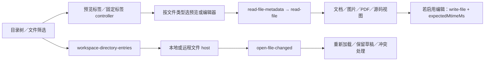

# M9 / F22-A 文件模块：REA 调研与迁移方案

更新日期：2026-10-16。状态：静态调研完成，用户已将文件工作区确定为 M9；尚未开发和运行验收。当前顺序为 M8 项目导入导出 → M9 文件工作区 → M10 定时任务 → M11 邮件／禅道／Jenkins，见 [里程碑规划](M8-M11_里程碑规划.md)。浏览器 F22-B 暂不指定里程碑。本文保留技术输入，本轮仅更新规划。

需求依据：[M9 文件浏览工作区需求](M9_文件浏览工作区.md)（2026-10-16 初稿，M9-R01–R09）、[需求池 F22-A](需求池.md)、[Codex 文件区域参考截图](design/f22/codex-file-browser-reference-20261016.png)。本文负责技术证据与迁移建议；产品范围、业务规则和最终验收要求在 M9 需求文档维护，后续技研发现须回到该文确认。浏览器方案独立保存在 [F22-B](F22B_内置浏览器_REA调研与迁移方案.md)，不作为本模块启动或验收的前置条件。

## 1. 可行性、范围与开发顺序

**文件模块可以在 SmartDD 现有 Electron／React 架构上实现。** Codex 的目录、搜索、文件标签、预览及文本编辑链已定位；Yoda 有可适配的目录服务、虚拟树、标签和预览基础。核心工作是接入 SmartDD 的多目录项目与任务目录，维护独立文件状态，并逐项对齐截图中的视觉和微交互。

| 层次 | 文件模块负责的内容 | 实施边界 |
| --- | --- | --- |
| 既有目标 | 右侧完整文件区域、目录树、文件筛选、多标签、面包屑、文档预览、源码查看、工具栏、外部打开、面板开合与调整 | 按 Codex 参考覆盖浅／深色、长文本、焦点、选中／悬停、滚动、空态和错误态 |
| 建议的先行闭环 | 本地目录 → 搜索定位 → 单击预览／双击固定 → 文档与源码切换 → 外部变更刷新 → 关闭／重开 | 独立于 PTY 与浏览器；浏览器未安装或未开发时也能完成全部闭环 |
| 完整功能目标 | 文件区域中已定位的编辑、自动保存、dirty 关闭、保存冲突，以及实际参考包含的文件格式与工具栏行为 | M9 按完整复刻目标形成逐功能矩阵；分步实现可以先交付浏览闭环，最终不能自行省略已确认的文件功能。远程主机与业务扩展仍按既有边界处理 |
| 与浏览器交接 | HTML 源码属于文件；隔离文档预览可作为文件专项能力；带地址导航的 HTML／localhost 页面属于浏览器 | 文档预览宿主与完整浏览器分别设计。未决定并验证 HTML 沙箱前保留源码／明确外开；文件模块不依赖完整 BrowserService |
| 既有排除 | Git 管理／状态展示、Codex 专有聊天及账户逻辑 | 源包中出现相关实现不改变 SmartDD PRD 的排除范围；F20 文档管理业务也不由本模块一并实现 |

**M9 的最终目标是完整复刻文件区域的功能、视觉和微交互。** 之前“只读先行”“编辑按需”的建议只可作为中间实施步骤，不再用于缩减 M9 最终范围；具体文件行为、支持格式和例外以实际参考逐项核对，缺证据就补查。M8 先行，M10／M11 接续；F22-B 保留后续，不是文件模块的前置条件。文件内部步骤见 §8，日程与应用版本另定。

## 2. 目标身份、方法与证据边界

### 2.1 实际检查的对象

| 对象 | 身份／版本 | 说明 |
| --- | --- | --- |
| 安装应用 | `/Applications/ChatGPT.app` | 名称是 ChatGPT，但 `CFBundleIdentifier=com.openai.codex`，包内 `productName=Codex`；这是本轮 Codex／ChatGPT 桌面壳目标，不是两个独立产品的对照实验 |
| 应用版本 | `26.1007.30912`，build `20156` | package 为 `openai-codex-electron`，声明 Electron `42.3.0`，同时存在 Owl 构建脚本及私有接口调用 |
| 输入 | `Contents/Resources/app.asar` | 567,757,587 bytes；SHA-256 `75e397e2280dde93b70a85aa926f4282c728eacc84dfeb15ba7fb6ddd84628af` |
| ASAR 边界 | 21,089 个文件成员 | 为定位模块，抽取 `.vite/build`、`webview/assets` 中的 JS／CSS 及 package 元数据；抽取不等于逐个分析 |
| Source map | ASAR 全成员清单中 `.map` 数量为 0 | JS 中的 `sourceMappingURL` 注释不代表源映射可用；原始 TypeScript 名称、目录与完整构建输入未恢复 |
| REA | `rea-agents 6.1.0`，skill v33 | 对选定原始模块做静态应用图及 feature trace；主进程和大型共享 bundle 结合 AST 格式化、精确调用点核对 |
| SmartDD／Yoda | 当前工作区／本地 Yoda `0.20.3` | 工作区包含既有未提交改动，源码快照见下文；复查方法见 [证据索引](design/f22/证据索引.md) |

本机还存在 ChatGPT Atlas，但它不是用户截图中的目标，本轮未展开该产品。没有读取用户会话文件、浏览历史、cookie、令牌或业务数据库；没有修改已安装应用或重启用户正在使用的 Codex。

### 2.2 如何理解证据

- **静态观察**：安装包中真实存在的函数体、参数、调用分支、常量及源码位置。证明代码结构，不能证明当前账号必然启用该分支。
- **静态推断**：经导入／导出、调用参数及消息分发关联得到的流程。REA 图中的 inferred 关系保持推断身份。
- **迁移建议**：为 SmartDD 重新设计的模块、接口、技术路线；不是声称 Codex 使用同一方案。
- **未知／未验证**：原生私有实现、运行时视觉与微交互、功能开关、平台表现。不得表述为已完全复刻。

REA 返回的应用图超过 MCP 10 MiB 传输预算时，使用同会话 retained Evidence 继续 trace；这是响应传输限制，不是分析结果被截断。另一方面，选定模块缺少完整依赖闭包，图的 coverage 仍为 partial，两者不能混淆。

证据入口见 [证据索引](design/f22/证据索引.md)。原始包片段、格式化代码和完整 REA JSON 留在 Git 忽略的 `release/f22-research/`；版本、文件哈希、边界与结论进入文档。

### 源码快照

| 对象 | 路径 / 版本 | 核对说明 |
| --- | --- | --- |
| SmartDD | `/Users/liubu/Documents/ChatGPT/SmartDD`；HEAD `7f75b3bea26ffe3d68a21a13d5a4af80581f6352`；`feature/0.0.1` | 工作区已有大量 M6/M7 等未提交改动，本文读的是当前工作区，行号可能随其他工作变化；不等同于只读该 HEAD 的内容 |
| Yoda | `/Users/liubu/Documents/ChatGPT/yoda`；HEAD `960fd3224508edc52fb7e99d9e8f8cf1723ad683`；package `0.20.3` | 本文列出的 fs/browser/editor/tab/window/package/license 主要检查路径在读取时没有工作区差异 |

下文 `S:` 表示 SmartDD 仓库根；`Y:` 表示同级 Yoda 仓库根；`文件:行号` 是本轮读取的精确入口，不是全部实现范围。

## 3. Codex 文件工作区怎样工作

详细模块、参数、常量和对应位置见 [文件实现证据](design/f22/Codex文件工作区实现证据.md)。下图描述从 UI 到文件服务的静态链路，省略了无关业务：



### 3.1 文件树不是扫描整个项目后一次性渲染

选定模块包含 `workspace-directory-entries` 查询、目录缓存、按需加载与虚拟化树。目录查询的 `staleTime` 为 5 秒；树行高 28px、字号 13px，支持 sticky folders。右侧树宽度有最小 200px、最大占父区域 60% 的约束。它们是此版本的局部实现参数，不是整张截图全部尺寸已经测量完毕。

筛选链实际调用 `fuzzyFileSearch/sessionStart → sessionUpdate → sessionStop`，订阅更新／完成事件，不支持会话时退回单次查询；它与树的目录懒加载分开。搜索排除 node_modules 等目录，但普通树仍可展示它们。客户端链路已定位，后端模糊匹配算法未展开。迁移时先接 SmartDD 的 `projectDirs` 和任务实际 `cwd`；列表、搜索、文件打开统一带根目录身份，不能只对当前已加载节点做字符串过滤后就声称等价。

### 3.2 预览标签与固定标签有不同语义

单击文件用于预览，双击将它固定；标签复用和文件去重由资源标签状态控制。它与“左侧换任务”是两个维度。SmartDD 应新增资源标签 store，保持中央任务终端常驻；关闭文件只释放该文件的模型、watch 与 UI，不结束 CLI。

截图包含多个 `index.html` 标签，但静态截图本身不能判定每一个是源码、静态 HTML 预览还是浏览器页面。后续要保留资源类型标识，不能只按相同显示名合并标签。

### 3.3 文档预览背后还有编辑与冲突状态

此版 Markdown 链路包含 CodeMirror；源码视图走 Pierre editor 相关实现。发现草稿延迟、自动保存、文件大小限制、基于 `expectedMtimeMs` 的保存版本校验和外部变更通知，具体边界见文件附录。

这说明完整迁移至少要区分 `loading / ready / dirty / saving / conflict / missing / unreadable / too-large`。若中间阶段只提供只读预览，要在验收清单中留下编辑与保存差异；M9 完成验收需补齐实际参考中的文件功能，不能以只读 Markdown 看起来相似宣称整个区域复刻完成。也无需为了还原外观先复制 Codex 的编辑器内部代码：可在许可明确的组件上重新实现相同用户行为。

### 3.4 类型路由补查：文件模块可以独立做到哪里

本轮新增两次聚焦分析和两次 trace，补足上一版未展开的类型分发。证据、原始字节锚点、限制与具体分支见[文件类型路由补充证据](design/f22/文件类型路由补充证据.md)，不是运行验收结果。

| 类型 | 补查得到的 Codex 静态事实 | 文件阶段的迁移处理 |
| --- | --- | --- |
| Markdown／文本／代码 | 按扩展名、语言、contentKind、显式查看器与行号等条件路由；Markdown 有富预览／源码，未知文件不一定进入编辑器 | 文件模块独立实现；区分可读文本、只读、二进制和错误，不按扩展名硬套 |
| 图片／SVG | 二进制和 MIME 构造 data URL，以 img 呈现；SVG 另有源码路径；TIFF 被上层明确列为不支持 | 可独立实现图片与源码，实际格式逐项验收；不用将 SVG 原文注入应用 DOM |
| PDF | 有独立 PdfPreviewPanel、页面 canvas／text／annotation 层及 PDF worker | 不需要先有完整浏览器。可比较 Codex 独立 renderer 与 Yoda embed 方案，在 A0 验证 worker、CSP、大文件与交互再选型 |
| 本地 HTML 源码 | 普通文件入口 browserEnabled 默认 false；浏览器委派还取决于 host、打开意图及功能参数 | HTML 源码不依赖 F22-B；显式网页打开单独交接 |
| HTML 文档预览 | 某些 cloud／文本附件路径进入 visualization sandbox；正常 wrapper 使用 codex-sandbox 的专用 webview，并有执行／网络策略 | 可作为文件专项能力，不必等完整浏览器；需要自有隔离宿主、协议、资源与生命周期，不能简单插入 React 区域或复制账号策略 |
| 未知二进制／归档 | 可能显示 unsupported，也可能在本地普通打开时转文件管理器 | 提供明确不支持态及外开，不承诺任意文件可预览或编辑 |

HTML 文档路径还存在分别按 UTF-8 bytes 和 UTF-16 code units 判断的限制，且自定义加载与普通读取的检查不同；具体边界见补充证据，不能把文本编辑的 10／20 MiB 阈值统一套到全部文件。截图中的多个 index.html 标签仍不能只凭名字判定走了哪条路线。

A0 应为每种格式列出“源码／静态富预览／隔离文档／外部或浏览器打开”的明确支持状态。首批是否加入隔离 HTML 文档由范围和探针结果确定；其独立宿主成本不等于整个 F22-B 的开发成本，也不应因此直接从完整文件区域目标中删除。

## 4. SmartDD 的落点与状态边界

以下是已检查的源码入口；行号属于本轮工作区快照，实施前按符号重新定位。

| 落点 | 现有源码 | 文件模块如何接入 |
| --- | --- | --- |
| 项目多目录 | `S:src/main/db/schema.ts:62` 的 projectDirs；`S:src/main/core/projects/dir-status.ts:41` 的 realpath 身份 | 从 projectId + dirId 获取可信根，不另造项目根模型 |
| 任务实际目录 | `S:src/shared/tasks.ts:13`；`S:src/main/core/tasks/task-service.ts:139`、`:157` | 任务页优先使用任务 cwd；项目路径后来改变时明确提示差异，不静默改根 |
| 文件 RPC | `S:src/shared/ipc/rpc.ts:16`；`S:src/main/rpc.ts:36`；`S:src/preload/index.ts:4` | 注册 files 领域；当前 RPC 丢弃 _event，需让受限入口得到发送方身份后签发根句柄，TypeScript 类型不是运行期授权 |
| 工作区容器 | `S:src/renderer/lib/layout/workspace.tsx:71`、`:81` | 保持 TaskView keepMounted，在其旁边加文件工作区 |
| 标签关闭 | `S:src/renderer/core/tasks-store.ts:140` | 当前关闭任务会结束会话；新增文件关闭 action，不能复用该动作 |
| 终端尺寸与焦点 | `S:src/renderer/views/task-view.tsx:155`、`:208`；`S:src/renderer/lib/ui/resizable.tsx:46` | 分栏拖动只触发 fit/resize，保留焦点，不新建 PTY |
| CSP／资源 | `S:src/renderer/index.html:5` | Markdown 图片、SVG、PDF、代码 worker 分别定义资源策略；主应用不执行文档中的任意脚本 |
| 平台路径 | `S:src/shared/projects.ts:53` 当前要求以 `/` 开头 | 首先验证 Mac；Windows 驱动器和 UNC 要单独适配与验收 |

当前 `capabilities/files.ts` 用于 Skill 部署，不是文件浏览服务，不能直接作为用户文件读取入口。文件名搜索应由主进程覆盖整个所选根；仅过滤已加载树节点会漏掉折叠目录下的文件。

建议首期资源标签只实现 file 类型，后续再注册 browser 类型，共享容器不依赖 BrowserService。标签、目录树、文件 buffer、watch 各有自己的生命周期。

```ts
// 迁移设计草图，不是现有 API。
type FileTab = {
  id: string;
  kind: 'file';
  rootId: string;
  relativePath: string;
  mode: 'preview' | 'source';
  pinned: boolean;
  scrollTop: number;
};
```

去重键包含根目录身份与规范化相对路径；同名文件不能跨项目合并。浏览器以后接入时采用独立 tabId，URL 不作为文件路径或文件去重键。

## 5. Yoda 文件能力：可复用单元与不可直接照搬之处

### 5.1 文件树和文件系统

| 源码入口 | 源码观察 | SmartDD 适配要求 |
| --- | --- | --- |
| `Y:src/main/core/fs/types.ts:9`、`:186`、`:277` | FileSystemProvider 抽象包含读、列表、搜索、watch；本地和 SSH provider 分离 | 首期可只做本地 provider，保留接口形状；SmartDD 的服务器配置不等于 Yoda 的远程工作区模型，不应默认把 SSH 浏览也算已迁移 |
| `Y:src/main/core/fs/impl/local-fs.ts:196` | `resolvePath` 做路径规范化与字符串前缀范围检查 | 可参考结构，但它不是完整符号链接边界。SmartDD 应额外比较 root/目标 realpath，明确目录内 symlink 指到目录外的行为；不把这段检查当成现成沙箱 |
| `Y:src/main/core/fs/impl/local-fs.ts:255` | list 默认最多 10,000 项、30 秒预算，可取消；返回 truncated/reason | 保留分页/截断/取消的可见状态；不要让巨大目录阻塞主线程，不能静默显示不完整结果 |
| `Y:src/main/core/fs/impl/local-fs.ts:359` | 文本读取默认 200 KiB，超过时读前缀并返回 `truncated/totalSize` | 显式提供“大文件只读预览/外部打开”，不能把被截断内容保存覆盖回原文件 |
| `Y:src/renderer/features/tasks/editor/stores/files-store.ts:24` | nodes 与 childIndex map；`:128` loadDir；`:163` 单层异步读取，已加载/请求中去重 | 拆出不依赖 Yoda `Resource`、workspace store 的 SmartDD `FileTreeStore`；当前只读浏览不需移入完整 worktree/provider 系统 |
| `Y:src/renderer/features/tasks/editor/editor-file-tree.tsx:35` | 单击文件预览，双击固定打开，目录展开时才加载 | 可作为交互候选，最终以 Codex 实测为准。键盘 Enter/Space 已有，完整方向键树导航仍需核对/补齐 |
| `Y:src/renderer/features/tasks/editor/editor-file-tree.tsx:152` | `@tanstack/react-virtual`，行高估计 28，overscan 10；`:31` 从 Git 状态读标记 | 虚拟化算法可复用，但 28px 等 Yoda 数值不能代替 Codex 视觉规格。Git 标记仅作参考实现观察；SmartDD PRD §2.2 明确排除 Git 功能，本方案不增加 Git 状态接口 |
| `Y:src/renderer/features/tasks/editor/stores/files-store-utils.ts:8` | 默认隐藏多种产物与配置目录；`:81` 目录优先排序；`:95` 展开集合转可见平面列表 | 排序/展平可复用。排除清单与截图冲突，改为可见性策略；“隐藏文件/遵守忽略文件/筛选名称”应分别建模 |
| `Y:src/main/core/fs/controller.ts:691` | 每个 project/workspace 一份 watcher，按 label 合并消费者路径，最后消费者退出时 close | SmartDD 可以按 canonical root 共享 watcher，消费方必须有 owner token，防止多个窗口同名 label 互相停掉监听 |
| `Y:src/main/core/fs/impl/local-fs.ts:774`、`:941`、`:991` | 原生 `@parcel/watcher`、200ms 稳定窗口、有上限事件队列与强制 flush、异步 subscribe 后关闭处理 | 可参考事件合并、背压和销毁竞态。此原生依赖会增加 Mac arm64/x64、Windows、Linux 的打包验证项，不能当纯前端依赖 |

筛选需要独立设计：只过滤当前已加载 nodes 会漏掉折叠目录下的文件。建议显式区分“当前目录列表筛选”和“项目内文件名搜索”，后者由 main 异步遍历或索引、取消过期请求、返回路径与截断状态。不要把 Yoda 内容搜索接口不加区分地当截图的文件名筛选。

### 5.2 标签、预览和模型

| 源码入口 | 源码观察 | SmartDD 适配要求 |
| --- | --- | --- |
| `Y:src/renderer/features/tasks/tabs/file-tab-store.ts:17` | 文件 tab 有稳定 tabId、path、isPreview、fileKind、renderer、pendingReveal；`:102` 预览替换保留 tabId | 独立资源标签可以直接借鉴数据结构，不混入 SmartDD 会话 tab；路径 key 至少包含 root identity |
| `Y:src/renderer/features/tasks/tabs/tab-manager-store.ts:688`、`:718`、`:742`、`:801` | 普通打开、侧栏固定、侧栏预览、预览替换；已有文件去重，脏预览升级为固定标签 | 可拆出小型 `ResourceTabStore`；原类含 conversation/diff/top-level/shell pin 等大量 Yoda 业务，整类复制会扩大范围。其 top-level 路由尚无同等 preview 语义，不能笼统称全部场景完备 |
| `Y:src/renderer/features/tasks/editor/stores/file-model-lifecycle-store.ts:18`、`:68` | 通过较小 FileTabsHost 接口监听打开路径，注册/释放 Monaco 模型；保存/冲突另有方法 | 若只做浏览，可先采用只读文本视图；如加入编辑，再引入 buffer/version/dirty/conflict 生命周期。截图“查看源代码”不能自动解释成可写编辑需求 |
| `Y:src/renderer/lib/editor/fileKind.ts:55` | image/svg/markdown/pdf/binary/text 分类；未知扩展名进入 text | 需要增加实际内容探测/编码错误状态；HTML、Office、音视频不能从这里推断得到专用预览 |
| `Y:src/renderer/lib/editor/markdown-renderer.tsx:25`、`:43` | 渲染 Markdown，源码切换，按文件所在目录读取相对图片 | 可以拆出渲染与图片解析，但原实现依赖 Monaco modelRegistry、task context、会话批注等；SmartDD 可将 `content/sourcePath/resolveAsset/onOpenLink` 作为明确 props |
| `Y:src/renderer/lib/ui/markdown-renderer.tsx:3`、`:150`、`:483` | react-markdown + GFM；full 变体 raw HTML 后经 rehype-sanitize；自定义组件及批注 | 可参考清洗链路。迁移时要检查自定义 URL/图片行为和 CSP；不需要为了只读预览引入 Yoda 批注系统 |
| `Y:src/renderer/lib/editor/svg-renderer.tsx:24`、`:36` | SVG 编成 data URL，用 img 显示并能切换源码 | 不直接插入原始 SVG DOM；按相同边界处理资源 URL |
| `Y:src/renderer/lib/editor/pdf-renderer.tsx:8` | Chromium 内置 PDF viewer，data URL `<embed>` | 需要在实际打包 Electron 中验证 viewer、滚动、快捷键、CSP 与大文件内存；不能仅凭组件存在确认全部平台可用 |
| `Y:src/main/core/fs/impl/local-fs.ts:691`、`:720` | 图片/PDF 读取为 base64 data URL；图片限 10 MiB、PDF 限 50 MiB | 可作为限制参考；大二进制跨 IPC 会复制和膨胀，建议评估受限自定义资源协议/临时 URL，主进程按 root 权限解析 |

## 6. 文件服务、标签与终端的迁移设计

### 6.1 文件接口与新增位置

建议新增位置：

- `src/shared/workspace-files.ts`：目录作用域、文件元数据、预览结果、watch 事件与错误码。
- `src/main/core/files/controller.ts`：注册 typed RPC，校验参数；不提供无约束的任意绝对路径读取。
- `src/main/core/files/file-service.ts`：通过 ProjectService/TaskService 解析可信目录；规范化、realpath 检查、大小限制、读取/筛选/外部打开。
- `src/main/core/files/watch-registry.ts`：共享 watcher，按窗口/消费者生命周期释放，合并事件，根目录消失时发送明确失效事件。
- `src/renderer/features/workspace-files/`：FileTreeStore、FileTree、FilePreview、Breadcrumbs；不依赖 PTY 生命周期。
- `src/renderer/core/resource-tabs-store.ts`：文件资源标签；与 TasksStore 独立，后续通过类型扩展接入浏览器。

建议接口草图，非现有 API：

```ts
type RootRequest =
  | { kind: 'project-dir'; projectId: string; dirId: string }
  | { kind: 'task-cwd'; taskId: string };

type FileRef = { rootId: string; relativePath: string };
type ReadPreviewResult = {
  kind: 'text' | 'markdown' | 'image' | 'svg' | 'pdf' | 'binary'; // HTML 源码先按 text；可选沙箱另增 renderer 契约
  content?: string;
  resourceUrl?: string;
  byteLength: number;
  truncated: boolean;
  version: string;
};

// rootId 为 main 签发并绑定当前宿主的 opaque id，不是任意绝对路径。
files.openRoot(request: RootRequest): Promise<RootHandle>;
files.list(rootId, relativeDir, options): Promise<ListResult>;
files.searchNames(rootId, query, requestId): Promise<SearchResult>;
files.readPreview(file: FileRef): Promise<ReadPreviewResult>;
files.watch(rootId, consumerId): Promise<WatchHandle>;
files.unwatch(watchId): Promise<void>;
files.closeRoot(rootId): Promise<void>;
files.revealInSystem(file: FileRef): Promise<void>;
```

异步结果必须携带 rootId/requestId；切项目或快速换文件后，旧请求结果不能覆盖当前视图。watch 应先订阅再建立/校对初始快照，避免扫描与订阅之间漏变更。目录根因项目配置变更而失效时，应主动关闭旧资源或提示重新选择，不能继续把旧授权用于新路径。重启恢复描述符保存 `RootRequest + relativePath + 展示状态`；临时 rootId 不作为持久化权限，恢复时重新解析目录并签发。SmartDD 一个项目可以有多个目录，仅存 projectId 与 relativePath 不足以标识文件。

### 6.2 与中央终端并排

建议保持 `Workspace → MainContent → TaskView` 原有常驻链，在右侧新增 ResourceWorkbench。其内部是资源标签/工具栏/文件预览，最右可以展开文件树。比例和是否允许最大化应跟 Codex 证据核对后实现。

关键不变量：

- 同一 PTY 只保留一个输入/尺寸权威实例；资源标签不新建 PTY，不重放终端历史，也不改变会话恢复。
- 切换文件、预览/源码、文件树开合，只改变资源状态；终端 key 仍是 ptyId。
- 终端容器变化后 fit/resize；隐藏尺寸为 0 时不向后台发 0×0。现有 `fitAndSync` 已有零尺寸保护，但高频拖动建议按帧合并并跳过未变尺寸。
- 现有 `TaskTerminal` 在 visible 变化时会 focus；新增面板后的自动聚焦要加“当前焦点仍属于任务/终端”条件，避免用户刚进入文件搜索框就被抢走焦点。
- 资源关闭 action 不调用 `tasksStore.closeTab`；停止任务也不必默认关闭只读文档，二者生命周期按产品规则分别定义。

Yoda 的 `Y:src/renderer/lib/pty/terminal-relayout.ts:4` 解释了另一类情况：终端换 host 但尺寸相同，ResizeObserver 未必触发。SmartDD 若采用“不搬移 TaskTerminal，仅调整兄弟区域”的布局，可减少此类复杂性。

## 7. 文件模块依赖与来源

本地 Yoda `package.json:5` 声明 Apache-2.0，`LICENSE.md:1` 记录 LovStudio 与 General Action 版权；SmartDD `NOTICE:3`、`:31` 已记录 Yoda 来源并保存许可全文。后续改编时，按实际移入文件更新来源声明与修改说明；本次只读研究没有复制 Yoda 功能代码，也不需要把“调研过的所有文件”声明成已移入实现。

| 候选依赖 | Yoda 声明版本/位置 | SmartDD 当前情况与建议 |
| --- | --- | --- |
| Electron / React / MobX | `Y:package.json:136`、`:168`，MobX 同 package | SmartDD 已有同代主要框架；复用现有依赖，不升级整套工具链 |
| `@tanstack/react-virtual` | `^3.13.23`，`Y:package.json:105` | SmartDD 未声明；文件树大列表可评估添加 |
| `@parcel/watcher` | `^2.5.6`，`Y:package.json:200` | SmartDD 未声明；新增原生依赖需覆盖所有打包目标，优先做小范围监听/负载探针再定 |
| Monaco / React adapter | `monaco-editor ^0.55.1`、`@monaco-editor/react ^4.7.0`，Yoda package | SmartDD 未声明；M9 按真实文件编辑、搜索、行号与大文件行为选择必要组件，不连带复制 Yoda 全部编辑业务 |
| Markdown 链路 | react-markdown `^10.1.0`、remark-gfm `^4.0.1`、rehype-raw `^7.0.0`、rehype-sanitize `^6.0.0`，`Y:package.json:172` 起 | SmartDD 未声明；只移入必要渲染/清洗依赖，不连带批注、会话笔记与完整 Monaco store |
| 图标 | devicon `^2.17.0`，`Y:package.json:132`；SmartDD 已有 lucide | 文件类型图标需要按实际资源逐项核对来源。Yoda 图标不是 Codex 像素一致证明 |

以上是**本地 package 声明范围**，不是已解析的安装版本。本机 Yoda 对应 `node_modules` 包不存在，未逐一核验这些第三方包的实际许可文件；开发选包时需读取锁定版本的 LICENSE/NOTICE 并更新分发清单。不要把 Yoda 顶层 Apache-2.0 直接推定为所有依赖、字体、图标的许可。

Codex/ChatGPT 私有 bundle 的调研用于理解布局、事件和接口边界；本文没有提出复制其整段专有实现、品牌资源、登录数据或私有服务调用。SmartDD 功能实现应由自有代码和可明确复用的开源部件组成。

## 8. 文件模块独立实施与验收

以下是 M9 的分步开发清单，尚未执行，不要求先完成 F22-B。A1／A2 等子步骤完成不能替代 M9 完整功能与视觉验收。

| 阶段 | 工作内容 | 完成判据 |
| --- | --- | --- |
| A0 文件准备与原型 | 按真实参考列出文件格式、编辑行为和所有功能状态；对齐整个文件区原型；验证大目录、watch、资源 URL 与 PDF 等候选承载 | 选型有隔离样本证据；每种格式和编辑操作有对应参考及验收用例；无法确认的行为补查并记录差异 |
| A1 目录与标签 | 可信 root、懒加载、文件名搜索、取消、虚拟树、面包屑、预览／固定／去重、标签关闭 | 隐藏文件及截图可见节点可达；跨根同名文件正确；乱序结果不覆盖当前视图 |
| A2 文档与源码 | 文本／Markdown／图片预览、源码切换、相对资源、外部打开；PDF、隔离 HTML 文档预览等按 A0 范围与实测结果加入 | 未验证的 HTML 执行仅提供源码／外开；采用文档沙箱时单独验收协议、资源、脚本与权限；大文件不静默截断为完整内容 |
| A3 连续性与完整视觉 | 文件变更、删除／重命名、根失效、位置恢复；浅深色、工具栏、菜单、拖动、焦点和全部确认微交互 | 原型与安装后的 App 同步核对；切任务、关文件、收面板均不重启终端；剩余差异逐项列出 |
| A4 编辑与保存闭环 | draft／base／revision、手动与自动保存、冲突、dirty 关闭、外部同时修改 | 不覆盖未确认的外部版本，不丢 draft；只读／截断内容不得保存覆盖原文件 |

必要测试覆盖：

- 路径：中文、空格、长路径、多根、`..`、绝对路径、编码路径、symlink 指向根外、根移动／删除及项目配置变化。
- 规模与竞态：万级文件、快速展开／折叠、搜索取消与乱序、watch 事件风暴、读取中删除、大文本与二进制；记录内存和主进程延迟。
- 标签：预览替换、固定标签不被替换、已开文件复用、滚动位置、异步 before-close 的旧实例保护；编辑项按最终范围执行。
- 终端：运行输出、等待输入和中文输入时切文件／拖面板／弹菜单；无 PTY 重启、焦点抢夺、丢输入和零尺寸写入。
- 格式：Markdown 相对图片与链接、SVG、未知编码、PDF 大文件与滚动；HTML 源码／外开与可选文档沙箱分别验证，带地址导航的网页属于 F22-B。
- 真实交付：从打包安装后的应用验证；Mac 通过不代表 Windows／Linux 已通过。新增原生 watcher 要加入对应构建检查。

可参考 Yoda 的 `src/main/core/fs/impl/local-fs.test.ts`、`src/main/core/fs/controller.test.ts`、`src/renderer/features/tasks/tabs/tab-manager-store.test.ts`、`src/renderer/features/tasks/editor/stores/file-model-lifecycle-store.test.ts`。这些仅是已有测试思路，未在 SmartDD 执行。

## 9. 未确认点与处理方式

| 未确认点 | 类型 | 后续处理／是否阻塞文件模块 |
| --- | --- | --- |
| 文件类型分发及 HTML 与 browser 的连接 | 本轮已补查静态链路，运行未验证 | Markdown／图片／PDF 可独立；HTML 源码、专用文档沙箱和完整浏览器分别处理，见 §3.4；内容嗅探全部规则和真实渲染仍待验证 |
| 模糊搜索后端具体排名算法、树底层所有键盘行为 | 源包内部实现尚未完整追踪 | 可继续 REA 沿客户端边界核对；初版搜索可用自有实现，不能宣称排序完全等价；键盘行为需运行核对 |
| 实际文件格式、编辑行为、任务与项目间状态映射 | 参考核对与 SmartDD 适配 | M9 完整复刻目标已确定；在 A0 将参考行为逐项落实，明确项目映射，未确认行为继续取证，不自行缩成只读浏览 |
| watcher／大文件阈值、PDF 承载、资源协议与 CSP | SmartDD 技术验证 | 在 A0 用隔离样本验证；无需等待浏览器宿主选型 |
| 全部像素、图标授权、菜单和动效、IME | 运行或资源证据 | 按 Codex 参考补测，记录来源和差异；静态常量不足以证明完全一致 |
| 保存原子性与跨平台路径／监听 | 自有实现和平台验证 | M9 编辑闭环须验证写入和冲突；各平台分别验收，不能把 Codex mtime 比较当原子写入保证 |

文件证据入口：[目录／标签／编辑链](design/f22/Codex文件工作区实现证据.md)、[源模块定位](design/f22/file-source-locations.json)、[统一证据索引](design/f22/证据索引.md)。只在同版本、同哈希下沿用原始偏移和混淆符号；新版本需要重新确认。此文可以独立指导文件模块准备与实施，不要求先阅读浏览器方案。
