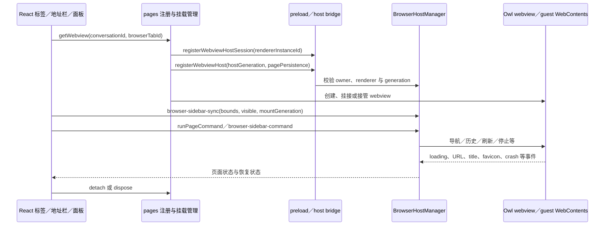

# F22-B 内置浏览器：REA 调研与迁移方案

更新日期：2026-10-16。状态：静态调研完成，保留后续需求；尚未开发、选型验证和运行验收。最新 [当前阶段规划](里程碑/README.md) 已确定 M8 项目导入导出、M9 文件工作区、M10 三方接入（禅道／邮件）、M11 应用接入标准化、M12 定时任务；Jenkins 留后续；浏览器暂不分配里程碑，不排入 M9 与 M10 之间，也不阻塞文件模块。

需求来源：[需求池 F22-B](需求池.md)，早期背景见 [PRD §8.9](SmartDD_V0.2_PRD.md)。本文为技研资料，浏览器尚未分配 M；后续确定阶段时另建独立 M 需求文档并引用本文。用户截图直接展示的是文件区，浏览器实际页面、交互和全部视觉状态仍需补充运行参考。本次只拆分文档与补查证据，不接入浏览器功能。

## 1. 可行性、范围与开发顺序

**SmartDD 可以实现内置浏览器；Codex 的整套浏览器后端不能直接复制。** 基础网页浏览可由标准 Electron 承担，Codex 已定位的主路径则使用带 Owl 扩展的托管 webview。导航、状态、权限及生命周期可以重新实现，专有的页面接管、克隆与恢复语义需逐项验证。

| 层次 | 浏览器模块负责的内容 | 实施边界 |
| --- | --- | --- |
| 基础浏览 | 网页标签、地址栏、前进／后退、刷新／停止、加载与错误、外部打开、开发站点预览 | 与终端及文件区并排；不因切任务丢失约定保留的网页状态 |
| 完整基础宿主 | guest 生命周期、登录态策略、弹窗、权限、下载、崩溃与恢复、焦点、几何和遮挡 | 需要专门 BrowserService 与标准 Electron 探针，不能仅添加网页元素 |
| 文件交接 | 带地址导航的 HTML 页面、localhost 与网页链接 | 接收文件模块显式打开请求；隔离 HTML 文档预览可留在 F22-A 专项实现；网页不获得应用文件 RPC |
| 高级能力 | 跨窗无损接管、完整页面现场恢复、Agent／MCP 控制、设备模拟、注释等 | 单独定义目标和证据；不自动纳入基础浏览或文件模块交付 |

复杂度：基础浏览中高，完整复刻高。文件模块安排在 M9；浏览器自身阶段尚未指定，实施时再做 B0 承载验证，不为此阻塞 F22-A。所有方案均属待实施设计，不代表已通过运行测试。

## 2. 目标身份、方法与证据边界

### 2.1 实际检查的对象

| 对象 | 身份／版本 | 说明 |
| --- | --- | --- |
| 安装应用 | `/Applications/ChatGPT.app` | 名称是 ChatGPT，但 `CFBundleIdentifier=com.openai.codex`，包内 `productName=Codex`；这是本轮 Codex／ChatGPT 桌面壳目标，不是两个独立产品的对照实验 |
| 应用版本 | `26.1007.30912`，build `20156` | package 为 `openai-codex-electron`，声明 Electron `42.3.0`，同时存在 Owl 构建脚本及私有接口调用 |
| 输入 | `Contents/Resources/app.asar` | 567,757,587 bytes；SHA-256 `75e397e2280dde93b70a85aa926f4282c728eacc84dfeb15ba7fb6ddd84628af` |
| ASAR 边界 | 21,089 个文件成员 | 为定位模块，抽取 `.vite/build`、`webview/assets` 中的 JS／CSS 及 package 元数据；抽取不等于逐个分析 |
| Source map | ASAR 全成员清单中 `.map` 数量为 0 | JS 中的 `sourceMappingURL` 注释不代表源映射可用；原始 TypeScript 名称、目录与完整构建输入未恢复 |
| REA | `rea-agents 6.1.0`，skill v33 | 对选定原始模块做静态应用图及 feature trace；主进程和大型共享 bundle 结合 AST 格式化、精确调用点核对 |
| SmartDD／Yoda | 当前工作区／本地 Yoda `0.20.3` | 工作区包含既有未提交改动，源码快照见下文；复查方法见 [证据索引](design/f22/证据索引.md) |

本机还存在 ChatGPT Atlas，但它不是用户截图中的目标，本轮未展开该产品。没有读取用户会话文件、浏览历史、cookie、令牌或业务数据库；没有修改已安装应用或重启用户正在使用的 Codex。

### 2.2 如何理解证据

- **静态观察**：安装包中真实存在的函数体、参数、调用分支、常量及源码位置。证明代码结构，不能证明当前账号必然启用该分支。
- **静态推断**：经导入／导出、调用参数及消息分发关联得到的流程。REA 图中的 inferred 关系保持推断身份。
- **迁移建议**：为 SmartDD 重新设计的模块、接口、技术路线；不是声称 Codex 使用同一方案。
- **未知／未验证**：原生私有实现、运行时视觉与微交互、功能开关、平台表现。不得表述为已完全复刻。

REA 返回的应用图超过 MCP 10 MiB 传输预算时，使用同会话 retained Evidence 继续 trace；这是响应传输限制，不是分析结果被截断。另一方面，选定模块缺少完整依赖闭包，图的 coverage 仍为 partial，两者不能混淆。

证据入口见 [证据索引](design/f22/证据索引.md)。原始包片段、格式化代码和完整 REA JSON 留在 Git 忽略的 `release/f22-research/`；版本、文件哈希、边界与结论进入文档。

### 源码快照

| 对象 | 路径 / 版本 | 核对说明 |
| --- | --- | --- |
| SmartDD | `/Users/liubu/Documents/ChatGPT/SmartDD`；HEAD `7f75b3bea26ffe3d68a21a13d5a4af80581f6352`；`feature/0.0.1` | 工作区已有大量 M6/M7 等未提交改动，本文读的是当前工作区，行号可能随其他工作变化；不等同于只读该 HEAD 的内容 |
| Yoda | `/Users/liubu/Documents/ChatGPT/yoda`；HEAD `960fd3224508edc52fb7e99d9e8f8cf1723ad683`；package `0.20.3` | 本文列出的 fs/browser/editor/tab/window/package/license 主要检查路径在读取时没有工作区差异 |

下文 `S:` 表示 SmartDD 仓库根；`Y:` 表示同级 Yoda 仓库根；`文件:行号` 是本轮读取的精确入口，不是全部实现范围。

## 3. Codex 内置浏览器怎样工作

详细底层证据见 [浏览器宿主实现证据](design/f22/Codex浏览器宿主实现证据.md)。重要结论是：**主浏览区域的真实创建链是托管 `<webview>` guest，带 Owl 扩展；不是因为 bundle 中出现 `WebContentsView` 就认定主浏览器采用了它。**

### 3.1 分成 React 外壳、托管 host 与主进程服务



`webview-864fb1b41440.js` 是一个 React 生命周期包装器，不直接返回 `<webview>` JSX。它通过 `pages.getWebview` 取得托管实例；真正的 `document.createElement('webview')` 位于共享 bundle 导出的 `GS` 类。不能把包装器返回 null／portal 误判为“没有原生网页”。

### 3.2 三类身份解决不同竞态

1. `conversationId + browserTabId` 标识逻辑页面；SmartDD 对应资源 owner 与 tab。
2. `rendererInstanceId + hostGeneration` 防止过期 renderer 或旧 host 接管新页面。
3. `mountGeneration` 协调可见面板与隐藏 host 的挂载；切换期间不能由旧组件 cleanup 销毁新组件正在使用的 guest。

`app-initial-6350d04672d0.js` 的 `getWebview/registerHost` 会复用 host、注册 renderer 会话、等待主进程确认，再标记已注册；异步回调重新检查实例和路由是否仍有效。主进程 `registerHost/attachWebview` 拒绝陈旧 generation 或错误归属。SmartDD 不必照搬全部类，但要保留这些不变量。

### 3.3 几何位置同步是专门一层

`tab-content-24fe1f531bbe.js` 的 `browser-sidebar-sync` payload 包含：

| 字段组 | 用途 |
| --- | --- |
| conversationId、browserTabId、pagePersistence | 页面归属及恢复身份 |
| hostKind、mountGeneration | right-panel／bottom-panel 等呈现位置及挂载世代 |
| visible、presented、bounds | 是否可见、是否实际展示、窗口内矩形；隐藏时 bounds 为 null |
| viewportScale、emulatedViewportSize、topContentInset | 页面缩放、设备模拟与内容偏移 |
| themeVariant、runtimeIntlConfig | 浏览器相关 UI 的主题与语言 |

该组件用 `ResizeObserver`、窗口 resize 和面板动画更新几何位置；销毁时发送隐藏状态。`webview-864...` 同时维护 clipBounds、opacity、scale、windowZoom，隐藏的 browser-use host 只有在没有可见挂载时才参与。SmartDD 的基础版本不需要设备模拟、注释和自动化控制，但仍要正确处理缩放、面板拖动、焦点、隐藏与退出。

### 3.4 命令不是让网页直接调用应用能力

已找到两条并存入口：`browserHost.runPageCommand` 服务调用，以及 `browser-sidebar-command` 消息分发。不能把所有操作简化为同一种 IPC。

`runPageCommand` 检查 owner window、页面存活、pending teardown；异步 URL 转换结束后再次核对页面对象和 mountGeneration，再执行导航。可见命令包括 navigate、go-back、go-forward、reload、stop、print、缩放和页内查找；较高级命令还有截图、注释与设计模式，它们不自动进入 SmartDD 首期。

主 preload 暴露 `electronBridge`，含受命名的消息 channel；`connect-app-host` 通过 MessagePort 连接应用 host 服务。普通网页使用独立 browser-page preload。SmartDD 应沿用自身 typed RPC，并把浏览器 guest 与可信应用 preload 分开，不能复制 Codex 全部 bridge 或把 SmartDD `electronAPI` 暴露给网页。

### 3.5 为什么不能直接移植整个浏览器后端

确认调用点含 `adoptWebContents`、`createWebViewTransfer`、`_createWebViewAdoptionLease`、`webContents.clone`，以及扩展 session 的 `permissionHandling: 'browser'`／`setPermissionPromptHandler` 等。SmartDD 的标准 Electron 类型接口没有这些 Owl 扩展。接口名相似不等于标准 Electron 保证同一语义。

因此，**交互可以复刻，后端需要适配或重写**。基本前进／后退／刷新／地址栏不要求这些私有能力；跨窗口保持完整页面现场、休眠恢复、浏览器扩展和 Agent 页面控制则不能依赖不存在的 API。详细替代表见浏览器附录。

### 3.6 与 HTML 文档沙箱的区别

补查确认 Codex 还有专用于 HTML 文档的 visualization sandbox：入口、协议、网络／执行策略和生命周期与完整的地址导航浏览器分开；正常 wrapper 使用 codex-sandbox 专用 webview。它不等于普通 iframe，也不意味着所有 HTML 文件都会自动进入浏览器。PDF 同样存在独立 renderer／worker 路径，无须完整浏览器先完成。

因此文件模块可独立提供源码、常见文档预览和经专项验证的 HTML 文档沙箱；F22-B 承担显式网页打开、地址导航及项目页面运行。两者是否共享底层隔离设施要另做权限与生命周期设计，不能共享任意 guest 或应用 preload。原始条件及 Evidence 见[文件类型路由补充证据](里程碑/M9_文件浏览工作区/调研/文件类型路由补充证据.md)。

## 4. Yoda 浏览器：已有实现与迁移空白

调用链是 `TaskViewStore.browser → TaskBrowserStore → BrowserPane → <webview> guest`，未见该链路使用 `WebContentsView`。 Yoda 当前是每任务一个常驻页面；其“新标签”动作回到空白／历史页并移除当前 guest，不构成多个网页标签。SmartDD 的多标签需要另建页面注册与生命周期管理。

| 源码入口 | 已确认行为 |
| --- | --- |
| `Y:src/renderer/features/tasks/browser/browser-store.ts:14` | 每任务一个 url/title/history/navigationId；历史最多 50 条，以 URL 去重；snapshot 只保存 url/title/history |
| `Y:src/renderer/features/tasks/stores/task-view.tsx:94`、`:244` | 从任务视图 snapshot 恢复浏览器状态，再写回 snapshot |
| `Y:src/renderer/features/tasks/browser/browser-pane.tsx:24` | 地址栏只给非 http(s) 输入补 `https://`，没有通用搜索或完整 URL policy |
| 同文件 `:32`、`:120`、`:139` | 初始 src 保持不变，后续命令通过 navigationId 触发 loadURL；guest 未 attach 时等 dom-ready 重试 |
| 同文件 `:149` | 监听 did-navigate / did-navigate-in-page / title / did-fail-load；忽略子框架失败与 ERR_ABORTED(-3) |
| 同文件 `:209` | 非前台面板或用户静音时 mute；dom-ready 再应用设置 |
| 同文件 `:254`、`:339` | React toolbar 管前进/后退/刷新/地址栏/历史/外开，底部是实际 `<webview>` 元素 |
| `Y:src/main/app/window.ts:194` | 主窗口启用 webviewTag，nodeIntegration false/contextIsolation true；宿主 sandbox false 是 ESM preload 的注释原因 |
| `Y:src/main/utils/externalLinks.ts:33` | guest window.open / target=_blank 在原 guest loadURL，始终 deny 新窗口；仅接受 http(s) |
| `Y:src/renderer/features/tasks/view/task-sidebar.tsx:440` | 文件/浏览器等用 React Activity 切换可见状态，BrowserPane 获得 visible 用来静音 |

**不能由这些源码推出的能力：** 多网页标签、项目隔离 cookie、完整权限提示、下载管理、证书异常产品流程、浏览器扩展、密码管理、DevTools/元素选取、自动化控制接口、真正的后台页面冻结。这些要按 F22 范围决定并单独实现/验证。

Yoda 的 toolbar/store 可以作为行为参考，浏览器承载技术由本文 §5 结合 Codex REA 和 Electron 官方文档选型。若采用 `WebContentsView`，React 只管理工具栏与占位矩形，main 管 guest；不能复制 `<webview>` JSX 就宣称迁移完毕。

若继续评估 `<webview>` 路线，也要补齐 `will-attach-webview` 的参数约束、guest preload 禁止、统一 URL 校验和权限策略。当前 inspected BrowserPane 没有设置 partition；因此本文没有证据支持“Yoda 已按项目隔离登录态”。

## 5. SmartDD 浏览器迁移设计

### 5.1 服务接口与生命周期

建议新增 `src/main/core/browser/browser-service.ts` 与 `browser-policy.ts`，renderer 使用 `BrowserToolbar + BrowserSurface`；BrowserService 用 adapter 隔离最终采用的 Electron guest 承载方式。

```ts
// 建议契约，非现有 API；所有操作都要验证 sender/owner/windowId。
browser.create({ owner, partitionPolicy }): Promise<{ tabId: string }>;
browser.navigate({ tabId, url }): Promise<void>;
browser.command({ tabId, action: 'back' | 'forward' | 'reload' | 'stop' }): Promise<void>;
browser.setViewport({ tabId, rect, visible, layoutRevision }): Promise<void>;
browser.setMuted({ tabId, muted }): Promise<void>;
browser.close({ tabId }): Promise<void>;
// 主进程推送 url/title/loading/back/forward/error/audible/crashed，不推任意 JS。
```

约束与生命周期建议：

1. 每个 guest 无 SmartDD 的 electronAPI、Node 和应用 preload；主 renderer 的通用 invoke 不应成为网页可用能力。IPC 验证 sender/owner，不能由网页自行构造任意 tabId。
2. 导航在 main 校验 URL。http(s)、localhost 开发站点、文件预览、外部协议是不同策略，不能靠字符串补前缀替代校验。
3. 新标签 create、可见 attach/resize、隐藏 mute/detach、关闭 destroy、窗口关闭集中清理；隐藏与销毁分别定义。持久化 url/title/order 不等于序列化整个 webContents。
4. 明确 partition 策略：按应用共享或按项目隔离必须是产品决定；已登录状态如何保留/清理也需明确。不得导入或借用 Codex/ChatGPT 的 cookie/profile。
5. 权限、下载、window.open、证书错误由统一 policy 处理；不能自动把任意网页申请转成系统权限。开发验收用隔离临时 profile。
6. 若采用原生 view，ResizeObserver 报告 DOM 占位矩形，main 转成窗口坐标并处理缩放/标题栏偏移；React modal/menu 打开时让 guest 不遮挡。关闭 pane、切视图、窗口最小化、全屏、崩溃均有明确状态。
7. 网页右键菜单、文字选择、复制、地址栏焦点、Cmd/Ctrl+L、前后导航键与终端快捷键不能互相争夺。先定义焦点域再接全局快捷键。

### 5.2 承载方案：优先预研 WebContentsView

**建议优先验证标准 `WebContentsView` 路线；将 `<webview>` 保留为对比方案。** 理由是 Electron 官方当前建议避免依赖 webview tag，并考虑 WebContentsView 等替代路径；Yoda 与 Codex 使用 webview 的事实不等于新功能必须同选型。[Electron webview 文档](https://www.electronjs.org/docs/latest/api/webview-tag)

WebContentsView 在主进程创建，加入窗口 contentView 后设置 bounds，并通过其 webContents 导航。它允许使用已有 WebContents，但一个 WebContents 不能同时显示在两个 WebContentsView 中；这不等于具备 Owl 的接管协议。[Electron WebContentsView 文档](https://www.electronjs.org/docs/latest/api/web-contents-view)

| 事项 | SmartDD 设计建议 |
| --- | --- |
| 生命周期 | create → load → attach／visible → hidden → close；隐藏保留页面，关闭真正释放；owner 窗口关闭统一清理 |
| 几何同步 | React 占位区域测量 bounds，按 layoutRevision 丢弃过期消息；处理 window zoom、DPI、标题栏与滚动偏移，单位以运行探针核对 |
| 菜单与浮层 | 原生 view 不受普通 DOM z-index 统一管理；需要明确 modal/menu 打开时隐藏／移除 guest 或使用专门 overlay，不能只调 CSS |
| 页面状态 | guest 事件生成带 revision 的 snapshot，UI 不根据地址栏输入直接宣称导航成功；保留加载失败、崩溃与取消状态 |
| 多标签 | 每个 tab 独立 guest，只有选中页呈现；后台音频／冻结／内存上限分开定义；不要依赖 Yoda 的单页 store 实现多标签 |
| 登录状态 | 使用 SmartDD 自有 partition；按应用共享还是按项目隔离待产品定案；不迁移 Codex cookie 或系统浏览器 profile |
| 能力隔离 | 网页 nodeIntegration false、contextIsolation true、sandbox true，不带应用 preload；主进程核对 sender 和 owner |
| 导航等策略 | http(s)／localhost、外部协议、window.open、下载、权限请求与证书错误由主进程集中处理 |

关闭承载窗口不会自动销毁所有 WebContentsView 的 webContents，需主动清理；不能只移除视觉 view 留下后台网页。[Electron BaseWindow 资源管理](https://www.electronjs.org/docs/latest/api/base-window#resource-management)

guest 安全基线与 sender 校验依据官方指导，具体 RPC 隔离适配到 SmartDD 现有实现。[Electron 安全指南](https://www.electronjs.org/docs/latest/tutorial/security)

这条路线的代价是几何、遮挡和焦点工作更多；后续可用同一个 BrowserAdapter 接口对比 stock webview。正式选型需要隔离探针结果，本文未运行该探针，不宣布选型已验收。

### 5.3 页面状态与文件模块的接口

```ts
// 迁移设计草图，不是现有 API。
type BrowserTab = {
  id: string;
  kind: 'browser';
  owner: { projectId: string; taskId?: string };
  browserTabId: string;
  title: string;
  url: string;
};
type BrowserSnapshot = {
  tabId: string;
  revision: number;
  url: string;
  title: string;
  loading: boolean;
  canGoBack: boolean;
  canGoForward: boolean;
  crashed: boolean;
  error?: { code: string; message: string };
};
```

同一 URL 可以打开两个独立网页标签，不能沿用文件 path 去重规则。网页对象留在主进程；UI 只消费可序列化 snapshot。文件阶段建立的资源容器只需新增 browser renderer 和关闭钩子；文件标签关闭仍只释放文件资源，浏览器关闭才释放 guest。

重启持久化 url/title/order/history 不等于恢复 JS heap、表单及 opener。应分别定义“恢复标签”和“恢复页面现场”的验收目标。需要在完整浏览器打开的 HTML 通过明确的 file reference／受限预览 URL 交接，不把任意本地绝对路径直接作为网页的文件系统权限。

### 5.4 SmartDD 接入位置

| 位置 | 现有证据／接入要求 |
| --- | --- |
| `S:src/main/app/window.ts:29`、`:48` | 当前主应用拥有业务 preload；浏览器 guest 使用独立配置，不沿用 shell 的 sandbox=false |
| `S:src/shared/ipc/rpc.ts:16`、`S:src/main/rpc.ts:36` | 现有注册函数丢弃 _event；浏览器入口需要 sender／owner／window 校验，不能只依赖类型 |
| `S:src/renderer/lib/layout/workspace.tsx:71`、`:81` | 复用文件阶段的资源容器与 TaskView keepMounted，不改左侧会话切换 |
| `S:src/renderer/core/tasks-store.ts:140` | 关闭任务会结束会话；浏览器关闭使用独立 action |
| `S:src/main/rpc.ts:46`、`S:src/renderer/views/task-view.tsx:180` | 保留现有 http(s) 系统外开；新增内置打开路由，两者行为明确 |
| `S:src/renderer/lib/ui/resizable.tsx:46`、`S:src/renderer/views/task-view.tsx:155`、`:208` | 分栏、尺寸与焦点需要协调；切网页不能重启 PTY 或抢走地址栏焦点 |

### 5.5 与中央终端并排

建议保持 `Workspace → MainContent → TaskView` 原有常驻链，在右侧新增 ResourceWorkbench。其内部是资源标签/工具栏/预览或网页，最右可以展开文件树。比例和是否允许最大化应跟 Codex 证据核对后实现。

关键不变量：

- 同一 PTY 只保留一个输入/尺寸权威实例；资源标签不新建 PTY，不重放终端历史，也不改变会话恢复。
- 切换文件、预览/源码、网页 tab、文件树开合，只改变资源状态；终端 key 仍是 ptyId。
- 终端容器变化后 fit/resize；隐藏尺寸为 0 时不向后台发 0×0。现有 `fitAndSync` 已有零尺寸保护，但高频拖动建议按帧合并并跳过未变尺寸。
- 现有 `TaskTerminal` 在 visible 变化时会 focus；新增面板后的自动聚焦要加“当前焦点仍属于任务/终端”条件，避免用户刚进入地址栏就被抢走焦点。
- 资源关闭 action 不调用 `tasksStore.closeTab`；停止任务也不必默认关闭只读文档/网页，二者生命周期按产品规则分别定义。

Yoda 的 `Y:src/renderer/lib/pty/terminal-relayout.ts:4` 解释了另一类情况：终端换 host 但尺寸相同，ResizeObserver 未必触发。SmartDD 若采用“不搬移 TaskTerminal，仅调整兄弟区域”的布局，可减少此类复杂性。

## 6. 浏览器独立实施与验收

以下是浏览器未来阶段内部的建议步骤，不是 M9 结束后立即执行的安排，也不属于已确定的 M10／M11。

| 阶段 | 工作内容 | 完成判据 |
| --- | --- | --- |
| B0 承载验证 | 对比标准 WebContentsView 与 webview；隔离 profile、测试页和 localhost | 缩放／DPI、拖动、弹层遮挡、中文输入、焦点、隐藏、销毁均有实际证据，再定承载方式 |
| B1 导航与标签 | BrowserService、页面注册、地址／前后退／刷新／停止、多个独立 guest、加载／错误／崩溃 | 快速切标签和导航无串页；旧异步结果不覆盖新页面；终端持续运行 |
| B2 权限与会话 | 登录态策略、window.open、下载、权限、协议、证书错误、退出清理 | 网页不能调用 SmartDD 业务能力；持久化和清理与约定一致；无孤儿 guest |
| B3 视觉与恢复 | 地址栏和工具栏、菜单、长标题、深浅色、网页与文件交接；标签和历史恢复 | 原型与安装 App 同步核对；区分标签恢复与完整页面现场，记录剩余差异 |
| B4 高级能力（另行确定） | Agent 控制、页面接管、跨窗、设备模拟、专有恢复等 | 逐能力验证 API 替代和运行效果，不用基础导航结果宣称完全等价 |

测试应覆盖 target=_blank、POST／重定向、localhost、加载失败／取消、主框架与子框架错误、登录和权限跳转、进行中下载关闭页、音视频后台行为、窗口最小化／全屏、反复开关标签与应用退出。可参考 Yoda 的 `src/renderer/tests/browser/browser-pane-address-bar.test.tsx`，但它不覆盖完整宿主生命周期。各平台分别从安装包验收。

## 7. 未确认点与继续调研入口

| 问题 | 已知边界 | 下一步 |
| --- | --- | --- |
| 承载方式与终端／React 浮层协作 | 标准能力可行；尚无 SmartDD 运行探针 | B0 验证焦点、遮挡、几何和资源释放后选型 |
| 登录 session 共享还是按项目隔离 | Codex 可见链路最终使用共享 persist:codex-browser-app | SmartDD 产品决策；不能由路由 partition 名字推断隔离策略 |
| Owl 私有接口内部语义 | 已定位 JS 调用契约，未还原 C++／Chromium 实现 | 确需接管等高级能力时再用 REA 做专项 native／运行调查；基础浏览不等待它 |
| 跨窗／休眠后现场恢复 | 有页面元数据、history 和部分 pageState，非整个进程快照 | 明确恢复目标；POST、opener、表单、滚动、内存状态分别验收 |
| 浏览器全套 UI、账号功能开关 | 当前截图只展示文件区，静态分支不证明账号启用 | 补运行参考和逐状态验收，不能宣称已完全复刻 |
| HTML 与文档预览交接 | 文件源码、隔离文档沙箱与完整导航浏览器是三种责任 | 已通过[类型路由补查](里程碑/M9_文件浏览工作区/调研/文件类型路由补充证据.md)区分静态入口；SmartDD 接口和运行验证仍按独立权限设计 |
| Windows／Linux、OAuth、IME、媒体、下载全覆盖 | 本轮未运行 | 各平台独立测试，不用 Mac 静态分析替代 |

## 8. 来源、证据与使用方式

Codex 专有 bundle 仅用于理解行为与接口，本次未复制到 SmartDD，也未读取或迁移用户 cookie、profile 或登录态。Yoda 顶层为 Apache-2.0；改编实际文件时保留版权、许可和修改说明，更新 SmartDD NOTICE，第三方部件仍需逐项核对。标准 Electron 承载可复用 SmartDD 现有主框架依赖，不因研究而升级整套工具链。

证据入口：[浏览器宿主详细证据](design/f22/Codex浏览器宿主实现证据.md)、[源模块定位](design/f22/browser-source-locations.json)、[切片定位](design/f22/browser-host-slices.json)、[统一证据索引](design/f22/证据索引.md)。官方文档链接紧随各项标准 API 判断；本地源码与静态证据不能代替实际运行验收。本文保留在文件模块之后使用，不形成当前浏览器开发或发布任务。
