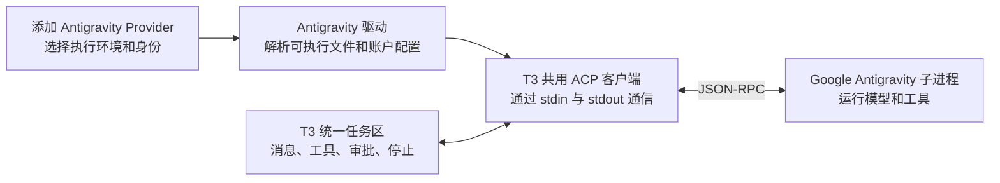

# F35 Antigravity 接入技研

调研日期为 2026-11-23。WillYou 当前分支为 `feature/0.1.7`，需求池条目为 [F35](./需求池.md)。本文依据本机 T3 Code 源码 `~/hx/3.GitHubProject/t3code` 的提交 `fe59fa44d0f12ba1e58b1cccc2c888ac99e743da`，该提交的桌面包版本为 `0.1.9`。文中的源码链接指向本机检出的文件。[T3 Code 桌面包版本][t3-version]

本机 `agy`、指定 Model Hub 网关和共享原型的实际结果见 [F35 技研验证与评审](F35_Antigravity验证与评审.md)。

## 1. T3 Code 怎样接入 Antigravity

T3 Code 把 Antigravity 注册为内置的 Provider 驱动。用户从通用的「Add provider」向导创建一个实例，T3 在执行项目的那台机器上启动 Google 的 Antigravity 进程，把用户消息交给它，再把流式回复、工具调用和审批接到共同的任务界面。T3 自己的 `effect-acp` 负责客户端通信，实际执行任务的是 Google 的 Antigravity 运行时。[驱动注册][t3-drivers] [添加向导][t3-wizard] [ACP 依赖][t3-acp-dependency] [Antigravity 适配器][t3-adapter]

**要安装的是能提供 ACP 服务的运行时。** 如果本机已有支持 ACP 的 `agy`，在 T3 的 **Binary path** 指定它即可使用这份程序。也可以在 T3 设置里安装由 T3 管理的 Google 运行时。两种方式都由 T3 启动进程，可以在同一个任务界面操作。Antigravity 桌面 App 和 IDE 是另外的安装项。[本机源码附带的使用说明][t3-guide-install] [进程启动参数][t3-spawn]

## 2. 如何找到并启动 CLI

按本机这个源码版本，查找顺序如下。[运行时查找][t3-resolve]

| 优先级 | T3 Code 的行为 |
| --- | --- |
| 1. 手动指定 | 使用 `binaryPath`。支持展开 `~`，也支持按运行环境的 `PATH` 找指定命令。显式路径无效时直接报错，便于用户修正路径。 |
| 2. T3 托管安装 | 读取 `active.json` 指向的已安装版本，检查安装记录和版本是否被标记为不可用。更新由 T3 管理。 |
| 3. 自动查找 | 没有手动指定路径和托管安装时才扫描 `PATH`。本机这份源码自动查找的是旧入口 `agy_acp_server.par`，Windows 对应 `agy_acp_server.exe`。已有 `agy` 时可以显式填写 `agy` 或 `~/.local/bin/agy`。 [自动查找的命令名][t3-names] |

识别到原生 CLI 后，T3 用 `agy acp` 启动，并传入 `--gemini-dir` 与 `--app-data-dir` 来区分配置。旧运行时则直接启动 ACP 可执行文件，并定位同目录的 `localharness_external`。工作目录来自任务选中的项目目录。对于版本管理器提供的 `agy` 启动器，T3 保留启动器路径，让它照常解析所选版本。[两类可执行文件][t3-external] [启动参数与工作目录][t3-spawn]

托管下载和账户是两件事。T3 在执行环境下载对应平台的 Google 发行文件，检查大小和校验和，通过验证后原子切换活动版本。正在运行的会话继续使用原来的进程，新会话使用更新后的版本。用户指定的 CLI 仍由用户自己更新；自定义路径的初步检测甚至允许版本字段显示为 `unknown`，后续由实际会话确认运行能力。[下载校验][t3-checksum] [版本切换][t3-activate] [安装与更新说明][t3-guide-install] [轻量检测][t3-probe]

## 3. 登录、模型和推理档位

### 账户身份和就绪状态

- 通用向导处理 Provider、身份和配置。保存后，Antigravity 的专属设置区承接安装、登录与连接状态。默认身份为个人 Google 账户，该版本也提供 Gemini Enterprise、Gemini API key 和 Agent Platform（Vertex AI）。需要保存 API key 时，凭据存放在运行宿主，设置界面只接收是否已保存等状态。[添加向导][t3-wizard] [设置区][t3-settings-ui] [设置类型][t3-settings-schema] [账户说明][t3-guide-auth]
- T3 给每个 Antigravity 实例建立独立的配置目录 `providers/antigravity/<实例对应的目录>`。即使指定的是你平时在终端运行的 `agy` 文件，T3 仍会传入自己的配置目录。这个设计允许多个账户实例共用一份程序，由各自的 Agent 进程完成授权和凭据存储。[实例配置目录][t3-profile] [启动参数][t3-spawn] [账户隔离设计][t3-profile-design]
- 后台检测只解析执行路径与配置，定时检查时无需启动 Agent。点击登录后，T3 才启动专用 ACP 进程，初始化、收取授权链接，并在授权之后实际建立会话、加载模型。本机同一环境可接收浏览器回调。该版本对远程场景提供回填返回地址，且由发起登录的客户端完成原来的流程。浏览器回调和实际连接验证是两个状态。[轻量检测][t3-probe] [登录与校验流程][t3-auth] [远程登录说明][t3-guide]

因此界面上应当区分「找到了程序」「需登录」「已连接并读到模型」。T3 把执行文件和配置检测结果用于前两类提示，成功建立会话后用实际返回更新认证状态与模型目录。[Provider 状态][t3-status] [发布目录][t3-catalog]

### 模型列表来自真实会话

T3 从 ACP 会话返回的 `configOptions` 查模型选项，缺少模型选项时兼容旧的 `models.availableModels`。当前模型标为默认。模型 ID、显示名和能否访问由当前账户和运行时返回，因此换账户后模型列表也可能变。[构造模型目录][t3-models] [模型与账户说明][t3-guide-models]

推理档位同样跟着具体模型走。较新的 Antigravity 运行时返回一个类别为 `thought_level` 的独立选项，早期的部分版本把档位编码在模型 ID 里。当会话公布独立推理选项时，T3 在专用探测会话中逐个切模型，记录各模型回报的选项，再切回原模型。[模型探测][t3-catalog] [模型与旧格式兼容][t3-thinking]

实际执行时，适配器先应用模型，再用当前会话公布的选项校验所选档位。它只写入当前会话支持的选项和值。继续任务时会重新应用已保存的显式模型，模型失去访问权限时提示重选。[写入会话选项][t3-options] [恢复模型选择][t3-apply-model]

## 4. 发消息、续聊、审批和停止

通用 ACP 层处理进程和协议。Antigravity 适配器补上这个 Agent 特有的认证、模型、权限和工具事件解释，再交给同一套任务 UI。[适配器][t3-adapter] [通用会话运行时][t3-initialize]

| 用户操作 | ACP 做什么 | T3 如何接到任务区 |
| --- | --- | --- |
| 打开新任务 | 用 `initialize` 读取 Agent 的协议和能力。按实例选择的认证方式认证后，发 `session/new`，带工作目录和允许接入的 MCP 服务。 | 保存返回的 `sessionId`，和 T3 的任务、Provider 实例关联。 [握手][t3-initialize] [创建会话][t3-session] [原生会话引用][t3-native-id] |
| 发送和看回复 | 用 `session/prompt` 发本轮内容，接收 `session/update`。 | 把消息片段、思考片段和工具进度转成现有任务事件，边执行边展示。 [发送请求][t3-prompt] [流式事件][t3-events] |
| 重启后续聊 | 进程需要重建时，用保存的 Antigravity `sessionId` 发 `session/resume`。 | Antigravity 适配器明确使用 `resume`，避免重新加载历史时回放工具调用。运行时未声明该能力时，会话恢复返回错误。 [恢复方式][t3-flavor] [会话恢复][t3-session] [适配理由][t3-adapter] |
| 批准或拒绝 | Agent 通过 ACP 向宿主申请工具权限。 | T3 复用审批和提问卡。对于原生 `agy`，会话用其支持的 `default` 模式，宿主依据当前权限设置回复；模型提出的固定选项问题仍交给用户作答。 [权限处理][t3-permission] [模式映射][t3-permission-mode] [任务中的权限][t3-guide-models] |
| 点击停止 | 通知 Agent `session/cancel`。 | 等本轮收到结束回执、排完事件。超过取消时限还未结束时，回收这条会话所用的运行进程。 [取消实现][t3-cancel] [Antigravity 取消策略][t3-flavor] |

ACP 在这一层连接 **WillYou 或 T3 到 Agent**。MCP 是 Agent 接入具体工具的方式。T3 在创建或恢复会话时按握手能力传入 MCP 配置。WillYou 内置浏览器需要在 Antigravity 会话中另行验证其工具是否可见，以及工具调用能否作用到正确的任务和标签页。[会话附带 MCP][t3-mcp] [Antigravity 的 MCP 传输设置][t3-adapter]

## 5. WillYou 的接入范围与改动点

沿用现有 **Provider、Agent 配置流程与统一任务 UI**。Antigravity 作为第三种 Code Agent，使用经实际会话确认的 Gemini 模型。单 Agent 走现有普通任务。多 Agent 走 M14 的宿主委派，Antigravity 可以派任务给 Codex 或 Claude Code，也可以作为它们的子任务。任务关系、时间线、审批和停止继续使用已有入口。[M14 单／多 Agent 规则](里程碑/M14_统一Agent工作区/需求.md#m14-r05-单多-agent-共存) [M14 委派规则](里程碑/M14_统一Agent工作区/需求.md#m14-r06-委派问题与结果回收rc8d4)

Codex 由本机 `app-server` 接入，Claude Code 由 Claude Agent SDK 调用本机程序。它们向宿主提供同一套 `AgentDriver` 接口，宿主负责会话绑定、消息投递、审批和委派。Antigravity 接入的重点是让 `agy acp` 向这套接口提供真实能力。M14 已留有 ACP 前置研究与私有业务桥实验，交付验证覆盖 Codex 和 Claude Code，两份研究可以用来减少重复验证。[驱动注册][will-registry] [驱动合同][will-driver] [M14 ACP 设计](里程碑/M14_统一Agent工作区/技研/技术方案.md) [第三适配器实验](里程碑/M14_统一Agent工作区/技研/实验/20261114_F02第三适配器私有业务桥验证/README.md)

| 位置 | 需要确认的改动 |
| --- | --- |
| **智能体设置** | 在现有「Code Agent → 订阅或供应商 → 模型与名称」流程增加 Antigravity。复用本机检测、自定义路径和默认智能体规则。执行器类型、工具登记、启动命令需要各加一项，明确 `antigravity` 对应本机命令 `agy`。 [执行器与配置类型][will-kinds] [本机发现][will-tools] [Agent 向导][will-agent-ui] |
| **Provider 设置** | 在已有 Model Hub 目录和详情增加 Gemini 原生端点，复用服务地址、Key、模型列表、可用性测试和「创建智能体」。现有 Provider 协议为 Anthropic、Responses 和 OpenAI。按实验确认的 `GOOGLE_GEMINI_BASE_URL` 接入地址，并以真实会话结果评估适用性。本机 Google 登录留待具备条件后验证。 [Provider 协议][will-endpoints] [现有兼容验证][will-agent-save] [Provider 目录][will-provider-ui] [T3 身份配置][t3-settings-schema] |
| **启动与事件** | 按工作目录启动 `agy acp`，复用宿主的运行管理、取消和会话绑定。现有 Codex 流采用无 `jsonrpc` 字段的消息封装，ACP 需要自己的协议封装。现有时间线也按两个执行器分流，需要把 ACP 的消息、工具、待处理请求和回合结束接到相同的时间线条目。 [启动计划][will-launch] [驱动路由][will-wiring] [现有 JSON 行协议][will-jsonl] [事件转换][will-timeline] |
| **模型与续聊** | 在现有模型菜单展示经 ACP 确认的 Gemini 型号、默认项和推理档位。委派目标仍依据已存配置或该身份实际返回的模型目录校验。已有 WillYou 任务均可在授权范围内切到 Antigravity，沿用现有任务 ID、历史和上下文交接。原生恢复按会话 ID、执行器身份、配置来源和工作目录判定，恢复后重新下发选定的模型与档位。 [任务模型菜单][will-picker] [当前模型目录][will-catalog] [委派目标来源][will-delegation-targets] [原生会话绑定][will-run-open] |
| **委派与审批** | 将本轮宿主 MCP 接入 Antigravity，让主 Agent 能调用 `wy_targets`、`wy_delegate`，以及观察、追问或取消已有子任务。作为子任务，由宿主统一继承权限、安排工作目录、回收结果。目前可信只读只给已验证的 Codex 托管配置，Antigravity 先按已证实的访问能力调度。请求只读时要核对回执上的实际访问级别和目录规则。 [宿主 MCP 创建及运行身份][will-host-capabilities] [委派工具][will-delegation-tools] [目标及权限][will-delegation-targets] [委派执行规则][will-delegate] |

本机 `~/.local/bin/agy` 样本为 `1.5.14`。识别按路径、可执行性和实际 ACP 握手及方法行为判断，版本号用于诊断。本轮用指定 Model Hub 和两款 Gemini 模型验证 Provider 来源。WillYou 的委派与权限通过第 4 至 6 项另行验证。

## 6. 隔离实验与通过条件

先跑 ACP 协议探针，再接现有宿主服务做委派集成。运行实验使用独立测试项目和数据目录，记录 CLI 版本、握手能力、会话与回合标识、实际模型和关键阶段耗时。M14 的 ACP 探针可参考消息分行、握手、会话和停止，审批实验单独根据测试场景回应。[M14 ACP 探针](里程碑/M14_统一Agent工作区/技研/复核_20261116/probes/lib/acp.mjs) [T3 安装测试][t3-install-test] [T3 登录测试][t3-auth-test] [T3 模型测试][t3-model-test] [T3 适配器测试][t3-adapter-test]

| 顺序 | 实验 | 通过条件 |
| --- | --- | --- |
| **1** | **CLI 发现和握手**。分别模拟桌面进程环境、登录 shell、显式路径、错误路径和旧 CLI。用本机 `agy` 实际跑 `initialize`。 | 得到协议版本和所声明能力。未安装、不可执行、启动失败和协议不兼容有各自状态。兼容升级后仍可用。记录发现、启动、握手各自耗时。 [现有发现服务][will-discovery] |
| **2** | **Provider 认证和 Gemini 模型**。用用户指定的 Model Hub、`gemini-4-carbon` 和 `gemini-4-argon` 验证目录、原生请求和真实 ACP 回合。 | 两款模型分别有真实回复及工具结果。认证来源和请求地址可核对，失败能定位到具体模型、协议和渠道。Provider Key 由现有凭据服务管理。 [T3 Key 注入][t3-key-auth] |
| **3** | **单 Agent、换模型和续聊**。新建、发两轮、切 Gemini 型号和档位、停止、重启后续聊。在 Codex 和 Claude Code 已创建的任务里切到 Antigravity，再切回原执行器。 | 实际模型与档位和用户选择一致。切换后沿用原任务和交接上下文，切回时恢复兼容的原生会话。取消后待处理请求和工具有明确终态。记录开会话、首条事件和恢复耗时。 |
| **4** | **MCP 与审批**。在真实 `agy` 会话注入一台隔离 MCP，再接 WillYou 宿主 MCP。让 Gemini 发现并实际调用委派工具，用测试文件验证允许、拒绝、取消和过期审批。 | 调用能核对到本轮有效任务身份，拿到真实结构化回执。子任务承接已验证档位。继承 Codex 专属的「帮我批准」时按规则降到「请求批准」。过期或不同运行的批准被拒绝。只读资格需通过真实写入拦截验证。 [现有权限档位][will-tier] |
| **5** | **主子互换和结果回收**。Antigravity 主任务分别派给 Codex、Claude Code，再由这两个执行器分别派给 Antigravity。覆盖一个父任务有两个子任务、对原子任务追问、关闭新委派、父回合繁忙以及取消子任务。 | 四个方向都经过现有委派服务。目标携带正确的 Gemini 模型与配置修订。任务关系标出主子来源，子审批回到原任务面板，子结果按既有规则在父空闲时投递一次。重复请求复用收据，子任务遵守既有深度限制。 [M14 角色互换](里程碑/M14_统一Agent工作区/验收/测试用例.md#m14-a19-通用委派与角色互换) |
| **6** | **真实写入边界**。用临时 Git 项目覆盖默认共用目录和显式独立工作副本，随后用普通目录及 SVN 夹具验证既有写入规则。并测目标模型失效、父子停止和宿主重启。 | 共用目录按队列交接写入，所选工作副本从正确提交、工作目录启动。配置过期有可操作原因。取消和恢复沿用原身份，已收回的结果保持一次交付。 [M14 同目录竞争](里程碑/M14_统一Agent工作区/验收/测试用例.md#m14-a31-同目录写入竞争与别名git-共用目录svn普通目录) |

第 1、2 项决定 CLI 启动和 Provider 接法。第 4、5 项验证宿主委派能否按现有合同复用。实际结果、证据和未执行的真实组合见 [F35 技研验证与评审](F35_Antigravity验证与评审.md)。

## 7. 从调研到交付

| 阶段 | 推进方法 |
| --- | --- |
| **范围初稿** | 用 F35 确认双入口、Gemini 模型、单 Agent 和宿主委派，引用 M14 已定规则。确定所属里程碑后建立阶段入口与 `需求.md`，写清平台、两种配置来源与用例编号。 |
| **技研** | 先用隔离探针跑握手、认证和 Gemini 请求，再验证 MCP、审批和主子互换。按证据确定 Provider 协议扩展、模型来源与会话恢复方案。 |
| **需求细化、原型和用例** | 把实验结论并入阶段需求和技术方案。在共享原型 `prototypes/m6-codex` 增加 Agent 卡片和检测状态、Provider 条目和连接结果。用现有模型菜单、审批面板及任务关系卡演示一组 Antigravity 主任务和子任务。编写正式用例，把真实 Google 登录前置、模拟原型和打包验收各自标清。 [共享原型规则](../prototypes/m6-codex/AGENTS.md) |
| **评审与开发** | 一起评审需求、原型、技研和用例。确认后按执行器与事件、配置与模型、委派集成逐批实现。补配置迁移、旧任务读取和导入导出回归。 |
| **打包验收与归档** | 用独立 `userData` 的真实 App 跑设置入口、单 Agent、双向委派和恢复，复用已有 CDP 验收驱动。核对真实 Gemini 会话、工作目录和文件结果。再回归 Codex、Claude Code 已有配置、任务和委派，将结果与包、源码基线写入交付说明。 [真实 App 自动验收流程](真实App自动验收流程.md) |

F35 已对照现有 M14 配置、驱动与委派服务。隔离宿主和实际目录实验、真实网关复验及用例修订见后续记录。里程碑归属留待排期确认，按仓库流程评审后确认正式开发。[专项实验结论](F35_Antigravity验证与评审.md#开发前专项实验结论) · [验收用例](F35_Antigravity测试用例.md) · [仓库开发流程](../AGENTS.md#每个阶段的必经步骤)

[t3-version]: /Users/liubu/hx/3.GitHubProject/t3code/apps/desktop/package.json:3
[t3-drivers]: /Users/liubu/hx/3.GitHubProject/t3code/apps/server/src/provider/builtInDrivers.ts:33
[t3-wizard]: /Users/liubu/hx/3.GitHubProject/t3code/apps/web/src/components/settings/AddProviderInstanceDialog.logic.ts:8
[t3-acp-dependency]: /Users/liubu/hx/3.GitHubProject/t3code/packages/provider-acp/package.json:58
[t3-adapter]: /Users/liubu/hx/3.GitHubProject/t3code/apps/server/src/orchestration-v2/Adapters/AntigravityAdapterV2.ts:208
[t3-guide-install]: /Users/liubu/hx/3.GitHubProject/t3code/docs/user/providers-antigravity.md:52
[t3-spawn]: /Users/liubu/hx/3.GitHubProject/t3code/apps/server/src/provider/AntigravityAuthSupport.ts:454
[t3-resolve]: /Users/liubu/hx/3.GitHubProject/t3code/apps/server/src/provider/AntigravityInstallation.ts:379
[t3-names]: /Users/liubu/hx/3.GitHubProject/t3code/apps/server/src/provider/AntigravityInstallation.ts:163
[t3-external]: /Users/liubu/hx/3.GitHubProject/t3code/apps/server/src/provider/AntigravityInstallation.ts:310
[t3-checksum]: /Users/liubu/hx/3.GitHubProject/t3code/apps/server/src/provider/AntigravityInstallation.ts:695
[t3-activate]: /Users/liubu/hx/3.GitHubProject/t3code/apps/server/src/provider/AntigravityInstallation.ts:564
[t3-probe]: /Users/liubu/hx/3.GitHubProject/t3code/apps/server/src/provider/Drivers/AntigravityDriver.ts:388
[t3-settings-ui]: /Users/liubu/hx/3.GitHubProject/t3code/apps/web/src/components/settings/ProviderSettingsPanel.tsx:1331
[t3-settings-schema]: /Users/liubu/hx/3.GitHubProject/t3code/packages/contracts/src/settings.ts:855
[t3-guide-auth]: /Users/liubu/hx/3.GitHubProject/t3code/docs/user/providers-antigravity.md:35
[t3-profile]: /Users/liubu/hx/3.GitHubProject/t3code/apps/server/src/provider/AntigravityAuthSupport.ts:179
[t3-profile-design]: /Users/liubu/hx/3.GitHubProject/t3code/docs/internals/providers.md:39
[t3-auth]: /Users/liubu/hx/3.GitHubProject/t3code/apps/server/src/provider/AntigravityAuth.ts:291
[t3-guide]: /Users/liubu/hx/3.GitHubProject/t3code/docs/user/providers-antigravity.md:19
[t3-status]: /Users/liubu/hx/3.GitHubProject/t3code/apps/server/src/provider/AntigravityProvider.ts:273
[t3-catalog]: /Users/liubu/hx/3.GitHubProject/t3code/apps/server/src/provider/Drivers/AntigravityDriver.ts:346
[t3-models]: /Users/liubu/hx/3.GitHubProject/t3code/apps/server/src/provider/AntigravityProvider.ts:73
[t3-guide-models]: /Users/liubu/hx/3.GitHubProject/t3code/docs/user/providers-antigravity.md:77
[t3-thinking]: /Users/liubu/hx/3.GitHubProject/t3code/apps/server/src/provider/acp/AntigravityAcpSupport.ts:217
[t3-options]: /Users/liubu/hx/3.GitHubProject/t3code/packages/provider-acp/src/server/adapter.ts:7637
[t3-apply-model]: /Users/liubu/hx/3.GitHubProject/t3code/apps/server/src/provider/acp/AntigravityAcpSupport.ts:255
[t3-initialize]: /Users/liubu/hx/3.GitHubProject/t3code/packages/provider-acp/src/server/AcpSessionRuntime.ts:2113
[t3-session]: /Users/liubu/hx/3.GitHubProject/t3code/packages/provider-acp/src/server/AcpSessionRuntime.ts:2238
[t3-native-id]: /Users/liubu/hx/3.GitHubProject/t3code/packages/provider-acp/src/server/adapter.ts:983
[t3-prompt]: /Users/liubu/hx/3.GitHubProject/t3code/packages/provider-acp/src/server/AcpSessionRuntime.ts:2669
[t3-events]: /Users/liubu/hx/3.GitHubProject/t3code/packages/provider-acp/src/server/adapter.ts:5616
[t3-flavor]: /Users/liubu/hx/3.GitHubProject/t3code/apps/server/src/provider/acp/AntigravityAcpSupport.ts:131
[t3-permission]: /Users/liubu/hx/3.GitHubProject/t3code/packages/provider-acp/src/server/adapter.ts:6743
[t3-permission-mode]: /Users/liubu/hx/3.GitHubProject/t3code/apps/server/src/provider/acp/AntigravityAcpSupport.ts:174
[t3-cancel]: /Users/liubu/hx/3.GitHubProject/t3code/packages/provider-acp/src/server/AcpSessionRuntime.ts:2405
[t3-mcp]: /Users/liubu/hx/3.GitHubProject/t3code/packages/provider-acp/src/server/AcpSessionRuntime.ts:2163
[will-kinds]: /Users/liubu/hx/4.uprxiao/SmartDD/src/shared/ai-agents.ts:3
[will-wiring]: /Users/liubu/hx/4.uprxiao/SmartDD/src/main/core/agent/wiring.ts:74
[will-picker]: /Users/liubu/hx/4.uprxiao/SmartDD/src/renderer/features/agent-tasks/agent-model-picker.tsx:1
[will-discovery]: /Users/liubu/hx/4.uprxiao/SmartDD/src/main/core/agent/discovery.ts:25
[will-driver]: /Users/liubu/hx/4.uprxiao/SmartDD/src/main/core/agent/driver.ts:139
[will-registry]: /Users/liubu/hx/4.uprxiao/SmartDD/src/main/core/agent/registry.ts:6
[will-tools]: /Users/liubu/hx/4.uprxiao/SmartDD/src/main/core/ai/agent-tools.ts:75
[will-agent-ui]: /Users/liubu/hx/4.uprxiao/SmartDD/src/renderer/features/agents/agent-editor.tsx:62
[will-endpoints]: /Users/liubu/hx/4.uprxiao/SmartDD/src/shared/ai-agents.ts:21
[will-agent-save]: /Users/liubu/hx/4.uprxiao/SmartDD/src/main/core/ai/agent-service.ts:125
[will-provider-ui]: /Users/liubu/hx/4.uprxiao/SmartDD/src/renderer/features/agents/provider-catalog.tsx:23
[will-launch]: /Users/liubu/hx/4.uprxiao/SmartDD/src/main/core/agent/profile-launch.ts:64
[will-jsonl]: /Users/liubu/hx/4.uprxiao/SmartDD/src/main/core/agent/jsonl-rpc.ts:1
[will-timeline]: /Users/liubu/hx/4.uprxiao/SmartDD/src/main/core/agent/timeline.ts:34
[will-catalog]: /Users/liubu/hx/4.uprxiao/SmartDD/src/main/core/agent/wiring.ts:274
[will-delegation-targets]: /Users/liubu/hx/4.uprxiao/SmartDD/src/main/core/agent/wiring.ts:230
[will-run-open]: /Users/liubu/hx/4.uprxiao/SmartDD/src/main/core/agent/agent-run-service.ts:88
[will-host-capabilities]: /Users/liubu/hx/4.uprxiao/SmartDD/src/main/core/applications/task-capability-launcher.ts:261
[will-delegation-tools]: /Users/liubu/hx/4.uprxiao/SmartDD/src/main/core/agent/delegation-service.ts:706
[will-delegate]: /Users/liubu/hx/4.uprxiao/SmartDD/src/main/core/agent/delegation-service.ts:224
[will-tier]: /Users/liubu/hx/4.uprxiao/SmartDD/src/main/core/agent/permissions.ts:45
[t3-key-auth]: /Users/liubu/hx/3.GitHubProject/t3code/apps/server/src/provider/AntigravityAuthSupport.ts:208
[t3-install-test]: /Users/liubu/hx/3.GitHubProject/t3code/apps/server/src/provider/AntigravityInstallation.test.ts:555
[t3-auth-test]: /Users/liubu/hx/3.GitHubProject/t3code/apps/server/src/provider/AntigravityAuth.test.ts:248
[t3-model-test]: /Users/liubu/hx/3.GitHubProject/t3code/apps/server/src/provider/AntigravityProvider.test.ts:247
[t3-adapter-test]: /Users/liubu/hx/3.GitHubProject/t3code/apps/server/src/orchestration-v2/Adapters/AntigravityAdapterV2.test.ts:99
