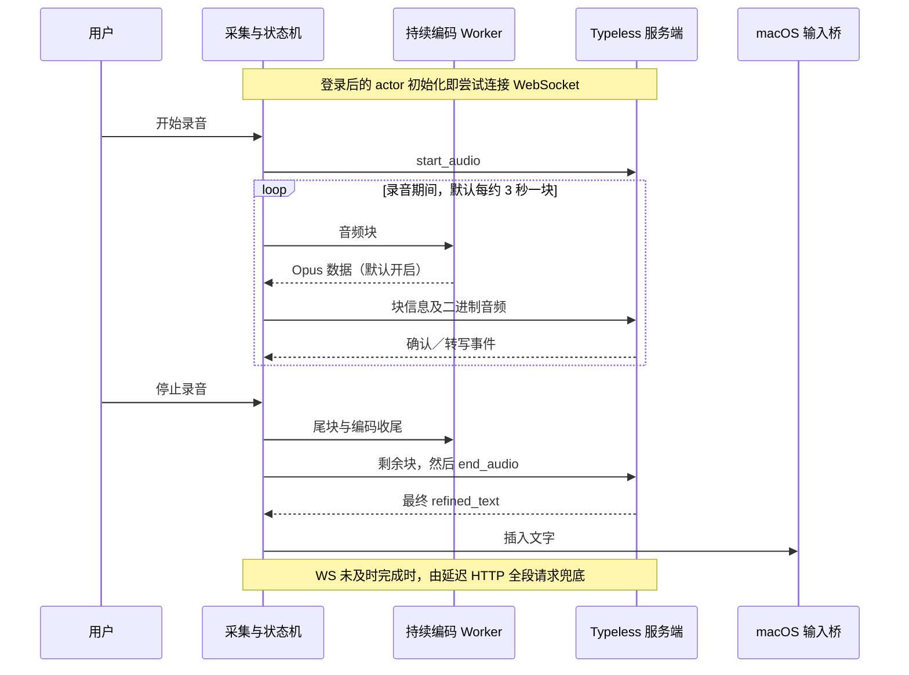

# F17 调研：Typeless 逆向与语音模型候选

调查日期：2026-10-16\
对象：本机 `/Applications/Typeless.app`，版本 **2.8.2（2.8.2.131）**\
目的：解释快速语音输入、跨应用插入和修改学习的实现，保留技术证据。\
当前范围：用户已将功能拆分；[M7 只接入本机 Typeless](M7_Typeless语音输入接入.md)，下文自有模型、录音与词库研究用于 [F17-B 后续模块](F17B_自有语音输入与本机词库.md)，不阻塞 M7。文件名保留以兼容已有引用。

## 1. 调研结论

已从安装包代码中确认：Typeless 有**录音期间分块发送的 WebSocket 主路径**，默认启用 Opus 压缩，停止时发送剩余音频和结束事件，最终整理文本返回后调用原生输入桥。整段 HTTP 上传作为延迟兜底和重试路径。它没有把所有网络工作都留到停止录音之后。

这些结构可以解释快速出字的体验；其各阶段耗时、服务端实时调度和实际 ASR／整理模型仍未测得。**没有证据可以把其后端指定为 Whisper、某个 GPT、Gemini 或其他具体模型。** 本次没有做动态抓包、真实录音或性能对比。

“修改后记住词语”也有明确客户端流程：插入后短时观察同一输入框，筛选局部修改，提交服务端，再处理自动加词通知。M7 直接使用 Typeless 自己的能力；F17-B 后续再实现 SmartDD 本机词库和局部修改学习，不能把服务端自动学习直接当成已有本地能力。

## 2. 调查方法与证据范围

使用 REA 的 JavaScript 应用分析能力，并配合只读 ASAR 提取、TypeScript AST 静态解析和原生动态库符号检查。未执行提取的代码、未修改 Typeless、未调用其私有接口，也未读取用户的 Typeless 配置、凭据或口述历史。

- ASAR：`/Applications/Typeless.app/Contents/Resources/app.asar`
- Bundle ID：`now.typeless.desktop`；应用为 Electron，主入口 `dist/main/index.js`。
- ASAR SHA-256：`49ee4061c662c4284e1d79327e2b0c4389d2df1fc1de9004e252e6e6f8528ad9`。
- 提取范围：89 个 package／dist JS／HTML 文件；REA 成功解析 82 个 JS 文件，无语法解析失败。语义图达到 100,000 节点上限，覆盖不完整。
- 主入口存在字符串表混淆。自编静态解码器只解释白名单数值运算、固定索引和无歧义别名，替换 9,608 处字符串调用；没有使用 `eval` 或导入目标模块。派生代码仅供阅读，不宣称已证明执行等价。
- 完整 ASAR 分析首次被解包后 `better_sqlite3.node` 的声明／实际哈希不一致阻断，随后对限定 JS 子集分析。该现象本身不能证明应用损坏或被篡改；原文件未被更改。

提取的第三方代码、派生文件及大型证据图只保留在已忽略的 `release/m7-research/`，不纳入产品源码或发布包。以下记录必要结构与可复核定位。

## 3. 为什么停止后能较快出字

| 发现 | 安装包静态证据 | 对等待时间的影响与边界 |
| --- | --- | --- |
| 连接提前建立 | 登录后的 WebSocket actor 创建即 `connect`，连接器避免重复连接；空闲断开计时为 1 小时 | 有机会复用连接，减少当次握手；不能保证每次起录时连接都已可用 |
| 连续采集 | `getUserMedia`、默认 16 kHz AudioContext、AudioWorklet；Worklet 每 1,024 个 Float32 样本向上层传递，混为单声道 | 音频采集与界面任务分离；1,024 样本不是一次网络请求 |
| 边录边传 | 调度每 100 ms 检查，默认累计约 3,000 ms 音频切块；调试配置可覆盖间隔 | 100 ms 是检查周期，3 秒是默认音频分块时长；已确认录音中就有发送流程 |
| 默认压缩 | `enabledOpusCompression.default=true`；持续 Opus worker 使用 32 kbps 配置；支持关闭压缩的 WAV 分支 | 降低音频传输量，持续编码保留状态；没有读取用户当前有效配置或实测压缩比 |
| 按顺序发送 | 编码及发送队列用序号和 Map 保证顺序，处理服务器块确认 | 异步编码不必阻塞界面；乱序回调不会直接打乱音频顺序 |
| 停止只做收尾 | Worklet flush 最后样本并确认停止，上层发送不足 3 秒的尾块，再发结束事件；会等待未完成编码，超时有上限 | 正常路径不必停止后从头上传。等待编码完成有最多 10 秒的保护上限，不是固定等 10 秒 |
| 最终结果直接交付 | 处理 `refine_completed`／`audio_processing_completed`，按 audio ID 去重，调用原生插入桥；保存记录与插入分别异步发起 | 未发现正常转写路径为逐字动画增加人为延迟；仍需要完成目标信息查询与原生输入 |

网络主路径为 Typeless 自有服务的 `/ws/rt_voice_flow`。客户端处理了分块转写事件和最终整理事件，**可以推断服务端能够把一部分工作与录音重叠**；实际识别从何时开始、整理是否也提前开始、用了几个模型，仍需要服务端证据或动态测量，静态客户端不能全部证明。

### 3.1 HTTP 兜底的实际含义

客户端 `startRefineRace` 让 WebSocket 结果和延迟 HTTP 结果竞速，先成功的交付；WebSocket 先完成时取消兜底请求。正常停止后会准备整段音频，普通转写的 HTTP 启动延迟为：

`6000 + ceil(录音秒数 / 30) × 500 ms`

语音命令模式还随选中文字长度增加等待；弱网、编码失败或未确认块数过多时可立即降级。整段请求经主进程发送到 `/ai/voice_flow`，代码中该 HTTP 请求超时为 40 秒。**这些是兜底参数，不是 Typeless 正常出字需要等待的时间，也不是本次实测结果。**

F17-B 后续可借鉴分块传输、提前连接、任务去重和故障恢复。自有模块首版不必立即照搬双路竞速；竞速可能重复计费，应先保证一条可靠的实时链路，并根据服务能力决定降级策略。M7 的 Typeless 唤起不涉及这些传输实现。

## 4. 跨应用输入与自动学习

### 4.1 输入桥

原生库导出／导入符号表明存在以下能力：

- `libKeyboardHelper.dylib`：键盘按下／释放、组合键、按键时长；使用 macOS 事件监听 API。
- `libContextHelper.dylib`：当前应用、焦点元素、相关内容查询；使用 Accessibility API。
- `libInputHelper.dylib`：`insertText`、`getCurrentInputState`、选中文本等；内部有保存／恢复剪贴板、模拟粘贴命令的符号，导入 NSPasteboard、键盘事件 API。

JS 调用链也把最终文本传给 `keyboard-input:insert-text`。因此跨应用输入依赖原生能力，不能仅靠 Electron 内某个 textarea 实现。符号证明存在剪贴板保护路径，尚未反汇编证明每个目标控件都使用该路径，也未进行兼容性实测。

### 4.2 “cloud 改成 claw 后记住”

静态链路为：

1. 最终文本插入后，约 200 ms 启动修改跟踪。
2. 主进程跟踪同一应用／输入框；计时配置约 15 秒，检测到编辑时可以重置，并非严格的总计 15 秒上限。
3. 键盘活动触发约 100 ms 防抖的输入状态读取；转移焦点、输入框清空等情况结束跟踪。
4. 用字符差异检测修改，排除无变化、整段删除或大幅改写；相关比较函数取输入内容前 1,000 字符，因此不能据此假设任何长文本位置都覆盖。
5. 将插入文本、修改前后输入信息和应用／模式信息构造成请求，发送 `/user/traits`。
6. 处理服务端返回的 `auto_add_dictionary`，有 term 和词条 ID 时发送 `dictionary:word-auto-added` 通知。

**已证明客户端有“观察修改 → 服务端判断 → 自动加词通知”的设计，未证明服务器如何挑选词语、如何使用词库，更没有证明它会实时训练模型。** 官网也描述了修改后自动加入词典、手工加词、CSV 导入和管理功能。[Typeless 词库说明](https://www.typeless.com/help/quickstart/history-and-dictionary)

SmartDD F17-B 候选方案：只观察本次插入片段，明确修正写本机词库；将相关词条作为后续识别／整理提示。识别出的 `cloud` 不能仅因曾有一次修正就永久全局替换为 `claw`。本地修改检测、自动学习与撤销需要独立验证，不属于 M7 接入范围。

## 5. 能否确定 Typeless 使用的模型

目前不能。客户端流向其自有语音服务，没有从已分析的调用链中拿到可核实的后端 ASR 模型 ID、整理模型 ID、模型版本或服务端提示词。REA 图覆盖也不完整，不能把“没有找到”写成“安装包绝对不存在”。

另做了已提取 JS 的模型名称关键词筛查。检出的 `whisper` 示例对应 onboarding 中的“低声说话／whisper mode”文案，`gemini` 示例对应使用场景介绍；这些名称出现不构成后端选型证据。搜索结果与上下文保存在 `typeless-model-name-search.json`。

公开的数据控制／隐私说明中出现第三方模型服务商，不足以确定是哪款识别模型或哪一条请求在使用它。[Typeless 数据控制](https://www.typeless.com/data-controls)、[隐私说明](https://www.typeless.com/privacy)

这不阻塞实现同类功能：需要复现的是输入体验和链路，模型应由中文／术语准确率、停止后的等待、稳定性和价格实测选择。

## 6. Model Hub 核验与候选方案

读取用户指定的模型市场及其公开前端所引用的模型目录／API 文档，未登录账号、未读取密钥、未进行模型推理。

2026-10-16 的公开目录有 117 个模型，其中明确标记语音识别的条目包括 `fun-asr` 与 `qwen3-asr-flash-filetrans`。`speech-2.8-hd/turbo` 属于语音合成，不能作为 ASR 使用。[Model Hub 公开目录](https://modelhub.ailemac.com/api/model/available_route_models?is_front=true)

Model Hub 的 Qwen 文档说明采用 `https://modelhub.ailemac.com/qwen/api/v1`，支持提交 `/services/audio/asr/transcription` 后查询 `/tasks/{task_id}`，并链接到供应商的异步文件识别协议。这证明有公开接入说明；不等于已经实际验证账号权限、请求参数、上传功能和收费。[Model Hub Qwen 接入文档](https://modelhub.ailemac.com/static/docs/zh/async/qwen.md)

| 候选 | 已核实的接口特点 | 与 F17-B 的关系 |
| --- | --- | --- |
| Hub：`fun-asr` | 异步任务，音频 URL 列表，完成后拉取转写结果；预编译热词使用 `vocabulary_id` | 可做文件转写比较；需要音频上传路径，云端持久热词不符合本次仅本机词库的默认范围。见 [Fun-ASR 文件 API](https://help.aliyun.com/zh/model-studio/fun-asr-recorded-speech-recognition-http-api) |
| Hub：`qwen3-asr-flash-filetrans` | 异步任务，单个音频 URL，完成后拉取转写结果 | 可做中文／混合语言比较；当前正式文件接口参数中未确认 prompt／单次词库能力，不能套用其他 Qwen 型号参数。见 [Qwen ASR API](https://help.aliyun.com/zh/model-studio/qwen-asr-api-reference) |
| 直连候选：`fun-asr-realtime` | 实时音频接口，中英切换与热词能力；需按其 WebSocket 协议接入 | 优先验证的流式路线之一；未在此次 Hub 公开 ASR 目录确认。见 [模型说明](https://help.aliyun.com/zh/model-studio/fun-asr-realtime)、[接入协议](https://help.aliyun.com/zh/model-studio/fun-asr-realtime-model-access) |
| 直连候选：Qwen3-ASR-Flash-Realtime | 实时会话，手动提交或 VAD 模式 | 与按钮／快捷键手动结束录音有适配空间；需验证具体型号、地区和提示能力，不能与 filetrans 混为同一接口。见 [实时交互流程](https://help.aliyun.com/zh/model-studio/qwen-asr-realtime-interaction-process) |
| 其他比较：`gpt-transcribe` | 官方音频转写模型；文件转写接口支持直接上传文件与提示 | 可比较术语与中文准确率；直传文件省掉音频 URL 步骤，文件结果流式输出仍不自动等于录音期间上传。未在 Hub 当前公开目录确认。见 [模型说明](https://developers.openai.com/api/docs/models/gpt-transcribe)、[文件转写指南](https://developers.openai.com/api/docs/guides/speech-to-text) |
| 其他比较：豆包录音识别极速版 | `volc.bigasr.auc_turbo`，同步 HTTP 文件识别，当前文档需音频 URL | 可作为短音频延迟对照，仍需上传；未在 Hub 当前公开目录确认。见 [官方接口文档](https://docs.volcengine.com/docs/DoubaoVoice/recording-file-recognition-lite-http?lang=zh) |

云端路线结论：优先向 Model Hub 核实实时接入能力，再实测流式模型；其现有异步文件模型作为可用性和效果对照。目前没有数据能证明哪个候选达到 Typeless 的速度。也不能从某一条 token 单价为零推断语音识别免费；成本需按实际音频时长、整理调用和可能的重试计入。用户随后补充的本地路线见下节，与云端候选一起验证。

### 6.1 用户截图补充：Whisper + Qwen 全本地路线

2026-10-16 用户提供的视频截图展示：Mac 本地录音、获取应用上下文和插入文本；`Whisper large-v3` 做听写，`Qwen3.6 35B` 做润色／翻译，通过 localhost 交互。截图是一套本地替代方案的说明，没有提供项目源码、运行时间线或模型精确版本，不能据此把 Typeless 本体判定为本地推理。

这套结构留给后续 F17-B：`页面按钮／快捷键 → 本机录音 → 本地 ASR → 本地文字整理（携带相关词库）→ 原生输入桥`。模型和运行时准备好后，核心处理可在断网下完成；localhost 表示同机进程接口，本身不证明整个应用没有外部请求，需要离线验收。

可复用的现成实现已核实：

- **语音识别**：MLX 官方示例提供 `mlx-whisper`，可从本地目录加载模型；`whisper.cpp` 提供 Apple Silicon Metal 推理，支持 large-v3 与 large-v3-turbo。可用 MLX 快速验证，用 whisper.cpp 比较打包和性能，不自行实现模型推理。[MLX Whisper](https://github.com/ml-explore/mlx-examples/tree/main/whisper)、[whisper.cpp](https://github.com/ggml-org/whisper.cpp)
- **文字整理**：官方存在 `Qwen3.6-35B-A3B`；截图简称未说明是否正是该版本及其量化格式。Ollama 已提供 `qwen3.6:35b` 和 MLX 版本，目录标注约 23–24 GB 模型文件，实际运行内存另含上下文及运行开销。[Qwen 模型卡](https://huggingface.co/Qwen/Qwen3.6-35B-A3B)、[Ollama 模型目录](https://ollama.com/library/qwen3.6)
- **当前设备**：只读核对为 Apple M4 Max、128 GB 内存，具备对上述量化组合开展本地试验的条件。尚未下载、加载模型或测量性能，不把内存容量等同于出字速度。

本地省掉网络上传、云端排队和按次 API 费用，但仍有模型加载、ASR 和文字整理的推理时间。探针应区分首次冷启动与常驻热启动，比较 large-v3／turbo 及不同大小的整理模型，测中文术语、误改、功耗与停止到插入时延；不能仅凭“本地”判定比云端更快。若做边录边识别，需验证分段边界、上下文和去重，不能机械照搬 Typeless 的 3 秒传输块。

本机词库和修改学习仍需 SmartDD 后续实现；运行两个模型不会自动具备“改一次就记住”。截图里的翻译不因此加入范围。该方案现已归入 F17-B，模型候选继续保留，并未决定必须使用 35B、替换全部云端方案或开始自有模块开发。

## 7. 复用 Yoda 的边界

本地 `../yoda/src/main/core/app/voice-input.ts` 只是检查／启动 Typeless，再通过 macOS 脚本模拟它的快捷键；`voice-input-shortcut.ts` 处理快捷键解析。Yoda 的这段代码没有提供自有采集、ASR、光标输入或纠错词库。

按用户最新拆分，**M7 就采用这套外接 Typeless 的方式**，复用按钮、焦点恢复、后台启动与快捷键转发，再补齐用户要求的全局唤起键。SmartDD 现有设置与 RPC 可复用；本机自有词库和模型接入属于 F17-B，不再作为 M7 的完成条件。本轮本地 Yoda 源码证据、模式差异和复用建议见 [Yoda 唤起调研](M7_Yoda语音唤起调研.md)；具体适配点与验收见 [M7 接入说明](M7_Typeless语音输入接入.md)。

## 8. 可复核定位与后续验证

派生文件位于 `release/m7-research/`；下列行号为本次静态格式化后的定位，原文件和字符位置由 manifest／笔记保存。

| 证据 | 位置 |
| --- | --- |
| 文件清单、原始哈希与提取边界 | `typeless-manifest.json` |
| 主入口字符串解码方法与替换映射 | `decode-main.cjs`、`typeless-main-decoding.json`；原始 main SHA-256：`5e9eb074797bf06f5bb55a7a7b45aa5353484f0cd23c6b11a4c1555b5ee58e0b` |
| 分块周期／actor／停止收尾 | `typeless-DFvLNtQv-readable.js`：991、1074、1134、1230、1261；原始 SHA-256：`d2b3d3e331674fbda798e0766dc0234ae92ff8ca5319b72dd73d164f2c490f84` |
| WebSocket／HTTP 竞速／采集实现 | `typeless-DWYvEY4x-readable.js`：1555、1648、1768、2381；原始 SHA-256：`c9f8faaedaa82b202e1cd5f71470128e019a3d37f333e65b24c88535e5de4f26` |
| 纠错跟踪及词库响应 | `typeless-main-readable.js`：3982–4056 |
| HTTP 整段 voice flow | `typeless-main-readable.js`：4126–4170 |
| 原生符号，不含反汇编或运行结果 | `typeless-native-symbols.json` |
| 音频链路各原文件 SHA、字符位置与条件 | `typeless-audio-analysis.md`、`typeless-audio-pipeline-analysis.md` |
| REA 汇总与受限覆盖记录 | `typeless-rea-summary.json`；完整大证据图另存本机，不提交仓库 |

已完成：静态调用链交叉核对、关键常数及默认值核查、官方文档与 Model Hub 公开目录核查。

未完成：真实音频和网络时间线、候选模型请求、自有录音／Accessibility 输入探针、修改学习准确率。上述属于 F17-B 的后续验证。M7 另需验证按钮／全局键确实触发 Typeless 并完成回填，以及打包后的焦点、权限和生命周期；两者均不能把本次静态调研冒充运行验收。
