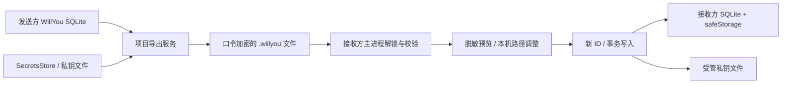

# M8 技术调研与设计

设计日期：2026-10-16；实施更新：2026-10-17。依据：[M8-R4 / M8-R01–R06](M8_真实项目导入导出.md)。状态：**已实现，macOS arm64的48条验收通过，已随 v0.0.5 预发布**。原型：[页面与状态](design/m8/M8_原型验收.md)；验证：[交付用例](M8_交付验收.md)。

## 1. 总体方案

正式数据源是 **WillYou 本地 SQLite**。导出查询项目及关联配置，再按引用读取本机凭据；导入解锁、校验、生成新 ID，通过一个事务插入接收方数据库。这里不查询业务数据库的数据，也不远程登录服务器。

SSH/DB Skill 仅用于一次性的 AIS 样本准备，并非生产导入器的数据源或前置依赖。样本转换脚本与业务代码隔离，后续由 App 从本地已登记项目生成同格式文件。



采用单项目复制导入，省去合并既有资源的歧义；AI 配置由发送方选择附带，接收方再次选择导入哪些，可全部跳过。只为被选中的配置创建全局副本及凭据。原型沿用 M6 壳层，业务实现沿用现有项目页、服务和校验器。用户已于 2026-10-16 批准按本方案及 M8-R4 原型实施。

## 2. 已核实的现状与复用点

基线：`feature/0.0.1`，`dfc3ee36578d0d6675abd2a4cad126575f7b7413`，本轮开始时工作区干净。

| 证据 | 已有能力 | M8 要适配的差异 |
| --- | --- | --- |
| [shared/projects.ts](../src/shared/projects.ts) | 项目、目录、8 种 DB、服务器字段与校验 | 包协议在这些字段外增加 ref、凭据引用和版本；不是另定义一套资源业务 |
| [project-service.ts](../src/main/core/projects/project-service.ts) | 项目 CRUD、资源关联、路径／名称唯一性、事务及默认值 | 普通方法各自开事务和 bump 版本；批量导入应有同一事务上下文，不能逐条成功即视为导入完成 |
| [db/schema.ts](../src/main/db/schema.ts) | projects、projectDirs、projectDatabases、projectServers、projectCapabilities、aiProfiles、appSecrets、tasks | 只取选中项目，tasks 不参与；导入新主键重建外键，重置运行／测试状态 |
| [secrets.ts](../src/main/secrets.ts) | SecretsStore.get/set/has；SQLite 保存 safeStorage 密文 | 原密文不可当便携密码复制；发送方解密后进入文件整体加密，接收方再用自己的 safeStorage 加密 |
| [dir-status.ts](../src/main/core/projects/dir-status.ts) | stat、可读写、VCS 检测；realpath/resolve 目录身份 | 检查接收方路径及所有未归档项目的占用；不能仅比较字符串 |
| [ssh-tester.ts](../src/main/core/connections/ssh-tester.ts) | 从 privateKeyPath 读取密钥 | 密钥随包携带内容，接收方生成自己的受管路径；不能保留发送方路径后假定可用 |
| [ai-profiles.ts](../src/shared/ai-profiles.ts)、[ai-profile-service.ts](../src/main/core/ai/ai-profile-service.ts) | 全局配置，runner/executable/args/env/color；敏感 env 独立存储 | 没有 project.defaultAiProfile；导入副本不得复用普通 create 的“首个即默认”或 controller 自动联网测试副作用 |
| [rpc.ts](../src/main/rpc.ts)、[projects/controller.ts](../src/main/core/projects/controller.ts) | 目录／文件选择及已有项目 RPC | 没有 M8 导出、解锁、预览、提交契约，需要新增 |
| [capability-service.ts](../src/main/core/capabilities/capability-service.ts) | 三个内置能力，未存关联时默认启用 | 导出有效开关值，导入显式保存；不带 Skill 代码和运行目录 |

具体约束：项目名不与未归档项目重名；同一路径只能属于一个未归档项目；一个项目最多一个默认 DB（可以未设置），目录有项时有一个默认。当前原型误把默认 DB 按环境分组，本轮仅在原型模型／文案中纠正为生产已有行为。

### 本地 Yoda 对标

仅只读检查同级源码，没有网上搜索或复制其私有配置。

- `../yoda/src/renderer/features/projects/components/settings-view/share-project-config-modal.tsx`：选择分享字段与目标，写入中禁用，成功／失败反馈，可复用交互组织。
- `../yoda/src/main/core/projects/settings/sharing/share-project-settings-to-config.ts`：确定目标 → 读取设置 → 合并可分享字段 → 写文件 → 返回结果，可复用职责分层。
- `../yoda/src/main/core/projects/settings/project-settings-json.ts`：读取、解析和字段校验。其部分配置场景允许默认值回退，M8 对损坏迁移文件必须拒绝，不能回退成空项目。

Yoda 上述代码不等于带 DB、SSH 凭据的完整项目迁移。本轮未复制代码；正式复用代码时按仓库规则补来源声明。

## 3. 便携协议 v1（已接入并验收）

### 外层与加密

`.willyou` 为 UTF-8 JSON 外层，不是整个数据库备份，也不是 ZIP。解锁前仅能看到协议参数和密文；项目名称、地址、账号等也位于密文内。用户自己命名的文件名可能包含项目名，不能据此称文件名也已加密。

```json
{
  "format": "willyou.project",
  "version": 1,
  "kdf": {"name": "scrypt", "N": 131072, "r": 8, "p": 1, "salt": "base64"},
  "cipher": {"name": "aes-256-gcm", "nonce": "base64", "tag": "base64"},
  "ciphertext": "base64"
}
```

导出口令最少 8 个 Unicode 字符、最多 1024 UTF-8 字节，不自动 trim，不要求字符类型组合；前后端执行同一长度规则，确认口令须与原值一致。派生 32 字节密钥；每次导出随机 16 字节 salt、12 字节 nonce、16 字节 GCM tag。scrypt 通过异步任务执行，最大内存 256 MiB，同一窗口同时只允许一项解锁／导出。AAD 是固定字段顺序、固定 KDF 字段顺序的 `{format,version,kdf,cipher:{name,nonce}}` UTF-8 JSON。接收方按同一规范重建 AAD，不采用调用者任意对象序列化顺序。

导出与导入均由 App 完成，用户不运行命令。口令经 scrypt 派生密钥，再执行 GCM 解密认证；不存可读口令，也不设计“先拿到明文再比对口令”的步骤。`decipher.update` 输出须暂存，只有 `final` 校验成功后才解析、展示或传给业务导入层；认证失败释放缓冲区并零写入。

scrypt 是有意增加计算和内存成本的口令派生函数，salt 应随机且至少 16 字节；GCM 解密只有在验证 tag 并完成 final 后才能使用结果。依据 [Node.js crypto 官方文档](https://nodejs.org/api/crypto.html)。这里的参数是本项目候选值，隔离试验不等于完整安全审计或所有设备性能结论。

先限制原始文件 16 MiB，再解析严格对象；限制密文解码后／明文为 10 MiB。只接受版本 1 的固定 KDF 参数，禁止导入文件指定超大计算量。base64 严格校验长度；拒绝未知外层字段、无效 nonce/tag、未来版本、重复 JSON 字段及非法编码。正式解析器需实现重复字段检测，不能用普通 JSON.parse 的“后值覆盖”作为协议策略。

### 解密后的载荷

```text
schemaVersion = 1
exportedAt, producer {name, appVersion, platform}
project {name, aliases[], description, rulesPath}
directories[] {ref, label, path, isDefault}
databases[]   {ref, ...现有 DB 非秘密字段}
servers[]     {ref, ...现有服务器非秘密字段, privateKeyPath: null}
capabilities[] {id, enabled}
profiles[]    {ref, name, runner, executable, args[], env[], color}
credentials { [resourceRef]: { password?, privateKey?, passphrase?, sudoPassword?, env? } }
```

DB/SSH 的 ref 也是 credentials 对应键。密钥 `privateKey={encoding:'base64',data:'...'}`，单项最大 1 MiB；AI 的 `env` 保留名称和 secret 标记，敏感 value 在 `credentials[profileRef].env[name]`。非敏感 env 值仍只出现在整体密文内。密码为空只允许显式 `password:''`；缺键属于缺失，不能用 truthy 判断吞掉空值。导出端遇到旧数据未存密码时必须让用户显式确认该资源使用空密码，不能从 SecretsStore.has=false 推断。

无 ID、项目归档时间、任务、会话、CLI 令牌缓存、连接测试结果或发送方 safeStorage 密文。导入验证所有 ref 唯一且引用完整，凭据不得游离。只接受已知字段与三个内置能力 ID，未来字段扩展升级格式版本。

### 字段适配

复用 `projectInputSchema`、`dirInputSchema`、`databaseInputSchema`、`serverInputSchema`、`aiProfileInputSchema`，显式做包 DTO → 输入转换。项目别名最多 50 个；AI 配置名 60 字、env 最多 100 项且名称唯一、value 最长 8192、args 最多 50 项且每项 4096、executable 沿用现有校验。项目／资源其他上限见 M8 需求。目录 50、DB 100、服务器 100、AI 50 是包额外容量上限。

来源命令不自动执行。代码目录的 sourcePath 只读展示，目录方式默认 local、localPath 初始为空；用户也可主动选择 source，主进程从已解锁载荷取对应原路径并在本机检查。每个目录提交 {ref, mode: local/source, localPath?}；source 模式不信任 renderer 提交的替代源路径，未知 mode/ref 拒绝。local 模式必须经过本机选择，不能用源路径代填；切换保留本次 localPath 草稿。最终只持久化当前有效路径，不保存模式及另一选项草稿；导入至少一个目录且恰好一个默认，源包零目录时在脱敏草稿生成一个本机新增主目录槽位。每个源目录均须映射；预览与提交均核对存在、目录类型、可用性及 realpath 占用，未选或不可用拒绝提交，不写入或覆盖源代码文件。接收方选择已有 CLI 或把绝对路径改为本机路径；本地检测与网络健康检查分开。AI 配置复制全新 UUID，明确保持 `isDefault=false`，原默认不变，空配置库也不擅自设默认；任务页仍允许显式选用。`check` 重置为未测试。

AI 区始终显示默认不勾选的总选项；空包禁用，勾选后初选全部并展开逐项列表，关闭或取消最后一项清空选择并收起。AI 选择使用包内 `selectedProfileRefs`，与目录映射一起提交，允许空数组；不另持久化一个可能与引用集合矛盾的开关值。主进程拒绝未知／重复 ref，并只给已选 profile 分配 UUID、生成同名后缀、重建 secret keys 和写入 env 凭据；未选项不触发 CLI 检测、safeStorage 写入或自动联网测试。整包的结构与引用仍需通过校验，不能靠取消勾选绕过恶意载荷检测。每次重开导入会话重置选择；失败重试保留本次选择，实际计数和回执仅统计选中项。

## 4. 主进程契约（已接入）

主进程管理真实文件、解密对象及凭据；renderer 只收脱敏预览。目录由用户逐个明确选择本机目录或使用原代码位置；原路径仅在主动选中后检查接收方文件夹存在／权限，不读取或执行文件内容，不做跨机访问。规则路径调整通过已有选择器提供。

| 契约 | 输入 | 输出／行为 |
| --- | --- | --- |
| projectTransfer.describeExport | projectId、显式选择的 profileIds | 有效资源计数、字段摘要、缺失凭据清单；不回传秘密 |
| projectTransfer.export | projectId、profileIds、口令、已确认的空密码资源 refs | 重新取一致快照，系统保存框，读取关联凭据和用户项目登记的私钥文件，加密后原子写；cancelled 或文件名／路径／摘要 |
| projectTransfer.chooseImport | 无任意磁盘路径参数 | 原生选文件、限制大小、复制加密字节到本次内存；返回 opaque fileToken、文件名／格式；取消无 token |
| projectTransfer.unlock | fileToken、口令 | 认证后验证 schema，生成 previewToken；返回不含密码的预览及路径问题 |
| projectTransfer.validateDraft | previewToken、项目名、selectedProfileRefs、目录／规则／已选 CLI 映射 | 核对所选 ref 子集、必选主目录及逐目录可用性、本机实际情况及重名，不允许伪造 credentials；返回选中项计数 |
| projectTransfer.commit | previewToken、requestId、selectedProfileRefs、用户映射 | 再验选择，仅写入所选 AI 及凭据；一次提交，返回新 projectId/profileIds、未配置本机项；同 requestId 重试返回原结果 |
| projectTransfer.dispose | fileToken/previewToken | 清除本次内存；窗口关闭／会话超时同样清理 |
| projectTransfer.getResult | requestId | 查已提交回执，处理响应丢失；不返回凭据 |

token 绑定发起窗口，10 分钟无活动失效，提交／取消后释放解密载荷。所有入口检查参数，错误不把原始 payload、SQL 参数或密码带入 renderer/log。口令必须经过 IPC 传入主进程，但不持久化，不出现在 URL、localStorage、命令行参数或日志。可控 Buffer 使用后清零；JavaScript 字符串及 OS 缓存无法承诺确定性擦除，应避免复制和长时间保留。

导出在短事务中取一致数据库记录与秘密密文快照，再解密、加密并写外部文件；不在等待用户保存框时持有 SQLite 写锁。实际选中快照有来源 configVersion，不能在导出过程中混用新旧记录。临时输出只含密文，写在目标同目录，成功 fsync/rename 后报成功；失败清理临时密文。

## 5. 事务、密钥文件与恢复

### 数据库

用一个主进程导入服务持有事务，生成全部新 UUID、重建资源关系与 secret keys，写 projects/resources/capabilities/可选 profiles/appSecrets，configVersion 最终为 1。不要依次调用多个带自动测试／版本副作用的公开 CRUD RPC。使用同一 SQLite 连接，测试必须证明中途 SecretsStore.set 失败能回滚之前插入。

AI profiles/appSecrets 写入集合由已验证的 selectedProfileRefs 决定；空数组时不增加任何 AI 配置或 AI 凭据。项目本身及 DB/SSH 可独立导入。回执与同一 requestId 绑定已提交的选择，重试时不得替换为另一组选择后返回误导计数。

提交前根据各目录模式解析最终路径，再次核对存在、所需权限、名称、realpath 占用、默认关系和凭据完整性。源默认 DB 可以为零，最多一个，不能在导入时暗自改成每环境默认。目录默认沿用源标记，不因插入顺序而选错；源包零目录时，接收方新选主目录为唯一默认，不能零目录提交。

### 私钥文件

现有 SSH 运行时接受文件路径，因此 M8 第一版建议使用接收方 `userData/imported-keys/<new-server-uuid>/key`，随机新 ID 决定路径，不信任包内文件名、相对路径或 traversal。目录 0700、文件 0600；本地是**受限权限的私钥文件**，不能称作 safeStorage 密文文件。密码、私钥口令、sudo 密码、AI token 仍在 SecretsStore。发送方私钥路径仅作来源说明，不作为写入目标。

文件系统和 SQLite 不能共同开启一个原子事务，采用可恢复的受管文件流程：

1. 获取导入互斥锁并生成 requestId、新资源 ID；写入仅含受管路径的持久化 journal，目录 0700。
2. 将密钥写入该 requestId 的 staging，0600、排他创建、防符号链接；校验后 rename 到预定受管位置。这时尚无项目记录。
3. 一次 SQLite 事务写全部业务记录、SecretsStore 密文及 `project_import_receipts` 回执；任一步失败回滚，删除这次受管文件。
4. commit 后写入已成功结果，再移除 journal。若响应丢失，同一 requestId 读回执返回原项目，禁止重复插入。
5. 启动恢复先扫描 journal：有已提交回执则保留被引用文件并清理 journal；无回执则清理该次 staging 和受管文件。清理未完成时保留 journal，不能给出成功结果或误删其他项目文件。

`project_import_receipts` 为**拟新增迁移表**，字段 requestId 主键、projectId、profileIdsJson、createdAt、结果摘要；无口令与凭据。明确项目删除／密钥替换后的受管文件清理规则：仅删除应用登记为 owned 且没有资源再引用的密钥；绝不删除用户原有外部私钥。所有崩溃窗口需故障注入验收。

## 6. 错误与测试策略

| 错误码（建议） | 页面行为 | 写入保证 |
| --- | --- | --- |
| UNSUPPORTED_VERSION / MALFORMED / TOO_LARGE | 选择页说明并重选 | 未读取／呈现明文，零业务写入 |
| UNLOCK_FAILED | 统一口令或损坏提示，清空口令，重试 | final 认证前不使用解密数据 |
| INVALID_PAYLOAD / MISSING_CREDENTIAL | 列出对象／字段位置，不含秘密值 | 整包拒绝，不能静默丢资源 |
| NAME_CONFLICT / PATH_CONFLICT / RULES_UNAVAILABLE | 预览修改，保留非敏感映射 | 事务前及事务内复验 |
| SECRET_STORAGE_UNAVAILABLE / KEY_IO_FAILED / COMMIT_FAILED | 未导入、恢复后重试 | DB 回滚 + 自有文件恢复 |
| PREVIEW_EXPIRED / CANCELLED | 返回选择或结束，释放内存 | 不出现半项目 |

正式测试包括前端状态／校验、加密／schema／映射单测、RPC+SQLite+SecretsStore 集成、磁盘故障与幂等，以及两个隔离 WillYou 数据目录间的打包应用操作。真实 AIS 资源只做用户已授权的最小只读查询；断网场景同样可保存配置。当前48条验收通过；全量单元／集成436项通过、2个既有opt-in探针未启用，最终焦点调整另有12项前端回归通过。按[实施验收记录](design/m8/M8_实施验收记录.md)区分层级、正常／故障包和实际结果，不用单测替代真实App链路。

### 2026-10-17 实施落点

- 协议与校验：`src/main/core/projects/transfer-format.ts`；窗口预览、快照及导入事务：`transfer-service.ts`；原生对话框及 IPC：`transfer-controller.ts`；原子文件与恢复：`transfer-files.ts`。
- `drizzle/0005_project_transfer.sql` 已增加 `project_import_receipts`、`imported_keys` 和 AI `command_pending`。实际回执保存 requestId、fingerprint、序列化非秘密结果和时间，结果内含 projectId/profileIds；不另存口令或载荷。
- 私钥目录先排他创建，再持久化 `.willyou-owned.json` 所有者标记，随后在同目录 staging/fsync/rename 密钥；回滚只清理匹配本操作标记的文件。数据库提交后清理 journal；启动和再次提交前执行恢复，失败不绕过受管文件检查。
- UI：`src/renderer/views/projects/project-transfer.tsx` 与同名 CSS，沿用已确认原型和现有 Dialog；原型专用场景控制未接入产品。
- 弹窗焦点保存持久的项目菜单／项目操作入口引用；放弃确认单独渲染嵌套遮罩，返回草稿时恢复原操作按钮，明确放弃时由父弹窗恢复入口。实际Tab／Shift+Tab、Esc、遮罩及busy保护均已复验。
- macOS 原生选择器不以未注册的扩展名过滤可选文件，避免 Open/Save 不可用；默认导出名仍为 `.willyou`，读取后执行完整内容校验。其他平台保留扩展名筛选，仍需各平台验收。
- 测试依赖注入 checkpoint 仅用于合成故障与子进程 SIGKILL 检查，没有生产环境变量或 RPC 入口。具体测试命令、当前包及剩余验收见实施记录。

## 7. 本轮隔离试验与 AIS 文件

实验：[package-proof.mjs](design/m8/experiments/package-proof.mjs)。不由 App 或原型 import，无真实连接，无生产表写入。

2026-10-16 / Node v22.23.1 / macOS arm64：R3 的 13 组加密运输检查通过，增加 7 字符拒绝／8 字符加解密成功边界；一次合成载荷加解密往返 362 ms。覆盖正确口令、中文、明文不可见、错误口令、密文/tag/nonce/salt 篡改、未知版本、超大 KDF 参数、过大文件、非法 JSON、重复导出的 salt/nonce 不同。时间仅一次隔离实测，非目标 SLA。

实验没有实现完整业务 schema、重复 JSON 字段拒绝、所有资源上限、safeStorage、IPC、受管私钥恢复与 UI 持久化；这些必须在正式开发时按验收用例实现。不得直接把实验脚本当生产导入服务。

AIS 样本抽取方式：

- DB：`~/.codex/skills/project-db-diagnostics/db_connections.json` 的 AIS；凭据按同名环境变量优先，再读 `.db_secrets.env`，不执行 shell 文件。
- SSH：`REMOTE_SERVERS_CONFIG` → AIS 项目 `.codex/remote-servers/servers.json` → `~/.codex/remote-servers/servers.json`，按 Skill 既有优先级；本次命中全局文件，取含 `deployments.AIS` 的项。
- 3 个数据库、2 台服务器、1 个目录，所有必需密码完整；无真实私钥或 AI 配置。默认 DB 沿用来源，服务器 `appRoot` 来自 AIS 部署 root，`logsPath` 对应 toolAgentLog。
- 本轮固定文件 SHA-256：`2e334ba38c4136fe6c28a23bddd2a5648de18d481cc3585241d58ab11b9a3688`。加密文件和口令分处 Git 忽略的目录，文件 0600、目录 0700。实际读回解密／数量／凭据存在检查通过。

需求 §7 的策略已获用户确认并按M8-R4实现。正式加密、事务、安全存储、故障恢复及真实AIS App链路已完成本轮macOS arm64验收；设计阶段的隔离试验仍仅作为历史技术证据。详细构建与实际结果见实施记录，发布及其他平台验收另行安排。
