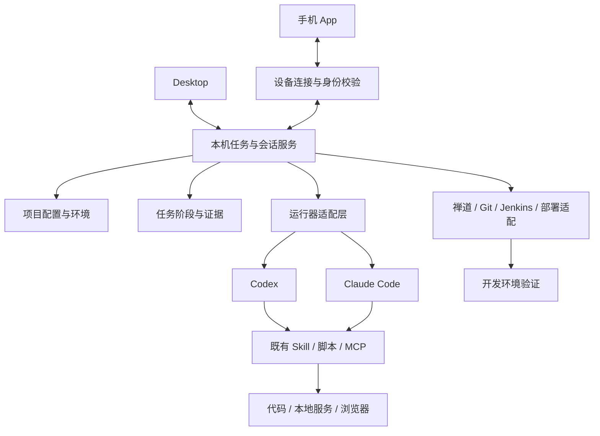

# SmartDD 产品需求文档（PRD）

产品名称：SmartDD（暂用当前目录名，正式名称待确认）  
目标版本：V0.1（首版范围建议）  
文档版本：V1.0  
创建日期：2026-10-14  
状态：需求讨论稿，可作为概要设计输入；尚未选定开发底座。

本稿中，“已明确”来自用户描述；“建议”是为形成可实现方案提出的产品规则；“待确认”不会被当成已经决定的事实。用户原文中的 Cloud Code 暂按 Claude Code 理解，具体客户端和 DeepSeek 接入方式待确认。

---

# 第一章 文档概述

## 1. 文档编制目的

明确一套以项目为中心、通过手机管理固定电脑上的编码 Agent 的产品需求。覆盖需求开发、禅道 Bug 处理、本地验证、代码提交、Jenkins 构建及开发环境部署验证，作为产品设计、研发选型和测试验收的依据。

核心目标：让用户离开电脑后，仍能发起开发任务、了解真实执行进度、查看证据、处理必要交互，并推动任务完成。

## 2. 文档分发与指导范围

适用于产品、桌面端、移动端、本机执行服务、集成适配与测试人员。首版建议以个人使用、单台常驻 Mac 设备、多项目为范围；多人协作及多设备调度后续扩展。

本文是产品需求，不定义已经实现的接口、数据库表或 SDK 调用。具体技术契约在选型和代码核验后形成。

## 3. 参考文档

| 来源 | 用途 | 核验范围 |
| --- | --- | --- |
| 用户提供的工作流与构想 | 主要需求依据 | 本次对话 |
| [Orca：stablyai/orca](https://github.com/stablyai/orca) | 项目工作区、终端、浏览器、手机联控参考 | 官方 README 与官网；未实机验收 |
| [Yoda 候选：lovstudio/yoda](https://github.com/lovstudio/yoda) | 项目、任务、Agent、Skill 与上下文管理参考 | 官方 README；用户所指“手工传的那个”尚未通过完整 URL 确认 |
| [Paseo：getpaseo/paseo](https://github.com/getpaseo/paseo) | 本机服务、多 Agent、跨端与插件方案参考 | 官方 README 与插件文档；未实机验收 |
| [腾讯 BrowserSkill](https://github.com/Tencent/BrowserSkill) | 本机浏览器测试能力参考 | 官方 README；与用户现有安装版本的对应关系待确认 |
| [参考项目调研与选型建议](./参考项目调研与选型建议.md) | 已发现能力、缺口及验证路线 | 与本稿配套 |

## 4. 名词、术语与缩略词

| 名词 | 本文定义 |
| --- | --- |
| 项目 | 一组代码库、运行方式、环境、外部系统和工具配置的业务单元 |
| 执行设备 | 常驻运行代码、Agent、服务和浏览器的电脑，例如 Mac mini |
| Agent 工具／运行器 | Codex、Claude Code 等实际执行编码任务的客户端；首版主要评估 CLI 或可支持的程序接口 |
| 模型配置 | 运行器所使用的模型、服务商及认证配置，与运行器本身分开管理 |
| Skill | 指导 Agent 完成 Java、SSH、数据库、禅道、浏览器等工作的既有能力说明及脚本 |
| MCP／连接器 | Agent 或系统访问外部工具的调用机制；能否使用取决于实际宿主和适配器 |
| 任务 | 有目标、阶段、状态及产物的工作，例如修复一个 Bug；可包含多个会话 |
| 会话 | 绑定某个项目、工作目录及运行器的对话和执行上下文 |
| 环境 | 数据库、配置、目标服务和服务器等资源的命名集合，例如本地、开发、测试、生产 |
| 工作区 | 某次任务实际执行的目录、分支和运行资源；可使用现有目录或 git worktree |
| 证据 | 命令退出码、日志、截图、测试报告、提交记录、构建记录和部署记录等可检查产物 |

---

# 第二章 版本概述

## 1. 产品简介

### 1.1 产品定位

SmartDD 是以项目为中心的移动开发工作台。项目集中管理代码、环境与工具配置；任务管理从需求或 Bug 到验证、构建、部署的进度；会话让用户与不同 Agent 协作。手机和桌面共享同一个本机任务状态。

产品的核心组织关系为：**项目 → 任务 → 会话／执行步骤 → 证据与交付记录**。

建议新建任务时选择项目、任务来源、Agent 工具和执行环境；进入自由会话时至少选择项目和 Agent 工具。环境只有在具体操作需要时才要求明确，以免闲聊或需求讨论先填大量配置。

### 1.2 当前工作方式（已明确）

1. 沟通或调研，整理现状、目标和需求文档。
2. 使用 Codex 开发，并调用 Java、SSH、数据库和禅道等 Skill。
3. 通过 Codex 或用户称作 Cloud Code 的工具执行本地单测。
4. 启动本地服务，再通过 Codex 桌面内置浏览器／Computer Use，或另一套 Agent 配合腾讯浏览器 Skill 做验收。
5. 本地代码、数据库和浏览器已经可以协同工作，希望保留这条执行链路。

### 1.3 使用场景

| 场景 | 用户期望 |
| --- | --- |
| 文档驱动开发 | 在手机提交需求文档，让 Agent 梳理、实施、测试并交付 |
| 禅道 Bug 处理 | 查看 Bug，复现后修复，未复现时形成说明并按项目规则退回 |
| 离开电脑后的协作 | 查进度、补信息、看差异或截图、继续任务 |
| 代码交付 | 检查修改范围，提交、推送，再触发指定 Jenkins 构建 |
| 开发环境验证 | 部署明确版本到开发环境，验证原问题及关键回归项 |
| 多项目切换 | 每个项目使用自己的目录、环境和外部系统，不重复拼接上下文 |

## 2. 本次版本目标

### 2.1 首版成功标准（建议）

用户完成一次桌面配置后，可以只用手机处理一个真实禅道 Bug：查看 → 复现 → 修复 → 本地复测 → 提交及推送 → Jenkins 构建 → 开发环境部署 → 部署后验证，并查看每阶段的证据。

常规流程不要求用户回到电脑。需要首次登录、操作系统授权或浏览器人工交互时，应显示阻塞原因和接管路径，不将这类情况包装成自动完成。

### 2.2 范围与优先级

| 范围 | V0.1 建议 | 后续扩展 |
| --- | --- | --- |
| 用户与设备 | 个人使用，一台常驻 Mac 执行设备 | 多用户、角色、多设备任务分配 |
| 客户端 | 桌面配置与操作，手机操作与查看；手机系统待确认 | 其他桌面系统、更完整的 Web 入口 |
| Agent | Codex、Claude Code 两种运行器 | DeepSeek Harness、OpenCode 等 |
| 项目 | 多项目；每个项目支持登记多个代码目录及服务 | 更复杂的跨项目依赖 |
| Skill | 接入并核验用户已有 Skill、脚本、MCP 配置 | Skill 分发、版本中心与共享市场 |
| 任务来源 | 自然语言、文档、禅道 Bug | GitHub、Jira 等更多工单 |
| 交付链路 | 本地测试、浏览器测试、Git、一个实际 Jenkins Job、开发环境部署验证 | 更多流水线及测试环境流程 |
| 生产配置 | 可以登记，默认用于上下文识别或按项目授权访问 | 生产发布另行定义，不纳入首版成功标准 |
| 并发 | 跨项目受资源限制并发；共享资源默认排队 | 完整的多工作区资源隔离和批量 Bug 调度 |

前期只支持两个运行器，也应在接口上允许扩展。首版不追求完整 IDE、任意手机编辑代码、多 Agent 竞赛或全自动生产发布。

### 2.3 阶段交付建议

| 阶段 | 可交付结果 | 退出条件 |
| --- | --- | --- |
| M0：技术验证 | 候选底座上的跨端会话与本机工具链验证 | 手机能发起任务；两个运行器能访问测试项目和所需工具；拿到一次浏览器测试证据 |
| M1：远程开发基础 | 项目、设备、环境、会话、文档任务、执行证据及重连 | 手机完成一次文档驱动的开发和本地验收 |
| M2：Bug 流程 | 禅道列表、复现分支、修复复测、Git 提交与推送 | 手机完成一个真实 Bug 的本地交付，并正确记录未复现分支 |
| M3：V0.1 闭环 | Jenkins、开发环境部署、部署后验证和发布记录 | 通过 2.1 中的完整成功标准 |

M0–M2 是实施里程碑，不能替代用户要求的完整首版闭环。不在没有验证的情况下给出固定工期。

## 3. 核心技术路线与模型设计

### 3.1 总体执行方式（建议）

手机负责发起任务、查看结果和处理交互；本机服务负责持久化任务状态、运行 Agent、调用工具和汇总产物；桌面端负责初始配置、详细检查和人工接管。

Agent 负责分析与执行建议；任务服务负责保存状态和处理确定性的阶段转移。测试是否通过、构建是否成功、部署的是哪个版本，应由实际工具结果支持。

资源操作既可以复用现有 Skill，也可以由连接器实现。凡是要稳定显示在手机页面上的结果，都需要转换成统一记录；首版不要求重写用户已经可用的工具。

### 3.2 三个执行维度

| 维度 | 例子 | 规则 |
| --- | --- | --- |
| 执行位置 | Mac mini 上运行 Agent 和本地 Java 服务 | 由项目绑定设备和工作区决定 |
| 数据与配置环境 | 本地服务连接开发数据库 | 与执行位置独立选择，不能以“本地运行”推断数据库也是本地 |
| 发布目标 | 将 Jenkins 产物部署到开发服务器 | 每次发布记录明确的环境、应用及版本 |

任务须显示这三个维度，防止“本地测试”被误理解为所有资源都在本地。

### 3.3 核心业务对象（建议）

| 对象 | 主要信息 | 关系 |
| --- | --- | --- |
| 执行设备 | 名称、在线状态、能力检测、配对设备 | 承载项目和执行步骤 |
| 项目 | 名称、代码目录、运行方式、配置版本 | 包含环境、连接器和任务 |
| 环境 | 名称、资源、测试入口、访问策略 | 供任务中的具体操作引用 |
| 运行器配置 | 工具、可执行入口、模型配置引用、能力 | 用于创建会话 |
| 任务 | 来源、目标、范围、状态、当前阶段 | 包含会话和步骤 |
| 会话 | 运行器、原生会话标识、目录、消息、状态 | 属于项目及可选任务 |
| 执行步骤 | 输入、实际操作、开始结束时间、结果、尝试次数 | 指向证据和外部记录 |
| 证据 | 类型、内容或附件、来源、关联版本 | 支撑复现、测试和完成结论 |
| 交付记录 | 提交 SHA、推送分支、构建编号、产物、部署和验证 | 贯通代码版本到环境版本 |
| 凭据引用 | 类型、保存位置、可用范围 | 被连接器和运行器使用，不作为普通配置明文同步 |

以上是概念模型，不是已实现的数据库表。

### 3.4 现有底座与自研边界

公开资料显示，三个参考项目都提供多 Agent 工作能力，且都有移动协作相关入口。Paseo 提供本机 daemon 和跨端插件；Orca 提供工作区、浏览器和手机联控；Yoda 候选强调任务、Skill 和上下文管理。具体比较见配套调研。

**建议先验证 Paseo 插件扩展路线，并保留 Yoda 二次开发候选。**最终选择以实测结果为准。项目多环境、禅道业务动作、任务阶段、Jenkins 产物追踪和部署证据是本产品要重点补齐的业务能力。

### 3.5 宿主能力边界

1. 不假定通过第三方产品启动 Codex CLI，就会继承 Codex Desktop 内置 Chrome Use、Computer Use 或桌面插件能力。
2. 每个运行器分别核验 Skill 路径、配置文件、MCP、脚本依赖、凭据与可见工具；同一个 Skill 文件不等于同一套运行能力。
3. 腾讯 BrowserSkill 的官方说明提供 CLI 与浏览器扩展方案，可作为统一浏览器通道的候选；本机安装、登录态、截图回传和无人值守运行仍须实测。[官方说明](https://github.com/Tencent/BrowserSkill)
4. 能力不支持时显示明确限制，允许选择已核验的通道或请求接管，不静默更换工具或模型。
5. 手机端访问的 localhost 是手机自身。本地页面预览须由受认证的代理或隧道转发到执行设备，或以截图、报告提供查看。

---

# 第三章 功能性需求及规格说明

## 1. 整体业务逻辑说明

### 1.1 文档驱动开发

选择项目和工具 → 上传／选取文档 → 梳理需求和验收点 → 形成任务步骤 → 开发 → 单测 → 启动服务 → 浏览器验收 → 查看差异与交付报告 → 按指令提交、推送、构建、部署及验证。

已有明确需求可以直接执行；存在影响实现范围或验收标准的缺失信息时，在手机上补充。需求文件更新后保留版本，识别其对已完成开发和测试的影响。

### 1.2 禅道 Bug 处理

选择项目 → 拉取 Bug → 选择具体 Bug → 检查复现条件 → 复现 → 分支处理：

- 已复现：记录失败证据 → 分析根因 → 修复 → 单测及本地复测 → 交付代码 → 构建 → 部署开发环境 → 部署后验证 → 按项目规则回写禅道。
- 未复现：记录环境、版本、步骤和实际结果 → 形成未复现说明 → 按项目配置的动作退回或请求补充信息。
- 无法开展复现：环境、账号、数据或依赖缺失 → 等待补齐 → 再次复现；不能归为“未复现”。

“退回”“解决”“关闭”等外部动作须映射到实际禅道版本和项目规范，不直接把内部任务状态套成禅道状态。用户明确要求不能复现就打回，产品应支持这条规则；是否自动回写以及退回给谁需配置清楚。

### 1.3 自然语言指令与快捷操作

| 用户输入 | 预期动作 | 需要明确的信息 |
| --- | --- | --- |
| 先帮我拉一下禅道 Bug | 拉取当前项目的 Bug 列表 | 查询范围可用项目默认值 |
| 复现第一个 | 针对手机当前列表快照的第一个 Bug 建任务 | 显示具体 Bug ID；后续列表刷新不改变目标 |
| 解决并复测 | 在当前任务中执行根因分析、修复和本地复测 | 当前任务及测试环境 |
| 提交代码并构建 | 执行项目定义的提交、推送、构建流程 | 分支、远端、提交范围及 Jenkins Job |
| 部署到开发环境验证 | 部署明确产物并验证 | 产物版本和开发环境 |
| 按这个文档做 | 创建文档任务并提炼验收点 | 文档版本、项目和实现范围 |

指令应转换成可见的任务步骤。用户能看到已经执行到哪里、哪些尚未执行、下一步依赖什么。

### 1.4 任务状态与阶段

建议将任务状态与业务阶段分开：

| 状态 | 含义 |
| --- | --- |
| 待执行 | 已创建，未开始 |
| 排队中 | 等待工作区、浏览器或其他资源 |
| 执行中 | 有正在运行的步骤 |
| 等待用户 | 需要补充信息、处理运行器交互或项目策略要求的决策 |
| 等待条件 | 设备、依赖服务或环境暂不可用 |
| 已暂停 | 已请求暂停，且执行到可暂停边界 |
| 失败 | 当前步骤明确失败，保留恢复入口 |
| 已完成 | 满足该任务所选的完成标准 |
| 已取消 | 任务终止；已发生的外部操作仍保留记录 |

业务阶段可为：需求梳理、复现、分析、修复、单测、本地复测、代码提交、代码推送、构建、部署、环境验证、禅道回写。

例如“执行中／本地复测”“失败／构建”是完整状态。“Agent 发完一轮回答”“单测通过”“禅道显示已解决”都不能单独代表整个发布任务完成。

## 2. 功能性需求分类、分项索引

| 序号 | 一级功能 | 二级功能／功能名称 | 优先级／范围 |
| --- | --- | --- | --- |
| F01 | 项目管控 | 项目与代码目录 | P0 |
| F02 | 项目管控 | 多环境与外部系统配置 | P0 |
| F03 | 设备与工具 | 执行设备与配对 | P0 |
| F04 | 设备与工具 | Agent 运行器及模型配置 | P0 |
| F05 | 设备与工具 | Skill 与工具能力检测 | P0 |
| F06 | 会话与任务 | 创建、继续及管理会话 | P0 |
| F07 | 会话与任务 | 文档任务与阶段执行 | P0 |
| F08 | 禅道 Bug | Bug 查询与详情 | P0 |
| F09 | 禅道 Bug | 复现、修复及回写 | P0 |
| F10 | 本地验证 | 服务、单测及浏览器验收 | P0 |
| F11 | 代码交付 | 差异、提交与推送 | P0 |
| F12 | 构建发布 | Jenkins 构建与产物 | P0 |
| F13 | 构建发布 | 部署与环境验证 | P0，开发环境 |
| F14 | 跨端联控 | 手机工作台与结果查看 | P0 |
| F15 | 跨端联控 | 断线恢复与通知 | P0 |
| F16 | 执行规则 | 授权策略与操作记录 | P0 |

P0 表示首版完整闭环必需。详细编辑器、远程桌面视频、语音输入、批量 Bug 及多设备调度为后续候选。

## 3. 项目管控

### 3.1 项目与代码目录（F01）

**功能描述**：创建多个项目，登记其代码库、服务及日常开发方式，形成所有任务共享的项目上下文。

**用户角色**：项目使用者／配置维护者；首版可为同一人。

**输入**：项目名称、说明、执行设备、一个或多个本机代码目录、代码库用途、默认分支、安装／构建／测试／启动命令、服务端口、入口 URL、项目规则文件及默认工具。

**基本事件流**：
1. 在桌面创建项目并选取本机目录，支持同一业务项目登记前端、后端等多个仓库。
2. 检测目录可访问性、Git 状态、运行依赖及命令配置。
3. 保存配置，显示检测结果和配置版本。
4. 手机同步项目列表，创建任务时引用该项目。

**输出**：项目配置、可运行状态、检测结果和项目任务列表。

**界面原型**：项目列表 → 项目详情；详情含概览、代码与服务、环境、连接器、工具、任务六个区域。手机优先展示概览和任务，详细配置可在桌面完成。

**约束规则**：目录是执行设备上的路径；不同项目不能串用凭据、目录或运行资源。移动或删除目录时明确提示。修改配置保留版本，运行中的任务使用启动时的配置快照；需要变更时明确记录。归档项目保留历史记录。

### 3.2 多环境与外部系统配置（F02）

**功能描述**：以项目组织数据库、服务器、禅道和 Jenkins 配置，允许多个环境及多实例资源。

**用户角色**：项目配置维护者。

**输入**：以下配置及凭据引用。

| 配置组 | 主要字段 | 用途 |
| --- | --- | --- |
| 环境 | 名称、用途、应用配置、测试入口、数据准备方式 | 明确运行与验证上下文 |
| 数据库 | 类型、主机、端口、库名／schema、账号或凭据引用、读写范围、可选隧道 | 查询与复现、测试数据准备 |
| 服务器 | 地址、端口、用户、SSH 认证引用、应用路径、服务控制方式、验证入口 | 远程验证与部署 |
| 禅道 | 地址、版本／接口方式、认证引用、产品／项目映射、Bug 筛选、字段映射、回写规则 | 查询和处理项目 Bug |
| Jenkins | 地址、认证引用、Job 路径、参数模板、源码引用参数、产物定位、可选部署阶段 | 精确触发构建和关联产物 |
| 辅助依赖 | 必需中间件、测试账号、健康检查及数据隔离要求 | 保障复现和复测可执行 |

**基本事件流**：
1. 为项目创建本地、开发、测试、生产等命名环境。
2. 关联资源和外部系统；同一个环境可有多个数据库及服务器。
3. 执行连接测试，保存各项实际结果。
4. 配置默认测试环境和发布目标；任务操作引用明确的环境。

**输出**：环境列表、资源配置、连接检测报告及动作可用性。

**界面原型**：环境卡片列出数据库、服务器、服务入口；连接器页面分别配置禅道和 Jenkins，显示上次检测时间与结果。

**约束规则**：连接测试不能通过发布、数据修改来证明连接成功。账号密码、Token、SSH 密钥以凭据引用保存，手机配置和日志不显示完整密钥。生产资源策略独立于开发和测试环境；首版部署目标限定为已配置的开发环境。实际支持的数据库、禅道认证方式和 Jenkins 参数需按用户环境确认。

## 4. 设备与工具

### 4.1 执行设备与配对（F03）

**功能描述**：让手机连接常驻电脑，并了解设备是否能够执行项目任务。

**用户角色**：设备所有者。

**输入**：设备名称、配对请求、本机服务配置、网络连接方案及操作系统授权状态。

**基本事件流**：
1. 桌面启动本机服务并展示设备状态。
2. 用户通过二维码或一次性配对码绑定手机。
3. 手机验证设备，显示项目及可操作任务。
4. 设备持续上报心跳和执行状态；用户可撤销已配对手机。

**输出**：可信设备关系、在线状态、服务与浏览器可用性。

**界面原型**：桌面设备设置；手机设备列表和离线提示。首版一台执行设备也保留清楚的设备名称。

**约束规则**：手机断线不终止本机任务。设备休眠、服务退出与网络断线分别显示；不能承诺关机后继续执行。开机自启、本机服务恢复及 Mac 图形会话下的浏览器可用性须实测。连接采用受认证的直连、VPN 或加密中继方案，具体路线选型后确定。

### 4.2 Agent 运行器及模型配置（F04）

**功能描述**：统一登记 Codex 与 Claude Code，并允许分别配置模型和能力。

**用户角色**：设备／工具配置维护者、任务执行者。

**输入**：运行器类型、可执行入口、版本、认证状态、模型配置引用、启动参数、运行权限、支持的会话恢复和中断能力。

**基本事件流**：
1. 检测本机已安装的运行器，允许手工登记。
2. 分别完成认证及最小任务测试。
3. 展示启动、消息、事件、恢复、停止和工具调用能力。
4. 新任务选择运行器；运行器选择与模型选择分开。

**输出**：可用运行器列表、模型配置及能力检测报告。

**界面原型**：工具管理页面包含 Codex、Claude Code 卡片；会话创建页展示工具、模型配置和可用状态。

**约束规则**：首版至少支持这两种工具的启动、消息和结果接收。恢复／中断能力按实际运行器验证，不用模拟成功。Claude Code 使用 DeepSeek 的具体配置和兼容性待确认；不能推定该配置具备所有 Claude 原生功能。不得通过界面自动化点击桌面 App 作为默认集成方式，除非正式验证并明确接受其限制。

### 4.3 Skill 与工具能力检测（F05）

**功能描述**：复用已有 Java、SSH、数据库、禅道和 Browser Skill，让用户知道每个项目、运行器实际能够调用什么。

**用户角色**：配置维护者、任务执行者。

**输入**：Skill 目录或路径、项目规则、脚本依赖、MCP 配置、凭据引用、浏览器扩展／CLI 配置。

**基本事件流**：
1. 登记既有能力位置，并按照所选运行器的规则加载。
2. 分别核验发现、加载、依赖、连接及最小调用。
3. 创建任务时展示实际可用能力；缺失必需能力时显示原因。
4. 能力升级后保留版本记录，对新任务重新核验。

**输出**：按项目和运行器划分的能力矩阵、失败原因及修复入口。

**界面原型**：能力列表包含名称、用途、位置、版本、运行器、可用状态和检测结果。

**约束规则**：不能把“磁盘存在文件”视为“当前会话已加载且可调用”。不覆盖用户现有 Skill 内容。无法迁移的桌面宿主能力标记为不支持，保留原桌面流程或选择已核验的独立通道。

## 5. 会话与任务

### 5.1 创建、继续及管理会话（F06）

**功能描述**：手机或桌面选择项目和工具，创建、查看、继续、暂停或终止会话。

**用户角色**：任务执行者。

**输入**：项目、运行器、模型配置、消息、附件、关联任务和工作区。

**基本事件流**：
1. 选择项目及工具，系统展示工作区、可用能力和执行范围。
2. 发送指令，显示运行器输出、工具事件和必要交互。
3. 用户补充要求或查看结果；桌面与手机同步同一会话。
4. 离开页面后继续执行；返回时读取持久化消息和当前状态。
5. 请求暂停或停止，系统展示实际执行结果。

**输出**：会话历史、执行事件、产物及当前状态。

**界面原型**：会话页顶部固定显示项目、任务、工具、工作区和环境摘要；中部为对话及步骤卡片；底部为输入和快捷动作。

**约束规则**：暂停是请求，不保证能即时中断构建或部署。手机与桌面同时输入按顺序处理，同一轮不重复提交。切换运行器时创建新的原生会话，并交接目标、已做工作、文件和证据；不宣称跨运行器原生上下文无损迁移。现有 Codex Desktop 会话导入为后续待验证能力。

### 5.2 文档任务与阶段执行（F07）

**功能描述**：将文档或自然语言目标转成有范围、验收点和阶段的任务，支持分步执行和按已授权范围连续执行。

**用户角色**：需求提出者、任务执行者。

**输入**：文档或正文、项目、目标、验收要求、运行器、执行环境及允许完成到的阶段。

**基本事件流**：
1. 上传文档或引用项目已有文档；首版建议支持 Markdown、文本、可提取文本的 PDF，其他格式待确认。
2. 系统保存原文和版本，Agent 提炼范围、待澄清点和验收标准。
3. 创建阶段计划；明确范围后执行开发与验证。
4. 每完成一个步骤保存实际结果和证据。
5. 在授权范围内继续执行，失败或条件不足时停在具体步骤。

**输出**：需求摘要、任务计划、实现产物、测试报告及交付记录。

**界面原型**：任务详情包含目标、来源、阶段时间线、会话、证据和交付；文档可在手机查看。

**约束规则**：文档内容不能自动扩大项目授权范围。步骤可重试，修改输入后重新检查依赖。代码变化使相关测试结论失效；环境变化影响对应复现和验证结果。完成标准可以是“本地交付”或“部署验证完成”，创建时明确。

## 6. 禅道 Bug

### 6.1 Bug 查询与详情（F08）

**功能描述**：在手机按项目查看禅道 Bug，直接进入复现或修复任务。

**用户角色**：开发者。

**输入**：项目映射、状态、指派人、优先级、版本、关键词等筛选条件。

**基本事件流**：
1. 在项目内拉取 Bug，展示列表及同步时间。
2. 打开详情，查看标题、步骤、预期和实际结果、版本、附件及历史。
3. 选择具体 Bug，发起复现或关联已有任务。
4. 刷新时同步最新外部状态，提示已有处理中任务。

**输出**：Bug 列表、详情、附件和内部任务关联。

**界面原型**：手机项目页的 Bug 标签；列表有状态、优先级、处理标记，详情有“复现”“修复并复测”“补充信息”等动作。

**约束规则**：Bug ID 与禅道实例、项目共同标识目标，避免同号串项目。“第一个”绑定操作时的列表快照。连接失败不能显示为空列表。字段和筛选能力以实际禅道版本为准。

### 6.2 复现、修复及回写（F09）

**功能描述**：将单个 Bug 变成可追踪的复现、修复、复测及回写流程。

**用户角色**：开发者；外部 Bug 的接收角色按禅道项目规则配置。

**输入**：Bug 快照、目标代码版本、测试账号和数据、环境、复现步骤、回写规则。

**基本事件流**：
1. 检查代码、服务、账号、数据、浏览器及所需依赖。
2. 按 Bug 步骤运行，记录预期、实际结果和失败证据。
3. 已复现则分析根因和修改范围，修复后执行针对性验证及回归。
4. 未复现则整理说明，按配置规则退回；条件不足则请求补齐。
5. 完成所需交付阶段后回写原因、验证环境、版本和证据链接／摘要。

**输出**：复现结论、根因、修复差异、复测报告、禅道动作记录。

**界面原型**：Bug 详情显示关联任务和阶段；复现结论卡片区分“已复现”“本次未复现”“条件不足”。

**约束规则**：“本次未复现”不等于 Bug 不存在。未复现回写需包含具体版本、环境、执行步骤和结果。退回／解决／关闭／指派动作的语义、目标人与自动化策略待项目配置。不能因为环境不可用自动退回。回写失败单独保留重试入口，不重新执行已完成的修复或部署。外部状态变化时先核对，避免覆盖他人处理结果。

## 7. 本地验证

### 7.1 服务、单测及浏览器验收（F10）

**功能描述**：从项目配置启动依赖及本地服务，执行单测和浏览器验证，并在手机提供可检查结果。

**用户角色**：开发者。

**输入**：工作区、启动／停止命令、环境配置、端口、健康检查、测试命令、浏览器通道、测试账号和验收点。

**基本事件流**：
1. 检查端口、依赖和环境，启动服务并等待实际就绪。
2. 执行单测，收集退出码和测试结果。
3. 通过已核验的浏览器通道访问正确服务、执行验收点。
4. 保存截图、必要日志及步骤结果，汇总通过、失败和未执行项。
5. 根据任务策略保留或停止服务，仅操作任务拥有的进程。

**输出**：服务状态、单测报告、浏览器验收报告、失败定位和媒体证据。

**界面原型**：任务中的测试卡片：用例、结果、环境、代码版本、耗时、截图与日志；页面预览作为可选能力。

**约束规则**：退出码成功并不自动表示业务验收通过；没有运行的用例标为未执行。修复前后证据关联明确代码版本。不同 worktree 不自动隔离端口、数据库和浏览器登录态，须另行分配或排队。共享数据库的数据准备需配置允许范围及清理方式。浏览器登录／验证码等人工步骤提供接管或等待条件入口。

## 8. 代码交付

### 8.1 差异、提交与推送（F11）

**功能描述**：在手机检查任务修改，并按照项目规则提交和推送指定代码。

**用户角色**：开发者。

**输入**：目标仓库、分支、任务修改范围、差异、提交说明、远端及项目交付策略。

**基本事件流**：
1. 展示文件清单、关键差异、测试结论及未完成项。
2. 识别任务启动前已存在的修改和其他任务修改。
3. 执行提交并记录 commit SHA；执行推送并验证远端结果。
4. 将已推送版本交给构建步骤。

**输出**：差异报告、提交 SHA、推送分支和远端状态。

**界面原型**：手机差异页支持文件切换和片段查看；交付卡片分别显示“已提交”“已推送”。

**约束规则**：不能提交无关修改或覆盖用户已有工作。commit 与 push 是独立步骤；推送失败不标记为代码已可构建。冲突需要停留在具体冲突状态，不用强制推送自动解决。同目录写入任务互斥，或使用分支／worktree；跨仓库任务记录各仓库 SHA。

## 9. 构建发布

### 9.1 Jenkins 构建与产物（F12）

**功能描述**：触发指定 Jenkins Job，跟踪排队、运行和完成结果，建立代码版本到产物的关联。

**用户角色**：开发者。

**输入**：项目 Jenkins 配置、Job、环境、已推送的源码引用、参数和构建动作标识。

**基本事件流**：
1. 校验 Job 与参数，显示目标和源码版本。
2. 提交构建请求并持久化请求、队列记录和后续构建编号。
3. 跟踪排队及构建状态，收集日志和实际完成结果。
4. 记录实际源码版本、产物位置及可验证的版本信息。

**输出**：队列／构建记录、状态、日志、构建版本及产物引用。

**界面原型**：构建卡片展示 Job、分支／SHA、排队状态、构建编号、参数摘要、结果和日志。

**约束规则**：收到触发请求不等于构建成功。Job 仅支持分支构建时，必须读取并核对实际构建 SHA，不能假定是刚推送的提交。网络超时可能导致“结果未知”，先核对是否已有构建再重试；需要本机幂等记录及可用的 Job 关联机制，不能假定 Jenkins 原生支持任意幂等参数。构建失败不进入部署。

### 9.2 部署与环境验证（F13）

**功能描述**：部署指定构建产物到开发环境，并再次验证 Bug 或需求验收点。

**用户角色**：开发者／该环境的发布操作者。

**输入**：产物引用、版本信息、目标环境和服务器、发布步骤、健康检查、验证用例、上一可用版本及可用回滚方式。

**基本事件流**：
1. 核对产物、版本、环境和目标服务。
2. 按项目配置，通过 Jenkins 部署阶段或既有 SSH 发布流程执行。
3. 检查目标环境实际运行版本及健康状态。
4. 执行原 Bug 或需求验收点及关键回归，保存环境证据。
5. 验证成功后完成该阶段；失败时记录问题，按已配置策略停止或回滚。

**输出**：部署记录、实际运行版本、健康检查和环境验证报告、回滚结果（如有）。

**界面原型**：发布卡片展示环境、版本、步骤、结果、验证证据和已配置的回滚入口。

**约束规则**：部署与验证是独立步骤。部署命令返回成功后仍需确认目标服务版本；健康检查通过不等于 Bug 修复验证通过。同一应用同一环境的发布互斥。Jenkins 已包含部署时，不能再由 SSH 重复发布。回滚仅在项目定义了可用操作且授权范围覆盖时执行，不承诺所有项目可自动回滚。首版不执行生产发布。

## 10. 跨端联控

### 10.1 手机工作台与结果查看（F14）

**功能描述**：手机提供项目入口、Bug、任务、会话和交付结果，让用户无需阅读整个终端输出就能处理当前事项。

**用户角色**：开发者。

**输入**：项目选择、文本指令、附件、快捷动作及必要交互答复。

**基本事件流**：
1. 打开工作台查看设备在线状态、执行中和待处理任务。
2. 进入项目，查看任务、Bug、环境及工具状态。
3. 新建任务或进入会话发送指令。
4. 查看阶段报告、截图、差异、构建和部署记录，继续下一步。

**输出**：与桌面一致的任务事实和用户操作结果。

**界面原型**：建议一级入口为工作台、项目、任务、设置；项目内含概览、Bug、会话、环境。任务详情集中承载阶段、会话、证据和交付，避免在多个列表重复寻找同一个 Bug。

**约束规则**：关键动作显示具体项目、Bug、环境或代码版本。日志可展开，默认显示结论和失败原因。首版手机端优先任务操作和查看；复杂配置、完整编辑和系统授权可在桌面完成。iOS、Android 或两端优先级待确认。

### 10.2 断线恢复与通知（F15）

**功能描述**：手机切后台、网络断开或重新登录后恢复任务状态，通知用户关键进展。

**用户角色**：开发者。

**输入**：设备事件、任务事件、客户端已读位置、通知偏好和操作请求标识。

**基本事件流**：
1. 本机持久化任务、步骤及消息事件，手机增量接收。
2. 手机断开时本机继续执行，界面显示最后同步时间。
3. 重连后获取最新状态与遗漏事件，确认未回执操作的实际结果。
4. 任务完成、失败或等待用户时发送通知，点击进入相应任务。

**输出**：恢复后的任务事实、去重后的操作和可定位通知。

**界面原型**：连接状态条、重新同步提示、任务通知与待处理列表。

**约束规则**：手机在线不是任务运行的前提。重连不重复执行同一操作。设备重启后恢复持久化记录并核对原进程及外部状态，不盲目重新部署。中断后是否能恢复 Agent 原生会话取决于运行器能力。通知默认聚焦完成、失败、需用户操作及设备异常，不逐条推送工具日志；推送权限和手机系统后台限制需实测。

## 11. 执行规则

### 11.1 授权策略与操作记录（F16）

**功能描述**：用户按项目和环境定义任务能连续执行到哪里，并查看每项实际操作的来源与结果。

**用户角色**：项目配置维护者、任务执行者。

**输入**：动作类型、项目、环境、允许范围、连续执行策略、具体任务指令及运行器权限。

**基本事件流**：
1. 配置项目动作规则，例如读取 Bug、修复复测、提交推送、触发开发构建和部署。
2. 创建任务时展示所选执行范围；明确指令可授权对应步骤。
3. 范围内步骤连续执行，不反复询问同一事项。
4. 需要新增目标、扩大修改范围或处理未授权动作时，在手机展示具体待决策内容。
5. 保存用户指令、配置版本、运行器事件、实际操作和结果。

**输出**：项目策略、任务授权范围、必要交互及操作记录。

**界面原型**：项目的自动化规则页；任务中的执行范围摘要及具体交互卡片。

**约束规则**：不把每一步都设计成审批。项目可预授权“修复到本地复测”或“提交推送并完成开发环境部署验证”等范围。流程约束应由实际执行通道实现，不能只靠提示词声称限制了一个拥有任意 Shell 权限的 Agent；适配器能否执行权限边界须在 M0 核验。浏览器会话、终端输出及任务附件需要按凭据规则避免泄露密钥。记录只保留可观察的消息、事件和结果，不要求保存模型内部思考。

## 12. 异常与恢复要求

| 情况 | 预期处理 | 禁止误判 |
| --- | --- | --- |
| 数据库或依赖不可用 | 等待条件，显示连接失败证据 | 不能记为 Bug 未复现 |
| 测试账号过期 | 等待补齐账号或接管登录 | 不能记为业务测试失败或成功 |
| Agent 额度、认证或进程异常 | 保存已有结果，等待恢复或明确选择其他运行器 | 不能静默换模型或重复已完成操作 |
| 本地端口占用 | 识别进程归属，按配置换端口或排队 | 不能杀掉其他项目服务 |
| 同目录多个任务修改 | 排队或使用独立工作区 | 不能混合提交多个任务的变更 |
| Git 推送失败 | 保留本地提交，重试推送或处理冲突 | 不能触发依赖远端代码的构建 |
| 构建／部署触发后连接超时 | 记为结果未知，查询外部实际状态 | 不能自动重复触发 |
| Jenkins 成功但版本不符 | 停止部署，明确实际构建版本 | 不能按目标版本已成功交付展示 |
| 部署成功但复测失败 | 保留运行版本和失败证据，按策略处理 | 不能关闭整个任务 |
| 禅道回写失败 | 仅重试回写，保留其余完成阶段 | 不能重复修复、构建或发布 |
| 用户取消任务 | 中止可中止步骤，核对已触发外部操作 | 不能宣称撤销了已完成部署 |
| 手机或设备断开 | 区分最后已知状态和实际在线状态 | 不能沿用缓存显示“实时执行中” |

## 13. 非功能要求（建议验收基线）

| 维度 | 要求 |
| --- | --- |
| 状态一致性 | 本机持久化状态为统一依据；手机和桌面读取同一任务及版本；缺少最新信息时显示同步时间 |
| 可恢复性 | 保存步骤开始、结束、尝试次数及外部标识；重启后能核对执行状态并从明确边界恢复 |
| 操作去重 | 重复点击、断线重发和事件重复到达，不产生重复提交、构建、部署或 Bug 回写 |
| 版本追踪 | 能从任务查到代码 SHA、实际构建版本、产物、实际部署版本和对应测试结果；多仓库分别记录 |
| 资源归属 | 进程、目录、端口、浏览器会话及环境发布锁关联到任务；清理只作用于本任务资源 |
| 配置与凭据 | 配置可备份且有版本；凭据用操作系统安全存储或选定凭据方案；备份和手机同步默认不带明文密钥 |
| 附件与日志 | 手机能查看截图及报告；大日志支持分页／增量；保留期和容量上限可配置，默认值待确认 |
| 交互延迟 | 建议在线正常网络下，关键状态通常在 3 秒内更新；实际目标在连接方案和 M0 测试后确定 |
| 可维护性 | 运行器与外部连接器可分别升级；记录版本和能力变化，避免一次升级破坏全部项目 |
| 成本可见性 | 能获取的 Agent 用量和耗时展示真实数据；无法获取时显示未知，不捏造精确费用 |

## 14. 首版验收标准

| 编号 | 验收操作 | 通过标准 |
| --- | --- | --- |
| A01 | 配置两个项目，各运行一项任务 | 使用正确目录、配置和凭据，无跨项目串用 |
| A02 | 同一业务项目登记前后端两个目录 | 可启动所需服务并分别记录仓库版本 |
| A03 | 分别选择 Codex 和 Claude Code | 两个运行器都能创建会话、执行最小修改并返回真实结果；不支持的能力明确显示 |
| A04 | 通过手机给出需求文档 | 形成范围与验收点，完成修改、本地验证及可查看的交付报告 |
| A05 | 查询禅道并选择“第一个”后刷新列表 | 任务始终关联最初选定的 Bug ID，不随排序变化 |
| A06 | 处理能复现的真实 Bug | 有修复前失败证据、根因、差异、修复后验证和回归结果 |
| A07 | 处理本次未复现的 Bug | 输出环境、版本、步骤和结果；按项目规则退回或待确认回写动作 |
| A08 | 在数据库不可用时发起复现 | 停在等待条件，不自动认定 Bug 未复现或退回 |
| A09 | 手机查看单测和浏览器结果 | 能查看通过／失败／未执行项、截图或日志，且证据关联代码版本 |
| A10 | 提交、推送并触发 Jenkins | 分别显示提交和推送状态；构建记录能核对实际源码版本与产物 |
| A11 | 构建成功后部署开发环境 | 目标正确，显示实际运行版本；原验收点通过后才完成环境验证 |
| A12 | 构建失败或部署后验证失败 | 停在对应步骤，保留报告和恢复路径，不显示任务全部完成 |
| A13 | 手机断网、重连并重复点构建 | 本机任务继续；查询到同一操作结果，不重复触发构建 |
| A14 | 同项目两个任务申请同目录／浏览器资源 | 有明确排队或隔离行为，修改、测试和清理不相互干扰 |
| A15 | 完整流程后禅道回写失败 | 只重试回写，不重复提交、构建或部署 |
| A16 | 查看配置、日志及附件 | 密钥不会作为普通字段、日志或手机消息明文显示 |
| A17 | 本机服务重启后恢复任务 | 核对实际进程和外部状态，完成步骤不被盲目重新执行 |
| A18 | 手机完成一个真实 Bug 全流程 | 常规情况下无需回到电脑即可完成复现到开发环境验证；所有阶段证据可追溯 |

## 15. 待确认事项

这些事项影响选型和实施细节，不影响本稿对产品主体的梳理。

| 事项 | 当前依据／建议 | 影响 |
| --- | --- | --- |
| Yoda 完整地址 | 暂以 lovstudio/yoda 为候选；用户说是 GitHub 上“手工传的那个” | 判断参考项目是否正确及二次开发条件 |
| Cloud Code 的具体产品 | 暂按 Claude Code；DeepSeek 接入方式未核验 | 运行器及模型适配 |
| 手机系统 | iOS、Android 或双端待确认 | 首版客户端和通知方案 |
| 产品使用范围 | 建议先个人使用 | 是否需要组织、成员及角色权限 |
| 固定设备和运行要求 | Mac mini 为候选，系统版本、登录方式、是否持续保持图形会话待确认 | 自启、浏览器与无人值守可用性 |
| 现有项目的运行配置 | Java 版本、构建工具、前后端服务及测试命令待登记 | 自动启动和测试范围 |
| 现有 Skill 清单与路径 | 用户已有 Java、SSH、数据库、禅道和浏览器能力 | 能否完整继承工具链 |
| 数据库类型及测试数据规则 | 多环境已明确；具体类型、数据准备与写入范围待确认 | 复现可靠性和并发方式 |
| 禅道版本和动作规则 | 查询范围、退回动作、接收人、解决／关闭时点待确认 | 准确回写 |
| Git 流程 | 分支命名、直推或 PR、是否允许自动提交推送待按项目配置 | 提交和 Jenkins 触发衔接 |
| Jenkins Job 和部署现状 | 地址、认证、参数、SHA／分支构建、是否已带部署待确认 | 避免错版本和重复部署 |
| 默认连续执行范围 | 建议允许按项目预授权，减少重复交互 | 手机端操作体验 |
| 手机查看本地页面的深度 | 截图与报告为必需；实时预览和完整人工控制待确认 | 代理、隧道或视频能力 |
| 是否沿用已有桌面会话 | 首版建议创建平台管理的新会话；历史导入另测 | 集成复杂度 |

