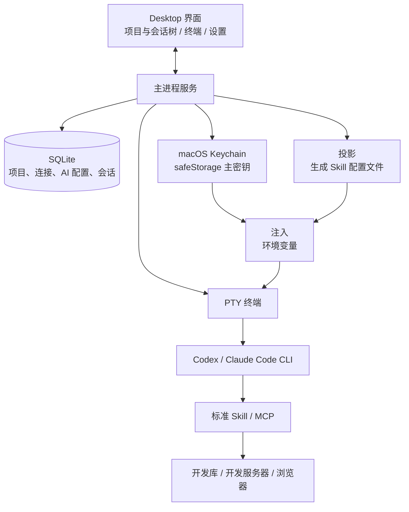

# SmartDD 产品需求文档（PRD）

产品名称：SmartDD（暂用当前目录名，正式名称待确认）  
目标版本：一期（Mac Desktop）  
文档版本：V0.2（取代 V0.1）  
更新日期：2026-10-15  
状态：一期方向已确认；M0–M3 已交付（见各里程碑说明文档），本稿随实现同步更新。  
代码仓库：<https://github.com/uprxiao/SmartDD.git>（SmartDD 自身用 Git 管理；它所管理的目标项目以 SVN 为主，两者无关）

本稿中，“已明确”来自用户描述；“建议”是为形成可实现方案提出的产品规则；“待确认”不会被当成已经决定的事实。

---

## 修订说明（V0.1 → V0.2）

| 项目 | V0.1 | V0.2（本稿） |
| --- | --- | --- |
| 一期范围 | 手机为一等公民，Desktop 负责配置 | **一期只做 Mac Desktop**；手机端放二期，先 iOS |
| 运行器接入 | 运行器适配层，CLI／程序接口待评估 | **只用 CLI**：Desktop 内嵌终端，在项目目录下拉起 Codex／Claude Code |
| 模型接入 | 运行器配置与模型配置分开 | 引入 **AI 配置**：同一运行器可配多套，如 CC-DS、CC-Claude、CC-GLM |
| 版本控制 | Git（提交、推送、SHA） | **SVN，且不纳入管理**；提交、更新继续在 CLI 里用 `svn`。原 F11 移出 |
| 禅道、Jenkins、部署 | P0 | **二期**；禅道 Skill 需重写，细化后再设计 |
| 项目资源 | 项目 → 环境 → 资源 | 在**项目上直接配置**代码目录、数据库（带环境标签）、服务器 |
| 配置存储 | 本机任务服务 | **SQLite 为唯一来源**；通过“投影”和“注入”交给现有 Skill |
| 密钥存储 | Keychain 逐条存放，配置存引用 | **safeStorage 加密后存 SQLite**，主密钥由 Keychain 托管（M0 验证后确认） |
| Skill | 识别并复用现有 Skill | **标准 Skill**：代码与数据分离，内置并按项目装载，由 Desktop 统一维护 |
| 会话 | 平台管理的会话 | **项目 → 会话树**，保存原生 session ID，支持 resume；Desktop 关闭则终端随之关闭 |
| 底座 | 验证 Paseo 插件，保留 Yoda 二开 | **新建 Electron 项目**，参考 Yoda 的架构、界面和主题，按模块搬运，**不 fork** |
| 验收 | A01–A18，手机跑完 Bug 全流程 | **V1–V10**，Desktop 端到端的只读调查流程，对象为 AIS 项目 |

V0.1 的异常处理原则（不静默失败、不把条件不足当成业务失败）继续保留。

V0.2 内补充（2026-10-14，用户确认）：界面上“会话”称为“任务”；F05 新增首页布局（首条消息输入框、项目与 AI 配置下拉）和任务搜索（⌘K），均排入 M3。见 §4.2。

---

# 第一章 文档概述

## 1. 文档编制目的

明确 SmartDD 一期的需求：在 Mac Desktop 上以项目为中心，集中管理代码目录、数据库、服务器和 AI 工具配置；在项目目录下拉起终端会话运行 Codex／Claude Code；并让这些配置通过标准方式被 Skill 正确使用。作为技术探针、设计、开发和验收的依据。

核心目标：让用户说“去开发库查一下某数据”“看一下开发服务器上的日志”时，Agent 能自动匹配到**当前项目**登记的资源，且用户能核实它连的确实是正确的那一个。

## 2. 适用范围

适用于产品、桌面端开发和测试人员。一期面向个人使用、单台 Mac、多项目；二期再扩展手机端、禅道、Jenkins 与多人分发。

本文是产品需求，不定义已实现的接口或数据库表。具体技术契约在技术探针后形成。

## 3. 参考文档

| 来源 | 用途 | 核验范围 |
| --- | --- | --- |
| [SmartDD PRD V0.1](./SmartDD_V0.1_PRD.md) | 前一版需求 | 已被本稿取代，保留作历史 |
| [参考项目调研与选型建议](./参考项目调研与选型建议.md) | 技术栈、底座选型、搬运清单、Skill 现状 | 与本稿配套，V0.2 同步更新 |
| [Yoda：lovstudio/yoda](https://github.com/lovstudio/yoda) | 架构、界面、主题、数据模型的主要参考 | 读取了仓库元数据、目录树、`package.json`、LICENSE、数据库 schema 与部分源码；未安装运行 |
| [Orca：stablyai/orca](https://github.com/stablyai/orca)、[Paseo：getpaseo/paseo](https://github.com/getpaseo/paseo) | 二期手机端、终端稳健性参考 | 同上，未安装运行 |
| 用户现有 Skill（`~/.codex/skills`） | 现有数据库、SSH 等 Skill 的配置方式 | 读取了配置字段结构（已脱敏）和脚本参数，未读取任何密钥 |

## 4. 名词、术语与缩略词

| 名词 | 本文定义 |
| --- | --- |
| 项目 | 一个业务系统的集合：代码目录、数据库、服务器及项目默认值，例如 AIS |
| 代码目录 | 项目的本机源码路径，可有多个（后端、前端）；启动 Agent 时作为工作目录 |
| 运行器 | Codex、Claude Code 等 CLI 本身 |
| AI 配置 | 运行器加一组环境变量（接口地址、令牌引用、模型名等）和启动参数，例如 CC-DS、CC-Claude、Codex |
| 会话 | 项目下的一次 CLI 使用，绑定项目、AI 配置、工作目录和运行器的原生 session ID。**界面上称为“任务”**（与 Yoda 一致），文档中“任务”与“会话”同义 |
| 会话树 | Desktop 左侧“项目 → 会话”的层级列表 |
| 原生 session ID | Codex、Claude Code 自己的会话标识，用于 resume |
| 标准 Skill | 只含代码和说明、不含个人数据的 Skill 包，带版本号，由 Desktop 统一维护 |
| 投影 | 把 SQLite 中的项目配置生成为现有 Skill 能读取的配置文件 |
| 注入 | 拉起终端时，把密钥和配置路径写入该进程的环境变量 |
| 凭据引用 | 指向密钥表中一条加密记录的标识。密钥用 Electron safeStorage 加密后存入 SQLite，主密钥由 macOS Keychain 托管；配置里只存引用，任何地方都不存明文 |
| 环境标签 | 数据库或服务器所属的环境，如开发、测试、生产 |

---

# 第二章 版本概述

## 1. 产品简介

### 1.1 产品定位

SmartDD 是 Mac 上的 AI 开发工作台。项目集中管理代码目录、数据库和服务器；在项目下可以开多个终端会话，用不同的 AI 配置运行 Codex 或 Claude Code；配置存放在本机 SQLite，并以标准方式提供给 Skill，使 Agent 能自动连到当前项目的正确资源。

核心组织关系：**项目 → 会话**；项目下挂代码目录、数据库、服务器。

### 1.2 当前工作方式（已明确）

1. 只使用 CLI：Codex 和 Claude Code，配合各自的 Skill 和 MCP。
2. 已验证两个 CLI 都能通过 MCP 控制浏览器。
3. Claude Code 通过 `.zshrc` 里的函数切换账号，可接 DeepSeek、智谱、Kimi、Claude 等模型。
4. 数据库、SSH 等 Skill 各自有配置文件，密码放在环境变量或本地文件中。
5. 公司项目使用 SVN，提交和更新直接用 `svn` 命令。

### 1.3 一期使用场景

| 场景 | 用户期望 |
| --- | --- |
| 项目内日常开发 | 在项目名下开多个会话，每个会话在项目目录里直接工作 |
| 查开发数据 | 说“去开发库查一下 XX”，自动匹配到该项目的开发数据库 |
| 看服务器环境 | 说“看一下开发服务器上的日志”，自动匹配到该项目的开发服务器 |
| 多模型切换 | 同一项目下，按需选择 CC-DS、CC-Claude、Codex 等拉起会话 |
| 恢复历史会话 | 重新打开 Desktop 后，在会话树里 resume 之前的会话 |
| 给他人使用 | 后续他人安装 Desktop、选好工具，标准 Skill 默认可用（一期预留，二期分发） |

## 2. 本次版本目标

### 2.1 一期成功标准（已确认）

用户在 Desktop 上新建项目，配好代码目录、开发数据库和开发服务器，选定项目和 AI 配置后在终端拉起 Agent，让它调查某个具体功能的**业务逻辑、数据存储、当前环境、对应页面和数据库**，并能核实 Agent 实际使用的是该项目登记的资源。

验收对象：**AIS 项目**（已确认）。

### 2.2 范围与优先级

| 范围 | 一期 | 二期及以后 |
| --- | --- | --- |
| 客户端 | Mac Desktop | 手机端（先 iOS，再 Android） |
| 项目与代码目录 | 多项目，每项目多个代码目录 | 跨项目依赖 |
| 数据库配置 | 多环境标签，连接测试 | 更多数据库类型、连接组增强 |
| 服务器配置 | SSH 连接，连接测试 | 部署元数据的深度使用 |
| AI 配置 | Codex、Claude Code，多套配置 | 更多运行器 |
| 会话 | 内嵌终端、会话树、resume | 手机查看与操作 |
| Skill | 标准 Skill 内置、按项目装载、Skill／MCP 识别 | 分发、版本中心、共享 |
| 配置传递 | 投影加注入 | Skill 直接查询 Desktop（CLI 或 MCP） |
| 版本控制 | 不管理 SVN | 只读展示 SVN 信息（可选） |
| 禅道 | 不做 | Skill 重写，拉取指派、状态流转、已解决等 |
| Jenkins、部署 | 不做 | 构建、部署与环境验证 |
| 生产库 | 可登记，默认只读 | 另行定义 |

不做：SVN 提交、更新、回滚的任何管理；tmux 持久化；Desktop 内嵌浏览器；git 相关功能。

### 2.3 里程碑

| 阶段 | 内容 | 退出条件 |
| --- | --- | --- |
| M0 技术探针 | 新建 Electron 骨架；验证 node-pty 与 better-sqlite3 的原生模块构建和打包；验证 Claude Code、Codex 的 session ID 获取与 resume；验证 Keychain 存取；验证 Skill 装载位置 | 能拉起两个 CLI，拿到 session ID，resume 成功 |
| M1 骨架 | 窗口、侧边栏、主题、设置页、进程间通信、SQLite 迁移 | 能启动并保存一项设置（2026-10-14 已达成，见 `M1_骨架说明.md`） |
| M2 项目与连接 | 项目、数据库、服务器的增删改，密钥加密存储，连接测试 | V8 通过（2026-10-14 已达成，见 `M2_项目与连接说明.md`） |
| M3 会话 | AI 配置、终端会话树、resume；首页（首条消息输入框、项目与 AI 配置下拉）、任务搜索（⌘K） | V1、V7、V10 通过（2026-10-15 已达成，见 `M3_会话说明.md`） |
| M4 Skill 与注入 | 内置 Skill、按项目装载、投影、注入、Skill／MCP 识别 | V2、V3、V4、V6、V9 通过 |
| M5 端到端验收 | 用 AIS 项目跑完整流程 | V1–V10 全部通过 |

不在没有验证的情况下给出固定工期；M0 结果出来后再估算。

## 3. 核心技术路线

### 3.1 总体架构（建议）



Desktop 负责保存配置、拉起终端、传递配置和展示状态；Agent 负责分析和执行。Skill 实际连了哪个资源，以 Skill 自己的记录为准，不以 Agent 的回答为准。

### 3.2 实现方式与技术栈（建议）

- **新建项目，不 fork**。参考 Yoda 的架构和处理逻辑，包括前后端分层、界面、配色和主题，按模块搬运，只保留基础配置功能和一期核心功能。
- **技术栈**：Electron、React 19、electron-vite、better-sqlite3 加 drizzle、node-pty、xterm、Tailwind。理由：三个参考项目全是 Electron，终端 PTY 方案成熟，二期手机端可与其 Node 技术栈衔接；选 Tauri 则无法复用任何代码，核心后端要用 Rust 重写。详见调研文档。
- **合规**：Yoda 为 Apache-2.0，搬运代码需保留版权声明并在 `NOTICE` 中注明来源与改动。
- **仓库结构（已确认）**：本仓库只放 Desktop，工程直接位于仓库根目录（`src/`、`package.json` 等），`docs/` 放文档。二期若做手机 App 和服务端，各自另建独立仓库，不放进本仓库。

### 3.3 核心业务对象（建议）

| 对象 | 主要信息 | 关系 |
| --- | --- | --- |
| 项目 | 名称、别名、说明、默认 AI 配置、配置版本 | 包含代码目录、数据库、服务器、会话 |
| 代码目录 | 标签、路径、版本控制类型（仅标记） | 属于项目；作为会话工作目录 |
| 数据库 | 环境标签、类型、地址、库、账号、凭据引用、访问级别、别名 | 属于项目 |
| 服务器 | 环境标签、地址、端口、账号、认证方式、凭据引用、别名 | 属于项目 |
| AI 配置 | 名称、运行器、环境变量模板、启动参数、凭据引用 | 全局；被会话引用 |
| 会话 | 标题、项目、AI 配置、工作目录、原生 session ID、状态、时间 | 属于项目 |
| 标准 Skill | 名称、版本、说明、需要的配置类型 | 按项目启用 |
| 凭据引用 | 密钥表中加密记录的标识（SQLite 存 safeStorage 密文） | 被数据库、服务器、AI 配置引用 |

以上是概念模型，不是已实现的数据库表。

### 3.4 配置如何到达 Skill（已确认方案）

SQLite 是唯一来源。Desktop 用两种方式把配置交给 Skill：

| 方式 | 做法 | 用途 |
| --- | --- | --- |
| 投影 | 把项目配置生成为现有 Skill 能读取的配置文件，写到 Desktop 自己的数据目录 | 传递结构化信息（地址、库名、别名等） |
| 注入 | 拉起终端时，把配置文件路径和密钥写入该进程的环境变量 | 传递配置位置和密码，使其不落盘 |

**统一的配置解析约定**（建议作为所有标准 Skill 的规范）：`--config` 参数优先，其次是环境变量，最后才是 Skill 目录内的默认路径。

**现有 Skill 的核验结果**：

| Skill | 现状 | 需要的改动 |
| --- | --- | --- |
| `remote-password-ssh` | 已支持 `--config` 与 `REMOTE_SERVERS_CONFIG` | 无 |
| `project-db-diagnostics` | 仅有 `--config`，默认读 Skill 目录；密码走 `passwordEnv` | 补充环境变量 |
| `operate-databases` | 仅有 `--config`，默认读 Skill 目录；有写操作审批机制 | 补充环境变量；审批机制原样保留 |

要点：
- `remote-password-ssh` 的“项目级配置”依赖 git 根目录查找，SVN 项目找不到，需走环境变量，这与本方案一致。
- 其配置格式要求密码字段为明文。一期保持兼容（已确认），改为读环境变量放后续；若需改动，须保证规范和标准化。
- 凡需改动现有 Skill，改动应小、统一、向后兼容，且不覆盖用户现有的 Skill 内容。

### 3.5 宿主能力边界

1. 只使用 CLI。Desktop 不通过界面自动化点击其他桌面 App。
2. 浏览器验证依赖 Codex、Claude Code 在 CLI 中已验证的浏览器 MCP；一期 Desktop 不内嵌浏览器。
3. 不假定 Skill 文件存在就等于当前会话已加载；识别分三级显示（见 F07）。
4. 运行器自身的会话数据（Claude Code、Codex 各自的会话文件）由运行器管理，Desktop 只保存引用。
5. Desktop 关闭时，其拉起的终端随之结束，不做后台保活。

---

# 第三章 功能性需求及规格说明

## 1. 整体业务逻辑

```
新建项目（代码目录 + 数据库 + 服务器，保存到 SQLite）
   → 连接测试（数据库、服务器各自只读探测）
   → 选定项目与 AI 配置，新建会话
   → Desktop 在项目目录拉起终端：注入环境变量，投影配置文件
   → 用户向 Agent 提问（查数据、看环境、看页面、读代码）
   → Skill 通过注入的路径和密钥连接对应资源
   → 用户核对 Skill 的实际连接记录，确认连的是正确资源
```

## 2. 功能分类、分项索引

| 序号 | 功能 | 说明 | 优先级 |
| --- | --- | --- | --- |
| F01 | 项目与代码目录 | 创建、编辑、归档项目；登记代码目录 | P0 |
| F02 | 数据库配置 | 多环境标签、连接测试 | P0 |
| F03 | 服务器配置 | SSH 连接信息、连接测试 | P0 |
| F04 | AI 配置 | 运行器、环境变量、多套配置 | P0 |
| F05 | 终端会话与会话树 | 首页新建任务、拉起、保存、resume、任务搜索 | P0 |
| F06 | 标准 Skill 管理 | 内置、版本、按项目装载 | P0 |
| F07 | Skill 与 MCP 识别 | 发现、配置有效性、加载状态 | P0 |
| F08 | 配置投影与注入 | 配置到 Skill 的传递 | P0 |
| F09 | 凭据与安全 | safeStorage 加密存储、脱敏、日志 | P0 |
| F10 | 设置与外观 | 主题、通用设置 | P1 |

二期预留（本版不展开）：禅道、Jenkins 与部署、手机端、Skill 分发与版本中心、SVN 信息展示。

## 3. 项目管理

### 3.1 项目与代码目录（F01）

**功能描述**：创建多个项目，为每个项目登记代码目录，使 Agent 在该目录下启动。

**输入**：名称、别名（用于自然语言匹配，如 AIS）、说明、一个或多个代码目录（标签、路径、版本控制类型）、默认 AI 配置、规则文件路径（可选）。

**基本事件流**：
1. 新建项目，选择代码目录。
2. 校验目录是否存在、是否可读写；检测是否为 SVN 工作副本，仅作标记。
3. 保存到 SQLite，出现在左侧会话树。
4. 此后在该项目下新建会话，工作目录默认为所选代码目录。

**输出**：项目配置、检测结果。

**界面原型**：左侧为项目列表，点击展开其会话；右侧为项目详情，含概览、代码目录、数据库、服务器、会话五个区域。

**约束规则**：
- 不要求目录是 git 仓库，也不执行任何 `git init`。
- 同一路径不能属于两个活跃项目。
- 目录被移动或删除时标记为“不可用”并提示，不自动删除项目。
- 删除项目只删除 SmartDD 内的记录，不删除代码目录和外部资源。
- 归档的项目保留历史会话。
- 配置修改保留版本号；已拉起的会话使用启动时的配置，修改仅对新会话生效，界面须提示。
- 不在代码目录中写入未经确认的文件，以免污染 SVN 工作副本。

### 3.2 数据库配置（F02）

**功能描述**：在项目上登记数据库，区分环境，使“去开发库查”能匹配到正确的一个。

**输入**：环境标签（开发、测试、生产、自定义）、类型、主机、端口、库名、schema、账号、密码（加密存储）、别名、访问级别、是否项目默认库。

**基本事件流**：
1. 在项目的“数据库”区域新增一条，选择环境标签。
2. 填写连接信息，密码保存为凭据引用。
3. 执行连接测试，显示结果、耗时和失败原因。
4. 保存；同一项目可有多个同环境的库。

**输出**：数据库配置列表、连接测试结果。

**界面原型**：按环境分组的卡片列表，每张卡片显示别名、库名、环境、访问级别、上次测试时间与结果。

**约束规则**：
- 数据库类型一期必须支持 MySQL；PostgreSQL 及盘维等类型取决于现有 Skill 能力，待确认。
- 连接测试只做握手加简单只读语句，不得写入数据。
- 失败原因分类显示：网络不通、认证失败、库不存在、超时。
- 访问级别（只读、读写）只是传给 Skill 的元数据；真正的写操作审批仍由 Skill 负责（例如 `operate-databases` 的计划加确认机制），Desktop 不介入、不绕过。
- 生产库可登记，默认只读，界面标记明显，创建会话时显示提示。
- 不同项目的数据库互相隔离，不能串用。

### 3.3 服务器配置（F03）

**功能描述**：在项目上登记服务器，使“看一下开发服务器”能匹配到正确的一台。

**输入**：环境标签、IP、端口、用户、认证方式（密码或密钥）、凭据、别名、sudo 策略、备注、应用根目录与日志路径（可选）。

**基本事件流**：与 F02 相同，连接测试为 SSH 握手加一条只读命令。

**约束规则**：
- 连接测试不执行任何变更操作。
- 密码和私钥口令加密存储（见 F09）。
- 同一项目可有多台服务器，按环境标签和别名区分。
- 与 `remote-password-ssh` 的现有字段保持对应，便于投影。

## 4. AI 配置与会话

### 4.1 AI 配置（F04）

**功能描述**：把 Codex 和 Claude Code 登记为运行器，并允许为同一运行器配置多套 AI 配置（如 CC-DS、CC-Claude、CC-GLM）。

**输入**：名称、运行器、可执行文件、环境变量模板（接口地址、令牌引用、模型名、思考强度等）、启动参数、显示颜色。

**基本事件流**：
1. 检测本机已安装的运行器及版本，允许手工指定路径。
2. 新建 AI 配置，选择运行器并填写环境变量；令牌加密存储。
3. 可选：从现有 `.zshrc` 的账号函数导入（展示脱敏预览，用户确认后再导入）。
4. 执行最小测试：用该配置拉起 CLI 并确认能启动。
5. 健康状态（2026-10-15 用户确认）：
   - 测试 = 用该配置非交互地问 CLI 一句“只回复 `SMARTDD-OK-<随机码>`”，回复里有这个码即通过；在空临时目录运行，60 秒超时，同一配置同时只跑一个测试，输出中的令牌脱敏后再存。
   - 自动测试只在导入、新建、修改了启动方式（可执行文件、环境变量、启动参数、运行器）之后触发；只改名称或颜色不触发；应用启动时不测试。设置页每个配置有“测试”按钮可手动测。
   - 运行中的任务也回写状态：CLI 会话文件里出现 API 错误（认证、欠费、模型不存在等）即更新该配置的状态，正常回复则标为可用；以最后一次发生的为准。CLI 启动后很快异常退出且没有任何 API 回复，也记为失败。
   - 结果存库（状态、分类、来源、原因、耗时、时间）。认证 / 欠费 / 模型 / 配置不完整 / 找不到命令 / 其他错误为“不可用”（红），429 / 5xx / 网络 / 超时 / 回复不符为“异常”（黄）。
   - 界面：设置页状态灯 + 悬停说明（时间、来源、原因）；首页和恢复面板的下拉标出不可用的配置但仍可选；任务页底栏圆点；非手动触发而变为不可用时弹提示。

**约束规则**：
- 运行器和 AI 配置分开：运行器是程序，AI 配置是“程序加一组环境”。
- 令牌不明文保存、不明文显示、不写入日志。导入后建议提醒用户处理 `.zshrc` 中的明文。
- 不得推定某个 AI 配置具备 Claude 的全部原生功能；能力差异以实际测试为准。
- 跨 AI 配置 resume：M0 已验证 CDSH（DeepSeek）与 claude 互相 resume 同一 Claude Code 会话可用，含思考块也不报错（见 M0 报告 P4）。界面可提供“换 AI 配置恢复”，但须提示：不同配置的模型能力不同，且只验证过这两套配置。

### 4.2 终端会话与会话树（F05）

**功能描述**：在项目目录下拉起内嵌终端运行 CLI，保存会话以便再次 resume。

**输入**：项目、AI 配置、代码目录、初始提示（可选）。

**基本事件流**：
1. 点“新建任务”（⌘N）进入首页，或在项目下点“新建任务”（自动选中该项目）；在输入框下方选择项目和 AI 配置，按需填写首条消息。
2. Desktop 注入环境变量、投影配置，在项目代码目录下拉起 PTY 并启动运行器；首条消息非空时作为启动参数交给 CLI（参照 Yoda），为空时只打开终端。
3. 会话出现在项目的会话树下；Desktop 记录原生 session ID。
4. 重新打开 Desktop 后，在侧栏单击历史任务，自动按原项目、目录和 AI 配置执行 resume；原配置已删除、未开始、不可恢复等情况显示恢复面板（见下方约束规则）。
5. 可重命名、归档、删除会话（只删除 SmartDD 记录）。
6. “搜索任务”（⌘K）按标题、首条消息、项目名查找任务，选中后跳到该任务（运行中则切到其终端，已结束则可恢复）。

**输出**：会话树、终端界面、会话状态。

**界面原型**（参照 Yoda 首页）：

- 左侧边栏：顶部依次为“新建任务 ⌘N”“搜索任务 ⌘K”“设置”；下方为“项目”列表，每个项目可展开其任务；任务行右侧运行中为绿圈、CLI 已退出（终端仍在）为灰圈，其余显示距上次启动的相对时间（now / 5m / 3h / 2d / 2mo / 1y）；底部一行显示“SmartDD + 版本号”。
- 首页（新建任务）：中间为多行输入框（首条消息）；输入框下方一排下拉——**项目**（列出已登记项目，项目有多个代码目录时可再选目录）和 **AI 配置**（列出用户配置的 CC-DS、CC-Claude、Codex 等）；右下角为“启动”按钮，⌘↩ 亦可启动。
- 不做 Yoda 输入框上的分支选择、Skills 菜单、附件、语音、对比等控件（git 不在一期范围，Skill 由 F06 按项目装载）。
- 任务页（2026-10-15 用户确认，按 Yoda 任务页改版）：
  - 顶栏左侧为**任务标签**（2026-10-15 用户确认）：每个打开的任务一个标签，显示运行状态圆点（运行中绿色）和标题，悬停显示“项目 / 任务”；末尾“+”新建任务。侧栏单击任务时打开新标签（已打开则切过去）并自动 resume；新标签放在当前标签之后。点 ×（或中键）关闭标签即结束该任务的会话，焦点移到右侧标签，没有右侧则左侧，全部关闭后回首页。标签只在内存中，重启后不恢复。
  - 顶栏右侧为结束（或恢复）按钮和 ⓘ 任务信息弹层，弹层列出项目、AI 配置、模型、工作目录、已注入的变量名清单（不含值），CLI 退出后在弹层中“换配置”。
  - 终端占满主区，是可交互的真实终端：xterm 参数、字体栈（用户字体后接 Menlo、PingFang SC 等含中文的等宽字体）、按键映射（Shift+Enter 换行、⌘⌫ 删到行首、⌥←/→ 按词移动、⌘←/→ 行首行尾、有选区时 ⌘C 复制）与 Yoda 一致；PTY 环境带 `TERM=xterm-256color`、`COLORTERM=truecolor`，并按终端区域大小启动，避免 CLI 首屏错位。终端里的链接用系统浏览器打开（仅 http/https）。停止的任务在主区居中显示恢复面板。
  - 底栏：运行器图标与名称、AI 配置（颜色点 + 名称）、模型名（取配置的 `--model` 启动参数或 `ANTHROPIC_MODEL`，读不到不显示）；右侧为运行中任务数。
  - 终端下方会话面板、右侧面板、资源库、置顶放到后续里程碑。

**约束规则**：
- 同一项目可同时开多个会话；不同项目的会话互相隔离。
- Desktop 关闭时终端随之结束；重新打开**不自动恢复进程**（启动时不批量拉起任务）。用户打开某个已停止的任务（侧栏单击、⌘K、项目页）时，自动用任务记录的 AI 配置 resume，不再询问；每打开一次标签只自动尝试一次（关闭标签后再打开会重新尝试）；“未开始”“不可恢复”、原配置已删除、已归档的任务，以及用户主动“换配置”时，仍显示恢复面板由用户选择（2026-10-15 用户确认，参照 Yoda）。
- 关闭 Desktop 时若有运行中的会话，须提示确认。
- 若无法获取某会话的原生 session ID，须标记“不可恢复”并说明原因，不得假装可恢复。
- 首页的项目、AI 配置未选齐时不能启动；默认选中上次使用的项目和 AI 配置（无则用通用设置里的默认 AI 配置）。
- 首条消息作为命令行参数传给 CLI，不经过 shell 拼接，避免引号和特殊字符被解释。
- 会话只保存元数据（标题、项目、AI 配置、目录、session ID、时间、状态），**不持久化终端全文**，以避免密钥落盘（建议，待确认）。
- Claude Code、Codex 获取 session ID 与 resume 的具体方式，以 M0 验证结果为准。
- 同一目录可同时运行多个 Codex 任务，各自的会话不得互相认领；换用另一套 AI 配置恢复时，仍使用会话原来所在的 `CLAUDE_CONFIG_DIR` / `CODEX_HOME`。
- 项目下有运行中的任务时不能删除项目（提示先结束）。
- 两个 CLI 都是在**第一条用户消息之后**才写会话文件。拉起后未发过消息的会话没有可恢复的内容：Claude 会话再次打开时应沿用原 ID 以 `--session-id` 新开，而不是 `--resume`；Codex 会话标记为“未开始”。

## 5. Skill 与配置传递

### 5.1 标准 Skill 管理（F06）

**功能描述**：把现有可用的 Skill 整理为标准 Skill，内置在 Desktop 中，按项目装载，并由 Desktop 统一维护。

**输入**：Skill 包、版本、项目启用关系。

**基本事件流**：
1. Desktop 内置一份标准 Skill 清单，每个 Skill 带版本号。
2. 新建项目时，默认启用清单中的 Skill，可按项目开关。
3. 拉起会话时，保证对应 Skill 可被运行器发现。
4. Desktop 里查看、升级、停用 Skill；升级保留版本记录，只对新会话生效。

**约束规则**：
- **代码与数据分离**：标准 Skill 只含代码和说明，不含任何个人数据（连接信息、密码）；数据来自 SQLite。
- 不覆盖用户现有的 Skill 目录和内容；内置 Skill 与用户自有 Skill 并存时须显示来源。
- **不向代码目录写入**，因为 SVN 工作副本中新增文件会出现在 `svn status` 里，有被误提交的风险。装载方式按 M0 验证结果（见 M0 报告 P6/P8）：
  - Claude Code：把内置 Skill 打成插件放在 Desktop 数据目录，拉起时用 `--plugin-dir` 指定，只对该会话生效；Skill 名带插件前缀（如 `smartdd:xxx`）。
  - Codex：没有按会话添加 Skill 目录的参数。投影到用户级 `~/.agents/skills`，对未在该项目启用的 Skill 用 `-c skills.config=[{path=…,enabled=false}]` 按会话停用（用户已于 2026-10-14 确认）。投影只增删 Desktop 自己的 Skill，不动用户已有目录。
  - MCP：Claude 用 `--mcp-config`，Codex 用 `-c mcp_servers.<名称>.*`，均按会话注入，不改全局配置。
- 一期内置清单以现有 Skill 为基础，具体清单待确认。
- 他人安装 Desktop 后默认可用的分发能力放二期，一期只保证结构上不排斥。

### 5.2 Skill 与 MCP 识别（F07）

**功能描述**：识别本机和项目下可用的 Skill、MCP，让用户知道每个运行器实际能用什么。

**基本事件流**：
1. 按运行器扫描 Skill 与 MCP 配置位置。
2. 以列表展示名称、来源、版本、所属运行器和状态。
3. 创建会话时展示该会话可用的能力；缺失必需能力时显示原因。

**状态分三级**：

| 状态 | 含义 |
| --- | --- |
| 已发现 | 在磁盘上找到 |
| 配置有效 | 配置能解析，依赖满足，路径可达 |
| 已加载 | 在实际会话里核验过可被调用；无法自动核验时显示“未核验” |

**约束规则**：不能把“磁盘存在文件”当作“当前会话已加载”。具体扫描路径以 M0 核验结果为准。

### 5.3 配置投影与注入（F08）

**功能描述**：把 SQLite 中的项目配置传递给 Skill，同时保证密钥不落盘。

**基本事件流**：
1. 拉起会话前，按所选项目生成投影文件，写入 Desktop 数据目录下的该项目目录。
2. 解密该项目所需的密钥。
3. 拉起终端时，把投影文件路径和密钥写入环境变量，其中密码变量名与 Skill 配置里的 `passwordEnv` 对应。
4. 会话顶部（顶栏 ⓘ 任务信息）显示已注入的变量名清单，不显示值。

**约束规则**：
- 投影文件写到 Desktop 数据目录，不写入 Skill 目录和代码目录。
- 写入前若目标文件已存在且内容不同，须显示差异并备份，不静默覆盖。
- 投影文件带版本和哈希，便于核对是否与 SQLite 一致。
- 仅注入当前项目的资源，不得把其他项目的密钥放入环境。
- 对要求明文密码的现有配置格式（如 `servers.json`），一期保持兼容：投影文件权限设为仅本人可读，并在 Desktop 退出时清理（建议，待确认）。
- 已知限制：环境变量对 CLI 及其子进程可见，一期接受，以“最小注入”缓解。
- 注入后须有自检，确认变量确实进入了终端进程，不能只看拉起命令成功。

## 6. 凭据与安全（F09）

**约束规则**：
- 所有密码、令牌、私钥口令用 Electron safeStorage 加密后存入 SQLite 的密钥表，配置项只存凭据引用。加密主密钥由 macOS Keychain 托管（条目名“SmartDD Safe Storage”），整个应用只有这一条 Keychain 条目。M0 已验证。
- safeStorage 不可用时直接报错，不降级为明文。
- 配置导出和备份默认不含密钥。
- 界面、日志和错误信息中的密钥一律脱敏。
- 会话记录不保存终端全文（见 F05）。
- 删除项目、数据库或服务器时，须询问是否同时删除对应的加密密钥记录。
- 一期不实现多用户权限。

## 7. 设置与外观（F10，P1）

主题（浅色、深色）与配色参考 Yoda；通用设置包括数据目录、默认 AI 配置、启动行为。界面语言支持简体中文与英文，默认简体中文，菜单栏随之切换（M1 已实现）。

## 8. 二期预留（不在本版范围）

| 方向 | 说明 |
| --- | --- |
| 禅道 | 现有 Skill 需重写。需细化：如何拉取已指派给我的 Bug、状态流转、已解决的处理、回写规则 |
| Jenkins 与部署 | 与 SVN revision 的对应关系待确认；本地修改可先不提交、不构建，只要在本地跑起来 |
| 手机端 | 先 iOS，再 Android；参考 Paseo、Yoda 的 gateway 与中继方案；前提是一期 Desktop 流程已跑通 |
| Skill 分发 | 版本中心、他人安装即用、统一维护 |
| SVN 信息展示 | 只读显示 URL 与 revision，可选 |

## 9. 异常与恢复要求

| 情况 | 预期处理 | 禁止误判 |
| --- | --- | --- |
| 代码目录不存在或被移动 | 标记“不可用”，禁止在该目录拉起会话，提示修复路径 | 不能自动换目录或自动删除项目 |
| 数据库或服务器连接测试失败 | 显示失败类别和原因，保留配置 | 不能显示为“未配置”或“正常” |
| 运行器未安装或版本不符 | 提示安装或指定路径 | 不能静默换另一个运行器 |
| AI 配置的令牌缺失 | 提示补充，不拉起会话 | 不能用其他配置的令牌代替 |
| Keychain 拒绝访问主密钥（safeStorage 不可用） | 停止注入并说明原因 | 不能降级为明文写文件 |
| 无法获取原生 session ID | 标记“不可恢复” | 不能提供无效的 resume 入口 |
| 投影文件写入失败 | 停止拉起并显示原因 | 不能在配置缺失的情况下拉起并让 Agent 自行摸索 |
| 注入自检失败 | 提示并不继续 | 不能只凭启动命令成功就认为配置已生效 |
| 关闭 Desktop 时有运行中会话 | 提示确认，说明终端将随之结束 | 不能静默杀掉进程 |
| 同一目录同时有多个会话 | 允许开启，界面提示可能存在并发修改 | 不能擅自合并或排队 |
| 修改项目配置时已有运行中会话 | 提示仅对新会话生效 | 不能让旧会话悄悄使用新配置 |

## 10. 非功能要求（建议验收基线）

| 维度 | 要求 |
| --- | --- |
| 数据位置与备份 | SQLite 与投影文件位于固定数据目录；可备份，备份默认不含密钥 |
| 安全 | 密钥只以密文形式落盘，明文只出现在目标进程环境中；日志脱敏；终端全文不落盘 |
| 可恢复性 | 重启后项目、配置、会话元数据完整；会话通过 resume 恢复，不承诺进程恢复 |
| 隔离 | 项目之间的配置、密钥、会话互不可见 |
| 平台 | macOS；芯片架构与最低系统版本待确认 |
| 可维护性 | 运行器、Skill、Desktop 可分别升级，并记录版本 |
| 许可 | 搬运 Yoda 代码须保留 Apache-2.0 声明与 NOTICE |
| 分发 | 自用阶段可不做签名公证；给他人使用前须完成签名与公证（待确认） |
| 响应 | 界面操作与终端输入无明显卡顿；具体指标待 M0 后确定 |

## 11. 一期验收标准

验收对象：AIS 项目（正式）；另建一个配置了不同开发库的对照项目（用于 V4）。所调查的具体功能由用户选定（待确认）。

| 编号 | 检查项 | 验收操作 | 通过标准 |
| --- | --- | --- | --- |
| V1 | 目录与启动 | 新建会话 | 终端工作目录是项目登记的代码目录；会话顶部显示注入的变量名清单 |
| V2 | 数据库匹配 | 说“去开发库查某表” | 数据库 Skill 实际连接的是该项目登记的开发库，**以 Skill 自身连接记录核对，不只看 Agent 回答** |
| V3 | 服务器匹配 | 说“看开发服务器上的日志” | SSH Skill 实际连接的是该项目登记的开发服务器 |
| V4 | 不串项目 | 在对照项目下做同样提问 | 连接的是对照项目的库和服务器，不会连到 AIS 的 |
| V5 | 业务闭环 | 让 Agent 调查所选功能 | 能给出业务逻辑、数据存储、当前环境、对应页面和数据库五方面的信息，且与实际情况一致 |
| V6 | 密钥安全 | 在 SQLite 文件、投影文件、日志、终端记录中搜索密码 | 除按兼容策略生成的、权限受限的投影文件外，无明文 |
| V7 | 会话恢复 | 关闭并重开 Desktop，恢复会话 | 会话树中仍有该会话；resume 后能接上之前的上下文；无法恢复的会话明确标记 |
| V8 | 连接测试 | 对数据库、服务器故意填错信息 | 显示真实且分类正确的失败原因 |
| V9 | Skill 与 MCP 识别 | 打开识别列表并拉起会话 | 内置 Skill 随项目装载并可被运行器发现；三级状态与实际一致；未核验项如实标注 |
| V10 | AI 配置 | 用 CC-DS 和 CC-Claude 各拉起一个会话 | 各自使用正确的接口地址、模型和令牌；令牌不泄露到界面和日志 |

## 12. 待确认事项

| 事项 | 当前依据／建议 | 影响 |
| --- | --- | --- |
| 验收功能 | 验收项目已确认为 AIS；具体调查哪个功能待用户选定 | V5 的验收内容 |
| 内置 Skill 清单 | 以现有数据库、SSH 等 Skill 为基础；个人数据须剥离 | F06 的范围 |
| 数据库类型范围 | MySQL 必需；PostgreSQL、盘维取决于现有 Skill | F02 的类型与测试 |
| `servers.json` 明文策略 | 一期兼容；投影文件权限受限并在退出时清理（建议） | 密钥安全与 V6 |
| 是否持久化终端全文 | 建议不持久化 | 隐私与 V6 |
| `.zshrc` 账号导入 | 已定并于 M3 实现：一次性导入，展示脱敏预览，导入后提醒原文件仍是明文 | F04 的体验 |
| 芯片架构、最低系统版本、分发对象 | 自用阶段待定，分发前须签名公证 | 打包与发布 |
| 界面语言 | 已定：中英双语，默认简体中文 | F10 |
| 生产库登记策略 | 建议默认只读并强提示 | F02 |
| SVN 信息只读展示 | 默认不做 | F01 |
