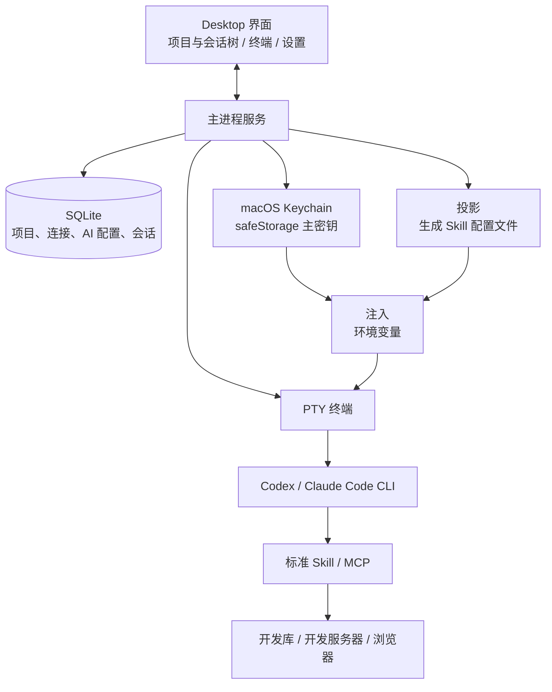

# SmartDD 产品需求文档（PRD）

> 2026-11-01 编号调整（用户确认）：当前顺序为 M10 三方接入 → [M11 应用接入标准化](里程碑/M11_应用接入标准化/需求.md)（F19-D，原M12）→ [M12 定时任务](里程碑/M12_定时任务/需求.md)（F16，原M11）。下文早期日期中的 M11 定时任务是历史编号；业务详细规则以独立阶段需求为准。

> 文档定位（2026-10-16）：本稿保留产品基础规则与历史记录。新想法统一登记到[独立需求池](需求池.md)；各阶段具体需求分别在 M 文档维护，再据此形成原型、技研和交付验收资料。本稿中的后续需求讨论保留作背景，不再作为重复维护的需求池；当前阶段安排及文档入口见[阶段索引](里程碑/README.md)。

> 2026-10-17 范围调整：用户确认 M10 为通用三方接入框架＋禅道＋邮件，M11 为定时任务；Jenkins 拆为 F19-C 留后续，飞书不纳入。禅道先打通本人指派的 Bug／需求数据，邮件优先本机 Foxmail。详细规则唯一维护于对应阶段需求；以下标注 2026-10-16 的原安排保留为历史。

> 2026-10-17 目录归档：M8–M11 已按“需求、调研、原型、技研、验收、交付”分目录，统一从[里程碑索引](里程碑/README.md)进入。M8 沿用已完成的实现与验收，原型增量和确认版本在本阶段目录留档。

产品名称：WillYou（2026-10-16 定稿；仓库、技术标识及历史文档沿用 SmartDD）\
目标版本：一期（Mac Desktop）  
文档版本：V0.2（取代 V0.1）  
更新日期：2026-10-16\
状态（2026-10-16 记录，当前进度见阶段索引）：M0–M4 已交付；M5 完成 AIS 场景列表的隔离自动化 V1–V10 验收，并补走日常 SmartDD 页面里的 CC-work 数据库统计与 173 SSH 调查（2026-10-15，见 `M5_AIS端到端验收.md`）。真实交互发现并修复 Claude 配置根和终端颜色问题。AIS 业务页面仍仅核对源码与接口映射，未包含 AIS 浏览器 UI 验收。一期新增 M6「页面与 AI 配置体验优化」，范围为 F14、F15；用户于 2026-10-16 授权按原型正式接入、验收后发布。生产实现及本机验收完成；v0.0.4 已预发布，四目标构建和七包下载核验通过。F16 定时任务本轮仅保留入口与样式。M7 范围已收敛为 F17-A：参考本地 Yoda，通过页面麦克风按钮和全局快捷键唤起已安装的 Typeless；不要求 Option 单键。用户已授权按原型实施，生产代码已接入，打包真机验收中；设置试用框真实回填已通过，完整语音验收仍进行中。F17-B 自有录音、识别整理和本机词库拆至后续，研究资料保留但不阻塞 M7。后续里程碑已确定：M8 为真实项目导入导出（F21），M9 为完整复刻 ChatGPT／Codex 文件浏览工作区（F22-A），M10 为通用三方接入及禅道／邮件（F19 共用、F19-A／B），M11 为定时任务（F16），Jenkins／F19-C 留后续。F22 已完成静态调研并拆为独立迁移文档；浏览器 F22-B 暂不指定里程碑。F18 会议与工作流、F20 文档管理继续保留需求池。M8 已按用户确认的原型正式接入，macOS arm64的48条验收通过，开发完成且尚未发布，结果见独立 M8 文档；M9–M11 尚未开始功能实现。各阶段不纳入 M7 交付，应用发布版本另定。F17–F22 均不属于 M6 或 v0.0.4 的功能交付。后续阶段进度以独立 M 需求文档及其验收记录为准。

后续需求统一收集到 [需求池](需求池.md)，各 M 文档维护具体范围；本 PRD 保留既有业务基线与历史背景。

代码仓库：<https://github.com/uprxiao/SmartDD.git>（SmartDD 自身用 Git 管理；它所管理的目标项目以 SVN 为主，两者无关）

本稿中，“已明确”来自用户描述；“建议”是为形成可实现方案提出的产品规则；“待确认”不会被当成已经决定的事实。

---

## 修订说明（V0.1 → V0.2）

| 项目 | V0.1 | V0.2（本稿） |
| --- | --- | --- |
| 一期范围 | 手机为一等公民，Desktop 负责配置 | **一期只做 Mac Desktop**；手机端放二期，先 iOS |
| 运行器接入 | 运行器适配层，CLI／程序接口待评估 | **只用 CLI**：Desktop 内嵌终端，在项目目录下拉起 Codex／Claude Code |
| 模型接入 | 运行器配置与模型配置分开 | 引入 **AI 配置**：同一运行器可配多套，如 CC-DS、CC-Claude、CC-GLM |
| 版本控制 | Git（提交、推送、SHA） | **SVN，且不纳入管理**；提交、更新继续在 CLI 里用 `svn`。原 F11 移出 |
| 禅道、Jenkins、部署 | P0 | **二期**；禅道 Skill 需重写，细化后再设计 |
| 项目资源 | 项目 → 环境 → 资源 | 在**项目上直接配置**代码目录、数据库（带环境标签）、服务器 |
| 配置存储 | 本机任务服务 | **SQLite 为唯一来源**；通过“投影”和“注入”交给现有 Skill |
| 密钥存储 | Keychain 逐条存放，配置存引用 | **safeStorage 加密后存 SQLite**，主密钥由 Keychain 托管（M0 验证后确认） |
| Skill | 识别并复用现有 Skill | **标准 Skill**：代码与数据分离，内置并按项目装载，由 Desktop 统一维护 |
| 会话 | 平台管理的会话 | **项目 → 会话树**，保存原生 session ID，支持 resume；Desktop 关闭则终端随之关闭 |
| 底座 | 验证 Paseo 插件，保留 Yoda 二开 | **新建 Electron 项目**，参考 Yoda 的架构、界面和主题，按模块搬运，**不 fork** |
| 验收 | A01–A18，手机跑完 Bug 全流程 | **V1–V10**，Desktop 端到端的只读调查流程，对象为 AIS 项目 |

V0.1 的异常处理原则（不静默失败、不把条件不足当成业务失败）继续保留。

V0.2 内补充（2026-10-14，用户确认）：界面上“会话”称为“任务”；F05 新增首页布局（首条消息输入框、项目与 AI 配置下拉）和任务搜索（⌘K），均排入 M3。见 §4.2。

V0.2 内补充（2026-10-15，v0.0.3 安装试用反馈）：F14、F15 已纳入一期新增里程碑 M6。用户随后确认先做 Codex 界面分析与独立交互原型，审阅后再做正式接入；要求布局、视觉与微交互按实际截图复刻，业务使用 SmartDD 自己的，运行中任务仍为终端。用户另明确去掉“空间”入口、保留“定时任务”入口与样式；实际定时任务作为 F16 记入后续需求池，本轮不实现。范围见第三章 §13、§8.3 和 [M6 范围与验收](M6_页面与AI配置体验优化.md)。

V0.2 内补充（2026-10-16）：用户确认在现有 `feature/0.0.1` 分支完成 M6 正式实现、自测、提交和标签发版；数据库、服务器连通失败不阻塞本次验收，但页面流程、配置保存与真实错误反馈必须正常。随后新增三个后续需求：快捷键语音输入与智能总结（F17）、会议纪要到项目交付的工作流（F18）、参考 Claude Code 插件机制的 Jenkins／禅道／邮件集成（F19）。三项只登记需求，不在本次开发与发布中实现；优先级、所属阶段和排期待后续规划。

V0.2 内补充（2026-10-16，原始语音规划，已由下条拆分）：最初讨论了 Option 开关录音、云端模型、本机词库与修改学习，随后加入 Whisper／Qwen 本地路线候选。已完成 Typeless 2.8.2 的关键客户端链路静态逆向，未确认云端具体模型或实测耗时；研究记录保留在 [技术调研](M7_Typeless技术调研.md)。

V0.2 内补充（2026-10-16，当前有效的 M7 范围）：用户确认语音模块分两步。F17-A 在 M7 先按 Yoda 的方式唤起本机 Typeless，提供页面麦克风按钮和可配置全局快捷键，不再要求 Option 单键；F17-B 的自有识别整理、词库和模型选型后续再做，用户另开终端验证，不作为 M7 前置条件。已完成本地 Yoda 源码调研、M7 交互原型与详细方案；用户随后授权正式开发，现已接入页面入口、全局键、设置和原生按键桥，正在核对安装后权限与实际回填。实现与未覆盖项见 [M7 实施与验收记录](M7_实施与验收记录.md)，改动放在 `feature/0.0.1`，自有语音实验留在 `feature/typeless-special-test`。见 [Yoda 调研](M7_Yoda语音唤起调研.md)、[原型验收与预览](design/m7/M7_原型验收.md)、[M7 接入说明](M7_Typeless语音输入接入.md)、[F17-B 后续需求](F17B_自有语音输入与本机词库.md)。

V0.2 内补充（2026-10-16，新增需求池条目）：用户新增文档管理（F20）与项目导入导出（F21）。F20 管理会议、需求、概要设计、详细设计、测试和验收文档，直接关联项目并作为后续开发流程的输入；F21 将已有项目及数据库、服务器、路径等配置信息导出为一份文件，后续导入复用，支持大版本发布后的真实项目测试。两项仅登记需求，优先级、所属阶段、上线版本和排期待定，不纳入当前 M7 开发。

V0.2 内补充（2026-10-16，截图补充需求）：新增 F22「文件浏览工作区与内置浏览器」。以用户提供的 Codex 截图红框内整个文件浏览区域为参考，同时登记应用内浏览器能力。用户认为该需求可能较复杂，要求先记录；本次仅入池，技术方案、复杂度、分期与排期待评估，见 §8.9。

V0.2 内补充（2026-10-16，F22 调研）：用户随后授权使用 REA 逆向本机 Codex／ChatGPT 实现，形成后续可复刻迁移的文档，明确只调研、不开发。已完成选定发布包模块的静态分析与 SmartDD／Yoda 源码适配核对，定位文件目录、搜索、标签、编辑保存及浏览器宿主链路，区分标准 Electron 与 Owl 扩展。结论、证据和迁移方案见 [F22 REA 调研](F22_文件浏览与内置浏览器_REA调研及迁移方案.md)；运行时微交互、私有 native 内部实现及跨平台表现未验证，功能仍待设计排期。

V0.2 内补充（2026-10-16，F22 拆分）：用户要求将文件与浏览器迁移文档分开，明确后续先开发文件模块。已拆为 F22-A、F22-B 两份可独立使用的方案，迁移落点、步骤与验收分别归档；原报告保留导航，已通过有界 REA 补查区分文件类型、独立 PDF 渲染和 HTML 文档沙箱／浏览器路径。本次仍仅文档与调研，未实施功能。

V0.2 内补充（2026-10-16，M8–M11 确认）：用户正式确定 M8 为真实项目导入导出（F21），M9 为文件浏览工作区完整复刻（F22-A），M10 为定时任务（F16），M11 为邮件、禅道、Jenkins 接入（F19）。F22-B 浏览器保留后续，暂不分配里程碑。独立需求文档见 [M8–M11 阶段索引](里程碑/README.md)，本次仅更新规划，不启动开发或发布。

V0.2 内补充（2026-10-16，文档维护结构）：按用户要求独立建立[需求池](需求池.md)，允许先收集功能名或模糊想法。M8、M9、M10、M11 已分别建立需求初稿；每个 M 文档独立维护详细范围与规则，并关联原型、技研、交付验收。原合并规划改为索引，F22-A 保留为 M9 技研依据。当前仅整理文档，不表示这些阶段已经完成设计或启动开发。

---

# 第一章 文档概述

## 1. 文档编制目的

明确 SmartDD 一期的需求：在 Mac Desktop 上以项目为中心，集中管理代码目录、数据库、服务器和 AI 工具配置；在项目目录下拉起终端会话运行 Codex／Claude Code；并让这些配置通过标准方式被 Skill 正确使用。作为技术探针、设计、开发和验收的依据。

核心目标：让用户说“去开发库查一下某数据”“看一下开发服务器上的日志”时，Agent 能自动匹配到**当前项目**登记的资源，且用户能核实它连的确实是正确的那一个。

## 2. 适用范围

适用于产品、桌面端开发和测试人员。一期面向个人使用、单台 Mac、多项目；二期再扩展手机端、禅道、Jenkins 与多人分发。

本文是产品需求，不定义已实现的接口或数据库表。具体技术契约在技术探针后形成。

## 3. 参考文档

| 来源 | 用途 | 核验范围 |
| --- | --- | --- |
| [SmartDD PRD V0.1](./SmartDD_V0.1_PRD.md) | 前一版需求 | 已被本稿取代，保留作历史 |
| [参考项目调研与选型建议](./参考项目调研与选型建议.md) | 技术栈、底座选型、搬运清单、Skill 现状 | 与本稿配套，V0.2 同步更新 |
| [M6 页面与 AI 配置体验优化](./M6_页面与AI配置体验优化.md) | 一期新增 F14、F15 的范围、原型审阅步骤与验收清单 | F14、F15 已完成正式接入与本机验收，v0.0.4 预发布及下载核验通过 |
| [M7 Typeless 语音输入接入](./M7_Typeless语音输入接入.md) | F17-A 的页面按钮、全局快捷键、Yoda 复用及验收 | 生产代码已接入，打包真机验收中，尚未完成真实回填验收 |
| [F17-B 自有语音与词库](./F17B_自有语音输入与本机词库.md)、[Typeless 技术调研](./M7_Typeless技术调研.md) | 后续自有模块与模型候选，保留已有研究 | 后续需求，阶段／排期待定；不阻塞 M7 |
| [需求池](./需求池.md) | 统一收集想法、功能及安排摘要 | 当前唯一需求池，不要求想法已具体 |
| [M8–M12 阶段索引](里程碑/README.md) | 导航与阶段顺序 | 不维护详细范围 |
| [M8 项目导入导出](里程碑/M8_真实项目导入导出/需求.md) | F21 独立需求与关联产物入口 | 开发完成，尚未发布 |
| [M9 文件工作区](里程碑/M9_文件浏览工作区/需求.md) | F22-A 独立需求与关联产物入口 | M9-R2设计中，详细资料见阶段入口；完整验收未通过 |
| [M10 三方接入（禅道／邮件）](里程碑/M10_三方应用接入/需求.md) | F19 独立需求与关联产物入口 | 初稿待细化 |
| [M11 应用接入标准化](里程碑/M11_应用接入标准化/需求.md) | F19-D 独立需求与接入标准 | 设计中，R0.3 初稿，尚未生产开发 |
| [M12 定时任务](里程碑/M12_定时任务/需求.md) | F16 独立需求与关联产物入口 | 原M11顺延，初稿待细化 |
| [F22-A 文件模块迁移](里程碑/M9_文件浏览工作区/技研/REA调研与迁移方案.md) | 文件目录、搜索、标签、预览／源码、文件服务与 Yoda 复用；独立实施与验收清单 | 纳入 M9，最终目标为完整复刻；静态调研完成，功能未实施 |
| [F22-B 浏览器迁移](./F22B_内置浏览器_REA调研与迁移方案.md) | Codex 宿主、Owl 边界、标准 Electron 方案、会话／权限／下载与独立验收 | 保留后续，暂不指定里程碑；选型探针与功能验收未执行 |
| [Yoda：lovstudio/yoda](https://github.com/lovstudio/yoda) | 架构、界面、主题、数据模型的主要参考 | 读取了仓库元数据、目录树、`package.json`、LICENSE、数据库 schema 与部分源码；未安装运行 |
| [Orca：stablyai/orca](https://github.com/stablyai/orca)、[Paseo：getpaseo/paseo](https://github.com/getpaseo/paseo) | 二期手机端、终端稳健性参考 | 同上，未安装运行 |
| 用户现有 Skill（`~/.codex/skills`） | 现有数据库、SSH 等 Skill 的配置方式 | 读取了配置字段结构（已脱敏）和脚本参数，未读取任何密钥 |

## 4. 名词、术语与缩略词

| 名词 | 本文定义 |
| --- | --- |
| 项目 | 一个业务系统的集合：代码目录、数据库、服务器及项目默认值，例如 AIS |
| 代码目录 | 项目的本机源码路径，可有多个（后端、前端）；启动 Agent 时作为工作目录 |
| 运行器 | Codex、Claude Code 等 CLI 本身 |
| AI 配置 | 运行器加一组环境变量（接口地址、令牌引用、模型名等）和启动参数，例如 CC-DS、CC-Claude、Codex |
| 会话 | 项目下的一次 CLI 使用，绑定项目、AI 配置、工作目录和运行器的原生 session ID。**界面上称为“任务”**（与 Yoda 一致），文档中“任务”与“会话”同义 |
| 会话树 | Desktop 左侧“项目 → 会话”的层级列表 |
| 原生 session ID | Codex、Claude Code 自己的会话标识，用于 resume |
| 标准 Skill | 只含代码和说明、不含个人数据的 Skill 包，带版本号，由 Desktop 统一维护 |
| 投影 | 把 SQLite 中的项目配置生成为现有 Skill 能读取的配置文件 |
| 注入 | 拉起终端时，把密钥和配置路径写入该进程的环境变量 |
| 凭据引用 | 指向密钥表中一条加密记录的标识。密钥用 Electron safeStorage 加密后存入 SQLite，主密钥由 macOS Keychain 托管；配置里只存引用，任何地方都不存明文 |
| 环境标签 | 数据库或服务器所属的环境，如开发、测试、生产 |

---

# 第二章 版本概述

## 1. 产品简介

### 1.1 产品定位

SmartDD 是 Mac 上的 AI 开发工作台。项目集中管理代码目录、数据库和服务器；在项目下可以开多个终端会话，用不同的 AI 配置运行 Codex 或 Claude Code；配置存放在本机 SQLite，并以标准方式提供给 Skill，使 Agent 能自动连到当前项目的正确资源。

核心组织关系：**项目 → 会话**；项目下挂代码目录、数据库、服务器。

### 1.2 当前工作方式（已明确）

1. 只使用 CLI：Codex 和 Claude Code，配合各自的 Skill 和 MCP。
2. 已验证两个 CLI 都能通过 MCP 控制浏览器。
3. Claude Code 通过 `.zshrc` 里的函数切换账号，可接 DeepSeek、智谱、Kimi、Claude 等模型。
4. 数据库、SSH 等 Skill 各自有配置文件，密码放在环境变量或本地文件中。
5. 公司项目使用 SVN，提交和更新直接用 `svn` 命令。

### 1.3 一期使用场景

| 场景 | 用户期望 |
| --- | --- |
| 项目内日常开发 | 在项目名下开多个会话，每个会话在项目目录里直接工作 |
| 查开发数据 | 说“去开发库查一下 XX”，自动匹配到该项目的开发数据库 |
| 看服务器环境 | 说“看一下开发服务器上的日志”，自动匹配到该项目的开发服务器 |
| 多模型切换 | 同一项目下，按需选择 CC-DS、CC-Claude、Codex 等拉起会话 |
| 恢复历史会话 | 重新打开 Desktop 后，在会话树里 resume 之前的会话 |
| 给他人使用 | 后续他人安装 Desktop、选好工具，标准 Skill 默认可用（一期预留，二期分发） |

## 2. 本次版本目标

### 2.1 一期成功标准（已确认）

用户在 Desktop 上新建项目，配好代码目录、开发数据库和开发服务器，选定项目和 AI 配置后在终端拉起 Agent，让它调查某个具体功能的**业务逻辑、数据存储、当前环境、对应页面和数据库**，并能核实 Agent 实际使用的是该项目登记的资源。

验收对象：**AIS 项目**（已确认）。

### 2.2 范围与优先级

| 范围 | 一期 | 二期及以后 |
| --- | --- | --- |
| 客户端 | Mac Desktop | 手机端（先 iOS，再 Android） |
| 项目与代码目录 | 多项目，每项目多个代码目录 | 跨项目依赖 |
| 数据库配置 | 多环境标签，连接测试 | 更多数据库类型、连接组增强 |
| 服务器配置 | SSH 连接，连接测试 | 部署元数据的深度使用 |
| AI 配置 | Codex、Claude Code，多套配置；M6 打通工具检测、配置添加与任务选用（F15） | 更多运行器 |
| 页面与细节 | 现有界面已交付；M6 以 Codex 桌面端为图标、布局与细节对标（F14） | 后续按实际使用反馈迭代 |
| 会话 | 内嵌终端、会话树、resume | 手机查看与操作 |
| 定时任务（F16） | M6 仅保留时钟导航入口与视觉样式；不提供实际定时执行 | 已纳入 M11；创建计划、调度与执行记录等见 §8.3 |
| 语音输入与智能总结（F17） | M7 仅做 F17-A：页面按钮及全局快捷键唤起本机 Typeless，见 §8.4 | F17-B 自有录音、识别整理、输入与本机词库后续排期；所属阶段待定，多端同步继续另行规划 |
| 会议纪要与项目工作流（F18） | 本次只登记需求，不开发 | 会议成文、关联项目、选作需求并衔接计划到部署，待规划排期，见 §8.5 |
| 插件化集成（F19） | 当前未实施 | 禅道／邮件及共用框架已纳入 M10，Jenkins 留后续，见 §8.6 |
| 文档管理（F20） | 本次只登记需求，不开发 | 六类项目文档直接关联项目，作为后续开发流程的输入，见 §8.7 |
| 项目导入导出（F21） | M8 开发完成，尚未发布 | 已纳入 M8；用一份文件复用真实项目及数据库、服务器、路径等配置，见 §8.8 |
| 文件浏览工作区与内置浏览器（F22） | 当前仅文档与静态调研 | F22-A 文件工作区纳入 M9，要求完整复刻；F22-B 浏览器暂不分配里程碑，见 §8.9 |
| Skill | 标准 Skill 内置、按项目装载、Skill／MCP 识别 | 分发、版本中心、共享 |
| 配置传递 | 投影加注入 | Skill 直接查询 Desktop（CLI 或 MCP） |
| 版本控制 | 不管理 SVN | 只读展示 SVN 信息（可选） |
| 禅道 | 不做 | 既有需求并入 F19：插件接入、现有 Skill 适配或重写、拉取指派与状态流转 |
| Jenkins、部署 | 不做 | 既有需求并入 F19；构建、部署与环境验证衔接 F18 工作流 |
| 生产库 | 可登记，默认只读 | 另行定义 |
| 构建与分发 | tag 触发 Mac arm64/x64、Windows x64、Linux x64 构建；个人自测允许无签名、无公证的预发布 | 对外分发前接入 Apple 签名、公证并完成各目标平台验收 |
| 安装格式与自动更新 | v0.0.2 已发布两个 Mac DMG、一个 Windows EXE；按用户后续要求，v0.0.3 补 MSI 与 Linux AppImage/DEB/RPM 的实验性包 | 平台完整业务适配、安装升级验收与应用内自动更新；逐项验证，不以生成文件代替功能验证 |

不做：SVN 提交、更新、回滚的任何管理；tmux 持久化；git 相关功能；Codex 的“空间”功能与导航入口（现有 SmartDD 项目管理保留）。Desktop 内嵌浏览器不纳入当前已排期范围，已作为 F22 后续需求登记，见 §8.9。

### 2.3 里程碑

本表保留阶段总览；当前安排从[需求池](需求池.md)进入，具体需求与验收边界以各 M 文档为准。

| 阶段 | 内容 | 退出条件 |
| --- | --- | --- |
| M0 技术探针 | 新建 Electron 骨架；验证 node-pty 与 better-sqlite3 的原生模块构建和打包；验证 Claude Code、Codex 的 session ID 获取与 resume；验证 Keychain 存取；验证 Skill 装载位置 | 能拉起两个 CLI，拿到 session ID，resume 成功 |
| M1 骨架 | 窗口、侧边栏、主题、设置页、进程间通信、SQLite 迁移 | 能启动并保存一项设置（2026-10-14 已达成，见 `M1_骨架说明.md`） |
| M2 项目与连接 | 项目、数据库、服务器的增删改，密钥加密存储，连接测试 | V8 通过（2026-10-14 已达成，见 `M2_项目与连接说明.md`） |
| M3 会话 | AI 配置、终端会话树、resume；首页（首条消息输入框、项目与 AI 配置下拉）、任务搜索（⌘K） | V1、V7、V10 通过（2026-10-15 已达成，见 `M3_会话说明.md`） |
| M4 Skill 与注入 | 内置 Skill、按项目装载、投影、注入、Skill／MCP 识别 | V2、V3、V4、V6、V9 的实现及本机验证完成（2026-10-15）；AIS 正式验收与 M5 合并，见 `M4_Skill与配置注入.md` |
| M5 端到端验收 | 用 AIS 项目跑完整流程 | 场景列表隔离自动化 V1–V10 通过；日常页面 CC-work 实际查询 Skill/Agent 数量和 173 包时间，修复交互启动与颜色缺陷（2026-10-15），见 `M5_AIS端到端验收.md` |
| M6 页面与 AI 配置体验优化 | F14：按 Codex 实际截图复刻布局、视觉与微交互；F15：检测结果衔接配置列表与任务启动；定时任务只保留入口样式 | F14 逐页视觉及交互验收、F15 真实页面检测到提问流程、相关回归测试均通过；具体清单见 [M6 范围与验收](M6_页面与AI配置体验优化.md)。已按本轮边界验收并发布 v0.0.4；四目标构建、七包下载核验及下载后 Mac arm64 回归通过，见 [实施与验收记录](M6_实施与验收记录.md) |
| M7 Typeless 语音输入接入 | F17-A：复用 Yoda 的后台唤起与快捷键转发，提供页面麦克风按钮、全局唤起键、最小设置与异常反馈 | 用户已授权按原型实施，生产代码已接入，打包真机验收中；设置试用框真实回填已通过，完整语音验收仍进行中。退出条件：安装后 App 的首页／终端按钮、跨应用全局键、实际语音回填、焦点、系统授权／冲突反馈及回归通过；见 [M7 范围与验收](M7_Typeless语音输入接入.md)。自有模型和词库不属于本阶段退出条件 |
| M8 真实项目导入导出 | F21：以一份文件导出／导入项目、数据库、服务器、代码目录等配置，复用真实测试项目 | 开发完成，macOS arm64的48条验收通过。真实项目迁移、只读任务及停止恢复已验证，尚未发布，见 [M8 需求](里程碑/M8_真实项目导入导出/需求.md) |
| M9 文件浏览工作区 | F22-A：完整复刻此前 ChatGPT／Codex 文件区域的功能、视觉和微交互 | 用户已确定；REA静态研究与R2设计材料已形成，原生动态仍有缺项。逐功能／状态对照，原型与 App 同步验收；不以只读子集宣称完整完成，见 [M9 需求](里程碑/M9_文件浏览工作区/需求.md)，迁移研究为其技研输入 |
| M10 三方接入（禅道／邮件） | F19 共用、F19-A／B：禅道与邮件接入，参考 Codex 通用能力框架 | 用户已确定；先规范范围、禅道数据读取与本地 Foxmail，再细化动作及验收；未批准开发，见 [M10 需求](里程碑/M10_三方应用接入/需求.md) |
| M11 应用接入标准化 | F19-D：Skill／SOP、MCP／CLI入口及统一能力、权限与结果 | 当前设计中，具体规则与验收以 [M11 需求](里程碑/M11_应用接入标准化/需求.md) 为准；尚未生产开发 |
| M12 定时任务 | F16：计划管理、调度执行、任务与结果记录 | 原M11顺延；按最终调度策略验证触发、暂停／恢复、失败和错过执行处理，当前只有入口样式，见 [M12 需求](里程碑/M12_定时任务/需求.md) |

一期补充（2026-10-15）：按用户要求在 `feature/0.0.1` 推进多平台构建与标签发版。`v0.0.1` 因标签检出问题失败并保留记录；修复后 `v0.0.2` 首次成功发布安装包。后续 `v0.0.3` 补齐 Windows MSI、Linux AppImage/DEB/RPM 和用户选定的新 Logo，四个目标的构建、原生模块/解包检查及发布全部成功，七个安装包已实际下载校验，Mac arm64 下载包的图标与隔离 GUI 检查通过。Windows/Linux 的完整业务适配、Apple 签名、公证尚未完成，见 [多平台构建与发版](多平台构建与发版方案.md)。自动更新按 §8.1 继续作为后续功能；发布和版本进位规则统一维护在根目录 `AGENTS.md`。

M6 属于一期追加迭代，承接 v0.0.3 试用反馈。F14、F15 均为本阶段必做项；应用发布版本按 `AGENTS.md` 确定，里程碑阶段编号不与 tag 编号绑定。步骤 1（界面对标）、步骤 2（交互原型）完成后，用户于 2026-10-16 授权执行步骤 3（正式接入、测试与发布），已完成并发布 v0.0.4。F17-A 随后进入一期 M7。当前按 2026-11-01 用户确认的顺序为 M8 真实项目导入导出 → M9 文件工作区完整复刻 → M10 三方接入（禅道／邮件）→ M11 应用接入标准化 → M12 定时任务（Jenkins 留后续），见 [阶段规划](里程碑/README.md)。F17-B、F18、F20 和 F22-B 仍在需求池，未分配后续里程碑。

### 2.4 一期自测与二期分发安排（2026-10-15 用户确认）

| 阶段 | 已确定的安排 | 后续完成条件 |
| --- | --- | --- |
| 一期：个人自测 | 从 `v0.0.1` 起递增 tag，`v0.0.2` 首次成功发布安装包；允许无 Apple 签名、无公证，Release 标为预发布；边自测边使用和修复 | 持续记录问题、安装与真实业务测试；明确 Mac x64、Windows、Linux 的未验收范围 |
| 一期期间：申请准备 | 用户可同步申请 Apple Developer Program、Developer ID Application 证书和公证认证信息，不阻塞自测发版 | 准备证书及私钥的 P12、导出密码、Apple ID、应用专用密码和 Team ID，配置到 GitHub Actions Secrets |
| 二期／正式交给其他用户使用前 | 接入自动签名、公证及票据装订，将发布通道切换为 `stable` | 签名校验、公证结果、下载后首次安装与启动、各声明支持平台的业务验收全部通过 |

记录的问题：无签名包可以构建，但从网络下载后的首次打开可能被 macOS 安全机制拦截；这影响分发和安装体验。当前仅自测，已接受此限制；对外分发前解决。Apple 签名、公证与 Windows 平台适配分别跟踪，取得证书不代表平台功能已经通过。申请和接入目前均待完成，不预设 Apple 审批时间。

Yoda 发布资产对标（2026-10-15 用户提出）：v0.0.2 交付 Mac arm64/x64 DMG 与 Windows x64 EXE；按用户后续指示，v0.0.3 提前补 MSI、Linux AppImage／DEB／RPM 的实验性构建。完整平台业务和安装升级验收仍单独跟踪。`.blockmap` 属于差分下载元数据，`.delta` 属于旧版到新版的增量更新包，随应用内自动更新接入，不能仅上传同名文件就声称具备自动更新。具体对标与顺序见构建发版文档 §4.5。

## 3. 核心技术路线

### 3.1 总体架构（建议）



Desktop 负责保存配置、拉起终端、传递配置和展示状态；Agent 负责分析和执行。Skill 实际连了哪个资源，以 Skill 自己的记录为准，不以 Agent 的回答为准。

### 3.2 实现方式与技术栈（建议）

- **新建项目，不 fork**。当前底座参考 Yoda 的架构和处理逻辑，包括前后端分层、界面、配色和主题，按模块搬运，只保留基础配置功能和一期核心功能。后续页面图标、布局与细节按用户新增需求以 Codex 桌面端为设计对标，见第三章 §13.1；适用的 Yoda 实现仍可复用。
- **技术栈**：Electron、React 19、electron-vite、better-sqlite3 加 drizzle、node-pty、xterm、Tailwind。理由：三个参考项目全是 Electron，终端 PTY 方案成熟，二期手机端可与其 Node 技术栈衔接；选 Tauri 则无法复用任何代码，核心后端要用 Rust 重写。详见调研文档。
- **合规**：Yoda 为 Apache-2.0，搬运代码需保留版权声明并在 `NOTICE` 中注明来源与改动。
- **仓库结构（已确认）**：本仓库只放 Desktop，工程直接位于仓库根目录（`src/`、`package.json` 等），`docs/` 放文档。二期若做手机 App 和服务端，各自另建独立仓库，不放进本仓库。

### 3.3 核心业务对象（建议）

| 对象 | 主要信息 | 关系 |
| --- | --- | --- |
| 项目 | 名称、别名、说明、默认 AI 配置、配置版本 | 包含代码目录、数据库、服务器、会话 |
| 代码目录 | 标签、路径、版本控制类型（仅标记） | 属于项目；作为会话工作目录 |
| 数据库 | 环境标签、类型、地址、库、账号、凭据引用、访问级别、别名 | 属于项目 |
| 服务器 | 环境标签、地址、端口、账号、认证方式、凭据引用、别名 | 属于项目 |
| AI 配置 | 名称、运行器、环境变量模板、启动参数、凭据引用 | 全局；被会话引用 |
| 会话 | 标题、项目、AI 配置、工作目录、原生 session ID、状态、时间 | 属于项目 |
| 标准 Skill | 名称、版本、说明、需要的配置类型 | 按项目启用 |
| 凭据引用 | 密钥表中加密记录的标识（SQLite 存 safeStorage 密文） | 被数据库、服务器、AI 配置引用 |

以上是概念模型，不是已实现的数据库表。

### 3.4 配置如何到达 Skill（已确认方案）

SQLite 是唯一来源。Desktop 用两种方式把配置交给 Skill：

| 方式 | 做法 | 用途 |
| --- | --- | --- |
| 投影 | 把项目配置生成为现有 Skill 能读取的配置文件，写到 Desktop 自己的数据目录 | 传递结构化信息（地址、库名、别名等） |
| 注入 | 拉起终端时，把配置文件路径和密钥写入该进程的环境变量 | 传递配置位置和密码，使其不落盘 |

**统一的配置解析约定**（建议作为所有标准 Skill 的规范）：`--config` 参数优先，其次是环境变量，最后才是 Skill 目录内的默认路径。

**现有 Skill 的核验结果**：

| Skill | 现状 | 需要的改动 |
| --- | --- | --- |
| `remote-password-ssh` | 已支持 `--config` 与 `REMOTE_SERVERS_CONFIG` | 无 |
| `project-db-diagnostics` | 仅有 `--config`，默认读 Skill 目录；密码走 `passwordEnv` | 补充环境变量 |
| `operate-databases` | 仅有 `--config`，默认读 Skill 目录；有写操作审批机制 | 补充环境变量；审批机制原样保留 |

要点：
- `remote-password-ssh` 的“项目级配置”依赖 git 根目录查找，SVN 项目找不到，需走环境变量，这与本方案一致。
- 其配置格式要求密码字段为明文。一期保持兼容（已确认），改为读环境变量放后续；若需改动，须保证规范和标准化。
- 凡需改动现有 Skill，改动应小、统一、向后兼容，且不覆盖用户现有的 Skill 内容。

### 3.5 宿主能力边界

1. 只使用 CLI。Desktop 不通过界面自动化点击其他桌面 App。
2. 当前浏览器验证依赖 Codex、Claude Code 在 CLI 中已验证的浏览器 MCP；Desktop 内嵌浏览器已记入 F22 后续需求，尚未排期或实现，不改变当前验证方式。
3. 不假定 Skill 文件存在就等于当前会话已加载；识别分三级显示（见 F07）。
4. 运行器自身的会话数据（Claude Code、Codex 各自的会话文件）由运行器管理，Desktop 只保存引用。
5. Desktop 关闭时，其拉起的终端随之结束，不做后台保活。

---

# 第三章 功能性需求及规格说明

## 1. 整体业务逻辑

```
新建项目（代码目录 + 数据库 + 服务器，保存到 SQLite）
   → 连接测试（数据库、服务器各自只读探测）
   → 选定项目与 AI 配置，新建会话
   → Desktop 在项目目录拉起终端：注入环境变量，投影配置文件
   → 用户向 Agent 提问（查数据、看环境、看页面、读代码）
   → Skill 通过注入的路径和密钥连接对应资源
   → 用户核对 Skill 的实际连接记录，确认连的是正确资源
```

## 2. 功能分类、分项索引

此表保留原有 F 编号与产品分类；新想法及当前概览状态在[需求池](需求池.md)维护，已安排阶段的详细需求从独立 M 文档进入。

| 序号 | 功能 | 说明 | 优先级 |
| --- | --- | --- | --- |
| F01 | 项目与代码目录 | 创建、编辑、归档项目；登记代码目录 | P0 |
| F02 | 数据库配置 | 多环境标签、连接测试 | P0 |
| F03 | 服务器配置 | SSH 连接信息、连接测试 | P0 |
| F04 | AI 配置 | 运行器、环境变量、多套配置 | P0 |
| F05 | 终端会话与会话树 | 首页新建任务、拉起、保存、resume、任务搜索 | P0 |
| F06 | 标准 Skill 管理 | 内置、版本、按项目装载 | P0 |
| F07 | Skill 与 MCP 识别 | 发现、配置有效性、加载状态 | P0 |
| F08 | 配置投影与注入 | 配置到 Skill 的传递 | P0 |
| F09 | 凭据与安全 | safeStorage 加密存储、脱敏、日志 | P0 |
| F10 | 设置与外观 | 主题、通用设置 | P1 |
| F12 | 应用内自动更新 | 检查版本、展示变更、下载进度、确认重启安装、失败恢复 | P1（二期高优先级，已确认待开发） |
| F13 | Windows MSI 与 Linux 分发 | Windows x64 MSI；Linux x64 AppImage、DEB、RPM 的构建、安装与升级验收 | P1（v0.0.3 构建已交付；完整平台验收待完成） |
| F14 | 页面与细节优化 | 按 Codex 实际截图复刻布局、视觉和微交互，功能用 SmartDD 自己的；关联 F10 | 一期 M6 已交付（v0.0.4），验收边界见 M6 记录 |
| F15 | AI 工具检测与配置优化 | 将 Codex／Claude Code 的检测结果衔接到 AI 配置列表及新建任务，减少手工配置；关联 F04 | 一期 M6 已交付（v0.0.4），验收边界见 M6 记录 |
| F16 | 定时任务 | 保留时钟导航入口；后续支持按计划执行项目任务与查看结果，见 §8.3 | 纳入 M11，当前仅入口样式，调度功能未实施 |
| F17 | 语音输入与智能总结 | F17-A：按钮／全局快捷键唤起 Typeless；F17-B：自有语音处理与本机词库，见 §8.4 | F17-A 纳入 M7，生产代码已接入，打包真机验收中，尚未完成真实回填验收；F17-B 后续排期 |
| F18 | 会议纪要与项目工作流 | 会议转写成文，选作项目需求，衔接梳理、计划、执行、测试与部署，见 §8.5 | 需求池，待规划、待排期 |
| F19 | 插件化集成 | 参考 Claude Code 插件机制接入 Jenkins、禅道、邮件及日报周报，见 §8.6 | 禅道／邮件及共用框架纳入 M10，Jenkins 留后续，细化设计待完成 |
| F20 | 文档管理 | 管理会议、需求、概要设计、详细设计、测试和验收文档，关联项目并用于后续开发流程，见 §8.7 | 需求池，待规划、待排期 |
| F21 | 项目导入导出 | 导出、导入项目及数据库、服务器、路径等配置，以同一份文件复用真实测试项目，见 §8.8 | M8 开发完成，尚未发布 |
| F22 | 文件浏览工作区与内置浏览器 | 文件工作区完整复刻与内置浏览器分别规划，见 §8.9 | F22-A 纳入 M9；F22-B 暂不分配里程碑，独立迁移文档已形成 |

二期预留及后续需求池：禅道、Jenkins 与部署沿用既有需求并统一纳入 F19，衔接 F18；手机端、Skill 分发与版本中心、SVN 信息展示继续保留。F17-A 纳入一期 M7；F21 → M8、F22-A → M9、F19 的共用框架／禅道／邮件 → M10、F16 → M11；F19-C Jenkins 留后续。F17-B、F18、F20 和 F22-B 保留后续需求池，未分配里程碑；各项上线版本与日程未指定。

## 3. 项目管理

### 3.1 项目与代码目录（F01）

**功能描述**：创建多个项目，为每个项目登记代码目录，使 Agent 在该目录下启动。

**输入**：名称、别名（用于自然语言匹配，如 AIS）、说明、一个或多个代码目录（标签、路径、版本控制类型）、默认 AI 配置、规则文件路径（可选）。

**基本事件流**：
1. 新建项目，选择代码目录。
2. 校验目录是否存在、是否可读写；检测是否为 SVN 工作副本，仅作标记。
3. 保存到 SQLite，出现在左侧会话树。
4. 此后在该项目下新建会话，工作目录默认为所选代码目录。

**输出**：项目配置、检测结果。

**界面原型**：左侧为项目列表，点击展开其会话；右侧为项目详情，含概览、代码目录、数据库、服务器、会话五个区域。

**约束规则**：
- 不要求目录是 git 仓库，也不执行任何 `git init`。
- 同一路径不能属于两个活跃项目。
- 目录被移动或删除时标记为“不可用”并提示，不自动删除项目。
- 删除项目只删除 SmartDD 内的记录，不删除代码目录和外部资源。
- 归档的项目保留历史会话。
- 配置修改保留版本号；已拉起的会话使用启动时的配置，修改仅对新会话生效，界面须提示。
- 不在代码目录中写入未经确认的文件，以免污染 SVN 工作副本。

### 3.2 数据库配置（F02）

**功能描述**：在项目上登记数据库，区分环境，使“去开发库查”能匹配到正确的一个。

**输入**：环境标签（开发、测试、生产、自定义）、类型、主机、端口、库名、schema、账号、密码（加密存储）、别名、访问级别、是否项目默认库。

**基本事件流**：
1. 在项目的“数据库”区域新增一条，选择环境标签。
2. 填写连接信息，密码保存为凭据引用。
3. 执行连接测试，显示结果、耗时和失败原因。
4. 保存；同一项目可有多个同环境的库。

**输出**：数据库配置列表、连接测试结果。

**界面原型**：按环境分组的卡片列表，每张卡片显示别名、库名、环境、访问级别、上次测试时间与结果。

**约束规则**：
- 数据库类型一期必须支持 MySQL；PostgreSQL 及盘维等类型取决于现有 Skill 能力，待确认。
- 连接测试只做握手加简单只读语句，不得写入数据。
- 失败原因分类显示：网络不通、认证失败、库不存在、超时。
- 访问级别（只读、读写）只是传给 Skill 的元数据；真正的写操作审批仍由 Skill 负责（例如 `operate-databases` 的计划加确认机制），Desktop 不介入、不绕过。
- 生产库可登记，默认只读，界面标记明显，创建会话时显示提示。
- 不同项目的数据库互相隔离，不能串用。

### 3.3 服务器配置（F03）

**功能描述**：在项目上登记服务器，使“看一下开发服务器”能匹配到正确的一台。

**输入**：环境标签、IP、端口、用户、认证方式（密码或密钥）、凭据、别名、sudo 策略、备注、应用根目录与日志路径（可选）。

**基本事件流**：与 F02 相同，连接测试为 SSH 握手加一条只读命令。

**约束规则**：
- 连接测试不执行任何变更操作。
- 密码和私钥口令加密存储（见 F09）。
- 同一项目可有多台服务器，按环境标签和别名区分。
- 与 `remote-password-ssh` 的现有字段保持对应，便于投影。

## 4. AI 配置与会话

### 4.1 AI 配置（F04）

**功能描述**：把 Codex 和 Claude Code 登记为运行器，并允许为同一运行器配置多套 AI 配置（如 CC-DS、CC-Claude、CC-GLM）。

**M6 体验优化**：v0.0.3 用户反馈 Codex 已被自动检测到，但未进入可选的 AI 配置列表；F15 已在一期 M6 完成生产实现，检测、添加、选择和最小提问已走真实页面，相关证据见 [实施与验收记录](M6_实施与验收记录.md) 及 §13.2。

**输入**：名称、运行器、可执行文件、环境变量模板（接口地址、令牌引用、模型名、思考强度等）、启动参数、显示颜色。

**基本事件流**：
1. 检测本机已安装的运行器及版本，允许手工指定路径。
2. 新建 AI 配置，选择运行器并填写环境变量；令牌加密存储。
3. 可选：从现有 `.zshrc` 的账号函数导入（展示脱敏预览，用户确认后再导入）。
4. 执行最小测试：用该配置拉起 CLI 并确认能启动。
5. 健康状态（2026-10-15 用户确认）：
   - 测试 = 用该配置非交互地问 CLI 一句“只回复 `SMARTDD-OK-<随机码>`”，回复里有这个码即通过；在空临时目录运行，60 秒超时，同一配置同时只跑一个测试，输出中的令牌脱敏后再存。
   - 自动测试只在导入、新建、修改了启动方式（可执行文件、环境变量、启动参数、运行器）之后触发；只改名称或颜色不触发；应用启动时不测试。设置页每个配置有“测试”按钮可手动测。
   - 运行中的任务也回写状态：CLI 会话文件里出现 API 错误（认证、欠费、模型不存在等）即更新该配置的状态，正常回复则标为可用；以最后一次发生的为准。CLI 启动后很快异常退出且没有任何 API 回复，也记为失败。
   - 结果存库（状态、分类、来源、原因、耗时、时间）。认证 / 欠费 / 模型 / 配置不完整 / 找不到命令 / 其他错误为“不可用”（红），429 / 5xx / 网络 / 超时 / 回复不符为“异常”（黄）。
   - 界面：设置页状态灯 + 悬停说明（时间、来源、原因）；首页和恢复面板的下拉标出不可用的配置但仍可选；任务页底栏圆点；非手动触发而变为不可用时弹提示。

**约束规则**：
- 运行器和 AI 配置分开：运行器是程序，AI 配置是“程序加一组环境”。
- 令牌不明文保存、不明文显示、不写入日志。导入后建议提醒用户处理 `.zshrc` 中的明文。
- 不得推定某个 AI 配置具备 Claude 的全部原生功能；能力差异以实际测试为准。
- 跨 AI 配置 resume：M0 已验证 CDSH（DeepSeek）与 claude 互相 resume 同一 Claude Code 会话可用，含思考块也不报错（见 M0 报告 P4）。界面可提供“换 AI 配置恢复”，但须提示：不同配置的模型能力不同，且只验证过这两套配置。

### 4.2 终端会话与会话树（F05）

**功能描述**：在项目目录下拉起内嵌终端运行 CLI，保存会话以便再次 resume。

**输入**：项目、AI 配置、代码目录、初始提示（可选）。

**基本事件流**：
1. 点“新建任务”（⌘N）进入首页，或在项目下点“新建任务”（自动选中该项目）；在输入框下方选择项目和 AI 配置，按需填写首条消息。
2. Desktop 注入环境变量、投影配置，在项目代码目录下拉起 PTY 并启动运行器；首条消息非空时作为启动参数交给 CLI（参照 Yoda），为空时只打开终端。
3. 会话出现在项目的会话树下；Desktop 记录原生 session ID。
4. 重新打开 Desktop 后，在侧栏单击历史任务，自动按原项目、目录和 AI 配置执行 resume；原配置已删除、未开始、不可恢复等情况显示恢复面板（见下方约束规则）。
5. 可重命名、归档／取消归档会话；会话菜单不再提供删除入口（2026-10-16 用户确认，参考 Codex 归档交互）。已停止会话直接归档；运行中先确认“结束并归档”，等待该终端退出后才设置归档状态，停止失败或超时保留未归档记录。其他会话不受影响。
6. 归档后从项目的日常列表收起，仍可通过“已归档任务”和搜索查看；保留原项目、标题、目录、AI 配置、原生会话 ID 和 CLI 会话文件。成功提示支持撤销／查看。取消归档返回原项目，只恢复可见性，不自动启动进程；用户可继续按原恢复条件启动。归档期间不能手动启动。项目或配置的删除功能维持各自规则。
6. “搜索任务”（⌘K）按标题、首条消息、项目名查找任务，选中后跳到该任务（运行中则切到其终端，已结束则可恢复）。

**输出**：会话树、终端界面、会话状态。

**界面原型**（参照 Yoda 首页）：

- 左侧边栏：顶部依次为“新建任务 ⌘N”“搜索任务 ⌘K”“设置”；下方为“项目”列表，每个项目可展开其任务；任务行右侧运行中为绿圈、CLI 已退出（终端仍在）为灰圈，其余显示距上次启动的相对时间（now / 5m / 3h / 2d / 2mo / 1y）；底部一行显示“SmartDD + 版本号”。
- 首页（新建任务）：中间为多行输入框（首条消息）；输入框下方一排下拉——**项目**（列出已登记项目，项目有多个代码目录时可再选目录）和 **AI 配置**（列出用户配置的 CC-DS、CC-Claude、Codex 等）；右下角为“启动”按钮，⌘↩ 亦可启动。
- M6 不做 Yoda 输入框上的分支选择、Skills 菜单、附件、语音、对比等控件（git 不在一期范围，Skill 由 F06 按项目装载）。语音另列 F17-A 在 M7 接入本机 Typeless，不追记为 M6 已交付功能；F17-B 自有语音模块后续开发。
- 任务页（2026-10-16 最新确认，Codex 会话导航与窗口标题，中央保留真实终端；替代先前横向任务标签方案）：
  - 窗口顶栏显示文件夹图标和当前会话标题，取消横向任务标签及重复面包屑。由左侧项目会话切换，搜索与项目任务列表仍可打开会话；切换保留后台进程、当前输入及内存回滚记录，不重启任务。
  - 右上角更多菜单提供结束／启动或恢复及主题切换，旁边保留任务信息和新建入口。任务信息展示项目、AI 配置、模型、工作目录、已注入变量名（不含值）；CLI 退出后可“换配置”。终端不设麦克风按钮或独立语音窗口，使用 M7 全局快捷键直接向当前 CLI 输入。
  - 终端占满主区，是可交互的真实终端：xterm 参数、字体栈（用户字体后接 Menlo、PingFang SC 等含中文的等宽字体）、按键映射（Shift+Enter 换行、⌘⌫ 删到行首、⌥←/→ 按词移动、⌘←/→ 行首行尾、有选区时 ⌘C 复制）与 Yoda 一致；PTY 环境带 `TERM=xterm-256color`、`COLORTERM=truecolor`，并按终端区域大小启动，避免 CLI 首屏错位。终端里的链接用系统浏览器打开（仅 http/https）。停止的任务在主区居中显示恢复面板。
  - 底栏：运行器图标与名称、AI 配置（颜色点 + 名称）、模型名（取配置的 `--model` 启动参数或 `ANTHROPIC_MODEL`，读不到不显示）；右侧为运行中任务数。
  - 终端下方会话面板、右侧面板、资源库、置顶放到后续里程碑。

**约束规则**：
- 同一项目可同时开多个会话；不同项目的会话互相隔离。
- Desktop 关闭时终端随之结束；重新打开**不自动恢复进程**（启动时不批量拉起任务）。用户打开某个已停止的任务（侧栏单击、⌘K、项目页）时，自动用任务记录的 AI 配置 resume，不再询问；当前窗口首次打开该会话时自动尝试一次，已显示的停止终端由更多菜单手动恢复；“未开始”“不可恢复”、原配置已删除及用户主动“换配置”时，仍显示恢复面板由用户选择；已归档任务仅显示只读记录／本窗口保留的终端回滚与取消归档入口（2026-10-15 用户确认，参照 Yoda）。
- 关闭 Desktop 时若有运行中的会话，须提示确认。
- 若无法获取某会话的原生 session ID，须标记“不可恢复”并说明原因，不得假装可恢复。
- 首页的项目、AI 配置未选齐时不能启动；默认选中上次使用的项目和 AI 配置（无则用通用设置里的默认 AI 配置）。
- 首条消息作为命令行参数传给 CLI，不经过 shell 拼接，避免引号和特殊字符被解释。
- 会话只保存元数据（标题、项目、AI 配置、目录、session ID、时间、状态），**不持久化终端全文**，以避免密钥落盘（建议，待确认）。
- Claude Code、Codex 获取 session ID 与 resume 的具体方式，以 M0 验证结果为准。
- 同一目录可同时运行多个 Codex 任务，各自的会话不得互相认领；换用另一套 AI 配置恢复时，仍使用会话原来所在的 `CLAUDE_CONFIG_DIR` / `CODEX_HOME`。
- 项目下有运行中的任务时不能删除项目（提示先结束）。
- 两个 CLI 都是在**第一条用户消息之后**才写会话文件。拉起后未发过消息的会话没有可恢复的内容：Claude 会话再次打开时应沿用原 ID 以 `--session-id` 新开，而不是 `--resume`；Codex 会话标记为“未开始”。

## 5. Skill 与配置传递

### 5.1 标准 Skill 管理（F06）

**功能描述**：把现有可用的 Skill 整理为标准 Skill，内置在 Desktop 中，按项目装载，并由 Desktop 统一维护。

**输入**：Skill 包、版本、项目启用关系。

**基本事件流**：
1. Desktop 内置一份标准 Skill 清单，每个 Skill 带版本号。
2. 新建项目时，默认启用清单中的 Skill，可按项目开关。
3. 拉起会话时，保证对应 Skill 可被运行器发现。
4. Desktop 里查看、升级到随应用提供的新版本、停用 Skill；升级保留版本记录，只对新任务生效。恢复既有任务时保留原 Skill 版本与启用选择，资源配置按最新项目版本重新生成。

**约束规则**：
- **代码与数据分离**：标准 Skill 只含代码和说明，不含任何个人数据（连接信息、密码）；数据来自 SQLite。
- 不覆盖用户现有的 Skill 目录和内容；内置 Skill 与用户自有 Skill 并存时须显示来源。
- **不向代码目录写入**，因为 SVN 工作副本中新增文件会出现在 `svn status` 里，有被误提交的风险。装载方式按 M0 验证结果（见 M0 报告 P6/P8）：
  - Claude Code：把内置 Skill 打成插件放在 Desktop 数据目录，拉起时用 `--plugin-dir` 指定，只对该会话生效；Skill 名带插件前缀（如 `smartdd:xxx`）。
  - Codex：没有按会话添加 Skill 目录的参数。投影到用户级 `~/.agents/skills`，对未在该项目启用的 Skill 用 `-c skills.config=[{path=…,enabled=false}]` 按会话停用（用户已于 2026-10-14 确认）。投影只增删 Desktop 自己的 Skill，不动用户已有目录。
  - MCP：Claude 用 `--mcp-config`，Codex 用 `-c mcp_servers.<名称>.*`，均按会话注入，不改全局配置。
- M4 首版内置 `project-db-diagnostics` 与 `remote-password-ssh` 的 SmartDD 适配包。原脚本保留主要工作流与安全检查，清理个人数据；`operate-databases` 作为用户现有 Skill 识别，保留其独立审批流程。
- 他人安装 Desktop 后默认可用的分发能力放二期，一期只保证结构上不排斥。

### 5.2 Skill 与 MCP 识别（F07）

**功能描述**：识别本机和项目下可用的 Skill、MCP，让用户知道每个运行器实际能用什么。

**基本事件流**：
1. 按运行器扫描 Skill 与 MCP 配置位置。
2. 以列表展示名称、来源、版本、所属运行器和状态。
3. 创建会话时展示该会话可用的能力；缺失必需能力时显示原因。

**状态分三级**：

| 状态 | 含义 |
| --- | --- |
| 已发现 | 在磁盘上找到 |
| 配置有效 | 配置能解析，依赖满足，路径可达 |
| 已加载 | 在实际会话里核验过可被调用；无法自动核验时显示“未核验” |

**约束规则**：不能把“磁盘存在文件”当作“当前会话已加载”。具体扫描路径以 M0 核验结果为准。

### 5.3 配置投影与注入（F08）

**功能描述**：把 SQLite 中的项目配置传递给 Skill，同时保证密钥不落盘。

**基本事件流**：
1. 拉起会话前，按所选项目生成投影文件，写入 Desktop 数据目录下的该项目目录。
2. 解密该项目所需的密钥。
3. 拉起终端时，把投影文件路径和密钥写入环境变量，其中密码变量名与 Skill 配置里的 `passwordEnv` 对应。
4. 会话顶部（顶栏 ⓘ 任务信息）显示已注入的变量名清单，不显示值。

**约束规则**：
- 投影文件写到 Desktop 数据目录，不写入 Skill 目录和代码目录。
- 写入前若目标文件已存在且内容不同，须显示差异并备份，不静默覆盖。
- 投影文件带版本和哈希，便于核对是否与 SQLite 一致。
- 仅注入当前项目的资源，不得把其他项目的密钥放入环境。
- M4 为 SSH 脚本增加 `passwordEnv`、`passphraseEnv`、`sudoPasswordEnv`，保留手动指定旧明文字段的兼容能力；Desktop 自己只生成环境变量引用，不生成明文密码文件。投影目录/文件权限为 `0700`/`0600`，本轮终端退出、启动失败或 Desktop 退出时清理本轮投影。
- Skill 的连接记录只包含项目/资源 ID、配置版本/hash、目标主机/库名/用户名、状态和时间；保留在 Desktop 数据目录，不记录密码、SQL、命令全文或查询结果。任务信息可查看记录路径。
- 已知限制：环境变量对 CLI 及其子进程可见，一期接受，以“最小注入”缓解。
- 注入后须有自检，确认变量确实进入了终端进程，不能只看拉起命令成功。

## 6. 凭据与安全（F09）

**约束规则**：
- 所有密码、令牌、私钥口令用 Electron safeStorage 加密后存入 SQLite 的密钥表，配置项只存凭据引用。加密主密钥由 macOS Keychain 托管（条目名“SmartDD Safe Storage”），整个应用只有这一条 Keychain 条目。M0 已验证。
- safeStorage 不可用时直接报错，不降级为明文。
- 历史规则：配置导出和备份默认不含密钥。M8 的项目迁移按 2026-10-16 用户新确认，采用包含关联凭据的加密文件供另一位 WillYou 用户导入；详细范围统一以 [M8 需求](里程碑/M8_真实项目导入导出/需求.md) 为准。
- 界面、日志和错误信息中的密钥一律脱敏。
- 会话记录不保存终端全文（见 F05）。
- 删除项目、数据库或服务器时，须询问是否同时删除对应的加密密钥记录。
- 一期不实现多用户权限。

## 7. 设置与外观（F10，P1）

M1 的主题（浅色、深色）与配色参考 Yoda；通用设置包括数据目录、默认 AI 配置、启动行为。界面语言支持简体中文与英文，默认简体中文，菜单栏随之切换。用户于 v0.0.3 试用后要求页面图标、布局及细节完整参考 Codex 桌面端；F14 已在一期 M6 按确认原型完成生产接入，保留主题与中英双语，本机视觉及功能验收已记录，见 [实施与验收记录](M6_实施与验收记录.md) 及 §13.1。

## 8. 分发扩展与后续迭代

| 方向 | 说明 |
| --- | --- |
| 禅道 | 既有需求并入 F19 插件化集成，见 §8.6。现有 Skill 的适配或重写、指派 Bug 拉取、状态流转与回写规则仍待细化 |
| Jenkins 与部署 | 既有需求并入 F19，衔接 F18 工作流。与 SVN revision 的对应关系待确认；本地修改仍可先不提交、不构建，只要在本地跑起来 |
| 手机端 | 先 iOS，再 Android；参考 Paseo、Yoda 的 gateway 与中继方案；前提是一期 Desktop 流程已跑通 |
| Skill 分发 | 版本中心、他人安装即用、统一维护 |
| SVN 信息展示 | 只读显示 URL 与 revision，可选 |
| 应用内自动更新（F12） | 2026-10-15 用户确认的重要功能；参考本地 Yoda，列为二期高优先级，细则见 §8.1 |
| Windows MSI 与 Linux 分发（F13） | 2026-10-15 用户要求提前接入本轮构建；参考 Yoda 的 x64 MSI、AppImage、DEB、RPM，完整平台验收要求见 §8.2 |
| 定时任务（F16） | 已纳入 M11；当前保留时钟入口与样式，实际调度待设计和实现，见 §8.3 |
| 语音输入与智能总结（F17） | 2026-10-16 确认拆分：M7 做 F17-A，按钮／全局快捷键唤起本机 Typeless；F17-B 自有模块留后续验证和开发，见 §8.4 |
| 会议纪要与项目工作流（F18） | 2026-10-16 新增：在 SmartDD 内采集会议并生成文档，关联项目后用于需求梳理、计划、执行、测试及部署，见 §8.5 |
| 插件化集成（F19） | 禅道／邮件及共用框架纳入 M10，Jenkins 留后续；沿用插件化方向及日报周报需求，见 §8.6 |
| 文档管理（F20） | 2026-10-16 新增：管理六类项目文档，直接关联项目并作为后续开发流程的输入，衔接 F18，见 §8.7 |
| 项目导入导出（F21） | 已纳入 M8；以一份文件复用已有真实项目及资源配置，用于大版本发布后的测试，见 §8.8 |
| 文件浏览工作区与内置浏览器（F22） | 静态调研与独立迁移文档已完成；F22-A 文件工作区完整复刻纳入 M9，F22-B 浏览器暂不分配里程碑，见 §8.9 |

### 8.1 应用内自动更新（F12，已确认待开发）

**目标**：用户在 SmartDD 内获知新版本、查看更新内容、下载并完成升级，保留已有项目、加密配置与会话恢复信息。设置页提供当前版本、检查更新、下载进度、重启安装及 Release 页面入口，参考 Yoda 的 `UpdateCard`。

**基本流程**：启动后和定时检查更新 → 提示可用版本与变更说明 → 用户发起下载 → 展示进度与错误重试 → 下载及校验完成 → 用户确认后退出并安装 → 重启核对版本与数据。参考 Yoda 的启动延迟 30 秒、每小时检查、检查超时 30 秒；这些属于实现参考值，可按实际体验调整。

**约束与复用边界**：

- 使用项目统一的数值版本比较和进位规则；稳定通道默认不接收预发布，不自动降级。测试通道须明确标识，不能因测试版 tag 数字较新就覆盖稳定用户。
- 有运行中的 CLI 任务时，安装前明确提示中断影响并让用户选择稍后或确认安装；任务元数据先保存。重启后沿用原生会话恢复，不承诺后台进程跨升级继续运行。
- 校验安装包完整性及更新来源；损坏包、错误架构或未通过所需签名验证的包不得安装。失败显示可操作原因，保留当前版本可用，并提供完整安装包下载入口。
- 下载超时、网络中断、取消后允许重试；升级失败要有可验证的恢复路径。SQLite 迁移需兼容并保护现有数据，不在未核对数据兼容性时直接回退旧程序。
- Mac 参考 Yoda 的 Sparkle 与签名更新 feed；Windows、Linux 参考其 `electron-updater`。结合 SmartDD 依赖按模块适配，保留来源声明；Mac 正式自动更新与 Apple 签名、公证接入一起验收。
- `.blockmap`、`.delta`、更新索引与完整包由构建流程按实际更新机制生成；保持同版本、同架构、校验和一致。增量更新失败有完整包或明确的人工恢复途径。
- MSI、DEB、RPM 的升级路径分别定义并测试；不假定所有安装格式都能使用相同的应用内替换流程。

**验收**：从真实旧版本升级到新版本，验证检查与版本排序、预发布隔离、下载进度、包损坏拒绝、断网重试、运行中任务保护、安装重启、项目/配置/加密凭据/会话恢复信息保留，以及升级失败后的恢复。Mac、Windows、Linux 各自取得证据后才声明该平台支持自动更新。

### 8.2 Windows MSI 与 Linux 安装包（F13，构建已交付）

| 平台 / 格式 | 需求 | 验收要求 |
| --- | --- | --- |
| Windows x64 MSI | 在现有 EXE 外增加 `.msi`；参考 Yoda 的用户级、非一键安装配置 | 干净系统安装、含空格目录、覆盖升级、卸载与用户数据保留策略；启动应用并验证 SQLite、PTY、CLI、Skill 和安全存储 |
| Linux x64 AppImage | 可直接分发的 AppImage | 声明支持的发行版与桌面环境；运行、桌面启动、权限及更新方式验证 |
| Linux x64 DEB | 面向 Debian / Ubuntu 系发行版 | 包管理器安装、依赖、升级、卸载，及应用完整业务验收 |
| Linux x64 RPM | 面向 RPM 系发行版 | 在选定发行版进行相同安装、升级、卸载和业务验收 |

**构建与发布**：在对应系统 runner 构建，重建 SQLite/PTY 原生依赖，保留版本与提交校验；增加对应的 Actions artifact、Release 资产、manifest 和 SHA-256。先完成 Windows、Linux 的终端、CLI 检测、Skill 运行时和安全存储适配，再声明平台可用。Linux 不允许把安全存储静默降级为明文。

**当前状态**：v0.0.3 已在 GitHub Actions 完成四个目标、七个安装包的构建并公开预发布，包含新 Logo。Windows MSI 与 Linux AppImage/DEB/RPM 均在原生 runner 解包，通过版本、架构、SQLite 和 PTY 检查；构建与最终下载记录见[多平台构建与发版](多平台构建与发版方案.md#10-msi-与-linux-扩展v003)。桌面安装升级、CLI、Skill、安全存储等完整业务验收仍待完成；自动更新仍未实现。参考本地 `../yoda/electron-builder.config.ts`、`src/main/core/updates/update-service.ts`、`mac-sparkle-updater.ts`、`src/renderer/features/settings/components/UpdateCard.tsx` 与其发布脚本。

### 8.3 定时任务（F16，已顺延 M11，待详细设计）

> 以下保留早期讨论和安排背景，不再在本节独立细化。当前具体需求及关联产物请进入 [M12 定时任务需求](里程碑/M12_定时任务/需求.md)。

**原阶段安排（2026-10-16，历史）**：用户当时将实际定时任务功能确定为 M10（2026-10-17 已顺延 M11）；原 M6 的入口占位保持历史边界，详细周期与运行策略在 M10 设计时确定。

**用户决定（2026-10-15）**：不需要 Codex 的“空间”功能，导航中移除该入口；需要“定时任务”，本轮保留其时钟图标、导航位置关系、悬停及选中样式。点击入口可展示与整体 UI 一致的规划占位页，清楚标明尚未开放，不创建调度计划、不自动启动 CLI。SmartDD 的现有项目功能继续保留。

**后续目标**：用户为指定项目和 AI 配置安排重复执行的任务，减少每次手工发起；任务的运行结果继续使用 SmartDD 现有任务及终端机制。此能力独立于 F12 的“定时检查应用更新”。

**待细化的功能范围（规划，非本轮实现）**：

- 任务计划：名称、项目／代码目录、AI 配置、任务说明、执行时间／周期及其时区。
- 计划管理：查看下一次执行时间、新建、编辑、暂停、恢复和删除计划。
- 执行记录：每次执行的时间、状态、对应任务入口、结果和失败原因，便于回看。
- 与现有能力复用：项目配置、CLI 运行器、Skill、任务历史与终端，避免另建一套 AI 配置和结果展示。

**排期前待定**：首版支持哪些周期；应用关闭、电脑睡眠或错过执行时间时如何处理；同一计划重叠执行、重试、通知与无人值守权限如何约束。当前不承诺后台常驻或应用退出后仍执行，也不把这些未定策略写成既定实现。

**本轮验收边界**：导航不再出现“空间”；有可识别的定时任务入口及规划提示；点击、悬停、选中和返回正常；无真实任务、计时器或后台调度被创建。F16 完整验收在排期时另行制定，不并入 M6 的功能完成标准。

### 8.4 语音输入与智能总结（F17，分阶段交付）

> 以下保留早期讨论和安排背景，不再在本节独立细化。当前具体需求及关联产物请进入 [M7 Typeless 接入需求](M7_Typeless语音输入接入.md)（F17-B 仍独立待排期）。

**当前决定（2026-10-16）**：用户明确先用已安装的 Typeless，按照 Yoda 的方式提供入口，日常开发先用起来；完整自有方案后续再做。F17 保持同一需求编号，拆成 F17-A 与 F17-B，避免重复登记。

| 子需求 | 阶段 | 范围 |
| --- | --- | --- |
| F17-A 本机 Typeless 接入 | 一期 M7，生产代码已接入，打包真机验收中，尚未完成真实回填验收 | 页面麦克风按钮；后台唤起 Typeless 并触发听写；可配置全局快捷键，其他应用也能唤起；检测、权限／冲突提示和焦点处理 |
| F17-B 自有语音输入与本机词库 | 后续需求，阶段／排期待定 | 自有录音、识别、忠实整理、光标输入、词库管理与修改学习；本地／云端模型验证，先不做多端同步 |

**M7 使用方式**：新建任务与设置试用区提供小麦克风按钮，点击后聚焦目标再唤起 Typeless。运行终端使用 SmartDD 全局快捷键，取消终端 Mic 与独立语音窗口；正常唤起静默，仅失败、权限或配置问题提示。全局快捷键在 SmartDD 后台运行时有效，保留外部应用输入焦点，不拉起 SmartDD 主窗口。不再要求 Option 单键；SmartDD 全局唤起键与 Typeless 的实际触发键分别配置和校验，避免抢占及递归。

**M7 职责边界**：录音、整理、结果输入、结束／取消和词库使用 Typeless 已有能力。SmartDD 本轮不采集音频、不接模型、不自建词库；页面只反馈触发状态，不假定知道 Typeless 是否正在录音。对未安装、未授权、快捷键错误等显示真实反馈。这里的“本机客户端”不等于其识别离线运行。

**Yoda 对标**：本地源码已有麦克风按钮、焦点／选区恢复、后台启动 Typeless 和模拟其快捷键；未在检查的语音链路中发现独立的全局唤起键注册，因此 SmartDD 需补齐此项。快捷键字段、hands-free 与听写模式、首次启动等待需按本机版本验证，不机械照搬回退值。

**后续自有模块**：保留 `cloud → claw` 等修改学习、本机词库、云端实时 ASR／Model Hub 及 Whisper／Qwen 本地路线。用户将另开终端验证，研究和试验不阻塞 M7，也不自动指定 M8。此前“Option 单键 + 完整自有语音”的 M7 范围已由本节替代。

**验收**：M7 以打包应用的按钮触发、外部全局键、真实语音回填、首页／终端／外部输入焦点、权限与冲突错误、生命周期及现有功能回归为准。启动进程或模拟键成功不等于转写输入成功。本轮原型入口与实际点验见 [M7 原型验收](design/m7/M7_原型验收.md)，实现机制见 [Yoda 调研](M7_Yoda语音唤起调研.md)。详细执行入口为 [M7 接入与验收](M7_Typeless语音输入接入.md)；后续范围见 [F17-B 自有语音](F17B_自有语音输入与本机词库.md)，研究证据见 [技术调研](M7_Typeless技术调研.md)。

### 8.5 会议纪要与项目工作流（F18，需求池，待规划排期）

**用户诉求（2026-10-16）**：希望直接在 SmartDD 内开会，结束后自动生成会议纪要文档；在项目里直接选用这份文档作为本次需求，继续完成需求梳理、制定计划、执行、测试和部署，让日常工作的各环节在同一平台衔接。

**目标流程**：

```text
在 SmartDD 发起／记录会议
  → 会议音频采集与转写
  → 自动生成可编辑的纪要文档（讨论要点、决定、待办及未决问题）
  → 关联项目，选定文档作为本次需求输入
  → 需求梳理与确认 → 制定计划 → 执行 → 测试 → 部署
  → 各阶段结果回到项目，能追溯到会议及需求文档
```

**需求范围**：

- 会议与成文：会议记录、音频采集、转写和纪要整理；具体采集方式和参与人识别能力待设计。纪要中的决定、负责人和时间应有原始依据，未明确的内容保留为待确认项。
- 项目文档：会议文档可保存、编辑、关联项目，并在新任务／需求梳理时选择使用；通用文档管理统一衔接 F20（§8.7）。关联哪一版文档、修改后如何更新任务输入、附件及引用如何保留，后续细化。
- 工作流衔接：复用现有项目、AI 配置、CLI、Skill 与任务机制，让每阶段的输入、计划、产物、执行状态和失败原因可见；支持阶段间继续处理和回看。
- 部署衔接：与 F19 的 Jenkins／禅道等插件关联，部署目标、前置检查、执行权限、是否需要人工确认及失败恢复策略在规划时确定。会议结束不等于自动获得执行或部署授权。

**范围边界**：“在软件里开会”是用户目标；首版采用本地会议录音、系统音频采集、导入外部会议记录，还是提供或接入多人音视频会议，目前未定。会议采集与纪要能力不等于已经决定自建音视频会议系统，也不改变本轮 M6 中央工作区继续使用终端的约定。

**排期前待定**：会议参与方式与采集来源、录音提示与权限、长录音／多人转写、文档存储和版本引用、需求与计划的确认点、阶段失败后的重试／续跑、测试与部署的交付标准。F17-B 后续自有语音处理可作为复用候选，F17-A 的 Typeless 唤起入口不等于可复用的会议采集／转写引擎；F19 提供外部系统连接。依赖关系与分期拆分在规划时确定。

**后续验收方向**：使用一场实际会议走通“纪要成文 → 项目选用 → 需求与计划 → 执行 → 测试 → 部署”，核对各阶段引用和产物、人工修订的保留、权限与失败处理。此为后续目标，当前不指定上线阶段，不在 v0.0.4 实现会议或工作流引擎。

### 8.6 插件化集成（F19，禅道／邮件纳入 M10，Jenkins 留后续）

> 以下为历史讨论，不表示 Jenkins 属于本期。当前具体需求及关联产物请进入 [M10 三方接入（禅道／邮件）需求](里程碑/M10_三方应用接入/需求.md)。

**原阶段安排（2026-10-16，历史）**：用户当时将邮件、禅道、Jenkins 三类接入确定为 M11（2026-10-17 已调整为 M10 禅道／邮件，Jenkins 留后续），邮件不再只是未排阶段的远期方向；内部实现顺序和具体业务闭环待设计。

**用户诉求（2026-10-16）**：参考 **Claude Code 的插件机制**组织 SmartDD 的扩展能力，以插件形式接入 Jenkins、禅道，后续可继续接入邮件等系统；邮件支持收发、基于邮件内容推动工作，以及生成和发送日报、周报。此处参考对象明确为 Claude Code；当前只确定扩展方向，未承诺兼容其插件格式或运行时。

**既有需求归并**：第二章及本章 §8 已记录禅道、Jenkins 和部署需求，统一在 F19 下跟进，不新增重复功能编号。现有禅道 Skill 的适配或重写、Jenkins 与 SVN revision 的对应关系、状态回写规则继续保留为待细化项。

| 插件方向 | 用户希望完成的工作 | 规划时需要明确的边界 |
| --- | --- | --- |
| Jenkins | 查看任务和构建结果，按项目衔接构建、部署与环境验证 | 服务地址、身份认证、项目与 Job／参数映射、SVN revision、执行权限与失败恢复 |
| 禅道 | 拉取指派的需求／Bug，关联 SmartDD 任务，跟踪状态并回写处理结果 | 版本与接口、现有 Skill 适配、状态流转、字段映射、回写与重复执行处理 |
| 邮件 | 收取和发送邮件；提取需求／待办，基于内容发起工作；生成和发送日报、周报 | 邮箱服务与协议、收件范围、附件处理、项目关联、收件人和发送时机、草稿审阅与发送权限 |

**插件机制的设计方向（待细化）**：

- 插件可独立安装、配置、启用／停用和升级，展示名称、版本、来源与能力；清单格式、分发方式、宿主接口和兼容策略待定。
- 插件能够复用适用的 Skill、MCP 或系统 API，按项目选择连接及能力；不因“插件化”就另建一套项目与任务数据。
- 外部账号与凭据沿用加密、脱敏和最小范围使用原则；具体权限模型、执行隔离、日志及凭据注入契约在设计时确定。
- 构建／部署、禅道回写、邮件发送等动作应有可审阅的目标、参数或内容及真实结果；自动执行与人工确认的边界需在规划时明确，安装插件本身不代表所有动作均可自动执行。
- 邮件内容可形成可审阅的需求或待办，再关联项目及任务；日报／周报的数据来源、时间范围、模板、接收人和发送方式另行细化。如需定时运行，与 F16 联动，不能据此视为当前已支持无人值守。

**原 M11 初稿的设计待定（历史，当前以 M10 需求为准）**：三类集成内部顺序和各自最小闭环；Claude Code 插件机制中要参考的具体部分；是否需要兼容现有插件、插件 SDK／市场；各系统版本与认证方式；权限、可审阅执行、重试与去重、离线和停用行为。此为旧三类集成初稿；当前 M10 仅共用框架、禅道和邮件，Jenkins 留后续；具体日程和发布版本未定。

**后续验收方向**：插件安装配置可用、启停生效、项目隔离、凭据不泄露、外部结果可追溯；分别验证 Jenkins 构建链路、禅道状态处理、邮件收发与报告发送。具体动作和验收环境在排期时明确；本次不安装插件、不连接外部系统、不发送邮件。

### 8.7 文档管理（F20，需求池，待规划排期）

**用户诉求（2026-10-16）**：集中管理会议文档、需求文档、概要设计、详细设计、测试文档和验收文档；将文档直接关联到某个项目，基于关联文档继续后续开发流程。

**已明确的需求范围**：

- 文档类型覆盖上述六类，作为项目开发与交付资料统一管理。
- 已有文档可直接加入并关联指定项目，在项目中查找和选用。
- 选定项目文档后，将其作为后续需求梳理、设计、开发、测试或验收的依据，衔接项目任务与开发流程。

**与 F18 的关系**：F18 负责会议采集、纪要生成及工作流衔接；F20 提供覆盖各阶段文档的通用管理能力，会议纪要是其中一种文档来源。已有文档的关联与使用不以先完成会议采集为前提。

**排期前待定**：支持的文件格式、导入或本地路径引用方式、预览与编辑范围、文档版本与任务引用关系，以及具体工作流入口。优先级、所属阶段和上线版本未定。

**后续验收方向**：用上述六类实际文档关联同一项目，能够在项目内找到并选用文档，基于所选内容继续后续开发任务，核对任务使用的项目和文档是否正确。

### 8.8 项目导入导出（F21，M8 评审材料见独立文档）

> 以下保留早期讨论和安排背景，不再在本节独立细化。当前具体需求及关联产物请进入 [M8 真实项目导入导出需求](里程碑/M8_真实项目导入导出/需求.md)。

**阶段安排（2026-10-16）**：用户确定 M8 优先实现真实项目的导入、导出，用于后续版本真实测试；沿用 F21 编号，具体范围和待定项如下。

**用户诉求（2026-10-16）**：测试阶段希望直接复用已有项目，将项目及数据库、服务器、路径等信息保存为一份可导入的文件；在大版本发布后导入这份文件，快速恢复项目配置并开展真实测试，减少反复手工配置。

**已明确的需求范围**：

- 导出已有项目，至少包含项目基本信息、数据库配置、服务器配置、代码目录及相关路径信息。
- 从一份项目文件导入上述信息，恢复项目与资源的关联，便于继续使用已有项目开展测试。
- 同一份文件可在后续大版本发布后的测试中反复使用，作为真实项目配置的复用入口。

**范围与待定项**：当前明确的是项目与资源配置信息；是否包含源码、数据库实际数据、文档和任务历史，后续规划时确定。文件格式与版本兼容、已有项目来源及外部格式适配、重名或重复导入处理、路径变更后的映射方式均待细化。以上为早期讨论。2026-10-16 用户已明确：排除历史会话，关联密码／私钥／令牌随文件加密迁移，接收方同样使用 WillYou；代码路径导出作参考，导入时选择本机文件夹替换。具体方案以 M8 独立需求为准。

**后续验收方向**：从已有真实项目导出一份文件，在新版应用的测试环境中导入，核对项目、数据库、服务器、路径及关联关系；补齐必要配置后，通过真实页面完成项目任务、数据库查询与服务器调查。验证同一份文件可重复用于后续版本测试，不能仅以文件导入成功代替真实业务验证。

**状态（2026-10-17）**：M8-R4真实业务已实现，macOS arm64的48条验收通过，开发完成；原型、技研、用例与实际结果从独立M8文档进入。尚未发布，发布版本待定。

### 8.9 文件浏览工作区与内置浏览器（F22-A 纳入 M9，F22-B 保留后续）

> 以下保留早期讨论和安排背景，不再在本节独立细化。当前具体需求及关联产物请进入 [M9 文件浏览工作区需求](里程碑/M9_文件浏览工作区/需求.md)；F22-B 仍在[需求池](需求池.md)待安排。

**用户诉求（2026-10-16）**：希望 SmartDD 具备所提供 Codex 截图红框内的整个文件浏览区域，以及浏览器能力。最初先登记需求，随后用户授权使用 REA 调研具体实现及迁移路径，仍不开发功能。

**调研进展**：已按用户要求拆分为 [F22-A 文件模块迁移](里程碑/M9_文件浏览工作区/技研/REA调研与迁移方案.md) 与 [F22-B 浏览器迁移](F22B_内置浏览器_REA调研与迁移方案.md)，各自包含实现证据、SmartDD／Yoda 落点、分期和验收清单；[原合并报告](F22_文件浏览与内置浏览器_REA调研及迁移方案.md) 仅保留导航。SmartDD 可实现两类能力；Codex 主浏览路径含 Owl 扩展，需单独适配。文件类型路由已完成聚焦补查，确认 PDF 可独立渲染，HTML 源码／专用文档沙箱／完整浏览器是不同责任；本轮无功能代码改动和运行时等价验证。

**用户确定的安排**：M8 先做真实项目导入导出，M9 做 F22-A 文件浏览工作区，要求完美复刻此前 ChatGPT／Codex 文件区域的功能、视觉和交互；之后 M10 做共用三方框架、禅道与邮件，M11 做定时任务，Jenkins 留后续。F22-B 浏览器暂不分配里程碑，不插入 M9 与 M10 之间。文件模块独立实现和验收，浏览器承载、Owl 接管和浏览器探针不是前置条件；本次只记录规划，未开始功能实现。

**界面依据**：[用户提供的 Codex 截图](里程碑/M9_文件浏览工作区/调研/证据/codex-file-browser-reference-20261016.png)。对标范围为右侧红框内完整文件工作区；截图展示了文件浏览状态，浏览器页面及未展示的交互需在后续调研中补齐。

| 子项 | 已记录的目标范围 | 后续需细化的内容 |
| --- | --- | --- |
| F22-A 文件浏览工作区（M9） | 完整复刻文件区域的目录、筛选、多标签、面包屑、各类查看器、文档／源码切换、编辑保存、工具栏、外开、布局与微交互；已定位的自动保存、变更和冲突流程按完整功能目标梳理 | 按实际参考补齐功能与状态对照矩阵、格式边界、项目／任务映射、保存冲突、焦点与视觉；分步实现不等于可以将最终范围缩成只读预览 |
| F22-B 内置浏览器 | 在 SmartDD 内打开和浏览网页，与文件查看、项目任务共同服务于开发和验证流程 | 地址输入、导航与刷新、标签组织、登录状态、页面权限、下载、开发页面预览，以及是否接入 Agent／MCP 自动化；静态方案已有依据，首期范围与运行探针待定 |

**与现有需求的关系**：F20 管理文档类型、项目关联及开发流程中的文档使用；F22 提供文件和网页的浏览工作区，文档预览等能力在规划时统一考虑复用。中央运行工作区继续使用终端，新增区域与终端的并排布局、显示／隐藏及切换方式后续设计。本条将内嵌浏览器纳入未来需求池，不改变当前已排期功能与验收边界。

**复刻要求**：文件浏览区域按现有 Codex UI 约定完整、细粒度对齐，覆盖布局尺寸、字体、图标、颜色、间距、边框、选中／悬停、长文本、滚动、标签页和工具栏交互，以及浅／深色状态；具体行为须由实际界面核对，截图未展示的状态不视为已确认。原型与实际 App 在后续实施时同步验收。

**后续预研与设计事项**：M9 按完整功能目标建立对照矩阵，验证目录规模／监听、文件格式承载、编辑保存与冲突、预览资源、标签状态、终端并排及视觉细节；缺失的参考证据继续用 REA 或实际操作补查。浏览器在独立阶段再验证承载、隔离、会话／权限／下载和恢复，不占用已确定的 M10、M11。实际工期、版本日程及技术选型待定。

**后续验收方向**：文件模块独立验收真实项目中的文件树定位、筛选、标签切换、文档预览与源码查看、外部打开、变更刷新及终端稳定性；浏览器后续独立验收网页访问、导航、会话／权限／下载及与文件和终端并用。两者均按各自 Codex 参考核对视觉与交互；浏览器人工浏览和 Agent 自动化另行区分，未实测能力不宣称支持。

**状态**：两份迁移文档已形成，功能未开发；F22-A 已纳入 M9，F22-B 暂不分配里程碑。M9 的完整复刻目标已确定，具体日程、应用版本和实现方案待细化，不纳入当前 M7 开发。

## 9. 异常与恢复要求

| 情况 | 预期处理 | 禁止误判 |
| --- | --- | --- |
| 代码目录不存在或被移动 | 标记“不可用”，禁止在该目录拉起会话，提示修复路径 | 不能自动换目录或自动删除项目 |
| 数据库或服务器连接测试失败 | 显示失败类别和原因，保留配置 | 不能显示为“未配置”或“正常” |
| 运行器未安装或版本不符 | 提示安装或指定路径 | 不能静默换另一个运行器 |
| AI 配置的令牌缺失 | 提示补充，不拉起会话 | 不能用其他配置的令牌代替 |
| Keychain 拒绝访问主密钥（safeStorage 不可用） | 停止注入并说明原因 | 不能降级为明文写文件 |
| 无法获取原生 session ID | 标记“不可恢复” | 不能提供无效的 resume 入口 |
| 投影文件写入失败 | 停止拉起并显示原因 | 不能在配置缺失的情况下拉起并让 Agent 自行摸索 |
| 注入自检失败 | 提示并不继续 | 不能只凭启动命令成功就认为配置已生效 |
| 关闭 Desktop 时有运行中会话 | 提示确认，说明终端将随之结束 | 不能静默杀掉进程 |
| 同一目录同时有多个会话 | 允许开启，界面提示可能存在并发修改 | 不能擅自合并或排队 |
| 修改项目配置时已有运行中会话 | 提示仅对新会话生效 | 不能让旧会话悄悄使用新配置 |

## 10. 非功能要求（建议验收基线）

| 维度 | 要求 |
| --- | --- |
| 数据位置与备份 | SQLite 与投影文件位于固定数据目录；可备份，备份默认不含密钥 |
| 安全 | 密钥只以密文形式落盘，明文只出现在目标进程环境中；日志脱敏；终端全文不落盘 |
| 可恢复性 | 重启后项目、配置、会话元数据完整；会话通过 resume 恢复，不承诺进程恢复 |
| 隔离 | 项目之间的配置、密钥、会话互不可见 |
| 平台 | 当前真实业务验收为 macOS Apple Silicon；已增加 Mac x64、Windows x64 构建配置，其他平台可用性与最低系统版本需分别验收 |
| 可维护性 | 运行器、Skill、Desktop 可分别升级，并记录版本 |
| 许可 | 搬运 Yoda 代码须保留 Apache-2.0 声明与 NOTICE |
| 分发 | 已确认：一期个人自测先无签名、无公证预发布；二期／正式给其他用户使用前完成 Apple 签名、公证和安装验收，见 §2.4 |
| 响应 | 界面操作与终端输入无明显卡顿；具体指标待 M0 后确定 |

## 11. 一期验收标准

验收对象：AIS 项目（正式）；另建一个配置了不同开发库的对照项目（用于 V4）。用户授权选择简单只读功能，本轮采用 AIS 场景列表查询；对照项目使用独立本机 MySQL/SSH 协议服务。验收结果及证据边界见 `M5_AIS端到端验收.md`。

| 编号 | 检查项 | 验收操作 | 通过标准 |
| --- | --- | --- | --- |
| V1 | 目录与启动 | 新建会话 | 终端工作目录是项目登记的代码目录；会话顶部显示注入的变量名清单 |
| V2 | 数据库匹配 | 说“去开发库查某表” | 数据库 Skill 实际连接的是该项目登记的开发库，**以 Skill 自身连接记录核对，不只看 Agent 回答** |
| V3 | 服务器匹配 | 说“看开发服务器上的日志” | SSH Skill 实际连接的是该项目登记的开发服务器 |
| V4 | 不串项目 | 在对照项目下做同样提问 | 连接的是对照项目的库和服务器，不会连到 AIS 的 |
| V5 | 业务闭环 | 让 Agent 调查所选功能 | 能给出业务逻辑、数据存储、当前环境、对应页面和数据库五方面的信息，且与实际情况一致 |
| V6 | 密钥安全 | 在 SQLite 文件、投影文件、日志、终端记录中搜索密码 | 除按兼容策略生成的、权限受限的投影文件外，无明文 |
| V7 | 会话恢复 | 关闭并重开 Desktop，恢复会话 | 会话树中仍有该会话；resume 后能接上之前的上下文；无法恢复的会话明确标记 |
| V8 | 连接测试 | 对数据库、服务器故意填错信息 | 显示真实且分类正确的失败原因 |
| V9 | Skill 与 MCP 识别 | 打开识别列表并拉起会话 | 内置 Skill 随项目装载并可被运行器发现；三级状态与实际一致；未核验项如实标注 |
| V10 | AI 配置 | 用 CC-DS 和 CC-Claude 各拉起一个会话 | 各自使用正确的接口地址、模型和令牌；令牌不泄露到界面和日志 |

## 12. 待确认事项

| 事项 | 当前依据／建议 | 影响 |
| --- | --- | --- |
| 验收功能 | 已确定：用户授权选择简单只读功能，采用 AIS 场景列表查询，已完成五方面核对 | V5 已验收；浏览器页面实测不在本轮范围 |
| 内置 Skill 清单 | M4 首版采用数据库诊断与 SSH 两个适配包，个人数据已剥离；完整写库审批 Skill 作为用户已有能力识别 | F06 的范围 |
| 数据库类型范围 | MySQL 必需；PostgreSQL、盘维取决于现有 Skill | F02 的类型与测试 |
| `servers.json` 明文策略 | M4 已采用密码环境变量引用；脚本保留旧格式显式输入的兼容性，Desktop 不投影明文密码 | 密钥安全与 V6 |
| 是否持久化终端全文 | 建议不持久化 | 隐私与 V6 |
| `.zshrc` 账号导入 | 已定并于 M3 实现：一次性导入，展示脱敏预览，导入后提醒原文件仍是明文 | F04 的体验 |
| 芯片架构、最低系统版本、分发对象 | 分发安排已确认，见 §2.4；各平台最低系统版本及完整业务验收仍待确认 | 打包与发布 |
| 界面语言 | 已定：中英双语，默认简体中文 | F10 |
| 生产库登记策略 | 建议默认只读并强提示 | F02 |
| SVN 信息只读展示 | 默认不做 | F01 |

## 13. 一期 M6：页面与 AI 配置体验优化

本节记录 v0.0.3 安装试用后的新增需求。用户于 2026-10-15 明确将 F14、F15 纳入一期新增里程碑 M6，两项均为必做项；于 2026-10-16 授权在现有 `feature/0.0.1` 分支按确认原型完成正式接入、自测、提交与标签发布。当前生产实现及本机验收完成；v0.0.4 已预发布，四目标构建和七包下载核验通过。具体范围、步骤和 M6-A01–M6-A08 验收清单见 [M6 范围与验收](M6_页面与AI配置体验优化.md)。

**当前验收进度（2026-10-16）**：本机 `typecheck`、`build`、M4 UI 回归通过；应用测试 278 项通过，2 项按需 CLI 测试在常规测试中跳过，已通过独立 CLI 探针 2／2 补验。打包应用真实页面中的 Codex 与 CC-work 已返回最小问题的回复。用户明确本次数据库／SSH 无需连通，已验证连接失败的真实提示、配置保存和重新打开；不将这些结果表述为真实资源查询通过。本机验收、四目标构建及 Release 七包下载核对均已完成，下载后的 Mac arm64 原生模块与隔离界面回归通过；详细证据见 [实施与验收记录](M6_实施与验收记录.md)。

| 编号 | 需求 | 状态 | 关联功能 |
| --- | --- | --- | --- |
| F14 | 页面与细节优化：复刻 Codex 布局、图标、视觉与微交互 | 生产接入、本机验收及 v0.0.4 发布完成 | F10 设置与外观、F05 任务界面 |
| F15 | AI 工具检测与配置优化：检测到 Codex 后便于添加并使用配置 | 生产接入、真实检测到提问流程及相关回归通过，已发布 v0.0.4 | F04 AI 配置、F05 新建任务 |

### 13.1 页面与细节优化（F14）

**用户诉求**：布局和 UI 完全按 Codex 实际界面复刻，功能使用 SmartDD 自己的。验收标准为实际页面的对应关系与细节一致，而非仅做相似的简洁风格。

**需求范围**：

- 对标首页、新建任务、侧栏、项目／任务列表、任务页外层操作区、设置页及配置弹窗的布局层级、信息密度和操作位置，统一页面体验；项目资源页复用同一套样式与组件。
- 以当前生产源码核对功能保留，不能为视觉改版删减已有字段、操作或页面。项目编辑保留概览、代码目录、数据库、服务器、Skill 与 MCP、项目任务六项；AI 高级配置与导入、能力管理、任务标签、搜索及运行上下文也须有可达入口。对应页面、已检查流程与剩余差异见 [现有功能与原型对应清单](design/m6/现有功能与原型对应清单.md)，正式接入按此逐项回归。
- 首页按用户截图呈现中央欢迎区、靠底部的输入框、上层项目／本机环境栏和下层操作栏；新建任务后中央进入终端，保留输入与 ANSI 颜色，不改为聊天消息、工具调用卡片或结构化结果。
- 设置页使用应用窄导航栏、设置分类栏和内容区，不额外保留项目侧栏。按参考图核对深色背景、列宽、标题位置、搜索框、分组卡片、开关及分隔线。
- 微交互纳入复刻：项目行悬停后的“更多／新建任务”、项目详情浮层、任务右键及更多菜单、菜单分组与分隔线、悬停和选中反馈、点击外部／Esc 关闭、焦点返回与键盘操作。菜单动作接 SmartDD 的实际能力，不因复制外观就扩展分享、分叉等业务。
- 应用导航去掉“空间”，保留“定时任务”的时钟入口和样式；实际调度功能作为 F16 后续开发，见 §8.3。
- 统一功能图标的风格与尺寸、字体层级、间距留白、按钮与输入框、边框、圆角、菜单及悬停／选中／禁用状态；保留 SmartDD 已确认的品牌 Logo。
- 延续现有浅色／深色主题和中英双语，保证小窗口、长项目名和长任务名下的可读性及操作可达性。
- 留存实际对标的 Codex 桌面端版本与界面截图作为视觉验收依据；用户提供的实际截图优先于静态资源推断。没有直接对应的 SmartDD 专属页面按相同规则适配。当前已按确认原型完成生产接入，正核对真实页面与功能保留；视觉结论以对应状态的实际截图为据，不以原型存在替代验收。

**验收要求**：逐页对照留存的 Codex 参考界面检查图标、布局和细节；在浅色／深色、中英文及小窗口下检查无重叠、截断关键操作或不可读状态。按功能对应清单真实操作项目及资源编辑、AI 高级配置与导入、能力管理、新建任务、切换项目／AI 配置、终端输入、任务搜索与恢复，确认已有流程正常。原型有页面、示例测试成功不能替代正式应用功能验收。

### 13.2 AI 工具检测与配置优化（F15）

**用户反馈**：在“新建任务设置 → AI 配置 → 新建配置”相关流程中，CC 可以探测和配置；自动检测也能识别 Codex，但配置列表没有相应配置，无法顺畅选用。

**问题记录（改造前）**：自动检测区域只展示运行器路径与版本；新建配置默认选 Claude Code，需手动选择 Codex 并保存；`.zshrc` 导入仅创建 Claude Code 配置。检测结果与配置创建缺少直接衔接。

**当前实现与验收进度（2026-10-16）**：检测结果已提供添加配置／打开已有配置入口，带入运行器、路径及基础名称；重复检测复用已有配置，不覆盖用户编辑的参数。真实页面完成 Codex 检测、添加、修改、重检、重启保留、选择与最小提问；CC-work 与 CC-deepseek 导入后共存，CC-work 最小提问已收到回复。相关回归、四目标构建及下载包校验均通过；“已检测到”状态仍不等同于模型调用成功。

**预期体验**：

1. 自动检测到 Codex 或 Claude Code 后，展示明确的添加／使用入口，自动带入对应的运行器、可执行路径和合理的默认配置名称，减少重复填写。建议从检测结果一键添加基础配置，具体交互在设计时确定。
2. 优先复用用户本机已有的有效 CLI 配置与登录方式；已有登录可用时，不要求重复填写 API Key。需要补充登录、接口或模型配置时，明确指出缺项并提供可操作指引。
3. 添加成功后，AI 配置列表、新建任务的 AI 配置下拉和默认配置选择立即同步；用户可直接选中 Codex，在所选项目目录启动并提问。
4. 区分“已检测到工具”“已添加配置”“正在测试／可用／异常”等状态；检测到可执行文件不等于模型调用成功。沿用 F04 的真实最小调用测试与错误分类。
5. 重复检测不重复添加已有基础配置，不覆盖用户编辑过的参数、现有 CC 多套配置或默认选择；继续支持同一运行器的多套配置及手工指定路径。配置复用与导入沿用现有密钥加密、脱敏要求。

**验收要求**：

| 场景 | 通过标准 |
| --- | --- |
| 已安装且已登录 Codex，SmartDD 尚无 Codex 配置 | 从设置页检测、添加，到新建任务选择并发出简单问题，完成真实页面流程并收到回复；无需手动重填已可复用的信息 |
| CC 与 Codex 同时存在 | 两类工具均有清楚的配置入口；各自能选用和启动，使用正确的路径与配置，现有 CC-work 等配置保持可用 |
| 重复检测、重启应用、用户已编辑配置 | 不产生重复基础配置；已保存的配置和默认选择保留，用户参数不被覆盖 |
| 工具未安装、路径失效、未登录或调用失败 | 分别展示实际原因和修复入口；不把“检测到”显示为已通过模型调用测试，也不静默切换到其他工具 |

实施时补充检测与配置衔接的必要自动化测试，并通过打包后的 SmartDD 页面完成上述流程；仅命令行探测或接口测试不能代替界面验收。
