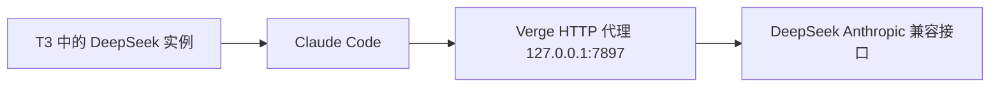
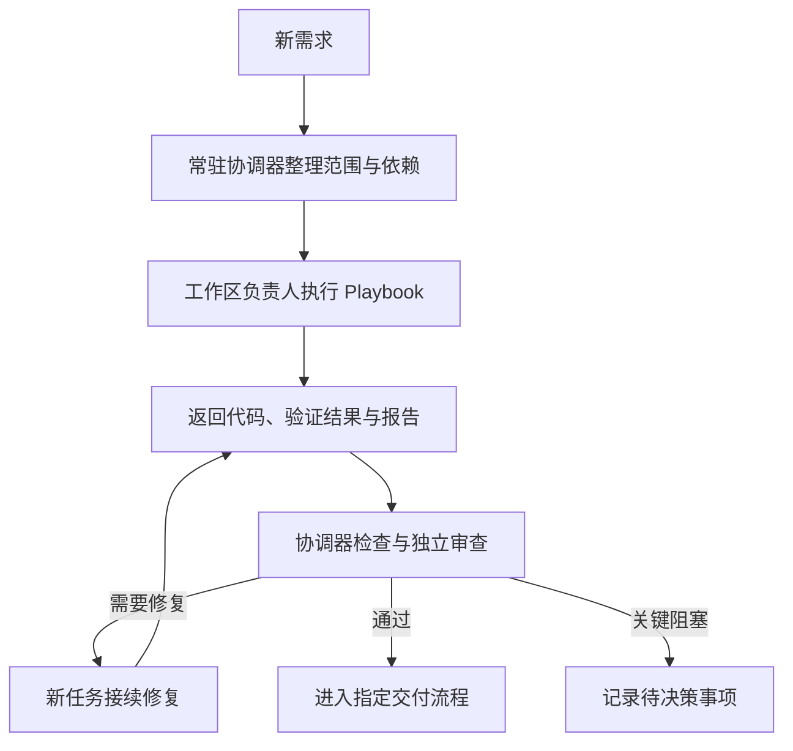
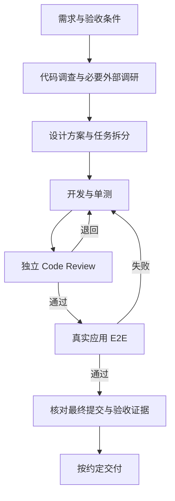

# T3 Code 多模型协作与研发工作流调研纪要

日期：2026-11-14，Asia/Singapore  
版本：v1.0，会话整理版  
适用环境：当前 macOS 上的 T3 Code、Codex，以及通过 Claude Code 接入的 DeepSeek  
研究重点：`creedants/pstack-t3`，源码快照 `dd15e6301eb6bbd04866a5091f50f801fbb2a5ed`（2026-11-07）

本文记录本次沟通形成的需求、排障结果、社区调研和实施建议。环境状态来自本次会话中的操作与检查；第三方能力来自所列源码和文档。本文未执行第三方工作流安装，也未把配置建议视为已经生效。

## 一页结论

**目标是把完整研发协作保存成可重复使用的工作方式：需求 → 调研 → 设计 → 开发 → 单测 → Code Review → E2E。日常只需提出具体需求，无须反复复述分工、交接和验收规则。**

目前已经解决基础接入问题：DeepSeek 通过 Claude Code 的 Anthropic 兼容接口连接，使用独立配置目录，并通过本机 Verge 的 `7897` 端口代理。按该实例参数运行的 Claude CLI 最小调用已返回 `OK`。这证明了基础连接，尚不证明多 Agent 全链路兼容。

T3 社区已有可复用方案，不只有 tstack、bstack。根据本次核实的功能范围，**优先评估 creedants/pstack-t3**：它覆盖任务拆分、跨模型委派、独立工作区、常驻协调、审查返工和交付。这个判断依据功能匹配程度，不代表社区使用率排名或本机稳定性结论。

对当前需求，建议的起步组合是：

> 一个常驻 `$brigade` 协调线程 + 显式模型角色配置 + 七阶段项目规则 + 项目验证 Skill；先用 light 模式完成一个真实小功能，再扩大并行。

需要补充的主要是产品需求规格、外部调研、UI/UX 设计和项目测试标准。pstack 有相关基础机制，但没有安装后就强制执行上述七阶段全部产物的通用流水线。

| 内容 | 当前状态 |
| --- | --- |
| DeepSeek API、独立配置目录与代理链路 | 已配置；相同实例参数的 CLI 最小调用已通过 |
| 社区方案与 pstack 工作机制 | 已完成文档和源码调研 |
| pstack 安装、角色配置、常驻协调器 | 尚未实施 |
| Codex 与 DeepSeek 的跨模型委派 | 尚未在本机完成验证 |
| 七阶段开发流程、项目 E2E 和最终交付 | 已提出适配方案，尚未跑通 |

本文按以下八部分展开：

1. 你的目标与需求。
2. 今天的环境配置与排障。
3. T3 多 Agent 的工作原理。
4. 社区方案调研与比较。
5. pstack-t3 深入分析。
6. 对照你的七阶段流程。
7. 适合你的配置方案。
8. 当前结论与下一步验证。

## 1. 你的目标与需求

### 1.1 需要完成的事情

希望继续以 T3 Code 为主要操作入口，组合 Codex、Claude Code 和 DeepSeek，覆盖从想法到可验收代码的全过程。

| 阶段 | 期望结果 |
| --- | --- |
| 需求 | 明确做什么、为谁做、范围和验收条件 |
| 调研 | 理解已有系统，必要时比较外部方案，给出依据 |
| 设计 | 形成技术方案；涉及界面时形成交互与视觉方案 |
| 开发 | 按依赖和范围组织实现，合适的部分并行 |
| 单测 | 验证关键行为，修复逻辑 Bug 时保留有效回归证据 |
| Code Review | 由独立上下文、优先另一模型家族检查实现 |
| E2E | 实际启动应用，走关键用户路径，核对结果和副作用 |

### 1.2 对使用方式的要求

- 角色分工和验收规则能保存，后续重复使用。
- 有一个稳定入口接收新需求，能看到工作结果和阻塞事项。
- 合适的工作可以自动拆分和并行，有依赖的工作按顺序推进。
- 实现、审查、返工和验证能衔接，减少人工搬运上下文。
- 有可检查的产物和真实执行证据，不能只依赖 Agent 的“完成了”。

当前重点是找到并适配现成方案。可视化拖拽编辑器并未被确认是必需条件；如果后续要求严格状态机、阶段按钮或人工审批界面，应单独列为选型条件。

## 2. 今天的环境配置与排障

本节是本次会话中的环境快照，不代表其他机器的默认配置。没有记录 API Key 或 Token。

### 2.1 当前相关配置

| 项目 | 本次会话确认的值 |
| --- | --- |
| T3 Code | `0.1.10-nightly.20261113.4643` |
| 系统 | macOS |
| DeepSeek 实例标识 | `claudeAgent_deepseek` |
| 实例运行工具 | `claudeAgent`，即 Claude Code 接入路径 |
| 实例显示名称 | `Deepseek` |
| 模型标识 | `deepseek-flash` |
| Claude 独立配置目录 | `/Users/hx/.claudedeepseek` |
| 设置文件 | `/Users/hx/.claudedeepseek/settings.json` |
| API Base URL | `https://api.deepseek.com/anthropic` |
| HTTP/HTTPS 代理 | `http://127.0.0.1:7897` |
| 鉴权信息 | 保存在 T3 对应实例的 Secret 配置中，由实例运行时使用 |

这里有两条不同的连接信息：

- `https://api.deepseek.com/anthropic` 是模型请求的目标 API。
- `http://127.0.0.1:7897` 是本机 Verge 的代理入口。

不能把 `7897` 代理地址填成 DeepSeek 的 API Base URL。



### 2.2 故障原因与处理结果

最初创建实例、添加配置后仍无法使用。后续排查发现，默认 Claude 设置文件 `/Users/hx/.claude/settings.json` 中存在指向 `http://127.0.0.1:8990` 的旧配置，干扰了预期连接。

最终采用的处理方式是为 DeepSeek 使用独立配置目录 `/Users/hx/.claudedeepseek`，将其 API 和代理设置写入该目录，T3 实例的 homePath 指向同一位置。这样可以避免继续读入默认目录中的冲突设置。

此前讨论过的“Environment → Variables”路径不应直接当作当前版本的有效操作步骤。本次最终有效的记录是实例配置目录、设置文件和 T3 实例 Secret 的组合；未来复现应先核对实际版本与可见设置项。

### 2.3 有效设置摘要

下面仅展示 API 和网络配置，省略鉴权字段，不能替代 T3 实例中的 Secret：

```json
{
  "env": {
    "ANTHROPIC_BASE_URL": "https://api.deepseek.com/anthropic",
    "HTTP_PROXY": "http://127.0.0.1:7897",
    "HTTPS_PROXY": "http://127.0.0.1:7897",
    "http_proxy": "http://127.0.0.1:7897",
    "https_proxy": "http://127.0.0.1:7897",
    "NO_PROXY": "localhost,127.0.0.1,::1",
    "no_proxy": "localhost,127.0.0.1,::1"
  }
}
```

实际设置中还对 `ANTHROPIC_API_KEY` 作了显式清空，实际 Token 仍由 T3 实例的 Secret 配置提供；这不表示 DeepSeek 可以无鉴权调用。

### 2.4 已验证与尚未验证

已按对应实例的 Token、模型、代理和独立配置目录执行 Claude CLI 最小调用，返回 `OK`，进程退出码为 `0`。

以下内容尚未因此得到证明：跨实例委派、嵌套子任务、所有工具调用、长时间调度、pstack 安装和七阶段流程。此前讨论过的 `CLAUDE_CODE_SUBAGENT_MODEL` 等子 Agent 模型设置，没有在本次最终配置中实际启用，不应列为已完成事项。

后续安装 Skills 也要使用正确目录：当前 DeepSeek 实例未必会读取默认 `~/.claude/skills`。T3 的 Claude 技能加载与配置目录有关，详见 [T3 Claude 技能说明](https://github.com/pingdotgg/t3code/blob/main/docs/user/providers-claude.md#skills)。

## 3. T3 多 Agent 的工作原理

### 3.1 先区分三层

| 层次 | 示例 | 职责 |
| --- | --- | --- |
| 操作与编排入口 | T3 Code | 管理项目、工作线程、实例和任务交接 |
| Agent 运行工具／provider | Codex、Claude Code 等 | 运行 Agent、调用工具、组织对话和执行代码任务 |
| 底层模型 | GPT 系列、Claude 系列、DeepSeek | 理解任务、推理并生成工具调用和内容 |

因此，当前“Claude Code 接 DeepSeek”是一条由 Claude Code 运行工具驱动 DeepSeek 模型的路径，不等于同时在使用一个 Anthropic Claude 模型。如果以后想让 GPT、Claude、DeepSeek 三个模型家族协作，还需要准备实际可用的 Claude 模型实例。

### 3.2 多线程、子任务与跨模型协作

| 方式 | 实际发生的事情 | 需要额外关注什么 |
| --- | --- | --- |
| 手动开多个线程 | 人分别给不同线程发任务 | 人负责分工、交接和收尾 |
| 父 Agent 委派子任务 | 主任务通过工具启动子 Agent，再接收结果 | 简报是否完整，结果如何合并 |
| 跨模型协作 | 子任务被显式路由到其他实例和模型 | 目标实例可用性、模型与工具权限、实际执行模型 |
| 固定工作流 | 保存角色、步骤、检查和状态，按入口重复运行 | 哪些步骤由模型遵守，哪些由程序检查 |

所以，“通过对话启动”并不意味着每次都要重写流程。短消息可以触发已保存的 Skill 或 Playbook；关键在于分工、路由、验收和恢复机制是否已经配置。

Skill 本身可以包含 `SKILL.md`、脚本和模板。仅有自然语言指令时，下一步主要由模型决定；加入脚本、状态检查和 CI 后，可以把特定条件交给程序执行。[Agent Skills 格式说明](https://agentskills.io/home)

### 3.3 上下文和交接原则

独立 Agent 不应被假定自动知道所有兄弟线程的历史。有效交接至少需要任务目标、范围、已有结论、输入材料、允许修改的文件、成功标准和报告位置。

pstack 的运行时会通过 T3 工具委派任务，使用简报、代码工作区和报告交接。它不是简单地在同一个回答里轮流写“产品经理说”“开发说”“测试说”。具体机制见 [pstack 运行时](https://github.com/creedants/pstack-t3/blob/dd15e6301eb6bbd04866a5091f50f801fbb2a5ed/skills/pstack-runtime/SKILL.md)。

Claude Code 自身的原生子 Agent 与 T3 的跨实例任务属于不同层次。当前单次 DeepSeek 调用成功，并不自动保证两条子任务路径都已经正确配置。

## 4. 社区方案调研与比较

### 4.1 如何理解本次调研结论

本次查看了官方／作者仓库、文档、源码和部分公开讨论，没有对全网用户做统计，也没有把各方案全部安装到本机。下表反映核实到的机制与适用范围，不是流行度排行榜。

调研结论已作修正：T3 相关候选不止 tstack 和 bstack；tstack 是 Theo 的项目，bstack 是另一位社区作者的项目。不能把它们统称为“T3 作者的两个方案”。

### 4.2 直接围绕 T3 的候选

| 方案 | 核实到的重点 | 对当前需求的判断 |
| --- | --- | --- |
| [t3dotgg/tstack](https://github.com/t3dotgg/tstack/blob/main/README.md) | 作者日常使用的 Skills；`sol-loop` 做改动审查与修复循环，`full-stop` 串接交付 | 适合轻量实现、独立审查和交付；不是现成的七阶段产品研发模板 |
| [gitbobobo/bstack](https://github.com/gitbobobo/bstack/blob/main/README.md) | Skill、路由脚本、JSON 偏好配置、巡检与持续派活 | 有固定跨模型编排，但带作者自己的模型、额度及权限策略，需要适配 |
| [creedants/pstack-t3](https://github.com/creedants/pstack-t3/blob/dd15e6301eb6bbd04866a5091f50f801fbb2a5ed/README.md) | Playbook、设计探索、独立验证、工作区隔离、常驻协调器和交付队列 | 本次功能范围最贴近完整流程，作为优先试用对象 |
| [mariusflorescu/pstack-t3](https://github.com/mariusflorescu/pstack-t3) | 另一份 pstack 的 T3 移植 | 与 creedants 版本不同，配置和安装说明不能混用 |
| [r3xsean/r3xstack](https://github.com/r3xsean/r3xstack) | `see-it-through` 串接方案、实现、独立审查和真实验证；还有 UI 设计流程 | 值得作为备选，需调整个人模型预设，未在本机实测 |
| [axatbhardwaj/axstack](https://github.com/axatbhardwaj/axstack) | align → spec → tickets → implement → review → watch | 调研时文档限定 Linux 和稳定版 T3，不适合当前 macOS Nightly 原样使用 |

tstack 的 `full-stop` 与 `full-send` 要区分：前者把合并留给用户，后者包含满足条件后自动合并。`council` 的默认多 provider 配置也不能直接视为当前两实例已经满足条件。[full-stop](https://github.com/t3dotgg/tstack/blob/main/skills/full-stop/SKILL.md)、[full-send](https://github.com/t3dotgg/tstack/blob/main/skills/full-send/SKILL.md)、[council](https://github.com/t3dotgg/tstack/blob/main/skills/council/SKILL.md)

另外见到的 [独立 Brigade 项目](https://github.com/escoffier-labs/brigade) 和 [workflow-boards-plugin](https://github.com/ccdwyer/workflow-boards-plugin)，分别存在 T3 子任务治理仍在推进、依赖特定插件分支等限制，暂不作为当前环境即装即用的主方案。独立 Brigade 项目与 pstack 内的 `$brigade` Skill 不是同一个项目。

### 4.3 通用方法与独立编排工具

| 方案 | 主要价值 | 与 T3 配合时的边界 |
| --- | --- | --- |
| [Superpowers](https://github.com/obra/superpowers/blob/main/README.md) | 设计、计划、实现、测试与审查的组合式 Skills | 支持不同运行工具，不等于自动在这些工具之间跨模型路由 |
| [BMAD Method](https://github.com/bmad-code-org/BMAD-METHOD/blob/main/README.md) | 需求、规格、架构、角色与项目交付方法 | 适合补充项目全过程方法，不能默认已接入 T3 常驻协调和模型路由 |
| [GSD Core](https://github.com/open-gsd/gsd-core/blob/main/README.md) | 分阶段规划、执行和验证，重任务放入新上下文 | 可复用阶段化方法；具体多工具协作仍要核对其运行机制 |
| [gstack](https://github.com/garrytan/gstack/blob/main/README.md) | 产品、工程、Review、QA 等角色技能 | 命名多个角色，不代表每个角色都在独立并行运行 |
| [Spec Kit Workflows](https://github.github.io/spec-kit/workflows/overview.html) | YAML、步骤控制、人工关卡、状态和恢复 | 更适合明确要求脚本式流程的场景；不是当前 T3 原生 YAML 编辑器 |
| [Cezar](https://github.com/brzozass/cezar.orchestrator/blob/main/docs/reference.md) | 配置式工作流、不同 runner、验证及重试 | 属于独立编排工具，当前 DeepSeek/T3 适配未实测 |

还查看过 [Oh My Claudecode](https://github.com/yeachan-heo/oh-my-claudecode)、[Orchestrator.inc](https://github.com/OrchestratorInc/agent-orchestrator) 和 [Vibe Kanban](https://github.com/BloopAI/vibe-kanban)。它们包含各自的运行环境或控制平台，应与“继续以 T3 为入口”的目标分别评估。

### 4.4 从公开实践中提炼的做法

调研中看到的可复用做法包括：短项目规则、独立上下文、明确职责、书面交接、真实验证，以及保留人工决策和合并边界。有些使用者也报告全套框架会增加 Token 和流程开销。这些是具体使用者经验，不能推导全行业使用率。[Codex/Claude 用户讨论](https://www.reddit.com/r/codex/comments/1wyzbib/claude_code_codex_users_what_does_your_actual/)、[流程复杂度讨论](https://www.reddit.com/r/ClaudeCode/comments/1vxricj/moving_away_from_superpowers_how_do_you_guys/)

本次建议是先选一套主流程，按实际缺口补能力，避免同时叠装多套都想控制整个生命周期的框架。

## 5. pstack-t3 深入分析

本节针对 `creedants/pstack-t3` 的固定源码快照，不混用另一份同名移植。细节分析也保存在 [独立分析笔记](pstack-t3-deep-analysis-2026-11-14.md)。

### 5.1 组成与入口

| 组成 | 职责 |
| --- | --- |
| `$poteto-mode` | 给一次有限任务选择合适 Playbook |
| `how` / `why` | 理解运行机制，调查历史、决策与约束 |
| `architect` / `arena` / `swarm` | 比较设计或候选，拆分适合并行的工作 |
| `interrogate` / gate review | 进一步审查，形成通过或返工结论 |
| `$brigade` | 长期接收需求、派发任务、审查和安排交付 |
| runtime、角色及状态脚本 | 映射 T3 工具，解析模型，验证简报，记录任务和交付状态 |

入口选择建议：单次工作用 poteto-mode；先做计划用 Multi-phase-plan；一组有限的多阶段工作用对应执行 Playbook；长期维护项目用 brigade。**Multi-phase-plan 负责生成计划，不等于已经开始实施。**[运行时](https://github.com/creedants/pstack-t3/blob/dd15e6301eb6bbd04866a5091f50f801fbb2a5ed/skills/pstack-runtime/SKILL.md)、[多阶段计划](https://github.com/creedants/pstack-t3/blob/dd15e6301eb6bbd04866a5091f50f801fbb2a5ed/skills/poteto-mode/playbooks/multi-phase-plan.md)

### 5.2 默认 Feature 的执行主线

1. 用 `how` 理解涉及的子系统。
2. 用 `architect` 探索设计方案；实际展开随 light/full 模式变化。
3. 检查前置阻塞、可并行部分、共享写入和最小安全拆分。
4. 把代码实现委派给 `feature, refactoring` 角色，明确范围、文件、数据模型和成功标准。
5. 在匹配的真实界面或运行入口验证，无法确定或验证错对象不能算通过。
6. 整理小而有序的提交。
7. 对有争议的设计进一步审查。
8. 进入 Opening a PR 流程。

父 Agent 主要负责设计、计划、审查和验证；代码实现交给子任务。强耦合功能先交给一个负责人，必要时再由负责人细分。并行的单位是可以独立完成的工作，不是机械地为每个阶段启动一个 Agent。[Feature Playbook](https://github.com/creedants/pstack-t3/blob/dd15e6301eb6bbd04866a5091f50f801fbb2a5ed/skills/poteto-mode/playbooks/feature.md)

这个默认顺序与用户的七阶段顺序不同：实际验证可能先于最终 Review。适配时要明确保存要求的顺序，以及 E2E 后如何检查最终提交和证据。

### 5.3 常驻协调器如何持续工作

brigade 创建一个项目协调线程。以后直接在该线程提出需求，协调器读取长期目标和规则，记录任务，再派给工作区负责人。负责人返回结果后，协调器检查 diff 和基础检查，再安排独立验证者，决定通过、返工或等待决策。



协调器自身不写功能代码。有写入的任务分配工作区，并通过路径租约协调共享范围；任务通知和调度用于收报告、继续推进和发现卡住的执行。T3 服务、机器、网络和凭据仍需持续可用。[协调器机制](https://github.com/creedants/pstack-t3/blob/dd15e6301eb6bbd04866a5091f50f801fbb2a5ed/docs/guide/coordinator.md)

### 5.4 状态和规则保存在哪里

| 材料 | 作用 |
| --- | --- |
| `menu.md` | 项目目的、完成标准、排除范围和预算说明 |
| `house-rules.md` | 长期规则，生成工作任务简报时带入 |
| `rail.tsv` / `dishes.tsv` | 收到的需求与执行单元 |
| `pass.tsv` | 审查结果 |
| `86.tsv` | 等待用户决策的事项 |
| `reports/` | 负责人及审查报告 |

默认状态目录在 `${XDG_STATE_HOME:-~/.local/state}/pstack-t3/` 下。汇报可选择 every-turn、milestones 或 digest；起步建议 milestones，在完成、退回、阻塞和需要决策时看到有意义的进度。[存储与汇报](https://github.com/creedants/pstack-t3/blob/dd15e6301eb6bbd04866a5091f50f801fbb2a5ed/docs/guide/reporting.md)

### 5.5 模型角色、审查和返工

角色配置可以保存在用户级 `~/.config/pstack-t3/roles.json`，项目级 `.pstack/t3-roles.json` 可覆盖对应角色。角色指向真实的 providerInstanceId、模型和支持的选项；未设置的角色通常继承父线程。因此，安装后不会自动形成 Codex 与 DeepSeek 分工。

brigade 优先选择与实际代码作者不同模型家族的验证者，审查结果绑定具体提交。同家族降级需要明确标记；实质代码变化或改变后的 rebase 需要重新验证。连续三次退回后进入决策，而非一直自动修补。[角色规则](https://github.com/creedants/pstack-t3/blob/dd15e6301eb6bbd04866a5091f50f801fbb2a5ed/skills/pstack-runtime/roles.md)、[审查与返工](https://github.com/creedants/pstack-t3/blob/dd15e6301eb6bbd04866a5091f50f801fbb2a5ed/skills/brigade/reference/review.md)

这里的“只读审查”主要由任务简报约束，不能直接理解为操作系统已强制为每个审查者设置只读权限。

### 5.6 light/full 与成本

当前源码默认 light。它减少周边任务，但保留决定能否交付的检查和独立审查。例如设计由一个 runner 提出两个结构不同的方案，常规调查减少子任务，swarm 每波最多三个 worker。这个上限不等于整个项目的所有嵌套线程总数上限；协调器负责人并发另有 worker cap。

full 会增加候选比较、审查和验证分支，适合有实际比较价值的复杂任务。维护者记录过一次旧版 full 运行：四个 Python 工作项最终启动 61 个线程，最后一个 PR 在启动后 109 分钟合并。这只是其测试仓库中的个案，不能预测当前项目时间或费用。[light 规则](https://github.com/creedants/pstack-t3/blob/dd15e6301eb6bbd04866a5091f50f801fbb2a5ed/skills/pstack-runtime/light.md)、[维护者运行记录](https://github.com/creedants/pstack-t3/blob/dd15e6301eb6bbd04866a5091f50f801fbb2a5ed/docs/live-runs.md)

配置中的 `budget` 主要控制推理档位，不是金额、总 Token、时长或并发的硬限制。控制开销还需要分别约定负责人数量、候选数量、审查者和返工轮次。[预算定义](https://github.com/creedants/pstack-t3/blob/dd15e6301eb6bbd04866a5091f50f801fbb2a5ed/skills/pstack-runtime/roles.md)

### 5.7 交付方式

| 模式 | 行为 |
| --- | --- |
| `merge` | 检查通过后走 PR 自动合并 |
| `human` | 创建 PR，留给人合并 |
| `push` | 通过检查后直接推送 trunk，源码包含 force-with-lease 行为 |
| `local` | 移动本地 landing ref，不改真实 trunk 和远程 |

模式属于仓库，同一仓库的多个协调器共享。不要因选了工作流就默认授权所有提交、推送和合并行为。[交付模式](https://github.com/creedants/pstack-t3/blob/dd15e6301eb6bbd04866a5091f50f801fbb2a5ed/docs/guide/reporting.md)

当前 t3code 的 AGENTS 明确要求未经显式请求不能创建 PR。未来在本仓库试用，应设置相符的本地交付契约，并覆盖普通 Feature 的默认 PR 行为；`human` 仍会创建 PR，不能当作本地交付的同义词。

## 6. 对照你的七阶段流程

以下是适配设计，尚未配置或执行。

### 6.1 每个阶段如何落地

| 阶段 | 可复用机制 | 必须固定的产物 | 进入下一阶段的条件 |
| --- | --- | --- | --- |
| 需求 | 协调器 intake、menu、计划 Playbook | 用户场景、范围、排除项、验收条件、必要未知项 | 已能据此设计和验证；影响产品决定的关键歧义已解决 |
| 调研 | Investigation、how、why、研究子任务 | 现有系统分析、必要外部来源、方案比较、约束、结论 | 推荐方案有依据，未验证假设明确列出 |
| 设计 | architect、方案比较、原型和计划检查 | 技术方案、接口、数据模型、失败路径；必要 UI/交互方案 | 选择和取舍清楚，开发与测试范围可执行 |
| 开发 | 负责人、独立 worktree、依赖拆分 | 可审查代码、必要迁移和实现报告 | 实现覆盖需求，基础检查完成 |
| 单测 | 项目测试、必要的 TDD/回归测试 | 命令、结果、关键行为与测试对应关系 | 相关测试通过，失败未被掩盖 |
| Code Review | 独立 verifier、gate/interrogate | 具体提交上的结论、问题及执行证据 | 阻塞问题解决，审查结果适用于当前代码 |
| E2E | 项目验证 Skill、已有测试框架和 T3 驱动工具 | 用户路径、实际运行结果、截图/录像/日志、必要副作用检查 | 关键路径通过，证据属于最终代码和目标界面 |

阶段不适用时应写明原因，不能机械地为文案或纯视觉调整新增无意义单测。该仓库已有关于测试层次、视觉证据和回归测试的规则，适配流程需要遵守。

### 6.2 原生能力中需要补齐的部分

**调研：** `why` 主要调查现有系统的设计动机；full 模式会按可用来源调查源码历史、工单、文档等，light 默认大幅缩减调查面。用户要求的联网选型、竞品研究等，应作为显式研究任务保存来源和交付标准。[why](https://github.com/creedants/pstack-t3/blob/dd15e6301eb6bbd04866a5091f50f801fbb2a5ed/skills/why/SKILL.md)

**设计：** `architect` 偏技术结构。需求中的“设计”如果包括界面、交互、视觉和设计系统，就需要增加对应步骤与可检查产物。[architect](https://github.com/creedants/pstack-t3/blob/dd15e6301eb6bbd04866a5091f50f801fbb2a5ed/skills/architect/SKILL.md)

**单测：** `tdd` 按显式要求或合适的局部回归目标使用，允许在不实际的情况下选择其他验证。必须另行写明本项目哪些关键行为需要测试。[tdd](https://github.com/creedants/pstack-t3/blob/dd15e6301eb6bbd04866a5091f50f801fbb2a5ed/skills/tdd/SKILL.md)

**E2E：** `create-verification-skill` 可以识别项目真实启动、驱动、证据和清理方式，优先利用现有 Playwright/Cypress 等工具。生成后要求至少走通一条完整路径。它不保证自动附送全部业务场景和长期 CI 测试套件。[验证 Skill](https://github.com/creedants/pstack-t3/blob/dd15e6301eb6bbd04866a5091f50f801fbb2a5ed/skills/create-verification-skill/SKILL.md)

### 6.3 建议保存的执行顺序



协调器在最后核对证据和代码的一致性，不需要再重复一轮完整设计讨论。E2E 之后如果改了代码，需要重跑受影响的检查，不能继续沿用不匹配的旧结论。

### 6.4 “完成”的证据怎么表达

建议每个功能报告附一张对应表。下面是未来报告格式示例，不是本次已完成的功能：

| 验收条件 | 相关实现 | 单元／集成测试 | E2E 场景与证据 | 状态 |
| --- | --- | --- | --- | --- |
| 管理员可批量邀请成员 | 实际文件或提交链接 | 实际命令与结果 | 登录、提交邀请、核对结果与记录 | 通过／失败／未验证 |
| 无效邮箱显示明确错误 | 实际校验路径 | 边界用例 | 界面错误与无错误副作用 | 通过／失败／未验证 |
| 重复邀请符合约定 | 实际去重行为 | 回归用例 | 实际重复操作与数据检查 | 通过／失败／未验证 |

“未验证”不能在汇总时变成“通过”。如果需要程序强制检查七阶段产物，还应接一层薄的校验脚本或 CI；pstack 已有角色、简报、审查与交付检查，但没有现成覆盖这张七阶段表全部内容的通用硬门禁。

## 7. 适合你的配置方案

以下均为起步建议，尚未写入配置，也不是模型质量评测结论。

### 7.1 推荐初始结构

一个 Codex 常驻协调线程管理一个项目。任务以 light 模式为主，DeepSeek 承担初始实现，Codex 做设计取舍和独立审查。先完成一个功能的完整闭环，不一开始启动多层管理和大量并行任务。

| 工作 | 起步分工 | 对应配置重点 |
| --- | --- | --- |
| 常驻协调、需求收敛、最终取舍 | Codex | 协调器线程模型；保持其不直接写功能代码 |
| 代码理解与资料整理 | DeepSeek，按实际工具能力确认 | how explainer、why investigators 等角色 |
| 设计 | 先一个 Codex 设计者提出两种方案 | architect runners；复杂问题再加独立候选 |
| 功能实现和局部测试 | DeepSeek | feature, refactoring、bug-fix |
| 独立审查与验证 | Codex 审查 DeepSeek 实现 | verifiers；按实际作者选择不同家族 |
| E2E | 有对应工具的验证任务 | 项目验证 Skill、浏览器／设备及测试状态 |

如果某次任务由 Codex 实际编写代码，需要换另一家族审查，或明确记录只能同家族审查的降级。模型名称本身不保证具备相同 MCP、浏览器或设备工具。

### 7.2 配置与材料分别放在哪里

| 内容 | 建议保存位置 | 是否已经存在／生效 |
| --- | --- | --- |
| DeepSeek API 与代理 | `/Users/hx/.claudedeepseek/settings.json` 和 T3 实例 Secret | 已配置 |
| 用户级 pstack 模型角色 | `~/.config/pstack-t3/roles.json` | 本次未创建 |
| 项目级 pstack 模型覆盖 | `.pstack/t3-roles.json` | 本次未创建 |
| 七阶段长期规则 | 协调器状态目录中的 `house-rules.md` | 本次未创建 |
| 项目目标与范围 | 协调器状态目录中的 `menu.md` | 本次未创建 |
| 项目验证 Skill | `.agents/skills/verify-<app>/`，并提供 Claude 可读入口 | 本次未创建；应先检查现有技能再决定是否需要 |
| 当前仓库测试／提交要求 | 仓库 `AGENTS.md` 等既有规则 | 已有规则，适配时沿用 |
| 交付模式与检查 | 仓库 landing contract | 本次未初始化 |

当前 t3code 已有 `test-t3-app` 和 `test-t3-mobile` 等项目验证指引。未来接入时应优先评估复用，避免再生成一套互相冲突的启动和数据规则。[项目验证技能生成原则](https://github.com/creedants/pstack-t3/blob/dd15e6301eb6bbd04866a5091f50f801fbb2a5ed/skills/create-verification-skill/SKILL.md)

### 7.3 DeepSeek 实例的适配检查

配置角色时使用真实实例标识 `claudeAgent_deepseek` 和模型标识 `deepseek-flash`，不要因为运行工具叫 Claude Code 就填入 Claude Sonnet/Opus 的名字。Codex 的实例和模型标识则通过当时实际能力目录读取，不在本文中编造固定值。

角色脚本通过 T3 能力目录判断实例是否支持子任务和目标模型。模型家族按规范化模型 ID 识别，因此 `deepseek-*` 与 `gpt-*` 可以区分；仍需验证实际模型调用和返回结果。[角色解析源码](https://github.com/creedants/pstack-t3/blob/dd15e6301eb6bbd04866a5091f50f801fbb2a5ed/t3/scripts/_roles/seats.py)

用户级安装时，pstack 安装器支持读取 `CLAUDE_CONFIG_DIR`；对当前实例应指向 `/Users/hx/.claudedeepseek`。安装前还需检查现有 Skills 和重复版本，避免将另一移植版配置混入。本文不提供未经本机确认的整段安装命令。[安装目录逻辑](https://github.com/creedants/pstack-t3/blob/dd15e6301eb6bbd04866a5091f50f801fbb2a5ed/scripts/_install/layout.py)

### 7.4 长期规则草案

下面是待保存、待验证的规则草案，不是已经启用的配置：

> 新功能先形成需求和可检查的验收条件，再完成相关代码调查与必要外部调研，选定设计后实现。涉及界面时，设计包括用户路径和必要视觉证据。测试应证明关键行为，逻辑 Bug 保留修复前失败和修复后通过的回归证据。代码由独立模型优先跨家族审查。关键用户路径必须在真实应用执行 E2E，并核对必要副作用。缺少证据的验收项不得标为完成。阶段不适用时写明依据。遵守仓库对测试、数据、提交、PR 和合并的规则。完成报告列出需求与证据的对应关系，返工后核对证据是否仍适用于当前代码。

另建议设置一个初始负责人、一个最终审查者，先按 milestones 汇报。并发、金额或时长阈值目前尚未决定，不能把这些建议写成既定配置。

### 7.5 日常怎么用

单次入口可以选择对应 Playbook；长期维护则把后续需求发给已配置的常驻协调线程，例如：

> 增加管理员批量邀请成员功能，支持邮件邀请和结果汇总。

预期协调器会沿用长期规则，补齐需求、调查与设计，再安排实现、测试和审查。只有影响产品方向、范围或交付授权的关键歧义需要用户决定；重复的协作要求无需再描述。

## 8. 当前结论与下一步验证

### 8.1 证据状态

| 事项 | 依据 | 可以得出的结论 |
| --- | --- | --- |
| DeepSeek 连接 | 本次配置与 Claude CLI 最小调用 | 基础 API、模型参数和代理组合可用 |
| pstack 的流程和状态机制 | 固定源码、官方仓库文档 | 功能范围与当前目标较匹配 |
| 社区其他方案 | 作者文档、源码和公开讨论 | 存在不同路线，可比较适用边界 |
| 当前 Codex/DeepSeek 角色分工 | 本次分析建议 | 可以作为试运行配置，尚无实际协作验证 |
| 七阶段执行与 E2E | 拟定规则和验证方案 | 尚不能宣称已部署或稳定运行 |

### 8.2 建议的实施次序

1. **检查实际能力。** 确认 T3 的编排工具、Codex 和 DeepSeek 实例可用；查看当前模型、选项和子任务能力。pstack 文档要求 T3 0.1.3+、Python 3.10+，版本号满足并不替代实际工具检查。[安装前提](https://github.com/creedants/pstack-t3/blob/dd15e6301eb6bbd04866a5091f50f801fbb2a5ed/docs/guide.md)
2. **按目录正确安装并核对加载。** 选定 creedants 版本，检查已有技能和备份，确认两个运行工具实际能看到相关入口。
3. **保存显式角色。** 用实际能力目录配置模型，执行最小跨模型委派，核实子线程真正使用的模型和结果回传。setup 的提供方验证会产生真实模型调用。[setup-pstack](https://github.com/creedants/pstack-t3/blob/dd15e6301eb6bbd04866a5091f50f801fbb2a5ed/skills/setup-pstack/SKILL.md)
4. **创建一个常驻协调器。** 保存项目目标、七阶段规则、负责人上限、汇报频率和交付边界。
5. **接好项目验证。** 复用已有启动和测试工具，实际走通一条用户路径，确认清理后证据仍存在。
6. **完成一个真实小功能。** 验证需求、调研、设计、实现、单测、独立审查和 E2E 的完整交接。
7. **复盘后扩大。** 观察遗漏、返工、时间和模型消耗，按独立工作范围增加并行或在必要任务上使用 full。

以上是未来实施计划，本次整理文档没有触发这些安装、模型调用或仓库操作。

### 8.3 首次试运行的通过标准

- 能用一条短需求触发保存的规则，无需补发完整分工提示词。
- 模型角色与实际执行一致；发生降级或替换时能看到记录。
- 代码作者与最终审查者保持独立，审查对应正确提交。
- 有适当的测试和真实应用验证，结果能对应验收条件。
- 能发现阻塞并给出有依据的返工或待决策项。
- 工作区、测试数据和应用清理遵守项目规则。
- 交付行为符合授权范围；在当前仓库没有默认创建 PR、推送或合并。

### 8.4 尚待确定的事项

| 事项 | 当前建议／状态 |
| --- | --- |
| 首次试运行项目与功能 | 尚未选择；应选能覆盖完整流程、范围较小的真实需求 |
| Codex 的具体模型与推理档位 | 实施时读取实际可用选项后确定 |
| 是否增加独立的 Anthropic Claude 模型 | 尚未决定；当前主要是 Codex 与 DeepSeek 组合 |
| “设计”是否必须包括 UI/UX | 按试运行功能明确，不能默认技术设计已覆盖 |
| 外部调研是否每次必做 | 建议按任务需要执行，并明确何时不适用 |
| 并发、时间和金额限制 | 尚未定值；不能由 budget 字段代替 |
| 最终交付方式 | 当前 t3code 建议本地验收；其他项目按仓库规则确定 |
| 是否要求七阶段程序强制过关 | 若有此要求，再接阶段产物校验或 CI |

### 8.5 保留的研究材料

- [社区方案详细调研笔记](t3-multiagent-workflows-research-2026-11-14.md)：保留更广的候选、参考资料和调研过程。
- [pstack-t3 深入分析笔记](pstack-t3-deep-analysis-2026-11-14.md)：保留实现机制、角色配置、模式和七阶段适配细节。
- 本文作为当前总览；后续实施后，优先更新证据状态和待验证事项，避免将建议误记为已完成。
