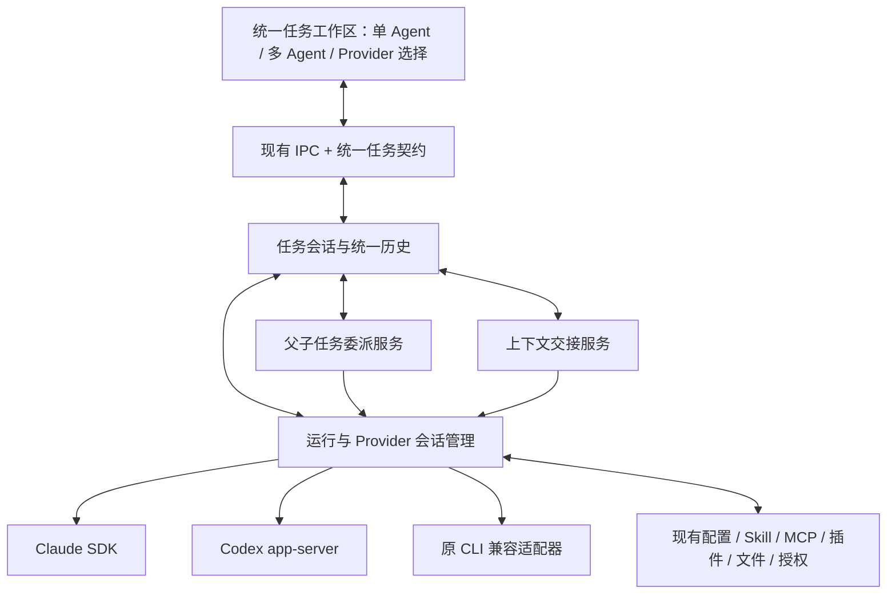

# WillYou 统一任务 UI、Provider 续聊与多 Agent 委派迁移调研

> 现行设计已收口到 [M14 技术方案 T0.1（研究收口稿）](里程碑/M14_统一Agent工作区/技研/技术方案.md)，范围以[需求 R0.2](里程碑/M14_统一Agent工作区/需求.md)为准：先跑稳 T3 式通用基座，独立模板与强制阶段流程后续扩展。本稿保留历史推导、方案比较及旧用例来源，不再并行维护现行实现规格；下方状态按形成时理解。T0.1 已按冻结范围完成研究与关闭审计，可作为实施设计依据；产品原型评审、正式开发与验收仍未完成。

> 2026-11-14 阶段归属：本次优化已登记为 F32／[M14](里程碑/M14_统一Agent工作区/README.md)，阶段范围以 [M14 需求](里程碑/M14_统一Agent工作区/需求.md)为入口。本稿保留为设计评审／调研依据，待整合为正式技术方案；定时任务已顺延为 M15。

> 2026-11-14 后续验证：按用户要求已开始全局兼容研究，实际实验、安装／版本问题及未决项统一见[M14 全局验证账](里程碑/M14_统一Agent工作区/技研/全局设计验证账.md)。下方“未执行”等状态为该稿形成时记录，不据此覆盖后续结果；本稿仍待整合。

> 版本：R0.1 · 专项调研稿  
> 日期：2026-11-14  
> SmartDD 基线：`feature/0.1.4`，`40ea344a930aec37e36a803b7c621d3632d2d75a`。  
> T3 Code 参考基线：本地源码 `f313d0a6cb843551fb60e57a454a71e71a3a8c04`；本次核对的关键源文件无未提交修改。  
> 证据范围：静态源码与官方接口资料核对，未安装 SDK、未运行真实 Agent、未进行功能迁移或付费模型验证。文中的目标架构、默认策略和实施顺序为调研建议。

## 1. 这次真正要实现的产品

用户最新确认的三个核心目标是：

| 核心目标 | 期望体验 | 本次范围判断 |
| --- | --- | --- |
| 统一任务 UI | Claude、Codex 等使用同样的消息、工具、状态与审批界面，日常操作统一且更美观 | 核心 |
| 同一任务切换 Provider 继续对话 | 在同一任务中从 Codex 切到 Claude，或从一个已配置智能体切到另一个，保留历史并能够接着工作 | 核心，不能继续排在“后续” |
| 单／多智能体共存 | 简单任务一个 Agent 完成；复杂任务由主 Agent 委派给其他 Agent，查看子任务、接收结果并汇总 | 核心，不能只预留接口 |

**总体建议：将 WillYou 升级为“拥有统一会话历史、可以选择执行 Agent、支持父子任务协作”的工作台。** SDK／app-server 是运行接口；统一历史与上下文交接支撑 Provider 切换；宿主委派服务支撑多 Agent。

例如同一个任务可以这样进行：先由 Codex 分析 → 用户切到 Claude／DeepSeek 继续讨论 → 进入多智能体模式，由主 Agent 委派实现和评审 → 主 Agent 回收结果。首轮交付可分别验收“单 Agent 空闲时切换”和“主 Agent 固定期间的委派”；多 Agent 树仍运行时更换主 Agent 是额外组合场景，不能未经验证就默认支持。

完整固定工作流编辑器、定时任务、远程机器协作和新增所有 T3 Provider 可单独安排；这不影响把上述三项目标列为同一次产品升级的完成标准。

## 2. 术语和需要分开的概念

| 概念 | 在本方案中的含义 | 示例 |
| --- | --- | --- |
| Agent runtime／执行器 | 负责工具循环、原生会话与执行的程序 | Codex、Claude Code |
| 模型供应商 | 提供模型 API 或账号服务 | OpenAI、Anthropic、DeepSeek、兼容网关 |
| 智能体配置 | WillYou 中一个执行器＋账号／供应商＋模型及运行配置 | Codex 工作账号；Claude Code · DeepSeek |
| 逻辑任务／会话 | 用户侧持续的一项工作，拥有统一消息历史 | “开发订单导出功能” |
| Provider 会话绑定 | 某个智能体配置在某个原生会话上的执行身份 | Codex thread A；Claude session B |
| 回合 | 一次用户输入或受控系统续接产生的一轮执行 | “继续实现分页” |
| 宿主委派 | WillYou 创建并管理另一个子任务，目标可为另一执行器／配置 | Codex 主 Agent 委派给 Claude／DeepSeek |
| 原生子 Agent | 某个执行器内部的子代理机制 | Claude Agent 工具产生的内部子任务 |

用户所说的 Provider 切换，需覆盖三个层级：同一配置换模型、同一执行器换供应商／账号、不同执行器之间切换。三者可以共用选择器，但底层处理不能混为一谈。

一个逻辑任务可以有多个 Provider 会话绑定；一个原生会话仍属于其兼容的执行器与身份范围。切换不代表把 Claude 的 session ID 直接交给 Codex。

## 3. SmartDD 当前有哪些可复用基础

### 3.1 已确认的实现

| 当前实现 | 源码依据 | 可复用部分 | 需要改变的部分 |
| --- | --- | --- | --- |
| Electron＋React＋IPC | [主进程装配](../src/main/index.ts)、[任务工作区](../src/renderer/views/task-view.tsx) | 桌面框架、导航、业务页面与 IPC | 中央任务视图增加统一聊天，不必更换应用框架 |
| 终端运行与任务服务 | [TaskService](../src/main/core/tasks/task-service.ts)、[PtyManager](../src/main/pty-manager.ts) | 创建、关闭、归档、原生身份与资源收尾经验 | 从“任务就是一个 PTY”拆出独立运行会话 |
| RunnerAdapter | [适配器](../src/main/core/tasks/runner-adapters.ts) | 程序发现、版本、状态根、原生历史定位 | 补程序化会话、结构化事件、能力及历史交接接口 |
| AI 配置与密钥 | [AiProfileService](../src/main/core/ai/ai-profile-service.ts)、[启动环境](../src/main/launch-env.ts) | 凭据存储、配置来源、隔离和环境处理 | 每次运行绑定明确的智能体及身份修订，不能只修改任务的一组环境变量 |
| 私有 Codex app-server | [私有服务](../src/main/core/applications/codex-private-server.ts)、[启动转换](../src/main/core/applications/codex-task-server.ts) | 程序验证、进程与后端归属、冻结 Skill 根 | 目前对话／审批仍属于 TUI；新增真正拥有聊天线程的客户端 |
| 业务 MCP 与调用上下文 | [PrivateBroker](../src/main/core/applications/private-broker.ts)、[ToolService](../src/main/core/applications/tool-service.ts) | 运行身份、工具列表、宿主调用与账本 | 增加第一方编排工具组；现有业务 MCP 不等于已有多 Agent 调度器 |
| 插件与授权 | [应用服务](../src/main/core/applications/application-service.ts)、[写审批](../src/main/core/applications/plugins/write-approvals.ts) | 项目资源、业务权限、插件生命周期及审阅 | 由 PTY 目标扩展为可信运行目标，保持原审阅链路 |
| 文件与业务引用 | [文件上下文](../src/main/core/files/terminal-context.ts)、[应用引用](../src/main/core/applications/terminal-insertion.ts) | 来源、版本、目标、去重和有效期 | 投递到聊天草稿／结构化输入，兼容子任务与上下文交接 |
| 原话来源核对 | [NativeUserInputs](../src/main/core/applications/native-user-inputs.ts)、[NativeUserMessages](../src/main/core/applications/native-user-messages.ts) | 真实输入与原生消息对应的业务规则 | 明确区分真人输入、历史转移、委派简报和结果通知 |
| 任务 UI 状态 | [tasks-store](../src/renderer/core/tasks-store.ts) | 任务列表、标签、导航、关闭行为 | 从保留所有已打开终端组件改为订阅会话状态；聊天历史不能依赖组件一直挂载 |

### 3.2 三个目标面前最关键的现有限制

1. [任务表](../src/main/db/schema.ts)和 [TaskView](../src/shared/tasks.ts)当前主要表示一个 runner、一个 nativeSessionId 和一个活动 ptyId；完整统一对话不是应用拥有的核心数据。
2. `TaskService.openOnce` 第 266 行明确拒绝用不同 runner 的配置恢复原任务。这是当前原生恢复路径的保护，不能为了切换 UI 就直接删除它。
3. 在本次核对的生产任务服务、共享任务契约与渲染路径中，未发现完整的宿主父子任务、跨 Provider 委派和结果投递领域模型。源码其他模块中的普通“delegate”措辞不能证明存在这套能力。
4. 现有 MCP 主要解决业务工具可调用，不自动解决“谁可以派生哪种 Agent、子任务何时完成、结果送给谁”。

因此，主要工作是会话模型和宿主运行能力升级，不能将替换中央终端组件视为整个迁移。

## 4. T3 Code 实际怎样实现这三件事

### 4.1 统一 UI 的基础是统一事件与适配器

T3 的 [ProviderAdapter](../../t3code/packages/provider-core/src/server/ProviderAdapter.ts)提供会话、回合、停止、原生请求、历史等共同边界。不同 Provider 的原生输出先转换为统一项目与状态，再交给客户端展示。

它并不要求底层全部使用同一种 SDK。Claude 与 Codex 分别接自己的程序化运行接口，统一发生在宿主契约和客户端投影层。

### 4.2 多 Agent 委派是宿主能力

[工具定义](../../t3code/apps/server/src/mcp/toolkits/orchestrator/tools.ts)和[处理器](../../t3code/apps/server/src/mcp/toolkits/orchestrator/handlers.ts)明确提供：

| T3 工具 | 作用 | 对 WillYou 的启示 |
| --- | --- | --- |
| orchestrator_capabilities | 查询允许的 Provider、模型、选项和运行模式 | 主 Agent 先知道实际可用目标，不凭提示词猜配置 |
| delegate_task | 创建一个受管理子任务，可指定目标、角色、隔离与等待模式 | 子任务启动由宿主负责，不让模型随意拼 CLI 命令 |
| task_status | 读取自己的委派状态和结果 | 返回执行与工作状态，不能只看某轮是否输出结束 |
| task_cancel | 取消委派及其关联后续工作 | 取消包含排队、运行与后代，不能只停一个界面 |

[OrchestratorMcpService](../../t3code/apps/server/src/mcp/OrchestratorMcpService.ts)的本地委派链路核对了：调用者所拥有的活动父运行、目标配置、权限模式、幂等命令和工作区，再发出 `delegated_task.request` 创建子线程／回合。

已确认的重要行为：

- 子任务主要接收显式 `task` 简报，不自动继承全部父历史。
- 可使用 shared 或 worktree；T3 的 worktree 从父 HEAD 对应提交准备，未提交修改默认不带过去。
- async 与 wait 分开，等待超时并不等于取消子任务；问题或审批也可以结束当前等待。
- 原生子 Agent 与宿主拥有的子任务分开标记；跨 Provider／特殊配置／独立 checkout 使用宿主委派。

这些行为来自 [委派契约](../../t3code/packages/contracts/src/orchestratorMcp.ts)、[委派模式](../../t3code/apps/server/src/mcp/delegatedTaskModes.ts)和[模型侧路由说明](../../t3code/packages/provider-core/src/server/orchestrationInstructions.ts)。

### 4.3 子结果有独立投递和唤醒链路

[ProviderContinuationService](../../t3code/apps/server/src/orchestration-v2/ProviderContinuationService.ts)处理父任务续接，[DelegatedTaskQuestionReactor](../../t3code/apps/server/src/orchestration-v2/DelegatedTaskQuestionReactor.ts)处理子任务的问题通知。

[subagentProjection](../../t3code/packages/provider-core/src/server/subagentProjection.ts)明确区分 `working`、`waiting_for_children`、`result_available`。父 Agent 一轮回复结束，或子 Agent 某轮结束但仍有后续工作，不等于整个任务树完成；结果已生成但未投递也仍有待办。

### 4.4 同任务切换 Provider 依赖上下文交接

T3 的 [Orchestrator](../../t3code/apps/server/src/orchestration-v2/Orchestrator.ts)管理 Provider 选择，[ContextHandoffService](../../t3code/apps/server/src/orchestration-v2/ContextHandoffService.ts)准备历史覆盖范围，[ContextHandoffDelivery](../../t3code/apps/server/src/orchestration-v2/ContextHandoffDelivery.ts)执行交付。

核实到的实现要点是：

1. 应用线程可以保存多个 Provider 原生线程及其选择状态。
2. 切到另一 Provider 时，为目标准备它尚未收到的历史，既有增量策略也有全线程历史策略。
3. [ProviderTurnStartService](../../t3code/apps/server/src/orchestration-v2/ProviderTurnStartService.ts)在开始实际回合前交付 handoff：适配器支持时进行原生历史注入，否则将受控上下文放在用户新输入之前。
4. 记录投递覆盖项目、目标原生线程及状态，避免来回切换重复灌入同一历史。
5. [handoffBudget](../../t3code/packages/provider-core/src/server/handoffBudget.ts)对历史、附件和目标上下文窗口做预算。上下文连续性不等于无限量无损复制所有内容。

已确认 Codex 适配器实现 `thread/inject_items`，仅在“不认识方法”等确定未修改历史的错误上返回不支持；运输错误导致结果不明时不能安全地再次注入。handoff 代码对不确定投递要求更换原生线程后核对处理。

官方 app-server 还明确：原生线程保存的模型供应商与当前配置不匹配时可能返回 `modelProviderMismatch`；这进一步说明“同一个应用任务继续”不等于“任意账号复用一个原生 thread”。[官方说明](https://learn.chatgpt.com/docs/app-server)

## 5. 方案选择

| 路径 | 统一 UI | Provider 续聊 | 多 Agent | 结合 WillYou 的判断 |
| --- | --- | --- | --- | --- |
| 继续嵌交互式 CLI，解析终端画面 | 需要从 ANSI／屏幕推断结构，适配成本高 | 难以可靠建立统一历史与交接 | 可以另做进程派生，但状态和结果仍难统一 | 保留兼容入口，不建议作为新主路径 |
| WillYou 保留业务，增加统一运行、上下文与委派服务 | 可控 | 由宿主维护逻辑会话和多原生绑定 | 由宿主管理父子任务 | **推荐**，能复用现有项目、插件与授权 |
| 整体嵌入 T3 服务端和客户端 | 成熟 UI／编排能力可参考 | 原生有相应机制 | 原生有相应机制 | 引入双任务体系、配置／数据库／身份融合及打包改造，需评估较大集成成本 |
| 以 T3 为产品底座，迁入 WillYou 业务 | 可获得更多现有 T3 功能 | 有相应基础 | 有相应基础 | 属于产品底座迁移；现有邮件／文件／浏览器和授权需要重接，当前不优先 |

建议复用 T3 已证明的接口边界、状态语义、投递策略和测试案例；不把整套服务、所有 UI 或所有 Provider 都作为第一批移植目标。直接复用源码时核对来源声明、依赖和对应提交。

SDK 与委派可以解耦：技术上宿主委派服务也可以调现有 CLI；但现有交互终端缺少可靠的结构化消息和结果链路。为同时满足三项目标，新主路径仍建议使用 Claude Agent SDK／Codex app-server，旧 CLI 作为渐进迁移适配器。

## 6. 推荐的整体结构



三个核心能力共用一套基础，而不是分别建设“单 Agent 聊天”“多 Agent 面板”“切换模型页面”三套运行系统。

### 6.1 建议的逻辑模块

| 模块 | 职责 | 首轮最小边界 |
| --- | --- | --- |
| TaskConversationService | 逻辑任务、统一历史、回合和来源 | 继续使用现有 taskId，增加规范消息与执行记录 |
| AgentSessionService／RuntimeAdapter | 启动／恢复／取消、原生事件与请求 | Claude、Codex 加原 CLI 兼容；真实进程回执保持有效 |
| ProviderSelectionService | 选择当前智能体、模型与绑定，生成切换计划 | 先覆盖单 Agent 空闲回合边界 |
| ContextTransferService | 历史选择、目标预算、注入／内联、覆盖游标及不确定状态 | 支持 A→B→A；不复用任意跨执行器原生文件 |
| DelegationService | 调用者校验、子任务创建、队列、状态、结果与取消 | 本地父→子，可选同或不同智能体 |
| WorkspaceIsolationService | 工作区路径、写入所有权、worktree 及产物回收 | 明确 shared／worktree，避免并行覆盖同一工作区 |
| 现有业务服务 | 配置、密钥、资源、插件、文件、浏览器、业务审批 | 作为权威继续使用；仅改变必要的运行上下文接口 |

这些是职责，不要求每项都变成独立进程或庞大框架。可在现有主进程内实现，按模块划分与测试。

## 7. 数据模型应如何迁移

### 7.1 首先拆开逻辑任务和原生会话

```text
逻辑任务 Task / Conversation（用户一直看到的同一项工作）
  ├─ ProviderBinding A：Codex 配置 + 原生 thread A
  ├─ ProviderBinding B：Claude 配置 + 原生 session B
  ├─ 每轮 Run / Turn：本轮实际选择、权限、来源与执行结果
  ├─ 统一消息与工具项目：标明原 ProviderBinding 和稳定顺序
  ├─ ContextTransfer：哪些历史已交给哪个原生绑定
  └─ Delegation：父任务与子任务的关系、状态及结果投递

子任务仍是完整逻辑任务，拥有自己的 ProviderBinding、运行和历史。
```

一个任务可以保存多份历史绑定，但同一普通回合只有一个当前执行绑定。切到旧 Provider 时可重新加载其原生会话，不要求把全部旧 SDK 进程常驻内存。

### 7.2 建议保存的信息

| 数据 | 必需信息 | 作用 |
| --- | --- | --- |
| 逻辑任务 | 项目、标题、协作模式、当前选择、创建与归档状态 | 保持用户任务身份稳定 |
| ProviderBinding | 执行器、智能体／供应商身份修订、配置根、nativeSessionId、兼容身份、状态 | 一个任务可跨配置与执行器，原生恢复仍有边界 |
| Run／Turn | ProviderBinding、请求模型／实际模型、权限、输入来源、开始／结束及未知状态 | 历史展示与执行事实不随当前选择变化 |
| 规范消息／工具项目 | 稳定 ID、内容、父子工具关系、来源绑定、内容版本 | 共用 UI、分页、交接及旧历史导入 |
| ContextTransfer | 目标绑定、源内容范围、已交付项目、预算／遗漏、内容摘要、投递状态 | 首次转移与切回增量补齐，避免重复灌入 |
| Delegation | parentTaskId、parentTurnId、childTaskId、目标选择、工作区、幂等 ID、状态 | 父子关系与生命周期 |
| CompletionDelivery | 子结果版本、接收逻辑任务、观察／唤醒／确认状态 | 结果不丢、不重复唤醒或伪装为真人输入 |
| 协作配置 | 允许目标、角色偏好、并发／总数／深度限制和任务快照 | 配置一次重复使用，无需每次写完整提示词 |

具体表结构要在新的整体技术方案中定稿。R0.2 中“一任务对应一个执行模式／原生绑定”的最小 SQL 不能不作调整就用于上述全部能力；应先完成多绑定设计，再落生产 migration。

### 7.3 旧字段的处理

- 现有 `tasks.id`、项目关系、标题、归档状态继续保留。
- 旧 `runner/nativeSessionId/stateRoot` 映射成 legacy ProviderBinding；保留原数据作为旧路径及追踪依据。
- 新代码按 binding 调原生执行器，不直接把旧任务的 runner 改成另一个执行器，再绕过旧恢复校验。
- 每条历史保留原始执行身份；切换当前配置不能让所有旧回复都显示为新 Provider。
- 从原生历史导入与历史交接产生的原生副本，应映射回同一规范内容；不能把每次 handoff 的回显再次追加成新真人消息。
- ProviderBinding 身份属于执行层；原业务项目／连接授权仍由现有服务决定。

## 8. 单 Agent 模式下切换 Provider 如何实现

### 8.1 三类切换分别处理

| 切换 | 示例 | 处理建议 |
| --- | --- | --- |
| 同配置换模型 | 同一个 Codex 智能体从模型 M1 换 M2 | 原生支持且语义兼容时下一回合应用；保留当前原生绑定 |
| 同执行器换配置／供应商 | Claude · DeepSeek → Claude · 另一供应商 | 判断兼容身份；不兼容则新建原生绑定并交接历史，不能任意复用账号上下文 |
| 跨执行器 | Codex → Claude／DeepSeek → Codex | 同一逻辑任务保留，目标使用自己的原生绑定，交付它尚未看到的内容 |

这项功能改变了 [M13 需求](里程碑/M13_应用Skill与MCP插件化重构/需求.md)中“一个会话绑定一个智能体、不做同会话跨供应商”的旧范围。用户本次已明确提出新目标；后续应把“逻辑任务可切换”与“原生会话仍绑定一个兼容身份”分别写入正式需求，而不是继续沿用旧禁止作为产品限制。

### 8.2 首轮建议的切换时序

1. 用户在同一任务选择目标智能体／模型；草稿、任务 ID、统一历史和项目保持不变。
2. 检查当前回合、原生请求、后台工作、未确认写操作及结果未知状态。首轮仅在可证明空闲时切换；不在生成中悄悄中断旧 Agent。
3. 主进程读取目标配置、来源修订、模型、权限与附件能力，生成切换计划。用户选择即表达切换意图；若账号来源变化或存在不兼容／遗漏内容，再要求明确处理。
4. 冻结旧绑定已产生的规范历史范围，关闭或卸载其活动运行，保留原生记录；撤销旧运行控制通道，避免迟到事件控制新 Agent。
5. 为目标创建或恢复 ProviderBinding，按目标重新加载 Skill／MCP／插件和当前有效业务上下文；不复制另一 Agent 的认证文件或原生 session 格式。
6. ContextTransferService 准备目标未接收的历史。原生注入通过后记录投递；走内联时保存待交接包，在下一次真实输入之前交付。
7. 目标已准备、切换记录持久化后更新当前选择；UI 明确区分“下一条使用目标”“上下文待交付／已交付”“实际模型待回报”。
8. 用户继续输入。主进程按原有幂等流程派发一次，不因切换再重发旧用户消息、工具调用或外部操作。

新目标启动失败时保留统一历史和旧绑定，显示失败及恢复选项；不自动换账号或换模型。旧运行已经关闭时，不能把回退按钮描述成旧进程一定仍可继续，需要按旧绑定正常恢复。

### 8.3 A→B→A 的上下文规则

目标 B 首次进入时，交付必要对话、用户要求、已确认结论、关键工具结果与文件／产物引用。再次回 A 时，只补 A 上次看到之后新增的规范内容；需要更换 A 的原生会话时重新建立覆盖范围。

覆盖游标以聊天内容和绑定身份为依据，不是 renderer 通知计数。交接包含来源及范围，不能把其他 Provider 生成的内容当成新真人授权。

长历史受目标上下文预算限制：优先保留用户约束、近期对话、当前代码／文件状态及重要结果；超预算采用可追溯的历史摘录／总结和按需读取，展示遗漏范围。隐藏推理、运行中工具进程、原生缓存和未决审批不作为可以无损搬移的内容。

### 8.4 投递不确定性

| 情况 | 处理 |
| --- | --- |
| 原生明确不支持注入，且可证明未改历史 | 可采用已验证的内联上下文策略 |
| 注入请求已发但回包丢失 | 标为未知，不能在同一原生会话盲目再次注入；核对或建立新绑定后重建交接 |
| 图片／文档目标不支持 | 保留历史与原附件，提示选择引用／文字替代或其他目标；不显示附件已交付 |
| 历史来源部分损坏 | 显示缺失范围，保留原始记录；不能声称已完整接续 |
| 切换前存在结果未知外部写入 | 先核对业务账本，不把换 Provider 当成重试许可 |

## 9. 多 Agent 委派如何落到 WillYou

### 9.1 两种模式共用任务基础

单 Agent 模式默认只使用用户当前选择的智能体，不开放 WillYou 管理的跨 Agent 委派。执行器原生内部子任务属于其自身能力，单独标明来源；不能把它当成跨 Provider 委派已经实现。

多 Agent 模式增加协作配置：主智能体、允许的协作者、角色偏好与并发限制。模型通过第一方编排 MCP 调用 DelegationService；子任务通过同一 AgentSessionService 启动，可用不同执行器、供应商和模型。

建议初期提供一层主→子委派，默认最多两个活动子任务，其余排队；总数、深度和允许目标都在任务快照中。新增策略应经产品评审，不应以全局提示词作为唯一限制。

### 9.2 第一方编排工具

| 工具 | 最少输入 | 宿主动作 |
| --- | --- | --- |
| orchestrator_capabilities | 可选筛选 | 返回该任务政策允许的智能体、模型、能力与工作区模式；不泄露凭据 |
| delegate_task | task、目标、可选角色／隔离／等待、clientRequestId | 从认证通道取得父运行，检查目标与限制，持久化委派，预约子运行和资源 |
| task_status | delegationId | 只读有权查看的委派，返回阶段、问题／审批、结果及交付状态 |
| task_cancel | delegationId、可选原因和幂等 ID | 取消排队及自有运行；递归范围按实际支持深度处理；保留已完成结果 |

具体返回字段、错误码和 versioned Schema 后续与既有 R0.2 公共契约一起设计。业务 ToolService 已有额外工具扩展边界，可评估复用其认证运行与预算机制；编排服务仍须保持第一方权限域，不能让任意外部插件或文件查看 MCP 得到派生 Agent 的权限。

不能由模型随意提交 parentTaskId、PID 或项目来指定自己属于谁；父身份从真实已认证 run 派生。目标由 WillYou 智能体 ID 解析，各子任务使用自己的凭据和配置根，而不是继承主 Agent 的 Key。

### 9.3 委派与回收时序

1. 主 Agent 读取可用目标和预设角色。
2. 调用 delegate_task，提交明确任务简报、输出要求及必要引用。
3. 服务以父任务＋clientRequestId 幂等登记 delegation 与 childTask；同 ID 不同内容拒绝。
4. 调度器取得并发名额及工作区，按子任务的目标配置启动新运行。
5. UI 展示子任务的智能体、模型、状态和审批；父 Agent 可以继续其他独立工作或等待。
6. 子任务完成后持久化结果、变更／产物、失败原因及未完成事项，写入 CompletionDelivery。
7. 同步等待仍有效时由工具结果交付；异步时以受控系统事件在父任务适合的回合边界唤醒／排队，不与真人消息混同。
8. 主 Agent 读取结果并综合。只有子任务、结果投递及必要后续工作都收口，才把整体任务显示为可交付。

结果通知和唤醒分别去重。已写结果但未成功通知可继续投递；原生父输入可能已送达时仍遵守未知状态处理，不能承诺跨进程绝对恰好一次。

### 9.4 上下文交接与 Provider 切换的区别

| 场景 | 应交付什么 |
| --- | --- |
| 同任务换 Provider | 目标尚未收到的必要任务历史，维持同一逻辑工作连续性 |
| 创建子任务 | 明确简报、范围、成功标准和必要引用，不默认全量继承父历史 |
| 子任务回主任务 | 结果、证据、文件变化与限制，不自动把子任务所有原始输出灌入父上下文 |

三个场景可以共用内容打包、预算和投递账本，但必须保留不同来源与授权含义。

### 9.5 审批、问题和取消

- 子 Agent 的提问在父任务和子任务 UI 可见。主 Agent 可以依据已有任务信息回答普通澄清；需要用户决定的内容转交用户。
- 原生工具审批、插件写审批、邮件等业务授权仍走原渠道。子 Agent 或主 Agent 不能把“我同意”当作真人审批凭据。
- 子任务的有效权限受父任务约束、项目资源权限、协作政策和目标能力共同限制；不支持的模式明确返回，不能静默扩大。
- 停止一个子任务不误停兄弟任务。停止整个协作任务要取消排队子任务、活动子任务、结果续接与相关后台工作，等待真实退出回执。
- 父一轮结束、父进程关闭、用户停止整个任务树是不同事件。首轮建议普通停止按钮明确为“停止当前生成／停止整个任务”，范围不能靠用户猜。
- 应用重启后从持久化关系恢复展示，运行先核查；不自动重新启动结果未知的子任务。用户恢复任务树后按确认的状态继续。

## 10. 工作区与并行开发策略

多 Agent 同时运行不等于允许同时修改同一工作区。角色名“评审”或“测试”只是意图，不能当成已实施的只读权限。

| 场景 | 建议策略 | 交付注意 |
| --- | --- | --- |
| 多任务分析／评审，不要求写源文件 | 可以共享已确认的输入或代码快照；真实写限制须由可验证的运行策略实现 | 不能仅靠提示词保证没有写入 |
| 多 Agent 并行实现不同部分 | Git worktree 隔离；记录基线提交、所属子任务及产物 | 未提交父改动不默认带入，需要显式引用 patch／内容 |
| 同一目录写入 | 单写入所有者，其他写任务等待 | 无法确认父后台工作停止时不放开共享写入 |
| 非 Git 项目 | 首轮采用串行写入；仍可进行多模型的先后协作 | 不假称具备 worktree 隔离 |
| 汇总子任务修改 | 主 Agent 按 diff／patch 和目标文件当前版本整合，冲突明确处理 | 不自动覆盖用户未提交修改，不在清理时强制丢弃子工作 |

建议把“自动选择隔离”作为候选默认：Git 中并行写用 worktree，非 Git 写入串行；与 T3 的具体默认不同之处应在产品评审中明确。worktree 生命周期由宿主登记和清理，不让模型自行创建无法追踪的 checkout。

完整 landing queue、自动 PR 合并和远程 worktree 不作为核心委派的前置。首轮需要具备可查看产物、可人工／主 Agent 明确整合以及可安全保留未合并修改的能力。

## 11. 统一 UI 应怎样优化

| 区域 | 单 Agent | 多 Agent |
| --- | --- | --- |
| 任务头部 | 当前智能体／Provider、模型、权限与切换状态 | 额外显示主 Agent、协作政策、活动／排队数量 |
| 时间线 | 用户、回复、工具、文件变化、Provider 切换分段 | 增加委派卡片、子结果、问题与汇总；不复制所有子流到父时间线 |
| 子任务区 | 默认隐藏；原生子任务有来源标记 | 任务树／列表，可展开子会话、单独停止与返回父任务 |
| 输入框 | 统一草稿、引用、附件和发送／停止 | 同一组件；用户需明确正在与主还是某子会话对话 |
| 状态 | 单轮与会话状态分开 | 增加等待子任务、等待人工、结果待回收与部分失败 |
| 历史身份 | 每段保留实际 Provider／模型 | 父子各自保留执行身份，不能只显示当前主配置 |

视觉方向参考 T3 的统一时间线和子任务展示，但保留 WillYou 品牌、文件／插件／浏览器入口。renderer 订阅规范项目与任务树投影，不直接读 SDK 原始对象，也不靠隐藏所有终端保持历史。

协作预设保存角色偏好、允许智能体、并发和隔离策略。用户首次配置后，日常选择模式并给出需求即可；不必每次重新输入长篇角色提示词。完整七阶段固定流程可以叠加在此服务之上，另定流程与产物验收，不与最基本的委派能力捆绑。

## 12. 迁移顺序和验证门槛

### 12.1 建议顺序

| 阶段 | 主要工作 | 阶段出口 |
| --- | --- | --- |
| P0 目标与兼容实验 | 确认三核心目标，验证双执行器、历史交接、第一方 MCP 和真实进程回执 | 对实际可支持组合有证据，未通过项保持原路径 |
| P1 公共会话底座 | 逻辑任务／多 ProviderBinding／规范事件／历史／来源；适配旧任务 | 从设计起支持切换与父子关系，避免先固化一任务一绑定 |
| P2 新运行接口与单 Agent UI | Claude SDK、Codex app-server；统一消息／工具／审批 | 两种执行器的连续对话、停止、文件引用和业务能力通过 |
| P3 单任务 Provider 续聊 | 选择计划、上下文预算／投递、切回增量、失败恢复 | Codex→Claude→Codex 仍在同一任务，并证明目标收到关键上下文 |
| P4 宿主多 Agent | 编排 MCP、子任务、并发／工作区、问题、结果与父任务唤醒 | 主 Agent 可真实委派另一执行器，并可靠回收与停止 |
| P5 既有业务、旧数据与组合验收 | 文件／插件／Skill／MCP／数据库／SSH／邮件／浏览器；旧任务与新模式 | 三核心功能及受影响原业务均有真实包证据 |
| P6 默认入口与发布准备 | 对验证通过的组合开放默认聊天；保留旧任务入口及回退边界 | 迁移与支持说明清晰；安装／发版按独立授权执行 |

P2 是基础里程碑，不是整个目标完成；P3 和 P4 都在本次核心范围。阶段可顺序交付和试用，但不能把多 Agent 或 Provider 续聊再次悄悄移出范围。

### 12.2 先证明的关键场景

以下为专项调研提出的验证场景，全部未执行，不替代既有阶段的权威用例账。

| 验证 | 固定操作与判据 |
| --- | --- |
| V1 单 Agent 双执行器 | 用隔离本地端点和实际程序分别完成两轮、工具、审批、停止、恢复；真实进程与原生身份可核对 |
| V2 跨执行器连续性 | A 写下随机标记／需求约束并生成受控文件结果 → 切 B 回答标记且继续改文件 → 切回 A 识别 B 新结果；同 taskId，证明增量交接 |
| V3 同执行器换供应商 | 两个独立配置端点／身份；切换后仅命中目标，不能误用旧 Key；原生不兼容时使用新绑定并保留逻辑任务 |
| V4 handoff 失败 | 注入前拒绝、发出后丢 ACK、目标不支持注入、历史超预算／附件不支持；逐项验证安全回退、遗漏说明和未知状态 |
| V5 最小跨 Agent 委派 | Codex 主任务委派 Claude／DeepSeek 子任务，再反向验证；子任务接收简报，结果回父，真实使用配置与模型一致 |
| V6 生命周期 | 同一委派请求重试、并发超限排队、子问题、子审批、父轮结束、父／子取消；不重复创建，不丢结果，不误报全树完成 |
| V7 并行文件 | 子任务 worktree 基线正确，父未提交内容不被静默覆盖；非 Git 串行；结束后未合并变更可找回 |
| V8 来源与业务权限 | handoff、委派简报和结果不签发真人授权；原生 full 模式也不跳宿主插件／邮件审批 |
| V9 旧会话与回退 | 原任务只读导入并建立旧绑定；新旧入口不双占原生会话；SDK→CLI 未验证时不自动切换 |
| V10 真实 UI／真实模型 | 同一候选包完成三核心目标；模型自己发起工具调用；模拟运输与真实模型证据分别记录 |

### 12.3 当前已知前置

- 私有 Codex 服务要求 0.167.1，但内置 codex 1.4.0 能力资源声明 0.166.0；须统一经证明的版本组合，不能只改元数据。
- Claude SDK、指定程序、配置来源、项目指令、Skill／MCP 与权限需做组合验证，不能认为读取 CLI 配置就天然等效。
- 同配置的多个并发运行、共用 CODEX_HOME／CLAUDE_CONFIG_DIR 与原生后端占用要单独验证；不让两个运行控制同一原生会话，也不能为追求并行直接改写用户全局配置或借用未核验 daemon。
- Claude 自有登录和首次完全访问提示的程序化等效路径保持原有待验证边界。
- M13 的供应商／身份修订与受管迁移尚有后续工作，正式集成要确认实际可调用接口，不能用规划当实现。
- 最新文档的 `thread/inject_items`、fork 等字段是否适用于所选程序版本，需按固定版本证明；不可直接复制最新请求。

## 13. 对既有 R0.2 方案需要怎样调整

[R0.2 方案](统一Agent工作区优化方案.md)可复用进程、权限、引用、幂等、数据库和 UI 验收的基础分析，但用户最新范围使以下部分需要重新整合：

| R0.2 部分 | 原限制 | 新方向 |
| --- | --- | --- |
| §1.2、§15 | 多 Agent 与同会话跨供应商在后续 | 改为三核心目标同属本次范围；固定流程编辑器等仍可后续 |
| §4.3 | 同会话不更换智能体／供应商 | 单 Agent 空闲回合边界可切换，时间线保留 Provider 分段 |
| §5 身份 | task 与单原生绑定、单 runtimeKind 的关系偏强 | 逻辑任务对多个 ProviderBinding，运行／工具指向实际绑定 |
| §8 来源 | 真人／程序化输入为主 | 加入历史交接、委派、结果通知等受控来源，不能混成新真人许可 |
| §9 SQL／状态 | 单绑定最小数据结构 | 增加选择历史、ContextTransfer、Delegation 与 CompletionDelivery，整体设计后再定 migration |
| §10 恢复 | 不同执行器拒绝原生恢复 | 保留该原生校验；通过新的逻辑任务 handoff 续聊，避免跨执行器误读原生 session |
| §12–13 | 单会话基础与 36 条候选用例 | 保留为基础子集；补三核心目标和组合场景后重定整体完成标准 |

本次先交付调研，不将这些新增架构改动伪装成已完成的 R0.2 实现规格。后续据此整合新的整体方案，再将正式需求、技术、原型和验收落入各自唯一文档。

## 14. 调研结论与实施建议

1. **推荐保留 WillYou 产品底座与业务服务。** 复用 T3 的运行边界、统一事件、历史交接和宿主委派机制，按现有 Electron／IPC／SQLite 技术栈适配。
2. **最先修改的是会话模型。** 逻辑任务、Provider 原生绑定、回合、上下文交接和父子委派应分开，防止 UI 做完后才发现无法切 Provider 或回收子结果。
3. **统一 UI、单任务切 Provider、多 Agent 委派共用基础并一起验收。** SDK 接入成功是其中一环，不是完整目标。
4. **迁移采用增量方式。** 新主路径逐步开放，旧任务保留原生绑定和兼容入口，既有业务授权继续作为权威。
5. **先做最小实证，再确定正式规格。** 优先完成 V2 的 Codex→Claude→Codex 和 V5 的双向委派；同时用本地夹具验证失败／去重／来源负例，再扩展真实模型与全业务验收。

### 证据边界

本稿的“已确认”指本地基线源码及当日官方资料可以支持的判断；所有 WillYou 新服务、数据模型、UI、切换与多 Agent 行为都是待实现／待验证建议。本次未启动应用、未修改业务代码、未安装第三方工作流、未执行真实模型测试。

官方补充依据：[Claude Agent SDK](https://code.claude.com/docs/en/agent-sdk/overview)、[SDK MCP 接入](https://code.claude.com/docs/en/agent-sdk/mcp)、[Codex app-server](https://learn.chatgpt.com/docs/app-server)。同级 T3 源码链接依赖本机目录；跨机器交接应以本文记录的提交及对应源码路径追溯。

## 15. 用户确认：保留既有业务体系是优化前提

2026-11-14，用户明确确认：浏览器、文件目录、插件、Skill 等已开发好的业务体系必须保留，这是本次优化开发的前提。此项作为三项新增核心能力的共同约束，不以新界面或新运行接口上线替代旧业务兼容验收。

### 15.1 保留对象

| 对象 | 必须保留的内容 | 新任务层需要完成的接入 |
| --- | --- | --- |
| 浏览器 | 已交付的工作区、标签／会话状态、控制能力与权限规则 | 单／多 Agent 调用仍关联准确项目和运行，不另建相互割裂的浏览器体系 |
| 文件目录与工作区 | 已交付的目录树、查看／编辑、文件来源与版本、引用投递能力 | 对接聊天草稿、Provider 会话与子任务目标；保持文件归属、版本及有效期校验 |
| 插件 | 已交付的包、配置、数据、连接、项目使用、生命周期和写审批 | 适配新的运行身份与任务树，继续通过原宿主服务执行与授权 |
| Skill／MCP | 已交付的来源、配置、资源版本、发现／交付／调用能力及其现有生效规则 | 按目标 Agent 的程序化入口加载；不建立与原管理体系平行的第二套配置 |
| 项目、智能体与凭据 | 原项目关系、配置、密钥存储、账号来源与既有任务记录 | 为实际执行绑定记录配置及身份修订；不丢失原数据、不静默换账号 |
| 其他既有业务 | 数据库／SSH、邮件、语音唤起、导入导出等已交付能力及入口 | 根据实际调用关系完成定向适配与回归，不因迁移任务层而遗漏 |

“已交付”以现有源码与权威验收记录为准；M13 等阶段未实施的功能继续保持原状态，不能把需求文档中的全部内容都当成已完成业务。

### 15.2 改造边界

- 优先复用现有业务服务、存储、资源所有权和授权机制。
- 新增或改造任务 UI、逻辑会话、ProviderBinding、原生适配器、上下文交接、宿主委派及其必要契约。
- 业务与任务之间允许做必要的接口适配，例如从 ptyId 目标迁移到可信运行目标；原功能和授权语义必须保持有效。
- T3 Code 作为运行、交接和委派机制的参考，WillYou 现有业务体系继续由 WillYou 的服务管理。
- 历史任务、业务数据、配置和资源采用增量迁移与可核查回退；不以批量重建项目、重装插件或重新配置所有 Skill 为正常迁移前提。

### 15.3 进入开发与完成验收的条件

1. 开发前建立保留清单：原功能 → 原入口／权威服务 → 新接入点 → 数据与权限依赖 → 回归用例。先核对已交付范围及有效证据。
2. 每批修改明确受影响业务；公共运行身份、上下文或授权改变时，检查其全部实际调用模块，不只验证一处聊天页面。
3. 在适用且声明支持的单 Agent、Provider 切换和多 Agent 路径中验证原业务主流程，以及目标隔离、拒绝／取消、失效和恢复等相关负例。
4. 原业务数据和配置保持可读可用，入口可达；新任务不得串项目、串文件目标、串插件连接或绕过既有审批。
5. 三项新能力与受影响旧功能均满足验收后，才认定优化完成；旧功能回归未完成的批次标试用／待验收，不直接切换全部用户任务。

本次只补记用户确认的边界，未开展业务改造或运行验收。

## 16. SVN／Git 与大型工作区补充调研（2026-11-14）

本节补充第 10 节的工作区选型和第 12 节的验收矩阵，不改变三核心目标与保留业务的前提。用户进一步说明：公司同时使用 SVN 和 Git，多数项目是 SVN；接受 Git 用 worktree、SVN 串行写入的基线，希望比较是否有更合适的方式；已有项目单个达到 10GB 以上，曾试过代码快照，认为整体复制成本不合适。

**当前建议：SVN／普通目录沿用原工作目录，宿主安排单写入者；在权限可验证时，其他 Agent 按需读取文件进行分析／评审；Git 可使用独立 worktree。全量代码快照、自动创建 SVN 工作副本不作为默认路径，也不作为本次完成的前置。**

### 16.1 现有业务事实与迁移约束

| 已核实事实 | 依据 | 迁移约束 |
| --- | --- | --- |
| SmartDD 自身用 Git，不代表被管理项目用 Git；原产品面向 SVN 项目 | [PRD](SmartDD_V0.2_PRD.md)第 19、32、365 行 | 不要求用户项目初始化 Git；SVN 更新／提交仍保留现有 CLI 使用方式 |
| 当前项目目录只做只读 VCS 标记，目录可用性不依赖 Git | [dir-status](../src/main/core/projects/dir-status.ts)第 5–17、29–38 行；[目录契约](../src/shared/projects.ts) | 不给新 SDK 任务增加 Git 仓库前置；marker 也不代表已验证某种隔离能力 |
| 项目可以有多个代码目录；同一路径可以登记到多个项目 | [目录表](../src/main/db/schema.ts)、PRD 第 352、366 行 | VCS 与运行工作区按实际目录识别；不能以一个 project.vcs 或仅 projectId 锁替代路径归属 |
| 任务按真实 cwd 启动、恢复；原生会话另有执行器身份 | [TaskService](../src/main/core/tasks/task-service.ts)、[私有 Codex 后端](../src/main/core/applications/codex-private-server.ts) | 统一 UI、Provider 续聊、父子委派不应依赖 Git commit 或 Git 快照成功 |
| 配置发现同时识别 .git／.svn 边界；文件引用有独立根与版本 | [能力发现](../src/main/core/capabilities/discovery.ts)、[文件来源](../src/main/core/files/sources.ts) | 保留既有项目指令、Skill／MCP 来源与文件授权，不能因换 cwd 漏掉配置或错投引用 |
| 项目导入导出传配置与目录映射，不复制源码工作副本 | [导入导出格式](../src/main/core/projects/transfer-format.ts)、[导入导出服务](../src/main/core/projects/transfer-service.ts) | 不把配置导出复用成 10GB 源码快照机制 |

T3 可借鉴的统一 Provider、上下文交接、委派结果投递语义与 Git 隔离实现须分开看。[VCS 类型](../../t3code/packages/contracts/src/vcs.ts)和[驱动登记](../../t3code/apps/server/src/vcs/VcsDriverRegistry.ts)没有 SVN 实现；其 worktree 委派要解析 HEAD，[checkpoint](../../t3code/apps/server/src/orchestration-v2/CheckpointService.ts)使用 Git refs。不能整体移植这些服务后宣称 SVN 已等效支持。

### 16.2 可选方式与成本比较

| 方式 | SVN 可获得的协作能力 | 成本与边界 | 建议 |
| --- | --- | --- | --- |
| 原目录共享、串行写入 | 主 Agent 分解；子 Agent 依次实现／测试／复审；结果回父；Provider 可在空闲边界切换 | 无整项目复制；同一工作区一次只有一个受管写入者 | **首轮可交付基线**，满足单／多 Agent，不把 SVN 排除在核心之外 |
| 按需读取相关文件，受限 Agent 并行分析／评审 | 实现 Agent 修改，其他 Agent 查资料、分析接口、评审已有变化 | 不提供整个项目某一时刻的一致视图；需记录读取版本并在结论回收时复核 | **优先评估的增强**，权限或版本有效性不能证明时串行 |
| 全量复制／导出代码快照 | 让子 Agent 在另一份目录分析或修改 | 10GB 以上的复制、空间、索引和清理成本；文件／元数据完整性另需处理 | **不作为默认，也不为了多 Agent 强制采用** |
| 用户已有的独立 SVN 工作副本 | 将写任务安排到各自目录，具备并行条件 | 需明确 URL／版本／本地修改和产物回收；仍须防止公共构建输出、浏览器等资源冲突 | 可选入口；不要求 WillYou 自动 checkout／update／merge |
| 自动为每个子任务创建 SVN 工作副本 | 可实现更多并行写入 | 网络、空间、认证、混合版本、externals 与整合复杂；10GB 项目成本仍可能很高 | 暂不作为首轮优先事项，确有收益再专项验证 |
| git-svn／给 SVN 工作副本增加影子 Git | 借用部分 Git 工具 | 引入第二套仓库、索引、忽略和同步语义，偏离现有 SVN 边界 | 本次不推荐引入 |

独立目录可以由 `svn checkout` 按指定版本创建，不必为每个 Agent 创建远程分支；但新 checkout 不等于原工作副本含本地修改的完整状态。[Subversion checkout 参考](https://svnbook.red-bean.com/en/1.7/svn.ref.svn.c.checkout.html)

曾比较过的 `svn export` 也不能当成完整工作副本复制：从本地 WC 导出会带本地内容修改，但不带未版本化文件；导出结果不是可直接管理 SVN 元数据的工作副本。[Subversion export 参考](https://svnbook.red-bean.com/en/1.7/svn.ref.svn.c.export.html) 用户的体积反馈进一步使它不适合作为默认协作路径。此处引用既有命令语义，不代表已验证公司使用的客户端版本。

### 16.3 共享目录串行写入：先把调度做正确

1. 按规范真实路径、重叠目录与工作副本边界确定资源归属。不同 projectId／taskId 指向同一路径或父子目录时，不能各自取得互不关联的写令牌；SVN 元数据操作还涉及整个 WC 的一致性。
2. 父 Agent 创建写子任务后先登记与排队，在父任务让出写入权、相关后台写活动已核查结束后，子任务才进入写阶段。父任务等待期间不得继续成为同一目录的第二个写入者。
3. 不允许“父持有写令牌等待子结果、子等待父令牌”的循环等待。最小实现可按阶段交棒；若同步 wait 无法安全交棒，明确返回不支持或使用已声明的异步排队协议，不悄悄改变等待语义。
4. 子任务结束并核对背景工作后释放令牌，再把结果交父任务整合／验收。任务树状态仍按 working／waiting_for_children／result_available 区分，不能仅看某轮结束。
5. 写令牌约束 WillYou 管理的运行，不声称能阻止用户 IDE、手工 svn update 或其他外部进程。发现相关文件或工作区身份变化时重新检查受影响结论／操作，不能覆盖用户新增修改。
6. 不在 .svn 中保存协作状态，不为自动清理执行 svn revert／cleanup／update。应用状态、队列、结果与恢复记录沿用宿主存储；用户的 SVN 业务流程保持原入口。

具体写权限必须由适配器与宿主可核验的工具策略配合；单靠角色提示词或 cwd 不能证明已经限制写入。无法约束的运行按串行写任务调度，不标成可安全并行的只读 Agent。

### 16.4 不复制整项目，怎样提高分析／评审并发

通过现有文件列表、搜索、读取和引用服务，按任务相关范围获取内容。记录每个实际读取文件的根、相对路径、内容 hash／版本及读取范围；结果注明所依据的版本。不要在每轮启动时遍历并 hash 整个 10GB 项目，也不要把搜索排除表直接当作完整 SVN 忽略规则。

主任务有新改动时，检查分析结论依赖的文件与引用；已变化的结论标为需要重验，按需重读。工具查询／目录集合也可能影响结论，不能仅验证几份文件就宣称全项目仍一致。重要最终评审安排在写入暂停、目标变更集明确的阶段。

这提供的是带版本依据的读取和过期检查，不承诺全项目原子快照。在数据大、变更频繁或无法证明只读权限时，串行评审仍是有效默认。测试命令可能生成构建产物，也按实际副作用申请写阶段；不能只因角色叫“测试”就与实现同时执行。

若需要保存评审证据，仅保存实际使用的有界文本、变更内容和引用；它不是整个源码目录的克隆。空间预算、引用有效期、产物目录和清理沿现有文件／存储规则设计，不能以硬链接或可写符号链接把“独立副本”实际指回原文件。

### 16.5 最小工作区边界及 UI

沿用第 6 节 WorkspaceIsolationService 的职责即可，不为本次新增完整 SVN 客户端或庞大 VCS 框架。运行接口接收已解析的 workspace 身份和实际 cwd；工作区能力分别表示共享串行写、独立目录、差异、快照和源码恢复是否可用。

- Git：已验证时使用 worktree；记录基线和未合并产物。
- SVN／普通目录：共享串行写可用；只读并发是否可用按实际权限策略报告；已有独立目录可显式指定。
- 同一项目多目录：逐个确定 VCS 与资源边界，不强行归为一种仓库。
- 无 Git checkpoint：任务仍可聊天、续聊、委派与完成。现有文件保存恢复、原生会话恢复、Git 整树回退是不同能力，不显示成等效支持。

UI 使用“共享目录，写入排队”“分析依据已变化”“独立工作目录”等实际含义，显示当前写入者和排队原因；不能把 SVN 展示为“不支持多 Agent”。原文件树、浏览器、插件和 Skill／MCP 页面继续可达，子任务查看必须能识别自己的目录与父任务目录。

### 16.6 独立 SVN 工作副本的可选边界

先支持用户明确指定已有目录，比自动复制每个大项目更符合当前范围。正式采用时至少核对仓库／URL、原始 WC 根、混合 revision、switched 子树、稀疏深度、externals 和本地修改；这些状态不能由单个 revision 字段完整代表。[Subversion 工作副本说明](https://svnbook.red-bean.com/en/1.7/svn.basic.in-action.html)、[externals 说明](https://svnbook.red-bean.com/en/1.8/svn.advanced.externals.html)

子任务交付内容变化、基线与产物，回收时核对主目录现状。文本、二进制、新增／删除／移动、属性和冲突需分别处理；普通 diff／patch 不是全部 SVN 状态的完整备份。`svn patch` 可能部分应用、产生拒绝文件或偏移匹配，不能以命令返回当作所有变更已正确整合。[Subversion patch 参考](https://svnbook.red-bean.com/en/1.7/svn.ref.svn.c.patch.html)

自动 checkout、远程分支、批量提交／合并不是三核心目标的必要条件，本次不因讨论该选项而扩大为 SVN 管理产品。

### 16.7 补充验证场景与实施优先级

以下场景均未执行，是对 V1–V10 的覆盖补充，不另冒充已通过用例：

| 场景 | 判据 |
| --- | --- |
| SVN 三核心主流程 | 原 WC 内双执行器连续对话、同 taskId 切 Provider、跨 Agent 委派与回收；不依赖 Git 初始化或快照 |
| 共享写入交棒 | 父／子／兄弟写任务按真实资源排队；父等待不占住子必需的令牌；背景工作未结束不提前释放 |
| 多项目／重叠目录 | 同一路径被多个项目登记、父子目录重叠仍识别同一资源，不破坏合法项目登记 |
| 并行分析权限 | 实际只读策略通过正／负例；不支持时明确串行；构建／测试等有写副作用的操作正确排队 |
| 读取依据过期 | Agent 读取后用户或实现 Agent 改文件，旧结论被标出；最终评审核对当前变更集 |
| 大型项目 | 代表性 10GB 以上项目不因建子任务默认复制、全盘 hash 或重新索引整目录；记录实际 I/O、占用和可接受的交互表现 |
| 既有业务 | 文件根与引用、项目指令、Skill／MCP、插件、浏览器的 run 授权在 SVN 路径继续有效 |
| 可选独立目录 | 未配置时基线正常可用；配置后目录身份和产物归属准确，不自动覆盖主 WC 或清理未合并修改 |

**首轮先交付 SVN 共享目录串行写＋三核心能力，并验证按需读取的并行分析是否值得开放；Git worktree 可独立启用。** 全量代码快照不作为推荐路线；独立 SVN WC 保留为已有目录的可选增强。第 10 节“非 Git 串行”的基线可继续使用，但第 12 节的核心验收应明确包含 SVN，不能只跑 Git 项目。
