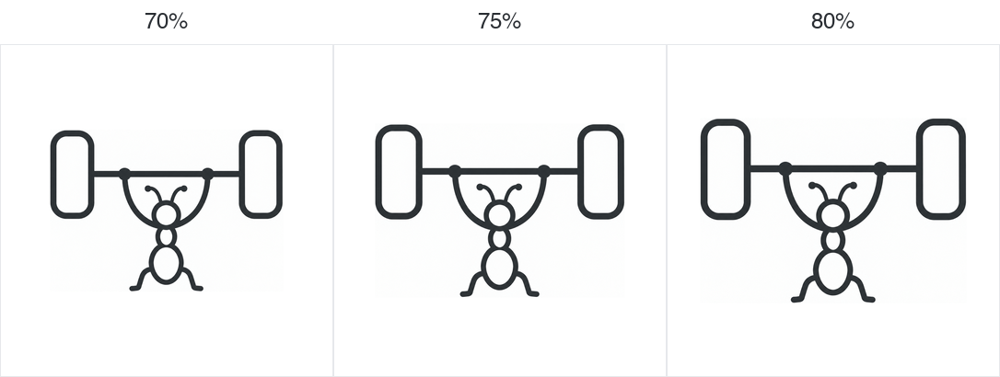

# 06 圆润极简：70%／75%／80% 占比对比

本轮固定用户选定的 `../monoline-refinements-6/06-soft-minimal.png`，仅做等比缩放和居中排版。

占比定义：深色图形的横向宽度 ÷ 正方形画布宽度，不是面积比例。三张画布统一为 1024 × 1024 像素，背景统一为白色。

- 70%：左右各约 15% 留白。
- 75%：左右各约 12.5% 留白。
- 80%：左右各约 10% 留白。

三个版本保持蚂蚁与杠铃的内部比例、线宽相对比例及造型一致。缩放会使整体线宽随图形一起改变，不是重新生成新的图案。

本轮按用户指定比例使用确定性的图像缩放与格式处理，不调用模型重绘。源图以灰度 50% 阈值测得主体包围框，保留边缘抗锯齿余量；实际占比和主体像素宽度记录在 `proportions.json`，存在整数像素取整误差。

| 比例 | 原图 |
| --- | --- |
| 70% | [1024px PNG](./smartdd-06-70.png) |
| 75% | [1024px PNG](./smartdd-06-75.png) |
| 80% | [1024px PNG](./smartdd-06-80.png) |

当前为比例选择稿，尚未更换应用内或安装包图标。
