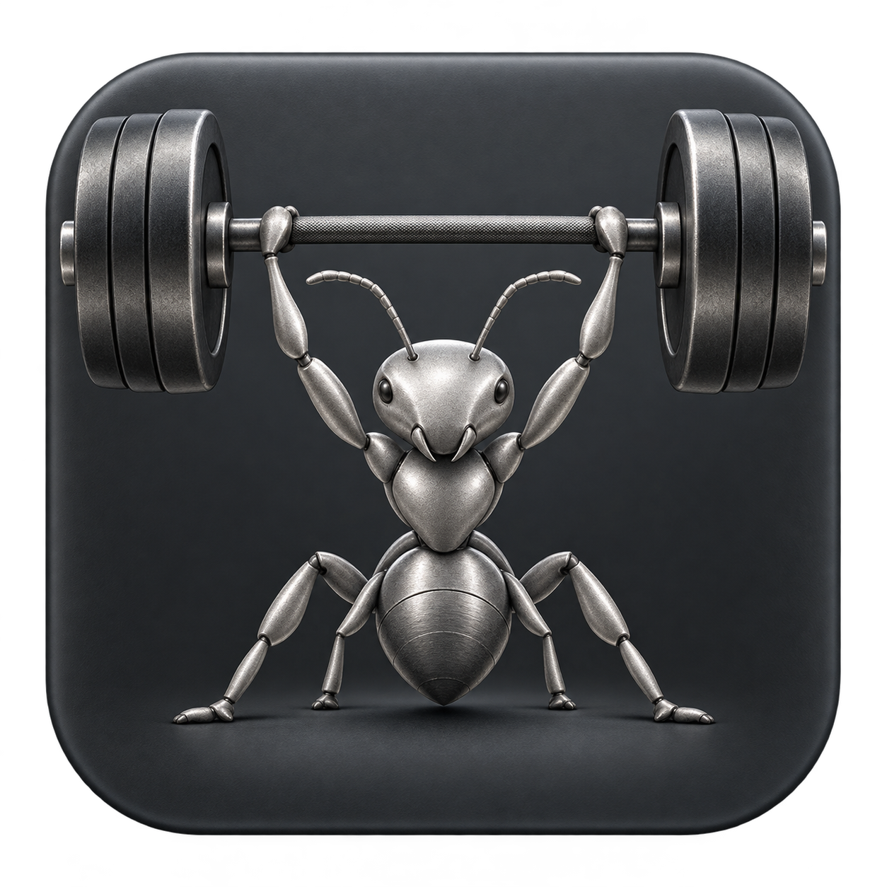
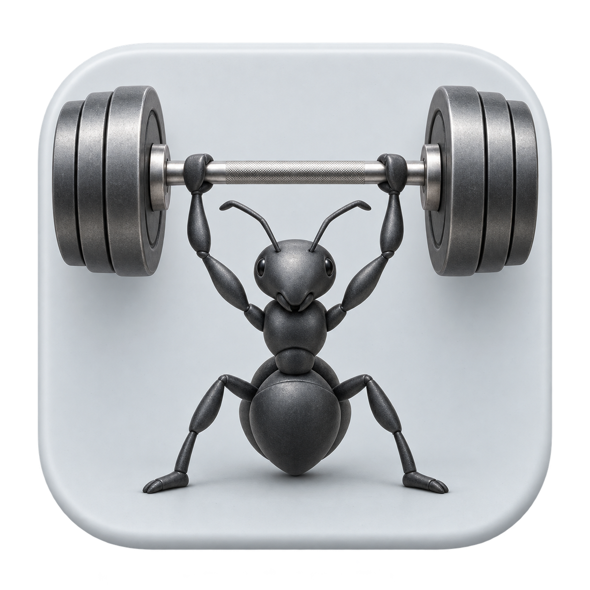
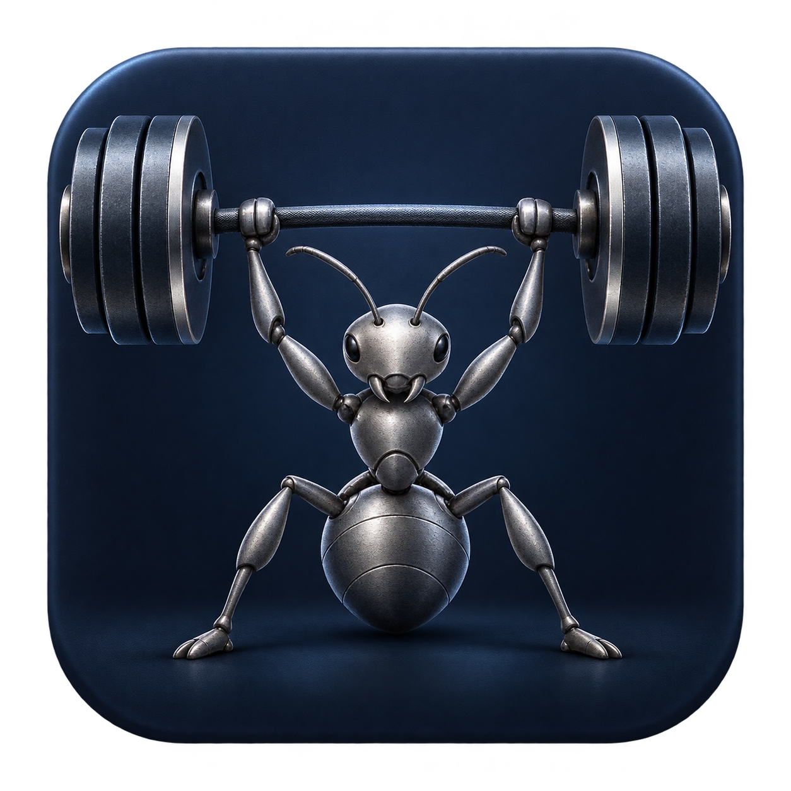

# SmartDD 应用图标：三种材质方案

状态：视觉评审稿，尚未接入打包。使用内置 image_gen 分别生成；保留原始透明 PNG。

## A · 石墨钛金属



生成提示词：

```text
Use case: logo-brand.
Asset: one premium macOS app icon design for SmartDD, a personal AI development workbench. Create a new refined design: a small ANT lifting a very heavy barbell overhead, conveying quiet strength, focus and capability.
Shared composition for a set of three material studies: single front-facing centered rounded-square tile, entire tile visible, occupies 88% of square canvas, equal margins, genuine transparent pixels outside tile. Within tile, a compact heavy barbell spans the upper third, large thick weight plates at both ends; the ant's raised front limbs grasp the bar. Ant centered below it, antennae, clearly separated head/thorax/abdomen, lowered center of gravity and feet firmly planted wide. Simplified strong limbs readable at 32–64 pixels. Ant and barbell together occupy most of the tile. Sculptural stylization rather than a toy mascot: restrained face, small subtle eyes, no giant cartoon eyes, no exaggerated smile, anatomically suggestive ant silhouette. A sophisticated collectible industrial sculpture, beautiful tactile materials, controlled studio lighting, soft ambient occlusion, crisp silhouette, shallow rounded bevel on tile. Weight and grounded tension in the pose. The form must be beautiful and readable as an installed desktop app icon.
Constraints: exactly one finished icon, no design sheet, no labels, no text, no letters, no watermark, no scenery, sun, grass, decorative particles, holographic effects or computer equipment. No yellow, orange, red or gold palette. No glossy plastic toy appearance. Keep identical shared layout and subject proportions across studies. Output square high-resolution PNG, alpha outside tile; opaque tile.
Material study A — GRAPHITE AND TITANIUM: deep graphite charcoal tile (#272B30), sculpted ant in satin titanium silver with fine bead-blasted texture, heavy barbell in dark gunmetal steel, subtle brushed edges. Strict neutral grayscale palette, soft cool white rim highlights and restrained reflections, no colored illumination. Quiet, dense, substantial, masculine yet elegant; premium industrial design. Maintain strong separation between silver ant, dark weights and charcoal tile. Background gentle graphite tonal gradient, no bright hotspot.
```

## B · 冷灰陶瓷



生成提示词：

```text
Use case: logo-brand.
Asset: one premium macOS app icon design for SmartDD, a personal AI development workbench. Create a new refined design: a small ANT lifting a very heavy barbell overhead, conveying quiet strength, focus and capability.
Shared composition for a set of three material studies: single front-facing centered rounded-square tile, entire tile visible, occupies 88% of square canvas, equal margins, genuine transparent pixels outside tile. Within tile, a compact heavy barbell spans the upper third, large thick weight plates at both ends; the ant's raised front limbs grasp the bar. Ant centered below it, antennae, clearly separated head/thorax/abdomen, lowered center of gravity and feet firmly planted wide. Simplified strong limbs readable at 32–64 pixels. Ant and barbell together occupy most of the tile. Sculptural stylization rather than a toy mascot: restrained face, small subtle eyes, no giant cartoon eyes, no exaggerated smile, anatomically suggestive ant silhouette. A sophisticated collectible industrial sculpture, beautiful tactile materials, controlled studio lighting, soft ambient occlusion, crisp silhouette, shallow rounded bevel on tile. Weight and grounded tension in the pose. The form must be beautiful and readable as an installed desktop app icon.
Constraints: exactly one finished icon, no design sheet, no labels, no text, no letters, no watermark, no scenery, sun, grass, decorative particles, holographic effects or computer equipment. No yellow, orange, red or gold palette. No glossy plastic toy appearance. Keep identical shared layout and subject proportions across studies. Output square high-resolution PNG, alpha outside tile; opaque tile.
Material study B — COOL CERAMIC: pale cool gray satin ceramic tile (#DDE1E5), sculpted ant in deep charcoal black matte ceramic, heavy barbell in brushed stainless steel and smoky gray metal plates. Restrained cool grayscale palette, soft diffuse daylight, gentle dimensional contact shadows, elegant porcelain-like tile with subtle rounded bevel. Calm, clean, refined, precise, suitable for a native Mac productivity app. No pure white glare or colorful illumination.
```

## C · 午夜蓝钢



生成提示词：

```text
Use case: logo-brand.
Asset: one premium macOS app icon design for SmartDD, a personal AI development workbench. Create a new refined design: a small ANT lifting a very heavy barbell overhead, conveying quiet strength, focus and capability.
Shared composition for a set of three material studies: single front-facing centered rounded-square tile, entire tile visible, occupies 88% of square canvas, equal margins, genuine transparent pixels outside tile. Within tile, a compact heavy barbell spans the upper third, large thick weight plates at both ends; the ant's raised front limbs grasp the bar. Ant centered below it, antennae, clearly separated head/thorax/abdomen, lowered center of gravity and feet firmly planted wide. Simplified strong limbs readable at 32–64 pixels. Ant and barbell together occupy most of the tile. Sculptural stylization rather than a toy mascot: restrained face, small subtle eyes, no giant cartoon eyes, no exaggerated smile, anatomically suggestive ant silhouette. A sophisticated collectible industrial sculpture, beautiful tactile materials, controlled studio lighting, soft ambient occlusion, crisp silhouette, shallow rounded bevel on tile. Weight and grounded tension in the pose. The form must be beautiful and readable as an installed desktop app icon.
Constraints: exactly one finished icon, no design sheet, no labels, no text, no letters, no watermark, no scenery, sun, grass, decorative particles, holographic effects or computer equipment. No yellow, orange, red or gold palette. No glossy plastic toy appearance. Keep identical shared layout and subject proportions across studies. Output square high-resolution PNG, alpha outside tile; opaque tile.
Material study C — MIDNIGHT BLUE STEEL: extremely dark midnight navy tile (#111C30), sculpted ant in smoky silver titanium, heavy barbell in dark blued steel with cool silver plate edges. Restrained deep navy and cool gray palette, a very faint ice-blue edge light only, no neon or luminous effects. Calm technological precision, quietly powerful and beautifully tactile. Background subtle navy tonal gradient and fine satin texture. Keep ant clearly legible on the dark navy tile.
```

