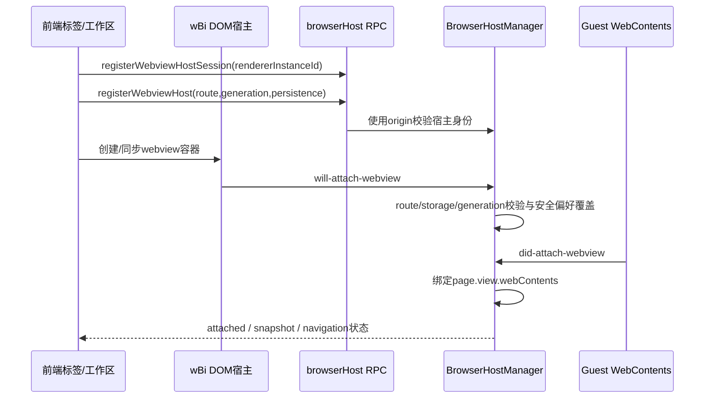

# F22：Codex 浏览器宿主实现证据与迁移边界

需求入口：[需求池 F22-B](../../需求池.md)，阶段未定。技术入口：[F22-B 浏览器迁移](../../F22B_内置浏览器_REA调研与迁移方案.md)。本文保留实现取证，迁移步骤为技术建议；后续选定 M 阶段后，在独立 M 需求文档确定具体范围。

调研日期：2026-10-16。仅静态分析，不修改产品代码，不启动被分析应用，不读取浏览历史、Cookie 或账户数据。

结论：SmartDD 可以做同类内置浏览器。当前 Codex 的可视页面实际由渲染进程创建 `<webview>`，再由主进程接管其 guest WebContents；它还调用多项 Owl 扩展接口，不能把压缩包中的浏览器宿主代码直接放进 SmartDD 的标准 Electron 即认为可用。页面导航、标签、历史恢复、权限 UI、下载管理可以用公开 Electron API 重新实现；无损 guest 接管、跨窗转移和原生浏览器权限/下载历史需要单独替代设计与验证。

## 证据范围与重现方式

安装路径虽为 `/Applications/ChatGPT.app`，本次目标身份由根调研确认是 `com.openai.codex`，版本 `26.1007.30912`、build `20156`。以下结论只属于这个已安装构建，不泛指所有 ChatGPT/Codex 版本。

| 标识 | 文件与身份 |
| --- | --- |
| ASAR | `/Applications/ChatGPT.app/Contents/Resources/app.asar`；SHA-256 `75e397e2280dde93b70a85aa926f4282c728eacc84dfeb15ba7fb6ddd84628af` |
| M | ASAR 内 `.vite/build/main-CqEoQDOU.js`；3,824,411 bytes；SHA-256 `09d19386e1f23cf4ccbc950fc40d85a1e8a064a08be588b2a4be6a89f6ada9e6`；manifest 的 ASAR member offset `7673309` |
| S | ASAR 内 `webview/assets/app-shared-8bd9d0399038.js`；8,175,575 bytes；SHA-256 `607ad0866dd25ed3764711b4467a9b60708353a599485b5249ff4cbe0e870245`；member offset `68915869` |
| M 行号 | `release/f22-research/formatted/.vite/build/main-CqEoQDOU.js`，Babel parser 7.29.9 / generator 7.29.8 格式化副本；非源代码原始行号 |
| 原始清单 | `release/f22-research/source-manifest.json`；原文件留在 `release/f22-research/extracted/`，不复制进需求文档 |

本子调研的 REA Evidence：`ev_44632a3cba4b686d769578bb4b83d42626e952bdee788de5dd689494c6649b3e`，operation `analyze_javascript_application`，provider `rea-javascript-application` version `1`，confidence `derived`、authority `shipped-artifact`。它分析的是四个精确源码切片，不是整个主进程 bundle：4 个 JavaScript 文件、17,269 bytes、4,226 AST nodes，parse failures 0、truncated scopes 0。外部变量没有在切片目录中解析，因此统计中的 `browser_windows: 0`、`ipc.operations: 0` **不证明原应用没有这些功能**。

MCP 完整响应超过传输预算，分析已经完成；未重复相同请求，改为导出保留证据：`release/f22-research/rea-browser-host-bundle.json`，7,047,040 bytes、1 record、export unknowns 0。这里的 unknowns 0 仅是工具记录数量，不代表所有实现问题已知。REA 限制仍包括：惰性文本解析、未运行 bootstrap、动态/混淆引用可能未解、静态关联不证明执行。

切片对应区间如下；均为原始 member 内 **0 起始** offset，长度以 UTF-8 bytes 计算。完整 SHA、字符区间与变换说明保存在 `release/f22-research/browser-host-slices.json`。

| REA 切片 | M byte offset | byte length | 原始字符 offset / length | 提取边界 |
| --- | ---: | ---: | --- | --- |
| `host-attach.js` | 1517908 | 10227 | 1517879 / 10227 | `function ICe(` 至 `function LCe(` 前 |
| `host-security.js` | 1528135 | 4788 | 1528106 / 4788 | `function LCe(` 至 `var ZCe=` 前 |
| `session-configuration.js` | 1532923 | 1570 | 1532894 / 1570 | `var ZCe=` 至 `var _U=` 前 |
| `adoption-lease.js` | 1852996 | 684 | 1852967 / 684 | `function $q(` 至 `function lAe(` 前 |

这四个文件逐字提取，无补入分隔符。S 中 `wBi=class` 另行人工核对，byte offset `6849350`、length `14654`，字符 offset `6806657`、length `14654`，切片 SHA-256 `85e36d1c38a329680bd9d9cf5a48d9559599e585da89c1b3e39a1edc5d0c81d8`。该辅助切片位于 `browser-host-extra-input/dom-webview-class.js`，末尾补一个分号，不在上述 REA 输入中；不可将其标为已由该 Evidence 分析。

根调研还提供原始前端模块 REA Evidence `ev_1fc56c3634117eea03d094719946ade49ce20875dbc9cdc7af9b81cb15d5b3fe`，以及 webview 模块 trace `ev_424e24fa6dc3fa1386e23e72d5a68c82b32a58e0b701cb2a0d14453d665f0556`（162 nodes、621 edges、partial）。宿主创建链以下由原始 S 与 M 人工核对补全；没有把工具图的未解析边当作运行证据。

## 已观察到的创建与挂载链

“观察”在本文表示静态语句可见，不表示已经执行过该路径。

1. `app-initial-6350d04672d0.js` 从 S 导入 `GS as _ae`；S 导出 `wBi as GS`。
2. S 的 `wBi` 构造函数明确执行 `document.createElement('div')`、第二个 overlay `div`、`document.createElement('webview')`。它把 webview 和光标 overlay 加入 container，并设置 `h-full w-full`、conversation/tab data 属性、`webviewrole=tab`。
3. 普通创建路径先设置页面持久化属性，再用 `GSt(conversationId, browserTabId, rendererInstanceId, hostGeneration)` 设置路由 partition，设置 adoption 属性，`src=about:blank`。应用导航并不直接依靠 DOM `src` 承载全部逻辑。
4. RPC 门面 `jb` 的 `registerWebviewHostSession`、`registerWebviewHost`、`syncView` 进入 `browserHostManager`，同时传入当前发送方 `origin`（M 34708–34920）。
5. `ensureWindowState` 建立窗口 registry，安装 `ICe` 监听器（M 84140–84236）。`ICe` 监听 `will-attach-webview`、`did-attach-webview`，并监听宿主销毁、导航与 render-process-gone 清理挂载（M 65600–66027）。
6. `will-attach-webview` 验证 route、storage owner、rendererInstanceId、hostGeneration 与 adoption lease。普通路径将 `params.src` 清空，记录 instanceId 到待挂载 route，主进程掌握初次导航（M 65679–65908）。
7. `did-attach-webview` 取得 Electron guest WebContents，根据 instanceId / adoption 记录调用 lifecycle.attachWebview（M 65909–65988）；其再次验证 host 身份及 route 不被重绑（M 81809–81905）。
8. `bJ` 把 guest 注入 `page.view.webContents`，安装导航、标题、favicon、失败、崩溃、焦点、上下文菜单、窗口打开等监听，发送 `browser-sidebar-webview-attached`（M 79965 起）。

**排除一项容易误判的证据：** M 唯一 `new _.WebContentsView`（69284）在 `Jwe.download()` 中，创建临时下载用 WebContents，调用 `downloadURL`，完成后关闭；它不是可视浏览器页面的创建器。不能搜索到这个类名就说 Codex 浏览器基于 WebContentsView。

## 身份、状态和生命周期

| 层次 | 已见字段/处理 | 开发时应保留的语义 |
| --- | --- | --- |
| 页面归属 | `conversationId + browserTabId`，`browserStorageId` 单独管理 | 同一标签的显示、存储与命令目标必须明确；SmartDD 可换成 project/session/tab 归属 |
| Renderer 会话 | `rendererInstanceId` | 宿主 renderer 重启后，拒绝旧异步响应和旧 webview attach |
| Host | `hostGeneration` | 同一路由宿主重新创建时拒绝陈旧挂载 |
| 展示 | `mountGeneration`、`presented`、`visible`、bounds、viewportScale | 标签切换、动画和卸载事件不能误杀新挂载 |
| Runtime | `cold / live-attached / live-detached / suspended` | 区分已有页面、后台保活、休眠与仅有快照的页面 |
| 销毁 | teardownId + reason + mountGeneration；先发 destroy-webview，前端确认后 finalize | 避免 DOM 生命周期与主进程不同步 |

证据：M 81804–82010、82110–82155、83200 起；S `wBi` 的 `detach`、`dispose`、`syncContainerStyle`、`parkInDom`。

S 中 `detach` 把页面后台化，清空活动 ref、取消焦点与交互，但保留 DOM；`parkInDom` 仍在 document 中放置隐藏容器。`dispose` 才移除 DOM、移除监听并尝试 guest destroy。`syncContainerStyle` 区分 visible、staged、bootstrap、hidden，并处理缩放、clipBounds、opacity、后台截图 surface。由此可知标签切换不是简单卸载 React 组件再重新加载 URL。

主进程在休眠前保存快照，并保护正在下载、捕获/媒体活动或 Agent 使用中的页面；具体阈值与全平台内存表现本次未运行验证。不要把“后台隐藏”与“休眠关闭 WebContents”混成一个状态。

## Session、安全、权限

M 11593–11600 定义 `af(x) = 'persist:codex-browser-' + encodeURIComponent(x)`。`ewe.configure()` 使用 `af('app')`，即 **`persist:codex-browser-app`**（M 66201–66231）。前端路由 partition 是挂载身份载体；`LCe` 最终将 guest 的 `params.partition` 与 `webPreferences.session` 替换成上述共享浏览器 session（M 66028–66043）。因此不能由 route 字符串推断“每个会话有独立 Cookie 容器”。

`cU` 覆盖 guest 安全设置：sandbox=true、contextIsolation=true、nodeIntegration/子帧/worker=false、webSecurity=true、allowRunningInsecureContent=false、webviewTag=false、plugins=false；移除任意 allowpopups、disablewebsecurity、webpreferences，再由主进程控制弹窗（M 66044–66046）。页面只使用专用 `browser-page-preload.js`，不与应用 shell 的全权限业务桥混用。

权限使用 `session.fromPartition(..., {permissionHandling:'browser'})` 与 `setPermissionPromptHandler`；通用 request/check handler 均返回拒绝。原生 prompt 转为 `xje` 的可订阅 UI snapshot（M 82633–82779），包含 requesting/embedding origin、permissions、availableActions、地理定位精度等。响应必须匹配 owner、tab、conversation、mount/host/renderer generation、navigationVersion、页面仍 presented 且未 teardown。导航后旧权限卡片不能继续授权。

**迁移含义（设计建议）：** SmartDD 用公开 `setPermissionRequestHandler` 与 `setPermissionCheckHandler` 建立自己的权限状态机，并记录 origin 与页面身份。不要照抄 Codex 的“普通 handler 全拒绝”而漏掉其 Owl prompt handler，否则浏览器权限会全部不可用。公开 Electron API 说明见 [Session](https://www.electronjs.org/docs/latest/api/session)。

## 导航、窗口打开、持久化、下载

**导航与命令（Observed）：** M 87054–87148 的 `browser-sidebar-command` 分发 navigate、back/forward、reload/ignoreCache、stop、find、zoom、print、截图、close-tab 等。navigate 先经过 URL forwarding，再由 BrowserHostManager 处理。`bJ` 维护 loading、title、URL、favicon、back/forward 与加载错误；监听 will-navigate / will-frame-navigate / will-redirect，阻止被限制导航（M 79965–80625）。SmartDD 应让主进程维护可信页面状态，前端只发 typed command 和消费 snapshot。

**新窗口（Observed）：** `setWindowOpenHandler` 检查深链、外部协议、限制导航和 disposition。普通新 tab 可发送 open-browser-tab 并 deny 原弹窗；Owl 分支使用原生 child WebContents + adoption lease 把 `window.open` 子页接入现有标签 UI（M 80507–80586）。后者涉及 opener/POST 等语义，不宜只用 URL 重开冒充完全一致。

**页面恢复（Observed）：** M 64019 创建 userData 下 `browser-sidebar-page-states.json`。记录 browserStorageId、tab/conversation owner、标题、URL、favicon、navigation entries/currentIndex（部分 entry 有 pageState）。写入有数量/字节预算和临时文件 rename（M 63859–63932），不是把整个进程或任意 JS heap 保存下来。M 78669–78700 使用公开 `navigationHistory.restore({entries,index})`；失败、被新导航取代、快照缺失均有分支。公开 API 见 [NavigationHistory](https://www.electronjs.org/docs/latest/api/navigation-history)。

**下载（Observed）：** `Xwe` 统一维护 liveDownloads、activeSavePaths、未读下载、route 归属、暂停/继续/取消/打开/定位；挂 `session.on('will-download')`。有活动下载阻止应用重启，也影响后台页休眠（M 69395–69610、83074–83100）。下载历史另外调用 `searchDownloadHistory`、`removeDownloadFromHistory`、`download-history-changed`，不是公开 DownloadItem 实时接口的自然附带能力。SmartDD 可用 DownloadItem 管实时下载、SQLite 管自己的历史；不要依赖上述未出现在当前标准类型中的扩展接口。

## Owl 扩展与 SmartDD 的公开 API 差异

SmartDD `package.json:60` 声明 `electron: ^42.0.0`；本机 `node_modules/electron/electron.d.ts` 可作为当前依赖的公开类型证据。Codex package 声明 Electron `42.3.0` 不能说明其运行时就是未修改的上游包。

| Codex 静态调用 | 位置 | 标准 Electron 核对 | 可迁移方案/边界 |
| --- | --- | --- | --- |
| `document.createElement('webview')` | S wBi byte 6849350 起 | 标准 webview 有此能力，但官方当前不建议新项目使用 | 保留外观、标签状态与命令协议，底层优先评估 WebContentsView |
| `_createWebViewAdoptionLease(owner)` | M 79375–79399 | 当前 electron.d.ts 无该名称 | 不可直接移植；重新设计 native view ownership |
| `webview.adoptWebContents(transfer)` | S wBi | 当前类型无该名称 | 跨窗接管需独立 spike，不能宣称 URL 重开等价 |
| `webContents.createWebViewTransfer(owner)` | M 81739 | 当前类型无该名称 | 如需无损跨窗，验证公开 WebContentsView 重绑定方案及生命周期 |
| `webContents.clone()` | M 83485 | 当前 WebContents 公开类型无该方法 | 用 navigationHistory 数据恢复新页；JS heap/opener 精确等价未证实 |
| `permissionHandling:'browser'`、`setPermissionPromptHandler` | M 66207–66211 | 当前类型无这些名称 | 自建权限 prompt registry，接公开 permission handlers |
| `setAgentActive`、部分捕获/媒体专用 API | M 79982、80012、80532 | `setAgentActive` 与 isCapturingCamera 等当前类型无；`isBeingCaptured` 则有 | 不要把所有媒体 API 都判成私有；逐项替代，Agent 控制可先独立状态管理 |
| `searchDownloadHistory`、`removeDownloadFromHistory` | M 69435、69523 附近 | 当前类型无这些名称 | 自有下载历史存储 |
| `navigationHistory.restore` | M 78679 | 公开 API | 可借鉴恢复状态机，仍需验证 pageState 数据限制 |

“类型中无名称”的结论是有界检查，不是完成了 Electron 二进制导出分析。结合 Owl 前缀、专有错误文案及调用链，可以高置信判定这一套接管能力依赖 Codex 的扩展运行时；没有进一步逆向其 Chromium/C++ 实现，不能声称已经取得这些原生实现源码。

Electron 官方目前建议避免新用 `<webview>`；公开 `WebContentsView` 支持用已有 WebContents 构造，但同一 WebContents 同时只能展示在一个 view。选择 WebContentsView 是 **SmartDD 迁移设计建议**，不是对 Codex 当前实现的描述。参见 [webview 官方说明](https://www.electronjs.org/docs/latest/api/webview-tag) 和 [WebContentsView](https://www.electronjs.org/docs/latest/api/web-contents-view)，核查日期 2026-10-16。

## 后续开发可直接采用的分层

1. Renderer：地址栏、标签、导航/加载/错误/权限展示；与现有终端同处工作区分栏，发命令和布局矩形。
2. BrowserHostService：负责 tabId 到 WebContentsView、owner、session、history、generation 的映射，校验所有 IPC 发送方与页面身份。
3. BrowserSessionService：session partition、权限、协议/弹窗策略、下载入口。项目隔离还是共享登录须作为产品决策，不误用 Codex route partition 的表象。
4. BrowserPersistenceStore：仅存标签元数据、导航历史与可恢复状态，不存可执行应用桥，不导出 Cookie/登录态到项目配置文件。
5. BrowserDownloadStore：实时 DownloadItem + 本地历史。页面关闭、应用退出与进行中的下载要有明确处理。

SmartDD 当前 shell 在 `src/main/app/window.ts:48` 使用专用 preload、contextIsolation=true、nodeIntegration=false、sandbox=false；这不应照搬给远程网页。浏览器 guest 必须独立设置 sandbox=true，避免给网页暴露项目/数据库/SSH/文件业务 IPC。这里是新增远程内容容器的必要结构边界，不要求本次修改现有 shell。

## 已回答与未回答

| 问题 | 状态 | 结论/后续证据 |
| --- | --- | --- |
| 页面究竟由什么创建 | 已回答，静态 | S 的 DOM webview → M will/did-attach → guest WebContents |
| 标准 Electron 可否实现基本内置浏览 | 可行，设计推断 | 公开 WebContentsView/session/navigation/download API 可覆盖；尚无 SmartDD spike 或真实验收 |
| Codex 宿主可否直接复制 | 已回答，静态 | 存在 Owl 运行时依赖，不能直接复制迁移 |
| 页面隐藏/关闭/恢复如何区分 | 已回答，静态 | DOM 保活、generation/teardown、快照持久化、history restore |
| 登录 session 是否按 conversation 隔离 | 已回答，静态 | 当前可见路径重写为共享 persist:codex-browser-app |
| 跨窗移动是否能用标准 API 完全等价 | 未验证 | 需验证 opener、POST、焦点、权限 prompt、capture 与无 reload 迁移 |
| 原生 Owl 接管/权限内部怎么实现 | 未解析 | 已发现 JS 契约；未分析 Chromium/C++ 原生实现 |
| Windows/Linux、IME、缩放/DPI、视频/音频、OAuth 全覆盖 | 未运行 | 必须逐平台执行；Mac 静态分析不能代替 |

本文件是后续设计输入。可以复用职责划分、状态机、接口与校验语义；源包并非本项目可直接发布的授权实现，本文不引入其 bundle 或品牌资源。
