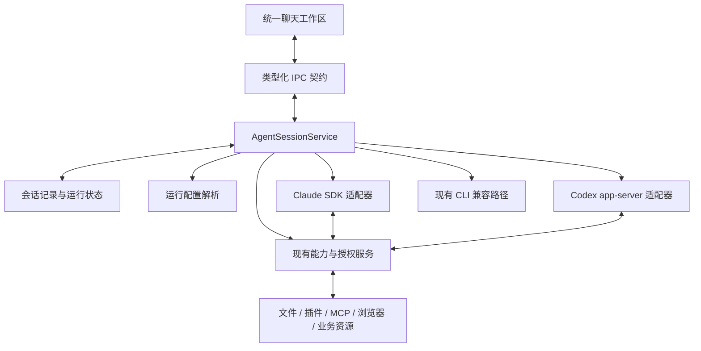

> 归档说明：R0.1 原稿，正文仅因移入历史目录重定位相对链接；原始文件路径为 `docs/统一Agent工作区优化方案.md`。原稿字节 SHA-256：`05764746fd672f5162152156d502503eaae080f8be35d4acbd0b2bab277aaa3c`。评审依据仍为 R0.1，现行正文见 [R0.2](../统一Agent工作区优化方案.md)。

# WillYou（SmartDD）统一 Agent 工作区优化方案

> 版本：R0.1 · 方案评审稿  
> 日期：2026-11-14  
> 项目：`/Users/hx/projects/SmartDD`  
> 调研基线：`feature/0.1.4`，提交 `40ea344a930aec37e36a803b7c621d3632d2d75a`，检查开始时工作区干净。  
> 本文性质：目标、需求和架构建议的综合评审材料。已完成静态代码核对及官方接口资料核对；尚未完成本方案的 SDK 集成实验、交互原型和运行验收。本文不代表功能已实现，也不分配新的 F／M 编号或调整既有里程碑顺序。

## 1. 用户目标与预期结果

### 1.1 用户希望解决的问题

SmartDD 当前以本地 CLI 作为 Agent 的运行入口，中央区域显示 CLI 自带的交互终端。不同 Agent 的输入、输出、审批、工具展示及快捷命令由各自终端界面决定。

用户希望将产品升级为 T3 Code 一类的统一工作台：

1. 在同一个聊天界面中使用 Codex、Claude 等 Agent，日常操作方式保持一致。
2. 通过 Agent 官方提供的 SDK、app-server 或其他已验证的程序化接口驱动执行。
3. 保留现有项目、任务、配置、文件、插件、Skill、MCP、浏览器及三方接入能力。
4. 保留已有 API 地址、Key、代理和配置隔离规则，继续支持已经适配的第三方模型供应商。
5. 让消息、工具调用、审批、执行状态和会话恢复成为工作台自身可管理、可展示的数据。
6. 为后续跨 Agent 协作、固定工作流、定时任务提供稳定的调用入口。

**目标产品形态：WillYou 负责统一交互与业务管理，各 Agent 运行时继续负责模型推理、上下文处理和工具执行。**

### 1.2 完成后的用户体验

用户创建任务时选择项目、智能体、模型及权限档位，然后直接在统一输入框中提问。Claude 与 Codex 使用相同的消息列表、工具卡片、文件引用和审批入口；差异能力通过可用选项和状态说明体现。

用户能够看到 Agent 正在执行什么、哪些操作需要批准、任务是否完成；切换页面后仍能继续查看进度；重启应用后能够查看历史，并在支持的原生会话上继续工作。

### 1.3 “其他功能不受影响”的定义

这是一项交付与验收要求，需要逐项验证，不能仅凭架构判断承诺零回归。

| 维度 | 必须满足的条件 |
| --- | --- |
| 数据 | 原项目、任务、配置、资源、密钥引用和能力快照继续可读；不覆盖原生会话记录 |
| 功能 | 已交付能力继续可达，现有操作的业务规则、权限及项目隔离保持有效 |
| 配置 | 同一配置选择对应同一供应商、模型和配置目录；缺失凭据时按既有规则处理 |
| 会话 | 旧任务保留查看和原入口恢复能力；可迁移的任务经过验证后进入聊天模式 |
| 运行 | 页面切换不误停任务；停止、关闭、归档、退出仍有清晰且可核验的结果 |
| 平台 | 每个平台分别核对；macOS 的验证结果不能替代 Windows／Linux 结果 |

## 2. 当前项目的事实与改造基础

### 2.1 已核实的实现

| 位置 | 当前行为 | 对本次方案的意义 |
| --- | --- | --- |
| [任务界面](../../src/renderer/views/task-view.tsx) | 使用 xterm，键盘输入发往 PTY，输出直接写入终端 | 中央交互区需要改为消息、工具和审批组件 |
| [PTY 管理](../../src/main/pty-manager.ts) | 使用 node-pty 启动命令，管理输入、输出、尺寸和进程退出 | 保留兼容运行路径；新聊天运行路径采用结构化协议 |
| [任务服务](../../src/main/core/tasks/task-service.ts) | 管理任务创建、启动、恢复、停止及能力生命周期；运行映射依赖 ptyId | 继续保留任务管理职责，逐步分离终端相关职责 |
| [运行器适配器](../../src/main/core/tasks/runner-adapters.ts) | 内置 Claude、Codex，封装程序发现、参数、状态目录和原生历史定位 | 可复用配置与身份逻辑，需要补充真正的会话执行接口 |
| [AI 配置服务](../../src/main/core/ai/ai-profile-service.ts) | 保存程序、参数、环境变量和密钥引用，主进程解析运行配置 | 复用存储，增加面向程序化运行的配置解析与兼容检查 |
| [私有 Codex 服务](../../src/main/core/applications/codex-private-server.ts) | 已启动 app-server；控制连接负责初始化与冻结 Skill 根发现，TUI 使用自己的连接处理对话 | 有进程与连接管理基础，但尚非完整聊天客户端 |
| [Codex 启动转换](../../src/main/core/applications/codex-task-server.ts) | 转换已识别参数并校验原生程序；当前该路径限制 macOS 和 Codex 0.167.1 | 需要沿用明确的版本边界，不能直接假定所有安装版本可用 |
| [任务表](../../src/main/db/schema.ts) | 任务表保存元数据，未将终端输出作为完整对话持久化 | 需要补充消息与执行记录，以及旧历史导入策略 |
| [文件上下文](../../src/main/core/files/terminal-context.ts) | 文件、正文、图片经终端投递，绑定 taskId／ptyId | 保留文件校验和引用机制，替换投递目标与方式 |
| [应用引用投递](../../src/main/core/applications/terminal-insertion.ts) | 将业务上下文插入目标终端，具有有效期及重复投递控制 | 改接聊天草稿和上下文服务，继续保留来源与幂等约束 |
| [用户输入凭据](../../src/main/core/applications/native-user-inputs.ts) | 依据终端实际输入或启动参数形成输入凭据 | 新的程序化提交路径必须纳入来源证据体系 |
| [原生消息核对](../../src/main/core/applications/native-user-messages.ts) | 将宿主输入与原生消息对应，支持后续业务判定 | 聊天记录本身不能直接替代原生消息与授权证据 |

### 2.2 与既有 M13／M14 的关系

[M13 入口](../里程碑/M13_应用Skill与MCP插件化重构/README.md)记录：P1 门槛开发与验收完成，其余 M13 仍待推进。相关配置、供应商、权限和技能管理设计包含已确认规则，但不能把整份需求当成全部已实现。

[M13 需求](../里程碑/M13_应用Skill与MCP插件化重构/需求.md)已经明确第三方供应商隔离、按次注入、不写全局配置、MCP 转换等约束。本方案应承接这些约束。旧文档中“在终端询问”等交互描述，需要在本次方案获批后改为对应的统一页面交互。

[M14 定时任务](../里程碑/M15_定时任务/README.md)仍为待规划。本次提供可复用的会话执行服务，不将定时任务列为现有已交付能力，也不自动扩大本次开发范围。

### 2.3 可行性结论

工程上可行。项目已经具备任务、配置、能力交付和原生会话管理基础，主要增量集中在：

- 统一的 Agent 会话运行接口。
- 原生协议到统一消息与状态的转换。
- 聊天页面、审批页面和上下文输入。
- 对话记录持久化与历史恢复。
- 原有终端绑定的业务接口迁移。

严格兼容仍需通过第 12 节的实验和验收确认，尤其是 Claude 配置加载、旧会话与应用授权链路。

## 3. 需求范围与优先级

### 3.1 本次完整交付范围

下面的 UAW 编号仅用于本文内部追踪；正式立项后再映射到需求池及对应阶段编号。

| 编号 | 需求 | 完成标准 |
| --- | --- | --- |
| UAW-R01 | 统一聊天工作区 | Claude、Codex 共用消息列表、输入框、执行状态和基本操作 |
| UAW-R02 | 官方程序化运行入口 | Claude 使用 Agent SDK；Codex 使用 app-server；版本和能力边界明确 |
| UAW-R03 | 连续对话与状态 | 同一任务保持原生上下文；支持发送、取消、完成及错误状态 |
| UAW-R04 | 工具与执行展示 | 展示运行时实际提供的工具、命令、结果和文件变更；缺失信息明确说明 |
| UAW-R05 | 审批与提问 | 支持批准、拒绝、取消、用户补充输入及待处理请求恢复展示 |
| UAW-R06 | 配置和供应商兼容 | API 地址、Key、模型、代理、认证来源及配置目录按既有规则生效 |
| UAW-R07 | Skill／MCP／插件兼容 | 按当前业务规则加载；能区分发现、配置、连接和实际调用状态 |
| UAW-R08 | 文件与业务上下文 | 路径、选区、正文、支持的图片及应用引用能够投递到准确任务 |
| UAW-R09 | 历史展示与恢复 | 新会话历史持久化，旧会话可查看并按兼容结果恢复 |
| UAW-R10 | 任务管理保持有效 | 创建、重命名、搜索、切换、停止、关闭、归档和删除继续可用 |
| UAW-R11 | 应用授权保持有效 | 邮件等操作的真实用户输入、作用域和授权判定不被聊天 UI 绕过 |
| UAW-R12 | 并发与隔离 | 多任务不串配置、不串上下文、不串审批；同一任务只有一个执行所有者 |
| UAW-R13 | 异常恢复与防重复 | 断连、崩溃和重试不会盲目重复发问、重复工具执行或重复外部操作 |
| UAW-R14 | 性能与可诊断性 | 长历史分页，流式输出有界缓冲，错误能够定位到任务、运行及请求 |
| UAW-R15 | 平台与兼容入口 | 为已声明支持的平台提供验证结果；不兼容配置保留原入口和明确原因 |
| UAW-R16 | 扩展接口 | 新 Agent 和未来调度调用会话服务，客户端无需按 Agent 重写主流程 |

以上是完整交付范围。实施可以分批，但文件上下文、应用授权、旧会话等兼容工作未完成时，只能交付试用版，不能宣称整体升级完成。

### 3.2 后续独立范围

- Cursor、Kiro 等新增 Agent 的正式接入。
- 跨 Agent 自动分工、固定工作流编辑器及工作流运行记录。
- 定时任务、无人值守执行和外部操作预授权。
- 同一会话跨供应商切换，以及跨 Agent 的完整上下文转换。
- T3 式远程服务、移动客户端和隧道连接。

这些能力可以使用本次接口，但应分别定义需求与验收。

## 4. 统一页面与交互设计

### 4.1 页面结构

保留 WillYou 当前项目导航、品牌、设置、文件区、插件区和浏览器工作区。在中央任务区域新增统一聊天视图，保持与既有侧栏及任务操作的连接。

| 区域 | 展示与操作 |
| --- | --- |
| 任务头部 | 项目、任务标题、智能体、模型、权限档位、运行状态 |
| 消息区域 | 用户消息、Agent 回复、执行进度、工具调用、支持的计划与结果 |
| 工具卡片 | 工具名、必要参数、执行状态、结果摘要；详细输出按需展开 |
| 文件变更区域 | 运行时提供的变更、路径和 diff；已有文件工作区继续负责查看与编辑 |
| 审批区域 | 待批准操作、作用域、允许的决策和原因；支持拒绝及取消 |
| 输入区域 | 文本、文件引用、选区、图片、业务引用、发送与停止生成 |
| 状态与诊断 | 当前运行阶段、错误原因、连接与恢复状态、兼容入口 |

参考 T3 的统一交互方式；WillYou 的视觉细节通过原型评审确定，不将“T3 一类体验”直接解释为全部页面逐像素复刻。

### 4.2 交互规则

1. 输入文本、插入引用与发送消息是三个明确动作。投递上下文默认进入草稿，避免用户尚未确认就开始执行。
2. 同一任务运行期间，首期只允许一个活动回合；补充消息的排队或中途引导能力由适配器声明。未支持时保留草稿并给出明确状态。
3. “停止生成”终止当前回合；“关闭会话”结束该任务的运行实例并保留历史；既有停止、归档、删除规则继续按原业务契约处理。
4. 切换项目、任务、文件区或插件页面，默认只改变查看对象。运行实例由主进程服务持有，生命周期不跟随聊天组件卸载。
5. 批准操作同时校验任务、运行、回合及请求身份。页面切换后不得把旧审批提交给新任务。
6. 模型与权限切换按既有业务规则及原生接口能力执行；需要重启或下一回合生效时明确显示，不把控件变化当成运行配置已经变化。
7. 快捷命令按适配器提供的能力显示。原 TUI 的所有斜杠命令与按键操作不能自动视为已迁移；常用操作映射成页面能力，其余保留兼容入口。
8. 仅显示运行时确实提供的推理摘要或执行信息，不补造未返回的思考内容、成本、工具结果或完成状态。

## 5. 技术架构与职责

### 5.1 推荐架构

继续使用现有 Electron、React、IPC、SQLite 和业务服务。在主进程增加统一会话服务，通过适配器调用 Agent。



借鉴 [T3 的 ProviderAdapter](../../../t3code/packages/provider-core/src/server/ProviderAdapter.ts) 将启动、恢复、回合、停止、审批和历史读取放在适配边界。以 SmartDD 的现有服务模型实现；本阶段采用现有 IPC 运输，不增加远程服务层。

### 5.2 模块职责

| 模块 | 责任 |
| --- | --- |
| TaskService | 项目与任务业务规则、元数据、归档和删除；通过会话服务执行任务 |
| AgentSessionService | 运行所有权、会话创建／恢复、消息提交、回合状态、审批路由、事件落库 |
| RuntimeConfigResolver | 解析智能体、供应商、模型、权限、环境、认证来源及配置目录；生成不可变启动计划 |
| AgentRuntimeAdapter | 原生 SDK／协议调用、事件转换、原生历史读取及能力声明 |
| 能力服务 | 沿用现有 Skill、MCP、插件、业务授权、资源占用及清理规则 |
| ContextDeliveryService | 接收文件和业务引用，校验来源、版本与任务归属，生成草稿／提交内容 |
| 消息存储与查询 | 保存统一历史、运行状态和关联索引，提供分页与增量查询 |
| 聊天客户端 | 渲染数据、收集输入和决策；通过 IPC 发出命令 |

这些是逻辑职责，初期可在少量模块内实现；按测试和依赖需要拆分，不要求提前建设通用插件框架。

### 5.3 统一身份

| 标识 | 含义 |
| --- | --- |
| taskId | 继续使用现有任务标识，对应用户看到的一项工作 |
| runtimeKind | 该任务使用聊天程序化运行或旧 CLI 路径 |
| nativeSessionId | Agent 原生会话标识，保持原恢复语义 |
| runId | 当前一次运行实例；优先复用现有能力运行标识，关联实际进程与资源 |
| turnId | 一次消息提交与执行的回合，关联宿主编号及原生回合编号 |
| itemId | 回复、工具、变更或其他流式项目的稳定标识 |
| requestId | 待审批或待用户输入的请求标识 |
| clientMessageId | 客户端提交消息的防重复标识 |

现有能力系统大量绑定 ptyId。应逐步改为“任务＋运行实例”的共同上下文，终端运行额外携带 ptyId，程序化运行携带真实进程和连接信息。不得为 SDK 实例伪造一个 PTY 来满足旧校验。

### 5.4 适配器接口建议

以下为职责示意，不是已落地的接口定义：

```ts
interface AgentRuntimeAdapter {
  describeCapabilities(context: RuntimeContext): Promise<AgentCapabilities>;
  createSession(plan: ResolvedLaunchPlan): Promise<NativeSession>;
  resumeSession(plan: ResolvedResumePlan): Promise<NativeSession>;
  startTurn(input: TurnSubmission): Promise<TurnStartReceipt>;
  interruptTurn(input: TurnTarget): Promise<void>;
  respondToRequest(input: RuntimeRequestDecision): Promise<void>;
  readHistory(input: HistoryQuery): Promise<HistoryPage>;
  closeSession(input: SessionTarget): Promise<void>;
  events(input: RunTarget): AsyncIterable<AgentRuntimeEvent>;
}
```

适配器必须提供能力声明，例如图片输入、工具审批、用户提问、原生恢复、历史读取、模型切换及中途引导。该声明需要结合实际版本、配置和模型，不能只按 Agent 名称固定为全部支持。

## 6. Agent 接入方案

### 6.1 Claude：Agent SDK

采用 `@anthropic-ai/claude-agent-sdk` 驱动 Claude Code 的 Agent 能力。官方 SDK 提供程序化会话、流式输出、工具和权限等能力，适合构建自有界面。[官方概述](https://code.claude.com/docs/en/agent-sdk/overview)

实施要点：

1. 固定 SDK 依赖版本，并记录实际 Claude 可执行文件版本。使用宿主已识别的可执行文件时，通过官方支持的 `pathToClaudeCodeExecutable` 指定，验证与 SDK 的兼容性。[TypeScript 参考](https://code.claude.com/docs/en/agent-sdk/typescript)
2. 从 SDK 返回值确认原生会话身份；以相同工作目录、配置根和受支持恢复接口继续会话。
3. 将 SDK 消息转换为统一回复、工具、请求、结果和错误；保留原生项目编号及父子关系，支持同一回复中的多个工具。
4. 按权限模式、规则、钩子及运行时回调的真实处理顺序接入审批，不能假定所有工具都会进入 `canUseTool`。[权限说明](https://code.claude.com/docs/en/agent-sdk/permissions)
5. 配置加载、Skill、MCP、插件和项目指令分别核对；第三方供应商模式严格遵循第 7 节的隔离要求。
6. SDK 内置 subagent 与 CLI Agent Teams 分别处理。Agent Teams 不能作为本方案已自动继承的能力。[SDK 与 Claude Code 功能差异](https://code.claude.com/docs/en/agent-sdk/claude-code-features)

### 6.2 Codex：app-server

以 `codex app-server` 作为程序化会话入口，由宿主实现双向 JSON-RPC 客户端。官方协议包含会话创建／恢复、回合、执行事件和审批。[官方说明](https://learn.chatgpt.com/docs/app-server)

实施要点：

1. 优先复用当前私有服务的程序校验、启动环境、进程所有权和连接管理思路。
2. 将现有“Skill 控制连接＋TUI 对话连接”的职责统一规划，增加真正拥有聊天线程的客户端；不能直接把现有控制连接当作完整聊天客户端使用。
3. 对锁定版本生成或核对协议类型，完成初始化、创建／恢复、开始／中断回合、原生请求响应和连接退出处理。
4. 将文本增量、工具执行、命令输出、文件变更和用户请求路由到准确任务与回合。
5. 将已冻结 Skill 根及 MCP 配置交付给实际执行会话的服务，验证连接一致性，避免控制连接发现成功而执行线程未加载。
6. 初期沿用已验证的运行隔离策略；是否跨任务共享 app-server，在并发、认证和资源所有权实验通过后再决定，不在迁移时一并重构进程拓扑。
7. 当前代码对私有服务路径的版本与平台限制是真实边界。新适配器应提供版本能力矩阵，不能把最新文档中的全部字段直接用于旧版本。

### 6.3 第三方模型与后续 Agent

DeepSeek 等是模型供应商，Claude／Codex 是执行工具循环的 Agent。现有供应商通过哪个 Agent 协议接入，就继续由对应适配器运行；有效性同时取决于接口协议、模型、工具调用及认证方式。

本次保留 M13 已确认的兼容协议边界，统一页面本身不增加协议转换。新增供应商应通过现有配置与可用性规则验证。

Cursor、Kiro 等后续接入时，先确认实际安装版本对应的 SDK、ACP 或其他程序化接口，再实现同一适配器契约，不按产品名称推定接口一致。

## 7. 配置、认证、Skill 与 MCP 兼容

### 7.1 配置解析原则

**CLI 与 SDK 是否使用同一配置，需要由启动计划明确保证。** 同一个 SDK 并不自动意味着读取同一个 HOME、配置目录、环境或参数。

建议在启动前生成脱敏的有效配置摘要：智能体、供应商、模型、配置根、认证来源类型、权限档位、代理是否启用、配置修订号和能力版本。具体凭据仅在主进程解析后交付所需进程，不进入客户端摘要。

| 项目 | 迁移要求 |
| --- | --- |
| API 地址与 Key | 从既有配置和密钥存储解析，按 Agent 的支持方式传入；避免同时残留另一套认证 |
| 模型 | 记录请求模型及运行时实际返回模型；无法核实实际模型时显示未确认 |
| 代理 | 保留既有代理配置；验证请求实际经所选路径发出，不只检查环境变量存在 |
| HOME／配置根 | 沿用既有默认、显式目录及原生会话身份规则 |
| shell 环境 | SDK 直接启动进程不必然执行 shell rc；复用现有安全的环境发现结果，单独验证 Finder 启动时 PATH、代理及认证来源 |
| CLI 参数 | 逐项映射为 SDK 选项或协议字段；未知参数提供兼容提示和原 CLI 入口，不静默丢弃 |
| 权限档位 | 保留已确认的 Agent 差异和适用范围，不能把 SDK 默认权限当作产品默认权限 |
| 程序与依赖版本 | 在启动前检查并记录；不兼容时阻止该聊天路径，避免自动更新影响其他任务 |

### 7.2 原生登录与受管供应商分别处理

以 [M13 需求](../里程碑/M13_应用Skill与MCP插件化重构/需求.md)为业务基线：

- **CLI 自有登录路径**：保留其独立身份和原有环境语义。程序化入口的认证支持与适用使用条件需要另行核对；可读到登录文件不能直接等同于所有登录方式均可用于 SDK。Claude 原生订阅仍按既有阶段约定单独验证，未核实的登录配置继续保留 CLI 入口。
- **Claude 第三方供应商路径**：使用 WillYou 管理的独立配置目录，清理与所选模式冲突的继承认证，缺 Key／失效 Key 不回退到用户其他账号。
- **项目设置隔离**：第三方 Claude 模式保留“仅采用受管设置，不采用项目／本地 settings，项目 CLAUDE.md 仍有效”的既有要求。
- **Codex 第三方供应商路径**：沿用已确认的插件同步、统计及认证隔离策略，并验证程序化启动时仍然生效。

当前 Claude SDK 的 `settingSources` 会影响文件设置和项目指令加载，其缺省行为还可能随版本变化。**“屏蔽项目 settings，同时保留 CLAUDE.md 与所需技能”的组合必须做专项实验，不能简单设置空数组后宣称兼容。** [SDK 配置加载说明](https://code.claude.com/docs/en/agent-sdk/typescript#settingsource)

### 7.3 Skill／MCP／插件交付

保留现有能力选择、冻结版本、项目启停、资源占用、凭据处理及清理规则。调整交付位置与连接方式，而不重新建设一套与 M13 平行的管理体系。

| 能力 | 需要核对的内容 |
| --- | --- |
| 用户与项目 Skill | 来源目录、同名冲突、启用状态、Agent 实际发现、相对脚本执行、恢复后加载 |
| 插件 Skill | 使用冻结资源，确认 SDK／app-server 执行会话可见，与插件选择保持一致 |
| stdio MCP | 命令、参数、cwd、环境、凭据过滤及进程生命周期 |
| HTTP 类 MCP | 实际支持的运输、请求头、认证、超时与连接状态 |
| MCP 转换 | 继续使用既有转换规则；env 插值、SSE、OAuth 及有损字段分别处理 |
| MCP 审批 | 将既有批准策略映射到页面及原生权限控制，保留拒绝后零执行的语义 |
| 配置变更 | 根据适配器能力决定实时刷新或恢复后生效，清晰展示当前会话实际版本 |

能力状态应分为“已发现、已选择、已交付、已连接／加载、已调用”。仅发现目录或返回工具列表不足以证明完整业务可用。[Claude SDK 功能加载说明](https://code.claude.com/docs/en/agent-sdk/claude-code-features)

## 8. 文件、业务上下文与授权链路

### 8.1 统一上下文投递

从现有终端投递服务提取可复用的来源、版本与归属校验，增加面向聊天草稿的投递目标：

1. 用户从文件区或业务页面选择内容。
2. 主进程校验项目、任务、运行实例、来源有效期和文件版本。
3. 将引用或内容加入该任务草稿，并显示实际将发送的内容。
4. 用户发送时再次核对需要冻结的版本与权限。
5. 适配器转换成支持的原生文本、图片或其他输入块。
6. 保存提交内容和引用元数据，明确“已加入草稿”与“已被运行时接收”的状态。

优先复用文件路径及选区引用，控制正文大小；大附件保留引用并按实际能力处理。模型不支持图片时在发送前说明，不能把未发送的图片显示为已接收。

### 8.2 真实用户输入与业务授权

现有 [NativeUserInputs](../../src/main/core/applications/native-user-inputs.ts) 会观察宿主实际交付给终端的输入；[NativeUserMessages](../../src/main/core/applications/native-user-messages.ts)进一步核对原生消息。新路径需增加程序化消息提交的来源记录。

建议保持以下边界：

- 主进程记录可信发送者、任务、运行、提交编号、内容摘要、上下文选择与实际提交结果。
- 区分用户输入、系统补充上下文、恢复导入、工具返回及未来自动任务输入。
- SDK／app-server 的接收回执与原生日志按原有证据要求关联；未核实接收的内容不得写成已确认输入。
- 输入来源凭据只说明内容来自哪里，邮件发送等操作是否被授权仍由现有业务规则判定。
- UI 导入旧记录、重新渲染历史或将文字放入草稿，都不得生成新的操作授权。
- 遇到确认结果未知的提交，保留未知状态并核对原生会话，避免自动重发。

## 9. 会话状态、事件与数据设计

### 9.1 运行状态

建议将“实例是否存在”与“回合是否完成”分开保存。

```text
会话：未启动 → 准备中 → 可用 → 关闭中 → 已关闭
                    ↘ 启动失败
任意活动阶段遇到进程退出／连接异常 → 恢复待确认

回合：提交中 → 执行中 ↔ 等待批准／等待用户输入
                ├→ 已完成
                ├→ 已取消
                ├→ 失败
                └→ 结果待确认
```

Agent 回复完成不代表整个运行实例关闭；连接断开不代表任务已完成；页面没有订阅也不代表任务停止。原生运行存在后台子任务时，主回合完成与后台工作状态分别展示。

### 9.2 统一事件

建议至少覆盖会话就绪／退出、回合开始／结束、消息增量／完成、工具开始／输出／结束、文件变更、审批请求、用户输入请求、用量信息和结构化错误。

事件携带 taskId、runId、turnId、itemId、原生关联编号、序号及格式版本。保留必要的原生差异信息，客户端展示以统一字段为主。

### 9.3 存储建议

在现有 SQLite 数据层增量扩展，具体表名在正式技研时确定：

| 数据 | 建议内容 |
| --- | --- |
| 会话运行记录 | 运行模式、原生身份、配置修订、运行状态、实际进程所有权、开始／结束信息 |
| 回合记录 | clientMessageId、原生回合编号、提交与结束状态、结果摘要和错误 |
| 消息与执行项目 | 稳定项目编号、类型、内容块、工具关联、来源、顺序及完成状态 |
| 待处理请求 | 请求类型、作用域、可用决策、当前状态和关联回合 |
| 草稿与引用 | 各任务独立草稿，引用身份及必要的版本信息 |
| 历史导入索引 | 来源、原生记录编号或位置、导入版本、最后进度及去重标识 |

消息存储服务于展示、查询和追踪。原生会话继续作为 Agent 上下文恢复的依据，能力快照及业务授权沿用其现有权威记录。不要把聊天消息表当成新的业务授权数据库。

### 9.4 一致性、流式与幂等

- 同一任务的提交与运行切换按顺序处理，主进程校验当前运行所有者。
- 客户端重复提交同一 clientMessageId，返回已存在的处理状态，不创建第二次执行。
- 记录待提交命令及状态，区分“确定未提交”和“可能已经提交”。跨原生进程的提交不能仅靠本地事务保证恰好一次。
- 工具及文本增量有界缓冲并按批写入，关键状态及时持久化；不保存无限增长的重复全文事件。
- 前端通过快照、游标与增量接续刷新。批准只对仍有效的原生请求执行一次。
- 应用重启后核对原生进程与会话；失效请求标为过期，不自动再次批准或补发外部操作。

## 10. 旧数据迁移与兼容策略

### 10.1 新旧模式并存

先为新建且满足兼容检查的任务开放聊天模式；旧任务保留原运行模式及原生身份。运行模式随任务保存，不能在一次应用升级后把所有任务默认改成 SDK 模式。

同一任务同一时刻只允许一个原生会话执行者。模式切换前正常结束原实例，并确认必要资源已释放；不能让 CLI 和 SDK 同时恢复同一个原生会话。

### 10.2 旧历史查看与继续执行分别验证

| 旧任务情况 | 处理方式 |
| --- | --- |
| 原生历史可读，恢复实验通过 | 只读导入可识别历史；用户选择后以原会话进入聊天模式 |
| 历史可读，但程序化恢复未验证 | 提供历史查看，执行仍保留原 CLI 路径 |
| 部分记录格式无法识别 | 展示已识别内容和缺失范围，保留原记录及原入口 |
| 原生历史缺失或身份不一致 | 显示具体原因，沿用既有恢复限制，不伪装为原会话续聊 |
| 运行仍在进行 | 保持当前实例，结束后再处理迁移 |

官方历史读取接口可作为优先方案，但必须核实锁定版本、自定义配置根及完整记录类型；不足部分沿用受控原生文件解析，不修改源文件。[Claude SDK 历史读取参考](https://code.claude.com/docs/en/agent-sdk/typescript#getsessionmessages)

### 10.3 数据升级与回退

数据库改动以新增结构为主，保留原任务字段、会话目录及能力快照。迁移可重入，历史导入按稳定编号去重，失败不阻止原兼容路径使用。

回退策略需要区分：

1. **关闭聊天功能开关**：仍运行新版本应用，保留新表并切回已验证 CLI 路径。
2. **恢复旧版应用**：只有经过数据库前后兼容测试才允许直接打开升级后的数据库；否则使用升级前备份。备份后产生的数据需另行保留，不得用覆盖数据库的方式无声丢失。

首期不自动删除旧运行代码或清理原生会话；清理作为稳定使用后的独立变更。

## 11. 模块改造清单与影响边界

| 模块 | 建议改造 | 保留与验证重点 |
| --- | --- | --- |
| task-service | 把会话执行委托给统一服务，保留任务业务方法 | 原有归档、关闭、删除与能力收尾行为 |
| runner-adapters | 保留程序和身份解析，组合新的运行适配器 | 自定义程序路径、参数、状态根和未知 Agent 读取 |
| capability-lifecycle／run-registry | 将通用运行上下文与 PTY 特有信息拆分 | 真实进程归属、资源占用、停止回执、异常恢复 |
| task-capability-launcher | 对接两种运行方式的准备、交付和释放 | 原冻结资源、版本、Skill 根、MCP 连接和清理 |
| codex-private-server | 复用已验证机制，补齐聊天客户端职责 | 控制连接、执行连接及线程所有权不能混淆 |
| ai-profile-service／launch-env | 增加程序化配置计划与兼容诊断 | 环境优先级、认证隔离、shell 与直接启动差异 |
| IPC 与共享类型 | 增加消息、审批、分页及事件契约 | 可信发送者校验、作用域校验和错误结构 |
| 数据库 | 增加统一历史与运行记录 | 原数据可读、迁移可重入、回退边界明确 |
| task-view／tasks-store | 新增聊天视图及状态订阅，兼容终端视图 | 任务切换、键盘、滚动、长历史和深浅主题 |
| 文件与应用引用 | 对接聊天草稿及结构化输入 | 目标绑定、来源、版本、去重、取消与图片能力 |
| 原生用户输入与消息证据 | 增加程序化提交的主进程证据 | 保留原生消息核对与现有业务授权判定 |
| 项目／文件／浏览器／插件业务 | 原服务继续提供能力，调整涉及会话的调用点 | 已交付业务全链路回归；不因页面替换遗漏入口 |
| 语音与快捷键 | 核对焦点、输入目标和发送行为 | 保持既有语音唤起方式，新增输入框可正确接收 |
| 打包与资源 | 固定 SDK、二进制与资源版本，处理实际文件路径 | Electron 打包、权限、原生组件和各平台安装 |

## 12. 分阶段实施与交付门槛

### 阶段 A：兼容实验与技术定案

在独立环境中验证关键路径，形成版本矩阵和真实回执：

| 实验 | 必须回答的问题 |
| --- | --- |
| A1 Claude 基本运行 | 锁定 SDK＋程序版本能否连续对话、调用工具、取消并恢复 |
| A2 Claude 配置组合 | 第三方隔离、项目指令、所需 Skill／MCP 能否同时满足既有规则 |
| A3 Codex 基本运行 | 当前已验证版本能否由宿主完整拥有会话与审批，接入冻结能力 |
| A4 旧任务恢复 | 原会话 ID、原配置根和能力快照能否被新入口正确使用 |
| A5 业务授权 | 程序化输入能否接入原生消息及邮件等操作的既有证据链 |
| A6 打包运行 | SDK 与可执行文件在真实 Electron 安装包中能否按正确路径运行 |

任一关键兼容项未通过，对应配置继续保留 CLI。实验完成后再确定支持版本；不能以新建一次会话成功替代这些门槛。

### 阶段 B：需求、原型与验收基线评审

将本文需求映射到正式阶段，准备统一聊天、工具、审批、上下文和旧会话等原型状态。明确首个目标平台、终端兼容入口、模型切换及不支持能力的呈现方式。

交付：正式需求、技术方案、原型和逐条验收用例。按项目现有流程评审后进入生产开发；本次请求的产物仅为方案文档。

### 阶段 C：统一运行与数据基础

建立会话服务、配置计划、共享契约、运行状态和历史存储。通过可控协议夹具验证流式、请求路由、幂等、取消、断连和资源释放，再接真实 Agent。

交付：受控入口可运行的新会话基础，现有终端路径继续可用。

### 阶段 D：接入 Codex 与 Claude

建议先完成已有 app-server 基础的 Codex 路径，再完成 Claude SDK；如阶段 A 结果表明相反顺序更稳妥，可据实调整。

每个适配器均独立完成对话、工具、审批、停止、恢复和错误处理；不得只完成文本输出就视为接入结束。

### 阶段 E：聊天页面与业务兼容

完成聊天 UI、文件与应用上下文、图片、语音输入目标、插件状态、旧历史和授权链路。核对设置、侧栏、快捷键、上下文菜单等受影响入口。

交付：可供完整业务验收的候选版本。

### 阶段 F：隔离验收与切换默认入口

在隔离 HOME／userData 和真实安装包中验证全部范围。达到第 13 节条件后，将已通过兼容检查的新任务默认设为聊天模式，保留旧任务原入口。

交付：验收结果、支持矩阵、已知限制、迁移说明和候选安装包。安装到日常实例及正式发布按原项目授权流程单独执行。

## 13. 验收矩阵与验证方法

### 13.1 必须覆盖的场景

下表是待细化的验收场景组，全部状态为**未执行**。它不是现有 M13 的正式用例账，也不能用于计算既有阶段通过率。

| 场景组 | 关联需求 | 核心判据 |
| --- | --- | --- |
| V01 基本对话 | R01／R02／R03 | Claude、Codex 连续多轮对话，统一显示且原生上下文保持 |
| V02 工具与结果 | R04 | 工具开始、输出、成功／失败及文件变更与原生执行一致 |
| V03 审批 | R05／R12 | 批准后执行；拒绝／取消后不执行；旧请求不能作用于新运行 |
| V04 用户提问 | R05 | 用户回复被交付给准确请求；关闭或过期后不会再次提交 |
| V05 模型与供应商 | R06 | 每个已支持配置命中正确地址、模型及认证；缺 Key 不发生禁止的回退 |
| V06 环境与配置根 | R06 | Finder 启动与开发启动均按约定解析配置；并发任务不串账号或目录 |
| V07 Skill／MCP | R07 | 用户、项目和插件能力按规则加载并实际调用，停用／变更行为正确 |
| V08 文件上下文 | R08 | 路径、选区、正文及支持的图片投递准确，过期引用和重复投递受控 |
| V09 业务授权 | R11 | 用户原话与原生输入可核对；引用、历史导入和工具输出不能新增操作授权 |
| V10 已有业务 | R07／R10／R11 | 项目、文件、数据库／SSH、邮件、插件及浏览器的已交付用例按影响范围通过 |
| V11 旧任务 | R09／R15 | 查看、恢复、目录、能力快照与原生身份正确；不兼容时保留原入口 |
| V12 生命周期 | R03／R10 | 停止生成、关闭、归档、退出和进程异常结果明确，资源释放准确 |
| V13 重启与幂等 | R09／R13 | 历史可读，重复提交不重复执行；未知结果不会自动重发 |
| V14 并发 | R12／R13 | 多项目、多任务分别提交和审批；同一任务不能被两种入口同时执行 |
| V15 性能与交互 | R01／R14 | 长历史分页，持续输出可滚动和输入；切换页面不丢输出或误停任务 |
| V16 平台与安装 | R15 | 支持的平台分别验证安装包、程序路径、SQLite、原生组件及配置恢复 |
| V17 扩展契约 | R16 | 新增受控测试适配器可复用服务与 UI，未支持能力有明确状态 |

### 13.2 分层验证

- **单元测试**：协议转换、配置优先级、参数映射、状态变更、作用域和幂等逻辑。
- **集成测试**：真实本地子进程协议夹具、SDK 回调、数据库迁移、历史读取、审批与资源收尾。
- **真实 Agent 实验**：对版本、模型、Skill／MCP 和原生恢复相关能力进行最小必要调用；合成 API 或协议夹具结果与真实模型结果分别记录。
- **真实 App 验收**：使用隔离安装包验证实际输入、焦点、滚动、页面切换、文件引用、审批和旧任务；遵循仓库当前真实 App 验收流程与可用工具约束。
- **业务回归**：复用已有权威用例，按改动影响选择；公共运行上下文、授权和持久化变更覆盖其所有实际调用模块。

每项证据记录源码与构建身份、Agent／SDK 版本、平台、配置类型、实际结果及剩余边界。未执行、阻塞和跳过不计为通过；正式阶段用例确立后，进度以唯一权威账为准。

## 14. 主要风险与处理

| 风险 | 可能影响 | 处理措施 |
| --- | --- | --- |
| SDK 与原生程序版本不匹配 | 字段缺失、启动失败或权限行为不同 | 固定版本组合、启动检查、协议夹具和真实回归 |
| 配置加载与 CLI 不同 | 供应商、项目指令或技能加载错误 | 明确模式及有效配置计划，专项验证第三方隔离组合 |
| TUI 专属功能缺少程序化入口 | 部分命令、团队或交互不可用 | 能力清单逐项映射，保留兼容入口并说明差异 |
| ptyId 深度绑定 | 新路径无法使用文件或插件能力 | 分离通用运行身份与终端句柄，逐个调用点迁移 |
| 原生输入证据不完整 | 邮件等操作失效或判定错误 | 增加可信提交记录，继续核对原生来源与业务作用域 |
| 历史格式或目录不同 | 旧会话展示或续聊失败 | 只读导入、版本化解析、身份校验和原入口兜底 |
| 请求结果未知 | 重复消息、重复工具或外部操作 | 明确未知状态，凭原生状态核对，禁止盲目重发 |
| 长文本与工具输出过大 | 内存、数据库和页面性能下降 | 分页、有限缓冲、按批持久化、折叠与按需读取 |
| 安装包资源路径变化 | 开发可用但用户安装后不可用 | 在真实包中核程序可执行位、外部文件路径和资源闭包 |
| M13 后续实现变化 | 两套配置或能力机制发生冲突 | 以现行需求为规则来源，实施前复核已落地模块并合并方案 |

## 15. 多 Agent 与固定工作流的后续演进

统一页面、运行适配器和协作编排是三个层次。本次完成前两层，为编排提供明确入口。

后续可增加工作流服务，将角色、智能体配置、输入、产物、依赖、审批点和失败处理持久化。例如：

```text
需求输入 → Claude 形成计划 → Codex 实现 → 独立评审任务 → 需要时修改 → 人工验收
```

此时工作流直接调用 AgentSessionService 创建任务、提交回合和读取结果，配置一次后重复使用，用户只提供本次需求。

需要独立设计的内容包括：任务间只传递哪些上下文、产物如何引用、代码工作区如何隔离、如何限制并发、失败从何处继续，以及外部操作何时需要用户决定。不同 Agent 的完整隐式上下文不能因统一 UI 自动共享。

M14 定时任务将来也可调用同一服务，但触发来源、无人值守审批和预授权必须按其独立需求实现。本次只保留来源和调用边界，不加入调度规则。

## 16. 建议评审决定与下一步产物

建议采用以下默认方案进入评审：

| 项目 | 建议 |
| --- | --- |
| 总体方向 | 保留现有业务，新增统一会话服务和中央聊天工作区 |
| 首批 Agent | Claude 与 Codex，第三方供应商继续走已适配协议 |
| 架构 | 沿用 Electron／React／IPC／SQLite，主进程统一持有会话 |
| 旧任务 | 保持原模式；只读展示与程序化恢复分开验证 |
| 终端入口 | 迁移期保留；待能力和兼容范围验证后再决定长期位置 |
| 新任务默认入口 | 先受控试用，完整验收后对已支持配置切换默认 |
| 平台 | 建议先以 macOS arm64 完成首轮完整验证；其他支持平台分别验收，不扩张原稳定性声明 |
| 后续能力 | 多 Agent、固定工作流、定时任务各自立项，复用本次服务 |

正式开发前仍需明确：本次工作的阶段归属和与 M13／M14 的顺序、聊天页面原型、必须首批支持的登录／供应商配置及程序版本，以及保留终端入口的位置。

下一步应先完成阶段 A 的兼容实验和阶段 B 的评审材料。进入生产开发后，再逐步交付运行基础、双 Agent 接入、聊天界面及业务兼容，并以完整验收结果决定默认入口切换。

## 17. 资料与事实边界

### 本地依据

- [项目协作规则](../../AGENTS.md)：品牌、阶段流程、隔离测试与发布边界。
- [M13 需求](../里程碑/M13_应用Skill与MCP插件化重构/需求.md)：供应商、权限、配置和能力管理的现行产品规则。
- [M13 当前状态](../里程碑/M13_应用Skill与MCP插件化重构/README.md)：P1 与其余工作的实际边界。
- [M14 当前状态](../里程碑/M15_定时任务/README.md)：定时任务待规划。
- [T3 Claude 适配器](../../../t3code/apps/server/src/orchestration-v2/Adapters/ClaudeAdapterV2.ts)、[T3 Codex 适配器](../../../t3code/apps/server/src/orchestration-v2/Adapters/CodexAdapterV2.ts)：本地架构参考，实际复用代码前核对依赖与来源要求。

### 官方接口依据

- [Claude Agent SDK 概述](https://code.claude.com/docs/en/agent-sdk/overview)：SDK 与 CLI、模型 API 的职责。
- [Claude TypeScript SDK 参考](https://code.claude.com/docs/en/agent-sdk/typescript)：程序路径、设置来源、会话和历史接口。
- [Claude SDK 功能加载与差异](https://code.claude.com/docs/en/agent-sdk/claude-code-features)：Skill、MCP、指令、插件和 CLI 差异。
- [Claude SDK 权限控制](https://code.claude.com/docs/en/agent-sdk/permissions)：权限模式、规则和运行时决策。
- [Codex app-server](https://learn.chatgpt.com/docs/app-server)：双向协议、会话、回合与审批。

官方资料核对日期为 2026-11-14。文档描述的是当日接口能力，SmartDD 当前固定版本是否支持相同字段，需要以兼容实验确认。本文中的新服务、表结构、阶段安排和默认建议均是拟议方案；文中已核实的项目现状与未来建议分别标明。
