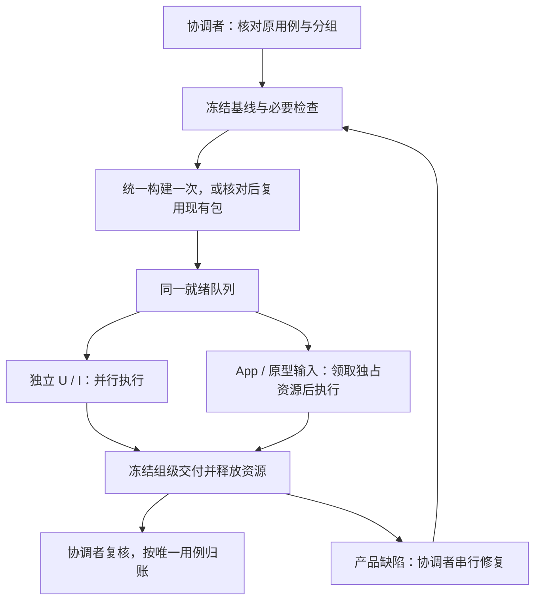

# 三 Agent 并行测试方案（评审稿）

日期：2026-10-21。状态：**待评审，尚未写入正式规则**。本稿只讨论测试协作；生产开发继续串行。M9 目标已由用户暂停，本稿的编写或确认均不自动恢复测试。

## 1. 调整目标

采用 **1 个协调 Agent＋2 个测试 Agent，总计 3 个**。用例先按业务、前置条件和资源分组，再从同一队列领取。**同一生产基线统一打包一次，各组复用；独立测试并行，争用界面或重计算的任务排队。**

目标是减少重复准备、重复构建和空等，同时保持原用例、真实 App 验收及证据要求。开发并行不在本次方案内，发布仍需独立授权。后续若采用本方案，也不能据此越过其他任务的授权边界。

## 2. 整体调整思路

执行顺序为：**核对原用例 → 分组与依赖 → 冻结代码 → 必要检查及统一打包 → 动态领取 → 汇交结果 → 按唯一用例归账**。发现产品缺陷时，由协调 Agent 串行修复，再统一提供新基线，执行受影响复验。

并行发生在独立的工作之间。例如，一个 Agent 做前端组件检查，另一个做文件模型／集成验证，协调 Agent 整理缺陷或执行不冲突的测试。真实 App 的一组界面验收交给一个持有资源的 Agent 连续完成，不逐次点击申请许可。



这里有两层约束：

- **3 个 Agent 是人员上限。**协调者空闲且有独立工作时也可执行测试；忙于修复、打包或汇总时，实际是两个测试执行者。
- **资源有自己的并发上限。**增加 Agent 不增加可同时使用的系统焦点，也不代表允许三个构建或三个重型 Office 引擎同时跑。

## 3. 当前规则与本轮事实

| 已有依据 | 已规定的内容 | 本方案补充的机制 |
| --- | --- | --- |
| [AGENTS.md](../AGENTS.md)“真实 App 自动验收与提效” | 按模块及共用前置批量执行；一份权威用例账；同包批量跑；共享焦点输入串行；独立 U/I 可并行 | 固定角色、分组领取、资源占用、构建交付和暂停回执 |
| [CLAUDE.md](../CLAUDE.md) | 引用 AGENTS.md，不维护另一套流程 | 继续引用统一规则，避免两份规则漂移 |
| [真实 App 自动验收流程](真实App自动验收流程.md) | 隔离实例、CDP 驱动、状态等待、分层证据和失败处理 | 将这些约束落实到每个测试组和交接 |
| 本轮 M9 执行 | 已授权总计 3 个 Agent 测试并行、开发串行；实际采用独立测试目录及唯一打包者 | 临时协作记录尚不能视为通用调度实现 |

本轮已经出现需要解决的具体问题：交付后的测试源又被修改、测试命令误用工作目录、用例预期需根据原始控制器重新核对、共享界面必须显式交接。暂停也必须覆盖 Agent、子进程和服务，单独修改目标状态不足以证明所有动作已停止。

这些是机制设计依据。目前没有足够的整轮统计证明固定的提速倍数。

## 4. 角色与权限

| 角色 | 职责 | 写入边界 |
| --- | --- | --- |
| 协调 Agent（总计 3 个中的 1 个） | 确定分组与优先级、分配资源、核对交付、串行修复、统一构建、汇总进度及暂停收尾；有空闲时领取独立测试 | 唯一生产／原型实现修改者、唯一构建者、唯一权威用例账写入者 |
| 测试 Agent 1、2 | 领取测试组，准备隔离夹具及驱动，执行分配的层级，返回红绿结果和清理回执；结束后领取下一组 | 只写自己的测试、夹具、驱动、日志及证据目录；不修改生产／原型实现，不自行打包，不直接修改权威账 |

测试 Agent 发现问题先交付最小复现、原预期、实际结果和受影响范围。修复交回协调 Agent，不在私有测试副本中悄悄修产品后宣称通过。采用协调者提供的冻结源码属于接收基线，须核对哈希。

角色不会增加逐步确认：已授权范围内的测试领取、常规修复和复验继续执行。只有真实缺失的授权、需求／合同变更或必须用户参与的操作才交用户处理。

## 5. 分组、领取与资源调度

### 5.1 先按共同前置分组，再标明资源

分组依据是**业务模块＋共用前置＋数据隔离边界＋资源需求＋依赖**，不能只把用例编号平均切成三份。

| 工作类型 | 分组示例 | 默认执行方式 |
| --- | --- | --- |
| 参考资料及静态核对 R | 同一参考版本、同一组原始控件语义 | 可与独立测试并行；受限或缺失的参考证据登记缺项 |
| 单元／组件 U | 同一模型、控制器或编辑缓冲区 | 私有目录内并行；限制各 runner 的内部并发，避免进程数量失控 |
| 集成 I | 共用 FileService、文件类型、真实 worker／原生前置 | 资源独立的可并行；使用重型引擎的领取重任务资源 |
| 打包 App A | 同一业务入口与共用项目前置，如一批 XLSX 编辑／保存场景 | 一个 Agent 持有界面资源连续执行，其他 Agent 做独立工作 |
| 原型 P | 同一共享组件、主题及状态矩阵 | 输入操作领取同一界面资源；合成结果仍单独记 P |
| 系统／人工补验 | IME、原生文件框、剪贴板、跨应用等 | 先完成可独立部分，集中列出具体待配合步骤，安排在最后 |

组的大小以可执行时间和共同前置为准。建议初值为 **约 10–30 分钟一组**，再按实际耗时调整；不能为满足时间强行重启正常运行的长场景。单条复杂用例可以拆成 U、I、A 等子任务，但必须明确不重叠的责任范围，并由协调者聚合成原来的一条用例。

优先级依次考虑：能够解除多组依赖的缺陷与前置、可以独立完整收口的组、资源队列中已准备好的组。必须用户参与或合同尚未确定的组登记条件，执行者返回领取其他工作。不能为提高表面通过率只挑容易的分支。

### 5.2 一份任务队列，协调者单写领取状态

**每个里程碑需要一份可查看的《测试分组与执行计划》**，说明分组、原用例 ID、负责层级、依赖、资源、负责人、基线及调度状态。已有执行计划时直接扩充，不再维护一份内容相同的分组账。M9 已有[剩余用例执行计划](里程碑/M9_文件浏览工作区/验收/剩余用例执行计划_20261020.json)，可以作为升级基础；本稿不在目标暂停期间启动分组执行。

分组计划之外，运行时调度记录保存当前领取者、session、PID 和端口等临时信息，按组 ID 引用计划，不复制一套测试结果。首版采用现有协作工具与这份运行记录，不引入新服务或数据库。测试 Agent 请求任务，协调者分配一个就绪组；一次只领取一个执行组，提交并释放资源后再领取。

“已汇交”不要求执行者等待全部归账完成：冻结交付且资源已释放后即可领取下一组，协调者按组复核。共同前置、全套类型检查或包检查由明确的一方负责，不让多个 Agent 重复执行同一检查。

| 调度记录字段 | 用途 |
| --- | --- |
| 轮次、组 ID、原用例 ID／原合同哈希、负责层级和场景 | 明确执行范围，避免重复或漏验 |
| 依赖、所需资源、优先级 | 判断何时能执行 |
| 基线 ID、源码／包／原生标识、测试源版本 | 避免混用包和修改中的驱动 |
| 领取者、状态、开始／阶段更新时间 | 防止重复领取，发现长时间无进展 |
| 独立工作目录、数据目录、端口、已启动 PID／session | 支持隔离、交接和准确暂停 |
| 交付目录／manifest、清理回执、缺项 | 供协调者复核和后续恢复 |

建议调度状态为：`待就绪 → 待领取 → 已领取 → 执行中 → 待复核 → 已汇交`；另外标记 `等待前置／已暂停／需回收`。**这些是任务状态，不是第二份用例通过率。**原用例结果仍只维护在阶段权威账。

只由协调者写队列，可以直接避免三个 Agent 同时改 JSON 或同时抢到一组。任务分配、资源占用及接收基线均通过明确消息交接，不能根据“对方似乎闲着”自行接管。

### 5.3 资源有明确的独占者

| 资源 | 首版上限／规则 |
| --- | --- |
| 生产与原型实现修改 | 1，协调 Agent 独占 |
| 完整构建 | 1，协调 Agent 独占；同时占用重任务资源 |
| App／原型界面输入、系统焦点、原生弹窗 | 同机总计 1 个执行组；首版全部排队，组内连续操作 |
| Office／PDF 等重型原生处理、资源校验、大文件压力测试 | 首版同机 1 个重任务组；其他 Agent 可做不争用资源的轻工作 |
| 独立 U／轻量 I | 可并行，前提是源码、依赖输出、数据和进程互相隔离 |
| 权威用例账与阶段汇总 | 1，协调 Agent 批量写入 |

同时需要界面和重任务资源的组一次申请两者；不能先占着一个再无限等待另一个。长任务必须有可观察的阶段或结果，超时先查原进程及当前阶段，不能立即重启整轮。

资源只有在执行者返回清理／释放回执后才能转交。消息超时或 Agent 失联只触发核查；确认原任务停止前，不因“租约过期”启动第二个界面执行者。无法核实归属的进程不擅自终止。

同机其他会话和用户手动操作也可能争用焦点。本方案只自动约束被纳管的执行者；若另一测试会话也在运行，须共用宿主级界面／重任务资源记录，否则不同时启动界面输入。不能声称暂停本轮等于暂停所有其他 Codex 会话。

跨会话共用资源时也只指定一个协调者写占用记录。首版没有自动跨会话抢锁能力；发现另一个未纳管任务正在使用资源时，先登记冲突并停在待就绪，不能各自认为自己独占。

## 6. 统一构建、隔离与版本交接

### 6.1 一个基线，只构建一次

1. 协调者核对分支和工作区，保留用户及其他工作的改动；将本轮生产输入冻结为提交或可恢复的源码快照，并列出差异及哈希。
2. 先完成相关代码检查，再统一生成一个真实 App 构建，核对必要的原生检查、包内容和标识。
3. 向所有组交付同一个基线 ID、源码依据、App 路径、包／原生哈希、适用平台及已知问题。交付的包和测试源不再原位修改。
4. 各 Agent 用不同 userData、项目／任务、文件根、数据库及调试端口运行该包。执行副本确需复制 App 时，也必须逐项校验为同一构建；这不属于重新打包。

只有生产输入、依赖、原生模块或构建配置变化才生成新 App。只改文档、外部驱动或隔离原型时，核对生产输入与包哈希后复用原包；P 自己的构建另行记录，不当成 App A。

### 6.2 修复后先交接新基线，再复验

发生产品红测时，执行者保留原结果并释放资源。协调者串行修复，运行相关检查后统一构建下一基线，再按影响关系补验。不能让两个测试 Agent 分别改产品、分别打包、各自汇报“同一版本通过”。

修复期间，执行者可以继续旧冻结基线上未受影响的就绪组；依赖修复的组等待新基线。两种基线的结果分别标明，不读取协调者正在修改的工作目录。

未受影响的旧结果可以保留原基线，沿用前核对相关输入及适用范围。受影响层级必须在新基线补验；不能要求每次修复都无差别重跑全量，也不能把旧包结果直接改写为新包结果。测试运行途中不替换代码、包或夹具。

### 6.3 依赖输出与业务数据均隔离

- 每个执行者有明确的私有工作目录；命令显式传入 cwd，启动前核对。依赖若共享，必须确认只读；会写缓存、重建 SQLite／PTY 等原生模块的目录不能共享可写副本。
- 用例中需要的点击、编辑、保存等经过真实 UI。准备非被验收数据可复用已有接口，不以直接改 store、DOM 或业务 RPC 代替被验收步骤。
- 同一包内可复用昂贵前置，但各场景的任务／文件身份、dirty、草稿、历史和持久化状态必须可区分，避免上一条的结果污染下一条。
- 只连接本轮隔离实例；不使用日常 App 数据、凭据或私有标签。界面标明 A／P 与测试区域。原有工具拒绝和系统权限边界继续生效。
- 当前验收包及必要的上一可回退包保留；旧过程 App 在源码可恢复、证据与哈希已归档且不再被引用后，按已有清理授权及时清理。保留原始红测及恢复依据，不清理其他会话、日常数据或未知归属的目录。

## 7. 结果归账、失败处理与暂停

### 7.1 交付完整组，按唯一用例计数

每组交付一份公共环境／基线说明、逐场景结果、必要截图／原始日志、文件 manifest 及进程清理回执。公共基线按哈希引用，不给每个断言复制一遍；不要求每条用例额外打一个压缩包。交付后冻结，修订使用新版本，接收者核对后再采用。

包及源码的公共证明每基线建立一次，后续组引用并核对是否变化。阶段入口仅写当前摘要和证据链接；完整原始记录保存在对应组，不在多份进度文档重复复制长日志。未完成 manifest 或中途被打断的暂存目录标为未封存，不能当作可归账交付。

协调者按原合同逐项复核。**某条约定的全部层级和步骤通过，才将该唯一用例计为通过。**例如同一 W20 拆给前端、后端及 App 三组，最后最多新增 1 条，不按组件断言数、主题数或重跑次数增加通过数。

有可复现产品缺陷的用例记失败，并同时保留其他缺项；必要环境或证据缺失且未发现产品红的，按实际记阻塞；尚待执行的保留未执行。部分绿测写入实际结果，不能提前转通过。M9 继续以原 419 条本期用例统计，6 条纯后续仍不混入分母；不为加速删用例、改预期或缩小阶段范围。

### 7.2 通过与不通过，都回写原来的测试用例

分组文档解决“谁跑哪组、何时能跑”；**原测试用例文档继续回答“这条是否通过、实际发生了什么”**。执行与缺陷记录保存修复、复验及证据导航，不再人工维护另一套通过率。

M9 的具体更新链路为：

1. 测试 Agent 提交组级结果、证据及明确的缺项，不直接改公共用例文档。
2. 协调者复核原合同、执行层级、基线和证据，更新[用例覆盖索引.json](里程碑/M9_文件浏览工作区/验收/用例覆盖索引.json)的 `status`、`actual_result`、`evidence`、`defects`。
3. 使用已有[维护用例索引.py](里程碑/M9_文件浏览工作区/验收/维护用例索引.py)生成原[测试用例.md](里程碑/M9_文件浏览工作区/验收/测试用例.md)及相关映射，并执行一致性检查；不让三个 Agent 分别手改生成文档。
4. 更新分组的汇交状态和阶段简要进度。正式统计只读取权威账中的唯一用例结果。

| 本次执行结果 | 原用例如何更新 |
| --- | --- |
| 全部约定步骤、层级通过 | 状态改为通过，写实际结果、基线和证据 |
| 发现产品缺陷 | 状态改为失败，写失败步骤、预期／实际差异、缺陷及证据 |
| 因必要条件缺失无法完成 | 按实际记阻塞，写已完成部分、缺失条件和恢复条件 |
| 仅部分步骤／层级通过 | 写入部分结果，整条保留未完整状态；存在产品红时仍记失败 |
| 修复后复验通过 | 原约定全部满足后才能改通过；保留此前失败、修复及复验依据，不删除红测 |
| 只有驱动／夹具出错 | 记录执行失败和未执行范围，按真实产品覆盖保持用例状态；不把脚本错误直接当产品缺陷 |
| 用户暂停，当前组未跑完 | 记录中断位置，保留已有真实结果；调度标暂停，不能把所有用例统一改成通过、失败或阻塞 |

结果在组交付并完成复核后及时回写，无需等待整个里程碑结束。原编号、前置、步骤和预期不因测试失败而修改；确需修订合同，单独评审并保留变更记录。

### 7.3 失败先分类，再决定下一步

| 失败类型 | 处理与推进方式 |
| --- | --- |
| 产品缺陷 | 保留原红测和最小复现，交协调者串行修复；执行者转其他就绪组，修复后补相关回归 |
| 驱动／夹具错误 | 单独记录；修正测试后只重跑受影响部分，保留原件；不得顺便改产品预期 |
| 环境／资源冲突 | 核对进程、端口、资源占用和依赖；解除条件后有依据地重试，不把它伪装为产品修复 |
| 需求／用例合同不清 | 列出具体冲突及依据、提出可评审改法；继续独立工作，不擅自改原合同判绿 |
| 系统／用户参与前置 | 登记已经完成及缺失的准确步骤，集中安排；其他 Agent 继续独立组 |

没有新变量或新假设时，不重复完全相同的失败轮次。间歇性问题按明确假设安排有界对照并记录每次结果；一次成功不能覆盖先前失败。也不能为了凑满三个忙碌 Agent，让它们一起压测同一个引擎并制造额外超时。

### 7.4 暂停是一项需要完成收尾的操作

用户要求暂停时，顺序为：

1. 协调者将目标设为暂停、冻结新领取和新指令，并通知／中断全部执行者。
2. 执行者停止后续输入、重试和新任务；已发出的原子操作按现有安全完成／取消协议收尾，避免中途破坏文件。
3. 恢复本轮观察钩子，保存已形成结果的状态；关闭本轮 App、PTY、worker、监听和临时服务。只操作有明确归属的实例。
4. 每个执行者返回运行 session、PID、端口及清理回执。协调者核对仍存活的已知本轮进程，确认资源释放。
5. 向用户报告目标已暂停、进程收尾结果和未完成项。仍有残留时明确说明，不能提前宣称“全部停了”。

上述测试清理与产品“正常退出／恢复”验收分别记录，终止测试进程不等于该业务用例通过。

恢复须用户明确要求。先读暂停记录、核对基线和已有产物，从未完成组继续；不自动重放暂停前的鼠标／键盘队列。协调者崩溃后的接续也按同样步骤核对原执行者，不能直接再派一轮。

## 8. 固定目录、文件名与读写时机

**固定入口文件承载当前计划和结果；轮次目录保留执行历史；临时目录存放进程、隔离数据和构建输出。**本节是拟采用的文件契约，下面标为“新增”的文件尚未创建，不能把目录示意当作已经实现的工具。

### 8.1 仓库内的目录约定

新阶段采用以下结构。已有阶段先登记现有文件与这些职责的对应关系，复用原入口；不因命名不同复制第二份账或搬动历史证据。

```text
docs/
├── 多Agent并行测试方案_评审稿.md       # 当前讨论稿
├── 真实App自动验收流程.md             # 方案采用后补操作说明
└── 里程碑/M<n>_<主题>/
    ├── README.md                     # 当前状态、下一步、计划及证据入口
    ├── 需求.md                       # 已确认需求；结果回写不改变需求
    ├── 交付说明.md                   # 达到交付条件后更新
    └── 验收/
        ├── 用例覆盖索引.json          # 原用例与实际结果的唯一数据源
        ├── 测试用例.md               # 从权威数据源生成，供人查看
        ├── 需求与用例映射.md          # 从同一权威数据源生成
        ├── 维护用例索引.py            # 用例文档生成与一致性检查
        ├── 并行测试分组.json          # 新阶段默认分组数据源
        ├── 并行测试分组.md            # 新增：分组数据的可读视图
        ├── 维护测试分组.py            # 待实现：生成分组视图并检查引用
        ├── 执行与缺陷记录.md          # 缺陷、修复、复验的简要记录与链接
        ├── 并行测试/
        │   ├── 基线/<baselineId>/基线.json
        │   └── 轮次/<runId>/轮次记录.json
        └── 证据/并行测试/<runId>/<groupId>/<attemptId>/
            ├── result.json           # 逐用例／场景的实际结果
            ├── manifest.json         # 已封存文件的路径、大小、哈希
            ├── cleanup.json          # 本次进程／端口／观察钩子的收尾结果
            ├── logs/                 # 实际产生的原始日志
            └── screenshots/          # 实际需要并保存的截图
```

日志／截图目录按实际需要创建，不创建空目录凑齐结构。`manifest.json`不包含自身哈希；协调者在轮次记录里登记接收的 manifest 哈希。只归档适合入库的合成数据与证据；真实数据、凭据、完整 App、依赖目录及 userData 沿用既有存储和忽略规则，不能因分组归档而纳入仓库。

编号约定：

- 原用例 ID 沿用，例如 `M9-T-W20`；原 A／W 等用例分类不重编号。
- 新执行组 ID 使用 `M9-G001`、`M9-G002`，与原用例分类区分。同一条用例拆成多组时，各组明确负责的层级／场景。
- `baselineId` 在同一 M 内唯一，已有 `r142`、`r143` 沿用；它不是版本号或发布 tag。
- `runId` 使用 `<M>-<UTC时间YYYYMMDDTHHMMSSZ>-<目标短ID>-<随机后缀>`，创建后不改名，避免同时开轮重名。
- `attemptId` 使用 `attempt-001`、`attempt-002`。重跑或修订已交付材料时创建下一次尝试目录；不覆盖原始结果。若只补说明而没有重跑，应明确“文档修订、未新执行”。

### 8.2 M9 的实际文件映射

**M9 继续复用现有权威账和执行计划，不新建一份同职能 JSON。**

| 职责 | M9 的准确路径（相对仓库根） | 处理方式 |
| --- | --- | --- |
| 阶段入口 | `docs/里程碑/M9_文件浏览工作区/README.md` | 保持原入口，链接当前分组计划和轮次记录 |
| 用例及结果源 | `docs/里程碑/M9_文件浏览工作区/验收/用例覆盖索引.json` | 保持原文件；协调者回写结果字段 |
| 人读用例／映射 | 同目录 `测试用例.md`、`需求与用例映射.md` | 继续由现有 `维护用例索引.py` 生成 |
| 分组数据源 | 同目录 `剩余用例执行计划_20261020.json` | 在原文件增加明确的分组定义及用例引用；已有日期保留，不另建 `并行测试分组.json` |
| 人读分组清单 | 同目录 `并行测试分组.md` | 拟新增，从上述执行计划生成；只显示计划及带时间的调度快照 |
| 分组维护工具 | 同目录 `维护测试分组.py` | 待实现；读取执行计划和权威用例账，生成分组视图、检查原用例 ID、层级分工及遗漏／重叠，不改用例结果 |
| 执行及缺陷记录 | 同目录 `执行与缺陷记录.md` | 复用，按用例／缺陷 ID 追加结果与证据链接 |
| 新轮次与证据 | 同目录 `并行测试/`、`证据/并行测试/` 下按 8.1 命名 | 仅用于采用本方案后的新轮次；旧证据继续原路径引用 |

现有执行计划中的旧计数及观察状态属于历史快照。升级时明确标注时间及来源；新分组视图中的正式用例状态和通过率只从 `用例覆盖索引.json` 读取，不能继续手工维护两套当前计数。

`维护用例索引.py` 的现有能力已核对：`--write` 更新权威账的派生项并生成上述两份 Markdown，`--check` 检查一致性。它目前不生成分组清单。拟新增的 `维护测试分组.py` 在实现并验证之前，不能写成已可运行的命令或声称分组自动同步已具备。

### 8.3 临时目录与长期记录的边界

每轮启动时一次性确定绝对路径并登记。新轮次建议采用：

```text
<临时根>/willyou-test-runs/<runId>/
├── dispatch.json                     # 协调者单写：当前领取、资源、PID、端口
├── coordinator/                      # 协调者私有源码／构建工作目录
├── workers/<workerAlias>/            # 各执行者私有源码、依赖和缓存
├── builds/<baselineId>/              # 协调者生成的唯一构建输出
└── attempts/<groupId>/<attemptId>/
    ├── data/                         # 独立项目、userData、数据库等
    └── delivery/                     # result、manifest、cleanup、日志和截图
```

在当前 macOS 环境，临时根可用 `/private/tmp`；已有隔离目录按登记路径复用，不为套用新名字重新复制 App 或重跑测试。`workerAlias` 到实际 Agent ID 的对应关系记在 `dispatch.json`。

文件各有唯一职责：

| 文件 | 谁写 | 写入内容与时机 |
| --- | --- | --- |
| 分组数据源 | 协调者 | 执行前定组；范围／分工／依赖变化时更新。只保存计划，不作为实时占用判断 |
| `dispatch.json` | 协调者 | 每次分配、开始、资源交接、停止时更新当前运行状态；执行者通过消息回报 |
| `基线.json` | 协调者 | 包校验完成后封存源码依据、包／原生哈希、平台和恢复路径；新基线新目录 |
| `delivery/result.json` 等组级交付 | 该组执行者 | 执行中保存阶段结果；结束／中断时写收尾并封存，提交后不原位修改 |
| 仓库内归档的组级交付 | 协调者 | 接收时核对 manifest 后归档；保持原结果字节及来源，复核结论记在轮次记录 |
| `轮次记录.json` | 协调者 | 每组接收／归账、基线切换、暂停及轮次结束时保存检查点、交付引用、归账回执和下一步 |

运行中的占用以本轮 `dispatch.json` 加已核实进程为准。长期轮次记录是带时间／版本的恢复检查点；它不能单独证明旧进程已经退出。临时文件丢失后，先核对检查点里的进程归属和实际存活情况；确认旧执行者停止后再重建运行记录。

暂停或轮次结束时，已形成的必要结果和恢复信息必须归档，不能只留在可能被清理的 `/private/tmp`。未封存材料明确记为“中断／待核验”，不据此增加通过数。

### 8.4 什么时候读写哪个文件

下表规定操作顺序；不是要求每次鼠标动作都更新文档。

| 时点 | 操作者 | 先读什么 | 更新／产出什么 |
| --- | --- | --- | --- |
| 接续工作 | 协调者 | `AGENTS.md`、`CLAUDE.md`、阶段 `README.md`、当前需求、权威用例账、最近轮次记录及用户指令 | 核对是否暂停；未获恢复指令则仅进行已授权的文档工作 |
| 建组／调整分工 | 协调者 | 原用例步骤与预期、已有结果、环境前置 | 分组数据源 → 人读分组清单；核对每个待验范围都有去向 |
| 准备测试包 | 协调者 | 当前源码及依赖差异、既有 `基线.json` | 复用已核验包，或统一构建并封存新 `基线.json`；不预填成功 |
| 领取组／等待资源 | 协调者分配，执行者接收 | 分组定义、原用例、冻结基线、`dispatch.json` | 协调者写领取者及资源；未获占用的执行者不启动输入或重任务 |
| 启动测试 | 执行者 | 已分配组、实际 cwd、夹具／驱动及包哈希 | 新尝试目录、初始结果和自身进程信息；回报协调者登记 |
| 发现失败／缺项 | 执行者 | 原预期、原始动作及实际错误 | 本次 `result.json` 和日志；立即回报分类、影响及阻断情况，不等整个组全部跑完才报告 |
| 结束／中断组 | 执行者 | 本次所有实际结果与仍运行的自有资源 | 写 `cleanup.json`、封存 manifest，交付目录及哈希；请求释放资源 |
| 接收及归账 | 协调者 | 原合同、基线、结果、manifest、收尾回执 | 归档交付 → 更新原用例 JSON → 生成用例／映射并检查 → 写轮次归账回执 → 更新分组视图及阶段简要状态 |
| 修复和复验 | 协调者修复，执行者复验 | 缺陷、红测证据、受影响范围 | 执行与缺陷记录、新基线（确需构建时）、新 attempt；复验后走相同归账流程 |
| 暂停 | 协调者与所有执行者 | 当前 dispatch、实际进程和未完成操作 | 目标暂停；停止／清理回执、轮次检查点、阶段 `README.md` 的暂停状态 |
| 用户明确恢复 | 协调者 | 暂停检查点、现有权威账、当前源码／包及进程实际状态 | 核对后重建／更新 dispatch，从未完成组接续；不重放旧输入队列 |
| 轮次结束／阶段交付 | 协调者 | 权威账、所有交付、缺陷及资源释放结果 | 封存轮次记录、更新阶段入口；达到原交付条件后才更新交付结论 |

### 8.5 归账中断与重试

协调者在轮次记录中用 `runId＋groupId＋attemptId＋manifest哈希` 标识一次交付，记录“待复核／待同步／已归账”及所更新的用例 ID。再次收到同一交付时先查回执，避免重复追加结果或重复统计。

权威 JSON 已更新但生成 Markdown 或一致性检查失败时，标记“待同步”，保留已写入的真实结果，修复文档同步后再完成回执；不为文档同步失败重新跑 App。接续时核对 JSON、生成文档及回执，不能仅看到其中一个文件就假定整批已归账。

在采用方案时，`AGENTS.md` 应指向本套目录／读写约定，`CLAUDE.md` 继续引用；各阶段 `README.md` 给出实际分组数据源、权威账和当前轮次入口。这样新接续的 Agent 可以从固定入口找到工作，而不必猜哪个日期文件最新。

### 8.6 与既有流程、文件及结果的衔接

本方案嵌入 `AGENTS.md` 现有七步里程碑流程。分组属于测试准备与执行安排，不增加一次需求审批，不改变原开发完成标准。`CLAUDE.md` 的 `@AGENTS.md` 和阶段接续入口继续有效；不能只读新分组文档就跳过原需求、用例和历史结果。

| 既有阶段／事件 | 沿用的文件及职责 | 并行方案增加的内容 |
| --- | --- | --- |
| 定范围、调研与技研 | `需求池.md`、阶段 `需求.md`、调研及技研资料 | 识别测试依赖与隔离条件；不提前创建执行成功记录 |
| 原型与用例 | 原型说明、原 `测试用例.md` 及其权威源 | 在原用例齐备后建立分组，引用原编号、步骤、预期和所需层级 |
| 用户评审 | 阶段 `README.md`、需求确认及原型基线 | 记录并行资源与分工；原范围授权仍沿用，新增范围按原规则处理 |
| 正式开发 | 原实现、必要测试、技研差异记录 | 开发由协调者串行完成；测试者使用冻结输入，不能并发修改生产实现 |
| 端到端验收 | 原用例账、`执行与缺陷记录.md`、证据目录 | 增加组、轮次及资源记录；通过、失败、阻塞和未完成情况均回写原结果体系 |
| 缺陷修复与复验 | 原缺陷记录、红测及复验依据 | 关联新旧基线和尝试；保留失败历史，按影响范围复验 |
| 交付归档 | `交付说明.md`、阶段 `README.md`、里程碑索引及需求池 | 汇总最终基线与原用例结论；只有原完成条件满足才变更阶段状态，发布仍走原流程 |

**已有文件优先于新模板。**第 8.1 节是拟采用的默认结构，不要求所有旧阶段改成 M9 的 JSON 结构。旧阶段若直接以 Markdown 维护权威结果，登记该文件并由协调者单写即可；若已有生成器，则只改其数据源并生成文档。迁移必须先核对原编号、预期、结果、缺陷、证据和统计一致，不能保留两个可独立编辑的当前结果源。

M9 还有 `实施计划与进度.md`、`剩余验收目标_20261020.md` 和既有 `交付说明.md`：继续作为计划、目标及交付事实的入口，不另建同职能文件。每批归账后，包含“当前”计数的摘要须从权威账同步并标注统计时间；历史批次的计数和旧状态保留其时间边界。用户暂停、恢复、改变范围或阶段状态时，同步相关当前入口，不能让旧段落中的“active”覆盖最新暂停指令。

方案正式采用时按以下顺序衔接：

1. 核对现有文件职责与最新结果，保留当前改动、原编号和历史证据；在阶段入口登记准确路径。
2. 在 `AGENTS.md` 补充统一并行约束，在 `真实App自动验收流程.md` 补充目录、读写及交接操作；`CLAUDE.md` 只补入口，不复制规则。评审稿保留设计依据并链接正式位置，不成为第三套执行规则。
3. 扩充已有执行计划，必要时增加分组可读视图及维护工具；校验引用、分工覆盖和统计一致，不改写既有通过／失败事实。
4. 完成文档和工具的必要检查后，再按用户当前目标状态决定是否执行。采用规则与恢复 M9 是两件事；当前暂停仍有效。

## 9. 提速预期与验证

**预计节省的是独立工作的等待、重复准备和重复构建，实际幅度需用完整批次验证。**三 Agent 不等于三倍速度；界面、构建及串行修复占比越高，收益越小。

仅作演算：若一批工作串行需要 100 分钟，其中 40 分钟必须串行，另 60 分钟可由两个执行者均分，理想时间约为 70 分钟；协调和返工还会增加耗时。这不是对 M9 的实测或工期承诺。

采用后至少记录一个完整批次，比较以下数据；不同复杂度的用例组不能只比条数：

| 指标 | 需要判断的问题 |
| --- | --- |
| 每小时新增完整通过的唯一用例数、解除的关键阻塞 | 总目标是否推进，而非只增加局部断言 |
| 执行、排队、前置准备、协调归档及缺陷修复耗时 | 瓶颈在哪，协调者是否成为新的长队 |
| 每个生产基线的构建次数 | 是否实现一次构建复用；重试是否有明确原因 |
| 重复执行、驱动错误及资源冲突次数 | 并行是否引入额外返工和不稳定性 |
| 证据完整率、误归账及暂停残留 | 提速是否仍满足验收真实性与可控性 |

验证机制时应覆盖重复领取、构建排队、UI 交接、驱动交付后修订、执行者失联、用户暂停及恢复这几类场景。先通过轻量调度检查／演练验证机制，不为验证调度重新跑已完成的整轮 App 用例。若实际没有收益，减少并发并优先解决重复构建或串行瓶颈。

## 10. 拟修改范围与评审点

方案确定后，正式规则统一补入 **AGENTS.md**：三人角色及授权边界、分组领取、统一构建、资源排队、隔离、唯一归账、失败处理、暂停与恢复。**CLAUDE.md 继续引用该规则**，必要时补一句入口导航，不复制全部条款。[真实 App 自动验收流程](真实App自动验收流程.md)补充调度记录及交接示例；各 M 仅保存本阶段分组与执行事实。

首版不增加产品 API、数据库表或用户业务流程。任务队列属于测试运行记录；后续如果实现自动文件锁或调度脚本，应另行核对实际接口、原子写入和故障恢复，并做必要验证，不能把本稿描述当作已有功能。

建议评审这四项默认值：总计 3 个 Agent；协调者独占开发及构建；首版 UI 与重任务各 1 个执行组；任务队列及权威账均由协调者单写。组时长是可调整的建议值，不改变产品期限。

**当前仅新增本评审稿，AGENTS.md、CLAUDE.md 尚未因本方案修改。M9 继续保持暂停。**
