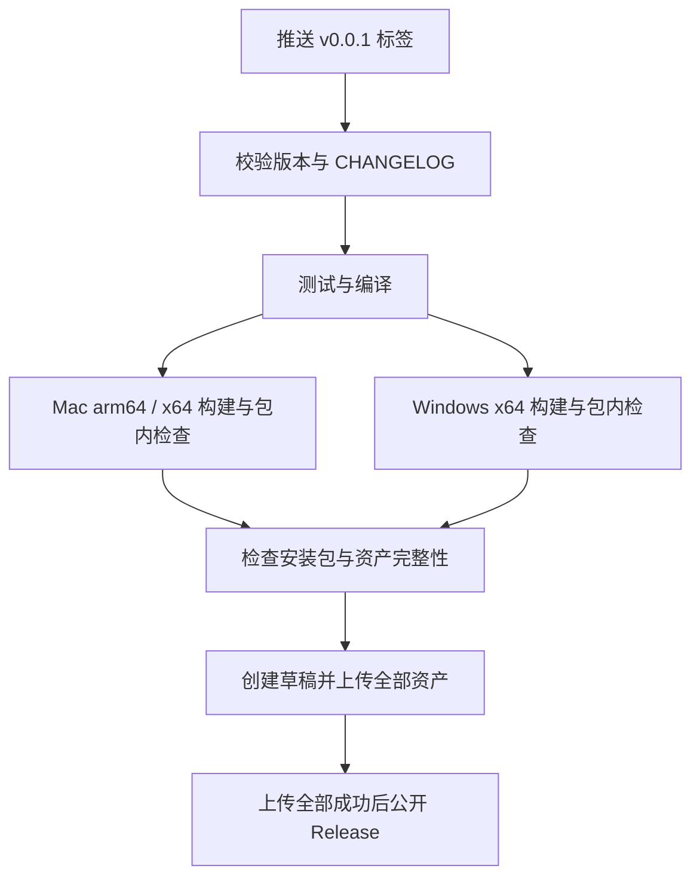

# SmartDD 0.0.1 多平台构建与发版

日期：2026-10-15

状态：已落地构建、检查、标签发布的配置和脚本；本机 Mac arm64 DMG 与隔离界面测试通过。尚未提交推送这些改动，未在 GitHub 实际运行工作流，未打 tag 或发布 Release。Windows 业务适配与其他平台验收仍未完成。开发与发布约定见根目录 [AGENTS.md](../AGENTS.md)，Claude Code 通过 [CLAUDE.md](../CLAUDE.md) 引用同一份规则。

## 1. 本次已完成的操作

- 从本地 `main` 创建并切换到 `feature/0.0.1`。
- 创建时两者均指向 `b54e05bd559c5d04c140f8492bc4e788d85ee9d9`。
- 原有 M4/M5 未提交改动保留在当前工作区。分支切换不等于这些改动已经进入提交。
- 本次没有创建版本标签、推送远端、创建 Release 或修改本地 Yoda。
- 新增 `ci.yml`、`build.yml`、`release.yml` 和共用的构建环境 Action。
- 拆出 `electron-builder.config.cjs`，增加分平台构建、包内原生模块检查、产物清单、发布元数据与校验脚本。
- `pnpm test` 改用 Node 启动器设置 Electron 环境变量，保持原测试行为并移除命令行赋值对 POSIX shell 的依赖。
- 补充 `CHANGELOG.md`、`NOTICE`、Yoda 原始版权与 Apache-2.0 许可文件。

后续开发先在 `feature/0.0.1` 推进。按用户确认的发布约定，验收后合并 `main`，对明确的发布提交打 tag，再推送 tag 触发构建。更复杂的长期分支策略另行规划。

## 2. 本地 Yoda 实际怎么做

参考目录：同级目录 `../yoda`。

参考快照：`960fd3224508edc52fb7e99d9e8f8cf1723ad683`，提交说明为 `chore: release v0.20.3`。以下以这个快照的可执行配置为准，不把文档里的旧描述当作当前实现。

| 能力 | 实际机制 | Yoda 源码位置 |
| --- | --- | --- |
| 日常检查 | 向 `main` 发起 PR，或手动触发；执行格式、类型、lint 检查 | `.github/workflows/code-consistency-check.yml` |
| 正式发版入口 | 推送 `v*` 标签；也允许手动指定标签 | `.github/workflows/release-prod.yml` |
| 版本一致性 | 标签去掉 `v` 后必须等于 `package.json.version`，CHANGELOG 必须存在对应版本标题 | `release-prod.yml` 的 `Verify release metadata` |
| 草稿 Release | 构建前创建 draft，先汇集各平台资产 | `release-prod.yml` 的 `create-release` |
| 多平台构建 | Linux、Windows、Mac 三个 job 分别在对应系统运行 | `release-prod.yml` 的 `release-linux`、`release-win`、`release-mac` |
| 依赖环境 | Node 24、pnpm、Python 3.11、锁文件安装；Windows 传入 MSVC 配置 | `.github/actions/setup-build/action.yml` |
| 原生模块 | 每个目标架构先执行 `electron-rebuild`，再执行 electron-builder | `scripts/release/build.ts`、`scripts/release/rebuild-native.ts` |
| 安装包 | Mac：DMG，默认构建 x64/arm64；Windows x64：NSIS EXE、MSI；Linux x64：AppImage、DEB、RPM | `electron-builder.config.ts`、`scripts/release/build.ts` |
| 正式公开 | 三个平台 job 全部成功后，把 draft 改为公开 Release，并标记 latest | `release-prod.yml` 的 `publish-release` |
| 试打包 | Windows 单独有手动工作流，只上传 Actions artifacts，不创建 Release | `.github/workflows/windows-beta-build.yml` |

所以，“提交 GitHub”和“发版”是两个动作。Yoda 当前的普通提交不会触发正式发布；只有匹配的标签被推送到 GitHub，或手动启动指定标签的发布工作流，才走正式发布。

Yoda 还有签名、公证、Sparkle 自动更新、R2 和国内镜像。这些是额外的分发能力，不是实现“标签触发多平台打包”所必需的全部组件。

## 3. SmartDD 当前状态

| 项目 | 当前情况 | 落地时需要处理 |
| --- | --- | --- |
| Git 分支 | 已切换到 `feature/0.0.1`；仍有 M4/M5 未提交改动 | 发版前形成可追溯、经过验证的提交 |
| CI | 已新增日常检查、试打包、标签发布配置 | 首次推送后观察真实 GitHub Actions 运行 |
| 本地打包 | 应用目录、Mac DMG、Windows NSIS EXE 入口已配置 | Mac arm64 DMG 已实测；其他目标需在各自 runner 实测 |
| 构建架构 | 每个目标使用对应系统和架构；先检查已安装 Electron 的平台、架构与版本，再复用分发目录 | 不在 Apple Silicon 上伪装完成 Intel 原生运行验收 |
| 原生依赖 | 按目标重建 `better-sqlite3`、`node-pty`，并用打包后的 Electron 加载包内模块实测 | 在 GitHub 对三个目标执行同一检查 |
| 终端启动 | `src/main/pty-manager.ts` 使用 POSIX shell 参数，默认 `/bin/zsh` | 适配 Windows 命令解释器与参数、退出和恢复行为 |
| CLI 查找 | `runner-detect.ts` 使用 `whence`/`type -P`，只接受 `/` 开头路径 | 适配 Windows PATH、PATHEXT、盘符、`.cmd` 启动器 |
| 配置注入 | `launch-env.ts` 依赖 shell 脚本 | Windows 适配必须保留已有配置优先级与凭据隔离行为 |
| Skill 运行时 | `capability-service.ts` 使用 `python3`；SSH 脚本依赖 Python `pty` | 核实运行时探测与 Windows 实现；仅在 CI 使用 Git Bash 不能解决 Python `pty` 的系统依赖 |
| 测试命令 | 主测试入口已改成 Node 启动器，发布辅助测试可跨平台运行；既有应用测试仍有 POSIX 夹具 | 完整应用测试目前在 Mac 跑；Windows 业务测试需随适配补齐 |
| 密钥存储 | 现有验收针对 macOS Keychain | Windows、Linux 分别验证对应安全存储，不能把 Mac 结果沿用过去 |
| 发布元数据 | 版本仍为 `0.0.1`，已新增 CHANGELOG、进位计算、版本和 main 归属校验 | 发布前提交完整内容并更新真实验收状态 |
| 签名 | 手动试包默认无签名；有证书配置时可签名；正式 Mac 发布强制签名、公证和验证 | GitHub Secrets 的实际配置本轮未读取或修改；不能复制 Yoda 的账户身份 |

M5 的完成范围仍是现有 Mac 流程。增加多平台构建后，需要单独取得新平台的可用性证据。

Yoda 已有 Windows 终端适配，可参考 `src/main/core/pty/pty-spawn-platform.ts` 的 PATH/PATHEXT、`.cmd`/`.bat`/`.ps1` 分支。它的 `shellSetup` 在 Windows 分支会被忽略，不能直接替换 SmartDD 的配置注入流程。

## 4. 已落地的实现

### 4.1 日常 CI

`.github/workflows/ci.yml`：

- 对 `main` / `feature/**` 分支 push、面向 `main` 的 PR 触发，也可由构建工作流复用。
- 使用 actionlint `1.7.12` 校验工作流语法、表达式与依赖；使用锁文件安装依赖，运行类型检查、发布辅助测试、应用测试和编译。
- 构建环境复用 Yoda 的 Node 24、Python 3.11 设置，pnpm 由 SmartDD 的 `packageManager` 固定为 `10.27.0`。应用测试额外安装固定版本的 PyMySQL / psycopg2-binary，以执行本机隔离协议测试。
- 完整应用测试在 Mac 执行；三个打包目标都执行发布辅助测试和包内原生模块检查。
- CI 使用临时目录、假凭据和隔离服务，不导入开发者的 AIS 数据库、服务器或模型凭据。

Yoda 的上述日常工作流没有执行单元测试；SmartDD 应保留自己的测试要求，不能只照搬它的检查列表。

### 4.2 多平台试打包

`.github/workflows/build.yml` 提供手动构建入口，也供标签发布调用。它先等待 CI，再并行构建三个目标，单独运行时只上传 Actions artifacts。当前目标如下：

| 目标 | 安装产物 | 验收要求 |
| --- | --- | --- |
| Mac Apple Silicon | `.dmg`，arm64；`macos-latest` | 本机 DMG、包内 SQLite/PTY、复制安装后的隔离 GUI 已通过；云端未跑 |
| Mac Intel | `.dmg`，x64；`macos-15-intel` | 等待对应 runner 构建与运行验证 |
| Windows | `.exe`，x64，NSIS；`windows-2022` | 等待 runner 构建；终端、CLI、Skill 业务适配尚未完成 |
| Linux（未配置） | 后续可选 AppImage，x64 | 不在本轮矩阵中，需补桌面环境、终端与安全存储验证 |

首版不必同时维护 Windows MSI、Linux DEB/RPM 等所有格式。Mac + Windows 是用户明确提出的目标；Linux 作为扩展项。

共享环境位于 `.github/actions/setup-build/action.yml`，打包入口为 `scripts/release/build.mjs`。构建脚本拒绝主机与目标系统/架构不匹配的调用，显式重建两个原生依赖，并完整解包 `node-pty` 与 `better-sqlite3`，包含终端辅助程序。包内测试使用安装包自己的 Electron 和 `app.asar` 模块，不借用工作区的 SQLite/PTY 模块。

每个安装包附带独立的 `manifest-<平台>-<架构>.json`，记录版本、提交、工作区是否干净、原生检查类型、签名状态、文件大小与 SHA-256。它是本次构建的核对清单，不代表完整业务功能或签名真实性的独立第三方证明。

### 4.3 标签发版

`.github/workflows/release.yml` 监听推送的 `v*` tag，复用试打包入口。正式标签要求为附注标签，已合并到 `origin/main`，与当前检出的提交一致，并符合下一版本进位规则。完整平台业务验收仍需在正式打 tag 前完成。



- 构建失败不会进入发布任务；上传失败保留草稿，不公开半套安装包。
- 打包步骤显式禁止 electron-builder 自行发布，由最后的发布任务统一上传、公开，减少双重发布路径。
- 普通检查只需读权限；创建和发布 Release 的任务才授予 `contents: write`。
- 同标签任务串行；已公开版本不覆盖资产，修复时发布新版本。
- 上传前验证三份产物清单：版本、提交、平台、架构、大小、SHA-256、干净工作区与必需的 Mac 签名状态；生成 `SHA256SUMS.txt` 一起上传。
- 创建 Release 使用 `--verify-tag`，不会隐式创建缺失的 tag；仅允许在草稿重试时替换上传资产。
- 工作流、构建脚本、版本说明和应用代码都必须包含在标签所指向的提交里。
- 首次接入时，验证 GitHub 上工作流可见性与手动入口；本地 YAML 校验不能替代真正的 Actions 运行。

### 4.4 复用边界

直接参考 Yoda 的三类机制：按系统构建、按架构重建原生模块、草稿聚合后统一发布。

保持 SmartDD 的应用名称、appId、版本、资源目录和原生依赖列表。复制或改编源码时在 `NOTICE` 补充来源。

本轮不引入 Yoda 的 PostHog 配置、R2/国内镜像、Canary 通道或 Sparkle。应用内自动检查和安装更新是独立功能，不能因为有 GitHub Release 就称为已经具备自动更新。

另一个需要适配而非照抄的例子：本地 `windows-beta-build.yml` 的原生重建命令仍含 `sqlite3,node-pty`；SmartDD 实际依赖是 `better-sqlite3,node-pty`。应以目标项目依赖为准。

## 5. 分支、版本与标签的关系

- `feature/0.0.1` 是开发分支，可以继续接收提交。
- `package.json` 的 `0.0.1` 是应用版本。
- `v0.0.1` 是固定指向某次提交的 Git 标签，不会自动收录工作区尚未提交的文件。
- Git 技术上允许给任意提交打标签；本项目采用先合并 `main`、验证最终提交后再打正式标签的约定。
- 版本从 `v0.0.1` 起，第三位满 10 进位，第二位满 100 进位。完整规则、边界示例和重试方式统一维护在 [AGENTS.md](../AGENTS.md)。
- 在本机打标签不会触发 GitHub Actions，必须将标签推送到 GitHub。

后续流程示意，以下命令本次未执行：

```sh
# 先完成代码提交、工作流接入及目标平台验收
git push -u origin feature/0.0.1

# 按仓库规则完成合并 main 和最终验证，确认远端 main 已包含发布提交
# package.json 和 CHANGELOG 已包含 0.0.1
git tag -a v0.0.1 <main中已验收的提交SHA> -m "SmartDD 0.0.1"
git push origin refs/tags/v0.0.1
```

推送标签后不要再为同一个标签同时启动手动发布。普通构建重试使用构建入口，正式版本修复递增版本号。

## 6. 交付时必须取得的验证结果

1. **配置检查**：工作流语法、版本不匹配时失败、缺失 CHANGELOG 时失败、构建失败不公开 Release。
2. **自动化回归**：类型检查、已有测试、应用编译通过；平台相关测试在对应系统运行。
3. **安装包检查**：Electron 与原生模块架构匹配；SQLite、PTY、数据库迁移、Skill 和运行时资源可用。
4. **真实页面检查**：从安装包启动，创建项目、配置连接、进入任务、选择 CC 配置、发起问题、执行只读数据库查询和 SSH 调查、停止并恢复任务。
5. **发布验证**：在 GitHub 实际跑过所有目标构建，下载产物安装检查，再验证草稿到公开的流程。

本轮实际结果（2026-10-15）：

| 检查 | 结果 |
| --- | --- |
| `pnpm typecheck` | 通过 |
| `pnpm test:release` | 8 项通过：进位、非法版本、CHANGELOG、跨系统打包阻断、临时 Git 仓库中的 tag/main 关系、产物一致性、缺项阻断、工作流依赖 |
| `pnpm test` | 274 项通过，2 项本机 CLI 探针按原设置跳过；首次沙箱运行因回环监听被拒绝失败，允许本机端口后完整通过 |
| actionlint `1.7.12` | 工作流语法、表达式与依赖检查通过；未启用额外 shellcheck / pyflakes |
| `pnpm package:release --platform mac --arch arm64` | 应用编译、原生模块重建、DMG 生成和包内 SQLite/PTY 检查通过 |
| DMG 安装内容 | `hdiutil` 只读挂载并校验，通过 `ditto` 将应用复制至临时目录，再卸载镜像 |
| 复制后的应用 GUI | 隔离项目开关、任务启动、真实 PTY、配置注入、浅色/深色 ANSI 与真彩色、中英文及 800px 窗口检查通过，无 renderer 异常 |
| GitHub 实际运行、Intel Mac、Windows | 未执行，不能称为已通过 |
| 正式签名、公证、Release 发布 | 未执行 |

GUI 测试使用隔离的测试运行器，不访问 AIS 或外部模型，不替代 M5 的真实模型验收。证据位于 `release/packages/mac-arm64/install-smoke.log` 与其中记录的临时截图目录。

本机试包为 `release/packages/mac-arm64/SmartDD-0.0.1-mac-arm64.dmg`，约 125 MiB；产物清单如实记录 `signed: false`、`dirty: true`，不作为可公开发布的验收版本。当前仍沿用 Electron 默认应用图标。

## 7. 日常使用与 GitHub 配置

本地常用命令：

```sh
pnpm typecheck
pnpm test
pnpm test:release

# 只输出下一版本；用于正式决策前先同步远端 tags
pnpm release:next
pnpm release:check --tag v0.0.1

# 在对应系统和架构运行，产物进入 release/packages/<平台>-<架构>/
pnpm package:release --platform mac --arch arm64
pnpm package:release --platform mac --arch x64
pnpm package:release --platform win --arch x64

# 保留本机应用目录打包入口，输出到 release/，会同样执行包内检查
pnpm package
```

将完整源码和工作流提交推送到 `feature/0.0.1` 后可观察 CI。手动工作流入口需要工作流已进入默认分支；接入 `main` 后，在 GitHub Actions 的 **Build installers → Run workflow** 选择要试打包的分支。完成后下载 `smartdd-mac-arm64`、`smartdd-mac-x64`、`smartdd-win-x64` 三份 artifacts。

普通检查与无签名试包不需要模型、数据库、SSH 或对象存储 Secrets。工作流使用 GitHub 提供的 token，只有发布 job 申请 `contents: write`；不需要额外填个人访问令牌。

签名配置放在 GitHub 仓库的 Actions Secrets，不写入代码：

| Secret | 用途 |
| --- | --- |
| `MAC_CERTIFICATE` | 自有 Developer ID Application 证书的 P12，使用 electron-builder 支持的 base64 形式 |
| `MAC_CERTIFICATE_PASSWORD` | 上述 P12 的密码 |
| `APPLE_ID` | 公证使用的 Apple ID |
| `APPLE_PASSWORD` | Apple 的应用专用密码 |
| `APPLE_TEAM_ID` | 证书所属团队 ID |
| `WIN_CERTIFICATE`、`WIN_CERTIFICATE_PASSWORD` | 可选的自有 Windows 代码签名 PFX 与密码；未配置时生成无签名试包 |

手动构建没有证书时允许无签名；有证书时执行签名，Mac 同时要求完整公证配置。正式标签工作流强制 Mac 签名、公证、`codesign` 与 `stapler` 校验，缺少配置会明确失败。Windows 签名可选，尚未测试实际签名流程。

正式发版仍按 [AGENTS.md](../AGENTS.md) 执行：完成各平台适配及验收、整理版本说明、提交并合并 main、确定发布 SHA，再推送 `v0.0.1`。当前“配置完成”不代表已经满足上述发布条件。
