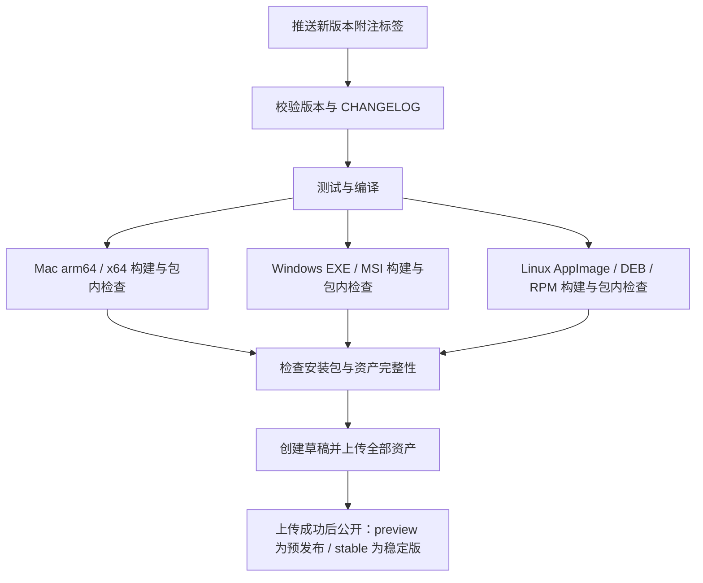

# SmartDD 多平台构建与发版

日期：2026-10-16

状态：M6 的 `v0.0.4` 已完成 GitHub Actions 四个目标构建及公开预发布，七个安装包已完整下载并校验，下载后的 Mac arm64 包原生模块和隔离 GUI 回归通过，见 §11。上一版 `v0.0.3` 已补齐新 Logo、Windows MSI 和 Linux AppImage/DEB/RPM。Windows、Linux 的完整业务适配与其他平台完整业务验收仍未完成。开发与发布约定见根目录 [AGENTS.md](../AGENTS.md)，Claude Code 通过 [CLAUDE.md](../CLAUDE.md) 引用同一份规则。

## 1. 本次已完成的操作

- 从本地 `main` 创建并切换到 `feature/0.0.1`。
- 创建时两者均指向 `b54e05bd559c5d04c140f8492bc4e788d85ee9d9`。
- M4/M5 与构建配置已提交并推送到开发分支（`27a7513`）；公开验收文档已去除真实资源地址、业务统计和部署时间。
- 首轮 [GitHub CI](https://github.com/uprxiao/SmartDD/actions/runs/38704354599) 已通过。首版按下述预发布流程推进；本地 Yoda 未修改。
- 已合并到 main 并成功发布 [v0.0.2 预发布](https://github.com/uprxiao/SmartDD/releases/tag/v0.0.2)，发布提交 `1fd537fb08b63a61319ac6bbd88a148537251b7f`；失败及修复记录见 §9。
- 已在下一版本 [v0.0.3](https://github.com/uprxiao/SmartDD/releases/tag/v0.0.3) 补齐 MSI、Linux 三格式及新 Logo；发布提交 `18a468d5fc32a1de6afc177c41935109a8eae2d6`，见 §10。
- M6 按确认原型接入正式 UI，并完成检测到 AI 配置的流程；[v0.0.4](https://github.com/uprxiao/SmartDD/releases/tag/v0.0.4) 发布提交 `6cdea23313d586a1aa8f85e59e090d269f48d34e`，见 §11。
- 新增 `ci.yml`、`build.yml`、`release.yml` 和共用的构建环境 Action。
- 拆出 `electron-builder.config.cjs`，增加分平台构建、包内原生模块检查、产物清单、发布元数据与校验脚本。
- `pnpm test` 改用 Node 启动器设置 Electron 环境变量，保持原测试行为并移除命令行赋值对 POSIX shell 的依赖。
- 补充 `CHANGELOG.md`、`NOTICE`、Yoda 原始版权与 Apache-2.0 许可文件。

后续开发先在 `feature/0.0.1` 推进。按用户确认的发布约定，验收后合并 `main`，对明确的发布提交打 tag，再推送 tag 触发构建。更复杂的长期分支策略另行规划。

## 2. 本地 Yoda 实际怎么做

参考目录：同级目录 `../yoda`。

参考快照：`960fd3224508edc52fb7e99d9e8f8cf1723ad683`，提交说明为 `chore: release v0.20.3`。以下以这个快照的可执行配置为准，不把文档里的旧描述当作当前实现。

| 能力 | 实际机制 | Yoda 源码位置 |
| --- | --- | --- |
| 日常检查 | 向 `main` 发起 PR，或手动触发；执行格式、类型、lint 检查 | `.github/workflows/code-consistency-check.yml` |
| 正式发版入口 | 推送 `v*` 标签；也允许手动指定标签 | `.github/workflows/release-prod.yml` |
| 版本一致性 | 标签去掉 `v` 后必须等于 `package.json.version`，CHANGELOG 必须存在对应版本标题 | `release-prod.yml` 的 `Verify release metadata` |
| 草稿 Release | 构建前创建 draft，先汇集各平台资产 | `release-prod.yml` 的 `create-release` |
| 多平台构建 | Linux、Windows、Mac 三个 job 分别在对应系统运行 | `release-prod.yml` 的 `release-linux`、`release-win`、`release-mac` |
| 依赖环境 | Node 24、pnpm、Python 3.11、锁文件安装；Windows 传入 MSVC 配置 | `.github/actions/setup-build/action.yml` |
| 原生模块 | 每个目标架构先执行 `electron-rebuild`，再执行 electron-builder | `scripts/release/build.ts`、`scripts/release/rebuild-native.ts` |
| 安装包 | Mac：DMG，默认构建 x64/arm64；Windows x64：NSIS EXE、MSI；Linux x64：AppImage、DEB、RPM | `electron-builder.config.ts`、`scripts/release/build.ts` |
| 正式公开 | 三个平台 job 全部成功后，把 draft 改为公开 Release，并标记 latest | `release-prod.yml` 的 `publish-release` |
| 试打包 | Windows 单独有手动工作流，只上传 Actions artifacts，不创建 Release | `.github/workflows/windows-beta-build.yml` |

所以，“提交 GitHub”和“发版”是两个动作。Yoda 当前的普通提交不会触发正式发布；只有匹配的标签被推送到 GitHub，或手动启动指定标签的发布工作流，才走正式发布。

Yoda 还有签名、公证、Sparkle 自动更新、R2 和国内镜像。这些是额外的分发能力，不是实现“标签触发多平台打包”所必需的全部组件。

## 3. SmartDD 当前状态

| 项目 | 当前情况 | 落地时需要处理 |
| --- | --- | --- |
| Git 分支 | `v0.0.4` 已从 main 发布；继续在 `feature/0.0.1` 开发 | 后续修复按下一版本发布，保留旧标签 |
| CI | v0.0.4 四个目标构建与发布全部通过 | 保留平台原生检查与各格式解包验证 |
| 安装格式 | Mac DMG、Windows EXE/MSI、Linux AppImage/DEB/RPM 七包已发布 | Windows/Linux 的桌面安装升级及完整业务验收单列 |
| 构建架构 | 每个目标使用对应系统和架构；先检查已安装 Electron 的平台、架构与版本，再复用分发目录 | 不在 Apple Silicon 上伪装完成 Intel 原生运行验收 |
| 原生依赖 | 按目标重建 `better-sqlite3`、`node-pty`，并用打包后的 Electron 加载包内模块实测 | 已在 GitHub 对四个目标执行；MSI/Linux 另检查各格式解包载荷 |
| 终端启动 | `src/main/pty-manager.ts` 使用 POSIX shell 参数，默认 `/bin/zsh` | 适配 Windows 命令解释器与参数、退出和恢复行为 |
| CLI 查找 | `runner-detect.ts` 使用 `whence`/`type -P`，只接受 `/` 开头路径 | 适配 Windows PATH、PATHEXT、盘符、`.cmd` 启动器 |
| 配置注入 | `launch-env.ts` 依赖 shell 脚本 | Windows 适配必须保留已有配置优先级与凭据隔离行为 |
| Skill 运行时 | `capability-service.ts` 使用 `python3`；SSH 脚本依赖 Python `pty` | 核实运行时探测与 Windows 实现；仅在 CI 使用 Git Bash 不能解决 Python `pty` 的系统依赖 |
| 测试命令 | 主测试入口已改成 Node 启动器，发布辅助测试可跨平台运行；既有应用测试仍有 POSIX 夹具 | 完整应用测试目前在 Mac 跑；Windows 业务测试需随适配补齐 |
| 密钥存储 | 现有验收针对 macOS Keychain | Windows、Linux 分别验证对应安全存储，不能把 Mac 结果沿用过去 |
| 发布元数据 | 已发布 `0.0.4`，保留 CHANGELOG、进位计算、版本和 main 归属校验 | 不覆盖已公开版本；下次须同步远端 tag 后计算，当前下一版本为 v0.0.5 |
| 签名 | 一期 `preview` 允许无签名、无公证；有证书时可签名；`stable` Mac 强制签名与公证 | 已只读确认仓库无签名 Secrets；自测不受阻，申请准备与对外分发待办见 PRD §2.4 |

M5 的完成范围仍是现有 Mac 流程。增加多平台构建后，需要单独取得新平台的可用性证据。

Yoda 已有 Windows 终端适配，可参考 `src/main/core/pty/pty-spawn-platform.ts` 的 PATH/PATHEXT、`.cmd`/`.bat`/`.ps1` 分支。它的 `shellSetup` 在 Windows 分支会被忽略，不能直接替换 SmartDD 的配置注入流程。

## 4. 已落地的实现

### 4.1 日常 CI

`.github/workflows/ci.yml`：

- 对 `main` / `feature/**` 分支 push、面向 `main` 的 PR 触发，也可由构建工作流复用。
- 使用 actionlint `1.7.12` 校验工作流语法、表达式与依赖；使用锁文件安装依赖，运行类型检查、发布辅助测试、应用测试和编译。
- 构建环境复用 Yoda 的 Node 24、Python 3.11 设置，pnpm 由 SmartDD 的 `packageManager` 固定为 `10.27.0`。应用测试额外安装固定版本的 PyMySQL / psycopg2-binary，以执行本机隔离协议测试。
- 完整应用测试在 Mac 执行；四个打包目标都执行发布辅助测试和包内原生模块检查。
- CI 使用临时目录、假凭据和隔离服务，不导入开发者的 AIS 数据库、服务器或模型凭据。

Yoda 的上述日常工作流没有执行单元测试；SmartDD 应保留自己的测试要求，不能只照搬它的检查列表。

### 4.2 多平台试打包

`.github/workflows/build.yml` 提供手动构建入口，也供标签发布调用。它先等待 CI，再并行构建四个目标，单独运行时只上传 Actions artifacts。当前目标如下：

| 目标 | 安装产物 | 验收要求 |
| --- | --- | --- |
| Mac Apple Silicon | `.dmg`，arm64；`macos-latest` | v0.0.4 云端构建、下载校验、包内 SQLite/PTY 和下载后的隔离 GUI 通过；本机打包 App 的 M6 真实模型流程通过，见 §11 |
| Mac Intel | `.dmg`，x64；`macos-15-intel` | v0.0.4 云端构建、SQLite/PTY 与下载校验通过；完整业务未验收 |
| Windows | `.exe`、`.msi`，x64；`windows-2022` | v0.0.4 EXE/MSI 构建、下载校验与包内检查通过，MSI 解包检查通过；完整业务仍待适配 |
| Linux | `.AppImage`、`.deb`、`.rpm`，x64；`ubuntu-22.04` | v0.0.4 三个格式分别解包验证版本、架构、SQLite/PTY 通过，下载校验通过；桌面、安装升级与安全存储仍待验收 |

用户于 v0.0.2 发布后明确要求本轮补齐 MSI 和 Linux 格式，已提前纳入一期补充。自动更新仍作为后续独立功能。

共享环境位于 `.github/actions/setup-build/action.yml`，打包入口为 `scripts/release/build.mjs`。构建脚本拒绝主机与目标系统/架构不匹配的调用，显式重建两个原生依赖，并完整解包 `node-pty` 与 `better-sqlite3`，包含终端辅助程序。包内测试使用安装包自己的 Electron 和 `app.asar` 模块，不借用工作区的 SQLite/PTY 模块。

每个平台/架构附带独立的 `manifest-<平台>-<架构>.json`，记录版本、提交、工作区是否干净、原生检查类型、签名状态、文件大小与 SHA-256。它是本次构建的核对清单，不代表完整业务功能或签名真实性的独立第三方证明。

从 v0.0.3 起，manifest 使用 `schemaVersion: 2`，每个平台/架构的 `files` 数组列出全部格式；共四份清单、七个安装包及一份 `SHA256SUMS.txt`。发布检查拒绝缺包、重复格式、路径替换、版本或提交不一致、文件大小或哈希不符。Linux 先安装 Yoda 使用的编译与 RPM 工具，并补 `libarchive-tools` 和 Electron 运行库。MSI 使用 Windows Installer 管理解包；Linux 使用 AppImage 自解包、`dpkg-deb`、`bsdtar` 解包，再运行各自载荷中的 Electron。此项检查不等同于真实桌面的安装、升级、卸载验收。

### 4.3 标签发版

`.github/workflows/release.yml` 监听推送的 `v*` tag，复用试打包入口。标签要求为附注标签，已合并到 `origin/main`，与当前检出的提交一致，并符合下一版本进位规则。`release.config.json` 当前为 `preview`，首版允许无签名、无公证，GitHub 标为预发布且不标为 latest；切换 `stable` 前须完成签名、公证及完整平台验收。



- 构建失败不会进入发布任务；上传失败保留草稿，不公开半套安装包。
- 打包步骤显式禁止 electron-builder 自行发布，由最后的发布任务统一上传、公开，减少双重发布路径。
- 普通检查只需读权限；创建和发布 Release 的任务才授予 `contents: write`。
- 同标签任务串行；已公开版本不覆盖资产，修复时发布新版本。
- 上传前验证三份产物清单：版本、提交、平台、架构、大小、SHA-256、干净工作区；`stable` 额外要求 Mac 签名状态，`preview` 允许无签名。生成 `SHA256SUMS.txt` 一起上传。
- 创建 Release 使用 `--verify-tag`，不会隐式创建缺失的 tag；仅允许在草稿重试时替换上传资产。
- 工作流、构建脚本、版本说明和应用代码都必须包含在标签所指向的提交里。
- 首次接入时，验证 GitHub 上工作流可见性与手动入口；本地 YAML 校验不能替代真正的 Actions 运行。

### 4.4 复用边界

直接参考 Yoda 的三类机制：按系统构建、按架构重建原生模块、草稿聚合后统一发布。

保持 SmartDD 的应用名称、appId、版本、资源目录和原生依赖列表。复制或改编源码时在 `NOTICE` 补充来源。

本轮不引入 Yoda 的 PostHog 配置、R2/国内镜像、Canary 通道或 Sparkle。应用内自动检查和安装更新是独立功能，不能因为有 GitHub Release 就称为已经具备自动更新。

另一个需要适配而非照抄的例子：本地 `windows-beta-build.yml` 的原生重建命令仍含 `sqlite3,node-pty`；SmartDD 实际依赖是 `better-sqlite3,node-pty`。应以目标项目依赖为准。

### 4.5 Yoda 发布资产对标与补齐顺序

用户于 2026-10-15 对照 Yoda v0.20.3 的 Release 资产提出补齐要求；本地 Yoda 源码及用户截图中，安装包、更新辅助文件和源码归档用途不同。

| Yoda 资产 | 用途 | SmartDD 当前与后续安排 |
| --- | --- | --- |
| `arm64.dmg`、`x64.dmg` | Apple Silicon / Intel Mac 安装 | 本轮两个 DMG；分别验证构建、包内模块和安装内容 |
| `x64.exe` | Windows 安装 | 本轮 NSIS EXE；当前标注实验性，终端、CLI 和 SSH Skill 业务适配仍待完成 |
| `x64.msi` | Windows 的另一种安装格式，便于特定分发和管理方式 | v0.0.3 接入构建与解包检查；安装、升级和卸载的完整验收仍待完成 |
| `.AppImage`、`.deb`、`.rpm` | Linux 不同发行版和安装方式 | v0.0.3 接入 Ubuntu 构建及三个格式的载荷检查；终端、密钥存储与桌面完整验收仍待完成 |
| `.blockmap` | 差分下载所需的文件块元数据 | 随应用内自动更新接入，单独上传不会启用自动更新 |
| `.delta`、更新 feed | 从特定旧版到新版的增量包及版本索引 | 随 Mac 自动更新机制、签名配置、升级和失败回退验收一起补充；保留完整安装包下载 |
| Source code ZIP / TAR.GZ | GitHub 自动生成的源码快照 | tag 创建后已有；不能作为可安装包验收结果 |
| SHA-256 / 产物清单 | 核对下载完整性和构建来源 | 上传 `SHA256SUMS.txt` 与四个目标的 manifest，记录全部格式、版本、提交、架构和签名状态 |

执行顺序：v0.0.2 已完成原三个目标的构建和可下载预发布；按用户要求在 v0.0.3 补 MSI 与 Linux 实验性包；后续完成平台业务验收及自动更新。新增格式必须有对应测试证据，文件数量不作为交付质量指标。

## 5. 分支、版本与标签的关系

- `feature/0.0.1` 是开发分支，可以继续接收提交。
- `package.json` 的 `0.0.1` 是应用版本。
- `v0.0.1` 是固定指向某次提交的 Git 标签，不会自动收录工作区尚未提交的文件。
- Git 技术上允许给任意提交打标签；本项目采用先合并 `main`、验证最终提交后再打正式标签的约定。
- 版本从 `v0.0.1` 起，第三位满 10 进位，第二位满 100 进位。完整规则、边界示例和重试方式统一维护在 [AGENTS.md](../AGENTS.md)。
- 在本机打标签不会触发 GitHub Actions，必须将标签推送到 GitHub。

发布流程示意（分支推送已执行，tag 状态以远端为准）：

```sh
# 先完成代码提交、工作流接入及目标平台验收
git push -u origin feature/0.0.1

# 按仓库规则完成合并 main 和最终验证，确认远端 main 已包含发布提交
# package.json 和 CHANGELOG 已包含 0.0.1
git tag -a v0.0.1 <main中已验收的提交SHA> -m "SmartDD 0.0.1"
git push origin refs/tags/v0.0.1
```

推送标签后不要再为同一个标签同时启动手动发布。普通构建重试使用构建入口，正式版本修复递增版本号。

## 6. 交付时必须取得的验证结果

1. **配置检查**：工作流语法、版本不匹配时失败、缺失 CHANGELOG 时失败、构建失败不公开 Release。
2. **自动化回归**：类型检查、已有测试、应用编译通过；平台相关测试在对应系统运行。
3. **安装包检查**：Electron 与原生模块架构匹配；SQLite、PTY、数据库迁移、Skill 和运行时资源可用。
4. **真实页面检查**：从安装包启动，创建项目、配置连接、进入任务、选择 CC 配置、发起问题、执行只读数据库查询和 SSH 调查、停止并恢复任务。
5. **发布验证**：在 GitHub 实际跑过所有目标构建，下载产物安装检查，再验证草稿到公开的流程。

本轮实际结果（2026-10-15）：

| 检查 | 结果 |
| --- | --- |
| `pnpm typecheck` | 通过 |
| `pnpm test:release` | 12 项通过：版本、元数据、平台、探针退出回归、tag/main 关系、包名架构约定、七包一致性、缺 MSI/Linux 格式与清单篡改阻断、预发布策略、工作流依赖 |
| `pnpm test` | 274 项通过，2 项本机 CLI 探针按原设置跳过；首次沙箱运行因回环监听被拒绝失败，允许本机端口后完整通过 |
| actionlint `1.7.12` | 工作流语法、表达式与依赖检查通过；未启用额外 shellcheck / pyflakes |
| `pnpm package:release --platform mac --arch arm64` | 应用编译、原生模块重建、DMG 生成和包内 SQLite/PTY 检查通过 |
| DMG 安装内容 | `hdiutil` 只读挂载并校验，通过 `ditto` 将应用复制至临时目录，再卸载镜像 |
| 复制后的应用 GUI | 隔离项目开关、任务启动、真实 PTY、配置注入、浅色/深色 ANSI 与真彩色、中英文及 800px 窗口检查通过，无 renderer 异常 |
| GitHub 实际运行 | v0.0.3 四个目标、七个安装包的构建、原生/解包检查与发布全部成功 |
| Release 下载检查 | v0.0.3 七个安装包已真实下载，版本、提交、大小、SHA-256 全部一致；全部 12 个上传资产均匹配 GitHub API 摘要 |
| 下载后 Mac arm64 应用 | v0.0.3 DMG 校验、只读挂载、临时复制、SQLite/PTY、隔离 GUI 全部通过；包内 ICNS 与已选图标字节一致，首页和侧栏新 Logo 正常 |
| 正式签名、公证 | 未执行；当前仍为无签名、无公证的个人自测预发布 |

GUI 测试使用隔离的测试运行器，不访问 AIS 或外部模型，不替代 M5 的真实模型验收。证据位于 `release/packages/mac-arm64/install-smoke.log` 与其中记录的临时截图目录。

v0.0.2 真实下载证据：`release/downloads/v0.0.2/download-verification.json`、`installed-app.json`、`install-smoke.log`；截图目录由日志记录。日志及下载文件不提交 Git。

v0.0.3 最终证据：`release/downloads/v0.0.3/download-verification.json`、`installed-app.json`、`native-smoke.json`、`install-smoke.log`。GUI 覆盖设置目录、项目开关、配置注入、真实 PTY、浅/深色 ANSI 与真彩色、中英文和 800px 窗口；使用隔离运行器，未重新访问 AIS 数据库、SSH 或外部模型。Windows/Linux 此轮验证到构建及载荷层，未完成干净桌面的交互安装、升级、卸载与完整业务验收。

本机最初试包为 `release/packages/mac-arm64/SmartDD-0.0.1-mac-arm64.dmg`，约 125 MiB；产物清单如实记录 `signed: false`、`dirty: true`，不作为可公开发布的验收版本。该历史试包使用 Electron 默认图标；v0.0.3 纳入用户选定的橙色蚂蚁举重 Logo，原图和各平台资源见 `build/icons/README.md`。

## 7. 日常使用与 GitHub 配置

本地常用命令：

```sh
pnpm typecheck
pnpm test
pnpm test:release

# 只输出下一版本；用于正式决策前先同步远端 tags
pnpm release:next
pnpm release:check --tag v0.0.1

# 在对应系统和架构运行，产物进入 release/packages/<平台>-<架构>/
pnpm package:release --platform mac --arch arm64
pnpm package:release --platform mac --arch x64
pnpm package:release --platform win --arch x64
pnpm package:release --platform linux --arch x64

# 保留本机应用目录打包入口，输出到 release/，会同样执行包内检查
pnpm package
```

将完整源码和工作流提交推送到 `feature/0.0.1` 后可观察 CI。手动工作流入口已进入默认分支，在 GitHub Actions 的 **Build installers → Run workflow** 选择要试打包的分支。v0.0.3 完成后应有 `smartdd-mac-arm64`、`smartdd-mac-x64`、`smartdd-win-x64`、`smartdd-linux-x64` 四份 artifacts。

普通检查与无签名试包不需要模型、数据库、SSH 或对象存储 Secrets。工作流使用 GitHub 提供的 token，只有发布 job 申请 `contents: write`；不需要额外填个人访问令牌。

签名配置放在 GitHub 仓库的 Actions Secrets，不写入代码：

| Secret | 用途 |
| --- | --- |
| `MAC_CERTIFICATE` | 自有 Developer ID Application 证书的 P12，使用 electron-builder 支持的 base64 形式 |
| `MAC_CERTIFICATE_PASSWORD` | 上述 P12 的密码 |
| `APPLE_ID` | 公证使用的 Apple ID |
| `APPLE_PASSWORD` | Apple 的应用专用密码 |
| `APPLE_TEAM_ID` | 证书所属团队 ID |
| `WIN_CERTIFICATE`、`WIN_CERTIFICATE_PASSWORD` | 可选的自有 Windows 代码签名 PFX 与密码；未配置时生成无签名试包 |

手动构建和 `preview` 预发布在没有证书时允许无签名、无公证；有证书时执行签名，Mac 同时要求完整公证配置。`stable` 工作流强制 Mac 签名、公证、`codesign` 与 `stapler` 校验，缺少配置会明确失败。Windows 签名可选，尚未测试实际签名流程。

首版 `v0.0.1` 按 [AGENTS.md](../AGENTS.md) 采用个人自测预发布：整理说明、完成检查、合并 main、确定发布 SHA 后推送 tag。未完成的平台业务适配必须在预发布说明中列出；二期／对外正式分发前完成相关验收及签名、公证，再使用下一版本 tag 发布稳定版。


## 8. Apple 签名、公证的后续接入

用户于 2026-10-15 确认：当前个人自测先无签名、无公证构建；边用边测，开发者资格与证书申请可同步推进；正式给其他用户使用前完成接入。此项已记录到 [PRD 一期／二期安排](SmartDD_V0.2_PRD.md#24-一期自测与二期分发安排2026-10-15-用户确认)。

签名证明开发者身份与文件完整性；公证由 Apple 自动扫描签名软件并返回票据。无签名包可以构建，但网络下载后的首次打开可能被 macOS 拦截；签名、公证主要改善分发与首次安装体验，不替代功能测试。

准备步骤：

1. 用户加入 Apple Developer Program。官方当前为每会员年 99 美元，实际按地区币种收费；账号注册、付款和身份核验由用户完成。
2. 在 Apple 开发者账户申请 **Developer ID Application** 证书，按页面生成 CSR，下载证书并导入钥匙串；导出包含私钥的 P12 并设置导出密码。
3. 准备 Apple ID、Team ID，以及开启双重认证后生成的应用专用密码。
4. 将第 7 节的五项 Mac 配置放入仓库 Settings → Secrets and variables → Actions。证书、私钥、P12 密码及应用专用密码不进入源码、日志或聊天。
5. 先在手动构建中验证签名、公证、票据装订与安装；确认各目标平台验收通过后，将 `release.config.json` 的 `channel` 从 `preview` 改为 `stable`，按下一版本 tag 发版。

之后每次 tag 构建自动完成：编译 → 签名 → 提交 Apple 公证 → 附加票据 → 校验 → 汇集安装包并发布。无需每版手工重新申请证书；证书或凭据到期、撤销后需更新配置。当前这些申请和接入工作仍待完成。

依据：[Apple 开发者计划](https://developer.apple.com/programs/enroll/)、[Developer ID 证书](https://developer.apple.com/help/account/certificates/create-developer-id-certificates/)、[Apple 公证说明](https://developer.apple.com/developer-id/)、[应用专用密码](https://support.apple.com/en-us/102654)、[electron-builder 公证配置](https://www.electron.build/docs/notarization/)。

## 9. 首次云端发布记录

- `v0.0.1` 已于 2026-10-15 推送，指向 `c246d744e9296c01c77993ce2aaf8023239e06dd`，远端为附注标签。对应 [Release 运行](https://github.com/uprxiao/SmartDD/actions/runs/38705746367) 在元数据校验失败，没有生成或发布安装包；标签页的源码压缩包由 GitHub 自动提供。
- 根因：`actions/checkout@v4` 按标签事件检出时，先取得附注标签，再用事件的提交 SHA 更新本地同名标签，令 `git cat-file -t` 返回 `commit`。已修复元数据与发布 job：显式 `ref: github.sha`，保留完整 fetch 和附注标签检查。
- 按既定规则保留 `v0.0.1`，修复版本使用 `v0.0.2`；先在开发分支执行三端试打包，核对结果后再推送新 tag。预发布继续无 Apple 签名、无公证。

- 首次三端[试打包](https://github.com/uprxiao/SmartDD/actions/runs/38706231001)：两个 Mac 目标成功；Windows EXE 已生成且包内 SQLite/PTY 输出通过，但验证进程未退出，被外层 30 秒超时阻断。已将独立探针改为全部断言通过后写完结果并退出，并新增“PTY 退出后仍有后台句柄”的回归用例。[修复后的三端试打包](https://github.com/uprxiao/SmartDD/actions/runs/38707534840) 全部成功。
- `v0.0.2` 指向 `1fd537fb08b63a61319ac6bbd88a148537251b7f`，[标签发布运行](https://github.com/uprxiao/SmartDD/actions/runs/38708593327) 全部成功，于 2026-10-15 16:58（北京时间）公开预发布；三个安装包与四个校验/清单文件齐备，另有 GitHub 的两份源码归档。[Release](https://github.com/uprxiao/SmartDD/releases/tag/v0.0.2) 三个安装包已下载校验；Mac arm64 下载包的原生模块与隔离 GUI 通过。

## 10. MSI 与 Linux 扩展（v0.0.3）

用户在 v0.0.2 发布后要求当轮增加，参考同级 Yoda 的 `electron-builder.config.ts`、`scripts/release/build.ts` 和 Linux 构建 job。新增 Windows MSI 与 Linux AppImage/DEB/RPM，保持 preview 策略；四个目标、七个安装包都通过构建及载荷检查后才公开。Linux 文件名遵循打包器约定：DEB 为 `amd64`，AppImage/RPM 为 `x86_64`，清单中的运行架构仍为 `x64`。本地类型检查、274 项应用测试（2 项 CLI 探针跳过）、12 项发布测试、编译和 actionlint 通过；云端试打包、标签发布与最终下载校验均已通过，见本节最终结果。自动更新仍待后续开发。

首次四目标[试打包](https://github.com/uprxiao/SmartDD/actions/runs/38713136393)中，两个 Mac 目标通过；Linux AppImage/DEB/RPM 均完成解包及真实 SQLite/PTY 检查。Windows 在 MSI 链接阶段报告 `LGHT0094: Icon:SmartDDIcon.exe could not be found`，未发布。此次构建尚未包含用户另行完成的 Logo；现将选定原图、ICNS/ICO/Linux PNG、应用内显示与打包图标配置统一纳入 v0.0.3，再对最终提交重跑。Logo 的本机类型检查、编译、274 项应用测试与隔离 GUI 已通过；单测与 GUI 并行时曾因共享临时目录清单发生一次断言碰撞，分开运行后通过，后续这两项顺序执行。

包含 Logo 的[第二轮试打包](https://github.com/uprxiao/SmartDD/actions/runs/38714705304)中，Mac、Linux 均通过；Windows 的 MSI 与 EXE 已生成，包内原生模块通过，随后 `msiexec /a` 解包在 180 秒超时。针对含空格的 `TARGETDIR`，按照 [Windows Installer 命令行文档](https://learn.microsoft.com/en-us/windows/win32/msi/command-line-options)改为只给属性值加引号，并以 Node 的 `windowsVerbatimArguments` 保留格式；保持原超时上限，失败时输出 MSI 日志尾部。修复后的真实 Windows 结果在下一轮验证通过。

最终结果：提交 `18a468d5fc32a1de6afc177c41935109a8eae2d6` 的[四目标试打包](https://github.com/uprxiao/SmartDD/actions/runs/38716410720)全部成功，Windows MSI 含空格目录的解包、SQLite 和 PTY 验证通过。随后 fast-forward 合并 main，创建附注标签 `v0.0.3`；[标签发布流水线](https://github.com/uprxiao/SmartDD/actions/runs/38717813909)全部成功，于 2026-10-15 18:19（北京时间）公开 [预发布 Release](https://github.com/uprxiao/SmartDD/releases/tag/v0.0.3)。共有七个安装包、四份 manifest 和 `SHA256SUMS.txt`，另有 GitHub 自动生成的两份源码归档。七个安装包已完整下载并核对来源与校验和，全部 12 个上传资产均匹配 GitHub 记录的摘要；Mac arm64 下载包的 ICNS 图标、版本、原生模块和实际隔离 GUI 均通过检查。

## 11. M6 正式界面与配置流程（v0.0.4）

发布提交 `6cdea23313d586a1aa8f85e59e090d269f48d34e` 包含按确认原型接入的 M6 UI、Codex／Claude Code 检测到配置流程及本轮修复。沿用 `feature/0.0.1`，本机验收后 fast-forward 合并 main；[最终 main CI](https://github.com/uprxiao/SmartDD/actions/runs/38825895738) 通过后推送附注标签 `v0.0.4`。

[标签发布流水线](https://github.com/uprxiao/SmartDD/actions/runs/38826301180) 的四个目标和公开任务全部成功，[Release](https://github.com/uprxiao/SmartDD/releases/tag/v0.0.4) 于 2026-10-16 08:03（北京时间）公开为预发布。产物包括 Mac arm64/x64 DMG、Windows x64 EXE/MSI、Linux x64 AppImage/DEB/RPM、四份 manifest 及 SHA256SUMS，共 12 个上传资产；源码归档由 GitHub 另行提供。七个安装包总计约 840 MiB，均对应同一发布 SHA。

七个安装包已全部实际下载，四份 manifest 的版本与发布提交一致，文件大小和 SHA-256 与清单及 SHA256SUMS 匹配；全部 12 个上传资产均与 GitHub API 的大小及 digest 一致。下载的 Mac arm64 DMG 挂载复制后，版本、架构、SQLite／PTY 及既有隔离 UI 探针均通过；截图检查包含英文 800px 窗口和深色彩色终端。证据位于 `release/downloads/v0.0.4/download-verification.json` 与 `release/m6-acceptance/downloaded-v0.0.4/`（本机验收产物，不入源码）。完整本机测试、真实 Codex／CC-work 页面提问、数据库／SSH 保存和错误反馈等证据见 [M6 实施与验收记录](M6_实施与验收记录.md)。

继续采用无签名、无公证的个人自测 preview；Mac x64、Windows 和 Linux 尚未完成完整桌面业务验收，Windows/Linux 仍为实验性。自动更新和实际定时调度没有包含在此版本；F17–F19 为后续需求登记，不是已上线功能。发布后的文档补记不改变本节发布 SHA，也不移动 tag。

## M7 开发补充：macOS 本机按键桥与权限身份（2026-10-16，未发版）

M7 新增随包的 `native/smartdd-voice`，在对应 Mac runner 编译并检查架构。为了让系统把按键组件归属到 SmartDD，预发布不再沿用 Electron 未绑定 Info.plist 的链接器签名，而由 electron-builder 使用 `identity: "-"` 完成 ad-hoc 封装。它不需要 Apple 证书，不提供 Developer ID 身份或公证，仍按无 Apple 签名的个人自测包分发；`signed` 产物元数据继续只表示正式证书签名。稳定版的签名、公证要求不变。

包内原生检查额外执行 `codesign --verify --deep --strict`，并核对代码标识与 CFBundleIdentifier 一致，再检查 SQLite、PTY 和桥的只读启动。签名完整不等于用户已授权辅助功能；安装后仍需通过系统设置授予当前应用权限并实测。ad-hoc 版本升级可能需要重新核对授权，不能承诺权限自动迁移。M7 尚在真机验收，结果见 [实施与验收记录](M7_实施与验收记录.md)。

本机工作区如果位于 iCloud／其他 File Provider 同步目录，FinderInfo 可能在签名中途重新附加。`afterPack` 仅清理生成包的 FinderInfo／ResourceFork，保留 quarantine 等其他属性；若同步服务持续附加元数据，使用 `pnpm package --output-dir /private/tmp/smartdd-build` 或 `pnpm package:release --platform mac --arch arm64 --output-dir /private/tmp/smartdd-installers` 在非同步目录构建。输出覆盖目录必须由调用者明确指定；CI 默认路径保持不变。
