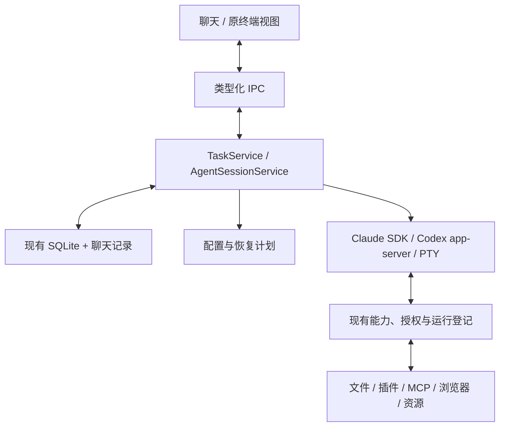

# WillYou（SmartDD）统一 Agent 工作区优化方案

> 现行设计已收口到 [M14 技术方案 T0.1（研究收口稿）](里程碑/M14_统一Agent工作区/技研/技术方案.md)，范围以[需求 R0.2](里程碑/M14_统一Agent工作区/需求.md)为准：先跑稳 T3 式通用基座，独立模板与强制阶段流程后续扩展。本稿保留历史推导、方案比较及旧用例来源，不再并行维护现行实现规格；下方状态按形成时理解。T0.1 已按冻结范围完成研究与关闭审计，可作为实施设计依据；产品原型评审、正式开发与验收仍未完成。

> 2026-11-14 阶段归属：本次优化已登记为 F32／[M14](里程碑/M14_统一Agent工作区/README.md)，阶段范围以 [M14 需求](里程碑/M14_统一Agent工作区/需求.md)为入口。本稿保留为设计评审／调研依据，待整合为正式技术方案；定时任务已顺延为 M15。

> 2026-11-14 后续验证：按用户要求已开始全局兼容研究，实际实验、安装／版本问题及未决项统一见[M14 全局验证账](里程碑/M14_统一Agent工作区/技研/全局设计验证账.md)。下方“未执行”等状态为该稿形成时记录，不据此覆盖后续结果；本稿仍待整合。

> 版本：R0.2 · 详细设计评审稿  
> 日期：2026-11-14  
> 项目：`/Users/hx/projects/SmartDD`  
> 源码基线：`feature/0.1.4`，`40ea344a930aec37e36a803b7c621d3632d2d75a`。  
> 本次：按 R0.1 Review 补齐设计与验收，未修改业务代码，未开展兼容实验或生产开发。  
> 阅读顺序：目标与范围（§1–3）→ 产品交互（§4）→ 运行与契约（§5–9）→ 恢复与实施（§10–12）→ 验收与未决项（§13–17）。

> **2026-11-14 用户目标更新：** 统一任务 UI、同任务切换 Provider 续聊、单／多 Agent 宿主委派均为本次核心需求。本文 R0.2 的 §1.2、§4.3、§9、§10、§15 等仍基于此前单绑定范围，须按新的整体调研整合，不能继续把多 Agent 与 Provider 续聊排除在本次之外。当前范围、源码对照和迁移建议见[专项调研](WillYou_统一任务UI_Provider续聊与多Agent委派迁移调研.md)；R0.2 保留为既有技术基础，尚非新范围的完整开发规格。

## 1. 用户目标、范围与本修订的效力

### 1.1 目标

将中央 CLI 终端工作区升级为统一聊天工作区：Claude 使用 Agent SDK，Codex 使用 app-server；WillYou 管理消息、状态、工具展示和用户交互，各 Agent 继续执行自己的模型循环与工具。

项目、任务、配置、文件、插件、Skill、MCP、数据库／SSH、邮件、浏览器、语音唤起及已交付的导入导出能力继续可用。现有供应商沿用已适配协议；DeepSeek 是供应商，Claude／Codex 是执行 Agent。

### 1.2 本次包含与后续范围

本次完整交付包含：统一页面、Claude／Codex 程序化适配、配置与权限、历史与恢复、上下文、业务授权、异常恢复及兼容入口。只显示文本成功不能视为整个升级完成。

Cursor／Kiro 等新增 Agent、跨 Agent 编排、固定工作流、定时任务、同一会话跨供应商切换、远程服务和移动客户端分别作为后续范围。本次只提供可复用的会话服务。

### 1.3 决策等级与实施边界

| 标记 | 含义 | 本文处理 |
| --- | --- | --- |
| 既定规则 | 来自用户目标、AGENTS 或 M13 现行需求 | 直接承接；具体实施时同步受影响原型和阶段文档 |
| 设计基线 | 本 R0.2 给出的技术方案及交互建议 | 按统一契约评审；不允许实现方在不同模块自行另定含义 |
| 实验门槛 | 必须依赖指定版本、原生进程或真实模型确认 | 全部标未执行；未通过的组合不开放聊天执行 |
| 排期决定 | 正式 F／M 编号、阶段顺序、生产开发及发布授权 | 本文不作自动调整；本次仅补齐文档 |

最终兼容目标采用 M13 已确认规则。当前尚未实施的 M13 配置、身份迁移等能力列为集成前置，不把本次工作自动扩为完成全部 M13。技术预研和契约设计可以先进行；正式集成前必须核对这些前置的真实实现。

“其他功能不受影响”通过数据可读、规则一致、入口可达、原用例回归及平台验证判定。旧原生历史不被覆盖，已有任务不批量切换模式；不兼容组合保留明确的原 CLI 入口。

### 1.4 保留既有业务体系是实施前提（2026-11-14 用户确认）

本次优化必须保留 WillYou 已开发的浏览器、文件目录／工作区、插件、Skill／MCP 及其他现有业务体系，沿用其业务服务、数据、配置、授权和生命周期规则。新能力集中于统一任务 UI、会话／运行适配、Provider 续聊和宿主多 Agent 委派。

允许为新任务模型做必要的接口与上下文适配，但不以重建现有业务体系为实施路径。旧业务入口继续可达，旧数据与配置可用；受影响能力必须在新任务路径中完成回归。具体保留对象、改造边界与验收条件统一见[专项调研 §15](WillYou_统一任务UI_Provider续聊与多Agent委派迁移调研.md#15-用户确认保留既有业务体系是优化前提)。正式开发范围必须先建立“原功能—原入口／服务—新接入点—回归用例”的对应关系。

## 2. 当前项目的事实与改造基础

### 2.1 已核实的实现

| 位置 | 当前行为 | 对本次方案的意义 |
| --- | --- | --- |
| [任务界面](../src/renderer/views/task-view.tsx) | 使用 xterm，键盘输入发往 PTY，输出直接写入终端 | 中央交互区需要改为消息、工具和审批组件 |
| [PTY 管理](../src/main/pty-manager.ts) | 使用 node-pty 启动命令，管理输入、输出、尺寸和进程退出 | 保留兼容运行路径；新聊天运行路径采用结构化协议 |
| [任务服务](../src/main/core/tasks/task-service.ts) | 管理任务创建、启动、恢复、停止及能力生命周期；运行映射依赖 ptyId | 继续保留任务管理职责，逐步分离终端相关职责 |
| [运行器适配器](../src/main/core/tasks/runner-adapters.ts) | 内置 Claude、Codex，封装程序发现、参数、状态目录和原生历史定位 | 可复用配置与身份逻辑，需要补充真正的会话执行接口 |
| [AI 配置服务](../src/main/core/ai/ai-profile-service.ts) | 保存程序、参数、环境变量和密钥引用，主进程解析运行配置 | 复用存储，增加面向程序化运行的配置解析与兼容检查 |
| [私有 Codex 服务](../src/main/core/applications/codex-private-server.ts) | 已启动 app-server；控制连接负责初始化与冻结 Skill 根发现，TUI 使用自己的连接处理对话 | 有进程与连接管理基础，但尚非完整聊天客户端 |
| [Codex 启动转换](../src/main/core/applications/codex-task-server.ts) | 转换已识别参数并校验原生程序；当前该路径限制 macOS 和 Codex 0.167.1 | 需要沿用明确的版本边界，不能直接假定所有安装版本可用 |
| [任务表](../src/main/db/schema.ts) | 任务表保存元数据，未将终端输出作为完整对话持久化 | 需要补充消息与执行记录，以及旧历史导入策略 |
| [文件上下文](../src/main/core/files/terminal-context.ts) | 文件、正文、图片经终端投递，绑定 taskId／ptyId | 保留文件校验和引用机制，替换投递目标与方式 |
| [应用引用投递](../src/main/core/applications/terminal-insertion.ts) | 将业务上下文插入目标终端，具有有效期及重复投递控制 | 改接聊天草稿和上下文服务，继续保留来源与幂等约束 |
| [用户输入凭据](../src/main/core/applications/native-user-inputs.ts) | 依据终端实际输入或启动参数形成输入凭据 | 新的程序化提交路径必须纳入来源证据体系 |
| [原生消息核对](../src/main/core/applications/native-user-messages.ts) | 将宿主输入与原生消息对应，支持后续业务判定 | 聊天记录本身不能直接替代原生消息与授权证据 |

### 2.2 与 M13 的责任边界

以 [M13 需求 R1.0](里程碑/M13_应用Skill与MCP插件化重构/需求.md)为规则来源，[M13 入口](里程碑/M13_应用Skill与MCP插件化重构/README.md)记录 P1 已完成、其余待推进。不可把“需求已确认”“代码已实现”“程序化路径已验证”合并为同一状态。

| 领域 | 当前事实 | 本次责任 | 集成前置 |
| --- | --- | --- | --- |
| 项目／任务／PTY | 已有服务和原 CLI 路径 | 保留业务入口，增加新运行路径 | 原 CLI 回归基线可复现 |
| 智能体／供应商 | 当前 AiProfile 仍有环境与参数；M13 已定义目标模型 | 通过配置解析接口消费 M13 结果 | 来源修订、模型列表、权限快照可获得 |
| 插件生命周期 | P1 已有宿主、运行和审批机制 | 增加运行目标兼容，不重做插件体系 | 按当前实现核对协议与生命周期 |
| 技能统一管理 | M13 的全局／项目来源与生效规则已确认 | 按 §7 的对象矩阵接入 | 未实施的管理能力由 M13 提供或列明接口依赖 |
| 跨配置目录恢复 | 当前 TaskService 倾向沿用原目录；M13 定义了受控迁移 | 调用 §10 的恢复事务，保留源历史 | M13 受管原生身份迁移接口与证据齐备 |
| 定时任务 | [M15](里程碑/M15_定时任务/README.md)待规划 | 保留调用与输入来源扩展点 | 不包含在本次完成标准中 |

### 2.3 代码核对发现的版本差异

候选版本必须分开记录：

- `codex-task-server.ts` 私有服务检查要求 Codex **0.167.1**。
- 内置 Codex `1.4.0` 能力适配资源的 `cliVersions` 声明为 **0.166.0**，不能据此认定 0.167.1 的能力交付也已验证。
- 内置 Claude `1.2.0` 能力适配资源声明 **2.1.318**；旧 `1.0.0` 资源声明 **2.1.303**。
- 本地 T3 的 SDK 依赖声明为 `^0.3.321`；这只提供候选线索，不是 SmartDD 已安装或已验证的版本。

版本差异见 §6 的实验矩阵；不得通过直接改适配资源中的版本字符串来代替能力、身份及协议验证。

## 3. 需求与追踪

UAW 为本文内部编号，正式立项时映射到需求池及阶段编号，不自动新增里程碑。

| 需求 | 内容 | 设计入口 | 主要用例 |
| --- | --- | --- | --- |
| UAW-R01 | Claude、Codex 共用聊天、输入与状态 | §4 | T01、T02、T30 |
| UAW-R02 | 官方程序化入口及真实进程管理 | §5–6 | T01、T06、T07、T31 |
| UAW-R03 | 连续对话、取消、完成与错误 | §4、§9 | T01、T08、T09、T20 |
| UAW-R04 | 工具、命令、结果、文件变更 | §4、§9 | T03、T28 |
| UAW-R05 | 原生审批、提问与宿主审批 | §8 | T04、T05、T08、T10 |
| UAW-R06 | 供应商、认证、模型、代理及配置根 | §6–7 | T10–T12、T22、T23 |
| UAW-R07 | Skill、MCP、插件及其生效规则 | §7 | T12–T15、T29 |
| UAW-R08 | 文件、选区、图片及业务引用 | §4、§8 | T16–T18、T30 |
| UAW-R09 | 持久历史与旧任务恢复 | §9–10 | T20–T25、T27 |
| UAW-R10 | 原任务管理与既有入口 | §4、§10–11 | T09、T27、T29、T30 |
| UAW-R11 | 真实用户原话及业务授权 | §8 | T10、T16、T21、T29 |
| UAW-R12 | 多任务、身份、请求与资源隔离 | §5、§9 | T04、T15、T26 |
| UAW-R13 | 幂等、未知结果及故障恢复 | §9–10 | T19–T21、T26、T27 |
| UAW-R14 | 分页、输出边界、性能与诊断 | §9、§13 | T02、T28、T33、T34 |
| UAW-R15 | 平台验证、兼容入口与回退 | §6、§10 | T24、T27、T31、T35 |
| UAW-R16 | 新 Agent 与未来工作流扩展接口 | §5、§15 | T32、T36 |

完整验收以 T01–T36 及受影响旧用例为基础。用例仍为未执行，设计覆盖不等于功能通过。

## 4. 页面与操作规格

### 4.1 页面和状态

保留项目侧栏、文件区、设置、插件、浏览器及品牌。中央任务区按持久化运行模式显示聊天或原终端；只有聊天任务呈现新输入与原生审批组件。

| 区域 | 正常状态 | 空／异常状态 |
| --- | --- | --- |
| 头部 | 任务、智能体、实际／请求模型、创建时权限 | 来源变化、模型未确认、兼容性提示；不显示 Key／环境明文 |
| 历史 | 用户、回复、工具、文件变更；工具默认摘要展开可控 | 首次加载骨架、空任务、部分历史不可识别、只读、分页失败重试 |
| 输入 | 多行文本、引用 chips、图片预览、发送 | 配置缺失、过期引用、模型不支持图片、任务归档时给出对应处理入口 |
| 原生请求 | 逐项显示范围、原因及运行时提供的决策 | 已解决／已过期／拒绝；迟到请求不能覆盖新运行 |
| 宿主审批 | 沿用插件／邮件具体审阅内容 | 原内容或连接变化后失效，重新准备而非重用旧回执 |
| 运行提示 | 准备、提交、生成、等待输入、取消、空闲 | 失败、结果未知、待核查占用、进程已退出；文案与 §9 状态一致 |

### 4.2 输入、快捷键与流式滚动

本修订建议采用以下交互作为待评审基线：

- Enter 发送，Shift+Enter 换行；中文输入法合成期间 Enter 不发送。输入框最多显示 10 行，之后内部滚动。
- 活动回合期间可编辑下一条草稿，但发送不可用；首期不实现排队或中途引导。原生请求的回答使用独立控件，不占用下一条普通草稿。
- 每个任务保存独立草稿与修订号；异步保存使用 compare-and-set，避免任务切换后的旧保存覆盖新稿。
- 引用投递仅加入指定任务草稿，成功后显示“已加入草稿”；不会自动发送。目标切换、来源过期或重复 operationId 均有明确结果。
- 发送成功入队后清空该草稿的已提交修订；提交前确定失败恢复原内容。结果未知时保留消息状态，禁止将它当作新消息自动重发。
- 历史初次打开定位末尾；用户离开底部时保持滚动锚点，显示“有新内容”。点击后回到末尾。向上分页保持原首个可见项目及相对偏移。
- 用户切换任务不停止运行。复制、选区、文件拖入、语音唤起和原有快捷键需复用对应服务，见 T17／T30／T33。

### 4.3 操作与边界

| 操作 | 行为 |
| --- | --- |
| 停止生成 | 请求取消当前回合，先标取消中；按原生结束回执决定取消／已完成／未知 |
| 关闭会话 | 停止该运行及相关后台工作，等待实际退出与资源收尾；任务及历史保留 |
| 关闭页面／切换任务 | 只改变查看对象；不触发运行关闭 |
| 归档／删除 | 继续由 TaskService 处理；活动或待核查占用先正常结束；不直接级联抹掉活动请求 |
| 更换模型 | 空闲且原生接口已验证时，对下一回合生效；只列允许模型。请求成功前不修改实际模型显示 |
| 更改权限 | 首页选择只影响之后新建任务；旧任务恢复沿用创建时权限。首期聊天任务不提供运行内修改权限入口 |
| 更换智能体／供应商 | 当前会话内不支持；关闭后按恢复规则显式选择，或创建新任务 |
| 查看原生模式 | 仅在停止、无未知提交且兼容检查通过时提供切换；具体规则见 §10 |

### 4.4 常用 CLI 交互迁移表

| CLI 交互 | 聊天模式入口 | 原终端模式 |
| --- | --- | --- |
| 普通提问、粘贴上下文 | 普通输入、引用、附件 | 保持原输入 |
| Ctrl+C 取消当前生成 | 停止生成；不将 Esc 统一解释为杀进程 | 原 CLI 按键 |
| `/model`、会话内模型选择 | 头部模型菜单；只改当前会话，首期不提供写 CLI 全局默认入口 | 维持原行为与 M13 全局变化提醒 |
| `/permissions`、Shift+Tab | 显示创建时权限；更改按前述规则 | 原生变化不反向覆盖任务创建快照 |
| 恢复、关闭、归档 | 侧栏／任务菜单的既有业务入口 | 保持原入口 |
| Skill 触发 | 原文本指令或适配器支持的显式 Skill 选择 | 保持原功能 |
| 压缩、重置、Teams、其他未知命令 | 首期不将文本斜杠命令自动执行为控制命令；提示能力边界 | 保留原生入口；切换前检查身份与运行状态 |

原型仍需在共享原型工程中呈现：空白、加载、生成、等待批准、拒绝、错误、未知、只读历史、窄窗、浅／深色和长输出状态。本文提供交互规则，不声称已完成可运行原型或像素验收。

## 5. 架构、运行所有权与接口

### 5.1 最小架构

沿用 Electron／React／IPC／SQLite。TaskService 保留任务业务，AgentSessionService 在主进程持有运行、订阅与提交；界面不直接调用 SDK。适配器负责原生协议转换，现有能力服务继续负责业务授权与资源。



不引入 T3 的远程服务、Effect 依赖或独立调度框架。[本地 T3 ProviderAdapter](../../t3code/packages/provider-core/src/server/ProviderAdapter.ts)仅作为边界设计参考；源代码复用另核许可证和依赖。

### 5.2 身份、权威与锁

| 标识／数据 | 权威来源 | 约束 |
| --- | --- | --- |
| taskId | 现有 tasks | 用户可见工作；保留现有 ID |
| runtimeKind | 新增聊天会话记录 | `legacy-pty`／`claude-sdk`／`codex-app-server`，按任务持久化 |
| runId | 现有 CapabilityRunRegistry | 当前一次运行；客户端传值仅用于过期检查，不能自授权限 |
| generation | 会话记录的递增整数 | 每次开始新运行递增；旧回包不得改写新运行 |
| nativeSessionId／状态根 | 受管原生身份登记 | 新建后确认并 CAS 绑定；恢复／迁移使用 §10 服务 |
| turnId | 主进程生成 UUID | 与原生 turn／prompt UUID 建立映射，不按时间猜测关联 |
| requestId | 主进程生成 UUID | 在 run＋generation 内绑定原生请求或宿主操作 |
| seq | 每任务持久化递增序号 | 用于快照、事件去重和重连，不使用时间戳排序代替 |
| 配置／连接／授权 | 原业务服务 | 聊天记录是展示与追踪数据，不取代原授权账本 |

主进程每任务串行处理命令；跨窗口、跨实例通过现有资源锁与数据库事务复核。除 taskId 锁外，还检查 `(Agent, canonicalStateRoot, nativeSessionId)` 所有权，防止不同任务占用同一原生会话。原生 ID 未生成时先占用任务及预留身份，确认后原子绑定。

### 5.3 进程与资源生命周期

沿用 [run-registry](../src/main/core/applications/run-registry.ts)的预留、arm、attach、exit、撤销及 lease，不为程序化路径伪造 PTY。引入逻辑 `ownerProcess` 句柄：旧路径映射到现有 `run.cli`；新路径映射到真实 Agent 进程。现有持久化 `kind='cli'` 暂保留为兼容值，表示运行所有者，不因命名批量改历史。

| 顺序 | 动作 | 持久化／失败处理 |
| --- | --- | --- |
| L1 | 校验配置、程序、权限、兼容组合和原生占用 | 不通过不创建活动运行、不发送模型输入 |
| L2 | 预留 run、资源及 owner 启动窗口 | 记录 prepared，提前登记 MCP／后端启动窗口 |
| L3 | 建立适配器事件 sink，执行 owner.arm | 之后才允许调用会触发 OS spawn 的 SDK／程序 |
| L4 | 真实 spawn，立即安装 spawn／error／exit 回调 | PID 必须来自宿主捕获的 ChildProcess，不能来自工具参数 |
| L5 | attach PID＋启动身份，完成必要后端证明 | 成功后运行 active；身份未知保持占用并中止模型提交 |
| L6 | 初始化原生协议，确认／绑定会话，加载能力 | 未确认时工具授权仍按现有 prepared／active 规则拒绝；不放松原校验 |
| L7 | 派发已持久化回合，持续消费事件 | UI 卸载不关闭 sink；回合结束保持空闲实例和资源 |
| L8 | 关闭／退出时撤销授权，停止自有工作并等待退出 | 退出回执与网络断开分别处理；所有自有进程确认后释放 lease |

Claude 采用官方 `spawnClaudeCodeProcess` 包装捕获实际 ChildProcess，arm 在调用 query 前完成；包装函数保留 SDK 的 cwd、env、stdio 和 signal。异步 attach 由主进程跟踪，首条输入通过受控队列等待身份门闩。目标采用同一长生命周期 query＋流式输入队列支持连续回合，尚须 G01 验证；不能把一次 result 当作进程退出。[官方 TypeScript 参考](https://code.claude.com/docs/en/agent-sdk/typescript)

新建 Claude 优先使用宿主 task UUID 作为官方 `sessionId`，收到 init 后核对；恢复使用 `resume`。即使原生启动较晚，也不得将尚无历史的新聊天任务误标为不可恢复。

Codex 首期每个活动任务独立 app-server。去掉 TUI 后，将实际 app-server PID 绑定到 owner；后端连接继续验证该进程或被证明的后代。原后端 launcher／server 句柄如仍被使用，关联同一个真实进程并按 PID＋启动身份去重发信号和收尾，不能等待永远不会产生的 TUI 退出。G03 验证后固定具体适配方式。

现有 launcher 的 beforeSpawn 会先启动私有 server，再 arm TUI；新路径必须改为先 arm owner，再启动 server，并通过新增的宿主专用 spawn／exit 回执绑定 owner。私有服务不能只暴露 URL／start／stop 而隐藏 owner 所需回执；它们不进入 IPC 或工具参数。

连接断开先进入恢复待确认，不等价于进程退出。确认仍存活则按明确关闭请求停止自有进程；无法确认的进程保留占用且不按名字杀进程。进程先退出后 attach 时，保留真实退出回执，不重新激活；spawn 前取消与 spawn 后失败使用不同收尾分支。

### 5.4 前后端公共契约

下面是拟议 wire 类型；均由共享模块实现运行时 Schema，不能只依赖 TypeScript。`JsonValue` 仅用于已校验的表单／业务数据，不接收任意可执行代码。

```ts
type JsonValue = null | boolean | number | string | JsonValue[] | { [key: string]: JsonValue };
type RuntimeKind = 'legacy-pty' | 'claude-sdk' | 'codex-app-server';
type PermissionId = 'request' | 'review' | 'full';
type SessionState = 'stopped' | 'preparing' | 'ready' | 'closing' | 'failed' | 'recovery-required';
type TurnState = 'queued' | 'dispatching' | 'accepted' | 'running' | 'waiting' | 'canceling'
  | 'completed' | 'cancelled' | 'failed' | 'not-sent' | 'unknown';
type InputBlock = { kind: 'text'; text: string }
  | { kind: 'file-ref' | 'context-ref' | 'image-ref'; referenceId: string };
interface CreateChatTaskInput {
  clientCreationId: string; projectId: string; dirId: string | null; aiProfileId: string;
  runtimeKind: 'claude-sdk' | 'codex-app-server'; permissionId: PermissionId;
  selectedModel: string | null; blocks: InputBlock[];
}
interface RunTarget { taskId: string; runId: string; generation: number }
interface SubmitInput extends RunTarget {
  clientMessageId: string; expectedDraftRevision: number;
  blocks: InputBlock[]; selectedModel: string | null;
}
interface TurnReceipt { taskId: string; turnId: string; state: TurnState; duplicate: boolean }
type Decision = { kind: 'choice'; choiceId: string }
  | { kind: 'form'; values: { [key: string]: JsonValue } }
  | { kind: 'url-result'; flowId: string; action: 'accept' | 'decline' | 'cancel' };
interface RespondInput extends RunTarget {
  requestId: string; decisionId: string; expectedRequestRevision: number;
  reviewHash: string; displayReceiptId: string | null; decision: Decision;
}
interface RequestView {
  id: string; source: 'agent' | 'plugin-host' | 'mail-host';
  kind: 'command' | 'file-change' | 'permissions' | 'question' | 'mcp-form' | 'mcp-url' | 'business-write';
  turnId: string | null; state: 'pending' | 'responding' | 'resolved' | 'expired' | 'cancelled' | 'unknown';
  revision: number; title: string; reviewHash: string; displayReceiptId: string | null;
  choices: { id: string; label: string }[]; formSchema: JsonValue | null; expiresAt: number | null;
  resolution: { kind: 'accepted' | 'declined' | 'cancelled' | 'expired' | 'unknown'; summary: string } | null;
}
interface ItemView {
  id: string; turnId: string | null; parentItemId: string | null; revision: number;
  kind: 'user' | 'assistant' | 'tool' | 'file-change' | 'notice';
  state: 'streaming' | 'completed' | 'failed' | 'cancelled';
  body: JsonValue; artifactIds: string[];
}
interface SessionView {
  taskId: string; runtimeKind: RuntimeKind; state: SessionState;
  run: RunTarget | null; activeTurn: { id: string; state: TurnState } | null;
  draft: { revision: number; blocks: InputBlock[] };
  config: { agentName: string; providerName: string | null; permissionId: PermissionId;
    requestedModel: string | null; actualModel: string | null; allowedModels: string[] };
  capabilities: { images: boolean; modelSwitch: boolean; inputProof: boolean;
    history: 'full' | 'partial' | 'none'; requestKinds: RequestView['kind'][] };
  items: ItemView[]; requests: RequestView[];
  olderItemsCursor: string | null; newerItemsCursor: string | null; lastSeq: number;
}
type EventPayload = { type: 'session'; state: SessionState }
  | { type: 'turn'; turnId: string; state: TurnState; errorCode: string | null }
  | { type: 'item'; item: ItemView }
  | { type: 'request'; request: RequestView }
  | { type: 'model'; requested: string | null; actual: string | null }
  | { type: 'usage'; inputTokens: number | null; outputTokens: number | null; cost: number | null };
interface SessionEvent {
  schemaVersion: 1; taskId: string; runId: string; generation: number; seq: number;
  occurredAt: number; payload: EventPayload;
}
interface Page<T> { values: T[]; nextCursor: string | null }
interface AgentError { code: string; message: string; retry: 'safe-same-id' | 'reconcile' | 'none' }
```

`ItemView.body` 按 kind 再验证：user 为原文＋引用摘要；assistant 为 text 和运行时确实提供的摘要；tool 为 name、参数展示、结果、退出状态；file-change 为路径和 diff；notice 为错误／恢复说明。工具参数按工具声明验证，不强行统一为固定字段。超长内容使用 artifact，不将整个原生对象无条件发送给 renderer。

| RPC | 请求／响应 | 校验与语义 |
| --- | --- | --- |
| `tasks.create` 聊天分支 | CreateChatTaskInput → taskId＋SessionView | 只建元数据与草稿，按 clientCreationId 幂等；不 spawn CLI、不通过 argv 发送首条消息 |
| `agent.open` | taskId、期望模式、可选恢复计划 token → SessionView | 主进程派生配置与身份；缺实验认证时拒绝聊天路径 |
| `agent.submit` | SubmitInput → TurnReceipt | 验证活动 run、草稿版本、引用和模型；回执仅说明已持久化入队 |
| `agent.interrupt` | RunTarget＋turnId → 当前 TurnState | 幂等取消当前回合；不是整个进程的 kill |
| `agent.close` | RunTarget＋operationId → SessionState | 等待真实关闭；超时为 recovery-required，不假报 stopped |
| `agent.respond` | RespondInput → 请求状态 | 只接受服务端提供的 choiceId 或符合 schema 的值；按请求 source 分流 |
| `agent.snapshot` | taskId、pageSize、可选 anchorItemId → SessionView | 默认末页；有锚点时读附近页，一致读状态、项目及 lastSeq |
| `agent.events` | taskId、afterSeq、limit → Page<SessionEvent> | 返回已提交的 seq 升序事件；过旧游标返回 E_CURSOR_EXPIRED |
| `agent.history` | taskId、cursor、direction、pageSize → Page<ItemView> | direction 为 older／newer；游标绑定 taskId、方向与查询版本 |
| `agent.saveDraft` | taskId、expectedRevision、blocks → 新修订 | CAS 更新；引用只保存不授予执行权，重开后再次核验 |
| `agent.prepareRestore` | taskId、目标智能体 ID → 计划预览及 token | 返回 §10 的来源变化、模型替换、目录复制等显式决定 |

所有方法复用可信主窗口 sender／frame 校验，文件预览或插件子视图不得因持有 ID 获得控制权。客户端不能提交实际 PID、密钥、环境、可执行命令、权限启动参数或自选业务上下文。

聊天“新建并发送”采用固定顺序：tasks.create 保存任务与初稿 → agent.open 完成运行预检／初始化 → agent.submit 以初始 clientMessageId 提交。首次消息只经 submit 派发一次；不得沿用旧 TaskService.create 的 firstMessage argv 启动后再重复发送。没有 runtimeKind 的旧创建请求维持原 PTY 契约；新返回值按模式区分 ptyId 与 SessionView，不能为兼容旧 OpenResult 强制伪造 ptyId。

公共错误码：`E_STALE_RUN`、`E_BUSY`、`E_CONFIG_REQUIRED`、`E_SOURCE_CHANGED`、`E_MODEL_UNAVAILABLE`、`E_UNSUPPORTED`、`E_REFERENCE_STALE`、`E_IDEMPOTENCY_CONFLICT`、`E_REQUEST_EXPIRED`、`E_CURSOR_EXPIRED`、`E_OUTCOME_UNKNOWN`、`E_PROCESS_UNCONFIRMED`、`E_HISTORY_CONFLICT`。只有明确未开始派发的失败允许以相同提交 ID 安全重试；其余按 §9 核对。

### 5.5 适配器内部边界

适配器启动前必须接受主进程提供的 event sink 和进程回执 sink；不在 startTurn 之后才建立监听。最低职责为 prepare、start／resume、dispatchTurn、interruptTurn、respond、readHistory、close。适配器持有原生连接及回调，服务持有持久化状态和业务规则。

配置计划为主进程私有对象：程序路径／哈希／版本、配置来源修订、工作目录、模式、原生身份、允许模型、创建时权限、受管能力版本和已解析环境。环境只在内存传给所需进程；持久化摘要仅保存引用、变量名及修订，不保存 Key。计划派发前复核来源修订，变更则 E_SOURCE_CHANGED。

## 6. 原生映射、版本与实验矩阵

### 6.1 映射表

| 宿主操作 | Claude 目标入口 | Codex 目标入口 |
| --- | --- | --- |
| 新会话／恢复 | query 的 sessionId／resume 与流式输入队列 | initialize／initialized，thread/start／thread/resume |
| 提交回合 | 带宿主消息 UUID 的输入；确认 init／原生消息与回合结果 | turn/start；保存返回 turn.id 与原生输入项目 |
| 文本／工具 | stream_event＋完整 assistant／tool 消息转换 | item 开始／增量／完成及命令、文件变更事件 |
| 中断 | 官方 Query interrupt；等待真实回合结束事件 | turn/interrupt；等待终态 |
| 原生请求 | canUseTool／受支持控制请求，遵循原生权限顺序 | 原生 server request＋原始 ID 类型对应回复 |
| 历史 | 官方历史接口优先，按配置根和版本受控读取不足部分 | 固定版本的线程／历史读取接口；不足部分只读 rollout |
| 关闭 | 结束输入队列并关闭 Query／自有进程，等待 exit | 关闭该任务客户端／自有服务并等待 exit |

以上入口依据当日官方资料，是否支持特定字段由固定版本实验判定；不把最新协议直接套给旧程序。[Claude TypeScript SDK](https://code.claude.com/docs/en/agent-sdk/typescript)、[Codex app-server](https://learn.chatgpt.com/docs/app-server)

Claude 的权限 allow／deny／hooks 可能先于 canUseTool 决定操作，不能依靠该回调覆盖宿主全部业务审批。Codex 请求保持命令、文件、权限授予、提问和 MCP elicitation 的类型区别，不压缩成一个 boolean。[Claude 权限](https://code.claude.com/docs/en/agent-sdk/permissions)

### 6.2 首轮候选矩阵

“候选”不表示支持声明。安装版本与二进制哈希在实验执行时记录；不升级用户日常 CLI 来凑版本。

| 组合 | 平台／程序／SDK | 能力资源 | 配置与能力范围 | 当前结论 |
| --- | --- | --- | --- | --- |
| C01 | macOS arm64；Claude 2.1.318；SDK 0.3.321 精确候选 | claude-code 1.2.0 | 受管第三方、普通批准、会话／工具／能力／恢复 | 待 G01／G02／G04／G05；不承诺该 SDK 与旧程序兼容 |
| C02 | macOS arm64；Claude 2.1.303；同候选 SDK | 旧 1.0.0 | 旧任务查看与恢复兼容 | 待实验；默认保留原 CLI |
| C03 | macOS arm64；Codex 0.167.1；app-server | 现有 1.4.0 仅声明 0.166.0 | 私有后端、冻结 Skill、原生请求、业务能力 | **版本绑定差异未解决，禁止标为通过**；须受控新增适配资源或另选经证明的组合 |
| C04 | macOS arm64；Codex 0.166.0；app-server | codex 1.4.0 | 既有能力版本的程序化兼容备选 | 现私有服务拒绝该版本；新连接与身份路径均需实验，不能直接绕过版本检查 |
| C05 | 与通过组合相同程序；CLI 自有登录 | 对应已认证资源 | Codex 登录；Claude 按原约定单独验证 | 认证方式及适用条件未确认的行不开放 SDK 登录路径 |
| C06 | macOS x64、Windows x64、Linux x64 | 各平台程序及原生组件 | 相同契约的安装与业务测试 | 未执行；不扩大原稳定性声明，原路径继续保留 |

认证与供应商按来源进一步分行：第三方 Anthropic 兼容、第三方 Responses 兼容、原生 API、原生订阅。真实模型只使用当前任务明确授权的配置；没有凭据的行保留未执行，不能用模拟结果替代。

### 6.3 兼容实验门槛

| Gate | 固定输入／执行 | 判据与应保存的证据 | 状态 |
| --- | --- | --- | --- |
| G01 | C01／C02＋本地模拟端点；两轮输入、工具、中断、恢复 | 原生 ID 保持、消息对应正确、真实进程回执齐全；SDK／CLI 哈希与运输日志 | 未执行 |
| G02 | 受管配置根＋项目 CLAUDE.md＋冲突 project／local settings＋Skill／MCP | 只命中所选端点，不使用禁止认证；项目指令有效、禁止设置无效、工具实际可用 | 未执行 |
| G03 | C03／C04；冻结 Skill；原生审批；去除 TUI | 适配资源版本绑定合法，owner 与后端身份一致，执行与控制连接同一会话，拒绝后零执行 | 未执行；存在版本差异 |
| G04 | 用户原文＋文件上下文＋相同文本第二次提交 | 可区分两次原文及系统上下文；业务来源核对有效，历史／工具输出不能新增授权 | 未执行 |
| G05 | 旧任务、改 Key、跨根、取消模型及同名目标文件 | 按 §10 决策恢复，保留原文件，失败不以新会话代替 | 未执行 |
| G06 | 真实 Electron 候选包、Finder 启动、隔离 HOME／userData | 程序可执行、SDK 可解析、PATH／代理／配置来源正确，退出无遗留自有进程 | 未执行 |
| G07 | 同一兼容组合＋用户授权真实供应商 | 模型实际完成工具、能力调用及连续对话；工程模拟与真实模型证据分列 | 未执行 |
| G08 | 需要首次确认的 Claude full 权限配置 | 证明官方程序化入口与既有首次原生确认规则等效；宿主不预写跳过项 | 未执行；未等效前该组合只允许 CLI |

实验失败应保留原回包和适配器版本；不能降低断言或只改元数据。版本矩阵中的具体支持行在得到证据后单独批准，不因本文提出候选版本而自动开放。

## 7. 配置、权限与能力生效规则

### 7.1 配置解析和认证隔离

配置解析使用同一主进程服务，按认证模式生成明确的完整环境。SDK 的 env 选项会替换子进程环境，不能把零散变量当成默认自动合并。[官方环境参数](https://code.claude.com/docs/en/agent-sdk/typescript)

| 模式 | 环境与设置规则 | 禁止行为 |
| --- | --- | --- |
| CLI 自有登录 | 采用现有可信 shell 环境发现结果、用户配置根及该模式原有认证语义 | 不注入供应商凭据，不把发现登录当作所有 SDK 用法都适用 |
| Claude 受管供应商 | 受管独立 CLAUDE_CONFIG_DIR；清理冲突 Claude 认证及父 Agent 变量，再注入选定凭据和模型 | Key 缺／失效不回退；不采用任务 project／local settings |
| Codex 受管供应商 | 原 CODEX_HOME 规则＋按次 provider／model 配置；禁用 plugins 同步与 analytics | 不改用户全局 provider，不因失败换成其他账号 |
| 第三方 MCP 子进程 | 按既有白名单／包装过滤环境，只交付其声明依赖 | 不因改用 SDK 将模型 Key 整份继承给 MCP／插件 |

沿用 M13 技术方案中 Claude `user` 设置来源＋受控 additional directory 加载 CLAUDE.md 的既有思路，在 SDK 中按等效设置映射，必须通过 G02；若不能同时满足，拒绝该聊天组合。模型主档、small-fast、子 Agent 等绑定遵守 M13 的默认模型规则，普通会话切换只改当前会话，不回写智能体默认。

供应商地址、认证方式或 Key 替换使用递增来源修订，不使用明文 Key 或可离线猜测的 Key 哈希作为身份。保存时“不改 Key”不递增 Key 修订；明确替换则递增。启动前再次比对来源修订，防止预检后被编辑。

### 7.2 权限映射

以 [M13 技术方案 §3.8](里程碑/M13_应用Skill与MCP插件化重构/技研/技术方案.md)为语义来源：

| 档位 | Codex 程序化语义 | Claude SDK 语义 | 宿主业务 |
| --- | --- | --- | --- |
| request | workspace-write、on-request、approvals_reviewer=user 的完整等效组合 | permissionMode=default | 插件／邮件仍按各自规则 |
| review | `--approve-for-me` 的完整等效组合，按固定版本配置生成器转换验证 | 不提供 | 原生自动审查不能替代插件写审批 |
| full | 原完全访问参数的等效沙箱与批准设置 | bypassPermissions；首次原生确认见 G08 | 宿主写操作仍审批，不继承 bypass |

不新增“只读”或自定义档位。renderer 只传档位 ID，主进程校验；不允许的档位按 M13 规定回到 request 并记录原因。创建时保存权限与原生等效配置摘要，恢复沿用创建记录；首页变更只影响新任务。

Codex review／full 的具体协议字段必须通过固定版本配置解析器和 G03，不能猜测几个字段就声称等同原 CLI。Claude 不自动写 `skipDangerousModePermissionPrompt`；G08 未通过前 full 的新聊天入口显示兼容原因与原 CLI 入口。

### 7.3 对象生效矩阵

这里定产品规则；原生热加载能力只能作为实现手段，不改变矩阵。

| 对象／变更 | 新建／恢复 | 已运行会话 | 在途调用／已有数据 |
| --- | --- | --- | --- |
| 插件包更新 | 使用最新已激活包 | 后续宿主转发调用使用新包 | 在途按旧包完成，按原生命周期回收旧资源 |
| 插件停用／卸载 | 按最新状态不交付／拒绝调用 | 宿主后续调用立即拒绝并解释 | 在途按原合同结束；卸载数据选择沿用现有规则 |
| Skill 启停／纳管／更新 | 按当前选择加载 | 已加载列表保持本次启动状态 | 提示重启会话后变化，不擅自 reload 改语义 |
| MCP 启停／配置变更 | 按当前选择连接 | 已启动连接保持本次启动状态 | 不主动摘除第三方进程；宿主业务权限仍实时校验 |
| 插件自带 Skill／MCP | 同 Skill／MCP 加载规则 | 已加载信息不变；对插件的真实调用仍受当前启停限制 | 更新后的工具名按既有兼容映射 |
| 项目切换插件连接 | 新运行用新连接 | 保持启动时原连接直到结束 | 不把旧请求转发到新账号 |
| 当前业务授权撤销 | 启动预检采用当前规则 | 现有授权服务拒绝不再允许的新操作 | 按原服务的在途撤销／结果未知规则处理 |
| 独立纳管 Skill／MCP 启停 | 全局有效，按 M13 选择交付 | 同加载规则 | 不新增逐项目开关 |
| 项目目录自带能力 | 仅来源项目任务可用 | 不因共享技能列表扩成全局 | 项目归属在投递与执行时复核 |

能力视图分别显示发现、纳管／选择、交付、加载／连接、调用验证；冻结的是本次 Skill／MCP 交付来源及启动证据，不是将所有插件代码和当前授权都永久固定。

### 7.4 CLI 参数及环境差异

自定义旧配置保留原存储。逐项识别 executable、args、cwd、配置根、代理、认证及模型；可等效映射才开放聊天路径。未知参数保留原 CLI，并说明具体未适配选项。

不在每回合重跑 shell rc；沿用现有可信环境发现结果，按运行模式重新过滤并构造完整环境。Finder 启动、登录 shell PATH、HTTP(S)_PROXY／NO_PROXY 及自定义程序路径通过 G06 验证。客户端只接收变量名、来源与是否启用等摘要。

## 8. 上下文投递、审批与真实输入来源

### 8.1 引用到草稿再到实际提交

文件、选区、正文、图片及业务引用复用现有来源校验。主进程签发不透明 referenceId，关联项目、任务、文件版本／业务证明、必要有效期；客户端不能用绝对路径或自行构造的 runId 获得读取权限。

1. 来源服务核对目标任务、项目与内容，投递服务以 operationId 幂等加入草稿。
2. 发送时冻结该稿修订及引用内容，复查过期、权限、文件变更和图片能力。
3. 不可用引用默认阻止整条提交，用户显式移除后再发；不静默删附件或截短原话。
4. 提交后保存实际内容块、来源版本与展示摘要。临时图片／正文文件在原生读取完或确认运行结束后释放，不因 UI 清空就删除。

### 8.2 三类决策分别路由

| source | 权威与入口 | 页面行为 | 完成判据 |
| --- | --- | --- | --- |
| agent | SDK 回调／Codex 原生请求 | 按 request.kind 展示 choice／表单／URL 流程；原生 ID 类型保存在适配器 | 原生确认请求已解决；操作执行结果另看工具终态 |
| plugin-host | 现有 PluginWriteApprovals | 沿用内容、目标、reviewHash、displayReceipt；目标从 PTY 扩为可信运行 | 原服务接受决定并记录；不由 SDK callback 自行批准 |
| mail-host | 现有邮件审阅与授权服务 | 保留发件账号、收件人、正文、附件、未知历史等具体审阅 | 原服务形成有效授权并执行其既有账本流程 |

主进程按 source 分流，前端同样的按钮不能改变权限范围。并行请求分卡片展示并绑定 requestId／run／generation；顺序按持久化 seq。不能把“允许本次”升级为“允许全部”。

原生请求进入 pending 后才接受决定；提交决定先 CAS 到 responding，再调用对应处理器。重复 decisionId 返回原状态；相同 ID 不同内容报冲突。原生工具终态或请求 resolved 可确认原生请求结束；本地写入响应成功只代表已发送，回包丢失则 unknown，不自动再次批准。

记录所选决定的非秘密摘要并在 RequestView.resolution 区分批准、拒绝、取消、过期与未知；不能只显示泛化“已解决”。含敏感值的表单走对应受管凭据通道，不把完整敏感回答随事件和日志广播。

UI 重载可重新展示仍存活的请求；宿主插件／邮件审阅回执按原服务重新签发。主进程重启后，旧内存 callback 不能从数据库复活；旧请求标过期／未知，先核原生状态。MCP URL 流程走现有可信外部打开方式，受支持且经用户操作才打开，不执行任意模型代码。

### 8.3 用户原话来源契约

扩展现有 NativeUserInputs 的内部来源类型为 `programmatic-input`，同时保留终端与启动参数。真实原文凭据仍只由可信主进程产生，不新增可供 MCP／插件自行签发的接口。

| 阶段 | 主进程记录 | 可用于业务授权？ |
| --- | --- | --- |
| 已保存 queued | clientMessageId、原稿修订、用户原文、引用与规范化提交内容 | 否 |
| 准备派发 dispatching | 原生 UUID／请求映射、当前 run 与来源修订、输入序号 | 否 |
| 原生接收确认 accepted | 原生用户记录／协议回执＋实际 wire 内容对应证明 | 仅作为输入来源，仍需原业务语义判定 |
| 提交结果未知 unknown | 已知回执与核对进度 | 否，禁止盲目重发或生成新授权 |

每次用户实际发送生成单调 inputSequence；相同文字的新发送有新序号，同一 clientMessageId 重试不增加序号。中断、运行更换或来源失效按原规则使对应最新性与作用域失效。

主进程保存 `rawUserText`、实际投递的 `wireText` 及来源片段映射。只做约定的 CRLF→LF，不擅自 trim／Unicode 改写。实际原生用户记录与完整 wire 内容核对；业务意图解析只消费被证明属于用户原文的片段，引用正文、系统指令、工具返回和导入历史不转化为用户授权。图片与附件另保留可核验的引用身份。

优先传入官方支持的用户消息 UUID，并核对原生用户记录；若固定版本不提供可靠接收证明，则该组合标“来源能力未验证”，保留原 CLI 授权路径。不能把 SDK iterator 接收、stdin.write 成功或 agent.submit 回执当成模型已收到原文。

### 8.4 取消与过期

停止生成立即使尚未决定的该回合请求失效；已经发出的业务操作按原账本处理，不能把取消 UI 当成外部操作已撤销。迟到的原生响应可补齐旧回合事实，不改写新回合，也不重新发送原操作。全访问模式下宿主插件和邮件审批继续有效。

取消顺序固定为：CAS 回合为 canceling，并使 pending 请求失效 → 对仍等待的 SDK 回调返回原生拒绝／取消、取消宿主待审操作 → 调用原生 interrupt → 等待回合与请求的真实终态。responding 请求可能已经交付决定，记录待核对，不能再次批准或用相反决定重发；任何“取消完成”都不能仅依据本地请求表更新。

## 9. 状态、事件、数据与故障一致性

### 9.1 状态和允许操作

会话是否可用与回合是否结束分别记录。事件 reducer 只有主进程执行，renderer 不推断“长时间没输出就是完成”。

| 状态／情况 | 允许操作 | 必须执行的动作 | 禁止行为 |
| --- | --- | --- | --- |
| stopped | 查看、准备打开／恢复、编辑草稿 | 经过配置／身份预检再生成新 run | 直接用旧 run 提交 |
| preparing | 查看、编辑草稿、取消准备／关闭 | arm／spawn／attach／协议初始化按序执行 | 未就绪就提交模型输入 |
| ready＋无活动回合 | 发送、选择会话模型、关闭、查看 | 发送时原子创建 queued 记录 | 同时开始两个普通回合 |
| queued | 查看、取消未派发提交、关闭 | 确定尚未 dispatch 时可标 not-sent | 取消后队列继续派发 |
| dispatching | 查看、请求停止、核对 | 先记录派发意图，异常先确认是否已发送 | 把回包超时直接当作未发送 |
| accepted／running | 查看、编辑下一稿、停止、关闭 | 记录原生映射与实际进度 | 再发送新普通消息 |
| waiting | 回答具体请求、停止、关闭、编辑下一稿 | 每个请求单独处理；全部阻塞条件结束后回 running | 用普通草稿回复错误请求 |
| canceling | 查看、关闭／继续核对 | 等原生终态；超时进入 unknown／recovery-required | 直接显示已取消、再开新回合 |
| completed／cancelled／failed／not-sent | ready 时可发新回合或关闭 | 先落终态，过期相关未决请求 | 根据迟到 ACK 将终态倒退为 running |
| unknown／recovery-required | 查看、核对、请求关闭 | 保留占用与证据；人工或原生确认后才解锁 | 自动重发、自动切 CLI、再次批准旧操作 |
| closing | 查看、等待收尾 | 禁止新提交，等待所有自有工作结束 | 关闭未确认就归档／删除活动资源 |

正常回合失败不必等于会话进程退出；明确可继续的模型错误可回到 ready。进程死亡、身份失效或无法判断是否仍在执行则进入 recovery-required。后台子任务以原生提供的父子关系展示；关闭停止整个运行，普通停止只针对当前回合，后台仍在时另显示其状态。

### 9.2 提交状态与崩溃窗口

1. 可信请求校验、草稿冻结、引用检查后，在同一 SQLite 事务写入 turn、user item、草稿修订变化、初始事件及 seq；提交回执表示 **queued**。
2. 单个任务执行队列先将该 turn CAS 为 dispatching 并持久化原生请求映射，再调用原生接口。事务中不执行文件 I/O、spawn 或网络请求。
3. 原生接收证据确认后记录 accepted，事件可进一步转 running／waiting。原生完成事件先于 ACK 时直接记录终态，迟到 ACK 只补原生映射，不倒退状态。
4. 原生明确拒绝且能证明未接受输入，记 not-sent；模型执行错误记 failed；无法证明是否已接受，记 unknown。
5. 同一 `(taskId, clientMessageId)` 重复提交返回原 turn 和状态；若冻结内容摘要、模型或引用版本不同，报 E_IDEMPOTENCY_CONFLICT。
6. 重启后 queued 且没有派发意图可在显式恢复到正确 run 后按同 ID 派发；dispatching／accepted／running／waiting／canceling 一律先核原生历史与运行。身份或接收证据不足时停在 unknown。

跨原生进程不承诺恰好一次。重放本地事件不重放模型输入和工具调用；断连后有外部操作结果未知时，继续沿用原业务账本的未知处理规则。

### 9.3 事件合并与客户端接续

适配器原始流在主进程归一化；持久化的 SessionEvent 使用 §5 的 envelope。首次收到工具／回复时创建稳定 itemId，增量更新同一项；完整消息替换／补齐该项，不追加第二份完整回复。原生重复事件按 `(nativeIdentity, nativeKey)` 或已确认流游标去重。

`ItemView.revision` 使用该项最后写入的 task seq。前端只接受更新的 revision；终态后的旧 delta 忽略。无法关联的事件保留为诊断／未归属通知，不猜测绑定到当前用户提交；后台信息不能变成用户输入。

item 的 ordinal 为稳定展示顺序：实时新增分配当前最大值之后的序号，按需导入较早历史则在当前最小值之前分配一段序号，并保持原生页内顺序；已有项只更新 revision，不改变 ordinal。两种分配均在同一主进程写事务内执行。恢复前先导入已知最近页，原生重复返回通过 lineage＋nativeKey 合并；未知历史位置明确标识，不用到达时间冒充原生时间。

主进程按 item 合并高频文本／工具输出，最多 50ms 或累计 32KiB 即提交一批；结束、审批、模型变更和错误立即先冲刷相关增量，再原子写投影＋事件＋last_seq。renderer 每次事件应用后维护 lastSeq。

客户端接续固定为：

1. 注册当前 task 的通知监听，通知仅提示有新数据，不作为唯一事实来源。
2. `agent.snapshot` 在同一读事务返回状态、默认最新 50 项（或 anchorItemId 附近页）、双向分页游标、待处理请求及 lastSeq=S。
3. 调用 `agent.events(afterSeq=S)` 补齐快照之后的已提交事件；加载期间通知只触发再次拉取。
4. 重复 seq 忽略，缺号时从最后连续 seq 拉取；请求返回空表示已追平，不因漏通知丢事实。
5. event log 已裁剪返回 E_CURSOR_EXPIRED，清理失效的历史页缓存，以可视 anchorItemId 重新取快照；锚点已删除则回末页并说明。保留草稿及可恢复锚点，加载中的页面使用订阅 epoch 丢弃旧任务回包。
6. 原生流监听在任何 dispatch 之前建立，与 renderer 的订阅生命周期分离。

### 9.4 最小数据库结构

以下 SQL 是拟议结构，使用现有同一 SQLite 连接；尚未加入生产 migration。`tasks`、`capability_runs` 为现有表。本稿已提供字段和主要约束，正式实现需按现有 Drizzle／迁移约定落地。

```sql
CREATE TABLE agent_sessions (
  task_id TEXT PRIMARY KEY REFERENCES tasks(id) ON DELETE CASCADE,
  creation_request_id TEXT UNIQUE, creation_digest TEXT,
  runtime_kind TEXT NOT NULL CHECK(runtime_kind IN ('legacy-pty','claude-sdk','codex-app-server')),
  state TEXT NOT NULL CHECK(state IN ('stopped','preparing','ready','closing','failed','recovery-required')),
  current_run_id TEXT REFERENCES capability_runs(run_id),
  generation INTEGER NOT NULL DEFAULT 0 CHECK(generation>=0),
  last_seq INTEGER NOT NULL DEFAULT 0 CHECK(last_seq>=0),
  config_snapshot_json TEXT NOT NULL, binding_ref_json TEXT,
  draft_json TEXT NOT NULL DEFAULT '[]', draft_revision INTEGER NOT NULL DEFAULT 0,
  import_cursor_json TEXT, created_at INTEGER NOT NULL, updated_at INTEGER NOT NULL
);
CREATE TABLE agent_turns (
  turn_id TEXT PRIMARY KEY,
  task_id TEXT NOT NULL REFERENCES agent_sessions(task_id) ON DELETE CASCADE,
  run_id TEXT NOT NULL REFERENCES capability_runs(run_id), generation INTEGER NOT NULL,
  client_message_id TEXT NOT NULL, submission_digest TEXT NOT NULL,
  input_json TEXT NOT NULL, model TEXT,
  state TEXT NOT NULL CHECK(state IN ('queued','dispatching','accepted','running','waiting','canceling','completed','cancelled','failed','not-sent','unknown')),
  native_turn_id TEXT, native_input_id TEXT, dispatch_started_at INTEGER,
  accepted_at INTEGER, ended_at INTEGER, error_code TEXT, created_at INTEGER NOT NULL,
  UNIQUE(task_id,client_message_id)
);
CREATE UNIQUE INDEX agent_one_active_turn ON agent_turns(task_id)
 WHERE state IN ('queued','dispatching','accepted','running','waiting','canceling','unknown');
CREATE TABLE agent_items (
  item_id TEXT PRIMARY KEY,
  task_id TEXT NOT NULL REFERENCES agent_sessions(task_id) ON DELETE CASCADE,
  run_id TEXT REFERENCES capability_runs(run_id), turn_id TEXT REFERENCES agent_turns(turn_id),
  parent_item_id TEXT, ordinal INTEGER NOT NULL, revision INTEGER NOT NULL,
  kind TEXT NOT NULL CHECK(kind IN ('user','assistant','tool','file-change','notice')),
  state TEXT NOT NULL CHECK(state IN ('streaming','completed','failed','cancelled')),
  body_json TEXT NOT NULL, native_identity TEXT, native_key TEXT,
  CHECK(native_key IS NULL OR native_identity IS NOT NULL), UNIQUE(task_id,ordinal)
);
CREATE UNIQUE INDEX agent_native_item ON agent_items(task_id,native_identity,native_key)
 WHERE native_key IS NOT NULL;
CREATE INDEX agent_item_history ON agent_items(task_id,ordinal DESC);
CREATE TABLE agent_requests (
  request_id TEXT PRIMARY KEY,
  task_id TEXT NOT NULL REFERENCES agent_sessions(task_id) ON DELETE CASCADE,
  run_id TEXT NOT NULL REFERENCES capability_runs(run_id), generation INTEGER NOT NULL,
  turn_id TEXT REFERENCES agent_turns(turn_id), source TEXT NOT NULL CHECK(source IN ('agent','plugin-host','mail-host')),
  kind TEXT NOT NULL, revision INTEGER NOT NULL, native_key TEXT, host_operation_id TEXT,
  view_json TEXT NOT NULL, review_hash TEXT NOT NULL,
  state TEXT NOT NULL CHECK(state IN ('pending','responding','resolved','expired','cancelled','unknown')),
  decision_id TEXT, decision_digest TEXT, decision_json TEXT, expires_at INTEGER, updated_at INTEGER NOT NULL
);
CREATE UNIQUE INDEX agent_decision_once ON agent_requests(task_id,decision_id)
 WHERE decision_id IS NOT NULL;
CREATE INDEX agent_request_pending ON agent_requests(task_id,state);
CREATE TABLE agent_events (
  task_id TEXT NOT NULL REFERENCES agent_sessions(task_id) ON DELETE CASCADE,
  seq INTEGER NOT NULL, run_id TEXT NOT NULL REFERENCES capability_runs(run_id),
  generation INTEGER NOT NULL, payload_json TEXT NOT NULL, created_at INTEGER NOT NULL,
  PRIMARY KEY(task_id,seq)
);
CREATE TABLE agent_artifacts (
  artifact_id TEXT PRIMARY KEY,
  task_id TEXT NOT NULL REFERENCES agent_sessions(task_id) ON DELETE CASCADE,
  item_id TEXT REFERENCES agent_items(item_id), relative_path TEXT NOT NULL UNIQUE,
  sha256 TEXT NOT NULL, byte_size INTEGER NOT NULL CHECK(byte_size>=0),
  mime TEXT NOT NULL, state TEXT NOT NULL CHECK(state IN ('pending','ready','deleting','missing')),
  created_at INTEGER NOT NULL
);
CREATE TABLE agent_restore_ops (
  operation_id TEXT PRIMARY KEY,
  task_id TEXT NOT NULL REFERENCES agent_sessions(task_id),
  plan_digest TEXT NOT NULL, plan_json TEXT NOT NULL,
  state TEXT NOT NULL CHECK(state IN ('planned','copying','copied','bound','done','failed','unknown')),
  owned_target_json TEXT, error_code TEXT, created_at INTEGER NOT NULL, updated_at INTEGER NOT NULL
);
CREATE UNIQUE INDEX agent_one_restore ON agent_restore_ops(task_id)
 WHERE state IN ('planned','copying','copied','bound','unknown');
```

JSON 字段写入前按版本化 Schema 校验；同时校验 task／run／turn 属于同一项目和当前 generation，外键本身不能代替这些校验。字段采用 UTC 毫秒，原生不合法／缺失时间保留未知，不伪造排序。

agent_sessions 是模式、草稿与聊天投影；原生身份以 binding_ref 指向的受管登记为权威，配置快照保存 ID、修订、默认／允许／请求模型、权限等非秘密字段。插件实际权限、连接和写操作结果仍以原业务表为权威。新表不重复发行插件／邮件执行许可。

`creation_request_id` 保障新建回包丢失后不重复建任务；相同 ID 不同创建内容拒绝。`agent_items.native_identity` 是逻辑会话 lineage 标识，在受控跨根复制时继承，不能直接用变化后的物理根生成新标识，否则会重复导入整段历史。物理原生身份及锁仍按 Agent＋真实根＋session ID 校验。user item 的 completed 只表示内容已封定，其“已入队／已接收／未知”标签由 turn.state 决定，不把内容保存当作发送成功。

### 9.5 保存、输出与删除

| 内容 | 保存规则 |
| --- | --- |
| 用户原文、已授权展示的回复与工具结果 | 保存在该本地任务历史；保持代码与原话语义，不任意脱敏改写正文 |
| 配置、运行诊断 | 只保存非秘密摘要；认证、环境值、连接密钥不进入聊天配置或诊断日志 |
| 超长工具结果／图片 | item 保存摘要和 artifactId；原生模型处理的工具内容不因 UI 摘要而改变 |
| 原始协议 | 默认不长期落整份；实验记录使用隔离数据及脱敏字段，不保存用户凭据 |
| event log | 每任务保留最近 10,000 条且最多 64MiB 的接续数据；裁剪不删除 item 历史 |

artifact 文件由宿主在受管根生成随机路径，禁止客户端传目标绝对路径。发布文件先写临时并校验，再登记 ready；缺失显示“内容不可用”，不将缺失结果视为成功。单项 UI 内联最多 256KiB，其余按需读取 artifact；单产物展示存储上限初始建议 32MiB，超过明确标“展示内容已截断”，不假称保存了完整结果。

删除任务先完成关闭、请求失效及恢复事务处理，再在事务中删除聊天数据。文件清理先登记待删清单，事务外只删除核实属于本次任务且无原生读取占用的自有文件。保留原生会话文件与原业务数据的删除语义；归档只读保留，聊天草稿和引用的失效在重开时说明。

agent_restore_ops 采用阻止隐式级联的外键：未结束／unknown 记录禁止任务删除；已结束记录由服务在同一删除事务中显式删除，再删除任务，避免留下无法追踪的跨根操作。

## 10. 恢复、迁移与模式回退

### 10.1 恢复决策顺序

`agent.prepareRestore` 返回非秘密计划和短期 token。计划有效期建议 120 秒，绑定任务、来源修订、历史身份、目标根、模型、创建时权限和能力版本。执行前再次核对；变更返回 E_SOURCE_CHANGED／E_HISTORY_CONFLICT，不沿用旧确认。

按下表自上而下判定；多项同时命中时需满足全部条件：

| 条件 | 处理 | 用户提示／结果 |
| --- | --- | --- |
| 任务归档／正关闭／存在未知提交或未确认进程 | 不恢复执行；允许查看 | 先取消归档或核查原运行 |
| 目标 Code Agent 不同 | 拒绝本任务原生恢复 | 可另建任务，不能伪装成同一原生续聊 |
| 原智能体被删除、地址／Key／认证来源变化 | 要求显式选择目标；记录被确认的来源修订 | 展示原与当前来源摘要，不显示 Key |
| 只改名称、排序、默认模型或允许模型 | 不当作来源身份变化 | 继续模型规则，不无故要求重选账号 |
| 原生记录缺失／无法证明归属 | 仅查看可识别历史；禁止续聊 | 沿用原不可恢复原因；不创建新原生 ID 冒充恢复 |
| 无消息、宿主可证明从未写历史的新任务 | 按旧 fresh／not-started 语义新开或重开 | 明确“尚未开始”，不是丢失已有上下文 |
| 相同 Agent、相同配置根、原历史完整 | 以原生 session ID 恢复 | 能力按本次恢复最新状态加载 |
| 相同 Agent、更换目标配置根 | 走受管复制和身份迁移事务 | 源文件保留；目标已有同名记录拒绝，不覆盖 |
| 最后实际模型仍在目标允许列表 | 使用该模型，不受默认模型改动影响 | 显示恢复模型 |
| 最后模型不再允许／可用 | 提示后使用目标默认模型 | 由用户确认替代；无可用模型则拒绝 |
| 原权限快照完整且目标支持 | 沿用创建时档位 | 首页当前权限不覆盖旧记录 |
| 旧任务缺来源或权限等必要快照 | 暂保留原 CLI 或只读 | 标未分类；补齐受控迁移依据后再开放聊天，不猜测旧权限 |
| 目标程序化组合未通过相关 Gate | 原 CLI／只读，不进行自动降级重发 | 展示具体版本／能力未验证项 |

模型来源按 M13：Claude 读取最后实际 `requestedModel`，Codex 读取 `turn_context.model`，并用对应程序化模型字段显式传入。原生 API／订阅的模型列表遵循其模式；无法合法取得列表时不假称已按供应商列表校验，列入对应兼容行。

### 10.2 跨配置根事务

跨根迁移通过 M13 受管身份服务执行；当前 `bindNativeSession` 只补 ID 且拒绝改根，不能直接调用它冒充迁移。拟议新增准备／提交原生身份迁移接口，由其统一维护身份索引、快照版本、镜像和原运行占用；该基础未完成时 G05 保持阻塞。

| 步骤 | 持久化与校验 | 失败／恢复 |
| --- | --- | --- |
| R1 准备 | 取得任务与原生身份独占权；写 planned，记录源版本／哈希及目标计划 | 不得有活动／未知运行 |
| R2 复制 | 只读源文件；在目标同目录自有临时文件复制并校验完整性；记录 copying／copied | 目标同名即冲突；源变化中止并保留源文件 |
| R3 发布 | 使用不覆盖已有文件的发布方式，记录目标文件身份及 hash | 出现竞争目标即拒绝；不覆盖用户写入 |
| R4 绑定 | 同 SQLite 事务 CAS 受管身份、快照指针、来源／模型记录和 bound 状态 | SQL 失败不直接启动；仅可清理由本操作独占创建且仍匹配身份的目标 |
| R5 恢复 | 按新绑定启动同一 session ID，验证历史上下文与能力 | spawn 后状态不明保留目标与占用，禁止回退重发 |
| R6 完成 | 记录 done，释放迁移锁；保留来源及旧绑定版本用于追踪 | 崩溃接续按日志逐步核查，不重抄全目录 |

复制必需原生记录及已验证的附属上下文，不能把另一账号的认证文件一并复制。只复制 JSONL 是否足够，须对锁定版本在 G05 证明；不完整时拒绝该组合。旧快照保留历史版本，当前权威绑定通过受管迁移产生新版本，不回写伪造旧证据。

### 10.3 历史导入

只读导入，保存原生身份＋记录稳定 key＋解析器版本；item 唯一约束保证重复导入不重复展示。以 agent_sessions.import_cursor_json 保存已确认进度，读取失败不推进游标。先导入最近页，其余按需；不扫描全部用户 HOME 来猜会话。

官方历史接口优先，但不能将其返回的部分用户／助手消息冒充完整工具历史。无法识别的类型显示缺失范围并保留来源；历史展示不签发新的真实输入凭据。

### 10.4 入口开关和失败切换

| 情况 | 模式处理 |
| --- | --- |
| 全局聊天开关关闭 | 不新建／恢复聊天执行；已有聊天运行继续可查看、停止和正常完成；不自动切换 |
| 新建且兼容组合已通过 | 用户选择后保存聊天 runtimeKind；完成全部验收后再提议设为默认 |
| 预检不兼容、尚未提交模型输入 | 可由用户明确选择原 CLI；保留草稿，不自动发送 |
| 提交可能已被接受、结果未知、正在运行或仍有后台工作 | 禁止切换；先核对并结束原实例 |
| 已停止且双向恢复验证通过 | 取得独占权，核对原生历史与配置后切换持久化模式 | 
| SDK 新任务反向用 CLI 未验证 | 保留聊天历史与原模式；显示不支持切换，不把“有 CLI”视为必能恢复 |

模式改变只改入口，不新建原生上下文。既有 CLI 记录保持原模式，缺失新表记录时按 legacy-pty 读取；不批量修改任务或迁移用户日常会话。

### 10.5 应用版本回退

关闭功能开关与安装旧版分别处理。新表使用新增 migration，升级前生成一致数据库备份并记录应用／schema 版本；不能把实时打开的数据库文件直接随意拷贝作为有效备份。

旧应用是否可打开新数据库必须通过 T35，未证明时启动前版本检查明确拒绝。需要恢复备份时保留升级后数据副本和原生历史，明确备份之后的新数据不会自动出现在旧库；不自动覆盖当前数据库。用户日常实例安装／退出按项目原授权流程执行。

## 11. 模块改造与旧能力回归清单

| 模块 | 具体增量 | 既有行为／回归依据 |
| --- | --- | --- |
| tasks／TaskService | 委托聊天运行；保留 open／close／archive／delete 对外业务 | [task-service.test.ts](../src/main/core/tasks/task-service.test.ts)，M13-T072 |
| RunnerAdapter | 原程序发现保留，组合能力声明与运行适配器 | 自定义路径、未知参数、原配置根与旧任务 |
| capability-lifecycle／run-registry | ownerProcess 语义、可信 RunTarget、真实 spawn／exit 回执 | [run-registry.test.ts](../src/main/core/applications/__tests__/run-registry.test.ts)，T06–T09 |
| task-capability-launcher／backend authority | SDK／server 交付、去 TUI 后 owner 及连接证明 | [codex-private-server.test.ts](../src/main/core/applications/__tests__/codex-private-server.test.ts)，G03 |
| 新 agent-session service／共享 IPC | §5 契约、串行提交、投影与请求路由 | T01–T05、T19–T21、T26 |
| AI 配置／环境 | 消费 M13 来源修订、完整环境与权限生成器 | M13-T094／T099／T100，G02／G06 |
| 数据库／恢复服务 | §9 新表、导入与 §10 受控恢复 | [session-registry.test.ts](../src/main/core/applications/__tests__/session-registry.test.ts)，M13-T012 |
| task-view／store | 新聊天状态、分页、草稿与源类型审批；兼容 terminal | M13-T072，T30／T33 |
| 文件投递 | 从 PTY 目标提取运行目标，保留来源、版本、去重 | [terminal-context-acceptance.test.ts](../src/main/core/files/terminal-context-acceptance.test.ts)，[M9 用例](里程碑/M9_文件浏览工作区/验收/测试用例.md) |
| 插件审批与引用 | 保留原宿主审阅语义，扩展可信目标 | [plugin-approval.test.tsx](../src/renderer/features/applications/plugin-approval.test.tsx)，M13-T001／T004 |
| NativeUserInputs／NativeUserMessages | programmatic-input 来源、实际 wire 核对与片段隔离 | [native-user-inputs.test.ts](../src/main/core/applications/__tests__/native-user-inputs.test.ts)，T16／T21 |
| 浏览器／数据库／SSH／邮件 | 原业务服务保留，仅调整运行上下文入口 | M13-T070／T071／T073；[M12 用例](里程碑/M12_浏览器自动化/验收/测试用例.md) |
| 包与原生组件 | 精确 SDK／程序资源、路径、权限、真实包验证 | G06／T31；不改变内部 SmartDD 数据与 safeStorage 身份 |

以上是已有入口的明确映射，不代表旧用例已经在新路径通过。原用例文字含“终端”时，保留其原始历史证据；为本次新增聊天等效用例，并按业务预期判定，不直接修改旧结果冒充新通过。

M13 尚未实施的测试项以原状态保持，不能从本文推断完成。当前已交付的旁路功能至少做一个完整主流程；公共身份、授权或数据库改动引发的调用模块都进入回归，不能仅选一个 UI 成功路径。

## 12. 开发工作包与进入条件

下面只规定建议依赖与交付，不调整既有 M 顺序。本次文档补齐不等于授权这些生产代码任务。

| 工作包 | 依赖／输入 | 交付与主要位置 | 完成条件 |
| --- | --- | --- | --- |
| W0 兼容实验 | C01–C06、F 夹具、现有能力资源 | 独立实验、程序哈希、Gate 结果与固定版本方案 | G01–G06／G08 按首批组合完成；G07 单列真实模型证据；失败项不开放 |
| W1 产品与原型基线 | §3–4、§7、§10；M13 依赖状态 | 正式阶段需求、原型状态、用例与版本清单 | 产品决定明确；本文新增交互与阈值经评审 |
| W2 公共契约与数据 | W1；已确定原生关联能力 | 共享 Schema、migration、事件 reducer／分页查询 | T02／T19／T20／T25 核心夹具通过，Schema 与 SQL 一致 |
| W3 运行与资源 | W0、W2；现有生命周期 | 主进程会话服务、owner 回执、取消与清理 | T06–T09／T26 通过，原 CLI 生命周期回归 |
| W4 Codex 适配 | W3、G03 认证组合 | 双向 RPC、会话、回合、请求及能力交付 | 文本／工具／审批／恢复完整链路，不只初始化成功 |
| W5 Claude 适配 | W3、G01／G02／G08 对应结果 | SDK 包装、输入队列、消息合并、请求控制 | 连续对话、取消、权限、能力与恢复符合契约 |
| W6 授权与上下文 | W4／W5、原业务服务 | 文件／业务草稿、原话证明、插件及邮件审批目标 | T10–T18／T21，拒绝及来源负例通过 |
| W7 页面与历史 | W2–W6、已确认原型 | 聊天、审批、文件引用、分页、滚动、键盘、兼容视图 | T01–T05／T17–T18／T28／T30／T33；原入口继续可达 |
| W8 迁移与恢复 | W3–W7、M13 身份迁移前置 | 恢复决策、跨根事务、历史导入、模式开关 | T22–T27／T35 通过，未知结果不重发 |
| W9 集成验收 | W0–W8 | 同一源码／安装包基线的 T01–T36＋旧用例结果 | 无未处理范围内缺陷；未验证平台和组合明确禁用或保留原入口 |

W2／W3 稳定后再集成前端；接口未确定时仅做原型和受控夹具，不并行建设各自不同的持久化／审批实现。生产验证使用隔离 HOME／userData；不向用户日常数据库写入实验数据，不自动安装或发布。

## 13. 可执行验收基线

### 13.1 夹具、层级及统计

下面 36 条是 R0.2 拟议用例，统一状态 **未执行**，目前不计入现有 M13 的权威用例账。正式阶段确认后以唯一用例账记录实际结果、证据、缺陷和分母；参数组合全部完成才算对应条目通过，不能拿子检查数替代用例数。

| 夹具 | 固定内容 |
| --- | --- |
| F1 项目／配置 | 隔离 HOME／userData；项目 A、B；受管 Claude／Codex 配置；只有测试标记凭据；Git 与非 Git 目录 |
| F2 协议／进程 | 可控本地协议子进程，显式门闩触发 ACK、增量、结束、error／exit；记录自有 PID 与启动身份 |
| F3 模型端点 | 本地 Anthropic／Responses 模拟端点，记录脱敏路由标记并可返回 401、拒绝、工具调用、丢 ACK；外连记录代理 |
| F4 能力 | stdio／HTTP 探针 MCP；用户／项目／插件 Skill；相对脚本和版本标记；项目指令与冲突 settings |
| F5 插件／连接 | 合成读写插件 v1／v2；可控在途调用；连接 C1／C2；本地邮件收发与写操作计数 |
| F6 历史 | 已知内容及字节哈希的 Claude／Codex 历史；无历史新任务、缺文件、同名目标、未知类型和跨根样本 |
| F7 消息与输出 | 10,000 项历史、4 个任务、10MiB 单项输出、超过内联阈值的结果、边界 UTF-8／图片与可失效文件引用 |
| F8 安装包 | 本次固定源码构建的隔离候选包、程序与原生组件清单、旧版数据库／应用副本 |
| F9 真实模型 | 用户授权的最小测试供应商与模型；仅用于要求真实模型的场景，不替代本地负例 |

U 为纯逻辑；I 为主进程／SQLite／真实本地子进程集成；A 为隔离真实 App；R 为真实模型；S 为原生系统／用户前置。模拟端点只能证明工程运输，不单独证明真实模型行为。等待以回执、事件或门闩为准，不用固定 sleep 冒充业务完成。

每次执行保存：用例 ID、参数组合、源码与包哈希、SDK／程序／能力资源版本、系统架构、UTC 时间、前置完成情况、原始脱敏回包、实际结果及缺陷链接。

### 13.2 用例

表中 Tnn 的完整 ID 为 UAW-Tnn；需求映射使用 §3 的 Rnn。每行写明前置／输入、步骤与可判定预期，正式执行补实际、状态、证据三列。以下全部未执行。

| ID／层级／需求 | 前置与输入 | 操作步骤 | 明确预期 |
| --- | --- | --- | --- |
| T01 I+A+R；R01–R03 | F1／F3，两种 Agent 的已验证组合；R 分支用 F9 | 打开任务 → 发“记住标记 Q” → 收到结束 → 再问 Q → 切任务后返回 | 两轮关联同一原生会话，模型保留 Q，消息不重复；主回合结束后会话 ready，切换不杀进程 |
| T02 U+I+A；R01／R14 | F2／F7；快照读取时插入新事件 | 发消息 → 原生先返回增量再完整回复 → 模拟漏通知 → 重载页面 → 向上分页 | 只有一份回复；seq 接续无漏项／重复；分页后锚点不跳；旧任务回包不污染当前页 |
| T03 I+A；R04 | F2，单回复中多个工具、并行与父子关系、文件变更 | 依次发送工具开始／输出／完成与部分失败 → 展开卡片、查看文件 | 项目按稳定 ID 更新；原生确实返回的参数、结果、退出／变更正确；缺信息标未知，不合成成功 |
| T04 U+I+A；R05／R12 | F2；任务 A、B 同时有原生命令／文件／权限请求 | 对 A 批准，对 B 拒绝 → 尝试把 A 的旧决定交给 B → 重发相同决定 | A 对应操作执行一次，B 零执行；跨目标拒绝；重复决定不重发原生许可 |
| T05 I+A；R05 | F2／F4，原生提问及受支持 MCP 表单／URL 请求 | 提交合法／非法表单 → 取消 URL 流程 → 使请求过期后回答 | 合法值只交付准确请求；不合法值被拒绝；取消不执行后续流程；过期回答不复活请求 |
| T06 I；R02／R13 | F2，在 arm 前、arm 后未 fork、spawn error 无 PID 三个门闩 | 各阶段请求关闭／取消 → 等待收尾回执 | 确定未 fork 的窗口被正确取消；未产生输入或无主进程；相应 lease 释放，不假造 exit |
| T07 I；R02／R13 | F2，先 exit 后 attach；另设身份读取失败 | 启动 → 按门闩交换回调顺序 → 核运行及资源 | 先退出不被重新激活；身份未知保持 recovery-required／占用，不信任伪造 PID，不按名称杀进程 |
| T08 I+A；R03／R05 | F2，正在等待批准／生成／即将完成三种状态 | 点停止 → 发送迟到请求与 ACK → 原生给终态；另模拟不回执 | 请求失效；终态不倒退，已完成与已取消如实显示；不回执为未知且不开放下一回合 |
| T09 I+A；R03／R10 | F2／F5，准备中和有后台工作的任务 | 关闭会话 → 关闭期间尝试重新打开／归档 → 发出真实进程 exit → 重复关闭 | 关闭准备不会随后 spawn；未确认退出前不归档或释放；退出后收尾一次；重复操作幂等 |
| T10 I+A+R；R05／R06／R11 | F1／F5，request／review／full 支持矩阵；存在原生自动审查配置 | 以每档启动 → 触发外部写／联网／插件写 → 改首页选择 → 恢复旧任务 | 权限与固定语义一致；request 不被意外代批；full 下宿主插件写仍审批；旧任务权限不被首页覆盖；未过 G08 的 Claude full 不进入聊天 |
| T11 I+R；R06 | F1／F3，两端点、继承冲突认证与代理；受管 Key 缺失／失效 | 启动正常配置 → 改另一配置并并发 → 分别测试缺 Key／401 → 查脱敏路由 | 正常只命中所选端点／模型；缺／失效不回退其他账号；代理实效可核，客户端／日志无配置密钥 |
| T12 I+A+R；R06／R07 | F4，受管根、项目 CLAUDE.md、会改地址／Key 的 settings、用户与项目技能 | 用聊天启动 → 查项目指令标记 → 实际调用 Skill 相对脚本与 MCP | 指令有效；禁止设置未生效；只加载允许的作用域；工具真实返回，模型 Key 未泄露给不需要的子进程 |
| T13 I+A；R07 | F5，v1 在途调用被门闩阻塞 | 更新 v2 → 完成旧调用 → 再调用 → 停用／卸载后调用 | 旧调用按 v1 完成，新调用用 v2；停用／卸载后拒绝新调用；不因整个 run 冻结而继续用旧插件 |
| T14 I+A；R07 | F4，任务已加载 Skill／MCP v1 | 更新／停用能力 → 在原任务观察 → 正常关闭再恢复 | 原加载列表／连接按本次运行保持；恢复后按最新选择加载；不按 SDK 支持热加载就擅自改变业务语义 |
| T15 I+A；R07／R12 | F5，任务 A 使用连接 C1；项目改选 C2 | A 再调用 → 新建 B 调用 → 关闭并恢复 A | 原 A 仍用 C1；B 及恢复后的 A 用 C2；旧审阅／请求不转移账号 |
| T16 U+I；R08／R11 | F3／F5，原文相同但提交 ID 不同，附加业务上下文含另一操作指令 | 提交原文＋引用 → 核原生 wire → 再发相同原文 → 导入同内容历史 | 两次真实发送有不同序号；核对完整 wire；引用／系统片段和导入历史不能生成新的用户操作授权 |
| T17 I+A；R08 | F1／F7，文件路径、选区、全文、业务引用 | 向 A 草稿投递 → 切 B → 修改来源文件 → 向 A 发送 → 重复 operationId | 目标不串；过期引用阻止发送并可移除；重复投递不重复添加；正文未经确认不自动发送 |
| T18 I+A+R；R08 | F7；图片支持／不支持两模型配置 | 插图 → 不支持时发送 → 改支持配置的独立任务发送 → 清空 UI → 等原生读取 | 不支持时发送前明确拒绝；支持时原生确实接收；读取前不删缓存，源变化不会投递旧图冒充新图 |
| T19 U+I；R13 | F2；相同 clientMessageId 同／异内容 | 连续提交相同请求 → 重载再提交 → 同 ID 改正文／模型／引用 | 返回同 turn，仅一次派发；异内容 E_IDEMPOTENCY_CONFLICT；去重不依赖仅内存 Map |
| T20 I；R03／R09／R13 | F2，在 queued、写 dispatching 后、原生已接收但 ACK 未到三门闩 | 各处关闭测试宿主并从隔离副本重启 → 核对原生状态 → 申请重试 | queued 仅在确定未派发时允许同 ID 继续；其余先核对，无法证明时 unknown；无自动重复工具／外部写入 |
| T21 I；R11／R13 | F3／F5，原生 UUID 缺失、内容不一致、记录迟到三种情况 | 提交原文 → 触发需要原话来源的业务操作 → 逐项补合法证据 | 证据不足时不授权；stdin 成功或宿主 queued 不算接收确认；合法证据只关联原提交，不借其他消息授权 |
| T22 U+I+A；R06／R09 | F6，原智能体删除、Key／地址／认证来源变化、仅改名称四分支 | 准备恢复 → 查看来源提示 → 确认或取消 → 执行前再改来源 | 身份变化显式重选，名称变化不误报；取消零启动；确认后再次变化使 token 失效，不静默换账号 |
| T23 U+I+A；R06／R09 | F6；最后模型 M1、默认改 M2、M1 取消允许、首页权限改动 | 分支恢复并查看预览／实际原生参数 | M1 仍允许则沿用；不允许需提示后用默认；权限用创建快照；原生记录解析结果与实际模型一致 |
| T24 I；R09／R15 | F6；同根、跨根、目标同名、源变化、复制中断分支 | 执行恢复 R1–R6 → 各门闩故障并接续 | 同一 session ID 和完整上下文；源字节不变；同名不覆盖；事务失败只清理独占目标，未知 spawn 不删证据或另开新会话 |
| T25 I+A；R09 | F6，重复导入、未知原生记录类型、缺文件 | 导入最近页 → 重复导入 → 翻历史 → 在未知类型和缺文件处继续查看 | 无重复项目；未知范围明确；导入不改源文件、不签发输入来源；部分失败不推进错误游标 |
| T26 I；R12／R13 | F1／F2，同任务两窗口、不同任务争用同一原生身份、两实例 | 同时 open／submit／resume → 结束原运行后重试 | 每任务只有一活动 turn／run；同原生身份不被双占；过期 generation 拒绝；锁依赖持久化及真实占用 |
| T27 I+A；R09／R10／R13 | F2／F6，运行中、unknown、已停止且双向验证三情况 | 关闭全局聊天开关 → 尝试切 CLI → 等关闭确认后再次切换 | 已运行仍可查看／停止；unknown 禁切换；只有停止且双向验证通过才切，草稿不自动重发 |
| T28 I+A；R04／R14 | F7，10MiB 输出与大于展示上限的结果 | 持续输出 → 展开／分页读取 → 删除对应任务 | 内联有界、artifact 按需加载；截断标志准确；不因累计达到旧 8MiB 控制预算杀长对话；安全收尾后清自有文件 |
| T29 I+A+R；R07／R10／R11 | F1／F4／F5；旧能力用例映射 | 两种 Agent 依次完成数据库／SSH、本地邮件草稿与授权发送、插件读写、浏览器主流程 | 原业务结果与规则一致；未经授权写入零执行；M13-T001／T004／T070／T071／T073 的对应场景有新证据；真实资源只按授权执行 |
| T30 A+S；R01／R08／R10 | F1，浅／深色、窄窗、输入法与语音工具可用 | 输入合成态 Enter、换行、草稿跨任务、拖文件、唤起语音、用原快捷键／菜单 | 合成态不误发；草稿独立；10 行后内滚；焦点、引用目标与原业务入口正确，不抢其他应用焦点 |
| T31 I+A+S；R02／R15 | F8，对每个拟声明平台／架构分别准备 | 安装隔离候选 → Finder／正常桌面入口启动 → 检查程序／SDK／原生组件 → 跑基本流程并退出 | 与固定资源版本一致，路径可执行、认证及代理来源正确；自有进程收尾，未测平台不宣称通过 |
| T32 U+I；R16 | 受控第三适配器，只声明部分能力 | 注册适配器 → 发消息 → 尝试不支持的图片／请求／恢复 | 复用同一会话服务和 UI；未声明能力明确拒绝；不增加主页面 Agent 名称分支 |
| T33 A；R01／R14 | F7，固定硬件／构建，10,000 项历史、4 个任务 | 重复任务切换、分页、输入和流式滚动，独立性能采样 | 达到 §13.3 的拟议阈值；所有历史可达但不全量渲染；采样与环境可复现 |
| T34 U+I；R14 | F7，1MiB 输入边界、过多引用、超帧、大量事件、游标过期 | 逐项提交边界输入 → 持续输出 → 裁剪 event log → 重连 | 边界接受／拒绝明确；不静默截原文；有界缓冲；过期游标重新快照，历史 item 不因 event 裁剪丢失 |
| T35 I+A；R15 | F8，旧库备份、升级后新增任务、新／旧应用副本 | 重入 migration → 关闭聊天开关 → 试旧应用打开新库 → 按回退流程恢复备份 | 数据迁移可重入；未证兼容时旧版被明确阻止；保留升级后副本，无自动覆盖或无声丢新数据 |
| T36 U+I；R16 | 同一会话服务，模拟用户／未来自动调用来源 | 从服务入口创建任务并提交带来源的受控输入 → 验证权限／结果 → 尝试自动来源签用户授权 | 服务不依赖 React 组件；来源可区分；未来自动输入不会借此取得真人原话授权，不自动实现调度策略 |

### 13.3 数值边界与性能判据

下列为本修订提出的待评审目标，不是实测值；若实现实验表明需调整，应保留测量结果并统一修订，不能在失败后悄悄放宽。

| 项目 | 初始目标 | 证明方式 |
| --- | --- | --- |
| 输入 | 每次 UTF-8 文本不超过 1MiB；引用最多 64 个 | 边界＋1 负例，不静默截断；图片大小服从现有更严格上限 |
| 历史 | 默认页 50 项，单次最多 100；10,000 项历史仍全部可分页访问 | 不加载全部历史到渲染树；保持滚动锚点 |
| 输出提交 | 最多 50ms／32KiB 合批；结束与审批立即冲刷 | 可控时钟／计数证明合批，独立性能采样证明交互 |
| 单项展示 | 256KiB 内联；更大使用 artifact；32MiB 展示产物上限 | 清晰展示摘要／截断与可读取范围，不改变模型实际工具上下文 |
| 接续存储 | 每任务最近 10,000 条／64MiB event log；item 历史另存 | 裁剪后快照恢复正确、旧历史不丢 |
| 本地运输 | 单 IPC 页返回目标不超过 1MiB；大项单独拉取；原生单帧上限候选 16MiB | 分页字节预算与超限错误；不复用累计 8MiB 杀连接策略 |
| 缓冲 | 每 run 未持久化规范事件目标不超过 8MiB | 优先合并同 item 文本；接近上限先冲刷／背压，仍超限则显式失败，不能无声丢关键事件 |
| 页面交互 | 固定基准下连续 100 次任务切换／输入／滚动，P95 可见反馈≤200ms | 同一候选包、预热与采样规则固定；独立基准脚本，不将墙钟断言写入普通单元测试 |
| 内存 | F7 相对同包空历史基线，renderer 额外 JS heap 目标≤100MiB；不含原生 Agent 进程 | 隔离 App 的固定采样点记录；工具与历史按需加载 |

### 13.4 验收与问题记录

阶段用例确立后，每次反馈按权威账列总数、已通过、未通过／待收口与通过率。本文当前仅完成设计，36 条未执行，不影响 M13 原有状态。

逻辑／协议缺陷先用最小失败测试定位，优先扩展已有模块测试；真实 App 验证覆盖焦点、输入、布局、滚动与组件接线。所有受影响原生能力还需对应版本与真实包证据。单平台、模拟服务、历史旧包或仅启动成功的结果不能替代整个范围。

## 14. 风险与阻止错误交付的门槛

| 风险 | 本稿处理 | 开放聊天执行的条件 |
| --- | --- | --- |
| CLI／SDK／能力适配资源不一致 | C01–C06 逐行认证，明确 Codex 0.167.1／0.166.0 差异 | 适配资源合法绑定并有协议／业务证据 |
| 配置隔离破坏项目指令 | 模式化完整环境、G02 组合实验 | 禁止设置无效且指令／能力有效 |
| 失去真实进程回执 | L1–L8＋owner 包装 | 正常、异常、取消均有可核验身份与收尾 |
| 宿主审批被原生 bypass 覆盖 | 三类来源分流，不修改业务授权权威 | full 模式下宿主写审批负例通过 |
| 原文与追加上下文混淆 | rawUserText／wireText／片段证明 | 真实来源、负例与重复输入序号验证通过 |
| 重复提交／迟到事件 | 数据库幂等、generation、seq、unknown 状态 | 故障窗口和接续用例通过 |
| 迁移丢上下文或错账号 | 来源修订、模型恢复、独占复制与身份 CAS | G05 与 T22–T27 通过 |
| 长对话触发旧控制预算 | 有界分批、分页、artifact 与每帧限制 | T28／T33／T34 长输出证据 |
| 原型与实际入口遗漏 | UI 状态、命令映射、旧用例清单 | 真实 App 集成验收完成 |
| 设计完成被误报为功能完成 | §16 分列设计补齐、实验和交付 | 未执行／阻塞不计通过，不据此切默认或发版 |

## 15. 后续多 Agent、固定工作流与定时任务

本次提供运行适配与统一交互。后续工作流服务可按持久化配置调用同一会话服务，例如“计划 → 实现 → 评审 → 修改 → 人工验收”，不要求每次重写一整套提示词。

工作流另行定义角色、Agent／模型配置、输入产物、依赖、代码工作区、并发、失败接续、人工关卡与预算。不同 Agent 的隐式上下文不自动共享，交接使用明确的产物和引用。工作流来源不会伪装为真人授权，外部写操作仍遵守独立政策。

M15 将来可复用创建／提交／查询服务，但本次没有调度实现、无人值守许可或跨 Agent 完整上下文转换。本稿接口中的来源区分与 T36 只验证边界，不代表后续功能已经交付。

## 16. Review 对应与当前就绪状态

| 发现 | R0.2 补齐内容 | 当前状态 |
| --- | --- | --- |
| RV-01 能力规则 | §2.2 前置分工、§7.3 对象生效矩阵 | 设计已明确；依赖对应 M13 实现与 T13–T15 验证 |
| RV-02 生命周期 | §5.2–5.3 身份、锁、owner 回执和时序 | 设计已明确；G01／G03、T06–T09 待执行 |
| RV-03 授权 | §8 三条决策链路、原话与 wire 来源契约 | 设计已明确；真实来源、宿主审批兼容待证明 |
| RV-04 接口数据 | §5.4 类型／RPC、§9 状态／SQL／幂等／事件接续 | 设计已细化；未加入生产代码，类型实现与运行验证待做 |
| RV-05 恢复 | §10 来源／模型／跨根决策、复制与身份事务 | 设计已明确；依赖 M13 身份迁移前置，G05 未执行 |
| RV-06 兼容 | §6 候选版本、具体差异与 G01–G08 | 实验输入与判据已定义；支持结果仍未验证，不能标关闭 |
| RV-07 回退 | §9.1 状态操作、§10.4–10.5 模式与应用回退 | 设计已明确；未知／双向恢复／旧版兼容待验证 |
| RV-08 验收 | §4 页面状态、§11 旧用例映射、§12 工作包、§13 36 条用例和数值边界 | 设计已细化；可运行原型与全部用例未执行 |

本稿现在能够指导公共契约、数据库与受控夹具的实现设计，以及逐项兼容实验。尚不能据此认定所有真实 Agent 配置可运行、业务零回归或可以切默认入口。

实施前必须完成三类事项：

1. **实验决定**：确认版本、接收证据、项目配置组合、私有后端身份与首次原生权限提示；失败项继续兼容路径。
2. **产品评审**：确认新增聊天交互、首批支持组合、终端入口位置与拟议性能阈值；不重开 M13 已确认规则。
3. **阶段安排**：确定 F／M 归属、对应 M13 前置的实际交付与开发授权。本文不改排期、不安装或发布。

正式立项时，将需求、技研、原型和测试各自归入对应阶段的唯一文档，本文变为综合入口与摘要；不要让两份规则正文长期独立演进。

## 17. 修订、依据与验证边界

### 17.1 修订记录

| 修订 | 内容 | 依据 |
| --- | --- | --- |
| R0.1，2026-11-14 | 目标、现状、总体架构和兼容方向 | [历史稿](历史/统一Agent工作区优化方案_R0.1_20261114.md)；归档仅调整相对链接，源字节 SHA-256 见档内说明 |
| R0.2，2026-11-14 | 合并修正 RV-01–RV-08；增加可执行契约、状态／数据／恢复、兼容实验与 36 条验收用例 | [R0.1 Review](review/统一Agent工作区优化方案_R0.1_Review_20261114.md)，用户要求补齐；不代表已批准生产开发 |

### 17.2 本地依据

- [AGENTS](../AGENTS.md)：品牌、阶段规则、真实 App、测试隔离和发布流程。
- [M13 需求](里程碑/M13_应用Skill与MCP插件化重构/需求.md)、[技术方案](里程碑/M13_应用Skill与MCP插件化重构/技研/技术方案.md)、[用例](里程碑/M13_应用Skill与MCP插件化重构/验收/测试用例.md)：业务语义与现有阶段的权威基线。
- [Claude 能力资源](../resources/agent-adapters/claude-code/1.2.0/adapter.json)、[Codex 能力资源](../resources/agent-adapters/codex/1.4.0/adapter.json)、[Codex 私有服务检查](../src/main/core/applications/codex-task-server.ts)：版本差异的静态依据。
- [本地 T3 Claude](../../t3code/apps/server/src/orchestration-v2/Adapters/ClaudeAdapterV2.ts)、[本地 T3 Codex](../../t3code/apps/server/src/orchestration-v2/Adapters/CodexAdapterV2.ts)、[SDK 依赖声明](../../t3code/apps/server/package.json)：同级目录下的只读参考，不是 SmartDD 已验证实现。跨机器交接应记录相应源码提交或提供可追溯仓库来源。

### 17.3 官方资料

- [Claude Agent SDK 概述](https://code.claude.com/docs/en/agent-sdk/overview)：Agent 能力及认证使用边界。
- [TypeScript SDK](https://code.claude.com/docs/en/agent-sdk/typescript)：程序包装、sessionId／resume、流式输入、环境与设置来源等接口。
- [Claude SDK 功能与 CLI 差异](https://code.claude.com/docs/en/agent-sdk/claude-code-features)：项目指令、技能与团队等能力边界。
- [Claude 权限](https://code.claude.com/docs/en/agent-sdk/permissions)：原生权限与运行时决策顺序。
- [Codex app-server](https://learn.chatgpt.com/docs/app-server)：会话、回合、事件、请求与原生响应；固定版本以实际生成／核对协议为准。

资料核对日期为 2026-11-14。本文完成静态代码核对、规则对齐和详细设计补齐；兼容 Gate、原型、真实包、真实模型及验收用例均未执行。不得将文档结构检查或拟议 SQL 检查描述为上述功能测试通过。
