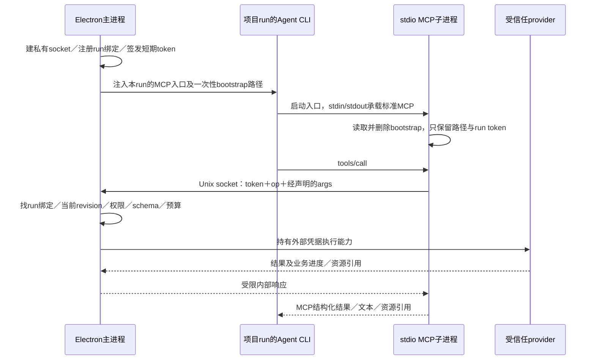

# MCP 到主进程桥接候选 · V2

2026-10-17。依据：[需求 R1.3](../需求.md) M10-R02／R07／R08／R09；补充[技术方案 V1](技术方案.md)及[多应用扩展 V2](多应用适配与Jenkins扩展方案V2.md)。状态：**候选架构＋本机隔离实验，未实现生产桥接，未批准正式业务开发**。

## 1. 整体思路与明确选项

**首版 macOS 候选采用：Agent CLI → stdio MCP 子进程 → App 私有 Unix domain socket → Electron 主进程 broker。** 子进程不访问主进程内存；它只把声明过的能力请求转成受限本机 IPC。主进程持有外部账号密钥、当前项目／连接权限和业务适配器，再把受限结果原路返回。

为每个 run 签发短期 opaque token，由主进程保存 token 摘要到项目／task／run／连接范围的绑定。子进程只取得 socket 路径和该 run token，不取得外部账号密码／API token。每次调用由主进程重新校验当前修订与撤销，作用域不由子进程提交的 projectId 决定。



Unix socket 是 App 内部实现协议，不是新增标准 MCP 传输承诺。Agent CLI 仍只看到标准 stdio MCP。以后增加应用不需要另开 socket 或把凭据注入各个 CLI；provider 继续通过共用 broker 调用。

## 2. 当前能力与新增工作

当前 `CapabilityService.prepare` 已能按 run 生成 MCP 启动配置：Claude 使用 `--mcp-config`，Codex 使用 `mcp_servers.*` 的 command／args，当前入口是 `python3 context_mcp.py context.json`。这证明已有**入口投影机制**，不证明已有主进程业务桥。源码：[capability-service.ts 第232–262行](../../../../src/main/core/capabilities/capability-service.ts)。

新增工作是受限 stdio 业务桥接入口、主进程 socket server、run token／绑定管理、broker 调度与生命周期恢复。可复用既有项目／task／run、MCP配置投影、`SecretsStore` 及权限服务；不能只把主进程 service import 到独立 Python／Node 子进程就当共享实例。现有 context MCP 的边界见[运行时 V1](../调研/Codex公开协议与WillYou运行时验证V1.md)。

本轮 Python 标准库程序模拟主进程，真实启动合成 stdio 子进程并通过 Unix socket 调用。没有使用 Electron main、真实 Codex／Claude CLI 或生产 provider，也没有修改现有 MCP 入口。生产入口如何随 App 打包、Python／其他运行时的依赖及可执行位置必须在打包环境验证，不能因本机有 Python 就宣称无依赖支持。

## 3. 启动、绑定与凭据

### 3.1 run 绑定由主进程持有

以下是新增数据／内存结构候选，不是已存在表或接口。

| 候选内容 | 责任与边界 |
| --- | --- |
| `AppInstance / brokerEpoch` | 每次App启动的随机实例身份；新实例不复用旧进程token；socket路径为短、随机、App自建的私有路径 |
| `RunBinding` | project／task／run／runner、允许的连接与能力、捕获的配置／权限修订、当前撤销、生命周期、过期窗口；由主进程创建，不从模型参数构造 |
| `RunToken` | 加密随机opaque bearer；主进程只存摘要及对应binding；子进程在内存持有原值；不等同外部账号凭据，但仍是需保密的临时能力 |
| `Bootstrap` | 仅协议版本、socket路径、run token；不带账号密钥，也不把项目／权限声明交给子进程作授权依据 |
| `Invocation` | 请求ID、已认证binding、operation、参数摘要、当前修订和结果／未知；不保存原始run token或未清洗正文 |

broker根据token找到binding，再核对对象／connectionId是否在该binding范围内。请求中若有project／task／run等作用域字段，应拒绝或只作为非授权信息；本候选选择**不接受客户端作用域字段**。每个operation仍校验参数schema及当前连接／能力权限；拿到一个合法token不代表能调用任意provider或写操作。

### 3.2 bootstrap 传递候选

为兼容“CLI再启动MCP子进程”，首版候选使用**一次性文件**：

1. 主进程在短路径的App私有目录创建0700目录；用排他创建及0600权限写bootstrap。MCP配置／argv只放固定桥接入口和bootstrap路径，不放token值。
2. 子进程验证文件与父目录类型／owner／权限、大小预算和版本；拒绝symlink，打开后复查文件身份；读取后删除bootstrap，原值只留内存。
3. stdin从第一条消息起只承载标准MCP，stdout只承载MCP，诊断走脱敏stderr；不把bootstrap拼入MCP stdin。run token不继承进全部终端环境或Skill上下文。
4. 子进程意外重启时，已消费文件不可再次读取，应失败并报告需重建该run入口。由App观察生命周期、撤销旧token、签发新token并重建bootstrap／重启对应MCP或CLI；不保留长期可复读文件来偷偷支持重启。

若将来直接由App创建子进程且CLI能明确保留指定FD，可以改用受控匿名pipe／FD传递；这不是当前已证实的CLI能力。本轮实际验证的是一次性文件方式。文件路径仍可能被同UID进程观察；该方式减少值进入argv／配置，不构成强隔离。

实验token为32字节随机数、60秒有效窗，仅是测试参数。正式候选为“短期有效窗＋主进程确认run存续后续期”；续期受当前任务、连接与权限约束，不能由任意子进程heartbeat无限延长。run结束、连接撤销、权限变化或App重启立即撤销／失效；长任务的续期及CLI恢复需专门验收，本轮未实现续期。

## 4. 内部协议、权限与预算

### 4.1 协议外壳

内部协议建议使用有版本、大小预算和request ID的UTF-8 JSON；首版可采用每连接一请求／响应的JSON line，不提供通用批处理或任意网络代理。本轮实验使用如下合成外壳：

```json
{"v":1,"id":"request-id","token":"<run opaque token>","op":"provider.operation","args":{}}
```

`token`只用于主进程查binding；`args`中对象ID／连接引用也须在该binding内校验。未知operation、额外作用域字段、非法schema、过大帧和过期token均在适配器执行前拒绝。响应不回显token，提供有界结构化结果、错误分类及资源引用。资源的后续读取同样重新授权，不能把返回的句柄当永久授权。

标准MCP stdio按逐行UTF-8 JSON-RPC传输，字符串中的换行要由JSON编码转义；stdout不能混入日志。[MCP 2025-06-18 Transports](https://modelcontextprotocol.io/specification/2025-06-18/basic/transports) 内部socket协议是另一个边界，同样要处理分包、半帧、无换行、额外帧、超时和预算；不能直接把“本机可信”当作合法输入。

实验请求预算1024字节、响应预算2048字节，均包含编码后的帧。它们用于验证限制是否被执行，不是生产邮件正文／日志的最终上限。真实大结果应返回受控资源引用并分段读；生产需分别定义握手、工具参数、结果、资源、并发连接及等待时长的预算。

### 4.2 权限校验必须在主进程

1. 查token摘要，核对有效期、run存续及当前App实例。
2. 取服务端绑定的project／task／run及获准connection／capability，禁止客户端切作用域。
3. 重新检查当前连接／项目权限修订、停用／撤销和对象范围；旧任务快照不能覆盖当前撤销。
4. 校验operation的输入schema、效果类别与实际写权限；在外部写调用前再次核对跨异步等待期间是否撤销。
5. 执行provider，保存脱敏结果；输出与资源执行预算、完整性和当前授权校验。

**操作系统“只读沙箱”与MCP业务写权限是两个控制面。** CLI本地文件只读不等于主进程不能发邮件、流转禅道或触发构建；MCP `readOnlyHint`也只是提示。必须依靠broker当前策略决定外部写能力。实验用一个“OS只读”合成标记证明两者不能互代：broker拒绝写时计数不变，broker明确允许时合成内存写可发生；没有测真实OS沙箱或执行真实外部写入。

## 5. 本机端点与生命周期

### 5.1 Unix socket 的适用边界

Node官方 `net` 支持非Windows平台的Unix domain socket，以及Windows named pipe；macOS路径长度通常受103字节限制，崩溃后socket节点可能残留。[Node IPC support](https://nodejs.org/api/net.html#ipc-support) 因而选择短、随机的本地私有目录；不能直接用很长的项目目录作为socket路径。

建议目录0700、socket0600，启动时校验owner／路径／文件类型，不跟随任意路径或symlink。正常退出先撤销token、停止接受新请求、关闭连接／listener，再仅清理由当前App实例拥有的socket及bootstrap。陈旧节点清理需检查实例／owner／文件类型及是否仍被活进程使用，不可盲删一个固定路径；这部分需实现并验证。

**同UID不构成操作系统强隔离。** mode位、随机路径和短期token可以减少误连及其他用户访问面；若同UID恶意进程能读取该run的内存／文件，它可能取得bearer并在其权限内调用。同UID检查或peer credential只能作为附加核对，不能代替能力授权，也不能宣称抵御同账号被控制。实验仅核对权限位和自身子进程，未做跨UID对抗或签名进程证明。

### 5.2 关闭、崩溃和结果未知

| 场景 | 候选处理 | 本轮证据边界 |
| --- | --- | --- |
| task／run结束或CLI退出 | 主进程撤销binding／token；终止桥接子进程或让其EOF退出；保留必要调用记录 | 已测合成子进程stdin EOF正常退出；未接真实task控制器 |
| 权限／连接修订变化 | 下一次请求重查并拒绝旧修订；有界中止尚未执行的读取 | 已测同一运行中子进程的下一请求被拒绝；未测生产在途操作 |
| 过期／撤销 | 不返回业务数据，要求由App重新建立有效run入口 | 已测过期与运行时撤销；未测正式续期 |
| 子进程崩溃或bootstrap已消费 | 失败关闭；由App重新签发和生成配置；不自动复用旧token文件 | 自动重建／CLI重启未实现 |
| App正常退出 | 清空run token、停止listener、关闭客户端、清理私有文件 | 合成owner实际清理并确认目录、socket和线程消失 |
| App崩溃／重启 | 新epoch、新socket、新token；核对陈旧文件；未决调用按业务引用恢复 | 崩溃恢复与残留清理未实验，不能写成通过 |
| socket断开／写调用响应丢失 | 区分未交付与结果未知；关联调用记录并按provider核实，禁止通用重复外部写操作 | 无真实外部写；不证明幂等或自动续跑 |

撤销发生在外部POST已发出后，不能承诺远端自动回滚。停止CLI、取消本地等待和取消外部业务分别处理；Jenkins队列／构建、禅道回写、邮件发送仍沿用各自核实协议。

## 6. 平台与交付依赖

首版macOS候选已经落到明确的socket链路，不将“stdio直接调用main服务”留作实现假设。Windows后续可采用带ACL的named pipe，或另行评审受限loopback HTTP；二者需要独立认证、端点权限、CLI连接和打包验证。本轮不尝试用macOS的AF_UNIX结果证明Windows通过。

若选HTTP，必须另行考虑绑定localhost、Origin／DNS rebinding及认证，不能把Unix socket实验当HTTP安全证明。[MCP HTTP传输要求](https://modelcontextprotocol.io/specification/2025-06-18/basic/transports) 即使使用相同内部消息，端点生命周期和平台控制也不相同。

正式开发前需要实现并验证：实际Electron main监听／broker集成、run生命周期接线、受控bridge入口及运行时打包、真实Codex／Claude配置和完整MCP协商、持续任务续期／重启、并发／背压／取消、资源句柄、当前撤销的在途边界及打包权限。它们是工程验证项，不要求用户先补业务口述；写操作的具体授权规则仍按需求评审。

## 7. 实验结果与复现

实验：[local-broker说明](实验/local-broker/README.md)、[脚本](实验/local-broker/local_broker_probe.py)、[结果](实验/local-broker/report.json)、[执行历史与哈希](实验/local-broker/evidence-manifest.json)。Python标准库的AF_UNIX接口及平台差异见[Python socket文档](https://docs.python.org/3.11/library/socket.html)。

实际环境macOS／Darwin arm64、Python3.11.9。3个真实合成stdio子进程、15次本机socket连接；**15项检查通过，0 TCP、0外部网络、0真实凭据／provider**。使用Python owner替代Electron，不是生产桥接验收。

首次默认沙箱在AF_UNIX `bind` 返回`EPERM`，未执行协议检查；按已授权的本机隔离实验范围，常规提权经自动审查通过后复验成功。失败和复验分别记录，没有把首轮失败删除或写成应用缺陷。

已验证：合法run、错误token、顶层／参数内伪造project、未知operation、换行转义／非法帧、请求与响应预算、当前权限修订、过期／撤销、写权限独立、stdio EOF及正常owner退出清理。未验证：完整MCP一致性、实际Agent模型选工具、Electron／真实CLI、OS强隔离、并发／背压、崩溃恢复、Windows或真实第三方操作。
