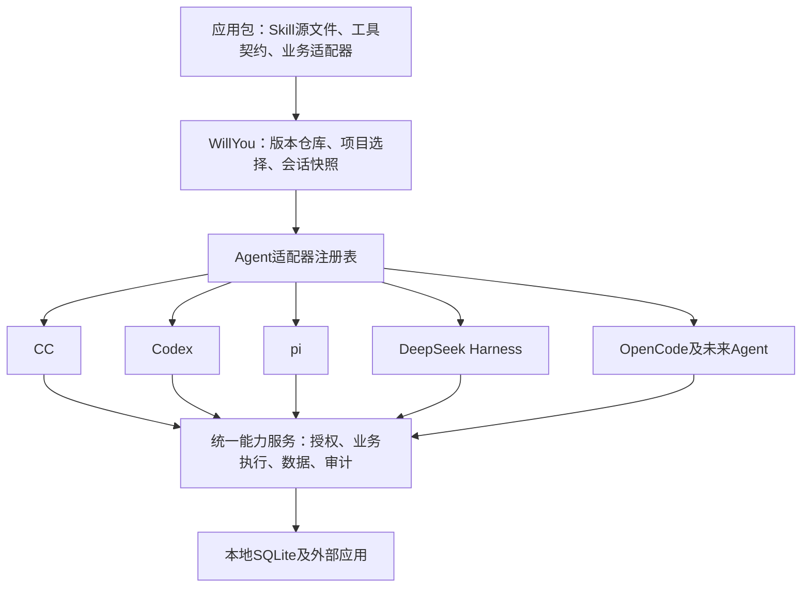

# 多Agent真实路径、会话流程与扩展架构

2026-10-19真实配置补验：[CC／cdsh与Codex报告](实验/runtime-preflight-20261019/README.md)补齐真实原生根、已有能力共存、同名冲突和自有历史恢复证据。生产适配必须实施[详细设计6.9](应用包与Agent运行时详细设计R1.6.md#69-真实用户配置合并与名称冲突预检)的名称预检、完整路径选择与共享目录协调；本机实测不能扩张为全部配置或未来Agent均已支持。

A18协调增量：[需求12.19](../需求.md#1219-a18安装会话使用与清理协调)及[运行时8.3](应用包与Agent运行时详细设计R1.6.md#83-资源登记锁顺序与中断恢复协议)统一全部实际共享目录消费者：H catalog锁→U资源锁→DB短写事务；启动前reservation／资源占用、停止确认后释放，多U不各自删除H路径。身份未知保守保留；等待不强制中断Agent。实现与故障注入待完成。

A16适配要求：[需求12.17](../需求.md#1217-a16有限重试与明确失败不默认重启agent)已确认简单失败处理。[运行时6.7](应用包与Agent运行时详细设计R1.6.md#67-统一重试预算桥恢复与错误回执)要求adapter声明并验证bridgeRecovery、configReload及是否需Agent重启；能独立恢复时按共同预算执行，不能时返回明确能力错误，不默认停启Agent。每个桥实例／探针使用独立新票据和generation，旧token／旧bootstrap不复用；业务写不随重连重放。后续pi／DSH／OpenCode仍须分别验证，首版只按已定CC／Codex范围推进。

A12首版范围已定：[需求12.13](../需求.md#1213-a12首版agent与平台支持范围)确认macOS arm64＋Claude Code／Codex；下文pi／DSH／OpenCode及其他平台路径继续作为扩展设计，首版只验证未支持提示和通用适配接口，不承诺其真实业务接入。两种首版Agent仍须分别从打包应用验证新建、调用、并发、resume及升级／撤销恢复，具体CLI版本记录于支持证据表。

A11入口已确认：[需求12.12](../需求.md#1212-a11首版仅支持willyou内启动与恢复)限定首版由WillYou内部发起／恢复已支持Agent，以下路径及配置均由受管启动流程提供；外部直接运行原生CLI不自动接入。架构仍支持增加Agent适配器，具体首版组合已按需求12.13确认，外部受管入口不在本期交付。

A10适配要求：[需求12.11](../需求.md#1211-a10停用断开移除与恢复)确认撤销应用能力不终止Agent，连接恢复不换旧会话的固定Skill／应用包；各适配器验证原会话下后续调用拒绝／同身份恢复、主动停用不恢复、重加需项目启用及在途结果。保留Skill文本不代表仍有工具权限，执行层按当前授权核对；外部普通CLI不自动接入，入口范围已按需求12.12确认。

A05适配要求：[需求12.4](../需求.md#124-a05应用能力不可用不阻塞agent)规定M10应用健康不阻塞CLI启动。各Agent适配器需分别验证：断网／认证过期时启动、调用错误、同连接恢复后原会话继续、桥异常与原身份重连；不得将“准备失败”转换为整台Agent不可启动。固定版本和能力上限仍保持。

2026-10-19，R1.6补充。用户进一步明确：设计阶段整体考虑CC、Codex、pi、DeepSeek Harness（DSH）、OpenCode及未来更多Agent，应用架构可适配扩展。依据[需求R10-13](../需求.md)，承接[安装与生命周期详细设计](应用包与Agent运行时详细设计R1.6.md)。本文区分**本机已核对机制、WillYou目标路径、待验证接入**，不表示五种Agent均已接通。

同日评审增量：用户已确认[禅道切换规则](../需求.md#122-禅道切换连接与原会话继续)。先停止项目相关运行再换连接，后续可resume原native session；固定Skill／应用包路径保持不变，本次MCP上下文解析当前显式连接并提示变化。适配器需验证原会话恢复和连接变更说明，不能以此宣称五种Agent已支持热切换。详细流程见[运行时设计9.5](应用包与Agent运行时详细设计R1.6.md#95-项目禅道连接切换)。

## 1. 架构先分开两种适配

**应用回答“能做什么”，Agent适配器回答“怎么把这些能力交给这个Agent”。** 禅道应用不应该知道当前跑的是CC还是pi；新增Agent不要求重写禅道查询和邮件业务。



应用适配器处理禅道／邮件的接口和数据；Agent适配器处理发现目录、Skill格式、工具名称、MCP或扩展、CLI/SDK启动、原生会话恢复。MCP是一个可选传输实现：没有原生MCP的Agent可通过其扩展工具API接入同一个能力服务，不能因此另做一套应用业务。

“一份应用包”指**每个应用版本一份受管原件**，多个版本并存；不同Agent引用会话固定版本，必要时生成对应派生文件。升级不覆盖旧原件，清理按默认／历史／运行／依赖引用判断。维护规则统一见[需求11.1](../需求.md#111-应用版本与skill维护规则)，不在各Agent适配器里各写一套保留策略。

## 2. 路径从哪里开始

### 2.1 先区分工作目录、原生历史和能力资源

用户本轮指出“会话目录可能在项目指定路径下”。这里修正前次口头简称：`capabilities/sessions/<taskId>`应称为**WillYou会话能力目录**，不应直接称为会话目录。它只保存WillYou提供给该会话的Skill／插件及版本引用，不是Agent工作的项目目录，也不接管Agent原生聊天历史。

| 目录 | 谁决定位置 | 用途与恢复规则 |
| --- | --- | --- |
| 项目工作目录`cwd` | 用户选择的项目／代码目录，可为指定子目录或worktree | 终端在这里启动、访问代码和执行项目命令；保存实际cwd，resume沿用原值，不切到能力目录 |
| Agent原生状态／历史根`stateRoot` | Agent默认规则和用户显式配置 | 存原生会话、配置等；可能在HOME，也可能被指定到项目下或其他路径；按实际根恢复，不强行移入WillYou |
| WillYou会话能力目录`S` | WillYou的userData下`capabilities/sessions/<taskId>` | 固定版本的受管Skill／plugin和能力快照镜像；与cwd独立 |
| 本次能力运行目录`T` | WillYou的userData下`capabilities/runs/<projectId>/<taskId>/<runId>` | 本次MCP／扩展启动配置；停止后可清理，resume重新生成 |

例如，项目工作目录可以是`/Users/liubu/Documents/ChatGPT/SmartDD`，CC仍从这个目录启动；其`--plugin-dir`可指向`/Users/liubu/Library/Application Support/SmartDD/capabilities/sessions/<taskId>/claude/plugin`。两个路径同时存在，加载额外能力不改变项目cwd。项目自己维护的`.claude/skills`、`.agents/skills`、`.pi/skills`等继续在项目原位置；WillYou应用包提供的是另一组受管能力，按adapter合并与过滤，不搬走用户项目Skill。

本轮代码核对：`src/main/core/tasks/task-service.ts`新建任务使用用户选中目录的`dir.path`作为cwd并持久化，恢复读取`row.cwd`；`native-sessions.ts`独立解析CLAUDE_CONFIG_DIR／CODEX_HOME。设计延续这两个独立字段，另用S/T记录能力资源，不能合成一个含义不明的sessionDir字段。这里的userData是WillYou用户数据位置，也不是`.app`安装包内部。

### 2.2 WillYou管理的能力资源目录

以下以这台Mac的默认用户路径展开；`task-001`、`run-001`、版本和hash是示例。**这是目标目录说明，尚未创建这些M10安装文件。** 真实userData仍由现有配置解析；`SMARTDD_USER_DATA`显式覆盖时所有U下路径随之变化。

```text
/Users/liubu/Library/Application Support/SmartDD/
├── smartdd.db
└── capabilities/
    ├── apps/zentao/1.0.0/<包hash>/
    │   ├── skills/bug-analysis/SKILL.md
    │   ├── skills/bug-analysis/references/...
    │   ├── skills/story-review/SKILL.md
    │   ├── tools/contract-v1.json
    │   └── adapter/index.cjs
    ├── apps/zentao/1.1.0/<另一个包hash>/...
    ├── packages/<独立标准SkillId>/<旧hash>/...
    ├── runtime/<工具桥hash>/mcp-bridge.cjs
    ├── agent-adapters/<agentId>/<adapterVersion>/<adapterHash>/...
    ├── sessions/task-001/
    │   ├── snapshot.json
    │   ├── claude/plugin/skills/<版本化名称>/SKILL.md
    │   ├── pi/skills/<版本化名称>/SKILL.md
    │   ├── opencode/skills/<版本化名称>/SKILL.md
    │   └── dsh/skills/<版本化名称>/SKILL.md
    └── runs/<projectId>/task-001/run-001/
        ├── context.json
        ├── mcp.json                 # CC启动配置
        ├── codex-launch.json        # 脱敏argv配置记录，不是Codex原生配置文件
        ├── pi-bridge.json           # WillYou扩展读取，不是pi原生MCP配置
        ├── opencode.jsonc           # 本次覆盖配置的脱敏镜像
        └── dsh.patch.yml            # 本次DSH启动／作用域绑定
```

每个会话实际只生成所选Agent需要的分支，上图合并展示五种情况。`agent-adapters`是本轮新增的目标资源仓库：插件、扩展和格式转换资源按adapterVersion/hash保留；核心adapter服务随WillYou构建，其ABI兼容仍要检查，不能只留一个旧JS文件就承诺永远可运行。

三个关键区别：

- `apps`保存应用包原件，所有Agent共用；升级只增加版本目录。
- `sessions`保存该会话长期读取的受管能力资源，停止和resume不改路径；不表示项目或原生聊天历史迁入这里。Codex的实际投影路径例外在下表。
- `runs`保存本次启动的工具连接配置；停止后清理，resume生成另一个run目录。这里不保存外部账号明文秘密。

## 3. 五种Agent分别怎么加载

设`C=/Users/liubu/Library/Application Support/SmartDD/capabilities`，`S=C/sessions/<taskId>`为会话能力目录，`T=C/runs/<projectId>/<taskId>/<runId>`为本次能力运行目录。以下缩写只是为了表格可读，不是要设置shell环境变量；五种Agent的cwd均另取用户指定项目路径，原生历史根也单独保存。

| Agent | 它平常发现Skill的位置 | WillYou给应用Skill的目标位置 | 工具连接处理 |
| --- | --- | --- | --- |
| CC | `/Users/liubu/.claude/skills/`、项目`.claude/skills/`、插件skills | `S/claude/plugin/skills/<name>/SKILL.md` | `--plugin-dir S/claude/plugin`；`--mcp-config T/mcp.json`注册本次桥 |
| Codex | `/Users/liubu/.agents/skills/`、项目`.agents/skills/`等；现有发现器另读`.codex/skills`兼容来源 | `/Users/liubu/.agents/skills/<版本化name>/SKILL.md` | 运行参数`skills.config`选择本会话版本；`mcp_servers`运行覆盖连接本次桥，不改全局config.toml |
| pi | `/Users/liubu/.pi/agent/skills/`、`/Users/liubu/.agents/skills/`、项目`.pi/skills/`与`.agents/skills/` | `S/pi/skills/<版本化name>/SKILL.md`，通过`--skill`显式传入 | 本机0.85.1采用WillYou扩展，`-e C/agent-adapters/pi/<版本>/<hash>/bridge.mjs`；扩展读取`T/pi-bridge.json`并把工具注册到pi |
| OpenCode | `/Users/liubu/.config/opencode/skills/`、项目`.opencode/skills/`；还会读Claude及`.agents`兼容目录 | `S/opencode/skills/<版本化name>/SKILL.md`，通过附加Skill路径配置引用 | 生成每个运行的OpenCode配置覆盖，加入相应Skill路径和MCP；通过进程级`OPENCODE_CONFIG_CONTENT`注入，T保留脱敏镜像 |
| DSH | 默认`/Users/liubu/.dsh/skills/`、项目`.dsh/skills/`、`.agents/skills/`和配置的customSkillDirs | `S/dsh/skills/<版本化name>/SKILL.md`，由受管Skill provider引用 | 用`T/dsh.patch.yml`及受管插件／作用域注册`@deepseek-ai/dsh-mcp-client`，保留DSH原生会话身份；不能把项目选择写进全局patch |

CC/Codex的现有依据见主设计与本机help；pi读取了本机已安装0.85.1包的README、skills/resource-loader源码与help。OpenCode本机安装包版本1.18.15，已读help；附加Skill路径、运行覆盖和MCP格式依据[官方配置Schema](https://opencode.ai/config.json)、[配置优先级](https://opencode.ai/docs/config/)和[MCP说明](https://opencode.ai/docs/mcp-servers/)，尚未在该二进制上验证全部配置行为。未来适配不能直接使用不断变化的在线Schema代替版本固定的Schema。

DSH已由用户确认是DeepSeek Harness；本机PATH未找到`dsh`，本轮未安装或运行。默认发现根／customSkillDirs及scope见[官方Skill机制](https://github.com/deepseek-ai/deepseek-harness/blob/master/docs/subsystems/skills.md)，MCP插件见[官方MCP客户端](https://github.com/deepseek-ai/deepseek-harness/blob/master/packages/mcp/mcp-client/README.md)，`--patch`和profile合成见[官方CLI行为](https://github.com/deepseek-ai/deepseek-harness/blob/master/apps/cli/reference/README.md)。表中WillYou目录与接线是待实现设计，不能当成DSH原生已有的配置文件。

### 3.1 新建时统一做什么

1. 取得项目当前启用的应用版本与连接，保存本会话快照。
2. 选择对应Agent适配器，检测实际安装版本，查其经过验证的加载能力；保存适配器版本、生成规则、Skill最终路径及工具名称映射。
3. 从完整应用包生成所选Agent需要的稳定资源，检查相对references/scripts仍可用。
4. 创建run，生成临时连接配置，检查当前授权；通过MCP或扩展把同一能力服务提供给Agent。
5. 创建原生会话，记录准确native identity与历史根；文件已准备、实际发现、正文读取和业务调用分开记证据。

### 3.2 resume时逐Agent做什么

| Agent | Skill恢复 | 工具恢复 | 原生历史 |
| --- | --- | --- | --- |
| CC | 继续传原`S/claude/plugin`，内容不换 | 重新生成T/mcp.json、握手及本次凭证；稳定服务名不换 | 原session ID、原CLAUDE_CONFIG_DIR／默认根；使用原生resume |
| Codex | 原全局版本化目录仍保留；重新传完整逐路径选择清单 | 重新传本次mcp_servers覆盖 | 原session ID、原CODEX_HOME；使用原生resume |
| pi | 重新传原`S/pi/skills/...`和原版扩展资源 | 新run配置、新连接；不沿用失效token | 使用原session file/ID和已记录session目录，不能新建空PI_CODING_AGENT_DIR假装恢复 |
| OpenCode | 继续引用原`S/opencode/skills`；重建对应运行覆盖 | 重新启动本次MCP，其他会话配置独立 | 用确切`--session <id>`，保留原数据根；不使用“最后一个会话”猜目标 |
| DSH | 原provider只提供该快照的路径／版本 | 重新挂载该会话的工具作用域或专属host，重新授权 | 通过选定版本SDK／会话服务恢复确切Session；headless的一次性新任务不算resume |

本机pi提供`--session <path|id>`；OpenCode提供`--session <id>`。DSH headless每次创建新会话，需使用可恢复的SDK／会话服务路线，具体接口和安装版本仍待实验；不编造`dsh --resume`命令。

### 3.3 必须提前解决的目录相互影响

A17已按[需求12.18](../需求.md#1218-a17会话skill版本选择与发现边界)确认；统一契约见[运行时6.8](应用包与Agent运行时详细设计R1.6.md#68-会话skill选择计划与共享发现边界)。包括CC在内，附加会话路径仍须验证其他默认目录的影响；共享目录协调登记全部实际消费者，不只登记Codex。首版验证CC／Codex，以下pi／OpenCode／DSH路线仍为后续适配设计。不能过滤就如实标应用未支持，保留Agent其他工作和用户能力；不默认隔离HOME／原生历史根。

**`.agents/skills`会被多个Agent发现。** Codex写进去的应用Skill可能也被pi、OpenCode和DSH看见。因此不能把“复制成功”当作项目隔离完成，更不能把整个应用版本仓库加入所有Agent的默认搜索路径。

- Codex沿现有逐路径启停路线，冻结受管目录集合；运行中不新增未进入禁用清单的应用目录。其余Agent也要对受管命名空间过滤。
- pi可用`--no-skills`关闭默认发现，再显式传入本会话应用Skill和本应保留的用户Skill；不能只关默认发现却丢掉用户能力。需要处理启动和`/reload`两条路径；SDK路线可通过`skillsOverride`过滤受管版本，不能声称普通CLI `-e`必然拥有同样过滤API。
- OpenCode对受管名称先拒绝、仅放行所选版本，同时保留用户能力；附加路径不自动关闭其他目录。不同Agent角色／配置层的权限合并要验证，最终列表与调用入口都必须一致。
- DSH自带目录发现与更新通知；只设customSkillDirs是“增加目录”，不代表关掉用户`.agents`目录。需在受管provider／Agent scope过滤应用命名空间。初次接入默认一个WillYou task对应一个受管host连接；共享host只有证明scope隔离和恢复正确后才开放。

MCP服务端仍以run所属项目和固定包验证权限；即使模型读到了多余说明，也不能借此获得其他项目的连接。模型可自行使用的文件／shell权限不属于该桥的完全隔离保证。

### 3.4 pi与DSH的特别处理

pi本机0.85.1文档明确无原生MCP，支持通过扩展提供工具。上游当前[文档](https://github.com/earendil-works/pi/blob/main/packages/coding-agent/docs/mcp.md)已经描述原生MCP与`~/.pi/agent/mcp.json`、项目`.pi/mcp.json`。**这两种事实不能混用**：0.85.1候选走受管扩展；以后检测到支持原生MCP的版本，再增加对应adapter策略，仍不把逐会话连接写入全局文件。`--skill`和重复加载入口的官方说明见[Skills](https://github.com/earendil-works/pi/blob/main/packages/coding-agent/docs/skills.md)、[CLI](https://github.com/earendil-works/pi/blob/main/packages/coding-agent/docs/cli.md)。

DSH的home级`~/.dsh/cordis.patch.yml`和profile级`~/.dsh/profiles/<profile>/cordis.patch.yml`会影响相应宿主组合，不能当作每个会话独有配置。WillYou新增的`T/dsh.patch.yml`通过启动overlay传入，scope/provider由受管adapter配置；保留原DSH_HOME和原native Session，不修改用户全局patch。共享宿主中的项目级、Agent预设级和会话级不是同一范围，必须实测。

另有两个直接影响通用架构的限制：DSH的serverName最多32字符，且stdio连接可能先启动协商探针再启动正式服务。因此新会话采用固定的短服务名（主设计已修正），adapter要声明是否有探针、重启与自动重连；不能复用“启动一次就消费唯一bootstrap”的假设。可采用每个连接实例独立握手的启动器，或经验证的本机HTTP桥。具体方案通过探针后固定，不能把当前一次性bootstrap直接接上并声称已兼容DSH。

## 4. 升级后，新旧会话各读哪条路径

假设旧包是`apps/zentao/1.0.0/H1`，新包是`apps/zentao/1.1.0/H2`：

| 情况 | Skill／工具包 | 路径行为 | 数据与权限 |
| --- | --- | --- | --- |
| 旧会话运行中 | H1 | 不原地覆盖；正式切换宿主升级前按既有流程停妥运行 | 当前有效授权 |
| 升级后新建会话B | H2 | 新建`S-B`；Codex选H2对应的版本化目录 | 同一SQLite的当前数据，当前项目选择 |
| 升级后resume会话A | H1 | 继续`S-A`／原Codex目录；生成新的`T-A-run2` | 当前数据、当前凭据；已撤销能力不恢复 |
| 旧任务希望使用新版 | H2 | 新建会话C和新native ID，可携带选定摘要；A保留 | 当前授权 |
| 旧包／旧桥不兼容 | 不自动改成H2 | 原路径和历史保留，明确阻断相关能力 | 不清库，不回退业务数据 |
| 仅升级Agent自身 | H1仍固定 | 检查新CLI与原adapter／生成格式兼容；必要时采用验证过的等价加载方式 | 不能因为CLI升级而自动换应用版本 |

冻结对象包括应用包、生成后的Skill内容、工具名称映射和所需契约。恢复本次run配置可以更新凭证、进程路径和连接信息；不能改旧Skill目录所指向的内容。不要把稳定Skill目录做成指向`latest`的软链接。

Agent适配器本身升级也要兼容历史：保存adapterId/version/hash及projectionFormatVersion；新宿主有兼容读取器且生成内容与原工具名称一致时可恢复；缺兼容实现明确报错。保留旧资源不意味着运行旧Agent二进制，CLI是否仍受支持必须重新检测。

## 5. 新增Agent时只接这一组接口

以下为新设计的内部接口，不是已经存在的SDK。应用包业务不依赖其具体实现。

```typescript
interface AgentAdapter {
  id: string;
  adapterVersion: string;
  detect(executable: string): Promise<AgentRuntimeFacts>;
  describeCapabilities(facts: AgentRuntimeFacts): AgentCapabilityProfile;
  planNewSession(input: NewSessionInput): Promise<AgentLaunchPlan>;
  planResume(input: ResumeInput): Promise<AgentLaunchPlan>;
  validateProjection(input: ProjectionInput): Promise<ProjectionCheck>;
  observeRuntime(run: RunHandle): AsyncIterable<CapabilityEvidence>;
  stop(run: RunHandle): Promise<void>;
  disposeRun(run: RunHandle): Promise<void>;
}
```

| 通用对象 | 必须包含的内容 |
| --- | --- |
| AgentRuntimeFacts | agentId、真实可执行文件／构建版本、OS／架构、支持的CLI/SDK能力、实际历史根；不读取聊天来猜 |
| AgentCapabilityProfile | Skill加载方式（路径／plugin／provider／共享目录）、工具方式（MCP stdio／HTTP／原生扩展）、隔离范围、恢复方式、重载方式、工具名及serverName约束、启动探针和重连行为 |
| AgentLaunchPlan | argv数组或SDK操作、当前run增量环境、稳定文件引用、临时配置、native identity定位方式、原生工具名称映射；秘密仅在主进程处理 |
| Snapshot adapterBinding | adapterId/version/hash、projectionFormatVersion、agentVersionAtCreation、Skill源及投影摘要、nativeToolNames、原历史句柄；M10初期实际runner仍只有CC/Codex |
| CapabilityEvidence | prepared／discovered／read／used，所属run、Agent版本及可复核的脱敏来源；无原生回执时保留unknown |

`agentId`走注册表，不在应用包中到处写`if codex/else claude`。native session句柄由适配器解释，可以是原生ID、文件路径或SDK句柄；通用任务层只负责持久化、身份一致性和生命周期。新Agent不支持某项能力时必须显式声明，不生成伪造配置，也不悄悄把MCP改成越权shell脚本。

Skill正文尽量使用通用业务指令；确需引用原生工具名时，包中用逻辑工具ID，适配器按模板渲染目标名称并记录transformRevision。保持references/scripts的相对路径，禁止运行时用字符串全局替换修改源包。每种Agent的插件代码和工具名字映射放agent-adapters，不复制禅道／邮件业务实现。

## 6. 接入顺序和当前证据

本轮扩大的是**架构考虑范围**，不是宣称未来三种Agent已经完成交付。先落实统一接口与CC/Codex真实验收；pi、DSH、OpenCode沿同一接口分别做适配和验收，再接入产品支持列表。任何后续Agent都执行同一套版本、权限、恢复和升级契约。

新增验收维度并入[既有T72](../验收/测试用例.md)：逐Agent能力声明、同时运行新旧版本、跨发现目录干扰、原生resume、工具握手／重连、升级旧会话、未支持能力降级和用户原配置保留。T50–T71现有场景作为通用语义参考，不能把CC一次通过直接算其他Agent通过。

原架构研究阶段只做本机包／源码读取、CLI help与官方资料核对，未启动模型或安装Agent。pi help曾尝试创建用户settings锁，被sandbox拒绝，命令仍输出help；此结果不算pi启动成功，后续改读安装包文档与源码，没有提升权限重试。OpenCode help成功；DSH无本机CLI验证。资料通过文档检查不代表运行行为通过。

2026-10-19后续[开发前真实机制探针](实验/runtime-preflight-20261019/README.md)已独立运行：CC 2.1.303／cdsh与Codex 0.162.1在受控原生根完成真实模型读取、MCP调用及同ID恢复／两版本并发。Codex的`skills.config.path`实测必须指向完整`SKILL.md`文件；填目录虽不报错却不能禁用另一版本。CC使用空setting-sources的隔离探针未保留合成用户Skill，生产不得照抄此参数或strict MCP去清空用户能力。具体边界见子报告，第一阶段未整体完成，正式产品支持矩阵仍未通过。cdsh是现有Claude Code加DeepSeek模型配置，不能计作DSH接入证据。

后续待实验：OpenCode已安装版本的配置Schema／Skill过滤、pi既有用户Skill保留及扩展重连、DSH的实际安装版本／恢复SDK／每会话scope及stdio探针。若实验揭示限制，改的是Agent适配器路线，应用包、SQLite与项目授权契约继续共用。
