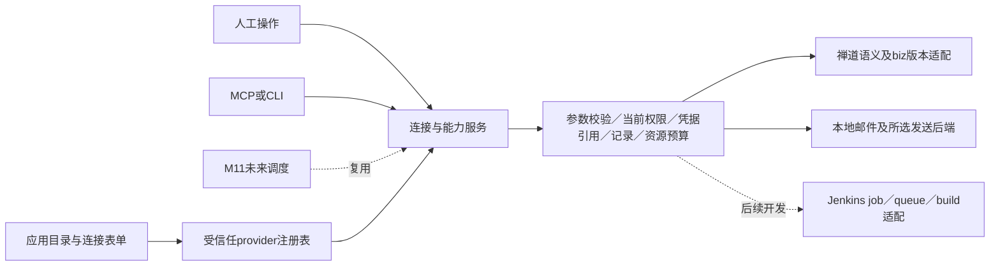

# 多应用适配与 Jenkins 扩展方案 · V2

2026-10-17。依据：[需求 R1.3](../需求.md) M10-R01／R02／R07／R08／R09；背景为[归档技术方案V1](技术方案V1.md)。状态：**公开协议研究＋设计候选＋纯合成实验，供原型和技研评审；未批准正式业务开发**。

本文件只补通用扩展边界和未来 Jenkins 路线，不覆盖 V1，不改变 Bug＋Story／Foxmail／邮件的本期实际接入范围。没有连接真实 Jenkins、读取其配置或凭据、触发／取消 Job，也没有安装 SDK／插件或修改生产及原型代码。

## 1. 整体思路

**框架统一连接、授权、调用和资源协议；每个适配器负责外部业务语义、版本兼容和结果核实。** 加新应用应复用设置→连接→项目选用→工具调用→记录→恢复这一条主线，同时保留应用自己的对象、参数、进度和动作。

沿用 V1 的“WillYou 主进程连接与能力服务＋内置适配器＋标准 MCP／CLI”。新增应用不要求先写 Skill；Skill 可提供选对象、分析和审阅等工作方法，凭据、网络访问、权限及业务调用仍由服务执行。下列命名、注册契约和流程均为**设计候选，并非仓库已有插件 SDK**。

建议区分三个概念：用户看到的“应用／插件”是目录与功能入口；`provider` 是受信任的适配实现；`connection` 是一组具体来源、身份和配置。一个邮件入口可以组合 Foxmail 本地读取 provider 与选定发送 provider，分别显示状态及权限，不能把“本地邮件可读”当作“发信已配置”。



## 2. 共用框架与独立开发职责

“通用”表示承载协议和流程可复用，不表示填一份 JSON 就能接通所有应用。

| 工作 | 框架复用候选 | Jenkins 独立开发职责 | 禅道／邮件对照 |
| --- | --- | --- | --- |
| 目录与注册 | 稳定 ID、版本、能力、表单、文档、许可元信息；受控加载 | 声明支持的 core／Job 类型／插件组合 | 禅道 biz 版本；Foxmail 本地格式和发送后端各自声明 |
| 配置与连接 | 保存、修改、启停、删除、检查、配置修订；多连接呈现 | context path、账号＋API token、Job 范围、代理／证书兼容；检查不得触发构建 | 禅道当前身份及范围；本地来源检查和发送账号分别进行 |
| 认证 | 密钥引用、加密存储、轮换／撤销、脱敏；认证流程宿主 | BASIC 预发送、crumb／会话差异；对目标 SSO／代理单独适配 | 本地文件不走 OAuth；公司禅道或邮件不能虚构 OAuth |
| 工具暴露与权限 | 根据项目绑定生成受限目录；校验 schema、当前修订、effect；协议投影 | 校验具体 Job、参数、权限和操作；不提供任意 URL／脚本工具 | Bug／Story 动作合法性和邮件目标／附件语义由适配器校验 |
| 对象与数据 | 连接＋类型＋外部 ID、分页／完整性外壳、引用与缓存 | folder／Job／queue／build 身份、参数定义、运行结果、日志 cursor | Bug 与 Story 分类型；邮件 native ID 映射独立验证 |
| 调用与进度 | 调用 ID、阶段、时间、取消轮询、超时、脱敏记录 | queue→build 关联、Job 类型差异、构建结果、取消竞态与远端核实 | 禅道回读状态；邮件交接、服务器接受、送达语义不同 |
| 资源 | 不透明句柄、身份绑定、预算、清洗／下载、撤销检查 | 日志／产物定位、游标、版本差异、授权读取 | HTML／内嵌图／附件使用同一资源外壳，内容解析不同 |
| 界面 | 目录、连接表单、项目选用、状态与调用记录骨架 | 若未来纳入，再做 Job 参数／队列／构建的必要业务视图 | 不强迫 Story、邮件和构建用同一详情字段 |
| 恢复与迁移 | 版本钉住、事务／补偿机制、可恢复记录 | provider 配置及保存对象迁移，旧队列／构建核实 | 邮件索引或禅道兼容分支升级各自处理 |
| 验收 | 协议／权限／资源／恢复公共用例模板 | 真实版本、插件、权限、嵌套路径、队列及写操作验收 | 合成实验不能替代任何真实应用验收 |

V1 可复用现有 `CapabilityService.prepare`、`SecretsStore`、项目／任务／run 身份和受控 IPC；新的 provider 注册表、业务 broker、持久化模型及 SDK 尚未实现。现有上下文 MCP 不能直接承担任意外部操作，详见[V1第2、3、6节](技术方案V1.md)。

## 3. Provider 注册与资源契约候选

### 3.1 注册信息和生命周期

建议首先内置、随应用发布经过验证的 provider，暂不开放用户填任意路径加载代码。注册元信息可静态化，但认证和业务适配仍需要受信任实现。

```ts
// 设计示意；非已有 TypeScript 类型或已发布 SDK
type ProviderDefinition = {
  id: string; contractVersion: number; adapterVersion: string;
  configSchemaVersion: number; configSchema: JsonSchema;
  authKinds: AuthKind[]; // 按实际后端支持声明，不统一要求OAuth
  compatibility: { server?: VersionRule; plugins?: PluginRule[] };
  capabilities: CapabilityDefinition[];
  resourceKinds: ResourceKindDefinition[];
  documentation: string[]; licenseMetadata: LicenseMetadata;
};
type CapabilityDefinition = {
  id: string; inputSchema: JsonSchema; outputSchema: JsonSchema;
  effect: 'read' | 'local-write' | 'external-write';
  requiredConnectionRoles: string[];
  recovery: { readsRetryable: boolean; reconcileProtocol?: string };
};
```

框架依据注册表调用 `validateConfig/check/listCapabilities/invoke/readResource/disconnect`；需长期业务跟踪时，适配器再实现 `reconcile` 与明确的远端取消操作。`disconnect` 是本地连接生命周期，不能默认等于撤销远端 token、删除数据或终止远端任务。通用“停止等待”只取消本地请求／轮询；远端取消必须调用独立声明和授权的能力。

完整 JSON Schema 校验、大小／深度限制和输出清洗应在主进程执行；MCP 的只读提示只由能力的真实 effect 投影。Agent 传入 `readOnly=true`、旧任务的权限快照或工具名称不能提高权限。保存配置、检查连接和列出能力也不能隐含触发业务写操作。

### 3.2 返回值与外部资源

建议返回统一外壳，内部保留业务类型，避免把所有应用的结果压成一个“成功”布尔值。

| 候选字段 | 含义与规则 |
| --- | --- |
| `invocationId / phase` | 本地调用身份；候选阶段 accepted／running／completed／failed／cancelled／unknown。调用阶段与持续业务跟踪分开存放；工具调用已返回时，关联操作仍可queued。completed只表示对应过程结束，不把Jenkins结果转换成SUCCESS |
| `summary / structuredData` | 有预算的文本与经过 output schema 校验的数据；外部文本作为数据处理，不成为权限或指令 |
| `objectRefs[]` | connection＋provider＋真实类型＋外部 ID／修订；Job 与 build、Bug 与 Story、邮件均不串用 |
| `providerProgress` | 带 namespace、schemaVersion 的业务扩展，例如 Jenkins queued／building／result；框架只校验外壳与对应 schema，不解释所有业务状态 |
| `resources[]` | 不透明 resourceId、种类／MIME、来源对象、字节数或未知、完整性、抓取时间／修订、敏感级别、可选 cursor；不直接让 Agent 任意 fetch URL／本地路径 |
| `completeness / warnings` | 完整／部分／缺失范围；列表、日志或附件截断必须显式返回 |
| `error / reconcileRef` | 标准分类＋适配器细节及可核实引用；未知结果不能写成“远端没有执行” |

`readResource` 必须重新核对当前项目／任务、连接、资源归属、启停及权限修订，执行字节／时间预算。Jenkins 日志、邮件 HTML、附件和构建产物都经过该入口。原始下载 URL 可以保存在适配器私有定位信息中，返回后仍校验 origin／context／对象范围，不能成为通用网络代理。HTML、ANSI、文件名与远程图片另做展示处理；资源加载失败或刷新界面不重新触发外部写操作。

## 4. Jenkins 官方证实与版本边界

本轮只浏览官方手册、官方 core 源码、Javadoc 及其日志基础库。没有目标 Jenkins 地址／版本／插件清单；当前 Javadoc 标为 **core 2.586**，`master` 源码为访问时版本，并非用户目标，也不是所有旧版兼容承诺。Javadoc 中 StaplerRequest2 方法的 “Since 2.475” 是 Java 方法重载变更，不能直接推成 HTTP `consoleText` 等端点从该版本才存在。

| 已证实的官方事实 | 对设计的影响 | 来源 |
| --- | --- | --- |
| Remote API 位于对象自己的 `.../api/`；支持 JSON，深度会改变返回范围；`X-Jenkins` 可提供 core 版本 | 按对象读取并限制结果；后续以目标实例 `/api/` 和响应验证字段及版本，缺版本头不能自行补版本 | [Remote Access API](https://www.jenkins.io/doc/book/using/remote-access-api/) |
| 脚本客户端可用 username＋API token 的 HTTP BASIC；Jenkins 可能直接返回403而不是先401 | token 按账号保存在凭据服务；受限请求首次就带认证；403需区分认证、权限、CSRF与代理，不能只写“密码错” | [Authenticating scripted clients](https://www.jenkins.io/doc/book/system-administration/authenticating-scripted-clients/) |
| 从 **2.96** 起，API-token 认证请求免 crumb | 不为该模式机械地先索取 crumb；低于2.96或插件／代理特殊认证留兼容验证 | [2.96 changelog](https://www.jenkins.io/changelog/2.96/) |
| **LTS 2.176.2／weekly 2.186** 起默认 crumb 与 web session 绑定；密码类脚本要保留会话 | 如确需密码认证，获取 `/crumbIssuer/api` 后带动态 crumb 字段名和相同 cookie；不能只缓存一个 crumb 字符串 | [2.176 upgrade guide](https://www.jenkins.io/doc/upgrade-guide/2.176/) |
| 当前 CSRF 页适用2.222及之后；crumb issuer可由插件替换；默认issuer的客户端IP选项在2.543移除 | 不能硬编码 `Jenkins-Crumb`、算法或IP策略；优先token；不通过关闭CSRF来接入 | [CSRF protection](https://www.jenkins.io/doc/book/security/csrf-protection/) |
| 普通 Job `/build`，参数化 Job `/buildWithParameters`；Multibranch／Organization Folder 的触发可能是扫描 | provider 必须识别 item 类型；“扫描”和“执行某个分支的构建”是不同能力 | [Remote Access API](https://www.jenkins.io/doc/book/using/remote-access-api/) |
| 当前参数化源码可201指向新队列，也可303指向复用队列；普通 `/build` 的201亦不保证新建队列 | 保存状态码与受限 Location，不把201／303或同参数队列合并当 exactly-once | [ParametersDefinitionProperty.buildWithParameters](https://github.com/jenkinsci/jenkins/blob/master/core/src/main/java/hudson/model/ParametersDefinitionProperty.java)、[ParameterizedJobMixIn.doBuild](https://github.com/jenkinsci/jenkins/blob/master/core/src/main/java/jenkins/model/ParameterizedJobMixIn.java) |
| Queue LeftItem 能表示已取消或产生 executable；Run 导出 `queueId`，result 可为空或尚未最终 | queue→build 关联优先 executable；构建终态结合 building 与 result；不能用 `lastBuild` 猜测本次构建 | [Queue.LeftItem](https://javadoc.jenkins.io/hudson/model/Queue.LeftItem.html)、[Run](https://javadoc.jenkins.io/hudson/model/Run.html) |
| 取消指定 queue item 是 POST，有读权限／取消权限检查；当前源码可返回204、404、422或500 | queue取消需精确ID和回读；404可能是权限不可见或竞态，不能当取消完成 | [Queue.doCancelItem](https://github.com/jenkinsci/jenkins/blob/master/core/src/main/java/hudson/model/Queue.java) |
| Pipeline `/stop` 是异步终止；`/term`、`/kill` 更强，不能保证请求返回就已停止 | 独立权限及回读；不通用升级到强制终止；不同Job类型接口另核对 | [Aborting a build](https://www.jenkins.io/doc/book/using/aborting-a-build/) |

### 4.1 认证、权限和凭据

**建议后续优先 username＋API token，首期不假定 Jenkins 原生 OAuth。** BASIC 需要 HTTPS 或另行确认的受信任传输；token 不进 URL、查询串、argv、工具 schema、聊天或日志。重定向默认不自动携带凭据，需校验同源、context path和允许对象后由适配器处理。Jenkins 的“远程构建触发 token”与用户 API token 是不同机制，不混用。

OAuth 宿主能力可以共用，但 authorization endpoint、PKCE／回调、scope、refresh／revoke 和账号识别需由具体 provider 声明和实现；未支持则不显示 OAuth 入口。Jenkins若经公司 SSO／反向代理或特殊插件认证，需要目标环境单独验证，不能拿浏览器会话成功代替脚本 API 成功。

权限建议从 Overall/Read＋限定范围的 Job/Read 开始；触发另需 Job/Build，取消／终止另需 Job/Cancel。Job/Workspace、Configure、Create、Delete、Run/Update、Credentials 管理和管理员权限不因集成而默认加入。404可由不可发现对象产生；`scope` 是 WillYou 的项目范围限制，不能替代 Jenkins 服务端 ACL。[官方权限说明](https://www.jenkins.io/doc/book/security/access-control/permissions/)

WillYou 持有的是“访问 Jenkins 的客户端凭据”；Jenkins 内部供 Pipeline 使用的 credentials／credential ID 是另一套对象，已有全局／项目／用户作用范围，不应为集成导出或自动管理它们。[Using credentials](https://www.jenkins.io/doc/book/using/using-credentials/) 同时，调用者有 Job/Build 不代表构建内代码仅具有调用者权限；官方升级指南指出默认构建身份可为 SYSTEM，实际运行身份需由 Jenkins 管理端核对。[构建身份说明](https://www.jenkins.io/doc/upgrade-guide/2.176/)

### 4.2 候选接口、参数与范围

以下只用于未来开发拆分；不是 M10 已注册工具，也没有在真实实例验证。`J` 表示经过授权、校验后的**具体 Job URL**，`B` 表示它的具体构建 URL；所有路径保留服务的 context path。

| 候选能力 | 方法／路径 | 最小输入、返回与边界 |
| --- | --- | --- |
| 读取目录／Job／参数定义 | GET `<允许的folder或J>/api/json` | 仅遍历获准范围；请求需要字段，字段及参数定义随类型／插件变化；不无限 depth |
| 触发普通构建 | POST `J/build` | 仅确认可构建的叶子Job；quiet period／delay另核对；保存受限队列Location |
| 参数化触发 | POST `J/buildWithParameters` | 使用声明参数schema；字符串按表单编码；choice／boolean／file／credential参数需逐类型验证，不接受任意字段、文件路径或脚本 |
| 跟踪队列 | GET `<base>/queue/item/{id}/api/json` | 保存queue ID／Job身份；读取cancelled／executable及有限状态，why／params需清洗和预算 |
| 查询构建 | GET `B/api/json` | 保存构建number／queueId／Job引用；building与result分别表达；按目标实例schema验证 |
| 增量日志 | GET `B/logText/progressiveText?start=...` | 使用服务返回的cursor／offset；限制读取和输出，不自行用清洗后字符数计算下一偏移 |
| 产物 | GET 构建API列出的受限artifact定位 | 先保存资源引用；下载路径／权限／大小单独控制，不默认取workspace |
| 取消队列项 | POST `<base>/queue/cancelItem?id={id}` | 独立外部写能力，核对item所属Job，回读取消或已生成构建；版本兼容需真实验证 |
| 停止运行中Pipeline | POST `B/stop` | 独立外部写能力；回读最终状态；不自动调用term／kill，其他Job类型另核对 |

参数化、文件参数及 folder 的依据见[官方 Remote API](https://www.jenkins.io/doc/book/using/remote-access-api/)；取消路由由[官方 Queue 源码](https://github.com/jenkinsci/jenkins/blob/master/core/src/main/java/hudson/model/Queue.java)的 Web 方法对应，目标版本仍待验证。参数定义查询是设计候选，不能承诺所有动态参数插件都能从 JSON 取得完整选项及校验规则。

**嵌套路径规则候选：**从已识别的原始 item-name 分段构造每层 `/job/{encodedSegment}/`，而非把 `folder/job` 作为一个名字编码；如 `Team A → service+api → main` 映射为 `job/Team%20A/job/service%2Bapi/job/main/`。官方样例也使用重复的 `/job/` 层级。[官方 folder 示例](https://www.jenkins.io/doc/book/using/remote-access-api/)

允许范围按规范化后的身份分段比较，`Team`不能匹配`Team-other`。禁止把显示名、已编码URL和原始分段混传；context、origin、路径边界、反斜杠／点段／二次编码及重定向都须受控。Multibranch 的分支名可与路径／展示名规则不同，斜杠分支名及插件内部编码需读取目标实例的规范对象引用并验证；实验故意拒绝此类复杂输入，不声称已覆盖。服务返回绝对 URL 也不能直接信任为新请求目标。

### 4.3 queue→build、取消与未知结果

**触发被接收不等于构建开始，构建开始不等于成功。** 建议用独立持续操作记录保留 queue、build 和业务进度；工具可先返回 accepted 和跟踪引用，再由读取能力查询，避免一个 MCP 调用无限等待。

| 观察／事件 | 候选记录与后续处理 | 禁止推断 |
| --- | --- | --- |
| 有受限201／303 Location | 原子保存调用intent、Job、queue ID及时间；查询该队列 | 保证新建、恰好一次、构建完成 |
| Queue存在但无executable | accepted＋Jenkins queued；有界轮询，可停止等待 | 队列等待是调用失败 |
| 发现executable | 校验其Job范围，保存build number／URL；读取具体构建 | 用当前lastBuild替代明确关联 |
| Queue cancelled | 记录该queue取消；明确与已运行build的状态区分 | 所有同Job构建均被停止 |
| queue消失／403／404／重启后不可查 | 用已知Job及时间窗口做有界、获准的queueId回查；无唯一证据则unknown | 没执行、已取消、可以重触发 |
| 请求或轮询超时 | 记录unknown及现有queue/build引用；允许恢复核实，不重复写 | 超时意味着远端回滚 |
| 取消请求返回 | 记录cancel-requested；回读queue或已启动build；取消竞态可能转成需明确停止运行 | HTTP完成等于业务已取消 |
| building为false且有最终result | 保留原Jenkins结果；展示SUCCESS／UNSTABLE／FAILURE／ABORTED等实际值 | 仅result非空就终态；把所有非SUCCESS都解释为网络错误 |

`Run.queueId` 可提供关联回查依据，但目标版本、保留窗口、权限、并发触发、队列合并、Job重命名／移动、删除历史都需验证；无法唯一关联时保留未知。读取可有界退避；**外部写操作不通用自动重触发**，包含网络中断、5xx、201响应丢失和应用重启。本地intent去重只能抑制本机重复提交，不构成远端幂等。若未来Job约定业务幂等参数，需要该Job自己的实现及测试，不能通过额外传一个requestId就宣称有效。

### 4.4 日志、资源和错误恢复

Jenkins Run提供原始 `consoleText` 和渐进日志入口；`AnnotatedLargeText` 有纯文本输出，基础库当前默认渐进协议使用 `start`、`X-Text-Size` 和 `X-More-Data`，日志轮转还会影响偏移。采用返回游标并绑定具体build；不把日志字数当字节offset。[Run API](https://javadoc.jenkins.io/hudson/model/Run.html)、[AnnotatedLargeText](https://javadoc.jenkins.io/hudson/console/AnnotatedLargeText.html)、[Stapler LargeText 源码](https://github.com/stapler/stapler/blob/master/core/src/main/java/org/kohsuke/stapler/framework/io/LargeText.java)

上述是当前默认实现证据，外置日志存储及插件可能改变行为，未验证前不承诺统一日志cursor。框架负责分页／预算／截断标记和受控资源读取；Jenkins适配器负责实际游标解释和恢复。日志可能含业务数据、参数或敏感内容，采用按需读取、必要脱敏及访问记录；不能假定服务端掩码覆盖所有内容。客户端断开或读取失败只停止读取，不取消构建。

认证／授权／crumb／Job不可构建／参数无效／队列拒绝／远端业务失败／资源失效／结果未知分别记录。HTTP错误分类不能只看单个状态码；反向代理的登录HTML、外域Location或协议不符应作为连接／协议错误处理，不以“200”判业务成功。

## 5. 版本、数据迁移和许可

建议分开保存四组版本：WillYou provider contract版本、适配器实现版本、连接配置schema版本、外部core／插件兼容信息。前两项随受信任发布固定；后两项决定配置能否加载和哪些能力可用。Jenkins插件安装／升级属于服务端管理，不由WillYou为普通连接自动执行；Jenkins本身支持独立插件生命周期及依赖关系。[Managing Plugins](https://www.jenkins.io/doc/book/managing/plugins/)

| 数据对象候选，非最终DDL | 新应用／升级时的处理 |
| --- | --- |
| Provider／Capability定义 | 校验稳定ID、contract版本、schema、effect；声明变更不能悄悄把读变写；历史operation ID保持可解释 |
| Connection配置 | provider自行给出显式迁移；迁移前快照、事务提交、失败回滚；密钥只保留secretRef，必要轮换另执行 |
| 项目绑定 | 新增能力默认未授权；停用／撤销实时生效；旧任务版本固定不恢复已撤销权限 |
| 外部对象／调用记录 | 保存来源类型与schema版本；保留旧queue/build关联，不因升级创建新写操作；无法迁移的只读展示并标限制 |
| 资源／本地索引 | 缓存可重建但不能删除唯一原始邮箱；迁移区分缓存与用户数据；版本不兼容时停止读取并报告 |
| M8项目包 | 不静默扩展已验收v1；是否携带连接及新包版本仍由业务评审决定，沿用V1边界 |

允许的OAuth流程宿主可共享；scope与refresh／revoke兼容、API token轮换、Foxmail来源授权和SMTP密码是不同生命周期。密钥不能由迁移器带入普通JSON。未知更高配置版本应明确拒绝或只读保留，不能按旧schema盲读。外部权限／插件变化在连接检查及调用时重新发现，不因本地配置已迁移就认为远端兼容。

**许可建议：先走公开 HTTP 协议和现有运行时能力，暂不引入 Jenkins SDK。** Jenkins core 的官方许可证为 MIT，保留相应声明；它不意味着所有插件、依赖或客户端库同一许可证。[官方 LICENSE](https://github.com/jenkinsci/jenkins/blob/master/LICENSE.txt) 具体复用源码／安装 SDK／附带资源前，按固定版本核对许可证、第三方声明、分发及升级成本；只调用API与复制实现应分别记录。本轮仅阅读公开源码，没有复制其实现或新增第三方依赖。

## 6. 添加新应用的可执行步骤候选

1. **定义范围与对象。** 先确定读取／写入动作、目标版本、真实身份和授权范围；列出业务结果与失败／未知状态，不从应用名称直接推接口。
2. **注册 provider。** 提交受信任实现和元信息，声明config／input／output／progress schema、认证类型、版本兼容、资源种类、effect和恢复协议；没有实现的元信息不能显示为“可接入”。
3. **实现适配。** 完成配置检查、身份／对象读取、分页、动作参数、结果核实与受控资源；自测回放或合成数据，随后用获准真实环境验证。共用broker不会生成这些业务语义。
4. **复用入口。** 应用目录、连接管理、项目选用、MCP／CLI投影及记录使用共用流程；复杂参数／对象选择只添加必要的内置UI扩展，扩展不绕过broker。Skill按需附带方法，不是接通前置条件。
5. **处理持久化与升级。** 连接及能力修订、旧任务恢复、停用／删除、配置／资源迁移、凭据轮换和兼容策略一起设计；固定依赖／来源及许可。
6. **形成验收并评审。** 公共协议／权限用例＋本应用真实用例，覆盖并发、超时未知、撤销、断点恢复、插件版本与打包平台。评审授权后才正式交付；研究候选不提前出现在本期可连接应用中。

未来Jenkins的独立开发仍至少需要认证／目标版本、Job发现与类型、参数化、路径及范围、queue→build、日志／资源、取消／恢复、真实验收等工作。复用框架后能少做管理与运行时基础设施，不能免除这些业务工作；是否按“只读→触发→取消／更多动作”分期是后续范围决定。

## 7. 实验、证据与未决

纯合成实验位于[provider-contract](实验/provider-contract/README.md)，Python标准库执行，**14项通过、0次网络请求、没有生产适配器**。[注册候选JSON](实验/provider-contract/registry-candidate.json)展示禅道／邮件／Jenkins共享元信息；[结果JSON](实验/provider-contract/report.json)记录实际范围与脚本哈希。

| 类别 | 本轮结论 | 不能替代的后续工作 |
| --- | --- | --- |
| 确证 | 官方认证／crumb版本差异、触发端点、当前队列／构建关联、权限及异步停止有来源 | 目标Jenkins的部署／插件／权限与真实响应未验证 |
| 建议 | 保留通用broker＋各provider业务适配；统一资源及进度外壳，外部写超时先核实 | 注册契约、DDL、迁移、UI及MCP业务工具均待正式设计／实现 |
| 合成实测 | 三provider注册、严格参数子集、effect执行、当前撤销、邮件读发分离、路径／范围、Location、进度／未知、迁移、资源预算 | 不证明真实Jenkins／禅道／邮件已接通；schema实验只覆盖object／string／required／额外字段／enum子集 |
| 技术待验证 | Jenkins core／插件及Job类型；分支斜杠路径；动态／文件／敏感参数；日志插件／cursor；队列消失恢复；远端取消竞态；代理及打包环境 | 后续明确目标环境后做先只读、再按已授权动作的真实验证 |
| 业务待决 | Jenkins后续范围／里程碑、允许的Job／参数／触发者、写操作审阅规则、日志／产物保留、平台 | 本轮先不要求用户逐项决定，也不把它们塞进M10实际接入 |

Jenkins研究解决的是通用框架能否容纳未来应用、哪些职责仍需独立开发。M10当前范围、原型和主方案由阶段维护者整合，本文件不自行改变其确认状态。
