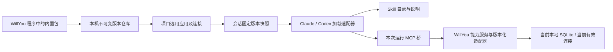

# M10 应用包、Skill、MCP 安装与会话生命周期详细设计

**2026-10-21 T63-APP-Y：** 同批X包的5类快照故障真实App历史／恢复拒绝／诊断全部补齐；原字节、身份及引用保留，无新运行／业务调用／发送授权，最终自有进程与租约已核对清理。生产输入未变，沿用X批225相关软件项，不重复累加。**T63整条通过，完整2/72（T42、T63）；M10开发中、目标active、未发布，其余70条继续。** [接续说明](../技研/T63真实App故障验收接续_20261021.md)、[证据](../验收/证据/m10-t63-app-y-20261021.json)。

**2026-10-21 SNAPSHOT-CASES-X：** T63新增未知格式独立分类、固定安全错误及跨项目提前核对；10文件225相关软件项（新增10在内）和类型通过，新X包原生／编译／资源／封签通过。真实App已创建4个正常原生任务，两次在停止前失焦让出，尚未注入快照故障。**T63保持部分执行，完整仍1/72仅T42，开发中、目标active、未发布；需接续同批实际故障页面，不缩减门槛。** [检查点](T63快照解析与恢复边界检查点_20261021.md)、[证据](../验收/证据/m10-snapshot-cases-x-20261021.json)。

**2026-10-21 CAPACITY-APP-W：** 容量降级新增独立持久回执与只读原生归属诊断，原准备不改写；修复停用后示例插入入口。相关软件去重11文件211项（新增9在内）及类型通过，最终W2包原生／编译／资源／封签通过。真实App＋实际Codex的容量故障8个局部检查点、旧占用自动启动恢复1项通过，私有合成模型、无业务调用／发信。**完整仍1/72仅T42，开发中、目标active、未发布，完整目标继续。** [检查点](容量降级诊断与真实App验证检查点_20261021.md)、[证据](../验收/证据/m10-capacity-app-w-20261021.json)。

**2026-10-21 LAUNCH-BUDGET-V：** 已接启动前容量预检／撤去应用注入及原固定Skill恢复修复；10文件180相关软件项（新增13在内）与类型通过。新V包原生／341编译／65资源／封签通过，真实App＋实际Codex0.162.1＋私有合成模型完成8个局部检查点，新增恢复后真实MCP读回同草稿通过。**完整仍1/72仅T42，开发中、目标active、未发布；容量故障GUI、内层exec／序列化／fork恢复与全范围继续。** [检查点](启动容量与原生恢复检查点_20261021.md)、[证据](../验收/证据/m10-launch-budget-v-20261021.json)。

A19前置实验增量（2026-10-19）：[真实机制报告](实验/runtime-preflight-20261019/README.md)记录CC 2.1.303／cdsh与Codex 0.162.1的真实Skill／MCP调用、原生同ID恢复和两版本并发，以及历史打包Electron的CJS桥启动。隔离根／合成数据只证明各子场景，用户能力合并等边界仍待闭合，第一阶段未整体完成；正式业务开发与打包验收尚未执行。[需求12.20](../需求.md#1220-a19开发前机制验证与开发后打包验收)的两阶段顺序不变。

A18协调已确认：[需求12.19](../需求.md#1219-a18安装会话使用与清理协调)确定完整准备后启用、引用与占用保护、清理复查及中断恢复。8.3补权威资源／依赖／占用、H→U→DB锁顺序、写事务、同卷回收及状态恢复；已修正8.2“读事务写引用”。这是实现契约，真实并发／中断尚未验证。

A17选择边界已确认：[需求12.18](../需求.md#1218-a17会话skill版本选择与发现边界)采用中央不可变版本＋会话明确选版，6.8补选择计划、共享目录消费者、真实发现证据和用户能力保留。不能可靠过滤的组合只隔离应用能力；实际适配仍待验证，事务／锁由A18承接。

A16失败处理增量：[需求12.17](../需求.md#1217-a16有限重试与明确失败不默认重启agent)确认临时故障有限重试、明确认证／配置错误直接提示、外部写unknown不重放。6.7补统一预算、错误分类与桥实例恢复契约；普通失败不默认重启Agent／resume，真实CLI的桥恢复能力仍待探针。

A15连接兼容增量：[需求12.16](../需求.md#1216-a15固定能力版本与当前连接配置兼容)确认原包版本固定、连接统一维护，旧工具通过受控兼容视图读取当前配置；同身份认证使用当前秘密。4.1/4.2和5.8补manifest配置契约、修订、身份识别、预检／提交及错误恢复，T28/T58/T59/T71待实现／执行。

A14增量：[需求12.15](../需求.md#1215-a14agent为主的邮件入口与共用执行服务)确认Agent为主的邮件入口，P06/P07收窄为配置状态、草稿及结果查看；共用后台不要求完整邮件客户端。7.2补人工／Agent／索引三类上下文，7.1接口相应使用通用ExecutionContext；真实实现与验证待完成。

A07发件契约：[需求12.7](../需求.md#127-a07本地读取smtp直发与发送记录)采用SMTP直发。连接配置以`plain/starttls/implicit-tls`显式枚举保存连接方式，服务地址／端口、认证方式、秘密引用分别校验，不凭端口推定模式、不静默降级；实际可用组合逐项验证。发件与读取连接独立，传输凭据不进入Skill或发件记录。发送服务在执行前保存intent及不可变内容修订，结果持久化为服务器接受／明确失败／unknown；记录目标、正文、附件信息／摘要、时间与脱敏回执，附件文件按需求12.10作为持久业务副本保留，自动容量控制按需求12.10。发送记录归WillYou，不回写Foxmail数据库或同步已发送副本。连接测试不发送业务邮件，多收件人部分接受需保留逐目标结果，不把未接受目标计作全成功。

A07功能增量：[需求12.6](../需求.md#126-a07邮件首版功能范围)确认读／总结、撰写、新邮件发送、回复／回复全部及普通附件。邮件操作输入需区分compose/reply/reply-all，保留原邮件稳定引用、实际收件人和附件引用／内容摘要；按5.4绑定具体执行意图。接收正文与附件沿用有界资源接口，不授予任意目录读取；文件变更后原授权摘要失效。发送通道已按需求12.7采用SMTP，首版不做Foxmail已发送同步；大小／类型上限和回复头继续技研验证，不能从可生成草稿推断可发送。

A05优先规则：[需求12.4](../需求.md#124-a05应用能力不可用不阻塞agent)确认应用故障不阻塞Agent。本稿包校验、桥协议和权限不通过时的“拒绝／阻断”仅作用于相关应用能力，不把M10应用准备作为CLI启动成功的前提；会话身份／原生历史／runner自身配置仍须有效。应用选用、固定身份与健康状态分离，健康恢复不换包、不扩大权限。

A04范围增量：[需求12.3](../需求.md#123-a04本人指派范围与邮件按天查询)收紧禅道读取为当前连接账号本人指派的Bug／Story及详情，执行层须同时约束列表、详情直查、缓存／引用读取；Skill只负责范围内匹配，不承担范围强制。禅道暂时不设产品白名单。邮件应用持久化`queryDays`，默认30、整数1–100；任务显式天数同样校验，后台不以空结果扩大范围。按需求12.3统一自然日／时区口径，本次查询固定起止时间和配置修订，返回实际范围及完整性；配置保存只影响后续查询，已有明确保存的合法配置保留原值（包括7），缺字段时使用30，不因上限提高改成100且不修改固定应用包。真实邮件日期字段映射需验证，日期缺失不能计作完整检索。相关T09/T10/T14已补设计用例，未执行。

同日扩展补记：依据新增R10-13，五种Agent的路径矩阵及注册式适配架构见[多Agent路径与扩展架构](多Agent路径与扩展架构说明R1.6.md)。用户已确认DSH为DeepSeek Harness；本机pi/OpenCode包已核对。通用层保留应用包与权限契约，Agent加载细节移入适配器；新增资源路径、短MCP名称及适配版本记录见下文。

日期：2026-10-19。依据：[需求 R1.6／R10](../需求.md)。状态：**开发设计稿；包含明确的目标契约，尚未生产实现，真实 Agent 兼容探针待执行**。本稿承接[技术方案](技术方案.md)，不代替整个 M10 的业务评审与开发授权。

用户本轮要求补齐旧版本与路径保留、工具及数据兼容、无快照历史会话处理，并明确安装位置和使用、升级全过程。本文中的“目标”“新增”“拟定”均表示待实现的设计；“现有”仅指本轮核对过的仓库代码。禅道写操作、发件授权、正文缓存等业务未决项仍按需求文档处理。

## 1. 整体设计

**每个应用版本在本机版本仓库保存一份原件，项目选择应用和连接，会话固定选中的包版本，每次运行重新建立工具连接。** 多个版本可并存；Skill、工具描述、适配器、模板和资源按应用包整体选择，不能只固定 Skill 文本而把实际执行切换到另一版适配器。Agent派生文件允许复制，不承诺全磁盘只有一份物理文件。

四个生命周期必须分开：

| 对象 | 身份与范围 | 改变时机 |
| --- | --- | --- |
| 应用包 | 全局安装，`appId + version + packageHash` | WillYou 程序升级带入新包；旧目录不可原地覆盖 |
| 项目选用 | `projectId + appId`，包含显式选择的连接及绑定修订 | 决定新会话初始能力；禅道按需求12.2先停止相关运行再切换，旧会话后续运行可采用新绑定 |
| 会话能力快照 | 稳定 `taskId`，对应一个原生 Agent 会话 | 首次启动固定；resume 不重选新版，不随项目新增能力扩权 |
| 一次运行 | 每次启动生成 `runId` | resume 生成新 run；重新校验授权、生成临时配置和短期凭证 |



快照保留的是能力及执行契约，不是数据库时间点。历史会话恢复后读取当前数据；被撤销的权限不会恢复，过期凭据不会复活。新版本的使用入口创建新会话，可带入用户选择的任务摘要，保留原会话。

本期只随宿主程序交付可信内置包。独立在线安装、任意第三方执行代码、市场和运行中热更新不属于本期。Claude Code、Codex 是现有生产适配基础；OpenCode、pi、dsh 只定义扩展接入要求，不能标记为已经支持。

## 2. 当前实现与需要调整的位置

以下路径均相对仓库根。核对代码不代表已经运行相应测试。

| 现有位置 | 已核对行为 | 本稿目标调整 |
| --- | --- | --- |
| `src/main/app/identity.ts`、`src/main/index.ts` | 显示品牌 WillYou；存储身份 SmartDD；支持 `SMARTDD_USER_DATA`；数据库是 userData 下 `smartdd.db` | 保留身份、数据库与覆盖配置，不因品牌或应用包升级换库 |
| `src/main/core/capabilities/assets.ts` | 两个标准 Skill 从 `resources/standard-skills` 导入；运行资源来自 `resources/runtime`，随主进程代码编译 | 保留旧包兼容；新增应用包构建清单，不冒充现有标准 Skill 已是完整 M10 应用 |
| `src/main/core/capabilities/capability-service.ts` | 版本目录按 hash 保存；`prepare(previous)` 可保留旧 Skill 版本；缺失时拒绝静默替换 | 固定整个应用包及执行契约，补长期会话路径、升级兼容和历史迁移 |
| 同上 Claude 分支 | Skill 放在每次 run 的 `plugin/skills`；结束运行删除 runRoot | 改为会话长期 plugin 根；只删除临时运行文件 |
| 同上 Codex 分支 | 写入用户 `.agents/skills/smartdd-*`；逐路径产生 `skills.config`；每次准备会投影已安装版本 | 在首个受管运行前完成目录准备；冻结目录集合，补多终端及跨实例锁 |
| `src/main/core/tasks/task-service.ts` | 保存 `tasks.runtime_snapshot`；恢复使用原 runner 和 stateRoot；损坏 JSON 抛错；删除 WillYou 任务不删除原生会话 | 新增带版本的快照格式、显式旧快照迁移和删除后的资源保留引用 |
| `src/main/core/tasks/native-sessions.ts` | 根据配置、继承环境和默认路径解析原生会话根；恢复保留原根 | 不为隔离 Skill 改 HOME 或重定向已有原生历史 |
| `resources/runtime/context_mcp.py` | 提供项目上下文 MCP，不是禅道／邮件业务执行器 | 保留既有标准能力；新增业务桥及受控执行服务 |
| `src/main/db/schema.ts`、`src/main/db/migrations.ts` | 已有 `skill_versions`、`project_capabilities`、任务快照；宿主数据库迁移有版本检查 | 新增应用包注册、会话资源引用、升级日志；不把旧表当作已支持新契约 |
| `src/main/secrets.ts` | `app_secrets` 保存 safeStorage 加密后的内容 | 继续引用秘密标识；Skill、快照、MCP 配置均不存外部账号密码 |

本机 CLI 只读版本核对：Codex `0.162.1`、Claude Code `2.1.303`。本轮执行了 `--version` 和 `--help`，没有启动模型、读取真实会话内容或验证新设计的加载效果。只读输出保留在本机忽略目录 `release/m10-research/runtime-design-r16-20261019/`。

## 3. 路径约定与安装目录

### 3.1 路径变量：统一解析一次，不在不同服务中重复拼接

| 符号 | 定义 | 当前用户默认值／说明 |
| --- | --- | --- |
| `U` | WillYou 最终 userData；优先显式 `SMARTDD_USER_DATA` | `/Users/liubu/Library/Application Support/SmartDD` |
| `C` | `U/capabilities` | `/Users/liubu/Library/Application Support/SmartDD/capabilities` |
| `H` | 启动该 Agent 所使用的实际用户 HOME | 本机 `/Users/liubu`；与 U 相互独立 |
| `R` | 打包程序 `process.resourcesPath` | 由 Electron 运行时给出；不能硬编码安装卷或应用名称 |
| `W` | 任务实际工作目录`cwd`，来自用户选择的项目／代码目录 | 可在任意已选路径、子目录或worktree；新建记录、resume沿用 |
| `N` | 该Agent的实际原生状态／历史根 | 默认或用户自定义路径；独立于U和W保存 |
| `S` | `C/sessions/<taskId>`，新增WillYou会话能力目录 | 只存受管能力资源，一个task对应一个根；不是W或N |
| `T` | `C/runs/<projectId>/<taskId>/<runId>` | 每次运行不同；停止后可删除 |

默认 U：macOS 为 `~/Library/Application Support/SmartDD`；Windows 为 `%APPDATA%\SmartDD`；Linux 为 `$XDG_CONFIG_HOME/SmartDD`，未设置时为 `~/.config/SmartDD`。实际值以 Electron 解析后记录为准。Windows/Linux 路径设计不构成平台验收通过。

项目没有独立的应用数据库，也不需要把应用包复制到代码仓库。Agent 的原生会话目录不是 WillYou 的数据库目录。开发、探针和打包测试必须使用独立 U，不能在用户日常库上演练迁移失败。

术语修正：前次沟通把S简称“会话目录”，容易与项目工作目录混淆，后续统一称“会话能力目录”。Agent从W启动，在W处理代码；通过绝对路径加载S中的Skill/plugin及T中的MCP配置，原生历史仍按N读取。用户已有项目Skill留在项目的原发现路径；不因启用WillYou应用搬迁项目或全局配置。项目cwd、原生状态根、能力资源根、单次运行根必须分字段保存，不能用一个sessionDir互相替代。

### 3.2 新增应用包的源文件、构建文件和落盘文件

以下是**目标目录**，目前不代表仓库已经存在这些文件：

```text
仓库/resources/application-packages/
  zentao/1.0.0/
    manifest.json
    skills/bug-analysis/SKILL.md
    skills/bug-analysis/references/...
    skills/story-review/SKILL.md
    tools/contract-v1.json
    adapter/index.cjs
    migrations/001.sql
    assets/...
  mail/1.0.0/...

R/capability-bundles/                 # extraResources，随程序分发，只读
  index.json
  apps/<appId>/<version>/<packageHash>/...
  runtimes/<runtimeHash>/mcp-bridge.cjs

U/
  smartdd.db                         # 持久业务、配置、稳定对象引用和版本记录
  cache/mail/                        # 仅邮件可重建缓存，500 MB总预算
    index.sqlite                     # 缓存目录、索引、覆盖范围与内容修订
    index.sqlite-wal / index.sqlite-shm
    objects/<sourceId>/<contentHash>  # 可重建正文／临时阅读附件
    staging/<jobId>/...               # 缓存暂存与维护临时文件，同计预算
  app-data/mail/blobs/<contentHash>   # 草稿／发送记录保留的稳定附件副本
  app-data/mail/staging/<writeId>/... # 业务副本写入暂存，单独计量／恢复
  smartdd.db-wal / smartdd.db-shm      # SQLite 管理，不当作升级包资源
  backups/m10/<upgradeId>/smartdd.db  # 一致性备份，非随意复制正在写的库
  capabilities/
    apps/<appId>/<version>/<packageHash>/...  # 完整不可变应用包
    packages/<skillId>/<legacyHash>/...       # 现有标准 Skill 路径保留
    runtime/<runtimeHash>/...                 # 不可变工具桥/运行资源
    sessions/<taskId>/
      snapshot.json                 # DB 快照的可重建磁盘镜像
      claude/plugin/
        .claude-plugin/plugin.json
        skills/<nativeSkillName>/SKILL.md
        skills/<nativeSkillName>/references/...
    runs/<projectId>/<taskId>/<runId>/
      context.json                  # 无密码的当前运行上下文
      mcp.json                      # Claude 本次 MCP 配置
      launch.json                   # 脱敏启动计划，不记录秘密环境变量
      self-check.json               # 文件/契约/工具握手结果
    staging/<installId>/...          # 安装临时目录
    conflicts/<conflictId>/...       # 已有冲突备份，不能用它覆盖用户文件
    resource-audit/<projectId>/<taskId>.jsonl
```

`1.0.0` 等是说明用版本，不是已发布 M10 包。程序版本与应用包版本分别管理；宿主发版进位规则不决定应用包版本。相同 appId/version 不得交付不同内容 hash；发现此情况报发布冲突，修正包版本后再交付。

`index.json` 必须列出每个包完整 hash、相对路径、manifest hash、运行资源 hash 和构建标识。首次启动从 R 校验并物化到 C；后续执行只引用 C 中的稳定路径。因此更换 `.app` 或安装目录不会删除旧会话的包。编译时依赖和包内依赖必须随产物齐备，禁止首次使用临时 `npm install`。

### 3.3 实际 Agent 安装／引用位置

| 类别 | 安装／引用位置 | 生命周期与管理权 |
| --- | --- | --- |
| 应用 Skill 权威内容 | `C/apps/<appId>/<version>/<hash>/skills/<skillId>/` | 全局保存；不可变；包升级新增目录 |
| Claude 应用 Skill | `S/claude/plugin/skills/<nativeSkillName>/` | 会话级完整投影；随 `--plugin-dir` 引用；恢复仍是同一路径 |
| Claude 标准 Skill | 同一会话 plugin 中对应目录 | 来源仍是现有标准 Skill 包；记录来源 hash，避免与应用 Skill 重名 |
| Codex 受管 Skill | `H/.agents/skills/<nativeSkillName>/SKILL.md` 及相邻资源 | 全局发现目录中的版本化投影；会话级配置选择；不是所有项目自动授权 |
| 标准 Skill 权威包 | `C/packages/<skillId>/<legacyHash>/` | 兼容现有 M4 目录与 hash 算法；不能擅自搬迁旧引用 |
| 业务 MCP 实现 | `C/runtime/<runtimeHash>/mcp-bridge.cjs` | 全局不可变运行资源；没有每个 Agent 再安装一套数据库 |
| Claude MCP 注册 | `T/mcp.json`，启动传 `--mcp-config` | 单次运行；不改 `~/.claude/settings.json` 或全局 `.mcp.json` |
| Codex MCP 注册 | 启动参数 `-c mcp_servers.<serverName>...` | 单次进程配置；不写 `~/.codex/config.toml` |
| 用户自己安装的 Skill/MCP | 原位置保留 | WillYou 只处理自己的命名空间；本设计不接管、升级或删除用户第三方资源 |

这里的“引用”包括不可变目录及校验过的完整文件投影，不要求符号链接。首版采用复制完整目录树以降低 Windows 和沙箱差异；引用关系写入快照。不能只复制 SKILL.md：其相对脚本、references 和 assets 必须一起复制。拒绝包内符号链接、路径穿越、越界绝对路径及大小写冲突文件。

新应用投影名拟定为 `smartdd-a-<appId>-<skillId>-<hash12>`，标准能力使用独立前缀 `smartdd-s-...`；appId 最长 20，skillId 最长 16，均小写字母数字及单连字符；最终名最多 64 字符。完整 hash 永远保留在注册表；12 位前缀发生冲突则阻止安装，不合并或覆盖。历史 M4 `smartdd-*` 名称继续保留，不追溯改名。每个投影的 SKILL.md name 使用其 nativeSkillName；面向用户仍显示逻辑名称，不暴露 hash 作为产品标题。

实例：禅道包的权威目录是 `/Users/liubu/Library/Application Support/SmartDD/capabilities/apps/zentao/1.0.0/<完整hash>/`；Codex 使用 `/Users/liubu/.agents/skills/smartdd-a-zentao-bug-analysis-<hash前12位>/SKILL.md`；Claude 使用 `/Users/liubu/Library/Application Support/SmartDD/capabilities/sessions/<taskId>/claude/plugin/skills/smartdd-a-zentao-bug-analysis-<hash前12位>/SKILL.md`。这些是待创建目录模板，不是宣称本机已经安装。

### 3.4 原生历史路径

Claude 原生根优先使用已记录的 `CLAUDE_CONFIG_DIR`，默认 `H/.claude`；会话通常在该根的 `projects/<cwd编码>/<nativeSessionId>.jsonl`。使用现有发现器解析实际项目编码，不用新字符串算法猜测历史路径。默认全局配置另有 `H/.claude.json`，本设计不修改。

Codex 原生根优先使用已记录的 `CODEX_HOME`，默认 `H/.codex`；会话文件在 `sessions/YYYY/MM/DD/rollout-*<nativeSessionId>.jsonl`，现有索引发现继续复用。恢复必须沿用 nativeSessionId、stateRoot、runner 和 cwd 身份；不可为了换 Skill 将 HOME、CODEX_HOME、CLAUDE_CONFIG_DIR 指向空目录，再称为恢复成功。

### 3.5 路径所有权与访问权限

所有新建受管目录写 `.smartdd-owned.json`：`owner=SmartDD`、schema、storeId、kind、sourceHash。旧 schema 1 标记保留兼容。路径必须通过规范化及父目录真实路径检查，检测大小写和软链接别名；操作时再次验证所有权，防止检查后路径被替换。

投影过程只允许构建器规定的确定性变换，例如将frontmatter的name写成nativeSkillName。分别保存sourceHash和projectionHash以及transformRevision；校验源包时用源摘要，校验Agent实际读取文件时用投影摘要，不把重写后的文件与原始SKILL.md直接按相同hash比较。快照中的Skill `contentHash`表示最终投影内容摘要，sourceRelativePath和packageHash共同定位不可变源内容。

持久配置和会话目录 POSIX 0700、文件 0600；包内需执行的文件仅按构建清单开放执行位。Windows 使用当前用户 ACL，需独立测试。对于同名用户目录或已被修改的投影，报 `OWNERSHIP_CONFLICT`／`CONTENT_CHANGED`，保留现场，不覆盖、不扫描其他私有目录。

### 3.6 用户自行安装的Skill／MCP：发现路径与管理边界

现有`src/main/core/capabilities/discovery.ts`会从下列位置收集能力信息；这是本项目发现器已实现的读取位置，不代表每一种CLI版本的原生发现结果都已实测。外部能力不因进入WillYou列表而被复制进受管包，也不获得本稿的历史版本保留保证。

| Agent／对象 | 当前发现路径 | 本机默认展开示例 |
| --- | --- | --- |
| Claude用户Skill | `<claudeStateRoot>/skills/<name>/SKILL.md` | `/Users/liubu/.claude/skills/<name>/SKILL.md` |
| Claude项目Skill／旧commands | 项目层级的`.claude/skills/`、`.claude/commands/` | `<项目目录>/.claude/skills/<name>/SKILL.md` |
| Claude用户MCP | 默认`H/.claude.json`内mcpServers；显式CLAUDE_CONFIG_DIR时用`<stateRoot>/.claude.json` | `/Users/liubu/.claude.json`；不能误写成默认`~/.claude/.claude.json` |
| Claude项目MCP | `<项目>/.mcp.json`，以及主配置中的项目局部条目 | `<项目目录>/.mcp.json` |
| Claude已有插件 | `<stateRoot>/plugins/installed_plugins.json`登记的installPath，读取其skills及`.mcp.json` | 不猜插件实际缓存路径，按登记路径读取 |
| Codex用户Skill | `H/.agents/skills/`；本项目还读取`<codexStateRoot>/skills/`作为兼容来源 | `/Users/liubu/.agents/skills/`、`/Users/liubu/.codex/skills/` |
| Codex项目／系统Skill | 项目层级`.agents/skills/`、系统`/etc/codex/skills/` | `<项目目录>/.agents/skills/<name>/SKILL.md` |
| Codex用户／项目MCP | `<codexStateRoot>/config.toml`及项目层级`.codex/config.toml`的mcp_servers | `/Users/liubu/.codex/config.toml`、`<项目目录>/.codex/config.toml` |
| profile临时能力 | CLI参数声明的plugin目录、MCP配置和覆盖 | 按当前profile解析，不写回用户配置 |

WillYou内置标准Skill的升级仍由受管版本仓库负责；用户自行安装的Skill／MCP由原安装工具管理。未来若提供“导入为受管版本”，必须显式复制资源、登记来源许可和固定hash，不能仅保存一个可变外部路径却承诺升级无影响。MCP外部服务自身版本与可用性也不由复制配置文件保证。

## 4. 包契约与兼容性

### 4.1 新增 manifest 字段

这是目标格式 `smartdd-app-package-v1`，构建器和启动校验器共用 JSON Schema；开发时实现该 Schema 并加入构建校验。以下字段不能凭 UI 文案推断。

| 字段 | 类型／约束 | 用途 |
| --- | --- | --- |
| `schema`, `appId`, `version` | 固定 schema、稳定 slug、三段应用版本 | 包身份；禁止用显示名称做存储主键 |
| `displayName`, `description` | 本地化显示文本 | 目录与详情展示 |
| `hostApi` | `{min: integer, max: integer}` | 独立宿主能力 ABI 范围；不比较宿主营销版本 |
| `dataApi` | 整数主版本 | 适配器使用的数据访问契约 |
| `connectionContracts` | `{providerId, configApiMajor, inputSchemaPath, authModes: string[], identityContractMajor}[]` | 初版内置包必填；列出可接受的配置视图与认证方式，不声明支持原始物理配置schema；输入Schema纳入files/hash，具体转换由5.8宿主注册表提供 |
| `runtime` | `{id, hash, protocolMajor}` | 固定兼容运行资源及桥接协议 |
| `skills` | `{id, path, entry, description}[]`，至少一个 | entry 必须是包内 SKILL.md；依赖资源在 files 中 |
| `tools` | `{name, contractMajor, inputSchemaPath, outputSchemaPath, permission, annotations}[]` | 工具稳定命名、完整输入输出校验及准确MCP行为注解；readOnlyHint／destructiveHint／idempotentHint／openWorldHint按真实操作分别声明，不能为避免审批将发件等写工具标成只读 |
| `adapter` | `{entry, format:"cjs"}` | 可信内置、预编译、依赖自包含的适配器入口 |
| `migrations` | `{id, from, to, file, checksum}[]` | 应用自身数据迁移，严格连续，不得修改其他应用的表 |
| `files` | `{path, sha256, size, executable}[]` | 完整文件清单；manifest 自身不列入，避免循环摘要 |
| `permissions` | 声明允许的动作类别 | 包声明上限；实际授权还要与会话／当前项目取交集 |

包摘要：对 manifest 的 JSON 递归按 Unicode 码点排序对象键，数组顺序保持，UTF-8、无多余空白；`files` 先按规范化 POSIX 相对路径排序。`packageHash = SHA256(canonicalManifestBytes)`。manifest 已包含每个资源的内容摘要，因此任何 Skill、工具 Schema、适配器或资源改变都会改变 packageHash。入口解析和构建共同使用同一 canonicalizer，并有固定测试向量；不要依赖 `localeCompare` 的系统区域设置。

既有标准 Skill hash 保留 `legacy-tree-v1` 算法，不重新计算后当作原版本；新应用使用 `app-manifest-v1`，快照记录算法标识。未列入 files 的文件不允许执行。检查重复路径、保留名、非法路径组件、大小写碰撞、缺文件和摘要不符。

### 4.2 必须同时检查的兼容层

| 层 | 判定 | 不兼容时 |
| --- | --- | --- |
| Skill 与工具 | 同一 packageHash；调用工具名及 contractMajor 存在 | 阻止使用该能力；不换新版工具凑合执行 |
| 旧适配器与新宿主 | 当前 hostApi 在包声明范围；运行时 hash 可用；宿主仍实现所需 dataApi | 历史会话标“当前程序不支持此版本”；保留原历史与资源 |
| 数据契约与物理数据库 | 旧 dataApi 可映射新 schema；包的旧迁移不重跑 | 保留数据，拒绝该适配器；不让旧代码直接按旧表结构写库 |
| 连接配置与认证 | 当前配置可转换到原包声明的configApiMajor，认证方式／身份契约支持且当前授权有效 | 明确CONFIG_INCOMPATIBLE／UNVERIFIED等原因，只拒绝该能力；不改旧包或回退旧密码 |
| Agent 加载 | 该 runner/版本的适配器探针通过；路径可读、配置生效 | 显示不支持或待验证；不能仅因文件落盘就显示已加载 |

**应用适配器通过宿主版本化 Data API 访问 SQLite，不持有数据库文件路径和任意 SQL 执行入口。** 数据库由主进程服务统一管理；旧包保留旧工具 Schema 和业务转换，宿主保留所承诺的 Data API。新宿主若移除旧 API，要在升级预检列出受影响会话数量及版本，不能把“保留包”宣传成必然可恢复。

可信内置适配器按 packageHash 加载到宿主注册表，CJS 模块只接受注入的 Data API、连接服务和审计接口；不得在模块顶层缓存某个项目的凭据或连接。单次调用传入由宿主产生的作用域对象。任意第三方包的代码隔离不由此方案承诺。

新增工具名称格式 `smartdd_<appId>_<operation>_v<contractMajor>`，例如 `smartdd_zentao_bug_get_v1`；示例不等于该工具已实现。小版本增加可选字段必须兼容旧输入输出；必填字段或语义变化新增主契约名。会话固定其工具集合，新版新增发送／回写能力不自动出现在旧会话。

## 5. 持久化模型与快照

### 5.1 新增表的开发契约

表名和字段均为本稿拟定新增设计，不是现有数据库。使用现有迁移体系创建；时间用 UTC ISO 8601，JSON 读写经过 schema 校验。业务连接表以5.8补齐配置／身份／秘密修订，原M10技术方案链接引用；快照只引用稳定connectionId／bindingId，不保存秘密或可变配置。

| 表 | 主键、字段及索引 | 写入规则 |
| --- | --- | --- |
| `capability_packages` | PK package_hash；app_id、version、hash_algorithm、relative_path、manifest_json、resource_id FK、installed_at；UNIQUE(app_id,version) | install_state由关联资源登记派生，避免两套状态；校验完文件才ready；禁止同版本不同hash |
| `capability_active_packages` | PK app_id；package_hash FK、activation_generation、activated_at | 安装成功且迁移通过后原子切换；不修改会话快照 |
| `capability_install_journal` | PK install_id；host_build、from_generation、to_generation、state、plan_json、backup_path、error_code、updated_at | 记录阶段与崩溃恢复；不能仅用 active 指针判断迁移是否完成 |
| `capability_session_snapshots` | PK task_id；schema_version、snapshot_json、snapshot_hash、created_at、legacy_status、retention_state | 资源选择首次写入后不可替换；状态和迁移结果另列；任务删除不级联删资源依据 |
| `capability_session_refs` | PK(task_id,ref_kind,ref_id)；ref_hash、relative_path | 对应用包、标准 Skill、runtime、Agent适配器和会话投影的长期引用；以快照事务同步生成 |
| `capability_runs` | PK run_id；task_id、project_id、runner、pid、process_started_at、state、started_at、ended_at、error_code | 每次 resume 新建；用于回收租约和临时文件；不保存明文 token |
| `capability_schema_migrations` | PK(app_id,migration_id)；checksum、from_version、to_version、applied_at、host_build | 同一迁移 checksum 改变拒绝执行；旧包恢复不降级 schema |

资源登记、依赖、占用和操作日志补充见8.3；所有引用变更遵守同一写事务与协调入口，不仅为安装流程加锁。

`tasks.runtime_snapshot` 当前字段保留：迁移期保存新快照的 schema/version/reference，读取器能识别旧完整 JSON；一次迁移完成后新表为权威数据。DB 更新与引用行在同一事务提交。`S/snapshot.json` 是带 hash 的镜像：缺失可从 DB 原子重建；与 DB 不一致要报告并重建，不能反过来覆盖权威快照。

### 5.2 会话快照 schema 2

目标结构如下；省略号不用于真正配置文件，实现时使用对应类型和 schema 校验。

```typescript
type CapabilitySessionSnapshotV2 = {
  schema: 2;
  taskId: string; projectId: string; createdAt: string;
  runner: string; // 注册表中的agentId；当前生产实现仅claude-code/codex
  adapterBinding: { id: string; version: string; hash: string;
    projectionFormatVersion: number; nativeToolNames: Record<string, string> };
  native: { sessionId: string | null; stateRoot: string; cwd: string };
  agentAtCreation: { version: string; adapterRevision: number };
  catalogGeneration: string;
  packages: Array<{
    appId: string; version: string; packageHash: string;
    hashAlgorithm: 'app-manifest-v1';
    hostApi: { min: number; max: number }; dataApi: number;
    runtimeHash: string; toolContractMajors: Record<string, number>;
    skills: Array<{ skillId: string; nativeName: string; contentHash: string;
      sourceRelativePath: string; projectionPath: string }>;
    bindings: Array<{ bindingId: string; connectionId: string; identityRevision: number }>; // 创建时来源；显式切换后的有效绑定见5.3，不覆盖此历史记录
    allowedOperations: string[];
  }>;
  standardSkills: Array<{ skillId: string; versionId: string;
    hash: string; hashAlgorithm: 'legacy-tree-v1'; projectionPath: string }>;
  mcp: Array<{ kind: 'applications' | 'legacy-project-context';
    serverName: string; protocolMajor: number; runtimeHash: string }>;
  provenance: 'created' | 'migrated-known-legacy';
};
```

首次 nativeSessionId 可能未取得：先以 taskId 保留所有资源并提交 pending 快照，原生启动成功后只允许补齐 native identity。能力数组仍不可变。PID、runId、凭据、当前连接状态、发现／使用证据不放在固定选择里，分别存在运行记录和诊断证据中。

MCP列表允许业务桥和现有项目上下文桥并存，名称不能冲突。首次创建时选中的M10应用必须能共用一个兼容的业务桥runtimeHash／protocolMajor；不兼容组合在prepare阶段标为应用能力不可用，Agent可启动；不在运行中偷偷换桥。已知M4历史迁移保留快照中的原MCP serverName及上下文工具契约，以原名称重新注册本次运行配置；不能把已在历史中出现的工具前缀直接改成新命名。未知历史不推测原serverName。

同一逻辑 Skill 的两版本不能在一个会话同时启用。同一应用多个连接复用一套 Skill，通过 connectionId 选数据；不能复制两份同名 Skill。没有项目的任务默认不注入 M10 应用能力，保持现有独立通用能力规则。

### 5.3 当前授权计算

每次列工具、调用前及恢复时计算；不需要外部连接的本地草稿按5.5使用项目应用权限，不能强制要求SMTP：

`effective = snapshot.allowedOperations ∩ 当前项目绑定允许动作 ∩ 当前连接权限 ∩ 当前宿主兼容能力`

绑定必须仍存在并属于原项目。新增连接不自动进入旧会话；移除／停用立即拒绝后续调用。重新启用同一身份连接可恢复快照原有上限，不能借相同 connectionId 偷换服务器或账号：账号／服务身份变化递增 identityRevision，旧会话须通过显式重新选用流程。禅道已确认的连接替换采用9.5，不要求新建原生会话。仅轮换同一身份的密码／Token不改变能力版本，恢复时使用当前秘密。

依据[需求12.2](../需求.md#122-禅道切换连接与原会话继续)，不可变快照的bindings保存创建时来源，不再作为“连接永远不得替换”的依据。项目禅道绑定保存独立的`bindingRevision`和当前`connectionId/identityRevision`；显式切换写审计记录，原快照/hash不改。每次run固定本次解析出的绑定修订并记录在运行上下文；调用须与项目当前修订一致，不能临时解析成最新连接后代替旧请求执行。只有原快照已含该应用的会话可使用显式替换绑定；工具及动作上限仍按上述交集，不新增应用／能力。旧结果、缓存键、对象引用及批准保留原connectionId与身份修订。

撤销不会删除已进入聊天上下文的文本，也不能阻止用户自行在终端运行的其他命令；这是 WillYou 工具服务的授权边界。已经发往外部系统的写操作不能保证撤回；记录状态并按原业务规则核实，不能自动重发。

### 5.4 具体执行意图与用户授权

依据[需求12.5](../需求.md#125-a06明确指令执行与对外动作授权)，业务执行服务统一校验当前权限和具体意图。读取／草稿不触发外部写确认；对外写操作区分用户明确指令与待用户确认的建议，已有明确授权不再追加WillYou确认弹窗。

目标授权记录包含`intentId`、发起来源与operationId、project及可空task/run、connectionId/identityRevision/bindingRevision、operation、目标对象、规范化参数摘要及内容／附件修订、用户指令或确认事件来源、状态与executionId。来源可为可验证的用户指令或界面确认；不能接受工具参数中的`approved=true`作为证据。跨Agent输入来源、原生终端指令与不可变草稿引用的取得方式须由适配器验证；未验证不宣称支持免重复确认路径，也不静默把所有调用视作批准。

执行前对实际参数重新计算摘要并核对当前绑定；语义等价的格式规范化不视作变更。实质内容／目标改变则重新明确。授权校验与该intent的一次执行占用原子提交，并行或重复回执关联同一执行；取消、撤销、连接切换使未执行批准失效。已提交动作结果未知保留unknown，不因重连、刷新或resume重复执行。能力权限、用户意图授权与外部执行结果分别记录；本地防重不承诺远端exactly-once。首版不增加长期类别授权表或设置。

### 5.5 邮件草稿数据与并发接续

依据[需求12.8](../需求.md#128-a08独立草稿未配发件与跨agent接续)，草稿由宿主数据服务保存于本地SQLite，不是聊天文本或调用日志的替代字段。目标对象为`mail_drafts`：draftId、projectId、sourceTaskId、mode、sourceMessageRef、senderConnectionId（可空）、recipient/subject/body、attachmentRefs、revision、state、createdAt/updatedAt；通过版本化Data API访问，不向Agent开放数据库路径或SQL。应用升级保留草稿数据及原发送修订。

提供`draft.create/list/get/update`和`draft.copyAsNew`目标接口，界面和Agent共用服务；12.15收窄页面后，首版主要由Agent创建／修改，轻量页面查看／审阅，不据此删减业务接口。读取／修改校验当前项目、应用能力和稳定draftId；update携带expectedRevision，事务中匹配旧修订才递增保存，冲突返回当前修订及可读提示，不最后写入覆盖。按实际数据契约做跨版本兼容，不把所有未来Agent默认记为已支持。来源邮件重读仍遵守当前来源／时间范围，保存草稿不是扩大原邮件查询权限。

能力计算按操作区分：draft只需当前项目邮件应用及草稿权限；mail.read另需有效读取来源；mail.send另需SMTP连接、完整参数与5.4授权。不能继续使用“有SMTP才暴露draft”的派生逻辑；未配发件人可以保存不完整草稿，发送时才验证必要字段。

发送先固定`draftId + revision + contentHash`与附件摘要，原子创建执行意图并占用该修订，发送中不接受原地内容更改。服务器接受后将原草稿标已发送并关联不可变发送记录；再次编辑通过copyAsNew创建新ID，保留来源引用。失败与unknown不伪装已发送，也不自动生成新的执行意图重发；取消／内容更改和重试仍按5.4及结果核实规则处理。附件稳定副本与保留规则按需求12.10及5.7执行；本节草稿并发和发送固定修订规则不变。

### 5.6 本地邮件刷新与查询完整性

依据[需求12.9](../需求.md#129-a09使用时刷新与手动刷新)及12.3。以下为待实现契约，不视为真实Foxmail增量已验证：

- 页面进入、Agent邮件查询和手动刷新调用统一刷新服务，携带已授权的来源ID／连接修订、本次日期范围和时区。查询开始固定`queryDays`及起止时间；允许整数1–100，默认30，已有配置保留。扩大范围补齐新增区间，缩小范围限制本次输出，不触发删除策略。
- 先检查本地来源身份与变化，再由异步worker分批更新需要的索引；主进程不做同步全邮箱解析。首轮只建立本次检索需要的数据，读取定位元数据所需的扫描范围须由真实格式验证；不承诺未验证的时间索引。后续用来源身份、对象ID和内容修订定位增量；只在确认完整枚举后处理缺失标记，锁定／半写入不能当作删除。
- 同一来源修订及兼容范围的并发检查可合并；小范围任务完成不能代表更大范围已完成。不共享项目授权或结果集合，每次查询仍独立校验本次权限和日期范围。手动刷新重新检查当前范围，可复用覆盖该范围的在途任务，不能仅刷新页面时间。
- 任务记录`jobId/sourceId/sourceRevision/range/checkpoint/status/lastCheckedAt/lastSuccessfulRefreshAt/completeness/error`；状态区分checking、updating、complete、partial、failed、cancelled。部分批次原子写入并持久化检查点；取消／崩溃后保留已完成部分，下次按需触发时核对来源身份再接续，身份不一致不能沿用旧检查点。
- 查询结果携带实际日期范围／时区、来源、检查时间、最近成功更新时间及complete／partial／unavailable。刷新未完成时明确返回处理中或部分结果；读取失败不返回完整空数组。正文缓存和持久附件分类按需求12.10；完整检查确认源对象已删除后从当前检索排除，旧会话已显示文本不改写。来源不可读不能靠缓存冒充当前完整结果；缓存清除后在原来源和授权有效时按需重建。
- 解析锁定使用有界重试，超限返回明确失败；用户可手动刷新或再次查询。无邮件使用时不持续监听／周期轮询，不自动拉起Foxmail收信；任务运行不阻塞Agent启动和其他能力。来源文件始终只读。

关联T14/T16/T34，首次扫描、移动／删除、锁定、中断恢复和100天范围须以受控数据及打包应用验证。

### 5.7 邮件缓存与持久附件分开管理

2026-10-20实施对应：持久附件已形成DEV005-B/C；U级缓存预算／占用／回收及状态清理RPC见[DEV005-F实现检查点](邮件缓存配额与恢复实现检查点_20261020.md)。下列保留已确认目标契约；真实来源索引／刷新、分类页面及产品验收仍未完成，不将局部机制等同整节交付。

依据[需求12.10](../需求.md#1210-a09缓存分类业务数据保留与容量控制)，以下为目标契约，尚未实现：

- 邮件缓存按sourceId、来源身份及内容修订索引，由统一服务管理；不同Agent复用底层内容，不在各session/run复制一份邮箱。项目授权和范围每次校验，不因缓存共用绕过授权。来源已删除／不可用状态与历史文字分开，不能改用相同ID的其他来源。
- 草稿附件保存到WillYou持久内容存储，草稿修订／发送记录持有引用，写入成功后才提交已保存状态。对内容相同的副本可去重，仍保留独立授权关系；有任何持久引用的内容不得按缓存淘汰。发送使用已固定副本和摘要；原文件后续变化不自动改变已保存草稿，用户主动替换附件形成新修订。
- 目标物理路径见3.2：`U/cache/mail/index.sqlite`和`U/cache/mail/objects/`保存可重建索引／内容；缓存暂存位于`U/cache/mail/staging/`，全部计入同一预算。草稿／发送记录与附件引用元数据仍在`U/smartdd.db`；持久附件在`U/app-data/mail/blobs/<contentHash>`，写入暂存在`U/app-data/mail/staging/<writeId>`。本机U默认`/Users/liubu/Library/Application Support/SmartDD`；可配置U统一解析。安装包、项目目录和Agent原生目录不存这些缓存。以上是目标设计，尚无实际落盘迁移。
- 缓存淘汰与持久附件物理隔离；阅读附件被选作草稿附件时，先完成持久副本及业务引用事务，再允许清缓存。暂存失败不得提交成功引用；崩溃遗留按写入日志及引用恢复，不把未完成副本冒充可发送附件。持久副本可在其存储内按hash去重，但不跨来源授权共享访问权。
- 手动清理按缓存资源清单执行，保护活动读取租约及持久引用，失败可重试；不得递归删除整个U、来源路径或capabilities目录。只清缓存不切换连接、不重写会话快照、不影响原固定应用包。
- 统一缓存管理器执行`maxBytes = 500000000`，作用域是同一U内全部邮件来源／项目／Agent；统计缓存文件、索引及辅助／临时文件，写入前预留配额，并发写入不能分别各用满500 MB。候选淘汰对象按lastAccessAt由旧到新排列，跳过活动租约；查询实际使用更新lastAccessAt，维护扫描本身不算使用，只有刷新写入而未被查询使用的对象以createdAt作为初始值。
- 30天未使用按持久UTC时间计算（30×24小时），不同于按自然日计算的邮件查询范围。启动、刷新完成及写入前触发有界维护，不引入持续邮箱监听或退出后后台任务。超过期限的在用对象待租约释放后回收；休眠／未启动时无需拉起App删除。重启核对配额、文件及写入日志，时钟回拨不提前过期。
- 达预算时先淘汰可释放项；在用对象占满／单项超限／实际磁盘不足时不继续扩张缓存，分批读取源数据或返回明确未完成，不影响Agent本身。缓存维护同样须预留暂存和数据库辅助文件空间；空间不够时推迟维护，不越预算创建额外完整副本。报告实际文件字节及回收结果，不能只删索引记录就报告已释放同量磁盘空间；可使用分片回收／在预算内重建，具体引擎方案须实测。
- 缓存缺项时使相应查询覆盖标记失效，后续按源重建或分批直读；不能以“未缓存”为“没有邮件”，不能因配额偷偷缩小100天查询范围。各类实际占用通过独立统计返回，持久邮件数据、暂存残留及应用版本占用不得计入“500 MB缓存已控制”后消失。

T17验证清理／重建与源删除边界，T18验证稳定附件副本和缓存清理后的草稿／发送记录。T17/T34已补500 MB边界、30天回收、并发／空间不足和分类占用预期，仍未执行；业务数据和历史版本本身的增长不归入可重建缓存承诺。

### 5.8 当前连接、兼容配置视图与秘密轮换

依据[需求12.16](../需求.md#1216-a15固定能力版本与当前连接配置兼容)。以下为目标设计，不是当前SQLite已有字段；业务配置值／真实秘密不写入本稿。

**配置与修订。** 连接按provider维持一份当前规范配置；数据库约束与保存接口至少包含下列字段，不按应用包版本创建平行连接副本：

| 字段 | 含义与变更条件 |
| --- | --- |
| connectionId／providerId | 稳定连接标识与提供方，不由显示名称或目录名推导 |
| configSchemaVersion／configJson／configRevision | 宿主规范配置结构、非敏感配置和单调修订；普通设置及认证方式改变会更新修订，纯显示名可另存元数据，但旧测试仍按表单修订失效 |
| identityContractMajor／verifiedIdentity／identityRevision | 经provider核实的服务实例、账号／来源标识与身份修订；相同已核实身份的秘密轮换不递增identityRevision，身份未知或变化不可假报相同 |
| secretRef／secretRevision | 指向加密秘密服务的当前引用与轮换修订；不在configJson存密码，不在会话目录／argv／日志存秘密；无认证的本地来源允许为空 |
| revision／policyRevision／enabled／auth／health | revision用于保存CAS；策略修订与启停／授权状态独立，健康变化不替用户改选连接。应用added及项目bindingRevision继续由各自对象维护 |

**身份判定。** provider实现版本化的身份识别器并使用只读测试结果。禅道至少以已核实部署身份／规范服务地址（保留部署基路径及端口）与当前账户稳定ID区分来源，不把显示名或相同Bug编号视作相同实例。SMTP按服务身份与已认证账号识别，允许发件身份仍受所选配置及具体发送授权约束；不把同名账号认作跨服务同一身份。Foxmail使用经格式探针验证的来源／邮箱稳定标识，路径仅是定位信息；同路径被另一份数据替换、标识缺失或无法证明目录移动前后一致时返回身份待核实。具体Foxmail稳定字段仍须实测，不预填已验证结论。

普通update若检测到身份变化，返回`IDENTITY_CHANGE_REQUIRES_SELECTION`，保留待编辑内容，不静默覆盖所有已引用项目的有效身份。调用现有显式连接选择流程；禅道按9.5停止相关运行再切，邮件按5.9显式选择，旧引用不重写。未能核实身份的连接可保留配置状态但不能按“同身份恢复”放行。

**兼容读取。** 新增`ConnectionService.resolveForPackage(ExecutionContext, connectionId, operation)`，仅供可信宿主执行器使用，返回经校验的`configView`、viewMajor、viewDigest、identity/config/secret/policy修订及不透明的本次credentialHandle。读取路径为当前规范配置→宿主受信转换器→原packageHash声明的configApiMajor输入Schema。秘密不进入configView；handle不回传renderer／Agent，认证执行器在真正认证前核对并取得当前秘密。

转换器注册键包括providerId、源configSchemaVersion、目标configApiMajor、identityContractMajor及实现版本／hash，声明支持的authModes与字段语义；纯转换不得联网、触发迁移或改变权限／认证要求。缺字段、未知枚举、语义不能等价表达、缺转换器均明确拒绝；不静默丢掉安全相关配置或用旧默认值降级认证。同一个旧工具名称／Schema／Skill保持原hash，不复制新版适配器冒充旧工具。初版包构建时检查connectionContracts和Schema；缺声明不按任意版本兼容，未来历史迁移须有可信原hash元数据或标未验证，不能原地修改已发布manifest。

兼容评估记录以packageHash、provider、当前configRevision／schema、identityRevision、hostBuild与转换器hash为依据，结果区分compatible、incompatible、unverified和具体原因。网络／认证健康单独记录，格式可转换不等于当前账号可用。run固定包与绑定身份，普通配置在每次操作开始解析当前值；单次操作保留其配置视图及修订，不中途拼接新旧字段。发送前重新核对真实目标／认证方式和当前授权，实质变化使旧执行意图失效；仅同身份秘密轮换不伪装成目标变更，但新认证必须使用当前秘密。

**预检与提交。** 连接保存携带expectedRevision及匹配测试结果；`planConfigChange`对候选配置和仍被引用包计算兼容影响，输出受影响taskId／版本／动作／原因与计划修订，不包含秘密。发布／升级预检同样遍历引用，不仅检查当前默认包。提交时重查连接、相关引用集合及计划修订；并发变化返回`CONFIG_PLAN_STALE`并重算，不用迟到计划覆盖当前状态。真实不兼容按已展示影响和原保存／升级流程提交后标能力不可用；无新增按版本重复登录页面。失败保留原有效配置，未知兼容不得标为成功，事务／跨进程锁统一按8.3执行。

**秘密生命周期。** 轮换先安全写入新秘密、验证同身份及所需认证、CAS提交当前secretRef／secretRevision，再按9.6清理无引用旧秘密；失败补偿只清本次新建秘密，不能误删并发已采用的秘密。未提交轮换不改变当前有效引用。提交后关闭／失效本连接旧revision的认证缓存与空闲连接池，后续新认证不得使用旧秘密；在途外部请求可能已发出，按实际／unknown记录，不重复发送。长连接的精确失效策略按SMTP／禅道协议测试，不能只改字段便宣称已重新认证；配置回滚／宿主回退不自动复活旧秘密。快照、兼容视图和GC保留记录均不备份秘密值。

错误区分`CONFIG_INCOMPATIBLE`、`CONFIG_COMPATIBILITY_UNVERIFIED`、`IDENTITY_CHANGE_REQUIRES_SELECTION`、`AUTH_REQUIRED`与普通网络失败；不把不兼容显示为无匹配数据。旧会话保留packageHash／native ID，其他Agent能力可继续；配置／转换支持修复后按原包重验恢复，不能在同会话偷换包。转换器随宿主更新时记录自身新hash与兼容证据，不修改原包hash。

对应T28配置预检及竞态、T58当前凭据／旧缓存与轮换失败、T59配置视图和不兼容／恢复、T71影响展示。实际身份识别、旧工具兼容与打包迁移仍待验证。

### 5.9 邮件读取／发送单独绑定与Foxmail读取边界

依据[需求12.21](../需求.md#1221-开工收口邮件单一来源发件账号及foxmail读取边界)。复用既有目标表`project_capability_bindings`，为邮件增加`slot`枚举`mail-read`／`mail-send`、`bindingRevision`、`identityRevision`、可空`connectionId`及当前操作白名单；约束`UNIQUE(projectId, appId, slot)`，不维护第二份权威“默认发件人”配置。每个项目邮件应用最多两行槽位，未选可用空connectionId表示，保留单调修订以防清空再选择的ABA问题。事务同时校验项目／应用归属、provider与slot匹配、连接身份及`expectedBindingRevision`；不接受用数组绕过基数。异常旧多选返回`BINDING_SELECTION_REQUIRED`，不取数组第一项。

读取来源只绑定一个经验证的本地账号；扫描客户端多账号容器时先列可选账号，不因选择根目录获得全部账号权限。草稿能力不依赖这两槽均存在；read只要求read槽，send只要求send槽及具体执行意图。全局连接目录与项目当前授权分开：工具参数指定未选中的connectionId时返回`CONNECTION_NOT_SELECTED`，不能依靠模型选择或UI单选确保隔离。

邮件选择改变不自动停启Agent。保存时CAS递增该槽修订、作废未执行的旧绑定意图，服务端使受影响run的邮件绑定缓存失效；保留其固定包／原生会话和其他应用上下文。仅对快照原有邮件能力，在下一次新操作准备阶段重新解析当前显式槽位，不增加原快照没有的应用／动作。每次操作固定connectionId／身份／绑定修订；入队、真正执行和读取交付前再次核对，迟到结果不能归入新来源。已提交SMTP的操作仍按旧连接记录实际结果／unknown，不撤回成功、不改账号重发。禅道仍按9.5先停再切，不能用邮件策略改写已确认规则。

草稿senderConnectionId为空时可正常保存。准备发送时使用当前send槽；若非空的草稿发件连接与之不同，返回`DRAFT_SENDER_CHANGED`并保留草稿，不直接替换。用户明确修改发件账号后CAS保存新revision，再按5.4生成本次意图；回复／回复全部亦遵守这一规则，不从原邮件To/From推导另一个账号。发送批准绑定当前槽修订、草稿revision及内容摘要，即使两个账号显示名相同也不能复用旧批准。

Foxmail provider只读已识别格式的本地文件，入口返回受支持formatVersion／identity及只读能力；未识别格式返回`SOURCE_FORMAT_UNSUPPORTED`，没有“尝试通用SQL解析”或自动标准导入后备。读取结果结构至少包含`completeness: complete|partial|failed`、scope起止日期／source identity、checkedAt、lastSuccessfulAt、items、issues（reasonCode与受影响对象引用）。完整扫描且无命中才允许complete空列表；单条正文／附件未下载按项目返回不完整，整体失败不伪装为无匹配。页面／Agent使用同一结构，支持当前来源修复与手动刷新；本期不提供邮件导入任务／入口、不自动唤起Foxmail收取。

数据库唯一约束、CAS竞态、切换后的意图失效与完整性返回分别落入T04/T14/T16/T18/T35/T58；当前为开发契约，合成原型通过不代表SQLite或Foxmail正式实现已经通过。

## 6. Agent 加载适配器

统一输入为固定快照＋本次 RunContext，输出为 argv 数组、增量 env、需要的可读路径与启动检查项。使用 `spawn(file, argv, {env,cwd})`；不拼接 shell 字符串，不把 TOML/JSON 编码当作 shell 转义。

### 6.1 Claude Code

1. 从固定 packageHash 生成 `S/claude/plugin`，完整复制 Skill 树；校验摘要后原子 rename。plugin manifest 的名称固定为 `smartdd-session`，version 是投影格式版本，不冒充应用版本；包版本由 snapshot 记录。
2. 首次启动与 resume 都传同一个 `--plugin-dir <S/claude/plugin>`。目录一旦用于 native session，不因停止、升级或任务归档删除，也不原地更新其中 Skill。
3. 生成 `T/mcp.json`，加入稳定 serverName 与本次桥接启动配置；传 `--mcp-config <T/mcp.json>`。默认不加 `--strict-mcp-config`，避免移除用户原有 MCP。
4. resume 使用现有 native session 参数及原 stateRoot；MCP 启动路径可指向当前安装的 WillYou 可执行文件，但运行资源和业务包必须通过快照兼容检查。
5. 不默认把所有 Skill 正文塞入 system prompt。目录发现、Skill 正文读取和实际工具调用分别记录；没有原生发现回执时显示“文件已准备，发现待验证”。

Claude 的 `--plugin-dir` 是会话加载入口，磁盘安装与本会话加载需要区分，见[官方插件说明](https://code.claude.com/docs/en/plugins)、[CLI 参数](https://code.claude.com/docs/en/cli-reference)。[2026-10-19真实探针](实验/runtime-preflight-20261019/claude/README.md)在2.1.303、cdsh的`deepseek-flash`配置下，确认新建／同原生ID恢复均调用Skill、显式Read同版本引用并完成MCP调用，新旧两版本可同时存活。该探针隔离原生根，使用空setting-sources与strict MCP来限定测试能力；合成用户Skill未被保留，因此不能把这些隔离参数用于生产默认启动，也不能将此结果解释为T50/T51完整业务通过。cdsh是Claude模型服务配置，不创建一个DSH适配器。

### 6.2 Codex

**采用现有用户目录投影＋逐会话启停配置，并新增目录冻结规则。** 不假设存在未经验证的 `extra_roots` 参数；`--add-dir` 授予额外可写目录，不用它冒充 Skill 发现配置。

1. 宿主启动先完成所有内置应用安装。对一个实际 H，在首个受管 Codex 启动前投影本次安装集合和历史仍引用的全部受管版本；校验后记录 catalogGeneration。
2. 每个会话对这个完整集合产生 `skills.config`：快照选中的版本为 true，其余受管版本为 false。用户自己安装的 Skill 不做全量禁用；保留其既有配置。受管路径与 profile 的覆盖冲突时显式报错，禁止后加入的参数覆盖隔离规则。
3. 当前本项目和Yoda使用`path=<.../SKILL.md>`；[0.162.1实测](实验/runtime-preflight-20261019/codex/README.md)确认必须到完整文件路径。填目录不报错但另一版本仍启用，不能仅据公开参考的“目录”文字更改。相同隔离发现根中的两个进程逐版本选择、项目B全部禁用受管版本而保留合成用户Skill通过；该结果不覆盖真实用户配置合并、目录新增或正式产品。其他CLI版本须重新验证，不能直接继承支持状态。
4. 同一个 H 存在受管 Codex 运行时，不新建受管 Skill 目录、不替换内容、不清理旧投影。有新包需等待所有相关运行停止；M10 不提供运行中热安装。
5. resume 重新生成该进程的完整禁用清单，所启用版本仍来自原快照；全局 active 指针变化不改快照。

Codex 会发现新增／变化的 Skill，并支持用户和项目目录及路径启停配置，因此“启动时禁用已有目录”不能证明以后新增目录也被禁用。冻结目录集合是本期受管运行的约束。[官方 Skill 文档](https://developers.openai.com/codex/skills)、[配置参考](https://developers.openai.com/codex/config-reference)。

真实模型实验还确认：无turn的空thread不产生可resume的rollout；验收必须先完成实际turn再停止／恢复。空CODEX_HOME首次并发初始化曾观察到一次SQLite失败，先初始化后并发通过；适配层对新根初始化应协调并记录结果，不能以该单次观察推断所有并发失败，也不默认迁移用户原生根。

跨实例：`H/.agents/smartdd-runtime/catalog.json` 保存受管路径、完整 hash、storeId 和 generation，`catalog.lock/` 为独占协调目录。持有者记录 PID＋进程启动时间，不能只凭 PID 判断陈旧锁；同 H 的第二个 WillYou 能力管理实例不得同时修改目录或启动一套不一致的受管 catalog。清除失效锁前验证持有进程已退出并重校验目录。文件发布采用临时文件＋原子 rename，操作全程持锁。

这里不是操作系统级隔离：用户在 WillYou 外自行启动 Codex，仍可能发现这些全局投影；没有 WillYou 本次运行的 MCP 注册和授权就不能通过本桥使用项目资源。受管 Skill 写明缺少工具时说明原因，不引导读取数据库或搜索秘密。如果产品以后要求外部 Codex 完全看不到这些 Skill，需单独验证私有插件／发现根方案，不能把当前方案宣传为完全不可见。

### 6.3 MCP 的实际位置与启动

MCP 是协议服务，不是一个需要复制到每个 Agent Skill 目录的文件夹。新增业务桥采用随程序构建的独立 CJS 产物，安装到 `C/runtime/<runtimeHash>/mcp-bridge.cjs`。以当前 `process.execPath` 启动，**仅在该 MCP 子进程 env 中**设置 `ELECTRON_RUN_AS_NODE=1`，不修改整个终端环境。

这是目标技术选型。[现存0.0.4包实验](实验/runtime-preflight-20261019/packaged-bridge/README.md)已证实该macOS arm64包可同时启动两个无害CJS桥并以纯净stdout完成协议交互，实际Electron42.11.14／Node24.19.0；只验证该历史产物，不代表未来M10包的fuse、依赖、权限或桥恢复已通过。正式包仍须重验，若关闭该能力，构建必须补齐受管运行时并重新评审契约，不能默默改用用户PATH中任意Node/Python。[Electron官方环境说明](https://www.electronjs.org/docs/latest/api/environment-variables)。现有M4 Python上下文桥继续按旧快照兼容，不声称本轮已经迁移。

新建会话的serverName拟定为`wy_<SHA256(taskId)前24位>`，共27字符，满足已核对DSH的32字符上限；全量taskId保留在服务端映射，检查碰撞后持久化名称，resume不重算替换。runId和凭证每次更换。已存在会话保留原serverName，不能为统一格式追溯改名。原生工具全名的长度、字符与命名空间由各adapter检查并保存映射；本规则替代本稿早先较长的smartdd_session命名候选。

Claude 的目标配置结构：

```json
{
  "mcpServers": {
    "wy_TASKTOKEN": {
      "command": "/actual/current/WillYou/executable",
      "args": ["/actual/userData/capabilities/runtime/HASH/mcp-bridge.cjs", "--bootstrap", "/private/temp/bootstrap.json"],
      "env": { "ELECTRON_RUN_AS_NODE": "1" }
    }
  }
}
```

示例是结构示意，TASKTOKEN/HASH 和 absolute path 必须由主进程解析，不直接写入实际配置。Codex 使用同一 command/args/env，转换成 `mcp_servers.<serverName>` 的 `-c` 覆盖。TOML 字符串由编码器生成，处理空格、反斜杠和引号；完整 argv 以数组传递。

MCP 子进程 stdio 只传协议，stderr 写脱敏诊断。业务请求经本机私有 broker 到主进程，再到对应 packageHash 的 adapter 和统一数据服务。Agent 不直连 SQLite，不接收 safeStorage 解密值。

工具行为注解随manifest、工具Schema一起固定并由适配器原样提供。Codex实测直接MCP RPC通过而模型路径在never策略下拒绝无只读注解的合成工具，准确注解后通过；不能用直接RPC替代模型路径验证。注解是给Agent的语义描述，不能代替broker的项目／连接／授权校验，真实发件等写操作仍保留正确写语义与用户意图规则。

### 6.4 本机 broker 与运行凭证

Unix endpoint 采用短目录 `/tmp/wy-<uid>-<随机标识>/broker.sock`，目录／socket 仅当前用户可访问；启动时检查平台路径字节数限制。bootstrap 位于该受限临时目录，0600，包含 endpoint、runId 和一次性随机秘密；子进程消费后立即删除。避免长 userData 路径造成 Unix socket 创建失败。

Windows 目标 endpoint 为 `\\.\pipe\smartdd-<用户标识hash>-<随机标识>`，限制当前用户 SID；bootstrap 使用受限临时目录。Windows ACL、命名管道及 Electron 子进程模式必须独立验收，不能沿用 Mac 结果。

bootstrap 交换短期运行凭证：32 字节系统随机数，目标有效期 15 分钟、运行中每 5 分钟续期；broker 核对 run 仍存活和当前授权后续期。停止、退出、升级、任务删除或权限撤销时立即使相关调用失效。broker 重启不接受旧 token；恢复重新握手。明文 token 不入 SQLite、不写 launch.json／日志／Skill／提示词，不作为命令行参数。桥崩溃后原bootstrap已消耗，按6.7由宿主登记新桥实例并生成新的单次票据；不复用过期文件，不因准备失败默认重启Agent。

broker 根据服务端登记的 runId 确定 taskId、projectId、packageHash 和权限，不能相信调用方自报项目。请求携带 operation、contractMajor、connectionId、arguments、requestId；服务端校验 schema、当前绑定、连接身份及授权后执行。请求结果包含 requestId、结果状态、脱敏错误及审计引用；外部写操作的 unknown 必须按业务规则核实，不因 MCP 重连自动重试。

### 6.5 新 Agent 接入契约

首版支持目标按[需求12.13](../需求.md#1213-a12首版agent与平台支持范围)确定为macOS arm64＋Claude Code／Codex；下表其他Agent是后续目标设计。首版支持记录以`agentId + executableVersion + os + arch + adapterId/version/hash + hostBuild`为键，关联prepared／discovered／read／used、resume、并发、撤销恢复和升级的实际证据。建议状态为unverified／verified／incompatible，按功能保留缺项，不能将检测到二进制直接标verified。当前尚无M10正式验收支持记录，不预填具体版本已通过。

CLI升级先重新检测能力并运行受影响验证；版本未知或兼容证据不足时说明限制，不盲目沿用旧配置格式。适配器失败仅影响应用能力，Agent自身启动沿用A05。macOS最低系统版本和具体CLI兼容范围以工程验证形成，不用本机一次结果推定全部macOS版本支持。

| Agent | 已核对基础 | 本期处理 |
| --- | --- | --- |
| Claude Code | `--plugin-dir`、`--mcp-config`、原生 resume | 在现有 adapter 上实现本稿；执行真实发现／读取／调用／恢复验收 |
| Codex | `.agents/skills`、`skills.config`、运行级 MCP 配置、resume | 增加 catalog 冻结与并发检查；真实验证文件路径参数匹配 |
| OpenCode | 本机包1.18.15，help已核对；官方支持附加Skill路径和运行级配置覆盖，兼容多个发现目录 | 新adapter待开发；按版本固定Schema并过滤受管旧版本，验证独立运行配置与原生resume |
| pi | 本机安装包0.85.1；已读源码／文档，支持--skill、扩展工具与原生session恢复；此安装版说明无原生MCP | 目标走受管扩展；上游新版MCP另设版本策略，不能直接套用；未接入WillYou |
| DSH | 用户已确认DeepSeek Harness；官方有Skill provider、作用域和MCP插件；本机PATH未找到dsh | 目标走受管provider／插件与SDK恢复；需固定安装版本验证scope、探针及重连；未接入WillYou |

OpenCode 路径和 MCP 格式依据[官方 Skills](https://opencode.ai/docs/skills/)、[官方 MCP](https://opencode.ai/docs/mcp-servers/)。新的agent-adapters不可变资源仓库为`C/agent-adapters/<agentId>/<adapterVersion>/<adapterHash>/`；加载扩展、plugin和确定性生成器按快照引用保留。通用接口、能力声明、不同Agent的路径与新建／恢复见[扩展架构](多Agent路径与扩展架构说明R1.6.md)。MCP或原生扩展复用同一业务服务；DSH协商探针／自动重连不能直接套用一次性bootstrap文件，需adapter专属连接启动器并验证。

新 adapter 的验收输入必须包括：确切二进制版本、发现范围、Skill name 规则、配置覆盖优先级、原生恢复标识、MCP 注册方式、并发隔离、权限撤销和日志证据。不能因大家都使用 SKILL.md 就把复制目录视为接入完成。

### 6.6 首版启动入口与宿主服务生命周期

依据[需求12.12](../需求.md#1212-a11首版仅支持willyou内启动与恢复)。入口范围已确认，下述目标契约待实现与验证：

- 项目内启动／恢复入口由主进程TaskService校验项目、runner profile、cwd及原生会话身份，建立／恢复task并登记新run；SessionCapabilities按固定快照或明确的新会话路径准备投影和工具上下文。cwd仅是工作目录，不作为授权项目的唯一依据；运行登记不允许普通工具客户端自报项目并自行创建授权。
- 首版不分发外部受管启动CLI，不把项目连接写进Agent全局MCP配置，不通过全局Skill目录存在就向任意原生CLI授予访问。已有受管Skill目录或只读引用可以按原设计存在，但没有有效受管run与凭证的工具请求仍拒绝；用户自有Skill／MCP保持其既有管理边界。此范围限制不声称可阻止同用户主动复制已授权进程信息，也不把窗口来源当作安全凭证。
- broker及应用服务由WillYou宿主管理。关闭窗口但宿主仍运行时按实际服务状态判断；彻底退出按既有终端退出流程处理活动run，使对应工具调用失效，不另起常驻服务。已经发出的外部写操作不因退出假报撤回；保留实际／unknown结果。是否保留Agent进程由既有终端生命周期决定，本节不新增退出后继续运行承诺。
- 服务崩溃／重启后不接受旧凭证；按6.7尝试已验证的独立工具恢复，或在用户正常使用WillYou准备／恢复会话时由宿主发新bootstrap并握手，固定包／原生身份不变；未含应用或能力未知的历史仍遵守9.3，不能仅因从WillYou点resume就补齐权限。服务暂不可用按A05返回能力错误，不阻止无关Agent工作或自动重发写操作。
- 新Agent适配器只接收受管启动上下文并复用相同服务；首版Agent、OS、架构按需求12.13确定，具体CLI兼容版本由实际验证形成，不以本节入口决定替代该矩阵或真实探针。

关联T67/T68/T71：覆盖WillYou内新建／恢复、外部无上下文请求、宿主退出／重启和原型入口；历史CLI help／静态路径资料不能代替产品执行证据。

### 6.7 统一重试预算、桥恢复与错误回执

依据[需求12.17](../需求.md#1217-a16有限重试与明确失败不默认重启agent)。本节是待实现契约，不是CC／Codex已经具备全部恢复能力的证据；实现失败只隔离受影响工具能力，不能扩大为Agent启动失败。

**统一预算。** `operationId`在宿主创建时附带retryBudget、deadline、cancelSignal和已用尝试数；provider、桥和包装脚本共用，不各自再套一层重试。初版工程默认上限为首次尝试加最多2次重试，退避基准1秒／3秒并加小幅抖动，总等待不超过原操作deadline（见7.1）；这些是可通过实验调整的技术默认值，不能宣称性能已验证。服务端Retry-After超过剩余时间时直接结束并报告稍后可重试，不提前打请求。能力准备／桥恢复独立于Agent启动，具有同样有限的预算；同一run／工具服务只保留一个在途恢复，重复调用不无限重置恢复预算。重试前重验当前权限、身份及取消状态。

| 故障类别 | 自动处理 | 对外结果 |
| --- | --- | --- |
| 短暂网络／可恢复服务故障 | 仅在operation语义和执行阶段允许时按预算重试；只读查询保持同一范围／来源，分页保留完整性 | 耗尽返回具体原因、attemptCount、retryExhausted及是否可稍后重试，不返回假空结果 |
| 密码错误／无权限／缺配置／不兼容／身份未知 | 不重复提交相同输入，直接结束；不以更换账号或降低认证要求求成功 | AUTH_REQUIRED／PERMISSION_DENIED／CONFIG_REQUIRED／CONFIG_INCOMPATIBLE等及可读修复建议 |
| 已停用／断开／移除／授权撤销 | 立即拒绝新尝试与交付，不自动开启连接 | 明确当前不可用原因；主动停用与临时故障分开 |
| 工具桥／本机broker不可用 | 有受验证恢复路径时有限恢复通道；不可恢复／预算耗尽直接返回能力错误 | CAPABILITY_UNAVAILABLE／RECOVERY_UNSUPPORTED或恢复中，不以正常握手伪称业务调用已成功 |
| 外部写已发出或是否发出不能证明 | 不通用重试；读取既有executionId及真实回执，按业务核实 | 真实成功／失败／unknown，同一intent不再次入队 |

错误是否可重试由可信执行器按操作语义和阶段判定，不能只凭HTTP码、MCP readOnlyHint或模型自报。SMTP连接／握手重试限业务提交前；一旦无法证明未提交，就保留unknown，不重新跑整个send函数。草稿create／update按原operationId和expectedRevision核对落库结果，避免“报错再建”产生副本。读取重试不放宽时间窗口或跨账号补结果。

**桥实例与恢复入口。** `BridgeSupervisor`目标接口为`inspect(runId, serverName)`、`prepareReplacement(runId, serverName, expectedGeneration)`和`reportAttempt(instanceId, result)`，只由宿主任务／适配器调用；工具请求不能自行注册run或签发权限。内存登记含hostGeneration、runId、serverName、bridgeInstanceId、phase、attemptGeneration、deadline、所引用的固定runtime／packageHash、撤销状态。多桥服务各自登记，run下多个合法实例分别认证；协商探针与正式实例按已验证adapter规则区分，探针不取得业务调用权限。

适配器能力表补`bridgeRecovery`（supported／unsupported／unverified）、`configReload`、`recoveryRequiresAgentRestart`和确切版本证据；恢复实现必须有可调用且验证过的原生入口，不能凭“支持MCP”推定能重启子进程。恢复步骤如下：

1. 检测断链／子进程退出时标相应工具服务不可用，取消尚未执行的调用等待；在途外部写保留执行记录／unknown。通过run状态及当前授权决定是否允许恢复，不触发Agent停启。
2. 对run＋serverName取得单一恢复所有权，检查expectedGeneration和当前TaskService登记。仅恢复原runtime／packageHash和当前合法身份；不能在此增添应用或升级工具。无已验证的独立桥恢复入口时直接标RECOVERY_UNSUPPORTED并结束尝试。
3. 每次生成新的bridgeInstanceId与单次bootstrap，目标文件为`T/mcp/<serverName>/instances/<bridgeInstanceId>/bootstrap.json`，限制当前用户读取；把实例、generation和单次随机秘密绑定登记，传给受验证adapter的替换／重载入口。路径可进入启动参数，秘密值不可；不得只把已消耗文件复制回来。一次性票据被broker原子消费后，子进程只删除本实例文件，不能删除另一个实例的新票据。准备而未消费的票据到期／取消时撤销并清理。
4. 新实例完成有效握手才标通道已连接，旧实例凭证撤销；迟到握手或旧generation回执不得把新状态覆盖成成功。若原生Agent会自动创建多个探针／连接实例，adapter须逐实例协调票据；该行为未经验证时不宣称可自动恢复，保留明确能力错误。
5. 重连成功只恢复后续请求入口，不重放旧业务队列。耗尽预算后返回失败，保留原因与下一步；不无限后台循环。后续用户明确重试／配置修复或既有新run准备可以开始新的有界尝试，不能由脚本无限递归制造新操作规避预算。

broker重启使用新hostGeneration并拒绝旧token；宿主仍有有效受管run时由同一监督入口重新验证和准备。完整宿主退出／重启则按6.6和9.2重新登记运行与授权，不把旧PID或自报runId作为签发凭据的充分依据。若某CLI必须停止并恢复原会话才能重新加载工具，只在诊断说明该可选方式，不自动执行；第一版的普通错误提示保持“能力暂不可用＋原因”。

**结果与记录。** 回执至少含requestId／operationId、errorCode、可读原因、failureLayer（provider／auth／config／bridge）、attemptCount、retryExhausted、retryable、nextAction和已有executionId／effectState；不泄露secret或bootstrap。retryable仅表示后续调用可否重试，不授权自动重发外部写；外部写effectState为unknown时必须为false并给出核实结果的nextAction。Skill要求依据结构化失败停止本次操作／告知用户，不凭“可能恢复了”反复提交同一邮件。页面、MCP与将来脚本包装均复用同一错误分类／执行记录，不能分别增加业务提交次数。

T11验临时／永久读取错误、总预算和取消；T19验发送不重放；T56验新实例／新票据、自动与不支持恢复路径；T58验同身份修复后继续；T68验旧generation与撤销；T69验状态证据。实际多实例协调／CLI重载及重启验收待完成；不以设计文字代替探针结果。

### 6.8 会话Skill选择计划与共享发现边界

依据[需求12.18](../需求.md#1218-a17会话skill版本选择与发现边界)。这是适配目标，尚非CLI实测结论；6.2的Codex目录冻结与6.5的能力验证要求继续适用。中央包是不可变源，S及H中的投影只是适配入口，不是另一套可独立修改的应用内容。

**准备计划。** 每次prepareRun从可信快照和实际runner/profile解析`SkillSelectionPlan`：包含runId、snapshotId、runner版本／OS／架构／adapterBuild、所选appId／version／packageHash／skillId／canonicalPath、投影路径、受管目录完整集合及catalogGeneration（使用共享目录时）、最终启停规则和用户配置指纹。路径和版本不由模型或renderer提交；计划不含秘密。投影须校验归属与内容身份，同名用户文件不得覆盖；用户自有Skill和MCP沿用其配置，冲突明确诊断。

**按适配器选择。** 优先使用受验证的会话专用插件／附加加载入口。附加路径并不自动关闭其他默认发现根；包括Claude Code在内，每个适配器都必须核查其实际搜索范围、重载及名称解析。共享目录中已有其他受管版本时，需要验证过滤后最终选择；不能只因为传了本会话路径就认为不受共享目录影响。首版按CC／Codex逐版本验证，其他Agent保留设计，不借用其研究结果声称已支持。

**运行与目录协调。** 凡实际发现路径涉及受管共享目录的运行，都登记其目录generation／消费关系；不能只按runner名称决定是否受变更影响。Codex依6.2在相关运行存续期间冻结目录集合，其他适配器只有证明自身过滤和重载不会受新增版本影响后才可采用更宽策略。无法证明时沿保守冻结规则，等待相关运行释放，不主动中断Agent。跨数据根共用H、投影发布／删除、运行登记与清理由8.3统一协调；竞态仍待真实验证。

本轮[共享根补查](实验/runtime-preflight-20261019/mixed-discovery/README.md)以同一合成HOME、正常setting sources运行CC 2.1.303与Codex 0.162.1：CC发现自己的用户Skill／显式插件，未发现本轮`.agents/skills`的Codex投影；四进程／两项目的13项发现与用户能力保留断言通过，随后CC v1＋Codex v2真实模型调用亦通过。因此不能把CC默认当成已经证明消费该共享根的运行，也不能据此假定未来版本永远不消费它。按实际版本的发现证据登记依赖；新增／重载竞态、真实profile同名冲突和生产协调另验。此补查修复了空setting-sources实验不能证明用户能力保留的证据缺口，但不证明用户所有实际配置均兼容。

**验证及失败。** 对支持组合分别记录prepared／discovered／read／tool-called证据：选中Skill正文带唯一版本标记，工具回执关联服务端固定packageHash。两个版本、两个项目、同类及CC／Codex混合运行、原生resume都必须维持一致。无法可靠筛选时不发布该应用的有效加载成功状态或业务权限，提示不支持／能力不可用，Agent其他工作保留；不靠改用户全局配置补救。此时默认目录中的文本可见性仍按真实Agent行为报告，不能保证文本完全不可见。

**调用权限独立核对。** broker按真实run和当前授权解析项目、连接及固定包；客户端自报的projectId／connectionId／版本不能覆盖服务端选择。外部无受管上下文的CLI即使读到Skill也不能使用WillYou受管工具；说明文件应提示从WillYou启动。此约束不是shell／文件系统沙箱，不试图限制用户本来拥有的本机权限。第一版不强制为所有会话新建独立Agent home；将来如采用，必须另外验证登录、用户能力保留和原生历史resume。

T52验证Codex真实配置形式及选择，T53验证同类／混合Agent与跨项目并发，T54验证所有相关共享目录消费者，T55验证用户能力／配置保留，T68验证文件可见与工具授权边界，T72验证不支持时的真实提示。文件和命令准备完成不能替代这些用例。

### 6.9 真实用户配置合并与名称冲突预检

2026-10-19实际原生根补验：[CC／cdsh](实验/runtime-preflight-20261019/claude-user-config/README.md)18项、[Codex](实验/runtime-preflight-20261019/codex-user-config/README.md)11项。CC 2.1.303同名`--plugin-dir`会替换原插件整套能力，同名MCP key会覆盖用户服务；Codex 0.162.1同名Skill可同时启用。不能依赖CLI合并优先级保护用户，以下是R07-11的必要实现契约。

1. **构造加载计划。** 使用会话原生根／cwd／runner profile解析实际有效配置层，保留用户设置来源、plugins、Skill和MCP。受管名称由storeId、appId、包版本／hash按确定算法生成，只使用适配器已验证的安全字符；新建时登记native名称及路径，resume重用原映射，不因冲突自动生成另一个名称。原包／原快照不因原生发现结果变化而重写。
2. **预检所有名字。** 比较插件manifest namespace、完整Skill／命令名、MCP server key及最终native tool name，区分自身已登记的同hash资源与用户／别的store资源。来源路径规范化、所有权及内容摘要一并校验；同名同路径但所有权未知仍是冲突。已有用户重复名保留，不替用户清理；仅当受管应用与之冲突时拒绝该应用。
3. **冲突降级。** 返回`AGENT_CAPABILITY_NAME_CONFLICT`，记录受影响应用、名称类型、脱敏来源路径和修复建议；该应用的Skill、工具与业务授权整体不注入，不发出覆盖冲突的CLI参数。Agent用用户原有效配置继续启动，其他无冲突应用可正常提供。UI提供查看冲突／修复后重新检查，不自动删除、禁用、覆盖用户能力或偷偷改名；同会话不能可靠热加载时明确下次用户正常停止／恢复时生效，不自动重启。
4. **只合并受管增量。** CC沿用正常设置来源，不使用空`--setting-sources`／`--strict-mcp-config`来获得假隔离；独立插件与MCP通过进程参数加载。Codex将用户`skills.config`条目与本会话受管完整`SKILL.md`路径选择合并，既有非受管记录原样保留；MCP只追加独立键。CLI `-c`左侧使用其实际路径解析规则，不能把TOML键引号原样套入；自有安全键使用已验证renderer，不拼接任意用户名称或凭据。
5. **发现后核对。** 对所选受管名称核查实际路径／enabled／hash、MCP工具身份和版本路由；不只比较工具总数。用户插件异步加载可增加发现项，需在有界发现窗口逐路径核对，不把新增当丢失；若仍不确定，标未验证而非已加载。用户MCP处于pending／失败只报告其自身状态，不把该服务故障当作应用覆盖或启动失败。
6. **目录冻结。** Codex实测活进程中新增未列入选择表的Skill，强制扫描后会默认启用。因此受管共享目录发布必须等待相关消费者释放，沿8.3协调；不能先新增全局可发现路径，再给其他已运行进程补过滤参数。用户目录不由WillYou加锁或修改；用户主动更改后的冲突重新诊断，不宣称操作系统级隔离。

本轮CC原`settings.json`／`settings.local.json`字节未改，`.claude.json`原生使用统计改变但配置定义语义不变；Codex config/auth/hooks指定文件hash不变。不要为了“保持hash”回写整个配置文件覆盖用户并发使用。探针为限制副作用临时关闭hooks／notify及模型阶段用户工具，不把这些实验限制带入正式启动的默认策略。生产适配器保留用户自主配置；任意hooks或未验证profile改变运行行为时单独诊断，不能从本次结果承诺所有组合均兼容。

预检和正式宿主参数生成的单元／集成检查、真实PTY与错误降级分别纳入T52–T55/T68/T72及开发后验收。本轮证明路线与风险边界，不代表守卫已进入生产代码。

## 7. 服务接口与职责

以下为拟定内部接口，供实现拆分；不是已经存在的 IPC。UI 不传绝对路径或版本文件内容，路径与授权由主进程决定。

| 接口 | 入参 | 返回 | 必须保证 |
| --- | --- | --- | --- |
| `PackageRegistry.installBundled` | buildId、已验证 bundle index | 安装结果、generation、兼容性影响 | 幂等、完整性、无运行中覆盖；不触发外部业务 |
| `PackageRegistry.planUpgrade` | 目标 bundle index | 包变化、迁移、受影响会话、可用磁盘估计 | 只读预检；明确不兼容会话，不能只显示版本号 |
| `PackageRegistry.activate` | 经校验 installId | 新 generation | 迁移、注册、active 指针原子切换 |
| `SessionCapabilities.create` | taskId、projectId、runner、解析后的 native 根 | 固定快照、资源引用 | 同事务取得项目绑定和 active 包；并发修改则重试 |
| `SessionCapabilities.resume` | taskId、原 native identity | 固定快照＋当前兼容检查 | 不接受前端传新版替代；不改旧包选择 |
| `SessionCapabilities.prepareRun` | taskId、runner profile id | runId、argv/env 增量、检查项 | 重新授权、创建临时凭证、锁定 catalog；秘密不回传 renderer |
| `SessionCapabilities.releaseRun` | runId、结束原因 | 清理结果 | 撤销凭证、停止桥、删 T；保留 S 和持久包 |
| `SessionCapabilities.inspect` | taskId | 版本、来源、准备／发现／使用／兼容状态 | 不输出密码／原始 token；诊断可展示可复制路径 |
| `SessionCapabilities.forkCurrent` | 原 taskId、用户选定摘要 | 新 taskId | 新原生会话、新快照；原 native ID 不变、不删除 |
| `PackageRegistry.collect` | 计划 ID、待清理 hash 集合 | 删除／保留原因 | 引用复查、catalog 锁、无活跃租约；不按年龄删除被引用包 |

新增模块建议：`package-registry.ts` 管包及安装日志，`session-capabilities.ts` 管快照与引用，`agent-adapters/` 管加载，`application-broker.ts` 管运行鉴权，`application-data-api.ts` 管版本化数据服务。复用现有 `capability-service.ts`、`files.ts`、task-service 和原生会话发现；不要另建一条绕开任务生命周期的 CLI 启动入口。

### 7.1 Data API与执行上下文的最小契约

以下为新增内部接口设计；业务对象的完整Schema继续按禅道／邮件专项定义，不能由通用层猜测。

| 接口 | 输入与输出 | 限制 |
| --- | --- | --- |
| `context.resolveConnection` | 服务端ExecutionContext＋connectionId → 脱敏连接元数据与身份修订 | 每次执行校验绑定；秘密不返回Agent |
| `ConnectionService.resolveForPackage` | ExecutionContext＋connectionId＋operation → 原包所需configView与修订、本次credentialHandle | 按5.8转换／校验；只供可信执行器，不向Agent或renderer暴露handle／秘密，不用最新配置字段直接塞给旧适配器 |
| `ConnectionService.planConfigChange` | 当前连接＋配置草稿＋expectedRevision → 影响计划与引用／配置修订 | 只读预检仍被引用包；保存时重查，计划不含秘密，不静默改变生效身份 |
| `data.v1.queryObjects` | 服务端作用域＋objectType＋已校验filter＋cursor＋limit → items、nextCursor、revision | 强制带连接／项目范围；限制字段和排序白名单；不接受SQL字符串 |
| `data.v1.getObject` | 作用域＋connectionId＋stableObjectId → 对象、来源修订、获取时间 | 返回当前数据；不存在与没有权限可区分但不泄露其他项目对象 |
| `data.v1.upsertFetched` | adapter执行上下文＋来源对象／修订 → 本地稳定引用 | 只供已注册provider同步使用；事务更新索引，不能由模型直接传数据库表名 |
| `execution.begin` | ExecutionContext作用域＋intentId＋operation＋规范化输入摘要＋可核验授权引用 → executionId | 按5.4校验具体目标／内容与当前绑定，原子占用一次执行；不因已有明确授权再次确认；不存秘密；本地幂等不冒充远端幂等 |
| `execution.complete` | executionId＋结果类别＋脱敏回执 → 持久化状态 | pending只允许转明确结果或unknown；unknown先核实，不能默认重发 |
| `resources.read` | ExecutionContext作用域＋资源引用＋offset＋length → 有界内容 | 校验资源归属和文件范围；附件／正文遵循业务缓存与授权规则 |

`RunContext`仅是7.2中agent-run来源的专属上下文，由broker内部创建，包含taskId、projectId、runId、packageHash、allowedOperations和有效连接集合；共用服务接受主进程生成的`ExecutionContext`，UI／索引无需伪造run。adapter、renderer和模型均不能从请求正文替换它。数据服务实现依赖当前物理schema，v1接口的输入输出不随字段重命名而无声改变。接口升级需要并存版本及对应契约测试。

目标初始工程限制：单次业务请求JSON最大256 KiB，普通响应最大1 MiB；正文／附件走有界资源接口，每块最多256 KiB；对象列表默认50条、最大200条。超限返回明确错误或分页游标，不静默截断后标完整。超时由工具契约声明，框架默认只读30秒、写操作60秒；超时只终止等待，不能据此判定外部写操作未发生。上述数值为本稿技术默认值，可由后续实测调整并保留修订，不构成已测性能承诺。

与 Yoda 的参考边界：本轮核对了 `../yoda/src/main/core/conversations/impl/skill-runtime-policy.ts` 和 `restart-skill-policy.ts`。其按路径生成 Codex 启停覆盖可参考；会话固定包、数据库兼容和资源保留是 WillYou 新增设计。若后续复用代码，按仓库现有来源声明和原许可维护，本轮没有复制其实现。

### 7.2 人工、Agent与本地索引共用执行上下文

依据[需求12.15](../需求.md#1215-a14agent为主的邮件入口与共用执行服务)。下列是开发契约，尚未实现；不为此增加完整收件箱、独立阅读器或手工写信工作台。

**创建与类型。** 内部`ExecutionContext`为可判别联合类型；公共字段为`operationId`、`callerKind`、`scope`、`appId`、`packageHash`、`dataApi`、`allowedOperations`、当前绑定／身份／配置／授权修订、可核验`authorizationRef`（具体动作需要时）、`cancellationOwner`与开始时间。上下文只在主进程内使用；工具／页面传动作、对象ID和必要输入，不能指定权限或伪造调用来源。操作ID由宿主生成，前端相关ID只用于匹配回执，不作为授权。

| callerKind | 必需来源与作用域 | 包版本、能力与生命周期 |
| --- | --- | --- |
| agent-run | 通过已认证桥绑定的taskId／runId，宿主解析projectId及当前显式绑定修订 | 包来自该会话固定快照；权限按5.3交集。停止／撤销run后不再接受新调用，不因工具异常停止其他Agent工作 |
| ui | 校验preload／IPC发送方及动作；项目对象用已验证project作用域，全局连接配置／测试用connection-management作用域 | 在操作开始时选择当前兼容默认包并持有操作租约；不创建Agent／原生会话或虚构taskId。当前配置／测试授权不等同任何项目的工具使用权；可在配置未就绪时测试，不因尚未启用项目而无法配置 |
| index-job | 由已验证页面／Agent操作触发，记录jobId、triggerOperationId和来源身份／配置修订；范围由刷新服务固定 | 只给来源读取和自有索引写入能力，禁止mail.send／外部写。保留父操作所选兼容解析器／索引契约与包租约，不在任务中途改版本；兼容性未证实的不同包任务不得仅凭来源相同合并 |

**作用域。** `scope`区分project、connection-management和internal-index；project上下文必须包含真实projectId及当前应用使用权限，草稿读取／修改逐次检查归属；全局草稿视图明确选择项目后建立project上下文。连接配置／测试可无需项目，但只能执行该管理动作，不接受借测试接口返回任意邮件／其他项目草稿。内部索引授权源于有效触发操作；来源共享不代表共享查询授权，每个等待者返回结果时独立重验项目、连接、日期范围与撤销状态。若所有授权使用者均消失／撤销，终止其索引工作；局部项目撤销不影响仍有权使用该来源的其他项目。

**服务和持久化。** UI与Agent调用同一draft／query／execution服务，复用5.4–5.7的授权、当前数据、修订冲突、缓存和结果分类。页面精简不移除工具接口；不同版本经过自身契约访问当前数据，不能因“共用服务”切换旧会话包。调用记录包含callerKind、operationId、可空projectId／taskId／runId／jobId、父操作、包hash、连接与修订、阶段和脱敏结果；agent-run类型强制taskId/runId，其他类型不填占位ID。授权来源只能来自可信入口，不接受`approved=true`或前端自报用户身份。

**取消与恢复。** 取消请求必须匹配发起上下文与operationId；取消一个查询只解除本次等待，共享索引仍有有效等待者则继续。最后一个等待者离开时在安全检查点停止，保留可恢复进度；当前授权撤销仍优先阻止后续读取／交付。终止等待不代表撤回已对外发送的邮件，保留executionId的实际／unknown结果，重开页面、再次查询和重启宿主均不得重放发送。UI／job租约纳入包引用和升级停写清单；具体跨进程事务／锁按8.3执行。

**首版入口。** 无Agent时仍能配置／测试连接、看刷新／缓存状态和本地草稿／发送记录。生成、修改和发送主要由项目Agent发起，轻量草稿页只承载查看／必要审阅及交给Agent继续处理；交接插入引用，不自动Enter。测试覆盖T05三类上下文和伪造拒绝、T16共享任务取消／撤销、T18共用草稿与发送、T34/T35轻量页面、T36来源记录。真实授权来源、兼容和执行结果仍须实测。

## 8. 首次安装、新建与使用流程

### 8.1 宿主首次启动／新程序首次启动

1. 解析U，按8.3取得维护操作所有权；先只读检查已有数据库版本、宿主迁移兼容、本次buildId及bundle index。物化与最终激活分别进入协调区，不持U锁再去等待H锁。此时不得先执行新宿主迁移；现有启动时自动migrate入口需拆成预检和执行两段。
2. 预检磁盘空间、manifest、hostApi/dataApi、当前历史引用、需要执行的迁移；不兼容情况形成可展示结果。
3. 对缺失包在 staging 写完整树并校验，原子发布到不可变目标；已存在相同 hash 则复用，损坏则停止并报告。
4. 按第10节执行必要数据库备份和事务迁移；登记 ready 包及 active 指针。未完成安装前该应用能力不可用，不阻止Agent启动。
5. 对 Codex 实际 H 准备 catalog；Claude 在具体会话准备时生成稳定 plugin。完成后开放新建／恢复入口。

包安装不等于用户已添加应用，不自动创建账号、不自动启用所有项目。未添加应用可以在版本仓库就绪，以便目录冻结；项目只有显式选用才获得对应能力。

### 8.2 新建会话

1. 按8.3进入协调区，在同一个`BEGIN IMMEDIATE`写事务读取项目选用／修订、连接身份和active generation，生成固定快照、完整依赖refs与preparing运行的资源占用；提交后才读取／物化能力文件。不按连接ready筛掉已选应用。网络／认证／来源健康另存当前状态；无法确定可信包身份的应用登记未就绪选择，不虚构hash或后续自动选latest，恢复须重新校验原选择。
2. 按应用校验完整包及执行契约，安全可读时生成固定Skill投影；单个应用失败记录明确原因并隔离，不阻止CLI启动、不注入损坏内容，也不覆盖固定选择。
3. 将已登记的preparing run完成为prepared，重新核对项目修订、有效权限、资源与catalog generation，准备broker／bridge、临时配置及脱敏诊断。应用桥使用有界异步握手，不把远端登录／连通检查作为CLI启动门槛；失败标对应能力不可用。通用桥可用时保持已选工具的稳定契约，实际调用返回明确不可用原因；桥本身失效时由宿主显示状态并按原运行身份重建，Agent适配器的重连需实测。
4. 用 argv 数组启动选定 CLI，获得原生 session identity 后补齐快照身份。若 CLI 失败，清理 run；固定快照作为失败创建记录保留，可重试原选择或明确重建任务。
5. 显示“已准备”；取得真实发现证据才显示“Agent 已发现”；实际读取 Skill 和工具调用独立显示证据，不把自检成功伪装成模型已使用。

正常调用：用户提出任务→Agent 按需要读取该 Skill→调用同会话 MCP 工具→broker 检查当前权限→固定版 adapter 执行→审计与结果返回。查询数据时读取当前数据库，不从会话快照中读取旧业务数据。临时不可用返回带appId／connectionId、原因及可恢复性的错误，与成功空结果分开；下一次调用重新检查同身份的健康／权限，恢复后正常执行，不自动重放失败动作。

### 8.3 资源登记、锁顺序与中断恢复协议

依据[需求12.19](../需求.md#1219-a18安装会话使用与清理协调)，本节统一5.1、6.2／6.8、8.1／8.2、9.2、10.2与11.3的内部实现约束。文件系统与SQLite不能构成单一原子事务；采用先登记意图／保护资源、物化、再提交可用状态的协议。以下为待实现契约，实际跨进程与断电行为须故障注入验证。

**权威资源和占用。** 下列表按现有迁移体系新增，所有外键与唯一约束在DDL落地时实现；不另开第二个业务数据库。新建资源处于staged也须先登记，未登记的目录不通过扫描自动成为ready。

| 表／记录 | 最小字段与约束 | 用途 |
| --- | --- | --- |
| `capability_resources` | PK resource_id；kind、content_hash、owner_store_id、path_scope（C／H）、relative_path、state、generation、integrity、operation_id；UNIQUE(scope identity, relative_path) | 包／runtime／Agent适配器／标准Skill／投影统一身份与生命周期；包表关联此行，只有这里持有资源状态。身份、内容摘要与归属不可悄悄改变 |
| `capability_resource_dependencies` | PK(parent_id,child_id)，两端FK；声明依赖必须完整、无环；新增／校验失败不能发布ready | 将manifest、快照、runtime及适配器绑定展开为完整依赖，避免只保护Skill文本或遗漏共用桥 |
| `capability_resource_leases` | PK lease_id；owner_kind（run／ui-operation／index-job／install／repair）、owner_id、host_instance、pid／process_started_at、host_generation、phase、last_seen_at、ended_at | 一次执行的资源占用；准备期也保护。保活时间仅用于排查，超时本身不授权删除 |
| `capability_lease_resources` | PK(lease_id,resource_id)，两端FK；创建占用时一次登记依赖闭包 | 与长期session_refs、active根及tombstone共同决定保护范围；停止运行不删长期引用 |
| `capability_resource_operations` | PK operation_id；kind、state、owner／generation、plan_json、expected_revisions、error、updated_at；可关联install_id | 安装／修复／清理和发布的持久操作记录，计划列明所有路径、hash、依赖、rename及补偿阶段。安装总进度仍由install_journal表示，关联阶段在同一DB事务更新 |
| `capability_store_state` | PK singleton；store_id、resource_generation、maintenance_state、maintenance_operation_id | 对单U资源变更及升级停写建立持久门闩；恢复完成前不放行冲突操作，读取诊断与无关能力按原边界继续 |

session_refs补resource_id关联；遗留未知／缺失资源保留ref_hash／原路径和retention hold，不制造ready资源。资源generation、安装generation、H catalogGeneration分别表示资源状态、默认集合与共享目录，不能用一个版本字符串替代。任何未知依赖、缺失ref或归属冲突均阻止受影响资源回收。

**锁及跨数据根顺序。** 规范化实际H／U并核对storeId，路径别名不能形成两把不同锁。资源操作共用下列固定顺序：

1. 涉及H发现目录的操作先取得`H/.agents/smartdd-runtime/catalog.lock/`。
2. 再取得`C/locks/resource.lock/`，作为单U资源／安装协调锁；不再另设顺序相反的安装锁。一次操作只修改本store的权威DB；涉及其他store的请求交给其所有者，不跨库临时持锁。
3. 最后开启SQLite `BEGIN IMMEDIATE`短写事务。按预期revision／generation重查条件后提交，反序释放锁。只涉及U的操作可从第2步开始；后来发现需要H时，必须先释放U／DB，按完整顺序重新取得并重新检查，不能持U等待H。

锁目录以原子mkdir取得，记录随机owner token、进程身份、启动时间、操作ID；每次发布／释放核对所有者，不删除后来者的锁。确认进程已退出且操作日志已对齐才恢复陈旧锁，PID重用、身份读不到、owner文件不完整均不能仅按年龄抢锁。取锁有有限等待与取消；等待期间不持DB事务，不等待用户交互。大文件复制／校验在已登记操作与占用保护下于锁外执行，回到协调区后再校验身份／generation和结果；H目录实际发布／改名与catalog更新仍在H锁内，不能在SQLite写事务中等待外部进程或网络。

H目录另设持久`catalog-consumers/<runOrOperationId>.json`，包含storeId、U规范路径指纹、host instance、PID／启动时间、runId、generation及preparing／active／releasing状态；路径标识在H范围唯一。记录只含协调信息、不含凭据。新运行在H锁下先写preparing reservation，再在本U事务登记refs／lease；DB失败后由同一所有者清除reservation。任一阶段中断留下记录时先保守保护，不能因本U没有run就删另一U的消费者。读取其他store的登记即可决定等待，不擅自修改其DB；未知／不可达所有者维持待核查。仅资源owner store能删除对应投影，其他store同名路径按归属冲突处理，不能改签所有权。

catalog发布前检查全部实际消费者，遵守6.8冻结规则；目录要变更时写持久pending operation，阻止冲突的新消费者进入，释放锁后等待相关运行正常结束。等待可取消；取消未发布的维护意图只撤销自己的门闩，不删已有目录或历史引用。单U宿主升级停写与H目录冻结是两个范围，不能用“本进程已停止”证明同H其他实例也已停止。

**新建／resume／UI／索引使用。** 协调区内在同一写事务重查项目选择、active或原快照、资源状态、依赖及维护门闩，并登记长期refs（新建）与本次lease。正常消费只接受ready且校验通过的资源；原快照缺失包保持retention hold，可登记独立repair操作，只允许原hash可信内容修复。处于deleting的资源不能新增消费占用，不从trash启动。引用和清理抢同一资源时，先提交引用则清理拒绝；先提交deleting则准备等待／报能力不可用，不能跳过状态检查。

提交后才读取文件、制作会话投影和配置；新的S投影先登记staged资源／依赖和该会话引用，在操作所有权下物化，校验后转ready。UI操作和索引job同样使用lease而无需伪造task。最终启动前短事务复查取消状态、授权修订、资源与catalog generation，将运行置prepared；启动失败只释放该次占用，已保存快照／refs保留。每次spawn尝试有独立身份，生成凭据后若准备被撤销就拒绝握手；不会因排队自动换包或换账号。

进程启动到PID落库之间崩溃时，不能直接判断没有子进程：登记的preparing占用及H reservation持续保护，核实子进程／桥退出才释放，无法核实则标待核查。停止先撤销调用入口并按原流程停妥CLI／桥／执行者，再释放run lease及H消费者；外部写的实际／unknown记录不随释放删除，也不参与重放。

**初次引入登记表。** 旧库尚无本节表时，在同一锁顺序下先以`C/operations/<operationId>.json`原子落盘引导日志和维护门闩，记录旧schema、备份、bundle hash与阶段；其他实例启动先检查此记录，不能绕过它开始资源消费或清理。按10.2停写／备份后，在一次迁移事务创建登记表并导入该操作、资源及状态，提交后DB成为权威，再补记文件镜像完成。首次空库也按此路径初始化；崩溃时先核对DB schema／迁移checksum和操作ID决定续做，不能因引导日志未完而重复迁移或创建空库覆盖旧库。

**安装及激活。** 先在写事务登记staged资源、依赖与install操作／占用，再在`C/staging/<installId>`物化并校验，校验结果落为verified。进入协调区复核hash／归属，rename到完整不可变目标；目录已存在时只按完全相同内容幂等复用。文件发布后才在DB事务将资源及依赖转ready；只有依赖全ready、迁移／兼容预检有效时，按10.2一次提交active、activation generation和install_journal。新包准备不改变历史快照；首版不增加运行中热安装，正式切换仍等待既定运行／写入停止条件。目录准备、ready和default是不同状态，UI不得提前显示已升级。

发布前写持久意图，所有文件／目录要求在同卷原子rename；验证平台对文件及目录持久化的实际保证，不能仅凭rename返回就声称断电安全。未提交的目标目录被安装占用保护；资源恢复前保持门闩，核对日志、文件hash及DB状态后复用或重做。默认集合一经成功提交，后续镜像／catalog失败按能力错误处理，不自动还原已产生业务写入的数据库。

**清理及恢复。** GC计划是只读建议；执行时在同一协调区和写事务重新展开全部根引用／lease／依赖，检查catalog冻结、所有权及generation。涉及H时先在H锁下登记catalog待完成意图，使其他store也能看到门闩，再执行本U事务；若DB条件不成立则撤销本操作意图，中断则先核查恢复。零引用且无保留理由才把资源标deleting、写gc operation并提交；此后其他消费入口统一拒绝新增占用。C内资源移至`C/trash/<gcId>/`；H投影移至`H/.agents/smartdd-runtime/trash/<gcId>/`，不得假定H和U在同一卷。H投影移走及catalog更新在H锁下完成，没有待恢复发布意图后才能接收新消费者。目标目录不在Skill发现根内，操作不跟随软链接删除其目标。

耗时物理删除可在锁外处理已隔离的trash，但每次仍核对操作所有权；最终确认文件确已删除才在短事务登记removed，永久保留版本／hash审计。未执行rename／删除前可取消清理并在验证完整性后回ready；已移走但未开始删除时由同一协调器恢复原路径、校验并重新发布，不能覆盖用户占用路径。开始部分删除后不允许仅改状态为ready，须完成清理或从可信同hash源重新完整修复；无完整副本时能力不可用，保留历史身份。

| 中断／冲突点 | 恢复与对外状态 |
| --- | --- |
| staged／verified但未发布 | 未成为默认；按操作ID重做或清理本次暂存，原有效版不动 |
| rename完成但DB未提交ready／active | 保留门闩／操作占用，核对完整内容后补提交或回收；不因文件存在就认为升级成功 |
| DB已提交、镜像／catalog未完成 | 以DB为准幂等重建，禁止重复迁移；H有未完成意图时先恢复，不能开放不一致发现列表 |
| H reservation已写、U准备未提交 | 核实owner、DB和子进程状态；能证明未启动且无占用后才清除，未知保留 |
| deleting已提交，文件尚未移动／部分移走 | 阻止新增消费，按路径清单继续或在尚完整时恢复；重复执行不会删除用户文件 |
| trash部分删除、或删除完成但DB未登记removed | 继续受管删除／补记removed；不把残缺树标ready，不删除业务库、草稿／发送附件 |
| 心跳过期、PID重用或其他store不可达 | 只标待核查；不以超时替代退出证明，不能自动偷锁、删引用或强制停Agent |

`RESOURCE_BUSY`表示可取消的协调等待；`RESOURCE_STATE_CHANGED`表示计划需重算；`RESOURCE_RECOVERY_REQUIRED`表示暂不能证明可安全使用或删除。它们是应用能力／维护状态，区别于Agent本身失败；取消和恢复不触发外部业务写入。T49/T54/T60/T65/T71分别覆盖发布、跨实例、迁移、回收与可见状态，未实际执行。

## 9. 停止、resume 与历史会话

### 9.1 停止

先标 run 为 stopping 并拒绝新调用，再中止可取消请求、撤销凭证、停止桥与 CLI，最后清理 T。外部写操作已经发出且结果未明时保留 unknown 审计。S、包版本、runtime、snapshot 和引用不得删除。异常退出启动时按 PID＋启动时间回收陈旧 run，只删临时目录。

### 9.2 同一会话 resume

1. 读取并校验权威快照，检查task/project/native identity；按8.3在写事务核对长期refs及依赖闭包，登记本次preparing run与占用，再访问原资源。缺失／损坏保留引用并隔离对应能力，不再次按全局active选包。
2. 逐项检查原 packageHash、Skill 树、runtime、hostApi/dataApi 和原生根是否存在；可用同 hash 的可信本地分发副本修复缺文件，不能用相同版本但不同 hash 替代。
3. 校验长期投影仍在原路径；若缺失且所有权及源 hash 可证明一致，在原位置重建完全相同内容。路径被用户占用则报冲突。
4. 完成已登记的新run准备，根据当前连接状态与权限按5.8校验配置视图并刷新有效秘密引用；若禅道已有显式切换，按5.3解析当前绑定，核对原包与目标配置兼容并向用户及Agent提供连接变化说明。旧凭据、旧token、旧runId不复用，不兼容不改包、不回退旧连接。
5. 使用同一 nativeSessionId 及原 stateRoot 恢复，传原 Skill 路径和重新注册的 MCP；重新建立本次发现／握手证据。

只查看历史记录不会安装应用、启动 CLI 或创建 MCP。切换 runner 创建新任务；不能把 Claude 的 native ID 传给 Codex 当作跨 Agent resume。

### 9.3 没有新快照的历史任务

| 历史情况 | 识别条件 | 处理方式 |
| --- | --- | --- |
| 已知 M4 快照 | JSON 可解析，包含可验证的 skillId/versionId/hash/path，匹配现有包 | 单次迁移为 schema 2，provenance 标迁移；只保留已知旧能力，不自动补 M10 应用 |
| 已知旧路径已删 | 旧 manifest 或快照能证明路径及内容，原包 hash 仍可得 | 在原受管路径恢复相同文件并记录兼容别名；无法证明内容则不制造“相同”结论 |
| 快照从未记录 | 字段为 NULL／明确历史格式无能力记录 | 标记“历史能力未知”；可按原生历史恢复且不新增 M10 注入，但不保证旧上下文中的 Skill 引用仍可用；使用当前应用需新建会话 |
| 快照损坏／不支持 | 非空但 JSON 错误、hash 不符、未知 schema | 阻止受管恢复，保留记录并提供诊断；不能当作无快照，更不能切最新版本 |
| 原版本缺失 | 已知 hash 无任何可信副本 | 原会话可继续，相关应用提示“所需版本不可用”；保留历史／固定hash，不加载损坏资源、不换新版；同hash修复后恢复该能力 |

历史恢复“不注入 M10”指 WillYou 不新增能力；Agent 自己发现的用户全局 Skill/MCP 不受此保证。旧会话可能曾跨多次运行记录不同临时绝对路径，仅凭最近一次快照不能证明所有旧路径可恢复；诊断须保留这个边界，不扫描用户聊天内容猜测权限或秘密。

无快照历史的具体加载计划：Claude不追加新的WillYou应用plugin／业务MCP；Codex仍生成对全部受管应用投影的false覆盖，防止既有全局目录被默认发现。用户自行安装的能力保留。已知M4历史仅启用已验证的标准Skill和原项目上下文服务，不按当前项目选用自动附加应用。

### 9.4 任务删除与跨目录迁移

现有删除 WillYou 任务不删除原生 CLI 历史，因此默认将能力快照转为 tombstone 保留引用，避免下一次 GC 让原生历史中的路径失效。需要真正释放版本时，应有明确的“清理会话能力资源”入口，展示影响并在执行前复查；该操作会使相关历史恢复能力失效，不能借普通任务删除隐式执行。

U、H、stateRoot 或工作区迁移不能仅靠相对包路径就保证旧模型上下文的绝对路径可用。本期保证同一安装数据根和已记录原生根下的恢复；迁移到其他机器／用户后的会话恢复单列限制，衔接 M8 时另做契约，不复制原生凭据或全局配置凑结果。

### 9.5 项目禅道连接切换

依据需求M10-R02-02–04，首版不做运行中热切换。目标执行顺序：

1. 展示原连接、目标连接和该项目所有已加载禅道能力的运行；校验目标连接配置与身份，读取当前bindingRevision。
2. 用户发起停止并切换后取得项目／应用切换锁，阻止相关新建、resume及新调用；按9.1停止全部受影响运行并撤销其租约。没有运行也须持锁检查，防止同时启动。
3. 停止失败、无法确认退出或目标校验失败时不提交新绑定，保持原选择；已经停止的运行不自动重启。已发出的外部操作保留原来源和实际／unknown结果，不能当成已撤回。
4. 核对预期旧修订及目标身份仍一致，事务更新当前连接并递增bindingRevision、记录切换审计、作废未执行的旧目标批准；失败回滚事务。旧快照及包不变；同一项目并发切换拒绝过期修订。
5. 释放切换锁。用户继续原会话时执行9.2：原包＋新运行配置＋当前连接，附带来源变化说明；适配器不能可靠提供该说明／恢复时明确阻止使用该能力。A的旧对象不重写成B的对象，不自动重发旧动作。

异常退出后旧run租约不可复用；按已提交绑定修订恢复状态，未提交则保留原选择，不凭聊天内容或临时文件推定切换成功。Agent兼容、并发及崩溃恢复仍须按T57真实验证。

### 9.6 停用、断开、移除与同身份恢复

依据[需求12.11](../需求.md#1211-a10停用断开移除与恢复)。此为待实现契约，不执行真实凭据／账号修改：

1. **状态与范围分开。** 应用added、项目binding.enabled、连接enabled、连接auth/sourceAccess、身份identityRevision分别存储。项目停用仅改本项目；连接停用只改变该连接enabled；断开改变该连接授权状态并解除秘密／本地来源访问引用，保留用户原enabled选择及非敏感配置；移除将应用added置否并关闭所有项目对该应用的使用，保留连接配置及其原停用／断开状态。清理缓存不改上述字段。
2. **提交与撤销。** 接口携带操作目标、作用域、expectedRevision；先计算影响列表，提交时重新检查修订与作用域。启停／断开只更新授权修订，不伪装成身份切换；事务提交为拒绝后续调用的生效点，同身份run仍保留原绑定与包。执行前及读取结果交付前重新校验授权，尽力取消在途读取；撤销后不向Agent追加其无权获取的数据。未执行写意图和旧批准失效，已经发出的写保留原来源及实际／unknown结果，不能自动重发。
3. **断开凭据的恢复。** 先持久化断开状态、解除secretRef并登记秘密清理任务，使任何新请求不能读取该秘密；再按原secretRef及其修订清理本连接独占的托管秘密，执行前重查引用；其他连接仍有引用的秘密保留，旧清理任务不得删除重新登录后写入的新秘密。清理失败时连接保持断开，显示“凭据清理未完成”并按日志重试，不假报凭据已清空；不能回滚成可调用状态。Foxmail无登录凭据时撤销WillYou来源访问绑定，不改源文件／系统权限。不向用户宣称第三方远端Token已撤销。
4. **恢复。** 同身份重新认证／来源校验成功后，连接保留原enabled意图，仍启用项目恢复；主动停用项目继续停用。单纯启用不能绕过已断开状态，需要重连。重新添加应用不恢复项目enabled，用户重新启用后按当前健康与权限校验；已断开的连接仍需重连。新会话用默认包，旧会话用原固定包与能力上限；此前缺该应用的历史不自动补能力。账号／服务变化不能当作重连，禅道仍走9.5。
5. **运行与资源。** 不强制停止原Agent，已加载Skill文本可继续存在但工具按当前授权拒绝。恢复后原会话后续新调用可继续，旧批准不复活；更新桥接授权状态不替换包或把旧调用改投新账号。若适配器重连存在版本限制，应仅明确对应能力不可用并安排探针，不宣称需要新会话才能使用。移除／重加不删除快照、包、数据库、业务附件或原生历史，所有资源清理继续按11节与5.7。

T03覆盖作用域、当前授权、秘密清理失败与在途结果；T30覆盖菜单、影响说明、重加和数据保留；T58覆盖运行中原会话拒绝／恢复。状态需重启可恢复，自动恢复不重放发送或其他外部操作。

### 9.7 M8项目导入导出边界

依据[需求12.14](../需求.md#1214-a13项目导入导出边界)，本节为待实现／验证契约；不扩展M8 strict v1，也不执行真实迁移。

1. **保持导出白名单。** 沿用`src/shared/project-transfer.ts`、`transfer-format.ts`和`transfer-service.ts`现有固定能力、严格schema与加密流程；新增M10表／字段不得被通用数据库导出或全数据目录打包隐式带入。项目选用、连接配置／秘密引用、本地来源与查询设置、应用包／Skill／MCP配置、缓存及持久草稿／发送记录／附件、会话快照与原生历史均不属于该格式。M8原有数据库／服务器／AI配置及凭据处理继续按原契约，不以M10排除项撤销原能力。
2. **导入新项目不继承应用绑定。** 新项目没有M10启用／选用记录；不按名称、目录或账号匹配已有连接，不改全局应用与连接、其他项目或原会话。用户随后从P04显式选择目标机已有适用连接；没有才新建，未就绪仍按原流程配置。新建会话由本机默认包和当前项目选用生成自己的快照，不能用源机器绝对路径或虚构历史快照恢复会话。
3. **页面只陈述格式可知信息。** 导出前说明排除范围，导入成功后给通用说明和项目应用入口。v1没有应用清单，不推断原应用名、遗漏数或迁移完成状态。数据根／原生历史搬迁仍是独立问题，本边界不保证跨机器旧会话可恢复。
4. **回归与证据。** T21使用合成连接／秘密／草稿夹具检查白名单、导入后零M10绑定、已有目标连接不变、显式复用及未知字段／版本拒绝；验证M8原有加密导出导入流程及新增提示。当前只完成源码只读核对，M10新增场景待执行，M8历史结果保持原构建／范围。

## 10. 程序升级、应用升级和数据迁移

### 10.1 升级前后选择矩阵

| 操作 | 应用包 | 数据／连接 | 会话行为 |
| --- | --- | --- | --- |
| 升级前已运行会话 | 保持原包 | 当前授权继续生效 | 升级正式切换前停妥受管运行，不热替换目录 |
| 升级后新会话 | 成功激活的新包 | 原 SQLite 的当前数据、当前显式选用 | 创建新快照 |
| 升级后恢复旧会话 | 原快照包与运行契约 | 当前数据、当前权限与当前秘密 | 兼容则继续使用能力；不兼容只阻断该应用能力，Agent仍可继续 |
| 历史页面只读查看 | 不要求启动任何包 | 展示原历史信息 | 不隐式重建会话 |
| 旧任务使用新版 | 新包 | 当前选用 | 新建原生会话，可带摘要，原会话保留 |

### 10.2 执行步骤与事务边界

1. **预检**：计算新包、迁移顺序、保留旧包的空间、活动会话及5.8当前配置对全部被引用包的兼容性影响；列出将无法恢复的旧契约。宿主自动更新下载不等于可以绕过此检查直接执行迁移。
2. **停止写入**：升级切换时停止受管 Agent/broker 接受新请求，完成或记录在途调用；暂停使用触发的本地索引、UI操作及所有数据库写入者。未停妥不能开始迁移。
3. **备份**：按8.3先登记持久维护门闩并核实所有写入者停妥，耗时备份不在SQLite写事务里执行；用 SQLite backup API 创建一致性备份，校验可打开和完整性；不能只复制 live `smartdd.db` 而漏掉 WAL。记录 schema、应用迁移水位、buildId 和备份 hash。
4. **物化文件**：staging 校验→原子 rename 发布新目录，旧目录不动。此时文件可存在，active 仍旧。
5. **数据库事务**：校验迁移 checksum／起始水位，执行已审查迁移及引用登记，更新 active 指针和安装日志。跨应用升级作为一次启动激活事务处理，失败全体回滚本轮数据库变更；禁止迁移脚本对外发送邮件或修改禅道。
6. **提交后恢复**：更新脱敏诊断和 Codex catalog；应用握手自检与Agent新建／恢复分别报告。出现应用文件损坏、catalog不可写等，保留数据库及诊断，仅隔离未能安全加载的应用；runner自身配置有效时仍可启动。

迁移只能改变所声明的数据结构；数据内容不会随包恢复为演示值。旧包恢复不执行旧迁移。旧程序发现新库不兼容应只读告知或拒绝打开，不创建同名空库覆盖。

### 10.3 崩溃恢复与回滚

| 中断点 | 重启处理 |
| --- | --- |
| staging 未完成 | 根据安装日志清理或重做未发布目录；原 active 不动 |
| 新目录已发布、DB 未提交 | 校验 hash 后复用目录并重跑未完成事务；不能认定升级成功 |
| DB 事务执行中 | SQLite 回滚未提交变更；校验安装状态和备份再重试 |
| DB 已提交、诊断镜像未完成 | 以 DB 为准重建镜像和 catalog；不再次执行迁移 |
| 已开始新版业务后想回旧宿主 | 禁止自动恢复升级前备份覆盖新增数据；检查旧宿主兼容，否则停用并明确恢复方案 |

迁移失败优先依赖事务回滚。只有尚未恢复业务写入、备份身份吻合且恢复流程明确时，才可用升级前备份修复损坏数据库。备份保留不表示可随时无损降级；恢复操作要告知会丢弃哪个时间点后的数据。

## 11. 版本维护、清理与卸载

### 11.1 发布与维护入口

业务规则唯一来源为[需求11.1／R10-14](../需求.md#111-应用版本与skill维护规则)。本节补实现约束，均为目标设计。

- 构建时按appId/version校验发布身份及全包hash。完全相同内容可幂等复用；相同版本不同内容报`PACKAGE_VERSION_CONFLICT`。发布登记保留version/hash身份，即使本机文件已清理也不允许同版换内容。Skill文件路径和展示名称可随新版调整，但快照用稳定skillId及原包hash解析。
- 首装只物化当前分发包；升级按安装日志增加新目录，旧目录不改。程序包不承担永久归档全部历史版本；用户数据仓库承担本机所需版本保留。不要将会话中的资源路径指向安装目录内可被升级覆盖的文件或`current/latest`别名。
- 故障修复按原hash恢复完整目录，再校验派生路径；无法取得相同内容就维持缺失／损坏诊断。用户希望修改Skill时另建独立资源身份，不放宽原包校验；不在此新增自定义应用编辑器实现。

### 11.2 版本清单与引用依据

新增版本清单查询从第5节权威表派生以下字段；不以UI缓存的计数决定删除：

| 字段（拟定） | 计算与用途 |
| --- | --- |
| `appId/version/packageHash` | 注册表身份，永久保留审计；清理文件后仍可标识已回收的版本 |
| `isDefault` | 是否被active表引用；与历史引用数量分别显示 |
| `sessionRefCount/tombstoneRefCount` | 按taskId去重统计普通快照及删除后保留引用；同一会话多个run不重复计入会话数 |
| `activeRunCount` | 当前有效运行租约数；启动准备过程先获得受保护引用，再读取文件 |
| `retentionReasons` | 默认包、历史引用、活动运行、共享依赖、引用待核查、目录冻结等；允许多个原因 |
| `sourceBytes/projectionBytes/reclaimableBytes` | 原件与派生空间分列；计划可回收量按实际唯一文件计算，不能重复累计共享资源；无法测量标未知 |
| `integrity/compatibility/canCleanup` | 完整性及兼容性分别计算；零引用只是清理条件之一，缺失／损坏记录不是零引用证明 |

引用核对读取快照、引用表、active和run租约；以固定hash展开完整依赖集合，逐资源判断包／runtime／Agent适配器／派生路径是否仍被其他会话占用。共享依赖只在最后一个使用者释放后才回收。当前默认包的依赖同样受保护。不得只依赖易失真的累加计数或lastUsedAt。

快照与引用行不一致时，将可确定的依赖纳入保留，停止受影响范围清理并显示待核查。无快照历史不能据此猜测所用版本，也不能用“未查到引用”证明可删；其资源来源不明时维持保守保留标记，显式核查后才能释放。一次清理不能扫描原生聊天正文来反推权限或秘密。

### 11.3 清理执行

应用“移除”按需求12.11及9.6撤销当前授权／关闭项目使用并移出已添加列表，保留连接配置，不自动删数据库历史、包或原生会话。未被任何会话引用的旧包才可以进入清理候选；新旧 active 指针、运行租约、tombstone 和标准 Skill 引用都要检查。

GC按8.3统一协议执行计划→固定顺序锁定→同写事务复查引用并标deleting→移到所属卷的受管trash→删除→登记removed。共享目录按全部实际消费者冻结；Claude被历史引用的稳定目录不能删。中断重启按操作清单恢复，不留下文件已残缺却标ready的记录。

deleting标记和最后一次引用检查在同一写事务内完成；create／resume／UI／job消费时统一拒绝deleting资源。C与H各自使用8.3定义的同卷trash，条目保存原相对路径、hash和操作ID；只有注册表确认无保留依据才继续删除。需要恢复时仅能在尚完整阶段按协调器取消／还原，部分删除必须重新完整修复，不能从trash或残缺目录启动。

保留策略：本期不按天数自动删除历史会话所需包。无引用的 staging／run 临时文件可自动回收；无引用包、备份和冲突目录的容量清理独立展示。旧包占用大小与保留原因可在诊断中查看，不为节省磁盘静默破坏 resume。

## 12. 状态、错误与原型增量

### 12.1 两类状态分开

包安装状态：`staged → verified → ready`，异常进入failed；清理进入deleting，成功后保留removed审计记录。`isDefault`、历史保留原因、完整性及兼容性独立记录，不能把“不是默认版”等同失效，也不能因为是默认版就隐藏历史引用。

会话状态：`preparing → prepared → discovered → used` 为证据逐步增加；每次新 run 重置当前发现／握手证据。另有 compatible、blocked、legacy-unknown 等兼容标志。模型没采用 Skill 时允许停留 discovered，不能自动写 used。

### 12.2 拟定错误码

| 错误 | 触发 | 用户处理与系统行为 |
| --- | --- | --- |
| `PACKAGE_MISSING` / `HASH_MISMATCH` | 原包缺失／内容不符 | 同 hash 可信副本修复或保留历史新建；不换最新版 |
| `PACKAGE_VERSION_CONFLICT` / `PACKAGE_IN_USE` | 同版异内容／清理时仍有默认、运行、历史或依赖占用 | 拒绝发布覆盖／清理，显示具体身份或保留原因；不强制替换文件 |
| `HOST_API_UNSUPPORTED` / `DATA_API_UNSUPPORTED` | 新宿主不支持旧契约 | 明确旧版本不可恢复；禁止旧 adapter 直读新表 |
| `SNAPSHOT_CORRUPT` / `SNAPSHOT_SCHEMA_UNSUPPORTED` | 快照损坏／未知格式 | 阻止受管恢复，提供脱敏诊断 |
| `NATIVE_STATE_MISSING` | 原 native root/session 不可达 | 提示恢复原路径或新建；不伪造 resume 成功 |
| `RESOURCE_BUSY` / `RESOURCE_STATE_CHANGED` / `RESOURCE_RECOVERY_REQUIRED` | 并发维护等待／计划修订失效／中断状态待核实 | 可取消等待、重算计划或恢复核查；不强制打断Agent、不自动换版／删数据 |
| `CATALOG_BUSY` / `OWNERSHIP_CONFLICT` | 活跃目录需变更／用户文件占用 | 等待停止后重试／用户处理冲突；不强制覆盖 |
| `BINDING_REVOKED` / `CONNECTION_IDENTITY_CHANGED` | 当前授权取消／账号身份换了 | 拒绝后续工具调用，保留已有会话内容 |
| `BRIDGE_UNAVAILABLE` / `BOOTSTRAP_EXPIRED` | 桥未握手／凭证失效 | 重新准备运行连接，不重试外部写操作 |
| `MIGRATION_FAILED` / `DATABASE_TOO_NEW` | 升级失败／旧宿主遇新库 | 保留原数据，报告可执行的恢复路径 |
| `AGENT_CAPABILITY_NAME_CONFLICT` | 受管插件namespace／完整Skill／MCP key与用户能力冲突 | 应用整体不注入，保留用户配置；Agent继续，修复后重新检查，不自动覆盖／改名 |
| `CONFIG_INCOMPATIBLE` / `CONFIG_COMPATIBILITY_UNVERIFIED` | 固定包无法读取当前配置契约／尚未证明可兼容 | 保留包和当前秘密；检查兼容配置，不偷换新版或回退密码 |
| `BRIDGE_RESTART_REQUIRED` | 适配器不支持运行中恢复能力桥 | 原Agent继续；用户正常停止／恢复时重新准备原版本，不自动重启 |
| `AGENT_ADAPTER_UNVERIFIED` | CLI 版本／参数行为未验证 | 不显示正式支持；允许进入诊断，不冒充已加载 |

### 12.3 R1.6 对当前 V3 原型的修正要求

当前 V3 的“升级后旧会话待同步→同步到新版”是 R1.5 合成行为，**不能作为 R1.6 开发依据**。本轮先记录增量，未修改运行原型，旧截图和通过结果保留原日期。

| 位置 | R1.6 应表现的行为 |
| --- | --- |
| 应用详情“版本与占用” | 默认版本标记、历史／已删任务保留引用、运行数、空间、保留原因及兼容状态；无占用才允许常规清理 |
| 项目应用 | 当前可供新会话使用的版本；项目启用与当前会话版本分开 |
| 终端应用抽屉 | “本会话 v1.0.0，项目可用 v1.1.0”；兼容时可继续；“用新版新建会话” |
| 历史恢复 | 已知旧版本正常恢复；缺失／不兼容／能力未知分别提示；查看历史无需启动 |
| 程序升级提示 | 新包版本、当前数据保留、旧会话兼容影响；不是独立应用在线升级按钮 |
| 诊断详情 | 包、Skill 投影、MCP 配置路径及来源 hash；当前 run 证据；复制信息必须脱敏 |

业务规则以需求 R10-05–14 为准，本文只描述实现和呈现映射。页面默认不展示内部表名、token 或整条启动命令。

## 13. 开发顺序与验证门槛

依据[需求12.20](../需求.md#1220-a19开发前机制验证与开发后打包验收)：前置机制验证先于正式业务开发，正式打包验收在开发完成后执行。两者分别留证，不相互替代。

| 阶段 | 执行内容 | 通过条件与结果范围 |
| --- | --- | --- |
| 开发前：真实Agent机制验证 | 在受控测试目录中构造两个独立版本标记的完整Skill树与无害工具，分别验证CC／Codex发现、读取、调用、同原生身份resume，同类／混合并发及跨项目选择；核查用户Skill／MCP保留和配置不被覆盖。以隔离打包桥实验核对实际Electron启动／协议／权限机制 | 保留真实CLI版本、argv脱敏内容、正文读取和工具回执证据；两个版本标记及服务端路由一致。相关机制失败就修正路线并复验，不据help或模型一句“已加载”宣布支持。实验原生会话身份和测试路径可追溯，不使用用户历史正文作证据 |
| 设计收口与评审 | A01／A20原型／文档对齐可与上述实验并行；按结论更新适配方案、页面状态及验收映射，明确此前保留细项 | 关键机制有证据、设计资料一致并完成整体评审；沿既有规则取得正式业务开发授权，不把本次验证安排当作授权 |
| 正式开发 | 落地包／快照／资源协调、任务与Agent适配、broker／Data API、连接及邮件／禅道业务；按范围执行单元与集成测试及故障注入 | 已确认行为实现、必要检查通过；开发中修正与确认基线同步，未执行端到端不能称M10已完成 |
| 开发后：打包应用验收 | 从实际安装的WillYou运行全部确认范围用例与受影响回归：业务查询／草稿／获准受控发件、两版本升级、新旧会话、并发、撤销、有限重试、unknown不重发、迁移／清理中断和权限恢复；CC／Codex分别执行 | 记录构建／包hash／实际版本、步骤、结果与证据，修复缺陷并复验；失败、阻塞、跳过不计通过，不把其他平台写成已支持。发布仍是独立授权与流程 |

**前置实验与正式用例的映射。** T50–T56中涉及加载／读取／恢复／并发／配置保留／桥启动的机制可先做探针子场景；T51完整两版WillYou升级、T54完整资源协调、T56正式宿主桥恢复仍需实现后重验。T68作用域及T72支持矩阵中的可独立机制可先使用测试桥验证，正式产品权限与版本判断必须后验。每条结果写清“前置探针”或“正式打包”，只验证子场景不把整条用例改为通过。

第一步不依赖真实禅道或邮箱来证明加载链路；真实模型调用若用于读取／选工具，按实际环境登记，不能混入E-UNIT结果。受控目录或测试账号不能掩盖真实加载路径差异；若只能在改变Agent原生根后通过，须明确证据边界，不能推定用户原配置及历史resume已被验证。准备文件／发现列表／正文读取／工具执行是四类不同证据。

[用例与执行层级](../验收/测试用例.md)维护具体前置条件；[执行记录](../验收/执行与缺陷记录.md)保存真实结果。[本轮前置报告](实验/runtime-preflight-20261019/README.md)已补齐真实原生根配置合并、名称冲突与自有会话恢复；开发前关键机制具备实施依据，必须落实的守卫见6.9，正式打包验收未执行。原有研究仍保留原版本／范围，不能迁为本次通过。

## 14. 尚需验证与确认的边界

| 项目 | 分类 | 开发进入条件 |
| --- | --- | --- |
| Codex skills.config、配置合并及目录变化 | 0.162.1完整SKILL.md、受控并发／跨项目、实际用户配置和同ID恢复已验证；新增路径forceReload默认启用已证 | 可进入实现；6.9冲突守卫及8.3冻结协调由正式产品完成，T52–T55不因探针子场景通过记整条通过 |
| Claude原生配置与resume | 2.1.303／cdsh实际用户根、原命令／MCP保留、新建及同ID恢复已验证；精确同名会覆盖，已形成预检契约 | 可进入实现；6.9守卫、真实PTY和两版WillYou升级开发后验收；hooks和其他profile不在本次证明范围 |
| 打包 Electron 的 Node 模式、桥启动和权限 | 历史0.0.4包的双CJS stdio桥机制通过 | 开发后以T56正式安装应用重验fuse／桥生命周期、权限与恢复，不沿用旧包作新构建通过 |
| 新 Agent | pi／DSH／OpenCode为首版之外的后续扩展，已有机制核对不等于接入 | 按扩展架构固定版本并验证adapter、目录干扰、恢复及重连后再加入正式支持范围 |
| 目标平台和具体业务动作／发件范围 | 首版平台／Agent按需求12.13确认；通用授权、邮件功能／SMTP按12.5–12.8确认，禅道后续写操作另议 | 实际版本兼容、正式业务和打包验收仍须完成；不因设计详细认为整个M10已批准开发 |
| R1.6收口UI与邮件细则 | 需求12.21已确认，异常原型与邮件单选已补；模型／构建及所列浏览器状态分别留证 | 依当前原型基线评审开发；完整视觉矩阵与正式UI业务验收按记录后验，不能宣称全部像素一致 |

本稿明确了路径、数据模型、接口、顺序和失败语义，可用于拆分实现与编写探针；前置兼容机制已取得所列证据，可按[开工收口结论](../调研/开工收口与准入结论_20261019.md)进入开发评审，但不是可直接交付的生产实现。源码证据与文档校验清单见[本轮设计检查](../验收/证据/m10-runtime-design-r16-20261019.json)。
