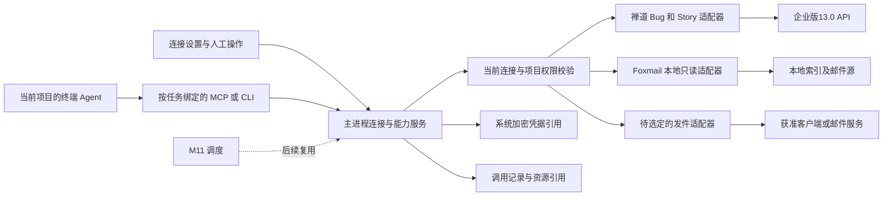

# M10 技术方案 · V2

需求记录增量：[R1.4第9节](../需求.md#9-r14-禅道后续操作场景已记录接口与规则待细化)已补记R04-01–04后续流转场景。本方案V2仍为R1.3设计／只读研究基线，不冒称新增动作已设计或已验证；继续复用[固定版本与探测证据](禅道列表接口复验_20261017/README.md)，写API待办集中在[禅道流转待调研清单](禅道流转待调研清单.md)，本轮仅归档。

后续实测补充：[真实接入验证（2026-10-17）](真实接入验证_20261017.md)。本V2正文保留设计形成时的研究状态；本机Foxmail读取、目标禅道认证／三条Bug材料／Story及SMTP实际收发已取得新证据，以补充文档为准，不将旧“未执行”句子当作此后的实时状态。业务候选仍需评审，实验脚本不替代正式实现。

本轮工程约束增量：Foxmail native ID必须按精确64位／十进制字符串传输，索引size不可直接当源文件大小，附件表不等于MIME全部资源；邮件读取与SMTP凭据分开。禅道个人接口403、通用筛选负控失效、全产品扫描600秒未完成；连接检查与历史同步分离，产品绑定使用稳定ID，列表范围／进度／完整性必须可表达。具体证据与失败恢复建议见上述专项第2、3节。

**同日列表问题已补齐：[本人列表专项](禅道列表接口复验_20261017/README.md)。** 企业biz13.0对应公开22.0发布系列；通用API v2控制器`my/work`以`mode=bug|story,type=assignedTo,param=0,orderBy=id_desc,recTotal=0,recPerPage,pageID`直接取得当前本人work列表，复用旧REST Token。Bug三页／唯一ID与网页一致、Story返回[]及总数0、排序与无效Token对照通过；不再把较新SDK的复数`my/bugs|stories`作为此版本默认。只读适配候选、分页／归属守卫、公开源码摘录与哈希已保存；正式主进程契约／能力注册仍待实施。详情／资源继续复用旧客户端，历史归档与work视图严格区分。

2026-10-17。依据：[需求 R1.3](../需求.md)，M10-R01–R09。状态：**连接组织方式已认可，原型与技术方案V2待评审；未批准正式开发**。业务范围保持Bug＋研发需求Story、Foxmail本地优先、邮件收发；Jenkins仅作扩展性研究，Ticket／飞书／M11调度不扩入。本轮已获准继续REA、可操作原型与阶段评审资料；连接统一管理、项目按需选用、工具调用和可选Skill的分工已认可。其余业务候选仍单列。

## 1. 技术结论

建议以 **WillYou 自有连接与能力服务＋应用适配器＋标准 MCP／CLI 接口** 落地。Codex 的目录／连接／工具／视图职责可借鉴；其私有云连接端点、账号体系和模型工具搜索服务不作为本项目依赖。安装、连接、当前任务工具可用和单次业务成功分别表达。

Codex REA 的具体链路及限制见[接入生命周期](../调研/Codex接入生命周期REA_V1.md)、[接入后使用](../调研/Codex接入后使用链路REA_V1.md)。公开协议、本机 Codex／Claude 运行时与存储实验见[运行时验证](../调研/Codex公开协议与WillYou运行时验证V1.md)。真实服务、原型视觉、打包权限仍按各自证据边界推进。

中央运行区保留终端；不要为了显示 MCP App 或复刻聊天卡片另建 Codex 聊天业务。工具先返回受限文本和资源引用，列表／详情可由后续确认的辅助区域承载。任意第三方 HTML、插件市场、任意代码安装或完整 MCP Apps 宿主均不作为本期默认实现。

## 2. 通用对象与服务契约候选

业务字段仍以需求为唯一依据。以下是实现职责划分，命名可在开发设计中调整：

| 对象 | 最低技术内容 | 关键边界 |
| --- | --- | --- |
| ProviderDefinition | 稳定ID、适配器版本、支持的来源／认证类型、能力及schema | 内置定义，不允许任意文件路径或未核验代码作为provider |
| Connection | 连接ID、provider、来源／账号显示信息、凭据引用、配置修订、启用／健康状态 | 已保存密钥不回传renderer、工具目录、argv或公开上下文；认证表单输入仅短暂持有，提交／关闭后清除；可用性不同于权限 |
| ProjectBinding | 项目与连接／能力的关联、允许操作、策略修订 | 数据结构支持关联；连接统一管理、项目按需选用已认可；账号数量及更细能力范围待定 |
| Capability | 稳定操作ID、输入schema、数据效果、执行位置、错误／重试规则 | 读取、草稿、外部写操作分开；MCP readOnlyHint只是提示，服务端仍执行实际限制 |
| ExternalObjectRef | connection＋真实对象类型＋外部ID、修订／来源、抓取时间、完整性 | Bug与Story数字ID可以相同；邮件Message-ID不能独自作本地主键 |
| Invocation | 项目／任务／run、连接及权限修订、操作、参数摘要、本地intent、阶段／结果、错误／资源引用 | 工具回执、客户端交接、外部业务结果分开；本地去重不保证远端幂等 |

适配器的候选接口为 `validateConfig/check/listCapabilities/invoke/readResource/disconnect`。连接认证可有OAuth、API Token、密码、无认证或本地文件来源等不同实现；不能因为Codex支持OAuth便给Foxmail或公司禅道虚构OAuth入口。

调用路径：界面或Agent提交操作和对象引用→主进程校验参数→核对当前项目绑定、连接修订及当前授权→执行对应适配器→保存脱敏结果与完整性→返回文本／结构化摘要／资源引用。是否需逐次审阅或允许预授权由业务决定；方案不预填某一种确认机制。

## 3. Agent／MCP 适配

- 复用现有 `CapabilityService.prepare` 的项目／任务／run配置与版本固定；为新连接记录独立修订。旧任务恢复必须重查连接停用／撤销状态，Skill旧版本固定不能覆盖当前撤销。
- 内置少量稳定工具优先使用标准stdio MCP，避免在首版同时构建多个网络入口。后续需要HTTP时再设计认证／生命周期；现有Yoda的通道转换可参考，不能直接照搬其只输出stdio的Codex adapter。
- 当前项目工具目录只暴露获准操作及输入schema。工具数量、token成本及是否需要搜索／懒加载以真实CLI实验决定；Codex客户端flag不证明其模型选择算法已还原，M10也无需先复制该云算法。
- broker执行前校验连接／项目／operation和schema，不能仅信任Agent传入的connectionId、read-only标记或历史授权。终端只拿资源句柄／所需结果；认证由服务持有。
- stdio stdout只用于协议，诊断走stderr／脱敏日志。为请求ID、超时、取消、工具错误、输出预算及资源读取分别建立契约；非法参数不进入外部适配器。
- 现有 `context_mcp.py` 是公开上下文投影器；实验确认它不承担完整初始化协商、任意参数或结果清洗。新增业务工具需要独立严格服务，不能向其context直接塞第三方密钥或邮件全文。

建议的小能力入口包括 Bug／Story本人列表与详情、邮件搜索／读取、资源读取及草稿准备；流转与发件工具待具体动作和发送通道确认。工具名／数量是候选，不把旧批量导出和SVN修复流程原样注入用户任务。

## 4. 禅道适配

目标 `http://192.168.106.185/biz/`，企业版13.0／biz13.0。优先复用现有Bug身份／产品枚举／跨分支／详情／文件下载逻辑，补齐Story列表、详情、历史和引用。

[17条接口矩阵](禅道13.0接口复用清单.md)来自固定官方提交：8条只读候选、6条流转研究、3条高版本排除。`/my/bugs`和`/my/stories`最低biz13.5，不作为13.0默认；按获准产品／项目／执行范围和当前account核对本人关系。服务器筛选若验证可用则采用；兼容回退不能遗漏分页／分支，也不能把空结果或404解释成“没有需求”。

当前UI只证明研发需求为Story、本人列表为0，不证明非空详情已读通。后续验证描述／验收标准、版本、状态、指派、关联、评论历史、附件及内嵌图片，并与页面比较。目标API实例尚未在本轮重新认证探测；旧Skill的13.0记录未含IP，保留为历史证据。

流转按对象／当前状态／动作／必填字段／权限／结果回读建表；本轮提取定义不表示已批准所有动作。不是直接更新status，也不把本地代码修复完成映射为禅道关闭。用户提到的SQL尚未在限定路径定位，API复用不依赖新增SQL通道；更不通过数据库写入绕开业务流转。

## 5. Foxmail 与发件适配

优先本地只读索引＋邮件源，WillYou建立自己的查询索引，不接管Foxmail的ICU全文索引、不更改其标记或删信策略。当前本地schema、有限.mail格式和合成MIME／MBOX实验见[Foxmail V1](../调研/Foxmail接入可行性调研V1.md)，真实最小样本验证与未决边界以该报告最新记录为准。

读取工作拆为来源登记、索引／文件对应、有限MIME解析、独立索引／缓存、资源引用和增量观察。先核对native ID与文件关联；Message-ID缺失／重复、移动／删除／重建、附件未下载／缺失、半写入及锁定都要显式表达，不能因读不到就记为空邮箱。

发件单独适配。Foxmail未找到已证实脚本发件契约；mailto／EML只是交接候选，Apple Mail静态接口或独立SMTP／服务API需另行选定、配置和验证。不把“类似Outlook”推定成Exchange，不提取Foxmail密钥来补配置，不迁移用户邮箱。

技术结果至少能区分草稿、交接、客户端反馈、服务器接受、失败和未知；具体文案待产品评审。超时不能直接自动重发，SMTP接受也不是收件人收到／已读保证。

## 6. 数据、凭据和迁移

- 业务表存连接／对象／调用与凭据引用，密钥存现有 `SecretsStore`。系统加密不可用时失败，不降级明文。连接检查、保存及轮换的多步结果需事务／补偿；日志只存必要目标摘要和标准错误码。
- Renderer通过已受控preload／IPC访问服务；新凭据仅作为测试／保存时的秘密输入一次性提交，已保存秘密不经普通读取接口回传。校验方法、对象身份和数据类型，不允许renderer提交任意SQL、路径、脚本或外链来冒充适配器操作。
- 资源缓存放本App受控根；外部URL／HTML／附件视为数据，不执行其指令。按需正文、内容预算、HTML清洗／远程资源、文件路径与符号链接、下载大小和缺失状态需独立验证。
- SQLite候选模型8项实验通过，支持连接＋类型＋外部ID唯一、项目绑定、修订、撤销及本地intent。它不是最终DDL；不把本地唯一键当远端exactly-once。
- M8 v1严格格式目前没有三方连接字段。是否导出连接／缓存／账号是业务待决：选择不携带时保留旧包兼容并给出清晰缺项；选择携带时设计显式新格式／迁移、接收方重绑定和密钥重新加密。不会静默改变旧版已验收文件。
- 首期平台未最终确认。本机实验为macOS arm64；本机Foxmail包是x86_64。文件可读不证明打包WillYou取得相同容器权限，需验证允许／拒绝／撤销恢复；Windows／Linux另列验证。

## 7. 异常与恢复

| 情况 | 技术处理候选 |
| --- | --- |
| 配置或认证无效 | 保留具体阶段与标准错误，重授权／重连；不把已保存写成连接成功 |
| 停用／撤销／账号切换 | 新调用重新核对修订与身份；取消可取消的读取，旧结果保留原来源，禁止串用 |
| 部分页／部分附件失败 | 返回部分及缺失范围，不能标全量完成；独立资源可按身份重新读取 |
| 读取超时／限流 | 有界退避及取消；结果缓存带抓取时间与完整性，不伪装最新 |
| 写操作超时 | 保留结果未知、操作ID和核实依据；查外部状态后决定重试，不通用重发 |
| App／CLI崩溃重启 | 回收孤立run／挂起请求；恢复按当前连接与实际远端状态核实；不能承诺任意pending自动续跑 |
| 展示资源失败 | 保留普通工具结果与失败信息；重新加载视图不自动重执行业务写操作 |

## 8. 评审前后工作划分

前轮包内静态调研、公开协议／版本、现有代码复用和隔离实验保留于[调研V1](../调研/调研总览V1.md)。本轮增量包括[多应用扩展REA](../调研/Codex多应用扩展契约REA_V2.md)、[Jenkins扩展与契约实验](多应用适配与Jenkins扩展方案V2.md)、共享原型及42条评审用例。云端算法、真实第三方状态、未配置发件通道及完整视觉无法由静态REA代替，明确列未知和验证条件。

本轮已在共享工程提供P01–P09候选交互；下一步评审原型、[业务待决](../调研/业务待决与后续验证V2.md)与[42条用例草案](../验收/测试用例.md)，收口具体动作／后端／平台，随后固定正式接口及持久化设计。原型／业务评审后才进入生产开发和打包验收；研究实验与正式业务结果分别记录。

## 9. 多应用扩展方式与设计取舍

采用**注册表＋适配器接口＋共用调用服务**作为候选设计。应用名称、图标、版本、简单配置字段和能力定义可声明；认证、对象读取、动作和结果核实仍由受信任适配代码实现。它能复用基础流程，不等于写一份manifest便自动支持新业务。[Codex增量REA](../调研/Codex多应用扩展契约REA_V2.md)证明存在通用设置schema和按身份调用工具的客户端路径；下述是WillYou的设计选择，不宣称Codex内部用了同名设计模式。

| 层 | 设计职责与扩展点 | 本期／后续 |
| --- | --- | --- |
| 应用定义与注册 | 稳定provider ID、四组版本、config／input／output／progress schema、认证类型、effect及文档／许可；拒绝冲突或未知契约 | 本期为受信任内置注册，不做任意代码市场；Codex portable manifest兼容不作为前置 |
| 共用连接与表单 | 简单字段渲染、必填校验、测试／保存／重连、修订和权限；复杂认证或对象选择提供受控UI扩展 | 禅道、本地读取及发送分别声明真实需求；不复用Codex私有云连接服务 |
| 共用执行服务 | 固定当前project／task／run、检查连接与权限修订、严格schema、调用记录／资源预算、错误／取消外壳 | UI、Agent及未来M11共用；不能仅靠模型遵守Skill或readOnlyHint |
| 业务适配器 | 协议／版本兼容、身份、对象、分页、业务前置条件、动作、资源及结果核实 | 禅道Bug／Story、本地Foxmail、所选发件后端分别开发；未来Jenkins独立实现Job／queue／build |
| 可选Skill | 选对象、分析／总结、工具顺序、输出格式和模板 | 不承担凭据存储，不是每种新应用接入的必选条件 |

新增应用按“定范围及版本→注册定义→实现适配器→复用管理／运行时入口→必要业务UI或Skill→配置迁移→公共和业务用例→评审／真实验收”推进。精确候选类型、资源外壳、业务进度namespace和Jenkins接口见[扩展专项§3–6](多应用适配与Jenkins扩展方案V2.md)。已用三种合成provider做14项检查，不将其称为生产框架已实现。

框架只统一调用阶段，不将所有业务压为布尔成功：Jenkins接受触发、排队、运行和最终result分开；邮件交接、服务器接受与送达分开；禅道动作需回读状态／历史。停止本地等待与取消外部业务也分开，外部写操作不通用自动重试。

## 10. 接口、数据及迁移设计候选

以下为拟新增契约，不是当前已存在的RPC、TypeScript类型或数据库表；正式开发前按最终评审固定名称、schema及错误码。既有能力以已核对源码／测试为准，不混用候选与现状。

| 候选主进程接口 | 入参 | 出参与约束 |
| --- | --- | --- |
| listProviders / readProvider | providerId、客户端schema版本 | 获准内置定义、受支持配置子集／能力；无凭据和任意代码入口 |
| validateConnection | providerId、配置草稿、秘密更新意图 | 校验结果、测试attempt ID／配置hash、识别身份、可用能力；不触发业务写操作 |
| saveConnection | 草稿、expectedRevision、匹配的有效测试结果、秘密更新意图 | 新revision／secretRef；配置变更使旧测试失效，秘密写入与配置失败需补偿 |
| setConnectionEnabled / disconnect | connectionId、expectedRevision | 当前状态；断开不默认撤销远端token或删除历史；这些语义按provider／业务规则固定 |
| bindProjectCapabilities | projectId、connectionId、能力白名单、expectedRevision | 新绑定修订；新增能力不默认授权；停用／认证失败不能报告为当前可调用 |
| invoke / reconcile | operation、参数、对象引用；主进程实际绑定的task／run身份 | invocationId、阶段、带schema的业务进度、数据完整性／资源／标准错误；不得信任调用者自报projectId扩大范围 |
| readResource / listInvocations | 不透明资源句柄及有界cursor；获准筛选条件 | 再查当前权限、资源归属与预算；刷新资源不重做原业务写操作 |

主进程IPC／RPC仍走现有受控入口；不同CLI的stdio子进程另需实际进程间桥接，不能直接调用Electron主进程内存。候选见[MCP到主进程桥接V2](MCP到主进程桥接候选V2.md)：macOS优先私有Unix socket＋短期run认证，外部账号密钥由主进程持有；Windows传输和打包权限分别验证。

| 拟新增数据对象（非最终DDL） | 字段类别 | 事务／迁移与恢复规则 |
| --- | --- | --- |
| connections | id、provider／配置schema版本、公开配置、secretRef、enabled、auth／health、revision、检查时间 | 保留原数据的备份和迁移版本；保存与测试分开；密钥加密失败不降级明文 |
| connection_attempts | attempt ID、配置hash、期望revision、身份、到期、阶段和脱敏错误 | 新尝试替代旧尝试；迟到回调不把新配置标为就绪；不保存秘密字段 |
| project_capability_bindings | project／connection、operation白名单、策略revision | 复合唯一／外键，项目删除及连接停用按评审规则处理；旧任务每次重新核对 |
| external_object_refs | provider／connection／type／native ID、修订、时间／完整性 | 按来源及真实类型隔离；去重不等于合并不同邮件；索引可重建，源数据不能误删 |
| invocation_records | invocation／intent、project／task／run、连接与策略revision、operation、阶段、结果／核实引用 | 先记意图及阶段再外部调用；崩溃保留unknown；本地唯一约束不保证远端恰好一次 |
| resource_refs | opaque ID、所有者／对象、MIME／预算、完整性、内部定位及cursor | 下载／读取再验权限；原始定位不开放任意URL／路径；缓存清理与源邮件分开 |

版本分开管理：框架contract、适配器实现、配置schema、外部服务／格式。已知旧版显式迁移并可回滚；未知新版保留原始配置、停用不兼容能力并提示，不能盲读。provider升级不能悄悄把read变write。索引迁移、旧任务恢复和调用记录展示均保留来源版本。

M8已交付的加密项目迁移及凭据能力保持其既有定义。新增三方连接是否入包需另定范围和格式；不能把当前M10候选当作撤销M8原有加密传输能力，也不静默扩展strict v1。原型浏览器只存脱敏示例和状态标记，不等于生产safeStorage或SQLite迁移已验证。

## 11. 状态、异常及验证边界

连接至少区分配置、认证／来源健康、enabled与项目授权四个轴；调用结果单独记录。测试通过只对同一草稿hash有效；停用影响新调用，已经发出的外部写操作无法通过本地停用撤回。在途读取取消、已提交写核实与旧结果保留，按最终业务范围逐项确定。

| 场景 | 候选服务处理 | 原型／真实验证分工 |
| --- | --- | --- |
| 旧测试／旧回调晚到 | 按attempt＋配置hash／修订匹配，过期响应丢弃 | 原型有测试修改失效；真实认证／并发需接口测试 |
| 发件关闭后新草稿 | 原操作有独立ID，不能将旧回执贴到新草稿；关闭视图不等于撤回邮件 | 原型按generation隔离回执；真正服务重启恢复另验 |
| 多连接及多任务 | 对象引用绑定实际选用连接，插入目标为当前／最近的同项目运行终端；歧义不自动选 | 原型已区分来源／项目；真实PTY授权及句柄生效需集成验收 |
| 部分页／详情不可读 | 明确partial及缺失范围；不将摘要冒充完整详情 | 原型状态可切换；真实分页／权限和非空Story需实例验证 |
| 结果未知 | 保存原操作／外部引用，先核实，不自动再发 | 邮件原型有unknown／核实；Jenkins仅合成研究 |
| 展示资源失败 | 普通结果和业务状态保留，资源单独恢复 | 不预设首版任意MCP App HTML宿主；实际预览另做内容处理 |

验证包括公开协议与REA来源绑定、已有31项复用基线、直接CLI工具调用、三provider契约实验、本地桥接实验、原型模型和浏览器交互。它们的实际结果分别归档；[42条评审草案](../验收/测试用例.md)中真实接口／打包业务用例仍未执行。原型截图只能证明对应主题／尺寸／演示状态，不能证明完全复刻Codex或其他平台通过。
