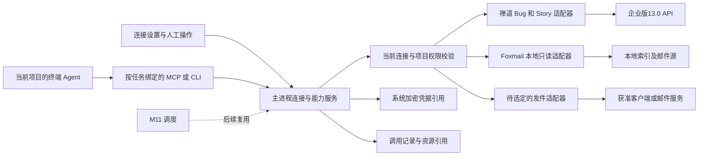

# M10 技术方案 · V1

2026-10-17。依据：[需求 R1.2](../需求.md)，M10-R01–R08。状态：**技术调研与候选方案 V1，可供讨论；未批准正式开发**。业务范围保持 Bug＋研发需求 Story、Foxmail 本地优先、邮件收发；Ticket／Jenkins／飞书／M11 调度不扩入。本轮用户授权先完成不依赖业务决定的调研，需确认的事项单列。

## 1. 技术结论

建议以 **WillYou 自有连接与能力服务＋应用适配器＋标准 MCP／CLI 接口** 落地。Codex 的目录／连接／工具／视图职责可借鉴；其私有云连接端点、账号体系和模型工具搜索服务不作为本项目依赖。安装、连接、当前任务工具可用和单次业务成功分别表达。

Codex REA 的具体链路及限制见[接入生命周期](../调研/Codex接入生命周期REA_V1.md)、[接入后使用](../调研/Codex接入后使用链路REA_V1.md)。公开协议、本机 Codex／Claude 运行时与存储实验见[运行时验证](../调研/Codex公开协议与WillYou运行时验证V1.md)。真实服务、原型视觉、打包权限仍按各自证据边界推进。

中央运行区保留终端；不要为了显示 MCP App 或复刻聊天卡片另建 Codex 聊天业务。工具先返回受限文本和资源引用，列表／详情可由后续确认的辅助区域承载。任意第三方 HTML、插件市场、任意代码安装或完整 MCP Apps 宿主均不作为本期默认实现。

## 2. 通用对象与服务契约候选

业务字段仍以需求为唯一依据。以下是实现职责划分，命名可在开发设计中调整：

| 对象 | 最低技术内容 | 关键边界 |
| --- | --- | --- |
| ProviderDefinition | 稳定ID、适配器版本、支持的来源／认证类型、能力及schema | 内置定义，不允许任意文件路径或未核验代码作为provider |
| Connection | 连接ID、provider、来源／账号显示信息、凭据引用、配置修订、启用／健康状态 | 密钥不进renderer、工具目录、argv或公开上下文；可用性不同于权限 |
| ProjectBinding | 项目与连接／能力的关联、允许操作、策略修订 | 数据结构支持关联；全局或项目独立配置的产品选择待定 |
| Capability | 稳定操作ID、输入schema、数据效果、执行位置、错误／重试规则 | 读取、草稿、外部写操作分开；MCP readOnlyHint只是提示，服务端仍执行实际限制 |
| ExternalObjectRef | connection＋真实对象类型＋外部ID、修订／来源、抓取时间、完整性 | Bug与Story数字ID可以相同；邮件Message-ID不能独自作本地主键 |
| Invocation | 项目／任务／run、连接及权限修订、操作、参数摘要、本地intent、阶段／结果、错误／资源引用 | 工具回执、客户端交接、外部业务结果分开；本地去重不保证远端幂等 |

适配器的候选接口为 `validateConfig/check/listCapabilities/invoke/readResource/disconnect`。连接认证可有OAuth、API Token、密码、无认证或本地文件来源等不同实现；不能因为Codex支持OAuth便给Foxmail或公司禅道虚构OAuth入口。

调用路径：界面或Agent提交操作和对象引用→主进程校验参数→核对当前项目绑定、连接修订及当前授权→执行对应适配器→保存脱敏结果与完整性→返回文本／结构化摘要／资源引用。是否需逐次审阅或允许预授权由业务决定；方案不预填某一种确认机制。

## 3. Agent／MCP 适配

- 复用现有 `CapabilityService.prepare` 的项目／任务／run配置与版本固定；为新连接记录独立修订。旧任务恢复必须重查连接停用／撤销状态，Skill旧版本固定不能覆盖当前撤销。
- 内置少量稳定工具优先使用标准stdio MCP，避免在首版同时构建多个网络入口。后续需要HTTP时再设计认证／生命周期；现有Yoda的通道转换可参考，不能直接照搬其只输出stdio的Codex adapter。
- 当前项目工具目录只暴露获准操作及输入schema。工具数量、token成本及是否需要搜索／懒加载以真实CLI实验决定；Codex客户端flag不证明其模型选择算法已还原，M10也无需先复制该云算法。
- broker执行前校验连接／项目／operation和schema，不能仅信任Agent传入的connectionId、read-only标记或历史授权。终端只拿资源句柄／所需结果；认证由服务持有。
- stdio stdout只用于协议，诊断走stderr／脱敏日志。为请求ID、超时、取消、工具错误、输出预算及资源读取分别建立契约；非法参数不进入外部适配器。
- 现有 `context_mcp.py` 是公开上下文投影器；实验确认它不承担完整初始化协商、任意参数或结果清洗。新增业务工具需要独立严格服务，不能向其context直接塞第三方密钥或邮件全文。

建议的小能力入口包括 Bug／Story本人列表与详情、邮件搜索／读取、资源读取及草稿准备；流转与发件工具待具体动作和发送通道确认。工具名／数量是候选，不把旧批量导出和SVN修复流程原样注入用户任务。

## 4. 禅道适配

目标 `http://192.168.106.185/biz/`，企业版13.0／biz13.0。优先复用现有Bug身份／产品枚举／跨分支／详情／文件下载逻辑，补齐Story列表、详情、历史和引用。

[17条接口矩阵](禅道13.0接口复用清单.md)来自固定官方提交：8条只读候选、6条流转研究、3条高版本排除。`/my/bugs`和`/my/stories`最低biz13.5，不作为13.0默认；按获准产品／项目／执行范围和当前account核对本人关系。服务器筛选若验证可用则采用；兼容回退不能遗漏分页／分支，也不能把空结果或404解释成“没有需求”。

当前UI只证明研发需求为Story、本人列表为0，不证明非空详情已读通。后续验证描述／验收标准、版本、状态、指派、关联、评论历史、附件及内嵌图片，并与页面比较。目标API实例尚未在本轮重新认证探测；旧Skill的13.0记录未含IP，保留为历史证据。

流转按对象／当前状态／动作／必填字段／权限／结果回读建表；本轮提取定义不表示已批准所有动作。不是直接更新status，也不把本地代码修复完成映射为禅道关闭。用户提到的SQL尚未在限定路径定位，API复用不依赖新增SQL通道；更不通过数据库写入绕开业务流转。

## 5. Foxmail 与发件适配

优先本地只读索引＋邮件源，WillYou建立自己的查询索引，不接管Foxmail的ICU全文索引、不更改其标记或删信策略。当前本地schema、有限.mail格式和合成MIME／MBOX实验见[Foxmail V1](../调研/Foxmail接入可行性调研V1.md)，真实最小样本验证与未决边界以该报告最新记录为准。

读取工作拆为来源登记、索引／文件对应、有限MIME解析、独立索引／缓存、资源引用和增量观察。先核对native ID与文件关联；Message-ID缺失／重复、移动／删除／重建、附件未下载／缺失、半写入及锁定都要显式表达，不能因读不到就记为空邮箱。

发件单独适配。Foxmail未找到已证实脚本发件契约；mailto／EML只是交接候选，Apple Mail静态接口或独立SMTP／服务API需另行选定、配置和验证。不把“类似Outlook”推定成Exchange，不提取Foxmail密钥来补配置，不迁移用户邮箱。

技术结果至少能区分草稿、交接、客户端反馈、服务器接受、失败和未知；具体文案待产品评审。超时不能直接自动重发，SMTP接受也不是收件人收到／已读保证。

## 6. 数据、凭据和迁移

- 业务表存连接／对象／调用与凭据引用，密钥存现有 `SecretsStore`。系统加密不可用时失败，不降级明文。连接检查、保存及轮换的多步结果需事务／补偿；日志只存必要目标摘要和标准错误码。
- Renderer通过已受控preload／IPC访问服务。校验方法、对象身份和数据类型，不允许renderer提交任意SQL、路径、脚本或外链来冒充适配器操作。
- 资源缓存放本App受控根；外部URL／HTML／附件视为数据，不执行其指令。按需正文、内容预算、HTML清洗／远程资源、文件路径与符号链接、下载大小和缺失状态需独立验证。
- SQLite候选模型8项实验通过，支持连接＋类型＋外部ID唯一、项目绑定、修订、撤销及本地intent。它不是最终DDL；不把本地唯一键当远端exactly-once。
- M8 v1严格格式目前没有三方连接字段。是否导出连接／缓存／账号是业务待决：选择不携带时保留旧包兼容并给出清晰缺项；选择携带时设计显式新格式／迁移、接收方重绑定和密钥重新加密。不会静默改变旧版已验收文件。
- 首期平台未最终确认。本机实验为macOS arm64；本机Foxmail包是x86_64。文件可读不证明打包WillYou取得相同容器权限，需验证允许／拒绝／撤销恢复；Windows／Linux另列验证。

## 7. 异常与恢复

| 情况 | 技术处理候选 |
| --- | --- |
| 配置或认证无效 | 保留具体阶段与标准错误，重授权／重连；不把已保存写成连接成功 |
| 停用／撤销／账号切换 | 新调用重新核对修订与身份；取消可取消的读取，旧结果保留原来源，禁止串用 |
| 部分页／部分附件失败 | 返回部分及缺失范围，不能标全量完成；独立资源可按身份重新读取 |
| 读取超时／限流 | 有界退避及取消；结果缓存带抓取时间与完整性，不伪装最新 |
| 写操作超时 | 保留结果未知、操作ID和核实依据；查外部状态后决定重试，不通用重发 |
| App／CLI崩溃重启 | 回收孤立run／挂起请求；恢复按当前连接与实际远端状态核实；不能承诺任意pending自动续跑 |
| 展示资源失败 | 保留普通工具结果与失败信息；重新加载视图不自动重执行业务写操作 |

## 8. 评审前后工作划分

本轮可独立完成的包内静态调研、公开协议／版本、现有代码复用和隔离实验已汇总至[调研总览](../调研/调研总览V1.md)。云端算法、真实第三方状态、未配置发件通道及完整视觉无法由静态REA代替，明确列未知和验证条件。

下一步先讨论[业务待决](../调研/业务待决与后续验证V1.md)并收口需求，再在共享原型实现经选定的入口／状态，细化确认用例和正式接口／持久化设计。原型／业务评审后才进入生产开发和打包验收；研究实验与正式业务结果分别记录。
