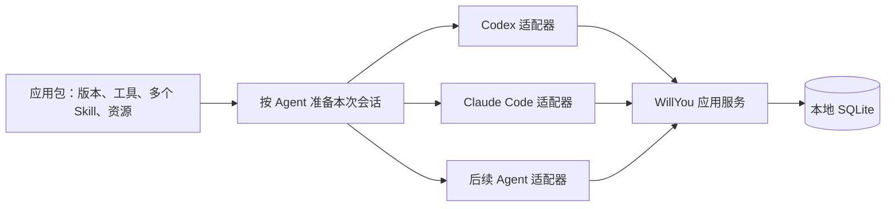

# Codex／ChatGPT Skill 分发机制与 WillYou 多 Agent 参考

日期：2026-10-19。依据：[需求 R1.5／M10-R02、R07、R10](../需求.md)。授权：用户提出使用 REA 逆向 Codex／ChatGPT，为多个终端 Agent 使用应用内 Skill 提供参考。本轮只读研究安装包、补充 M10 设计资料；未修改原型或生产代码，未启动目标程序、调用模型或读取用户账号、聊天、凭据及日志。

## 1. 结论

**值得借鉴的是“版本化插件包＋宿主负责发现／刷新＋客户端按自己的协议引用 Skill＋工具回到统一服务”的组合。** 已找到对应文件和具体函数，但没有取得原生 app-server 或 ChatGPT 私有服务的完整 Skill 装载实现。不能将目录存在、目录列表刷新或界面中出现 Skill 写成模型已经读取正文。

对 WillYou，建议应用只维护一套标准包，由各 Agent 适配器生成其需要的目录、启动参数和工具入口；每个终端会话记录实际使用的应用版本与 Skill 清单。这个方案是结合研究和本项目代码提出的设计候选，不是声称 Codex 为其他厂商 Agent 做了相同分发。

本机 `/Applications/ChatGPT.app` 的实际身份为 **`com.openai.codex`，26.1013.40934（20770）**，不是另一个独立 ChatGPT 客户端。ASAR SHA-256 为 `5ddc4e48259aa6f979e04529b1a5a4ae54b0f5c4ad6db5c6e004924c10916ddb`。它与前轮 26.1007.30912 的研究对象不同，本报告没有将旧代码作为新版证据。标准安装目录内的身份核查、随包插件和工具桥细节见[补查报告](ChatGPT技能装载静态补查_20261019.md)。

## 2. 安装包中实际看到的机制

机器清单：[codex-skill-distribution-rea-20261019.json](证据/codex-skill-distribution-rea-20261019.json)。下表位置均为本轮 ASAR 成员；函数名是压缩产物中的定位符，不是公共 API。清单保存成员 SHA-256、函数的半开字节范围及范围摘要，未提交专有源码正文。

| 环节 | 静态观察与定位 | 能证实的范围 |
| --- | --- | --- |
| 应用包组织 | 13 个随包插件各有 manifest 和版本；`computer-history` 同包声明 Skill 目录与 MCP 配置；`latex` 含 3 个 Skill。见[外置资源证据](证据/chatgpt-skill-host-boundary-20261019.json) | 一包可含多个 Skill、工具定义与资源；插件版本可与桌面版本分别表达。未证明任意独立在线升级 |
| 发现入口 | `app-initial-90eb42395b7d.js` 的 `cci`：按 host 分支；容器环境走 `hostedThreadFiles.listSkills`，其余走 `skills/list`，支持 `cwds` 和 `forceReload` | UI 从所属宿主取目录，不是从一个通用全局数组直接取全部 Skill。原生 `skills/list` 服务内部仍未分析 |
| 容器目录扫描 | `.vite/build/skills-B8B2Ke2-.js` 的 `f`，主进程 `listSkills` 调用它 | 扫描容器 cwd、用户 `.agents/skills`、Codex skills 和 plugins/cache 下的 `SKILL.md`；去重、解析 frontmatter 与可选界面元数据，返回名称、描述、路径、scope 等目录项 |
| 列表缓存 | initial 的 `uci` 按 host 与 roots 形成查询键，设 5 分钟缓存；提供显式 forceReload | 这是前端目录缓存策略，不是模型正文装载或会话有效期 |
| 选择 Skill | initial 的 `AKu` 从当前目录中过滤 enabled／适用项；显示来源与路径；`hUu` 按路径更新提及元数据，名称重复时不盲选 | 界面提及依赖真实来源身份，名称相同不等于同一个 Skill。没有由此证明自动触发算法 |
| 本地会话引用 | `start-dbded35e9600.js` 的 `z`，在插件 onboarding 路径构造 `{type: skill, name, path}`，交给现有会话 inputItems 或新会话 additionalUserInput | 至少这条具体流程把 Skill 身份交给会话后端；不是只插入一段普通提示词。未声称所有消息都经过这个函数 |
| ChatGPT 分支引用 | `hosted-6efcb4d78f54.js` 的 `N`／`P`：解析远端插件与 onboarding Skill；ChatGPT 分支通过 messageMetadata 的 `selected_hazelnuts: [skillId]` 和 `plugin:<id>` system hint 发起或继续会话，并复核账号身份是否变化 | 客户端发送的是远端 Skill ID 与插件身份。私有字段只是本轮证据，不作为 WillYou 要接入或复制的公共协议；服务端如何部署、读取和执行仍未知 |
| 更新后刷新 | initial 的 `JNu` 收到 `skills/changed` 后使目录查询失效；main 的 `Sne` 在插件 reconcile 无失败后请求 `skills/list(forceReload: true)`，`z0` 也有运行时刷新请求 | 存在明确通知／刷新流程；不等于所有运行中会话已切换新版本或读取新正文 |
| 工具调用 | 外置 `codex-app-tools/server.mjs` 将 `codex`／`chatgpt` 调用者的 thread、turn、call 标识交给同一 requestHost，经本地 pipe 访问宿主 | 可以共用能力服务；这是工具桥，不是 Skill 装载器，也没有证明 Agent 直接读 SQLite |

容器扫描有本轮可见的边界：最多取 512 个候选、每批 8 个处理、请求超时 10 秒，读取函数限制文本大小并校验路径。它扫描的是对应执行环境的文件系统，不应误写成本机原生 Codex loader 的完整目录优先级。具体限值也不直接作为 WillYou 产品规则。

因此需要区分三条路径：**本地 app-server 的 Skill 目录、托管容器文件系统的元数据扫描、ChatGPT 分支使用远端 Skill ID**。三者不能拼成一条已经跑通的端到端执行链。

## 3. 本项目已有的基础与缺口

本轮核对 [capability-service.ts](../../../../src/main/core/capabilities/capability-service.ts) 的 `prepare`，观察到以下实际代码：

| 对象 | 当前实现 | M10 尚需补足 |
| --- | --- | --- |
| 标准内容 | 能力包按内容哈希保存在用户数据目录，读取时检查内容；run snapshot 记录所选版本 | 当前是已有 DB／SSH 能力，不是已完成的 M10 完整应用包 |
| Claude Code | 把 Skill 的完整文件树投影到本次 run 的 plugin/skills，传 `--plugin-dir` | 应用绑定、版本、命名映射，以及真实发现／使用的验收 |
| Codex | 投影到 `.agents/skills/smartdd-<id>-<hash>`；启动时以 `skills.config` 开启本会话所选项，并关闭当时已知的其他受管投影 | 后续新安装版本进入同一共享扫描根时，旧会话是否发现它仍需并发实验。预先投影已有版本不覆盖未来新增版本，不能先宣称硬隔离 |
| 加载结果 | 启动包装器检查文件、环境和依赖；snapshot 初始 MCP loaded 为 unverified | 文件完整性通过不等于 Agent 原生发现成功，更不等于本轮读取了 Skill |
| Agent 范围 | [Runner 类型](../../../../src/shared/types.ts) 目前只有 claude／codex | OpenCode、pi、dsh 未接入；现有代码的 else 分支不能作为新增 Agent 的默认实现 |

这意味着 M10 可以复用现有能力包与 run 准备流程，但要把 runner 分支收敛为显式适配器，并补真实加载证据。不能仅增加 Agent 名称便声称兼容。

## 4. 建议用于 WillYou 的分发设计

以下均为**待评审的技术候选**，不修改 R1.5 已确认范围，不自动增加第三方 Agent 的本期交付承诺。

1. **一份标准包。** 用稳定 appId／skillId 表达身份，包清单固定完整 Skill 文件树、工具入口、资源与内容哈希；按目标 Agent 映射可接受的名称和目录。名称冲突应报告，不静默覆盖用户自己的 Skill。
2. **项目选用一次。** 启用应用及连接后，随包 Skill 与工具一起成为该项目的候选能力；创建 Codex 或 Claude Code 终端时自动准备其对应入口，不增加一次独立的配套 Skill 开关。
3. **每个会话准备一次。** 适配器根据已核验的 Agent 版本，决定原生 Skill 目录／插件／启动参数，以及工具使用 MCP、CLI 还是扩展。全局共享目录有隔离风险时，先验证可用的会话目录或替代入口；不能假定所有 Agent 都认识同一路径，也不能假定都内置 MCP。
4. **每个会话保存依据。** 候选快照至少记录 runner／版本、project／task／run、appId／包版本／哈希、Skill 身份与投影位置、连接／权限修订、工具传输、准备和发现结果。不将密钥写入 Skill 正文或目录索引。
5. **分别判断准备、发现和使用。** “已准备文件”来自本地哈希与参数检查；“Agent 已发现”须有该 Agent 的列表／协议／原生检查证据；“本轮已使用”须有可观察的正文读取或明确执行证据。若 Agent 不提供可靠信号，就显示未验证，不能由一段模型自述升级为通过。
6. **升级与在途会话分开。** 建议新会话使用新包，已有会话保留原版本；不能安全刷新时提示新建会话。共享服务须能兼容仍在运行的旧包工具契约，否则明确阻止继续或要求重建。停用／撤销在服务端重新判定，新旧 Skill 都不能绕过当前权限。
7. **工具统一访问数据。** 多 Agent 调用同一受控应用服务，由服务查询 SQLite、检查项目范围并管理并发。数据库路径、应用升级、数据库迁移与会话包版本分别管理；本轮没有验证这些升级行为。

这里的“多 Agent”首先是多个独立终端同时使用同一应用，不额外引入 Agent 间通信或自动协作功能。对于用户提到的未来 Agent，先建立加载能力矩阵再决定适配方式；dsh 的确切产品／版本尚不明确，不预填支持方式。

## 5. 对原型和后续验证的影响

现有 V3“项目应用”和“在终端使用”方向可以保留。建议后续评审以下增量，再修改对应原型：

| 位置 | 建议呈现 | 证据要求 |
| --- | --- | --- |
| 项目应用 | 项目选用的连接、随包 Skill、应用版本；可查看当前项目各终端的准备状态 | 项目启用不能直接代表每个现存终端已生效 |
| 在终端使用 | 列出已有终端的名称与 Agent 类型，明确操作目标；没有终端时进入创建终端流程 | 不把 Skill 示例文本的插入当作配置注入成功 |
| 会话应用 | 当前终端使用的包版本、Skill 清单、文件准备／原生发现状态；版本变化时说明何时生效 | 没有原生证据时显示“已准备，发现待验证”；原型用“模拟”明确标注 |
| 加载异常 | 不支持的 Agent／版本、名称冲突、目录不可写、工具连接失败及可用恢复操作 | 单个终端失败不改写其他终端为失败或成功 |

本轮没有把“加载待验证”偷偷改成正式产品验收结果。V3 合成状态的原记录仍有效，后续原型增量、需求确认及用例另行同步。

正式实现前至少补这些实验：两个项目／多个 Codex 与 Claude Code 终端同时运行；新增和升级应用时旧终端的目录可见性；同名 Skill 与用户自有目录冲突；停用后旧会话调用；恢复任务后的版本与工具契约；目录／工具故障恢复。用受控测试 Skill 和隔离目录验证原生发现与实际使用，不接触日常账号或凭据。当前 T43–T47 不能替代这些新增并发场景。

## 6. REA 覆盖、限制与归档

REA 第一组精确分析 10 个 Skill／插件相关 JS：98211 字节、30434 个 AST 节点、0 解析失败，Evidence `ev_cb584e7e371c95239e0d567313a371f1d5a6a2e4ed01ed1b0f3cd2819d295274`。第二组为新定位的 onboarding 两个成员：7052 字节、1756 个 AST 节点、0 解析失败，Evidence `ev_561485b55d64fb69f4bff595a2fd30ee2320cbd5ff1ff7a7568a91b8e880a89b`。两组均为惰性静态 AST 分析，没有运行目标脚本；main 与 initial 的具体函数另用 Babel AST 与原始字节核对，不冒充已经纳入 REA 源选择的调用图。

第一组模块追踪 Evidence `ev_18559e79a136b1a0fb2d85f6f561a37fac888c0b09592acc3d480dfaedc9923e` 已完成，但 MCP 返回超过传输上限；随后导出原结果，未重复同一追踪。它的关系仍是 partial／推断，不能作为执行证明。第一组有 16313 个未选源文件、189834 个语义未知；第二组有 16321 个未选源文件、183891 个语义未知。导出顶层 unknowns 为 0 不代表这些图内未知消失。

REA 记录 7 个 unpacked 原生模块与 ASAR 声明的完整性矛盾，原始限制完整保留。根 ASAR 有明确哈希，本报告使用的 **14 个 packed JS 成员**均另行核对整文件及分块摘要，与 ASAR header 一致；这只能固定所读字节，不能证明签名真实性、整包无修改或原生模块可信。本轮未根据这些原生模块作功能结论。

完整 REA 导出、原始成员快照与定位脚本在忽略目录 `release/m10-research/skill-distribution-20261019/`；最终根连接导出 `rea-evidence-bundle-final.json` 为 783371645 字节、5 条记录，摘要在入库清单。外置工具桥的独立 REA 归档位于该目录的 `chatgpt/`，由补查报告关联。没有开启原生 REA target，无需关闭目标会话。

| 原始问题 | 本轮回答程度 |
| --- | --- |
| 一包能否组织版本、多个 Skill 与工具 | 已有静态实例与清单证据 |
| Skill 如何被列出、选择并交给客户端会话入口 | 已定位具体路径；本地原生 loader 和自动触发内部实现未覆盖 |
| Codex／ChatGPT 能否共用工具宿主 | 有具体双调用者桥接代码；未做运行验证 |
| 能否直接照搬成 WillYou 的多 Agent 分发 | 只能借鉴分层；其他 Agent 仍需各自适配和验证 |
| 升级不丢 SQLite、旧会话固定版本是否已经验证 | 未验证，属于 WillYou 自己的工程设计与验收 |

本轮交付为研究及技术建议。M10 仍待评审，未批准正式业务开发；没有安装包验收、提交、合并或发布。
