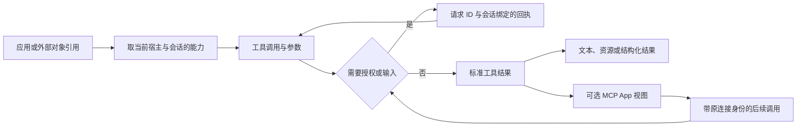

# Codex 接入后使用链路 REA · V1

日期：2026-10-17。依据：[M10 需求 R1.2](../需求.md)，对应 M10-R02／R07／R08，并为 R01、R03–R06 提供共用技术参考。本稿为静态技术调研，未批准正式开发，也不替代接入范围、回写动作、发信方式及权限策略的业务确认。安装／连接生命周期另见本阶段专项，本文从“已有应用可用”开始。

## 1. 核心结论与证据边界

Codex 的第三方使用链路并非“安装一个 Skill，再让 Agent 跑固定流程”。本机发布包中可以区分：应用／插件引用、按宿主与会话取能力、具体工具调用、异步授权回执、标准工具结果、可选的 MCP App 交互视图。Skill 可以提供用法，工具接口负责实际数据读写，结果视图负责展示与后续交互；这些层不应在 WillYou 中混为一种权限或一种执行状态。[TU01–TU09]

本轮已经还原上述客户端的主要静态契约和错误分支。**模型如何决定选哪个工具、云端如何把工具搜索结果装入模型上下文、服务器如何执行审批与外部 API，尚未还原。** 客户端 feature flag 不能证明模型工具搜索算法、当前账号开关或线上行为。[TU11]

调查未操作 Codex 界面，未读取用户聊天、账号凭据或运行日志，未启用连接、安装插件、发消息或调用真实第三方应用。没有用本地静态代码推断“已实际发送邮件”或“已写入禅道”。

### 目标身份

| 项目 | 实际核对值 |
| --- | --- |
| 安装目标 | `/Applications/ChatGPT.app/Contents/Resources/app.asar` |
| Bundle／版本／构建 | `com.openai.codex`／`26.1007.30912`／`20156` |
| ASAR SHA-256 | `75e397e2280dde93b70a85aa926f4282c728eacc84dfeb15ba7fb6ddd84628af` |
| 已提取输入 | `release/f22-research/extracted`；本轮使用的 16 个成员逐个与原 ASAR 字节及成员 SHA-256 一致 |
| REA 目录身份 | `7daad335b8cfa3623ec63036991ef413df0ca4c4dd3d7874c72b1302cbff5ac3`；这是目录 inventory 摘要，不能当作 ASAR 文件哈希 |
| 源定位 | [codex-tool-use-v1-locations.json](证据/codex-tool-use-v1-locations.json)：16 个成员、56 个函数的原始 UTF-8 字节区间、UTF-16 字符区间、哈希；有格式化副本的函数另存格式化行号 |

### 实际 REA 调用与限制

1. 对 15 个精确模块执行 `analyze_javascript_application`，读取 136,981 字节，解析 15 个 JavaScript 文件，parse failure 为 0。主 Evidence：`ev_9f715a60c2192e79441942226e5ac43e4098b3e95f0642afff3528fbfdf58220`；summary：`ev_9baedbc0baaae16a599016c4fff462f511d2ca2c35a4c5477deaceb89aae62df`。
2. 应用图为 **partial**；14,790 个未选择的 inventoried 文件保持 unknown，依赖不因被 import 自动得到分析。semantic 图到达总计 45,000／单文件 10,000 节点上限，为 **partial＋truncated**，不是全应用完整调用图。
3. 针对 `mcp-sandbox-rpc` 模块做 focused trace：`ev_d39fbc35c5902006a581d5e3b62e54a506dbd53669a85ee4ff630ea39af1d498`。命中 2 个 seed，15 个 traced nodes、33 条静态推断 edge、3 个 unavailable facts，覆盖仍为 partial；返回的限制包含部分 observation 的 artifact identity 不可用。后文原始字节另行与 ASAR 绑定，不把该校验当作已补全图中的 unknown。
4. 对 `callTool` 做 semantic forward trace：`ev_126c5d8ea430b972b46128a38f5e0d00341068f3d111d30027faf40e2b0b515b`，仅 1 seed／1 node／0 relations，结果 **ambiguous**、1,481 个相关 unknown；不能据此宣称已自动追通跨模块数据流。后文链路来自逐段人工静态核对，并另给原始字节证据。
5. 对错误文案的 exact-string graph trace 未命中：`ev_9779b46141c5e9c9d5a095bee6a46005630632dd9bad93bfbdacac51c53570b9`。文案实际存在于源字节；此结果只说明该不完整图未保留匹配，不能作为功能不存在的证据。
6. `app-initial-6350d04672d0.js` 未放进 REA 全图，使用 Babel AST 定位原函数并人工阅读。其函数证据在 JSON 中标明 `rea_analyzed: false`；不能冒充 REA 全图或运行期观察。所选两个 `composer-state` 小模块含画板／编辑器状态，未用来证明三方调用行为。

原始 REA 导出、摘要回执、AST 定位脚本、格式化副本和函数原文只留在本机忽略目录 `release/m10-research/tool-use-v1/`，不把大体积发布包代码或私有运行数据入库。

## 2. 从引用应用到可用能力

**已观察：** 输入编辑器区分 `appMention`、`pluginMention`、`skillMention`，保存稳定路径、显示名、说明与图标元数据。`bBc` 根据当前应用、插件、Skill 数据刷新引用，而非只把图标文字插入提示框。插件引用有独立 ID；原生应用引用还可带 bundle ID。`wBc` 收集并去重 plugin／browser-tab 引用；`UWc`／`WWc` 按 host、roots、会话及被提及的插件取目录并同步元数据。[TU01]

`Yfr` 将外部应用引用解析到插件目标：先查现有目录中的 remote plugin／canonical app ID，必要时请求 canonical-app 映射，再取插件详情；找不到返回空。它是“引用解析”，不等于已经连接成功，也不等于授予了工具执行权限。[TU01]

`KBt` 是另一种能力：应用可以声明一个“提及搜索工具”，由它返回资源、补全或可引用对象。搜索预加载失败会抛错；普通搜索失败返回空 items 并记录错误。不能把空列表一律显示成“没有数据”。本地宿主通过 `HC` 调用；hosted 搜索通过 `QBt` 走独立后端并检查账号身份没有切换。[TU02]

**仍未知：** 本轮未追通普通聊天的所有输入序列化与 `turn/start` 生成，也未还原模型侧工具选择。仅凭 @ 引用不得声称“本次任务必定只看到被引用应用”，或“提及后全部工具即刻注入”。WillYou 必须另行定义并验证实际任务授权清单。

**工具发现／懒加载的已证实范围：** `JZs` 中存在 MCP 搜索、延迟工具、增量工具等 feature override，以及 MCP Apps／plugins／auth elicitation 的开关配置。它证明产品具备相应配置入口；不证明本账号启用、具体搜索排序或能力 schema 的下发时序。[TU11]

## 3. 调用不只带工具名，还带宿主、会话和连接身份

图表示静态代码中的职责顺序。普通 Agent 到云端的完整执行路径不在本轮已证实范围。

### 本机宿主路径

`HC` 构造 `{ server, tool, arguments, _meta, threadId }`，通过指定 `hostId` 对应的客户端 `callMcpTool` 执行；返回后用 schema 解析结果，区分传输异常与 `isError` 业务结果，并记录时长及宿主／工具身份。[TU02]

如果调用方没有给 thread，`JBt` 可通过 `WC` 所建的宿主线程调用：该线程的请求声明为 `ephemeral`、`:read-only`、`threadSource: mcp_extension_host`，按 host＋account＋user 建查询键。新线程启动前后检查账号没有变化；线程被替换后等待活跃请求结束再 unsubscribe。这是应用资源／扩展宿主线程，**不能推广成用户所有任务都只读**。[TU02]

### Hosted MCP App 路径

`Rva` 为 MCP App 建请求处理器，固定允许的 MCP method 列表，携带 app URI、connector＋link target、当前账号、源会话、thread 和 message。根据产品与方法分支，转发到 `/ecosystem/call_mcp` 或 `/ps/mcp`；后者使用 JSON-RPC 2.0 并生成新的请求 ID，响应 ID 不一致即报错。[TU03]

`tools/call` 会核对工具 descriptor 是否存在，并将 connector、link、tool 组合成资源定位；需要显式 link 的工具把该值加进参数。工具列表请求在 metadata 中带 selected connector；后续调用带来源和 thread metadata。**这些 `/ps/*`、`/ecosystem/*` 是 Codex 客户端观察到的私有后端契约，不是 WillYou 可直接复用的公共接入接口。**[TU03]

请求期间监听账号切换并 abort；恢复后的响应也重新检查当前身份。客户端显式设置 hosted 请求不做通用自动重试。它不能证明服务器端的租户校验方式，但足以说明 WillYou 不能用一个全局工具名或一个缓存结果跨账号复用。[TU03]

## 4. 授权与补充输入是挂起请求的回执

`mcp-request-card` 将 `hostId＋conversationId＋requestId` 传入审批组件，显示 connector、操作、参数、风险级别和服务端允许的 persist 选项。接受／拒绝经 `replyWithMcpServerElicitationResponse` 返回，或交给调用者提供的 `onReply`；发起回执期间防重复提交，回执失败后允许重新操作。[TU04]

“本次／会话／持续”并非所有调用统一有的三个按钮。只有当前请求的 persist 模式包含相应值时才提供入口；高风险标记也来自请求字段。表单、用户验证、连接认证、通用确认是不同 elicitation 类型。面板按当前 pending request 的 ID 匹配自动处理状态，不把其他请求的回执挂到当前调用。[TU04]

Hosted `Pva` 对 `input_required` 保留 `requestState`、逐项展示 `inputRequests`，再把 `inputResponses` 交回同一逻辑调用；取消后的后续输入也用 cancel 回答。无输入却有 continuation 时带可中断等待；最大 32 轮，超过后报 continuation limit。它属于协议续接，不能当作 32 次独立重发业务操作。[TU03]

结果的认证失败还包含 connector＋link、missing-link／upgrade／reauthentication 等原因。客户端将匹配当前 target 的错误规范化为“需重新授权”，而不是把每种失败都叫网络错误。连接生命周期的具体重新授权流程由另一份专项覆盖。[TU03]

**关键区分：** 已安装、已连接、工具存在、当前任务允许执行、某次审批已接受、远端业务已经完成，是不同事实。本轮只能观察客户端校验和回执行为，不能证明其远端执行与持久化全部可靠。

## 5. 工具结果与 MCP App 的展示、身份和回流

`eE` 将工具消息转换为统一 item：call ID、server／tool／arguments、plugin ID、thread、duration、完成状态、原始资源 URI，以及 `content＋structuredContent＋_meta`。`isError` 与 failed 状态进入错误结果。`eon` 合并流式更新时保留既有 result／appContext，不因增量包缺字段把已显示信息抹掉。[TU05]

`mcp-tool-item-content` 能显示文本、图片、音频和资源链接；结构化结果有 JSON 展示。MCP App 是可选的另一种视图：根据工具／结果资源 URI、当前 catalog、来源 call、连接身份、渲染开关和资源读取结果决定是否可用。视图有 loading、launcher、inline、fallback 等分支；资源太大、出错、连接无效时仍保留普通工具结果及恢复入口。UI 资源读取的重试入口不会自动等价为重新执行原写操作。[TU06]

`loadMcpAppToolCitation` 打开工具引用时重新加载当前 catalog，核对 producer 的 server、plugin、connector 和 link，再解析对应工具／资源 URI；加载后还检查 identity snapshot 当前有效。不是直接信任历史引用上的 URL。[TU07]

`Yva`／`Xva` 的资源缓存键包含连接身份、URI、插件 revision；不具备明确 target 的回退路径还保留源 call 限制。`eya` 在支持 origin-call 的协议中要求回执确认相同 originating call，否则报错。资源“可取到”与“确认属于当前调用”分开表达；不能仅凭 URI 相同认定允许跨会话复用。[TU07]

### MCP App 不是一个无约束网页

`mcp-sandbox-rpc` 建 MessageChannel RPC。初始化核对 iframe source、origin、当前 src origin、init ID；自定义容器核对 sandbox ID、init ID 与端口集合。host 暴露经过包装的 `callTool`／`callMcp`、外链、文件、follow-up、状态更新等功能；一部分操作先检查当前活动状态。错误会序列化，含超时、abort、模型上下文冲突与可重试标记。静态存在校验不等于已做运行期攻防验证。[TU08]

`mcp-sandbox-element` 对 iframe 设置 sandbox 和 referrerpolicy，并给容器设置 partition 属性；具体 Chromium／Electron 策略是否足够、不同容器的实际隔离效果未测试。[TU08]

App 请求把内容发回对话时，有单个 pending request 的确认状态机：确认前允许编辑 prompt、查看／编辑 widget state；取消、重复请求、组件无人订阅分别有明确拒绝／清理。**点击 App 内按钮可能触发工具，也可能准备下一条 Agent 消息，两者不是同一条执行链。**[TU09]

扩展视图可以放到侧栏，保留源 App 名、打开原应用、关闭和宽度控制。这可为邮件／禅道对象详情的辅助区域提供参考，不构成把 WillYou 中央终端改为 Codex 聊天渲染器的需求。[TU09]

## 6. 错误、重试和恢复的实际限制

| 场景 | 静态代码观察 | 不能外推的结论 |
| --- | --- | --- |
| 传输断开 | `JBt` 仅在无显式 thread、符合 Transport closed 错误、调用者允许且尚未恢复过时重建并重试一次；普通 `HC` 默认不启用该选项 | 所有工具失败都能无害重试；写操作天然幂等 |
| 审批策略禁止请求 | 检测特定错误，显示当前对话权限入口；提示在可用时改成允许询问，再请求重试 | UI 能覆盖组织策略；失败后自动提升权限 |
| 资源展示失败 | 普通工具结果 fallback；资源读取有单独 refetch | 资源重取等于业务写操作重做 |
| 账号切换／视图过期 | 取消请求、核对 identity、拒绝失效引用／连接 | 后端已撤销的权限一定即时传播到所有客户端 |
| 认证失败 | 规范化 connector＋link 与 reauth 原因；交认证流程 | 读取工具返回错时可重复发送邮件／重复流转 Bug |
| RPC abort／timeout | 单次回复端口清理并序列化错误；保留上下文冲突的 retryable 数据 | 整个业务操作已回滚或远端没有执行 |
| 会话重新加载 | 有 loading／resuming／reconnecting 的展示条件；工具 item 保留可合并字段 | 应用重启后所有 pending 授权和外部写操作都能精确续跑 |

依据：[TU02–TU10]。最后一项尚缺运行期验证，不能把一个恢复提示组件当作完整恢复机制已经证明。

## 7. 对 WillYou 中央终端架构的迁移建议

以下均为**技术候选**，不写成已确认业务需求；不复用 Codex 私有后端或照搬其产品业务。

1. **三方工具由主进程／本机 broker 执行。** 终端里的不同 Agent 通过受控的 CLI 或 MCP 调用同一 broker；broker 统一连接实例、能力 schema、认证引用、参数校验、执行记录和取消。界面和未来 M11 使用同一层，不能各写一套禅道／邮件操作。
2. **工具目录与具体调用分开。** 小目录列出稳定 capability ID、说明、读写效果、输入 schema、运行位置和授权要求；按项目／任务发现并装载需要的工具。是否首版实现完整懒加载需结合现有 CC／Codex CLI 配置和 token 成本实验决定，不能只复制 flag 名称。
3. **调用身份显式传递。** 至少绑定 project／task／agent session、connection ID、capability ID、operation ID 和有效权限快照；broker 校验连接归属及版本。恢复旧任务时重新评估当前可用连接，不沿用一份过期工具清单。
4. **读取层和展示层独立。** 禅道 Bug／Story、Foxmail 邮件先产出带稳定来源 ID 的标准对象；正文／附件用资源引用，标明抓取时间、覆盖范围和来源。中央终端取得受限文本与资源句柄，辅助区域显示列表／详情；首版不必为此执行第三方 HTML。
5. **外部动作有单独请求／回执状态。** 记录 prepared、awaiting approval/input、running、succeeded、failed、canceled、outcome unknown 等实际状态；审批绑定具体参数摘要和请求 ID。审批通过只表示允许执行；邮件服务器回执或禅道复查结果决定外部完成状态。
6. **错误重试按能力定义。** 安全读请求可有限重试；发送与回写先查幂等或回执证据，超时保留 outcome unknown，再复查。Codex 客户端的重试分支提供设计启发，不证明 Foxmail／禅道可按同样规则重放。
7. **先统一协议，不急于做任意插件运行平台。** 对本期两种内置适配器，用相同注册、发现、调用、资源和事件契约已经能验证框架；插件市场、安装任意代码、运行 MCP Apps 是额外能力，应单独评估和确认。

对应 M10-R02／R07／R08；具体账号／项目归属、可用流转动作、发送授权范围仍留待业务沟通。M11 只复用契约，不在 M10 加调度器。

## 8. 证据索引与完成情况

| 标识 | 结论／定位函数；路径完整值见 JSON | 证据类型 |
| --- | --- | --- |
| TU01 | `app-initial`: `Yfr, bBc, wBc, UWc, WWc`；`plugin-reference` 的导出引用 | 原始发布包字节＋AST 人工静态核对；小 wrapper 纳入 REA |
| TU02 | `app-initial`: `HC, JBt, WC, GBt, KBt, QBt` | 原始发布包字节＋AST 人工静态核对 |
| TU03 | `app-initial`: `Rva, Pva, jva, qva, Vva` | 原始发布包字节＋AST 人工静态核对 |
| TU04 | `mcp-request-card`: `ye, be`；`mcp-server-elicitation-request-panel`: `ot, vt` | REA 所选模块＋逐段静态核对 |
| TU05 | `app-initial`: `a0t, eE, hWt, gWt, CWt, eon, ton` | 原始发布包字节＋AST 人工静态核对 |
| TU06 | `mcp-tool-item-content`: `ga, _a, xa, ka` | REA 所选模块＋逐段静态核对 |
| TU07 | `load-mcp-app-tool`: `re, Z`；`app-initial`: `Yva, Xva, Qva, eya` | 前者纳入 REA；后者为 AST 人工静态核对 |
| TU08 | `mcp-sandbox-rpc`: `x, O, k, A, j, P`；`mcp-sandbox-element`: `m, g, x` | REA 模块分析、focused trace；semantic trace ambiguous 明确保留 |
| TU09 | `mcp-app-follow-up-confirmation-dialog`: `A`；`thread-mcp-app-side-panel-tab`: `v` | REA 所选模块＋逐段静态核对 |
| TU10 | `thread-recovery-notice`: `b`；`mcp-tool-call-approval`: `E`；`mcp-tool-item-content`: `xa` | REA 所选模块＋逐段静态核对 |
| TU11 | `app-initial`: `JZs` 的 feature 配置 | 原始发布包字节；只能证明配置能力存在 |

| 原问题 | V1 状态 | 后续证据需求 |
| --- | --- | --- |
| 接入后怎样引用／取能力 | 部分回答 | 普通会话输入到 Agent 实际工具目录的运行期／公开源码验证 |
| 工具发现／懒加载原理 | 部分回答，模型侧 unknown | Agent 运行时工具发现与 schema 下发，不读取用户历史任务 |
| 调用线程、身份、参数和回执 | 客户端主要静态契约已回答 | WillYou CLI／MCP broker 的隔离实验；Codex 服务端实现不可由客户端反推 |
| 授权、补充输入、错误分支 | 客户端主要静态契约已回答 | 可控测试对象上验证接受／拒绝／取消／账号变更，不能用真实发信作探针 |
| 结果卡片／MCP App／资源引用 | 静态结构已回答 | 视觉状态、主题、焦点、超大内容及隔离的实际验收另做 |
| 失败恢复与重启续接 | 部分回答 | 可控请求中断、重启后 pending／unknown 结果处理；本轮没有运行 |
| 可迁移设计 | 已给技术候选 | 与本地既有终端、CLI 注入、安全存储、项目隔离的复用方案汇总 |

V1 足以支持共用框架与接口契约讨论；不代表所有源码／运行分支已穷尽，也不代表 M10 原型、业务评审或验收完成。
