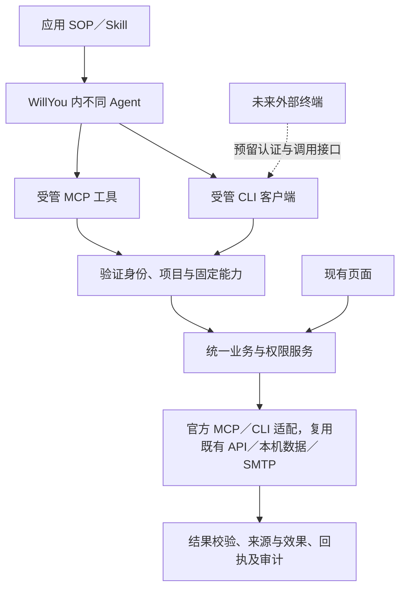

# M11 技术方案：现状与接入标准草案

依据：[需求 R0.5](../需求.md)，M11-R01–R12。2026-11-01，设计初稿；本文区分源码事实与建议，尚未执行本阶段技术实验。

## 1. 整体调整思路

**应用 SOP／Skill 说明使用方式，MCP 与 CLI 都是受管能力入口。** Agent 按固定应用声明选择入口，两条路径共用项目、连接、权限、审批和结果，不强制互相套接。上游官方 MCP／CLI 的复用由适配器处理，Agent 不获得绕过统一授权的直连凭据。

应用标准由 SOP／Skill、能力与入口声明、上游映射和验证规范组成。具体 Skill 文件可保持一致，Agent 的发现目录、MCP 配置和命令调用上下文通过各自宿主适配交付；模型厂商不进入业务能力实现。

## 2. 已核对的现状

| 位置 | 源码事实 | 本阶段影响 |
| --- | --- | --- |
| `resources/applications/zentao/1.0.3/skills/bug-analysis/SKILL.md` | Skill 使用现有 v1 MCP 工具，包含本人列表、完整引用及分块资源规则 | 新版本按应用声明说明 MCP 或 CLI；旧包不原地修改 |
| `resources/applications/mail/1.0.4/skills/work-assistant/SKILL.md` | 包含查询、持久草稿、修订冲突、审阅、授权核验和 unknown 禁止重发规则 | CLI 必须保留这些规则；发信不能只映射为 SMTP 命令 |
| `src/main/core/applications/bridge-runtime.ts` | MCP Server 通过桥客户端请求 `tools/list`／`tools/call` | 提供并存入口的参考；不要求 CLI 再启动一个 MCP Server 才能调用业务 |
| `src/main/core/applications/private-broker.ts` | 宿主代次、单次票据、桥实例与运行绑定、撤销及取消 | 可复用策略；现有桥票据不能直接变成供多个 CLI 进程复用的凭据 |
| `src/main/core/applications/tool-service.ts` | 固定工具契约与 run 派生权限；有参数校验、操作身份及效果错误 | 研究抽出入口无关的能力执行层，兼容旧工具名和版本 |
| `src/main/core/applications/execution-context.ts` | 宿主签发上下文，校验连接／授权修订；JSON 副本没有授权效力 | 新 CLI 入口由宿主签发有效上下文，不接受调用者自报权限 |
| `src/main/core/applications/application-adapter-registry.ts` | 当前只执行已索引受信内置适配器；源码明确并非第三方代码沙箱 | 上游 MCP／CLI 采用受控客户端／进程适配；任意第三方代码导入不在本期 |
| `src/main/core/applications/host-application-registry.ts` | 已有宿主应用、来源、配置 schema、权限及认证定义 | 优先复用注册与连接机制，不另建一份凭据和项目配置 |
| `src/main/core/applications/task-capability-launcher.ts` | 现有终端准备将快照、资源、Agent 适配与 MCP 桥生命周期组合 | CLI 交付、子进程身份与退出收尾需专项验证 |

同级本地 Yoda 已发现 `src/main/core/mcp/services/McpService.ts` 与配置转换工具，作为后续复用候选；本轮尚未完成源码内容核对，不写成已确认可复用实现。[前期官方资料](../../../F19D_应用接入标准与CLI_MCP双入口.md)继续作为协议事实来源。

## 3. 适配标准的建议最小内容

以下是拟定契约项，不是现有接口或已定稿字段名。

| 对象 | 必须说明的内容 |
| --- | --- |
| 应用 SOP 与入口 | 任务步骤、MCP／CLI 入口绑定、真实工具名或命令、使用边界、失败处理；同时声明两种入口时确定使用策略，不隐式切换重发 |
| 应用与能力 | 稳定标识、契约版本、输入／输出 schema、操作语义、权限、分页／资源、支持平台与上游版本 |
| 连接 | 服务身份、账号身份、环境与资源范围、配置 schema、认证方式；凭据仅由原安全存储解析 |
| 调用上下文 | 经验证的调用身份、项目、会话／运行、连接与授权代次、权限上限、操作身份、截止时间、取消信号 |
| 上游映射 | MCP 服务与选定工具，或 CLI 可执行身份、固定子命令及参数映射；输出、错误和效果状态的转换 |
| 结果 | 契约版本、数据、来源／修订、完整性与缺项、分页／资源引用、操作回执、受控错误与可重试性；原始字段与显示说明区分 |
| CLI 表现 | 命令／能力发现、JSON stdout、脱敏 stderr、退出码、有界输入输出、取消、超时及原操作查询；精确格式和退出码待实验定稿 |

参数模板必须作为结构化参数解析，不能把 Agent 输入拼成任意 shell 命令。上游能力列表变化不自动授予权限；声明的只读属性必须按实际业务效果核实，不能只信工具名称或提示标记。

## 4. 官方工具复用的分级

| 等级 | 适用条件 | WillYou 侧工作 |
| --- | --- | --- |
| 原样复用＋声明映射 | 上游版本可控、认证可托管、已选能力输入输出可解析、错误与取消可判定 | 注册能力、权限、连接和映射，接入统一校验与审计；官方工具本身保持原样 |
| 原样复用＋薄适配 | 需要转换参数／结果、分页、资源或错误，或补充特定生命周期控制 | 在 WillYou 侧增加适配代码；逐项说明仍缺的能力，不把文本提示当可靠结构化状态 |
| 专用实现或暂不接入 | 所需能力不可用、认证无法纳管、写效果不可确定，或版本与协议不兼容 | 评估现有 API／SDK／协议；不能宣称任意 MCP／CLI 均可零代码接入 |

MCP 映射需核对支持的协议／传输、工具版本和输入输出；CLI 映射需核对固定可执行身份、参数、退出状态、stdout／stderr、取消及凭据交付方式。精确支持矩阵在技术实验后补齐。

## 5. 身份、审批与生命周期

受管终端应获得可撤销、范围受限的调用身份；CLI 客户端向宿主请求能力。校验不能仅依赖 PATH、环境变量、父进程名称或用户传入的项目 ID。现有 MCP 桥的单次票据／内核进程身份模型需分析后扩展，不能直接复制票据文件给所有 CLI 进程。

邮件发送尤其需要原始用户指令、冻结草稿修订、审阅结果和具体发送意图。CLI 自报 `approved` 或仅传审阅 hash 都不能替代宿主核验。该证据链是首批 CLI 写能力能否纳入的开工前技术问题；不能保留时应回到需求确定范围。

建议调用状态区分等待／执行／成功／失败／取消／结果未知；授权和宿主生命周期独立管理。只读重试有界；写操作断连或超时可能已经生效时保留原操作查询，禁止跨入口隐式重发。取消上游 CLI 时只收尾本次自有进程，不能清理日常实例。

## 6. 兼容、数据与界面

- 建议 SOP／Skill 与新增运行资源形成新版本；旧会话固定包及 v1 MCP 通路按原契约恢复，不原地改历史包或自动追加权限。新应用按声明选用 MCP 或 CLI，不把 MCP 限定为历史兼容。具体迁移计划待评审。
- 现有页面继续调用业务服务；诊断和活动记录须准确表达实际入口。MCP 未连接不能直接当作 CLI 不可用，保留 MCP 历史记录也不能伪装成 CLI 实测。
- 是否新增 CLI 身份／调用记录字段、如何与现有快照和审计表关联，**需代码分析与技术实验**；目前没有新建表或确定迁移。安全存储身份和现有业务配置不因新入口另存副本。
- 外部终端预留认证上下文与传输接口；独立登录、常驻服务及应用退出后可用性均不在本期实现。

## 7. 实施前必须验证的事项

1. 受管 Codex 启动后可发现应用 SOP／Skill 及其声明的 MCP 或 CLI；两种入口的认证、项目隔离、权限收窄、撤销和正常停止可闭环。CLI 的连续子进程身份需专项验证。
2. 同一能力通过受管 CLI、MCP 和现有业务服务返回相同来源与权限判断，保留原始值、完整性和受控错误；新应用的 MCP 路径和旧会话 v1 兼容分别验证。
3. 受控 MCP／CLI 的声明映射通过正常、错误、分页、取消和超时；原样复用与薄适配分别留证，不冒充真实新应用接入。
4. 锁定首批命令／写能力、旧会话兼容及界面诊断增量，补充最终接口、状态表、数据迁移和[全量测试用例](../验收/测试用例.md)后评审。

本轮仅做源码分析与文档检查，没有运行这些实验。正式技术选择优先复用现有代码，并按项目要求继续核对本地 Yoda 的适用实现。

## 8. R0.4 补充：邮件连接槽、入口分配与现有应用迁移

以下 8.1 为源码事实（2026-11-01 读取 `src/shared/application-connections.ts`、`draft-data-service.ts`、`mail-execution-service.ts`）；其余为建议，待实验与评审。

### 8.1 邮件的两个连接槽（源码事实）

- 连接提供者共三种：`zentao`、`foxmail`、`smtp`；邮件应用有 `foxmail` 与 `smtp` 两个槽，禅道只有 `zentao` 槽。
- `foxmail` 配置为本机 `sourcePath`、`account`、`queryDays`，无凭据；`smtp` 配置为 `host`、`port`、`username`、`fromAddress`、认证（仅密码）与加密模式，密码走安全存储，不来自 Foxmail。
- 回复草稿通过 `readSource` 读原邮件并校验回复关联头，依赖 `foxmail`；新邮件草稿不读来源；创建回复时通过 `senderConnectionId` 选择 SMTP 并取 `fromAddress`，草稿阶段已同时涉及两个槽。
- 本次读取的几处代码未见“发件地址与 Foxmail 账号一致”的校验，该规则按新增产品规则处理（需求 §2.1）。

### 8.2 建议：能力与槽、入口分配

| 能力 | 需要的槽 | 语义 | 首批入口 |
| --- | --- | --- | --- |
| 邮件查询／读取／资源 | `foxmail` | 只读 | MCP |
| 回复草稿创建 | `foxmail`，可选 `smtp` | 本地写 | MCP |
| 新邮件草稿、修改、审阅 | 视实现，待核实 | 本地写 | MCP |
| 发送 | `smtp` + 草稿修订 + 授权证据 | 对外写、需审批 | MCP（证据链核验为开工前门槛） |
| 禅道 Bug／Story 查询、详情、资源 | `zentao` | 只读 | 目标 CLI；实验未过则 MCP |

选择理由：发送审批链已挂在 MCP 桥票据上并经 M10 验收；CLI 的多子进程身份尚未验证，用只读、低风险的禅道承担首个 CLI 样本。该分配不是已验证结论。

### 8.3 待核实

- 发件地址一致性在项目选用时、草稿创建时、发送前分别校验的取舍，以及已有不一致配置的处理。
- `smartdd_zentao_write_v1` 在生产路径的实际行为（本次仅在测试中看到其调用）。
- 禅道 Story 通过现有数据服务读取的完整性、分页与资源行为（用例生成但暂不执行）。
- CLI 身份实验方案：宿主签发范围受限、可撤销的运行身份，经本地通道交付；需先定威胁模型（防 Agent 越权与串项目，不假定防同用户恶意进程），实验结果写入本节。

## 9. CLI 身份实验结果（2026-11-01，隔离模拟）

实验位置：[技研/实验/cli-identity](实验/cli-identity/)（`broker.mjs` 模拟宿主、`cli.mjs` 模拟 CLI、`run.mjs` 运行，结果 `result.json`；Node 与 macOS arm64 本机）。**这是用最小模拟宿主与普通子进程做的机制验证，没有启动 WillYou、没有走真实 Codex、没有用生产代码**，不能当作 CLI 入口已完成或真实 Agent 验收。

方案：宿主为每次受管运行签发“运行级令牌”（范围、权限上限、过期、可撤销），经环境变量 `WILLYOU_RUN_TOKEN` 与通道地址交付；CLI 每次调用是新进程，经 Unix socket 向宿主请求；项目、权限只取自令牌绑定，调用参数不授权。

| 编号 | 验证 | 结果 |
| --- | --- | --- |
| E1 | 3 个连续＋6 个并行子进程均被识别为同一运行并取得该项目数据 | 通过 |
| E2 | 自报 `--project B` 被 `SCOPE_DENIED`，无 B 数据 | 通过 |
| E3 | 只读运行写被拒；授予写权限的运行可写 | 通过 |
| E4 | 无受管上下文的 CLI 直接拒绝；伪造令牌 `UNAUTHENTICATED` | 通过 |
| E5 | CLI 无令牌参数；stdout／stderr 中未出现令牌 | 通过 |
| E6 | 撤销后旧令牌 `REVOKED`，新运行可用，旧令牌不复活 | 通过 |
| E7 | 过期令牌 `EXPIRED` | 通过 |
| E8 | 观察：同一用户其他进程用 `ps eww` **能读到**目标进程环境中的令牌 | 观察项（风险） |
| E9 | 观察：纯 Node `net` 未暴露 Unix socket 对端 PID／UID。**更正（同日）：**生产代码已有 macOS 原生助手 `unix-peer-identity.ts`，可读对端 PID、启动时间、可执行文件和祖先链，`agent-bridge-processes.ts` 已用它证明“连接进程是本次受管 CLI 的后代”；本模拟未使用该助手 | 观察项（模拟限制，非产品限制） |

**结论（限于模拟）：**运行级令牌方案可满足“多子进程识别、串项目拒绝、权限上限、撤销、过期、不泄露到输出”。仅靠令牌，**不能**防止同一系统用户下的其他进程取走令牌（E8）。补强建议（来自对现有代码的阅读，**本实验未验证**）：复用现有对端身份读取，宿主在令牌之外再校验连接进程的内核对端身份、可执行文件和祖先链包含本次受管运行的进程（`agent-bridge-processes.ts` 对 MCP 桥已这样做）。这样被盗令牌在受管进程树之外使用会被拒绝。该补强在真实宿主中的可行性（CLI 是否稳定处于祖先链内、对短命子进程的读取时机、读取开销）须专项验证。

**建议威胁模型：**目标是防止 Agent 越权、串项目、自报权限、凭据进入 Skill／参数／日志，并通过“令牌＋受管进程树校验”抵御受管树之外的同用户进程；不声称抵御已在受管进程树内的恶意代码（Agent 自身执行的命令本就在树内）。缓解建议：令牌短时效并随终端退出撤销；每运行独立令牌；宿主侧所有授权判断不信任调用参数；可选以文件描述符或 0600 文件交付以减少 `ps` 暴露（需另验）。

**对入口分配的影响：**机制可行，禅道可按计划以 CLI 为目标入口；但仍须在真实 WillYou 宿主与受管 Codex 中验证（环境变量能否到达 Codex 执行的命令、终端退出收尾、与现有 broker 集成），通过前不改写为已确认。邮件仍走 MCP。

## 10. R0.5 补充：已核实的事实（2026-11-01）

- 发送授权来自宿主观察到的来源（页面真实点击 `ui.mail.send.review`／`ui.mail.send.authorize`，或宿主读取受管会话中的用户原话），与调用入口无关；Agent 经 MCP 或 CLI 都只能提交发送请求，不能自造授权。
- 聊天原话授权依赖 `native-user-messages.ts` 解析 Codex／Claude Code 的会话日志，版本白名单目前为 Codex 0.162.1、Claude Code 2.1.303；Agent 适配器另有 `cliVersions` 白名单。本机 Codex 为 0.166.0，M10 的真实验证使用 0.162.1（部分用 0.163.0）。
- `smartdd_zentao_write_v1` 仅在测试夹具中出现。
- Foxmail `account` 是用户填写的自由字符串，连接验证把它记为 `accountId`，不保证是邮箱地址。
- Agent 适配抽象见[架构设计 §15](架构设计.md)。

## 11. S0a 探针结果（2026-11-01，部分完成）

位置：[技研/实验/s0a-codex](实验/s0a-codex/)（`probe.mjs`、`run.mjs`、`results/`）。环境：macOS arm64，本机 Codex **0.166.0**，`codex exec --ephemeral`，只读假数据，模拟宿主（非 WillYou）。每次运行有 1 次真实模型调用。

**已执行：`-s read-only`（1 次）**

| 观察 | 结果 |
| --- | --- |
| 自定义环境变量（含名字带 `TOKEN` 的 `WILLYOU_RUN_TOKEN`、不带的 `WILLYOU_RUN_CRED`、`WILLYOU_ENDPOINT`）是否到达 Codex 执行的命令 | **全部到达** |
| 命令内是否标记沙箱 | `CODEX_SANDBOX=seatbelt`，`CODEX_SANDBOX_NETWORK_DISABLED=1` |
| 命令内连接宿主的 Unix socket | **失败，`EPERM`**（沙箱拒绝），宿主收到 0 次调用 |
| 命令内读取进程链（`ps`） | 失败，`spawnSync ps EPERM`（宿主侧读取对端身份不受影响，此项不是判据） |
| 令牌值是否出现在输出或事件流 | 未出现 |

**结论（限于 0.166.0＋只读沙箱）：**
1. 令牌经环境变量交付给 Codex 执行的命令，在此版本和模式下可行，没有被按名字过滤。
2. 但**受沙箱约束的命令无法连接位于沙箱外的 Unix socket**。这意味着“CLI 通过 Unix socket 向宿主请求”的方案，在 Codex 默认沙箱下不能直接工作。MCP 桥之所以能工作，是因为 Codex 以子进程方式启动 MCP 服务，不受命令沙箱约束。这是此前设计（架构设计 §6.2）没有考虑到的约束，属于 V1 的实质性发现。

**未执行（被权限分类器拦截，未绕过）：**`-s workspace-write`、`-s danger-full-access`。原因：这两种模式运行的是限制更少的 Agent，需要用户明确许可。因此不知道其他沙箱模式下 socket 是否可通、socket 放在可写目录内是否可通，也没有做 0.162.1 对比。

**对设计的影响（待用户决定后验证）：**
- 禅道走 CLI 的目标入口目前**没有被证实可行**；在沙箱下的可行方案需要单独验证，候选包括：①让 CLI 只作为 MCP 的薄封装；②调整沙箱可写／网络例外使其能访问通道；③使用 Codex 的非沙箱路径。②③涉及降低 Agent 的沙箱限制，属于需用户决定的安全取舍。
- 在结论明确前，禅道保持 MCP 为兜底入口（与既定回退一致），邮件不受影响。

### 11.1 S0a 补充：Codex 沙箱可只放行单个 socket（2026-11-01）

测试用 Codex 自带的 `codex sandbox`（直接在 seatbelt 中运行命令，**无 Agent、无模型调用**），脚本 [`sandbox-socket.mjs`](实验/s0a-codex/sandbox-socket.mjs)，结果 `results/codex-0.166.0-sandbox-socket.json`。

| 编号 | 条件 | 结果 |
| --- | --- | --- |
| N1 | 默认沙箱，不放行 | 连接被拒（EPERM），宿主 0 次调用 |
| N2 | `--allow-unix-socket <本宿主 socket>` | **连接成功**，宿主收到 1 次调用，返回项目 A 数据 |
| N3 | 放行另一个无关 socket | 连接仍被拒（EPERM），宿主 0 次调用 |

**结论：**Codex 沙箱提供官方、可精确到单个路径的 Unix socket 放行；放行 A 不会放行 B（N3）。令牌值未出现在输出。这说明“沙箱内 CLI → 宿主 socket”在技术上可行，前提是 WillYou 启动 Codex 时为本次运行的 socket 声明放行。

**边界（未验证）：**
- 这是 `codex sandbox` 测试命令的行为；`codex exec`／交互会话是否可通过配置（官方文档摘录里出现的是 `[permissions.<name>.network]` 的 `unix_sockets` 与 `[features.network_proxy]` 的 `unix_sockets`，但**文档未给出写法示例**）达到同样放行，尚未验证。
- 该放行属于对 Agent 沙箱的**局部放宽**（仅一个 socket），需要用户确认可接受；它应由 Agent 适配器的 `plan()` 在 L0 阶段写入启动参数，不由用户手工配置（见架构设计 §15）。
- 仅验证 Codex 0.166.0，0.162.1 未对比。

### 11.2 调研：飞书／钉钉官方 CLI 怎么处理（2026-11-01）

来源：[larksuite/cli](https://github.com/larksuite/cli)、[DingTalk-Real-AI/dingtalk-workspace-cli](https://github.com/DingTalk-Real-AI/dingtalk-workspace-cli)（均为 README 摘要，**未读源码**）。

| 方面 | 飞书 CLI | 钉钉 CLI（dws） |
| --- | --- | --- |
| 凭据位置 | 用户登录后存系统钥匙串 | 登录后存钥匙串；加密文件 `~/.local/share/dws-cli` |
| 调用方式 | CLI 带用户令牌**直接访问云端 API** | 同左 |
| 多账号 | `auth list` 多用户；`--as user/bot` | `--profile corpId:userId` |
| 权限限制 | OAuth 作用域（按域名或具体 scope） | 应用级授权，管理员须开启 CLI 访问 |
| 是否区分“哪个 Agent” | **未说明**；Agent 以用户身份在授权范围内行动 | **未说明** |
| 写操作保护 | `--dry-run`；README 警告幻觉与提示注入 | `--dry-run`；`--yes` 跳过确认（文档称 Agent 必需）；`dws schema` 暴露风险语义 |
| 沙箱 | 未提及 | 提供 `DWS_DISABLE_KEYCHAIN=1`、登录态导出／导入给无钥匙串的沙箱；未提 Codex 沙箱网络策略 |

**分析：**
1. 两者解决的是另一个问题：**把用户自己的登录态交给本机 CLI**，由 CLI 直接访问云端。它们没有“宿主代理＋每次运行范围令牌”，也没有按 Agent 隔离；谁能运行 CLI，谁就以用户身份在授权范围内行动，靠 OAuth 范围、管理员开关、`--dry-run` 和警告控制风险。
2. 我们的要求更严（需求 R07：Agent 拿不到三方凭据、按项目／会话／连接收窄、发送要宿主核验审批），所以不能照搬“CLI 持有凭据”的做法。
3. 它们的 CLI 要访问公网，在 Codex 沙箱（`CODEX_SANDBOX_NETWORK_DISABLED=1`）里需要沙箱放行网络或审批；这一点是我根据本次探针的推断，两个项目的文档没有写。
4. 可借鉴：`schema`（让 Agent 可发现每条命令的风险与确认语义）、`--dry-run`、结构化错误、Skill 只是“提示描述、不执行任意代码”。

### 11.3 S0a：真实 `codex exec` 会话验证（2026-11-01，用户已授权本次运行）

环境：Codex 0.166.0，`codex exec --ephemeral`，只读假数据，模拟宿主（非 WillYou），每次 1 次真实模型调用。证据：`实验/s0a-codex/results/codex-0.166.0-exec-E1.json`、`…-E2.json`。

| 编号 | 配置（经 `-c` 临时传入，未改动用户 `~/.codex/config.toml`） | 结果 |
| --- | --- | --- |
| E1 | `default_permissions`＋`permissions.wy.extends=":read-only"`＋`permissions.wy.network.unix_sockets={"<sock>"="allow"}` | 命令连接被拒（EPERM），宿主 0 次调用 |
| E2 | 在 E1 基础上增加 `permissions.wy.network.enabled=true` 与 `features.network_proxy=true` | **命令在沙箱内连上宿主 socket，宿主收到 1 次调用，返回项目 A 数据**；令牌环境变量均到达；令牌值未出现在输出或事件流 |

另外 `codex sandbox -c …` 的四种写法（C1–C4）均未放行，说明配置写法只在真实会话中生效，测试命令不能代替。

**结论：**在真实 Codex 0.166.0 会话里，沙箱命令可以通过配置放行并连接宿主的指定 socket，禅道经 CLI 的传输路径**在技术上可行**。

**未验证／风险（须在采用前补齐）：**
1. 放行需要同时打开 `network.enabled=true` 与 `features.network_proxy=true`（E1 仅有 `unix_sockets` 不够）。这会启用 Codex 的网络代理功能，命令里 `CODEX_SANDBOX_NETWORK_DISABLED` 变为未设置。该配置是否同时放开了对外联网（默认应只放行显式 allow 的域名）**尚未验证**。我准备加的“外部 TCP 443 探测”和“放行错误路径的负例”两次运行被权限分类器拦截（理由：安全削弱），未执行、未绕过。
2. 放行的是单个路径的负例（只放行 A，B 仍被拒）仅在 `codex sandbox` 测试命令中验证过（N3），未在真实会话中验证。
3. 两个 Agent 并行、令牌互相隔离、0.162.1 对比、WillYou 宿主集成，均未验证。
4. 在未明确联网边界前，不应把该配置写成可发布方案。

**补验（2026-11-01，由用户本人经 `verify-network-boundary.sh` 运行；各 1 次真实 `codex exec`，只用假数据）：**

| 编号 | 放行的 socket | 宿主调用 | 命令内直连外部 `1.1.1.1:443`（仅 TCP 握手） | 结果 |
| --- | --- | --- | --- | --- |
| E2b | 本宿主 socket | 1 次，返回项目 A | `ERR:EPERM`（被沙箱拒绝） | 通过 |
| E3neg | 另一个无关路径 | 0 次 | `ERR:EPERM` | 通过：放行 B 不放行 A，连接 EPERM |

令牌值未出现在输出或事件流（两次均 leak-free）。

**结论：**在真实 Codex 0.166.0 会话中，用配置只放行一个 Unix socket 可使沙箱命令连上宿主；放行路径不匹配时连不上；**对外直连 TCP 仍被阻止**。禅道经 CLI 的传输路径在 Codex 默认沙箱下可行。

**仍未验证／须注意：**
1. 启用 `features.network_proxy` 后，命令环境里出现大量代理变量（`HTTP_PROXY`、`HTTPS_PROXY`、`ALL_PROXY`、`NO_PROXY` 等，`CODEX_NETWORK_PROXY_ACTIVE`）。本次只测了**直连** TCP，未测经由该代理访问外部域名；代理默认应拒绝未放行域名，但**未验证**。
2. 代理环境变量会影响沙箱内命令（npm、pip、docker 等）的网络行为，是否干扰用户正常使用 Codex 的其他命令，未评估。
3. 两个 Agent 并行、令牌隔离、0.162.1 对比、WillYou 宿主集成（由适配器 `plan()` 注入该配置）、对端进程树校验，均未验证。
4. 仅验证 Codex 0.166.0 的这组配置键；其他版本的键名可能不同，应纳入适配器版本等级（R15）。

### 11.4 S0a 整批验证（2026-11-01，用户本人运行 `batch.mjs`；2 次并行真实 `codex exec`，假数据，模拟宿主＋项目真实原生助手）

环境：macOS arm64，Codex 0.166.0，`-c` 临时放行本次运行的单个 socket（同 §11.3）。证据：`实验/s0a-codex/results/batch-0.166.0.json`；不调用模型的自测见 `selftest.mjs`。

| 项 | 结果 |
| --- | --- |
| 并行两个会话令牌隔离 | 通过：会话 A 只看到项目 A，会话 B 只看到项目 B |
| 进程树校验（项目已有的 `willyou-process-identity` 原生助手） | 通过：两个会话的 CLI 均在各自 Codex 进程的祖先链内（祖先 6 层）；本进程持 A 的令牌在树外使用 → `PEER_MISMATCH` |
| 助手读取耗时 | 1–4 毫秒（自测连续 10 次 1–2 毫秒，均值 1 毫秒） |
| 经代理访问外部域名 | 通过（以 curl 为准）：`CONNECT tunnel failed, response 403`，代理拒绝了未放行域名。Node `fetch` 返回 `TypeError`，**原因不明确**（可能是代理拒绝，也可能是未走代理后被沙箱拒绝），不作为证据 |
| 对外直连 TCP | 通过：`ERR:EPERM` |
| 沙箱内常用命令 | `git --version`、`node -v` 正常；npm、pip、docker 未测 |
| 用户 `~/.codex/config.toml` | 通过：运行前后哈希与修改时间一致 |
| 令牌泄露 | 未出现在输出或事件流 |

**结论：**除 WillYou 宿主集成与 0.162.1 对比外，S0a 计划内的技研验证项已完成。传输方案（适配器启动时仅放行本次运行的单个 socket）＋令牌＋进程树校验在真实 Codex 0.166.0 会话中可行，联网边界未被放开。

**仍未验证：**
1. WillYou 宿主中由适配器 `plan()` 注入该配置（生产代码，须开发授权）。
2. Codex 0.162.1 及其他版本的配置键（本机仅 0.166.0，安装旧版本需外部下载，未做）。
3. 会话 B 的进程持会话 A 令牌的交叉使用没有单独跑；树外盗用已验证，同一判定逻辑覆盖交叉场景。
4. 只读沙箱模式；其他沙箱模式（`workspace-write`）下是否同样放行未测。
5. npm、pip、docker 等命令在代理变量下的行为未评估。
6. 其他 Agent（Claude Code、pi、zcode 等）的沙箱机制不同，未验证。

### 11.5 复审后补验（2026-11-01）

**① 交互式会话（用户本人运行 `interactive.mjs`；2 次真实模型调用）。**模拟 WillYou 的启动方式：交互式 TUI（PTY 驱动，只应答终端查询、不替用户做选择），不传沙箱参数、沿用用户配置（`approval_policy = "on-request"`），项目信任经 `-c` 临时设置。证据 `实验/s0a-codex/results/interactive-0.166.0.json`。

| 项 | I1 不注入（现状） | I2 继承工作区＋只放行 CLI socket |
| --- | --- | --- |
| 沙箱 | seatbelt | seatbelt |
| CLI → 宿主 | EPERM | 连通，返回项目 A；进程树校验通过 |
| 工作区写入 | 可写 | **仍可写（未降级）** |
| 模拟 MCP 桥端点 | EPERM | EPERM |
| 直连外网 | EPERM | EPERM |
| 经代理访问外部域名 | 用户原有代理 `127.0.0.1:7897` 不可达（沙箱拒绝） | Codex 代理 403 |
| 审批／信任提示 | 无 | 无 |

两轮令牌均未出现在会话日志；用户 `~/.codex/config.toml` 前后不变。在用户 Codex 历史中留下 2 条测试会话。**结论：**交互式会话与 `exec` 一致；继承工作区权限的注入不降级；本机会话本来就不能联网，注入前后一致。用户会话原本可联网的情形未覆盖（V16）。

**② CLI 独立端点（`split-endpoints.mjs`，`codex sandbox`，无模型）。**只放行 CLI 端点：CLI 端点连通，模拟 MCP 桥端点 EPERM，宿主 MCP 端点 0 次连接。交互式 I2 中 MCP 端点同样 EPERM。

**③ V4 Foxmail 账号标识。**WillYou 连接配置的 `account` 是手填文本，代码未与 Foxmail 数据校验；本机唯一 Foxmail 账号目录为 `Profiles/<账号>/messages.db`，目录名为完整邮箱（已脱敏，仅 1 个样本）。

**④ §15.7 版本登记。**每次启动（含恢复）在 `task-capability-launcher.ts` 第 158 行探测当前安装的 CLI 版本、第 285 行登记给本次运行。另核实：Codex 适配器 `resources/agent-adapters/codex/1.1.0/adapter.json` 的 `cliVersions` 仅 `0.162.1`，0.166.0 启动时第 209／230 行标记 `AGENT_ADAPTER_UNSUPPORTED`，应用能力不交付。

**⑤ 基线版本。**npm 上 `@openai/codex` 最新为 0.166.0，与本机一致；用户决定不再使用 0.162.1。
