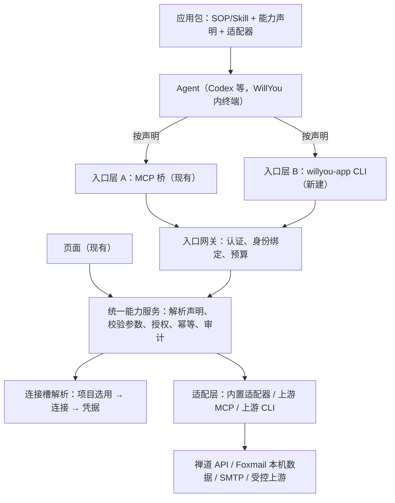
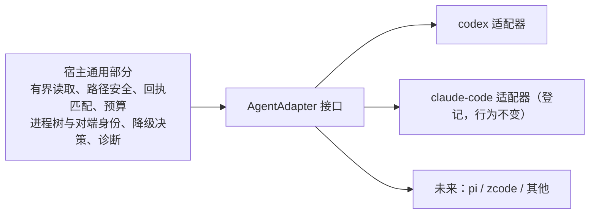

# M11 架构设计：应用接入底座

依据：[需求 R0.6](../需求.md)（M11-R01–R15）、[技术方案](技术方案.md)（源码现状与 CLI 身份实验）。2026-11-01，**设计稿，待用户评审**；评审通过并明确允许开发前，不进入生产实现。本文供后续开发 Agent（Codex）按步骤实现，所以每一节都标注依据：

- 〔源码〕已在仓库中读到的事实，附文件；
- 〔实验〕技术方案 §9 的隔离模拟结果，非真实宿主验证；
- 〔建议〕本设计提出、未经验证；
- 〔待验〕开发前或开发中必须先验证的假设，见 §11。

本文不另立业务规则；业务规则以需求为准，冲突以需求为准。

## 1. 设计目标与原则

1. 业务能力只有一份实现；MCP、CLI、页面三个调用面共用。
2. 应用通过声明接入：加一个应用 ＝ 加一个包（SOP/Skill ＋ 能力声明 ＋ 适配器），不改宿主核心。
3. Agent 永远拿不到三方凭据，也不能通过参数选择项目、连接或权限。
4. 一能力一入口（需求 §2.1）；入口选择是**声明**，不是运行时探测。
5. 不破坏旧会话：已发布的 `smartdd_*_v1` MCP 契约和固定包原样保留。
6. 写操作永不在入口之间隐式重发；结果未知保持“未知”并可查原回执。
7. 复用优先：下文每个模块标注复用、扩展或新建，新建须说明为什么不能复用。

## 2. 分层与职责



| 层 | 职责 | 禁止 |
| --- | --- | --- |
| 应用包 | 声明能力、入口、槽、权限、schema；携带 SOP；携带适配器 | 持有凭据；声明运行时才定的权限 |
| 入口层 | 传输、协议编解码、取消传递、把宿主身份交给网关 | 含业务逻辑；自行授权；缓存凭据 |
| 入口网关 | 验证调用者是哪一次受管运行，产出 `RunContext` | 信任调用参数里的项目／连接／权限 |
| 统一能力服务 | 按 `RunContext`＋声明执行同一套校验、授权、幂等与审计 | 区分调用来自 MCP 还是 CLI（仅记录来源） |
| 连接槽解析 | 把能力声明的槽解析为本项目已选连接，并取凭据句柄 | 把凭据返回给上层 |
| 适配层 | 把能力映射到上游并规范化结果 | 绕过统一服务直接暴露给入口 |

## 3. 现有代码映射

〔源码〕核对于 2026-11-01，行为以代码为准。

| 现有模块 | 现状 | 本设计的处理 |
| --- | --- | --- |
| `src/shared/applications.ts` `applicationManifestSchema`（`smartdd-app-package-v1`） | 包含 `skills`、`tools`（命名 `smartdd_<app>_<name>_v<N>`、`contractMajor`、输入输出 schema、`permission`、annotations）、`adapter`、`connectionContracts` | **扩展**：新增 manifest v2（§4），v1 继续可读 |
| `tool-service.ts` `ApplicationToolService` | 以 `RunContext`＋`BridgeToolCall` 工作；`list`/`call`；按会话快照选包；schema 校验；`HostToolOperation`（semantics、retry、`authorize`、`execute`）；操作账与幂等 | **复用为统一能力服务核心**；`call` 已入口无关，不要复制 |
| `private-broker.ts` | Unix socket；一次性引导票据→交换令牌；令牌绑定连接与桥进程；断连即撤销；方法 `exchange/renew/tools/list/tools/call/cancel` | MCP 入口继续使用不动；CLI 入口**新增**一种绑定模式（§6），共用 socket 基础设施与预算 |
| `unix-peer-identity.ts`、`agent-bridge-processes.ts` | macOS 原生助手读取对端 PID、启动时间、可执行文件、祖先链；已用来证明“连接进程是本次受管 CLI 的后代” | **复用**为 CLI 身份的第二因素（§6） |
| `application-adapter-registry.ts` | 实现 `ApplicationToolHost.resolve`；只加载已索引受信内置适配器；不是第三方沙箱 | **扩展**：新增“上游 MCP 适配器”“上游 CLI 适配器”两种受控类型（§8），内置适配器不变 |
| `execution-context.ts` `ApplicationExecutionContexts` | 宿主签发上下文；`connection(slot)`、`sendConnection`、`draftSender`、`resolveForPackage` 按槽取连接；`mail.send` 权限等 | **复用**为连接槽解析；新增“发件地址与 Foxmail 账号一致”校验点（§7） |
| `host-application-registry.ts` | `applications:[{id:'zentao',slots:['zentao']},{id:'mail',slots:['foxmail','smtp']}]`、provider 定义 | **复用**；能力声明引用其槽名 |
| `zentao-data-service.ts` | `kind` 为 `bug` 或 `story`；列表／详情／引用／分块资源 | **复用**；Story 无需新读取实现（需验证，§11） |
| `mail-execution-service.ts`、`draft-data-service.ts`、`mail-send-data-service.ts` | 草稿、审阅、发送意图、`MailSendReview`（含草稿修订与内容哈希）、授权核验 | **复用**；入口迁移不得改变其语义 |
| `task-capability-launcher.ts` | 启动受管终端，准备会话快照、桥引导、Agent 适配 | **扩展**：交付 CLI 上下文（§6.3），不改既有 MCP 交付 |
| `session-diagnostics.ts`、`session-applications.tsx` | 会话诊断，当前文案基于 MCP | **扩展**：按声明入口分别诊断（§10） |
| `resources/applications/{zentao/1.0.3,mail/1.0.4}` | 仅含 `skills/`（zentao 有 `bug-analysis`、`story-review`；mail 有 `work-assistant`） | **新版本**：出新包，旧包不原地改 |

## 4. 应用包与声明（manifest v2）〔建议〕

目标：用**能力**取代“工具”作为第一等概念，入口只是能力的绑定。

```jsonc
{
  "schema": "smartdd-app-package-v2",
  "appId": "zentao", "version": "1.1.0",
  "entry": "cli",                         // 应用级默认入口：mcp | cli（一应用一入口，见 4.2）
  "connectionSlots": [ { "slot": "zentao", "required": true } ],
  "capabilities": [
    {
      "id": "zentao.object.list",         // 稳定标识，不含传输信息
      "contractMajor": 1,
      "title": "列出本人 Bug/Story",
      "semantics": "read",                // read | write | external-write
      "permission": "zentao.read",        // 必须在 permissions 中声明
      "slots": ["zentao"],                // 需要的连接槽
      "inputSchemaPath": "contracts/list.input.json",
      "outputSchemaPath": "contracts/list.output.json",
      "retry": "safe-read",               // safe-read | never
      "legacyTool": "smartdd_zentao_work_list_v1",  // 对应旧 MCP 工具（若有）
      "binding": { "mcp": { "tool": "smartdd_zentao_work_list_v2" },
                   "cli": { "command": ["zentao","list"] } }   // 仅声明所选入口那一项
    }
  ],
  "skills": [ /* 同 v1 */ ],
  "adapter": { "entry": "…", "format": "cjs" },
  "permissions": [ "zentao.read" ]
}
```

规则：

1. **能力标识**稳定、与传输无关；`binding` 只能含**一个**入口。包校验在 `superRefine` 中拒绝同一能力同时含 `mcp` 与 `cli`（落实“一能力一入口”）。
2. **应用级入口**建议同一应用所有能力一致；校验默认要求一致，如需混用须在声明里显式 `mixedEntries: true` 并经评审（默认不允许，避免 Skill 讲两套）。
3. `semantics: external-write` 表示有不可撤回的外部效果（邮件发送）；此类能力必须声明审批要求，沿用现有 `.send` 工具不得声明只读／幂等的约束。
4. **旧包兼容**：v1 manifest 继续由现有 schema 解析；宿主内部统一转成“能力视图”（v1 的每个 tool ＝ 一个 `binding.mcp` 的能力）。不要求重写旧包。
5. 包文件完整性、哈希、`files` 清单规则沿用 v1。

SOP/Skill 内容规则：Skill 只写用途、步骤、**所选入口的真实调用方式**（工具名或命令）、结果与失败处理；不写凭据、不写另一入口。同一份 Skill 不按模型厂商复制。

## 5. 统一能力服务

〔源码〕`ApplicationToolService.call(runId, requestId, input, signal)` 已按会话快照选包、校验 schema、调用 `HostToolOperation.authorize/execute`、维护操作账。设计保持这个形态，只做以下扩展：

1. **输入同形**：入口把调用统一为 `CapabilityCall{ runId, requestId, capabilityId|legacyTool, contractMajor, arguments, signal, origin: 'mcp'|'cli'|'ui' }`。`origin` 只用于审计与诊断，不参与授权。
2. **解析**：按 `RunContext.snapshot` 的固定包选择能力；快照里没有的能力即使包里存在也拒绝（`SCOPE_DENIED`），落实“新发现工具不自动获权”。
3. **槽解析**：根据能力声明的 `slots` 调用连接槽解析（§7）；缺槽返回 `CONFIG_INCOMPATIBLE` 一类受控错误，错误信息指明缺哪个槽，不影响同应用其他能力。
4. **结果**：统一结果封装（契约版本、数据、来源／修订、完整性与缺项、分页或资源引用、操作回执、受控错误与可重试性）。MCP 入口把它放进工具结果；CLI 入口把它原样放入 JSON stdout。新结果契约用新 `contractMajor`，不静默改写 v1。
5. **幂等与重试**：沿用现有操作账（`operation_id`、`request_hash`、`state: running|succeeded|failed|unknown`、`effect_state`）。只读且声明 `safe-read` 的能力可有界重试；写能力不重试，`unknown` 保持并可按 `operation_id` 查回执。
6. **跨入口防重**：操作账以 `operation_id` 为键，与入口无关。同一 `operation_id` 经另一入口再提交时，返回原回执而不是重新执行。

## 6. 身份与入口网关

### 6.1 MCP 入口（沿用）〔源码〕

引导票据→`exchange`换令牌→令牌绑定该连接与桥进程；断连、撤销、过期失效。不改。

### 6.2 CLI 入口（新建）

CLI 与 MCP 桥的差别：MCP 桥是一个长连接进程；CLI 每次调用是**新进程**，所以不能复用“一次性票据＋长连接绑定”。〔实验〕模拟验证了“运行级令牌”可行（连续与并行子进程、串项目拒绝、权限上限、撤销、过期、不泄露到输出）。

设计〔建议〕：

1. **运行级令牌**：启动受管终端时，宿主为这次运行签发一个高熵令牌（范围＝该运行的 `RunContext`；权限上限＝快照允许的动作；有过期；可撤销），只存其摘要。通过环境变量 `WILLYOU_RUN_TOKEN` 与 `WILLYOU_ENDPOINT` 交付。CLI 不接受令牌参数，也不写盘。
2. **第二因素：进程树校验**〔源码＋建议，未在真实宿主验证〕：每次连接，宿主用现有对端身份读取获得内核对端 PID、启动时间、可执行文件与祖先链，要求：①可执行文件是受管 `willyou-app` CLI 的固定路径；②祖先链包含本次运行的受管进程（与 `agent-bridge-processes.ts` 对 MCP 桥的判断同构）。令牌被受管树之外的同用户进程盗用时因此被拒绝。
3. **项目、连接、权限一律来自令牌绑定的 `RunContext`**；CLI 参数里的项目或连接标识只作对照，不一致即 `SCOPE_DENIED`。
4. **生命周期**：运行结束、终端退出、用户停用或撤销连接、宿主重启，令牌立即失效；新运行新令牌；旧令牌永不复活。
5. **线程模型**：沿用 socket 预算（请求／响应字节、并发数）与取消语义；CLI 进程被信号终止时，宿主以该次 `requestId` 取消在途调用。
6. **威胁模型**：防 Agent 越权、串项目、自报权限、凭据进入 Skill／参数／日志，以及受管树之外的同用户进程；不声称抵御受管树内的恶意代码（Agent 自己执行的命令本就在树内）。

### 6.2.1 沙箱传输（S0a 验证，2026-11-01）

〔实验，真实 `codex exec` 0.166.0＋模拟宿主〕

- Codex 默认沙箱拒绝命令连接沙箱外 Unix socket（EPERM）。CLI 入口因此需要宿主在启动 Agent 时**只放行本次运行的 socket**。
- 可行写法（经 `-c` 临时传入）：`default_permissions="<profile>"`、`permissions.<profile>.extends=":read-only"`、`permissions.<profile>.network.enabled=true`、`permissions.<profile>.network.unix_sockets={"<socket>"="allow"}`、`features.network_proxy=true`。缺少 `enabled` 与 `network_proxy` 时放行不生效（E1）。
- 验证结果：放行本 socket → 连通；放行别的路径 → EPERM；对外直连 TCP → EPERM。
- 归属：该配置由 Agent 适配器的 `plan()` 生成（§15.3 L0），属于**适配器声明的启动参数**，不是应用包或宿主核心的一部分；其他 Agent 用各自的沙箱机制。
- 代价与未验证：见需求 §2.3。键名属 Codex 版本相关，必须登记在适配器版本等级表中（§15.4），未验证版本不得假定相同。
- 备选（保持不变）：放行不可用或联网边界验证不通过，则禅道保持 MCP。

### 6.3 CLI 的交付与形态〔建议〕

- 一个固定命令 `willyou-app`，子命令形式 `willyou-app <app> <command> [--flag value]`，由 manifest 的 `binding.cli.command` 定义；参数以**结构化参数**解析，不拼 shell 命令。
- 输出：成功时 JSON 到 stdout；诊断到 stderr（脱敏）；退出码：0 成功，2 业务拒绝，3 缺受管上下文，4 通道错误，5 结果未知；精确表在实施前由实验定稿〔待验〕。
- 由 `task-capability-launcher` 在启动受管终端时把 CLI 路径放入终端 `PATH`，并设置上述环境变量；不修改用户全局 PATH。
- 发现：`willyou-app --list` 返回当前运行快照中允许的命令；Skill 写明所选命令，不让 Agent 猜测。

## 7. 连接槽解析与邮件规则

〔源码〕邮件有 `foxmail`、`smtp` 两槽；`ApplicationExecutionContexts` 已提供按槽取连接、`sendConnection`、`draftSender`；回复草稿读 Foxmail 来源；新邮件草稿不读来源。

设计：

1. 能力声明 `slots` 是**需要的槽**；解析发生在统一能力服务内，凭据只以句柄形式在适配器内部使用。
2. **按能力判断可用**：缺槽只让依赖该槽的能力不可用，错误指明槽名；诊断按能力显示。
3. 邮件能力与槽：

   | 能力 | 槽 | 语义 |
   | --- | --- | --- |
   | 查询／读取／资源 | `foxmail` | read |
   | 回复草稿创建 | `foxmail`（必须）、`smtp`（可选，用于确定发件身份） | 本地写 |
   | 新邮件草稿、修改、审阅 | 待核实 | 本地写 |
   | 发送 | `smtp` ＋ 草稿修订与授权证据 | external-write |

4. **发件地址强一致〔新增规则，建议校验点〕**：
   - 项目选用时：保存 `foxmail` 与 `smtp` 选用的同时校验 `smtp.fromAddress` 与 `foxmail.account` 一致，不一致拒绝保存并提示；
   - 草稿选发件身份时：`draftSender` 再校验一次；
   - 发送前：`sendConnection` 再校验一次，作为最后防线。
   - 已有不一致配置：不自动修改；发送时拒绝并给出明确原因，读取和草稿不受影响。
   - 比较规则（大小写、别名、域名归一化）〔待验〕：先读现有 Foxmail 账号标识的实际格式再定。
5. 禅道只有 `zentao` 槽，无特殊规则。

## 8. 适配层

三种适配器类型，宿主分别管理，能力声明里写 `adapter.kind`：

| 类型 | 说明 | 本期用途 |
| --- | --- | --- |
| `builtin` | 随包的受信 CJS 适配器（现状），经索引加载，不是第三方沙箱 | 禅道、邮件（复用现有数据服务） |
| `upstream-mcp` | 宿主作为 MCP 客户端连接上游服务，仅暴露声明映射的工具 | 受控测试上游，验证 R04 |
| `upstream-cli` | 宿主以固定可执行身份、固定子命令和结构化参数调用上游 CLI，解析 JSON | 受控测试上游，验证 R05 |

通用规则：

1. 上游**新发现的工具／命令不自动获权**；只有 manifest 映射到的才可调用。
2. 声明的 `readOnly` 必须按实际业务效果核实，不只信上游提示。
3. 上游输出必须通过输出 schema；不通过为受控错误，不静默放行。
4. 取消只收尾**本次自有**子进程；超时与取消的区分、结果未知处理同 §5。
5. 官方工具复用分级沿用[技术方案 §4](技术方案.md)：原样复用＋声明映射 → 原样复用＋薄适配 → 专用实现／暂不接入。
6. 任意第三方代码导入不在本期；`upstream-*` 只加载经评审登记的映射。

## 9. 数据与兼容

〔建议，未定：是否新增表〕

- 调用来源 `origin` 与入口类型是否需要新字段，取决于现有活动记录（`activity-service.ts`）能否承载；优先复用现有字段，必要时追加**可空列**，迁移须可回滚，且不改写历史行。
- 会话快照 `packages[].toolContractMajors` 当前按工具名固定；v2 需要能力视图，设计为**在快照中追加字段**而非替换，旧快照读取路径不变。
- 旧会话恢复：按其固定包与 `smartdd_*_v1` 恢复；新会话使用新包。不原地改旧包、不给旧会话扩权。
- 升级期间禅道若选 CLI、邮件选 MCP，各应用分别新版本包；两个包的活动页展示各自入口。
- 具体迁移与回滚方案在实施前补〔待验〕。

## 10. 界面影响（不新增页面）

〔源码〕`session-applications.tsx` 现有“MCP 配置”文案与桥状态。设计：

1. 诊断按应用声明的入口分别显示：MCP 显示桥状态；CLI 显示“受管 CLI 已交付／上下文有效”，两者互不冒充。
2. 邮件诊断按能力显示依赖的槽状态（读取依赖 Foxmail，发送依赖 SMTP）；只配其一时另一类能力明确显示“未配置”。
3. 发件地址不一致：在项目选用与发送前显示明确原因。
4. 原有应用目录、连接、项目选用、活动、草稿与审批入口保持可达。文案细节和浅／深色状态待原型补充，见[原型说明](../原型/原型说明与变更.md)。

## 11. 未验证假设（开发前或开发中必须先验）

按风险排序。每项通过前，设计中依赖它的部分不得当作事实。

| # | 假设 | 验证方式 | 失败后的处理 |
| --- | --- | --- | --- |
| V1 | 受管 Codex 执行的命令能拿到 `WILLYOU_RUN_TOKEN`／`WILLYOU_ENDPOINT` 并连上宿主，且 CLI 处于本次运行进程的祖先链内 | 〔部分验证〕真实 `codex exec` 0.166.0＋模拟宿主：环境变量可达、经适配器式配置放行单个 socket 后可连通、直连外网被拒（技术方案 §11）。**待验：**WillYou 宿主集成、祖先链、经代理访问外部域名、并行 Agent、0.162.1 | 禅道保持 MCP；CLI 路径用受控工具验证 |
| V12 | 经 Codex 网络代理访问外部域名在默认配置下被拒；代理变量不破坏沙箱内其他命令 | 在真实会话中经代理请求未放行域名；跑常见命令（npm、git）观察 | 回退禅道到 MCP，或评估只放行 socket 而不启用代理的其他写法 |
| V13 | 适配器注入的配置不改用户 `~/.codex/config.toml`，且 Codex 版本变化时键名仍有效 | 对比运行前后用户配置哈希；多版本验证 | 未声明版本不注入，降级（§15.4） |
| V2 | 对端身份读取（外部助手进程）对短命 CLI 子进程的时机与开销可接受 | 连续／并行 CLI 压测，记录失败率与耗时 | 缩短流程，或在令牌之外用宿主侧一次性挑战；仍不行同 V1 |
| V3 | 〔已改写〕发送授权只来自宿主观察到的来源（`mail-user-authorizations.ts`：页面真实点击，或宿主读取受管会话中的用户原话），与入口无关；迁移到 v2 清单后仍调用同一服务、核对同一批字段（草稿修订、内容哈希、连接、授权） | 迁移前后回归（T20） | 不一致则回到需求评审，不降低审批 |
| V4 | 发件地址与 Foxmail 账号的比较规则与现有账号标识格式相容（`account` 是用户填写的自由字符串，不保证是邮箱） | 只读 Foxmail 账号标识样本（不读邮件内容） | 若不是邮箱地址，改为选用时由用户显式确认同一身份 |
| V5 | 〔已关闭，2026-11-01〕`smartdd_zentao_write_v1` 仅出现在测试与夹具，生产代码和 `resources` 包中没有 | 已核对 | 迁移无需处理 |
| V6 | 禅道 Story 通过现有数据服务读取的完整性、分页与资源行为 | 单元与接口层验证；真实数据补测另排期 | 补缺项，不降范围 |
| V7 | manifest v2 能力视图能无损覆盖 v1 工具并保持旧快照恢复 | 迁移前后快照回放 | 保留 v1 通路，v2 只用于新包 |
| V8 | 上游 MCP／CLI 适配的协议、传输、认证范围 | 受控上游服务端到端 | 缩小首批支持矩阵并如实记录 |

## 12. 实施拆分（供开发 Agent）

按依赖顺序；每步完成后跑相关单元与集成测试，并回写[测试用例](../验收/测试用例.md)。Story 相关用例仅生成，不执行。

| 步骤 | 内容 | 主要落点 | 完成判据与对应用例 |
| --- | --- | --- | --- |
| S0 | 〔S0a 已完成部分验证，见技术方案 §11〕V1 余项并入 S5；V2、V5 余项见 §11 | 技研实验目录 | 传输已验证；决定禅道入口待 S5 宿主集成 |
| S1 | manifest v2 ＋能力视图（v1 兼容） | `src/shared/applications.ts`、`manifest.ts` | 单测：v1 全量解析不变；v2 校验“一能力一入口”；V7 |
| S2 | 统一能力服务扩展（`CapabilityCall`、`origin`、跨入口防重） | `tool-service.ts` | 单测与集成：T02、T06、T09 |
| S3 | 连接槽解析与发件地址一致校验 | `execution-context.ts`、`selection-service.ts` | T18、T19 |
| S4 | 邮件迁移到 v2 包（MCP） | 新包 `mail/1.1.x`，适配现有服务 | T17、T20、T10；V3 |
| S5 | CLI 网关与 `willyou-app` | `private-broker.ts` 扩展、新 CLI 入口、`task-capability-launcher.ts` 交付 | T01、T06、T07、T08、T14；V1、V2 |
| S6 | 禅道迁移（CLI 或 MCP，视 S0） | 新包 `zentao/1.1.x`；Story 一并 | T01、T02、T17；T21、T22 仅生成 |
| S7 | 上游适配器（受控 MCP／CLI） | `application-adapter-registry.ts` 扩展 | T03、T04、T05、T15 |
| S8 | 界面诊断增量 | `session-applications.tsx`、原型同步 | T13 |
| S9 | 兼容与回归：旧会话恢复、重启、打包验收 | 全局 | T12、T14、T16；M10 基线回归 |
| S10 | Agent 适配接口抽象，Codex 迁入（§15）；Claude Code 现有实现仅登记、行为不变 | `agent-adapter-registry.ts`、`native-user-messages.ts`、`codex-skill-*-evidence.ts` | T23、T24、T28；M10 Codex 回归 |
| S11 | 版本等级与降级、版本自检 | 适配注册表、诊断 | T25、T26 |
| S12 | 适配一致性测试套件与新增 Agent 指南 | 测试夹具、文档 | T27 |

开发 Agent 的纪律：

- 单元／集成测试通过前不合并下一步；生产输入变化后统一重新打包再做打包 App 验收。
- 任何假设（§11）被证伪，先回写本文与需求，再继续，不自行改验收口径。
- 邮件发送只用合成 SMTP 夹具；真实外发需另有明确授权。
- 不修改 M10 已验收行为；不发布、不改版本号。

## 13. 本设计未覆盖

系统终端／iTerm 的实际调用、独立后台常驻服务、第三方包市场与未审核代码导入、禅道写动作、定时任务（M12）、Windows／Linux 的 CLI 身份实现（对端身份助手目前仅 macOS）。以上留作后续阶段。

## 14. 评审请回答

用户已于 2026-11-01 逐项确认：1. 采用 manifest v2；2. 邮件发送仍走 MCP，V3 改为迁移回归；3. 发件地址强一致三校验点（先定比较规则）；4. 默认不混用入口；5. 先做隔离探针 S0a（本机现有 Codex 版本，必要时对比 0.162.1），结果经用户查看后再决定后续；R15 排在 CLI 底座之后。**尚未明确允许生产开发**，本文仍是待评审设计；S0a 属隔离技研实验。

## 15. Agent 适配层抽象（M11-R15）〔建议，待评审〕

目标（用户要求）：把 Agent 相关的差异抽象成统一架构，后续新增 Agent 时**只按既有接口实现具体方法**，不改应用包、能力服务和宿主核心。

### 15.1 现状：差异散在分支里〔源码〕

- `agentAdapterMetadataSchema` 把 `agentId` 限定为 `claude-code | codex`；适配器是随宿主资源发布的 CJS 包，`prepare()` 把加载请求转成加载计划（启动参数＋要写的文件）。
- 白名单分散：适配器元数据的 `cliVersions`、`native-user-messages.ts` 里的 `supported` 表各自一份。
- 会话日志相关逻辑以 `if (runner === 'claude-code') … else …` 分支内嵌在宿主里：`native-user-messages.ts` 的定位文件、校验头、解析用户消息，`codex-skill-discovery-evidence.ts`／`codex-skill-read-evidence.ts` 的发现与读取证据。新增一个 Agent 就要到处加分支。

### 15.2 目标结构：宿主通用能力＋每个 Agent 一个适配器



宿主提供**不随 Agent 变化**的部分；适配器只提供**必须由该 Agent 决定**的部分。

### 15.3 接口（按等级分组，方法名是建议）

| 等级 | 方法 | 适配器要回答的问题 | 宿主通用部分 |
| --- | --- | --- | --- |
| 声明 | `describe()` | agentId、支持平台、按 CLI 版本声明的等级表（见 15.4） | 校验声明、保存哈希、不允许原地替换 |
| 探测 | `detectVersion(executable)` | 这个可执行文件是什么版本 | 固定路径与身份校验 |
| L0 已交付 | `plan(request)` | 启动参数、要写的配置文件、Skill 投放目录与规则、MCP 或 CLI 入口的交付方式 | 生成快照、哈希、写入原子性、清理、预算 |
| L0 已交付 | `skillProjection(entries)` | 该 Agent 扫描哪个目录、文件如何命名 | 内容完整性与回收 |
| L1 可调用 | `identity(processTree)` | 本 Agent 的可执行文件身份与进程树特征 | 令牌校验、对端身份、调用审计、撤销（Agent 无关） |
| L2 已验证 | `sessionLog()` → `{ locate, header, parse }`；`observeSkills(lines)` | 会话日志在哪、头部如何校验、如何识别“Skill 出现在可用列表”和“读过 SKILL.md” | 有界读取、O_NOFOLLOW、前后一致性复核、文件替换检测 |
| L3 原话授权 | `parseUserMessage(record)` | 日志里哪条记录是用户输入、如何取文本和时间 | 与受管终端输入回执匹配、有效期、一次性使用、失败即关闭 |
| 恢复 | `replaceBridge?()` | 配置变化后如何重载入口 | 代次、取消、收尾 |

规则：

1. **L0／L1 是必选**；L2、L3 可选。适配器未提供的方法，宿主视为该等级不可用。
2. **L1 几乎不依赖 Agent**：靠宿主自己对调用的证明，所以新 Agent 只要能启动并调用入口就至少达到 L0＋L1。
3. 适配器不得直接读写业务数据、凭据或其他会话；它只处理 Agent 侧的事。通用安全检查（链接、权限、预算）放宿主，避免每个适配器重复且各有漏洞。
4. **失败即关闭**：解析异常、记录缺失、版本不符都不产生授权或“已发现”结论，只降低等级。

### 15.4 版本等级表与降级

适配器为每个已验证的 CLI 版本声明等级和证据：

```jsonc
"levels": {
  "0.162.1": { "levels": ["L0","L1","L2","L3"], "evidence": "M10 验收 + 一致性套件 <hash>" },
  "0.166.0": { "levels": ["L0","L1"], "evidence": "S0a 探针 + 自检" }
}
```

- **已声明版本**：按声明等级工作。
- **未声明版本**：默认尝试 L0＋L1（best-effort，诊断标注“未验证”）；L2、L3 自动关闭；邮件发送授权退回页面点击；读取类能力不受影响。启动失败时明确提示，不静默。
- **提升等级**：通过**版本自检**（启动该版本，发送已知内容，核对适配器解析出的结果）后，把该版本的等级写入本机验证记录（与适配器哈希、版本绑定）。自检失败保持低等级。〔待验：是否需要把自检结果合入发布的适配器，还是只留本机记录——影响可复现性，评审时定。〕
- 声明与自检结果的**唯一读取点**是适配注册表；`native-user-messages.ts` 的 `supported` 表改为向注册表查询，不再各自维护。

### 15.5 一致性测试套件

所有适配器必须通过同一套契约测试，才能声明等级：

1. **计划快照**：同一请求生成的启动参数与文件内容稳定、无秘密、路径合规。
2. **日志夹具（golden）**：每个声明版本附真实录制的脱敏会话日志；断言发现、读取、用户消息解析结果。
3. **负例**：畸形记录、助手／工具输出伪装成用户消息、被替换或链接的文件、超预算、截断文件——都不得产生授权或“已发现”。
4. **降级行为**：未声明版本时 L2／L3 关闭、L0／L1 与诊断标注正确。
5. **会话固定**：恢复会话读取其原 Agent 与原版本登记，不允许跨 Agent 读取。

### 15.6 新增一个 Agent 的步骤（给后续开发者）

1. 实现 `describe`、`detectVersion`、`plan`、`skillProjection`（L0）。
2. 复用宿主 L1，补 `identity`。
3. 以 L0＋L1 发布，诊断显示“未验证 L2／L3”。
4. 需要“已确认读取 Skill”再补 `sessionLog`／`observeSkills`（L2）；需要聊天原话授权再补 `parseUserMessage`（L3）；每补一级附夹具和负例。
5. 跑一致性套件；通过后在版本表登记等级。

不需要改：应用包、SOP、能力服务、权限、凭据、结果契约。

### 15.7 会话与 Agent 绑定

会话一经开始就固定属于其原 Agent（快照中的 `runner` 与登记的版本）；日志格式不同，不跨 Agent 读取，也不切换。要换 Agent 就新开会话。〔待验：同一会话在 CLI 升级后重新打开，读取按启动时登记的版本还是新版本——评审前先核对代码与行为，结果回写。〕

### 15.8 本阶段边界

- 只整理接口并把 **Codex** 迁入；**Claude Code 的现有实现登记但行为不变**（不重构、不扩验证），其等级按现有证据声明，不额外声称。
- 不实现 pi、zcode 或其他 Agent；这些的发现方式、配置方式与会话格式尚未调研，不写成已支持。
- Windows／Linux 仍不在范围（对端身份助手目前仅 macOS）。
- 本章是 CLI 底座（S5）之后的工作（S10–S12）。

### 15.9 新增未验证项

| # | 假设 | 验证方式 | 失败后的处理 |
| --- | --- | --- | --- |
| V9 | 未声明版本做 L0 best-effort 时，启动参数或配置若不兼容会明确失败而不是静默失效 | 用本机 Codex 新版本做受控验证 | 对未声明版本默认只提示、不交付 |
| V10 | 从现有 Codex 分支代码迁成适配器接口后，M10 已验收行为不变 | Codex 0.162.1 回归（沿用 M10 已绿用例） | 保留旧路径直至等价 |
| V11 | 自检能可靠区分“格式兼容”与“格式变了但碰巧通过” | 夹具中加入变形日志 | 加强负例，不放宽 |
