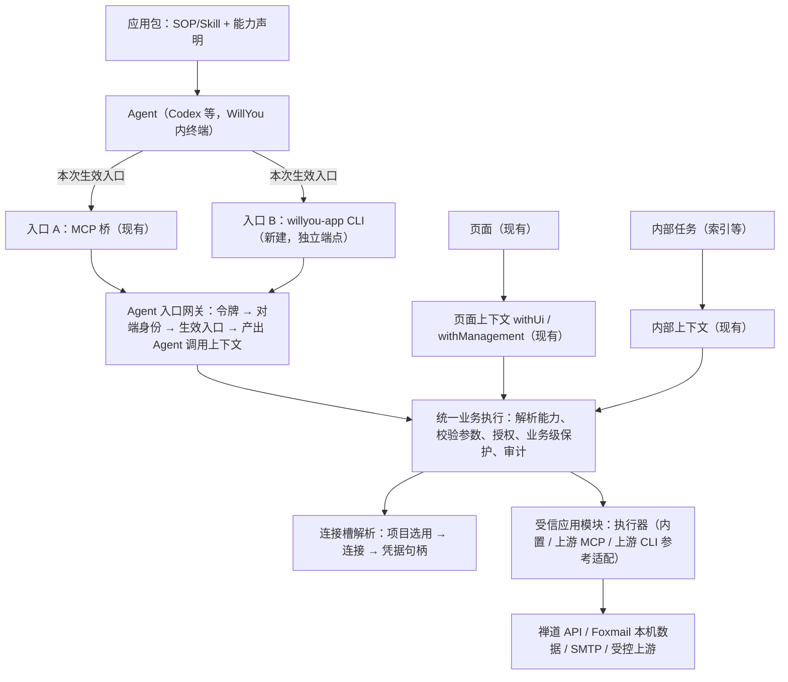
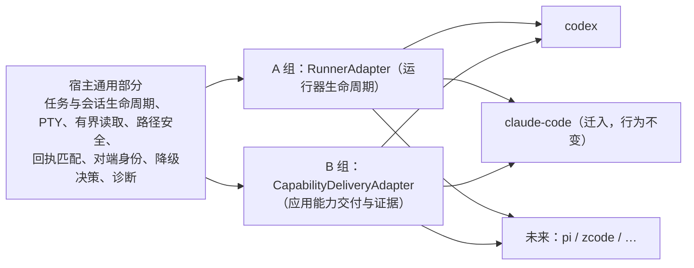

# M11 架构设计：应用接入底座

依据：[需求 R0.9](../需求.md)（M11-R01–R15）、[技术方案](技术方案.md)（源码现状与技研实验）、[Codex 评审 2026-11-01](../../../review/review-20261101-0848.md)（A01–A12）。2026-11-01 **R0.9 评审通过设计基线**；用户本轮确认原型、设计、测试用例评审均已通过，并授权按整理后的目标实施，当前从S0b接续。本文供后续开发 Agent（Codex）按步骤实现，各处标注依据：

- 〔源码〕已在仓库中读到的事实，附文件；
- 〔实验〕技术方案 §9–§12 的隔离实验结果，非 WillYou 宿主验证；
- 〔建议〕本设计提出、未经验证；
- 〔待验〕开发前或开发中必须先验证的假设，见 §11。

本文不另立业务规则；业务规则以需求为准，冲突以需求为准。

## 1. 设计目标与原则

1. 业务能力只有一份实现；页面、MCP、CLI 三个调用面共用业务执行。**共用的是业务执行，不是调用身份**：页面、Agent 运行、内部任务各有宿主签发的上下文（§5）。
2. **新增应用 ＝ 新包 ＋ 一个受信模块 ＋ 一条注册项**（用户 2026-11-01 确认）。宿主通用逻辑（能力服务、入口、权限、凭据、结果、诊断框架）不改；执行器是宿主编译进去的受信代码，不运行包里带来的任意代码（§4.2）。
3. Agent 永远拿不到三方凭据，也不能通过参数选择项目、连接或权限。
4. 一能力一入口；只读能力可另声明一个降级入口（§4.1 规则 3）。入口在每次运行启动时确定，服务端按本次生效入口拒绝其他入口（§9）。
5. 不破坏旧会话：已发布的 `smartdd_*_v1` MCP 契约和固定包原样保留。
6. 写操作永不在入口之间隐式重发；每个写能力必须声明业务级保护（§5.3）；结果未知保持“未知”并可查业务对象状态。
7. 新增 Agent ＝ 一个运行器适配器 ＋ 一个能力交付适配器，不改任务、会话和应用核心（§15）。
8. 复用优先：每个模块标注复用、扩展或新建。

## 2. 分层与职责



| 层 | 职责 | 禁止 |
| --- | --- | --- |
| 应用包 | 声明能力、入口、槽、权限、schema、业务级保护；携带 SOP | 持有凭据；携带可执行代码 |
| 受信应用模块 | 宿主编译的执行器、连接 provider、配置 schema／视图、认证、上游适配 | 绕过统一业务执行直接暴露给入口 |
| 入口层 | 传输、协议编解码、取消传递 | 含业务逻辑；自行授权；缓存凭据 |
| Agent 入口网关 | 先验令牌与内核对端身份，再验本次生效入口，最后产出 Agent 调用上下文 | 信任调用参数里的项目／连接／权限；未通过身份核验就进入业务 |
| 页面／内部上下文 | 沿用 `withUi`、`withManagement` 等现有边界 | 借用或虚构 Agent 运行 |
| 统一业务执行 | 按调用上下文＋能力声明做同一套校验、授权、保护与审计 | 按入口差异化业务规则（入口只记录来源） |
| 连接槽解析 | 把能力需要的槽解析为本项目已选连接，凭据只以句柄交给执行器 | 把凭据返回给上层 |

## 3. 现有代码映射

〔源码〕核对于 2026-11-01，行为以代码为准。

| 现有模块 | 现状 | 本设计的处理 |
| --- | --- | --- |
| `src/shared/applications.ts` `applicationManifestSchema`（v1） | `skills`、`tools`（`smartdd_<app>_<name>_v<N>`）、`adapter`、`connectionContracts` | **扩展**：manifest v2（§4.1），v1 继续可读 |
| `tool-service.ts` `ApplicationToolService` | `call` 首先 `assertActive(runId)`；按 `runId:requestId` 防重；每次调用随机生成 `operationId`；缓存缺失返回 `REPLAY_UNAVAILABLE` | **复用为 Agent 调用的执行核心**；不让页面经此路径（§5） |
| `execution-context.ts` | `withUi`（第 201 行，页面，`taskId/runId` 为空）、`withManagement`（第 226 行，连接管理）、`withAgent`（第 230 行） | **复用**三种上下文边界，作为调用上下文联合类型的来源 |
| `private-broker.ts` | 每宿主一个 socket；一次性引导票据→交换令牌；方法 `exchange/renew/tools/list/tools/call/cancel` | MCP 入口不动；CLI **另开端点与协议**（§6），复用预算与取消基础设施 |
| `unix-peer-identity.ts`、`agent-bridge-processes.ts`、`out/native/willyou-process-identity` | 原生助手读对端 PID、启动时间、可执行文件、祖先链；`<pid>` 模式读启动时间 | **复用**为 CLI 身份第二因素 |
| `host-application-registry.ts` | 只接受宿主编译的受信定义（第 34 行注释），RPC 与 manifest 不能注册 provider／schema／执行器；当前定义 zentao、mail | **扩展为模块注册契约的落点**（§4.2） |
| `builtin-package-registry.ts` | 安装器拒绝不在宿主支持列表中的 appId（第 24 行） | 支持列表改由模块注册表生成 |
| `application-service.ts` 组合入口 | 逐个装配现有应用；`stopProjectRuns` 中写死 `'zentao'`（第 114 行附近） | 改为读取模块声明（例如已有的 `stopBeforeSwitch`），移除应用名分支 |
| `src/shared/application-connections.ts`、`src/renderer/features/applications/connection-form.tsx` | `providerIdSchema` 固定为 `zentao/foxmail/smtp`，配置为固定判别联合；连接表单按三种 provider 逐个硬编码字段、初始值与错误文案（已核实） | 改为由已注册模块提供 schema 与配置视图；连接表单按配置视图通用渲染，现有三种 provider 的视觉与交互保持不变（视觉不变的重构，仍按原型规则核对） |
| `mail-read-data-service.ts` | 资源读取先查项目持久资源（草稿正文、附件、审阅），命中直接读，不碰 Foxmail（第 97 行）；仅原邮件资源走 Foxmail | 能力—槽矩阵按资源类别区分（§7） |
| `draft-data-service.ts`、`mail-execution-service.ts`、`mail-user-authorizations.ts` | 草稿修订、发送意图、审阅哈希、宿主观察的授权来源 | **复用**；入口迁移不改语义 |
| `session-registry.ts`、`session-projector.ts` | 快照固定 Skill 源目录哈希、投影与工具集合；旧 schema 要求选了应用就有应用 MCP 桥 | 新增运行计划记录（§9），旧快照原样恢复 |
| `task-capability-launcher.ts` | 每次启动探测当前安装的 CLI 版本并登记（第 158、285 行）；版本不在适配器 `cliVersions` 中则 `AGENT_ADAPTER_UNSUPPORTED`（第 209、230 行） | 扩展：生成运行计划、交付 CLI 上下文 |
| `src/shared/ai-profiles.ts`、`tasks/native-sessions.ts`、`tasks/task-service.ts` | 运行器限定 `claude`／`codex`；状态目录非 claude 即按 codex（第 17–18 行）；新建任务时 claude 用任务 id 作会话 id，其余为空（第 189 行） | 纳入运行器适配器接口（§15.3） |
| `resources/agent-adapters/codex/1.1.0/adapter.json` | `cliVersions` 只有 0.162.1 | 新版本适配器加入 0.166.0（S0b） |
| `resources/applications/{zentao/1.0.3,mail/1.0.4}` | 仅 `skills/` | 出新包，旧包不原地改 |

## 4. 应用包与受信模块

### 4.1 manifest v2〔建议〕

用**能力**取代“工具”作为第一等概念。下例是禅道主入口 CLI、只读降级 MCP 的有效声明，可直接按 §4.1 规则校验（不含注释）：

```json
{
  "schema": "smartdd-app-package-v2",
  "appId": "zentao",
  "version": "1.1.0",
  "module": { "id": "zentao", "contractMajor": 1 },
  "entry": "cli",
  "connectionSlots": [{ "slot": "zentao", "required": true }],
  "capabilities": [
    {
      "id": "zentao.object.list",
      "contractMajor": 2,
      "title": "列出本人 Bug/Story",
      "semantics": "read",
      "permission": "zentao.read",
      "slots": { "required": ["zentao"], "conditional": [] },
      "inputSchemaPath": "contracts/list.input.json",
      "outputSchemaPath": "contracts/list.output.json",
      "retry": "safe-read",
      "legacyTool": { "name": "smartdd_zentao_work_list_v1", "contractMajor": 1 },
      "binding": {
        "cli": { "command": ["zentao", "list"] },
        "fallback": { "mcp": { "tool": "smartdd_zentao_object_list_v2" } }
      }
    }
  ],
  "skills": [{ "id": "bug-analysis", "path": "skills/bug-analysis", "entry": "skills/bug-analysis/SKILL.md", "template": true, "description": "…" }],
  "permissions": ["zentao.read"]
}
```

写能力示例（邮件发送，主入口 MCP，**不得**有 `fallback`，必须有 `protection`）：

```json
{
  "id": "mail.send.execute",
  "contractMajor": 2,
  "semantics": "external-write",
  "permission": "mail.send",
  "slots": { "required": ["smtp"], "conditional": [] },
  "approval": "host-observed-user-authorization",
  "protection": { "kind": "business-intent", "object": "mail_send_intent", "key": "intentId" },
  "legacyTool": { "name": "smartdd_mail_send_execute_v1", "contractMajor": 1 },
  "binding": { "mcp": { "tool": "smartdd_mail_send_execute_v2" } }
}
```

**三个版本号的关系**（评审 B01）：`module.contractMajor` 是受信模块接口的版本（模块与包之间的契约）；能力的 `contractMajor` 是该能力输入输出契约的主版本，新包的新契约为 2，主入口与降级入口的 MCP 工具名后缀都必须等于它（上例均为 `_v2`）；`legacyTool.contractMajor` 是被映射的旧工具版本（现有均为 1），只用于新旧映射与审计，旧 v1 结果不被静默改写。

规则（`superRefine` 必须实现，并附正负例单测）：

1. **能力标识**：`<appId>.<名词>.<动作>`，前缀必须等于 `appId`；同包内唯一；与传输无关。MCP 工具名仍为 `smartdd_<appId>_<name>_v<N>` 且 `v<N>` 等于 `contractMajor`。CLI 命令第一段必须等于 `appId`。
2. **主入口唯一**：`binding` 除 `fallback` 外恰好一个键（`mcp` 或 `cli`），且等于应用级 `entry`；`mixedEntries: true` 才允许与应用级入口不同，须评审。
3. **降级入口**：只允许 `semantics: read` 的能力声明 `fallback`，且其入口必须与主入口不同；`write`、`external-write` 声明 `fallback` 即拒绝。
4. **业务级保护**：`write`、`external-write` 必须声明 `protection`（`business-intent`、`revision`、`upstream-key` 或 `operation-receipt` 之一；`operation-receipt` 指宿主按操作编号持久记录变更结果，例如现有 `mail_draft_mutations`）及对应对象与键；没有则拒绝注册（§5.3）。`external-write` 还必须声明 `approval`，且不得声明只读或幂等提示。
5. **槽依赖**：`slots.required` 与 `slots.conditional` 的槽名必须在 `connectionSlots` 中；条件依赖由受信执行器在调用时判定，缺失时返回指明槽名的受控错误（§7）。
6. **模块**：`module.id` 必须是已注册受信模块（§4.2），`contractMajor` 在其支持范围内；包不能携带执行代码。
7. **旧包兼容**：v1 由现有 schema 解析，宿主内部转成能力视图（每个 tool ＝ 主入口 MCP 的能力，`protection` 由模块按现有业务机制提供）。`legacyTool` 用于新旧契约映射与审计，不使旧工具名在新会话中可调用。
8. 包文件完整性、哈希、`files` 清单规则沿用 v1。

**应拒绝的负例**（单测必须覆盖）：MCP 工具名后缀（主入口或降级入口）与能力 `contractMajor` 不一致；同一能力 `binding` 同时含 `mcp` 与 `cli`；写能力带 `fallback`；写能力缺 `protection`；`fallback` 与主入口相同；能力标识前缀与 `appId` 不符；`slots` 引用未声明的槽；`module.id` 未注册。

**SOP／Skill**：Skill 作为模板，入口段落由宿主按本次运行的生效入口渲染（§9）；Skill 只写用途、步骤、生效入口的真实调用方式、结果与失败处理，不写凭据、不写另一入口。同一份 Skill 不按模型厂商复制。

### 4.2 受信应用模块注册契约（评审 A04）〔建议〕

新增应用时，**允许改**的范围：

| 允许改 | 内容 |
| --- | --- |
| `resources/applications/<appId>/<version>/` | 新包：manifest v2、契约 schema、Skill 模板 |
| `src/main/core/applications/modules/<appId>/` | 新受信模块（下表接口） |
| `src/main/core/applications/modules/index.ts` | 注册表中加一行 |
| 能力包构建索引 | 由构建脚本从注册表与资源目录生成，不手改 |

**不允许改**：`tool-service.ts`、CLI／MCP 入口与网关、`execution-context.ts` 的通用部分、会话快照与诊断框架、渲染端的通用应用页面。改了就说明抽象不足，须回到本文修订。

模块接口（复用 `HostApplicationRegistry` 的 `HostApplicationDefinitions` 与 provider 定义，组织成一个模块对象）：

| 成员 | 说明 |
| --- | --- |
| `appId`、`contractMajors` | 模块标识与支持的契约主版本 |
| `slots` | 连接槽及是否必需；`stopBeforeSwitch` 等现有策略字段 |
| `providers[]` | `providerId`、配置 zod schema、配置视图（复用 `config-view-schema.ts`）、认证方式、连接校验器（复用 `connection-verifier` 体系）、身份字段 |
| `executors` | `capabilityId → HostToolOperation` 工厂（复用现有 `semantics/retry/authorize/execute` 接口）；声明 `protection` 的实现 |
| `upstream?` | 若接上游 MCP／CLI，引用参考适配器并给出映射（§8） |
| `migrations?` | 应用数据迁移，沿用 manifest `migrations` 机制 |

组合入口在启动时遍历注册表构建：宿主应用目录、provider 联合 schema、内置包支持列表、执行器解析表、诊断槽定义。渲染端连接表单按模块的配置视图通用渲染（字段、初始值、校验文案、特殊控件如本地路径选择都由配置视图描述）。现有禅道、邮件改成两个模块，行为与界面不变（S1a）。

**证明方式**：用一个全新 appId 的受控样本应用（`sample-kv`，上游为受控 MCP 与受控 CLI 各一个能力，见 §8）按上表只改允许范围接入，并通过 CI 检查断言“不允许改”的文件没有出现应用名分支。

## 5. 统一业务执行与调用上下文

### 5.1 调用上下文联合类型（评审 A03）

统一的是业务执行，调用者身份各自签发：

```ts
type CallerContext =
  | { kind: 'ui'; projectId; appId; action; operations; sender }          // 来自 withUi，runId/taskId 为空
  | { kind: 'management'; appId; action; projectId? ; sender }            // 来自 withManagement
  | { kind: 'agent'; runId; taskId; projectId; entry: 'mcp' | 'cli'; requestId; plan: RunPlanRef } // 来自网关
  | { kind: 'internal'; projectId; appId; job: string; parent?: CallerRef }  // 索引等内部任务
```

- 每种上下文由宿主对应入口签发，调用者不能自报 `kind`。权限来源：页面＝用户真实 UI 操作与项目选用；Agent＝运行快照与生效入口；内部＝发起它的父上下文。
- 业务执行入口签名为 `execute(caller: CallerContext, capabilityId, contractMajor, args, signal)`；Agent 调用仍经 `ApplicationToolService` 的运行校验、`requestId` 防重与操作账，再进入同一执行器。页面不经运行路径，**在没有任何 Agent 运行时仍可读取、写草稿、审阅和授权发送**（T31）。
- `origin`（ui／mcp／cli／internal）只用于审计与诊断，不改变业务规则。

### 5.2 能力解析与结果

1. **解析**：Agent 调用按运行计划中的能力与生效入口解析；不在计划中的能力或非生效入口拒绝（`SCOPE_DENIED`、`ENTRY_NOT_ACTIVE`）。页面调用按项目选用与包声明解析。
2. **槽解析**：按 `slots.required` 预检；`conditional` 由执行器判定（§7）；缺槽返回指明槽名的受控错误，不影响其他能力。
3. **结果**：统一封装（契约版本、数据、来源／修订、完整性与缺项、分页或资源引用、操作回执、受控错误与可重试性）。MCP 放进工具结果，CLI 原样输出到 stdout。新结果契约用新 `contractMajor`，不静默改写 v1。

### 5.3 防重与写保护（评审 A06，用户决定 3）

各标识的职责：

| 标识 | 生成方 | 作用域 | 作用 |
| --- | --- | --- | --- |
| `requestId` | 入口（每次调用） | `runId:requestId` | 同一入口内重试去重；内容不同即 `REQUEST_CONFLICT`（现有行为） |
| `operationId` | 宿主（每次实际执行） | 全局 | 审计与回执定位；不承诺跨入口重放 |
| 业务对象键（如 `intentId`、草稿 `revision`、上游幂等键） | 业务 | 由能力 `protection` 声明 | 写操作的真正防重与“结果未知”时的查询依据 |

规则：

1. 框架只保证**同一入口内**按 `requestId` 防重；**删除**“跨入口返回原回执”的承诺。
2. 跨入口重复写在结构上被排除：写能力只有一个 Agent 入口、不得降级（§4.1 规则 3）；页面与 Agent 同时写同一对象，由业务级保护处理（邮件已有发送意图与草稿修订，M10 已验收）。
3. 每个写能力必须声明 `protection`，执行器实现；未声明不允许注册（§4.1 规则 4）。
4. 结果未知时，按 `protection` 声明的业务对象查询其状态（例如发送意图），不重发；缓存丢失时返回 `REPLAY_UNAVAILABLE` 的现有语义保留。
5. 只读且 `safe-read` 的能力可有界重试；写能力不由框架重试。

## 6. 身份与入口网关

### 6.1 MCP 入口（沿用）〔源码〕

引导票据→`exchange` 换令牌→令牌绑定该连接与桥进程；断连、撤销、过期失效。不改。

### 6.2 CLI 入口（新建）

CLI 每次调用是新进程，不能复用“一次性票据＋长连接绑定”。设计：

1. **运行级令牌**：启动受管终端时，宿主为本次运行签发高熵令牌（范围＝运行计划；有过期；可撤销），只存摘要；经环境变量 `WILLYOU_RUN_TOKEN`、`WILLYOU_ENDPOINT` 交付。CLI 不接受令牌参数，不写盘。
2. **核验顺序（评审 A01）**，任何一步失败都不进入业务，且拒绝不计入业务执行：
   1. 解析与预算；
   2. 令牌存在、未撤销、未过期；
   3. 内核对端身份可读（不可读即 `PEER_UNVERIFIABLE`）；
   4. 对端可执行文件的真实路径等于受管 `willyou-app` 固定路径（`EXECUTABLE_MISMATCH`）；
   5. 祖先链包含本次运行受管进程的 **PID 与启动时间**（启动时间由宿主在启动时用原生助手读取，调用方不能自报；不符即 `PEER_MISMATCH`）；
   6. 生效入口为 CLI（`ENTRY_NOT_ACTIVE`）；
   7. 项目范围与权限（`SCOPE_DENIED`、`PERMISSION_DENIED`）；
   8. 进入业务执行。
3. 项目、连接、权限一律来自令牌绑定的运行计划；参数里的项目或连接标识只作对照，不一致即拒绝。
4. **生命周期**：运行结束、终端退出、停用或撤销连接、宿主重启，令牌立即失效；新运行新令牌；旧令牌不复活。
5. 沿用 socket 预算与取消语义；CLI 进程被终止时，宿主按该次 `requestId` 取消在途调用。
6. **威胁模型**：防 Agent 越权、串项目、自报权限、凭据进入 Skill／参数／日志，以及受管树之外的同用户进程；不声称抵御受管树内的恶意代码。

〔实验〕修正后的核验顺序已在不调用模型的自测中验证（技术方案 §12）：10 个用例全部通过，8 个拒绝用例的业务执行次数均为 0。

### 6.2.1 沙箱传输（评审 A02）

〔实验〕真实 Codex 0.166.0。

**约束**：Codex 默认沙箱拒绝命令连接沙箱外 Unix socket；MCP 服务作为 Codex 子进程不受此约束，CLI 受约束。

**方案**：

1. **CLI 独立端点**：宿主为 CLI 单开 `cli.sock`，只承载 CLI 协议（能力列表、调用、取消），不暴露 MCP 桥的 `exchange`／`renew`。沙箱只放行 CLI 端点（已验证 MCP 端点 EPERM）。端点每宿主代次一个，运行间隔离靠令牌＋进程树。
2. **完整继承有效策略，只追加一个放行**：适配器的 `effectiveSandbox()` 返回**完整有效策略**，而非“可写／只读”标签：策略来源（具名权限档案／旧式 `sandbox_mode` 设置／命令行覆盖）、所在档案名及其父链、文件规则（含拒读）、额外工作区、联网规则（含允许域名）、企业受管要求。然后：
   - **用户使用具名档案**（`default_permissions = "X"`）：生成临时档案 `extends = "X"`，只追加 `network.unix_sockets = {"<cli.sock>" = "allow"}`；需要时追加 `network.enabled` 与网络代理开关，但不改动 X 的任何规则。
   - **用户使用旧式设置**（无具名档案）：仅当旧式设置可被内置档案等价表示（例如只有 `sandbox_mode` 且无额外可写目录、无联网设置）时，用对应内置档案；否则**不注入**。〔源码线索：Codex 存在“派生档案无法表示为旧式策略时退回只读”的警告，必须避免触发〕
   - **存在企业受管要求**（如 `allowed_sandbox_modes`、受管拒读）：不注入，除非已验证兼容。
   - **无沙箱／完全访问**：不需要注入。
   - 无法证明等价时一律**不注入 CLI**：只读能力用降级入口（MCP），没有降级入口的能力本次运行不可用并明确提示。
3. **注入写法（Codex 0.166.0，经 `-c` 临时传入，不写用户 `~/.codex/config.toml`）**：`default_permissions="<tmp>"`、`permissions.<tmp>.extends="<按第 2 条>"`、`permissions.<tmp>.network.unix_sockets={"<cli.sock>"="allow"}`；父策略未启用联网时还需 `permissions.<tmp>.network.enabled=true` 与 `features.network_proxy=true`（只写 `unix_sockets` 不生效）。
4. **归属**：由 Codex 适配器 `entryDelivery("cli")` 生成，是适配器按版本声明的启动参数；键名登记在版本等级表（§15.4），未验证版本不注入。

**已验证（0.166.0，均为模拟宿主）**：放行 CLI 端点后连通；放行别的路径连不上；MCP 端点不可达；默认配置下工作区写入保持；直连外网被拒；经代理访问未放行域名 403；并行会话令牌隔离；交互式会话无审批与信任提示；用户配置不变；令牌不出现在输出与会话日志。

**A02 对照（真实会话）**：继承具名档案时拒读与允许域名规则均保留、CLI 可连；用 `:workspace` 重建时两类规则都丢失（技术方案 §12.2）。允许域名为间接证据（本机 fake-ip DNS 使目标解析为私有地址）。

**未验证**：旧式设置的等价判定；企业受管要求。（P0 基线已补跑，P1 与 P0 规则一致。）官方约束：`default_permissions` 不与旧式 `sandbox_mode`、`[sandbox_workspace_write]` 同时使用，所以旧式设置只在可等价表示时才改用档案注入。修正后宿主的拒绝路径已在真实并行会话中确认（树外盗用 `PEER_MISMATCH`，业务未执行）。

**代价**：启用网络代理会向命令环境写入一组代理变量，覆盖用户原有代理变量；`features.network_proxy` 属功能开关，版本间可能变化。

### 6.3 CLI 的交付与形态〔建议〕

- 固定命令 `willyou-app <appId> <command> [--flag value]`，由 manifest `binding.cli.command` 定义；结构化参数解析，不拼 shell。
- 输出：成功 JSON 到 stdout；脱敏诊断到 stderr；退出码 0 成功、2 业务拒绝、3 缺受管上下文、4 通道错误、5 结果未知（实施前定稿）。
- 启动受管终端时把 CLI 放入终端 `PATH` 并设环境变量；不改用户全局 PATH。
- 发现：`willyou-app --list` 只列本次运行计划中生效入口为 CLI 的能力。

## 7. 连接槽与邮件规则（评审 A07、A08）

〔源码〕邮件有 `foxmail`、`smtp` 两槽。现有工具以 `resources/applications/definitions.mjs` 为准，共 14 个（评审 B03 勘正：此前写的 `smartdd_mail_write_v1` 并不存在，“写”只是操作类别）。

### 7.1 邮件工具—能力—槽映射

工具名省略前缀 `smartdd_mail_` 与后缀 `_v1`；新能力标识前缀 `mail.`，v2 工具后缀为 `_v2`。

| v1 工具 | 新能力 | 权限 | 语义 | 必需槽 | 条件槽（执行器判定） | 写保护 | 说明 |
| --- | --- | --- | --- | --- | --- | --- | --- |
| `query` | `mail.message.query` | `mail.read` | read | `foxmail` | — | — | 只读查询 |
| `read` | `mail.message.read` | `mail.read` | read | `foxmail` | — | — | 读原邮件 |
| `resource_read` | `mail.resource.read` | `mail.read` | read | — | `foxmail`：仅原邮件资源 | — | 项目持久资源（草稿正文、持久附件、发送审阅）不依赖 Foxmail（`mail-read-data-service.ts` 第 97 行） |
| `draft_list` | `mail.draft.list` | `mail.draft` | read | — | — | — | 不依赖 Foxmail 或 SMTP |
| `draft_get` | `mail.draft.get` | `mail.draft` | read | — | — | — | 指定或当前修订 |
| `draft_create` | `mail.draft.create` | `mail.draft` | write | — | `smtp`：指定发件身份时 | `operation-receipt` | 新邮件不得带回复关联 |
| `draft_update` | `mail.draft.update` | `mail.draft` | write | — | `smtp`：指定发件身份时；`foxmail`：更换原邮件来源时 | `revision`（`expectedRevision`） | 并发冲突不覆盖 |
| `draft_copy` | `mail.draft.copy` | `mail.draft` | write | — | — | `revision`＋`operation-receipt` | 原内容保持可追溯 |
| `reply_create` | `mail.reply.create` | `mail.draft` | write | `foxmail` | `smtp`：指定发件身份时 | `operation-receipt` | 读原邮件校验回复头 |
| `attach_import` | `mail.attachment.import` | `mail.draft` | write | — | `foxmail`：来源为原邮件资源时 | `operation-receipt` | 工作区文件来源不需要 Foxmail |
| `send_prepare` | `mail.send.prepare` | `mail.send` | write | `smtp` | — | `revision`（`expectedRevision`＋`expectedContentHash`） | 冻结意图，不提交 SMTP；需要已确认的发件身份 |
| `send_execute` | `mail.send.execute` | `mail.send` | external-write | `smtp` | — | `business-intent`（`intentId`＋`expectedReviewHash`） | 宿主观察授权；同一意图只提交一次，未知不重发 |
| `send_get` | `mail.send.get` | `mail.draft` | read | — | — | — | 只读查询意图与结果，**不重放发送**，不要求 Foxmail 或 SMTP；结果未知时用它查询 |
| `send_cancel` | `mail.send.cancel` | `mail.draft` | write | — | — | `business-intent`（`intentId`） | 取消未提交意图或记录停止等待；**不触发发送**，已提交邮件不可撤回 |

规则：

- 旧会话：v1 的 14 个工具在能力视图中逐一保留原语义，不合并、不改名。
- v2 新包：每个能力对应一个工具，与上表一一对应；邮件全部为 MCP 主入口，均无降级入口。
- 缺条件槽时返回指明槽名的受控错误；`send_get` 与 `send_cancel` 不因缺 SMTP 或 Foxmail 而不可用，以保证结果未知时仍能查询或停止等待。
- 禅道生产包现有 3 个工具（`work_list`、`object_get`、`resource`，以 `definitions.mjs` 为准），按同样方式在 S6 列出映射；`query`、`write` 只存在于测试夹具，不迁移。

### 7.2 发件身份确认（用户决定 4）

发送必须有**已确认的发件身份**，二者择一：

1. **自动确认**：项目选用了 Foxmail，且其来源所在账号目录名是邮箱（V4：取 `sourcePath` 所在账号目录名，不用手填的 `account`），小写后等于 `smtp.fromAddress`。
2. **用户确认**：没有选用 Foxmail，或目录名不是邮箱时，用户在项目选用页明确确认“该 SMTP 发件地址是我的发件身份”。

确认记录持久化（新表或现有选用记录的扩展，实施前定）：项目、SMTP 连接编号与修订、发件地址、Foxmail 连接编号与修订（若有）、账号目录名（若有）、确认方式（自动／用户）、确认时间、页面回执。**任一绑定的连接或修订变化即失效**，需重新确认；失效时发送拒绝并提示“需要重新确认发件身份”，读取与草稿不受影响。

**不一致即拒绝**（评审 B02）：Foxmail 账号目录名是有效邮箱但与 `smtp.fromAddress` 不一致时，拒绝并提示，**不能以用户确认覆盖**；用户确认只适用于未选用 Foxmail 或目录名不是邮箱两种情形。

校验点：项目选用时（自动确认、要求确认或拒绝）、草稿选发件身份时、冻结发送意图时（`send_prepare`）、发送前（最后防线）。只配 SMTP 时，用户确认后可以发送。目录名只作本约定的比较依据，不当作 Foxmail 账号的通用认证。

## 8. 上游适配规范（评审 A12）〔建议〕

### 8.1 适配器类型

| 类型 | 说明 | 本期用途 |
| --- | --- | --- |
| 内置执行器 | 受信模块内的执行器（现状） | 禅道、邮件 |
| `upstream-mcp` 参考适配器 | 宿主作为 MCP 客户端连接上游，仅暴露映射的工具 | 受控样本 `sample-kv` |
| `upstream-cli` 参考适配器 | 宿主以固定可执行身份、固定子命令和结构化参数调用上游 CLI | 受控样本 `sample-kv` |

### 8.2 上游适配器接口

```ts
interface UpstreamAdapter {
  describe(): { kind: 'upstream-mcp' | 'upstream-cli'; protocol; versions; capabilities: Mapping[] };
  open(conn: ConnectionHandle, cred: CredentialHandle, scope: ResourceScope, ctx: OpenContext): Promise<UpstreamSession>;
  invoke(session, capabilityId, args, ctx: { signal; deadline; operationId; protection }): Promise<NormalizedResult>;
  close(session, reason): Promise<void>;
}
```

必须遵守：

1. **凭据交付**：凭据只经安全存储解析为句柄，由宿主在启动上游进程或建立连接时注入（MCP 子进程的环境或请求头；CLI 子进程的环境与私有配置目录）。上游 CLI 运行在**每连接私有的配置目录**（覆盖 `HOME`／`XDG_CONFIG_HOME` 或工具专用变量），不得读取用户日常配置或钥匙串；无法隔离的官方 CLI 判为“不支持原样复用”。
2. **资源范围**：能力映射声明 `resourceScope`（如 namespace、vhost、key 前缀），执行器在调用上游前校验参数落在范围内；能用上游凭据本身限制的，优先用凭据限制。仅靠输入 schema 不算范围控制。
3. **会话复用**：上游会话键为（连接编号、连接修订、资源范围）。跨项目共享仅当键完全相同，按引用计数管理；停止项目 A 只释放 A 的引用，**取消以调用为单位**，不取消其他项目的在途调用。
4. **凭据轮换**：连接修订变化即建立新会话，旧会话在在途调用结束后关闭，不复用旧凭据。
5. **取消与超时**：取消传递到上游（MCP 取消通知；CLI 结束本次自有子进程组）；只读超时为失败，写操作超时为“结果未知”，按 `protection` 查询，不重发。
6. **结果**：上游输出必须通过输出 schema 和输出预算；不通过为受控错误；效果状态按映射转换（未开始／已生效／未知）。
7. **授权**：上游新发现的工具／命令不自动获权；声明的只读属性须按实际效果核实。
8. **销毁**：宿主退出、连接停用或模块卸载时关闭全部会话并核对子进程退出。

### 8.3 参考实现与样本应用

S7 前完成：受控 MCP 上游（stdio，含一个读、一个写能力）与受控 CLI 上游（脚本，含一个读能力），各写一份完整参考适配声明；用全新 appId `sample-kv` 按 §4.2 接入，覆盖：凭据从私有目录交付、资源范围拒绝、两个项目共享会话时停止 A 不影响 B、凭据轮换、取消与超时、写超时为未知且不重发、销毁收尾（T34、T36）。通过后才把本节称为接入标准。

官方工具复用分级沿用[技术方案 §4](技术方案.md)。任意第三方代码导入不在本期。

## 9. 运行计划与数据兼容（评审 A11）

### 9.1 运行计划

每次受管运行启动时生成并固定一份**运行计划**，与运行快照一起落盘：

| 字段 | 说明 |
| --- | --- |
| `runId`、`taskId`、`projectId` | 运行身份 |
| Agent 运行器与能力适配器的 id、版本、哈希 | 适配依据 |
| `cliVersion`、适配等级及证据引用 | 本次启动探测的版本与等级（§15.4） |
| 每个应用：包哈希、生效入口、是否降级及原因 | 例如“`L0.cli` 未声明，使用降级入口 MCP” |
| 允许表 | `capabilityId → 生效入口`；网关与 MCP 工具列表据此放行 |
| Skill：模板哈希、渲染参数哈希、渲染结果哈希 | 可追溯 Agent 实际看到的 SOP |
| 沙箱注入摘要 | 有效策略来源、临时档案摘要（不含秘密） |

规则：

1. **服务端执行允许表**：不属于本次生效入口的调用拒绝（`ENTRY_NOT_ACTIVE`），不能只靠 Skill 隐藏另一入口（T37）。
2. **恢复**：每次启动都是新运行，按当前版本生成新计划并重新渲染 Skill；旧计划保留用于审计，不复用其授权。
3. **纯 CLI 应用**：旧快照 schema 要求“选了应用就有 MCP 桥”；新快照 schema 版本取消该约束，对 v2 包按允许表交付；旧版本快照仍按原 schema 原样恢复。
4. 校验：运行计划写入前计算摘要，读取时核对；摘要不符拒绝该运行的应用能力。

### 9.2 数据与兼容

- 调用来源 `origin` 与入口类型：优先复用现有活动记录字段，必要时追加可空列；迁移可回滚，不改写历史行（S9）。
- 发件身份确认记录：见 §7.2。
- 旧会话按其固定包与 `smartdd_*_v1` 恢复；新会话使用新包。不原地改旧包、不给旧会话扩权。
- 具体迁移与回滚脚本在实施前补，单测覆盖升级与回滚。

## 10. 界面影响（不新增页面）

〔源码〕`session-applications.tsx` 现有“MCP 配置”文案与桥状态。设计：

1. 诊断按运行计划显示每个应用的生效入口、是否降级及原因；MCP 显示桥状态，CLI 显示“受管 CLI 已交付／上下文有效”，互不冒充。
2. 邮件诊断按能力显示依赖的槽状态（含条件依赖）。
3. 项目选用页显示发件身份状态：自动确认、需要用户确认、已失效需重新确认。
4. 适配等级（`L0.skill`／`L0.mcp`／`L0.cli`／L1／L2／L3）与“未验证版本”状态。
5. 原有应用目录、连接、项目选用、活动、草稿与审批入口保持可达。原型须先更新并经用户批准（S8 前置），见[原型说明](../原型/原型说明与变更.md)。

## 11. 假设与验证状态

按风险排序；“阻断”表示不通过则对应方案不成立。状态为技研证据，不计正式用例。

| # | 假设 | 风险 | 状态与证据 | 失败后的处理 |
| --- | --- | --- | --- | --- |
| V18 | Codex 0.166.0 可作为基线：L0／L1 交付，并在 0.166.0 上重新证明 L2 与 L3 | 阻断 | 未验证。现有适配器只声明 0.162.1，0.166.0 下应用能力目前不交付 | L2／L3 未通过前关闭：发送退回页面点击授权 |
| V15 | 注入完整继承有效策略，只追加 CLI 端点 | 阻断 | **已验证（默认配置与具名档案）**：默认配置下工作区写入保持（交互式 I2）；具名档案继承后与基线规则一致（拒读、允许域名、写入），模板重建会丢失（A02 P0／P1／P2，技术方案 §12.2）。余项：旧式设置等价判定、企业受管要求 | 不注入，按降级入口处理 |
| V1 | CLI 能拿到令牌与端点并连上宿主，且通过先认证后业务的核验 | 阻断 | **连通性已验证**（真实会话）；核验顺序与 PID＋启动时间＋可执行文件校验**已在自测验证**（技术方案 §12，业务执行 0 次）；修正后宿主在真实会话中**正向通过**（A02 的 P1、P2：可执行文件与 PID＋启动时间核验通过、业务在认证后执行）；拒绝路径也已在真实并行会话中确认（树外盗用 `PEER_MISMATCH`、业务未执行）。余项：WillYou 宿主集成 | 只读能力用降级入口；禅道保持 MCP |
| V20 | 新增应用只改 §4.2 允许范围 | 高 | 未验证（受控样本 `sample-kv`，T34） | 回到本文修订模块接口 |
| V21 | 运行器适配器能覆盖新增 Agent 的注册、发现、状态目录、启动／恢复、会话识别 | 高 | 未验证（假第三 Agent 契约夹具，T35） | 收窄 §15 的承诺并记录剩余分支 |
| V22 | 上游参考适配满足 §8.2 全部规则 | 高 | 未验证（T36） | 缩小首批支持矩阵并如实记录 |
| V23 | 页面在无 Agent 运行时独立使用不受影响 | 高 | 未验证（T31） | 回退到现有页面路径 |
| V16 | 用户会话原本可联网时，注入不减少其联网能力 | 高 | “允许域名”情形：继承方案保留白名单（间接证据，A02）；其他联网形态（`network.mode = "full"`、旧式 `network_access`）未验证 | 无法合并则不注入并提示 |
| V17 | CLI 端点与 MCP 桥端点隔离 | 高 | 已验证 | — |
| V3 | 发送授权只来自宿主观察来源，迁移后仍调用同一服务、核对同一批字段 | 高 | 未验证（T20） | 回到需求评审，不降低审批 |
| V10 | 适配器迁到新接口后，M10 已验收行为在 0.166.0 上不变 | 高 | 未验证 | 保留旧路径直至等价 |
| V7 | manifest v2 能力视图无损覆盖 v1 并保持旧快照恢复 | 高 | 未验证 | 保留 v1 通路 |
| V2 | 对端身份读取开销可接受 | 中 | 已验证（模拟宿主，0–4 毫秒）；余项：宿主内并发压测 | 宿主侧一次性挑战等替代 |
| V12 | 经代理访问未放行域名被拒；代理变量不破坏常用命令 | 中 | 部分验证（curl 403；`git`、`node` 正常；npm／pip／docker 未测） | 记录受影响命令 |
| V13 | 注入不改用户 `~/.codex/config.toml` | 中 | 已验证（三轮） | — |
| V4 | 发件地址比较依据 | 中 | 已核实 1 个样本：账号目录名为完整邮箱 | 不是邮箱时走用户确认（§7.2） |
| V19 | 升级后重开会话按当前版本登记，解析器读取可能混有旧版记录 | 中 | 已核实代码行为；混合记录处理未验证 | 一致性套件加混合夹具；失败即关闭 |
| V9 | 未声明版本 best-effort 交付时不兼容会明确失败 | 中 | 未验证 | 只提示、不交付 |
| V11 | 自检能区分格式兼容与碰巧通过 | 中 | 未验证 | 加强负例；自检最多 L2 |
| V6 | 禅道 Story 读取完整性 | 中 | 未验证（真实数据补测暂缓） | 补缺项，不降范围 |
| V8 | 上游协议、传输、认证范围 | 中 | 由 V22 覆盖受控样本；真实三方未验证 | 如实记录 |
| V5 | `smartdd_zentao_write_v1` | — | 已关闭：仅测试夹具 | — |

## 12. 实施拆分（供开发 Agent）

按依赖顺序；每步完成后跑相关单元与集成测试，并回写[测试用例](../验收/测试用例.md)。Story 用例只生成，不执行。真实 Agent 基线 Codex 0.166.0。

**阶段测试与完整验收分开**（评审 B04）：下表“完成判据”中的用例编号，在该步骤只完成其**单元／集成夹具部分**，记为阶段证据，不改变正式用例状态。整条正式用例只在相关应用、入口与真实打包 App 都齐备后执行并记账：入口与迁移类用例（T01、T02、T17、T30 等）在 S6 之后，打包 App 与回归在 S9，涉及 S10／S11 的用例（T23–T28、T35）在其完成后重新打包验收；S9 之后任何生产改动都要重新打包并补受影响验证。

| 步骤 | 内容 | 主要落点 | 前置 | 完成判据与用例 |
| --- | --- | --- | --- | --- |
| S0 | 〔已完成〕技研验证 | 技研实验目录 | — | 技术方案 §11–§12 |
| S0b | Codex 0.166.0 适配基线（L0／L1），M10 的 MCP 读取在 0.166.0 回归；L2／L3 保持关闭 | 新 Codex 适配器版本 | — | M10 MCP 回归通过；V18 的 L0／L1 |
| S1 | manifest v2＋能力视图（v1 兼容）、降级入口、业务级保护、槽依赖校验及正负例 | `src/shared/applications.ts`、`manifest.ts` | — | 单测；V7 |
| S1a | 受信应用模块注册契约；禅道、邮件改为模块，行为不变；移除组合入口中的应用名分支；provider schema 由注册表生成 | `modules/`、`host-application-registry.ts`、`builtin-package-registry.ts`、`application-service.ts`、`application-connections.ts`、`connection-form.tsx`（按配置视图通用渲染） | S1 | 现有用例回归；连接表单三种 provider 视觉与交互不变；CI 检查“不允许改”文件无应用名分支 |
| S2 | 调用上下文联合类型与统一业务执行；页面不经运行路径 | `execution-context.ts`、`tool-service.ts` | S1a | 阶段：T06、T09（MCP 与页面部分）、T31 |
| S2a | 运行计划（§9，传输无关）：生成、落盘、摘要校验、能力允许表、Skill 模板渲染与哈希；新快照 schema 版本，旧快照原样恢复；MCP 网关按允许表放行 | `session-registry.ts`、`session-projector.ts`、`task-capability-launcher.ts`、MCP 网关 | S1、S2 | 阶段：T37（MCP 部分）、T12（旧快照恢复部分） |
| S3 | 能力—槽矩阵与条件依赖（§7.1）；发件身份确认、不一致拒绝与失效 | `execution-context.ts`、`selection-service.ts`、数据迁移 | S2、V4 | 阶段：T18、T19、T32、T33 |
| S4 | 邮件迁移到 v2 包（MCP），14 个 v1 工具逐一映射（§7.1） | 新包 `mail/1.1.x` | S0b、S2a、S3 | 阶段：T10、T11、T17（邮件部分）、T20；V3 |
| S5 | CLI 网关：独立端点与协议、先认证后业务、PID＋启动时间＋可执行文件核验、按运行计划允许表放行；在**现有** Codex 适配器中按完整有效策略生成沙箱注入 | CLI 端点、`willyou-app`、`task-capability-launcher.ts`、Codex 适配器 | S0b、S2a | 阶段：T06、T07、T08、T14、T29、T37（CLI 部分）、T38；用受控 CLI 能力夹具，T01、T02 待 S6；V1、V2、V15、V16 |
| S6 | 禅道迁移：主入口 CLI、降级 MCP；现有 3 个 v1 工具（`work_list`、`object_get`、`resource`）的映射；Story 一并开发 | 新包 `zentao/1.1.x` | S5 | 阶段：T01、T02、T17（禅道部分）、T30；T21、T22 仅生成 |
| S7 | 上游参考适配器与 `sample-kv` 样本应用 | `modules/sample-kv/`、参考适配器、受控上游夹具 | S1a、S2 | T03、T04、T05、T15、T34、T36；V20、V22 |
| S8 | 界面诊断与发件身份状态 | `session-applications.tsx`、项目选用页 | **原型先更新并经用户批准** | T13 |
| S9 | 数据迁移与兼容、旧会话恢复、重启、打包验收 | 全局 | S4–S8 | T12、T14、T16；M10 基线在 0.166.0 回归 |
| S10 | Agent 适配抽象：运行器适配器（§15.3 A 组）与能力交付适配器（B 组）；Codex 迁入；Claude Code 迁入但行为不变；0.166.0 的 L2／L3 解析器与夹具；假第三 Agent 契约夹具 | `ai-profiles.ts`、`native-sessions.ts`、`task-service.ts`、`agent-adapter-registry.ts`、`native-user-messages.ts`、`codex-skill-*-evidence.ts` | S5 | T23、T24、T28、T35；V10、V18、V19、V21 |
| S11 | 版本等级与降级、版本自检（最多 L2） | 适配注册表、诊断 | S10 | T25、T26 |
| S12 | 一致性测试套件与新增 Agent／新增应用指南 | 测试夹具、文档 | S7、S10 | T27 |

开发 Agent 的纪律：

- 单元／集成测试通过前不进入下一步；生产输入变化后统一重新打包再做打包 App 验收。
- 任何假设（§11）被证伪，先回写本文与需求，再继续，不自行改验收口径。
- 改动超出 §4.2 或 §15.6 的“允许改”范围，视为抽象不足，先回到本文。
- 邮件发送只用合成 SMTP 夹具；真实外发需另有明确授权。
- 不改 M10 已验收行为；不发布、不改版本号。

## 13. 本设计未覆盖

系统终端／iTerm 的实际调用、独立后台常驻服务、第三方包市场与未审核代码导入、禅道写动作、定时任务（M12）、Windows／Linux 的 CLI 身份实现（对端身份助手目前仅 macOS）、真实第三个 Agent、真实新三方系统。

## 14. 评审记录

- 2026-11-01 用户确认：manifest v2；邮件发送仍走 MCP（V3 为迁移回归）；发件地址强一致；默认不混用入口；先做隔离探针；R15 排在 CLI 底座之后。
- 2026-11-01 设计复审后用户确认：只读能力允许降级入口；以最新 Codex 0.166.0 为基线。
- 2026-11-01 [Codex 评审](../../../review/review-20261101-0848.md) A01–A12 全部采纳；用户确认四项决定：①新增应用＝新包＋受信模块＋注册项；②Agent 抽象补全为运行器加能力交付完整生命周期，用假第三 Agent 契约夹具验证；③防重框架只保证同一入口内按 `requestId`，写能力必须声明业务级保护，删除跨入口回执承诺；④发送必须有已确认的发件身份，只配 SMTP 时由用户确认，确认绑定连接与修订、变化即失效。
- **尚未明确允许生产开发**；本文为 R0.9 设计稿（R0.8 经两轮 Codex 复审后局部修正）。

## 15. Agent 适配层抽象（M11-R15）〔建议，待评审〕

目标：新增 Agent 时只按接口实现具体方法，不改任务、会话、应用核心。

### 15.1 现状〔源码〕

- 运行器：`ai-profiles.ts` 把运行器限定为 `claude`／`codex`；`native-sessions.ts` 状态目录非 claude 即按 codex；`task-service.ts` 新建任务时 claude 以任务 id 作会话 id，codex 靠观察会话文件得到 id。
- 能力交付：`agentAdapterMetadataSchema` 限定 `claude-code | codex`；适配器 CJS 包的 `prepare()` 生成启动参数与文件；白名单分散在适配器 `cliVersions` 与 `native-user-messages.ts` 的 `supported`。
- 日志解析以 `if (runner === 'claude-code') … else …` 内嵌在宿主（`native-user-messages.ts`、`codex-skill-*-evidence.ts`）。

### 15.2 目标结构



### 15.3 接口

**A 组：运行器生命周期（评审 A05）**

| 方法 | 回答的问题 | 替代的现有分支 |
| --- | --- | --- |
| `describe()` | 运行器标识、显示名、平台 | `ai-profiles.ts` 运行器枚举 |
| `profileSchema()` | 该运行器在 AI 配置里的字段与环境变量 | `ai-profiles.ts` 配置 schema |
| `discoverExecutable(profile)`、`detectVersion(exe)` | 可执行文件在哪、什么版本 | 启动前探测 |
| `stateRoot(profileEnv, baseEnv, home)` | 状态目录（如 `CODEX_HOME`、`CLAUDE_CONFIG_DIR`） | `native-sessions.ts` 第 17–18 行 |
| `launchArgs({ mode: 'new' \| 'resume', sessionId?, firstMessage })` | 新建与恢复的启动参数 | `task-service.ts` 启动逻辑 |
| `sessionIdStrategy` 与 `observeSession(stateRoot, cwd, since)` | 会话 id 由宿主指定还是观察得到；观察方式 | `task-service.ts` 第 189 行与 codex 会话文件观察 |
| `sessionFile(stateRoot, cwd, sessionId)` | 会话文件定位 | `claudeSessionFile` 等 |

**B 组：能力交付与证据**

| 等级 | 方法 | 回答的问题 | 宿主通用部分 |
| --- | --- | --- | --- |
| 声明 | `describe()` | 按 CLI 版本声明的等级表（15.4） | 校验、哈希、不可原地替换 |
| 探测 | `effectiveSandbox(request)` | 本次会话的**完整有效沙箱策略**（§6.2.1） | 只读取，不改用户配置 |
| L0.skill | `plan(request)`、`skillProjection(entries)` | 启动参数、配置文件、Skill 投放目录与命名 | 快照、哈希、原子写入、清理；按生效入口渲染 Skill |
| L0.mcp | `entryDelivery("mcp")` | 如何交付 MCP 服务配置 | 桥票据、代次、收尾 |
| L0.cli | `entryDelivery("cli")` | 如何让 CLI 可执行、环境变量可达、沙箱放行 CLI 端点 | 令牌、CLI 端点、撤销 |
| L1 | `identity(processTree)` | 本 Agent 进程树特征 | 先认证后业务的网关（§6.2） |
| L2 | `sessionLog()` → `{ locate, header, parse }`、`observeSkills(lines)` | 日志位置、头部校验、发现与读取 Skill 的识别 | 有界读取、O_NOFOLLOW、前后一致性复核 |
| L3 | `parseUserMessage(record)` | 哪条记录是用户输入 | 与受管终端输入回执匹配、有效期、一次性使用、失败即关闭 |
| 恢复 | `replaceBridge?()` | 配置变化后如何重载入口 | 代次、取消、收尾 |

规则：

1. A 组全部必选；B 组 `L0.skill` 与 L1 必选，`L0.mcp`、`L0.cli` 至少其一，L2、L3 可选。未提供的方法视为该等级不可用。
2. 适配器不得读写业务数据、凭据或其他会话；通用安全检查放宿主。
3. 失败即关闭：解析异常、记录缺失、版本不符都不产生授权或“已发现”结论，只降低等级。

### 15.4 版本等级表与降级

```json
{
  "levels": {
    "0.166.0": { "levels": ["L0.skill", "L0.mcp", "L0.cli", "L1"], "evidence": "S0a 技研 + S0b/S5 回归 <hash>" }
  }
}
```

L2、L3 待 S10 的解析器、夹具与负例通过后再登记。

- **已声明版本**：按声明工作。0.162.1 不再作为基线，历史证据保留。
- **未声明版本**：`L0.skill`、`L0.mcp` best-effort（诊断标“未验证”）；`L0.cli` 不交付；只读能力按降级入口用 MCP，没有降级入口的能力不可用并提示；L2、L3 关闭，发送退回页面点击授权。
- **提升等级**：本机自检最多提升到 L2（含 `L0.cli`），记录绑定适配器哈希与版本；**L3 只能由发布的适配器携带夹具与负例证据声明**。
- 声明与自检结果的唯一读取点是适配注册表；`native-user-messages.ts` 的 `supported` 改为查询注册表。

### 15.5 一致性测试套件

所有适配器必须通过同一套契约测试：计划快照（稳定、无秘密、路径合规）；每个声明版本的脱敏日志夹具；负例（畸形记录、助手／工具输出伪装用户消息、文件被替换或链接、超预算、截断、**混合版本记录**）；降级行为；会话固定（不跨 Agent 读取）；**假第三 Agent**（脚本化 CLI，写会话文件、可新建与恢复）用于证明 A 组接口无需改宿主分支（T35）。

### 15.6 新增一个 Agent（给后续开发者）

**允许改**：`src/main/core/agents/<runnerId>/`（A 组与 B 组实现）、`resources/agent-adapters/<runnerId>/<version>/`、运行器注册表一行、夹具。**不允许改**：任务服务、会话恢复、应用网关与业务执行、诊断框架。步骤：

1. 实现 A 组全部方法。
2. 实现 B 组 `describe`、`effectiveSandbox`、`plan`、`skillProjection`，以及 `entryDelivery` 至少一种。
3. 以 L0＋L1 发布，诊断显示“未验证 L2／L3”。
4. 需要时补 L2、L3，每级附夹具与负例。
5. 跑一致性套件；通过后在版本表登记等级。

### 15.7 会话与 Agent 绑定

会话固定属于其原 Agent；不跨 Agent 读取或切换。〔源码〕每次启动（含恢复）都是新运行，启动时探测当前安装的 CLI 版本并登记；升级后重开旧会话，用新版本解析器读取可能混有旧版本记录的会话文件，一致性套件须含混合版本夹具（V19），无法判定的记录失败即关闭。

### 15.8 本阶段边界

- Codex 迁入，基线 0.166.0；Claude Code 迁入接口但行为不变，不做真实 Claude 验证（沿用免验决定），等级按现有证据声明。
- 不实现 pi、zcode 或其他真实 Agent；用假第三 Agent 夹具证明接口。
- Windows／Linux 不在范围。
- S10–S12 在 CLI 底座（S5）之后。
