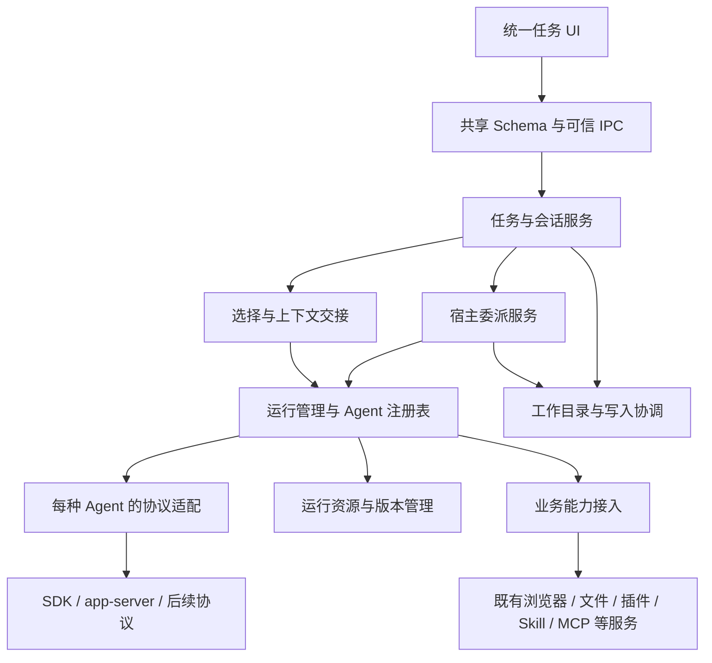

# M14 统一 Agent 工作区技术方案

版本：T0.1，研究收口稿。日期：2026-11-15。需求依据：[R0.2](../需求.md)。状态：设计研究与独立验证已按冻结范围关闭，可作为实施设计依据；产品原型／用例评审、正式开发与产品验收尚未完成，未启动本阶段生产实现。

本稿承接用户最新确认：先对标 T3 跑稳基座；统一 UI、同任务 Provider 续聊、单／多 Agent 均在本期；协作方法复用 Skill，独立团队模板管理与强制阶段流程留待后续。旧[优化方案 R0.2](../../../统一Agent工作区优化方案.md)保留为历史技术基础，其单绑定 SQL、固定 runtime 枚举和“续聊／多 Agent 后续”范围不作为本期实现依据。[专项调研](../../../WillYou_统一任务UI_Provider续聊与多Agent委派迁移调研.md)保留来源与方案比较；当前决策在本稿维护，证据及未决项在[全局验证账](全局设计验证账.md)维护。

初始源码基线：SmartDD `40ea344a930aec37e36a803b7c621d3632d2d75a`；后续受影响模块已按实验复核至 `5a9e04382441e24624cb94635f9d902c543a03d7`，以各实验来源摘要为准，不表示早期实验全量重跑。T3 参考 `f313d0a6cb843551fb60e57a454a71e71a3a8c04`。本文模块／接口名若标为拟议，均不表示代码已存在。表结构、Schema 和原型的具体落地仍需通过文末门槛；不将隔离实验脚本直接作为生产实现。

## 1. 范围与需求追踪

| 需求 | 本稿责任边界 | 主要验证项 |
| --- | --- | --- |
| R01 统一任务 UI | §4、§10，规范历史／工具／请求，不直接渲染 SDK 对象 | Q01、Q37–45、Q51–52 |
| R02 运行生命周期 | §3–4，真实所有权、运行与回合分离 | Q04–05、Q11–12、Q27、Q48 |
| R03 同任务切换 | §5，三类切换、空闲边界、恢复身份 | Q13–16 |
| R04 上下文及来源 | §6，覆盖、未知投递、原文和引用分别处理 | Q15–18、Q46 |
| R05 单／多共存 | §7，模式、原生子 Agent 与宿主委派区别 | Q24–29 |
| R06 通用委派 | §2、§7，同／跨执行器及角色互换 | Q19–20、Q23–29 |
| R07 Skill 复用／扩展 | §7，实际 Skill 调用、公共编排入口；模板产品延后 | Q08、Q19–20、Q23；Q21–22 为后续产品项 |
| R08 现有业务 | §9，数据、入口、授权、生效与释放逐项保留 | Q08–12、Q17、Q37–43 |
| R09 Git／SVN | §8，共享目录单写入者，大项目不全量复制 | Q30–36 |
| R10 渐进迁移 | §3、§11，旧任务／能力快照及回退边界 | Q13、Q46–50 |
| R11 安装／版本 | §12，运行资源与凭据来源分开 | Q02–03、Q06–07、Q53–56 |
| R12 可扩展接入 | §2，Driver、能力及协议适配，第三夹具核验 | Q01、Q19–20、Q29、Q55–56 |

保留浏览器、文件树／编辑／查看、插件、Skill／MCP、项目／配置／凭据、数据库／SSH、邮件、语音和已交付的导入导出能力。M13 的 P1 已完成不代表整个 M13 已交付；所需依赖按现状核对，不自动由 M14 接手全部未完成范围。定时任务仍为 M15，远程／移动及所有额外 Agent 不自动进入首批交付。

## 2. 架构与通用接入

沿用 Electron 主进程、类型化 IPC、SQLite 与既有业务服务；参考 T3 的职责划分，不引入其完整 WebSocket／Effect／远程架构作为前置。

以上为职责，不要求每项成为独立进程。编排和业务规则保持在服务层；IPC、MCP 工具和未来模板只是入口，不各自实现一套任务运行逻辑。

### 2.1 复用点与新增职责

| 已有实现 | 保留的职责 | 需要扩展的边界 |
| --- | --- | --- |
| `tasks/runner-adapters.ts` | 程序发现、配置根、原生会话知识与注册模式 | 新增程序化回合／事件适配；不把 CLI 参数接口当统一聊天协议 |
| `applications/capability-delivery-adapters.ts` | Skill 读取方式、MCP／CLI 入口、能力交付 | SDK／app-server 的明确交付、重载与释放方式 |
| `applications/native-evidence-adapters.ts` | 原生记录与输入证据 | 程序化输入、历史交接及子结果的来源映射 |
| `applications/agent-adapter-registry.ts` | 不可变资源、内容身份、版本支持与加载计划 | 与新运行 Driver 组合；不能把资源包 prepare 等同于运行生命周期 |
| `applications/session-registry.ts`、`run-registry.ts` | 固定能力、原生身份、资源引用、真实所有权 | 从单 task 能力身份演进为显式绑定／能力会话；不删除旧校验 |

T3 对照：`packages/provider-core/src/server/driver.ts` 的 Driver／Instance，`ProviderAdapter.ts` 的能力查询、切换计划和 SessionRuntime；`Orchestrator`、上下文交接及委派服务将通用工作放在宿主。原生 SDK 的类型、异常和特殊字段止于适配器边界。

### 2.2 拟议接入合同

| 合同 | 输入／输出与责任 |
| --- | --- |
| Driver 定义 | 稳定 `driverId`、显示元数据、配置 Schema 版本、支持的资源来源、创建实例方法；ID 不等于供应商品牌或模型名 |
| 配置实例 | 引用现有智能体配置 ID、来源身份修订和模型；解析可用性／能力，不复制凭据管理 |
| 运行适配 | 打开／恢复原生线程、启动回合、回应请求、停止回合、关闭运行、读取历史；可选的历史注入／steer／原生子任务能力单独声明 |
| 规范事件 | §4 的消息、工具、请求、模型、usage、状态及错误；能关联原生身份、输入和运行代次 |
| 资源提供 | 准备、校验和租用确切 SDK／程序／适配资源；未就绪时返回结构化状态 |
| 业务能力提供 | 交付当前运行允许的 Skill、MCP、业务 CLI 与来源证据；读取／写入许可仍由原业务服务裁定 |

能力以“已支持／明确不支持／未验证／当前不可用＋原因”表达。没有能力声明不视为支持；缺恢复能力不伪装成恢复成功，缺写授权证据不因聊天可用而开放写操作。实例能力还要结合具体版本、配置、工作目录和权限判断，启动时复核，不能只缓存 driver 级布尔值。

首批 Claude SDK、Codex app-server；旧 PTY 保留兼容路径。未来允许进程内 SDK、外部程序或服务协议，不把 UI 枚举固定成三种品牌。未来进程内／远端模式的身份与业务授权未验证前，不能拿 Electron PID 或虚构 PID 充当原生执行器所有权。第三测试适配器必须复用同一任务、切换、委派和事件路径；夹具通过不等于额外真实品牌已获支持。

### 2.2.1 公共协议基线 P1／P1.1／P1.2

[可执行 P1 Schema 与检查](实验/20261114_公共协议与Driver调用合同验证/README.md)将接口分成公开命令／查询、内部 Driver 调用和规范事件。公开命令不接受 native ID、PID、秘密、来源类型或自报 parent run；配置只传现有 profile、执行修订、模型和能力／资源摘要，真实 caller 与目标由宿主复核。Driver 的 open/new 与 open/resume 分开校验，startTurn 使用固定输入，业务回应不进入原生 respond。

| 接口组 | 固定字段与处理 |
| --- | --- |
| task.create／draft.save／input.submit | 创建携带 initialDraft，不隐式派发；保存草稿使用 expectedDraftRevision；提交使用 clientInputId、选择及草稿修订，由可信入口冻结 binding、target 和 blocks。深层冻结只防进程内修改，持久去重仍需事务收据 |
| selection.preview／apply | 同一目标结构包含 profileId、executionRevision、configSourceHash、model、capabilityHash、resourceManifestHash；apply 带预检 token 与预期选择修订，实际应用及派发前再次核当前性 |
| request.respond | requestId、完整期望 scope、requestRevision；runtime 只收冻结选项／问题／表单回应，business 保留 action、reviewHash、displayReceipt 并交原服务核验。客户端 source 与存储来源不同必须拒绝 |
| delegation.create／cancel | 创建传候选目标、输入与已登记 directoryId／workspace 模式，parent 由已绑定 caller 获得；取消区分 turn／subtree。运行约束由宿主政策裁定，不由 Skill 或 UI 参数扩大 |
| run／background 控制 | 绑定完整 task／binding／run／generation；后台停止另带 nodeId／expectedRevision。close、interrupt、后台停止不互相冒充 |
| 查询与事件 | 查询 requestId 独立于命令 ID；事件补拉固定 databaseId 与序号范围，历史页 cursor 独立。事件包含时间与来源 scope；任务级配置／草稿事件不伪造运行身份 |

Driver 注册要求明确能力状态和相应方法，但方法存在不等于特定版本已经验证。通用声明无品牌配对枚举；真实所有权仍由 §3.3 的宿主运行服务提供，不能把序列化 scope 当句柄。P1 通过的内容是形状／边界，不是新 TaskCommandService 已接线。

结构化请求只允许适配器准确表达、验证及编码的语义；无法识别的必需原生约束转为明确 unsupported，禁止忽略后默认回答。secret 答案不进入普通事件／日志或通用明文收据。更复杂表单、实际保护存储和协议版本支持继续沿能力矩阵验证，不能将 P1 的有限字段集当所有 SDK／MCP 的完整覆盖。

### 2.3 实例状态与原生协议映射

Driver 注册项保存定义及创建方法；工具映射、流式消息修订、待回应回调、原生关联及连接状态由独立实例／运行持有。不能把有状态 normalizer 放在 driver 级单例供两个账号／运行共用。候选 K31 已复现相同 tool ID 让 A 结果误标成 B 工具，改为每次 attach 创建映射后通过；这与 T3 Driver.create 的实例隔离约束一致。

映射前核对原生 session／thread 与宿主 binding／run／generation，不能因事件来自同类执行器就采用界面当前 task。绑定到出站输入／原生 turn 的终态才更新对应 Turn；Claude 合成历史也可产生 result，不能以 type=result、退出码或 num_turns 单独判定用户回合完成。未映射输入／工具回显只保留诊断或历史来源，不自动生成真人授权。

规范事件在适配器边界校验，原生特殊字段不能穿透成 UI 控制参数；关键必需事件缺失或不兼容时保留明确错误，不能伪报完成。运行时 Schema、方法目录、协议版本及初始化选项一并保存验证身份；按已知来源区分支持的方法与可记录的内部通知。候选核心只映射录制的文本／MCP 工具／终态，完整原生事件及新 TaskService 仍须补验，不能将夹具注册等同于新品牌可用。

原生身份的分配、确认和恢复检查是三个独立事实。T3 Claude ensureThread 先分配 UUID，启动选项用 sessionId／resume；T3 Codex ensureThread 调用 thread/start。WillYou 的公共层因此只要求适配器给出明确身份阶段及证据，不把某个方法成功、进程初始化、已有 ID 或 result 带 ID 直接投影成“原生可用／可恢复”。

| 身份事实 | 公共层处理 |
| --- | --- |
| 尚无 ID／适配器预分配候选 ID | 可以保留启动意图；候选 ID 单独纳入版本化 launch 参数与所属 binding／run，不能提前写成已确认 native 身份或授予业务来源可信性 |
| 实际原生协议确认 ID | 按该 provider 的已知事件／响应检查 run、cwd、stateRoot、预期 ID 和协议版本，再走 §3.2.9 原子绑定；同 ID 幂等，不同 ID 按明确重置流程或报错，不能覆盖原绑定 |
| 读取／恢复原生历史 | 独立记录尝试与成功／失败证据；会话已确认并不保证以后历史存在；缺历史不静默创建新身份或重发未知输入 |

[Claude 身份实验](实验/20261114_Claude身份与恢复联合验证/README.md)验证自动 ID 与宿主预分配 ID 两种方式，真实 system/init 都接入相同 owned run 绑定；新进程 resume 的实际请求包含历史，移开隔离历史后明确失败且无新请求。初始化响应与身份事件分开读取；错误 result 也可带原 session_id，不能据此确认成功。预分配值的生产持久事务、最终 launch Schema 和中途崩溃分支仍须遵循完整合同验证，不能直接照搬实验函数。

### 2.4 配置实例准入与第三适配器合同

目录项不是运行许可。选择与启动计划固定 driver／instance、配置与秘密来源修订、兼容身份、实际模型／cwd、能力快照及所需资源；异步准备／打开前后重新核对。配置未变也可能发生能力或资源状态改变，不能只检查 profile revision。凭据变更需覆盖共享同一凭据身份的实例，沿用已有来源服务和租约，不把秘密正文放入目录或兼容摘要。T3 的 Instance／continuationIdentity 与 Registry 的 credentialBinding／withAccess 是参考边界。

| 能力／结果 | 公共服务行为 |
| --- | --- |
| turns 可用，requests 不支持 | 允许普通回合；需要请求回应时再明确拒绝或降级，不把 requests 作为所有聊天的前置 |
| 可运行但无宿主工具通道 | 可作为被委派目标；不能宣称它能主动调用宿主委派，不按品牌硬编码主／子资格 |
| resume 明确不支持 | 在历史路径与资源条件允许时新建原生绑定，保留旧 lineage，重新计算覆盖；不可伪报恢复旧线程 |
| resume 未验证／暂不可用 | 保留原因并阻止不成立的复用计划，不能伪装成不支持以自动绕过 |
| 历史注入明确不支持 | 仅在已声明并验证的内联替代路径上交接；目标必须仍满足身份、来源及预算要求 |
| 交接 unknown／not-sent | 分别保留，不凭失败自动改路径或重发；按 §6 的证据和恢复规则处理 |

[第三适配器公共合同实验](实验/20261114_第三适配器与公共任务合同验证/README.md)已用三个合成协议适配器、同一候选任务服务与 SQLite 验证切换、九种主／子配对、来源、未知投递与配置／能力竞态。它补足第三 normalizer 以外的局部公共路径；真实 TaskService、业务、owner／目录租约、持久调度、完整 Schema 和 UI 尚未实现。实验曾只检查配置修订，未拒绝能力在打开途中改变；候选补上能力快照复核后通过。正式实现须用真实资源探测与准入机制取证，不能只复制候选内存检查。

### 2.4.1 新 Agent 接入与宿主公共边界

注册边界只增加 Driver 定义、配置解析／探测、独立实例工厂及能力声明；运行实例负责原生进程或连接、事件规范化、MCP 参数映射与明确的恢复结果。公共 TaskCommandService／调度器使用 P1.2 冻结目标和 C1.2 记录，不增加品牌配对表；主／子共用目录、准入、创建运行、停止和历史入口。角色不会隐式授予 hostTools、业务写入或来源权限。现有 RunnerAdapter／CapabilityDeliveryAdapter／AgentAdapterRegistry 的注册职责分别迁移到此组合，旧 CLI 路径继续由原适配器承担，不要求一次替换现有业务服务。

宿主创建绑定级能力会话与独立 run，持有不可复制的 owner 句柄，完成进程出生身份登记后才放行原生执行。每个 run 单独准备私有桥票据；子任务既不复制父句柄、票据或 PID，也不因父仍活跃而延续已停止子运行的权限。原生工具调用进入现有 broker／内核 peer 检查、CurrentApplicationAuthorization 和 ApplicationToolService；实时启停、连接及业务授权继续由这些服务决定。缺宿主工具通道／恢复能力按 §2.4 表处理，不能用品牌名猜测或默默改目标。

[F02 实验](实验/20261114_F02第三适配器私有业务桥验证/README.md)已以第三脚本适配器的两个真实运行，在相同公共路径验证主／子任务独立业务身份、当前政策拒绝、旧 scope／复制句柄拒绝和退出收束；§4.22 证据负责切换、九配对及能力缺失。父子关系在本批预置，完整命令／调度／结果回收仍按已有合同实施并执行 A01／A19／A23，不能把实验夹具直接作为生产调度器。现有研究脚本中的 Claude／Codex 工厂分支只负责当时的固定原生探针，不是正式通用接入接口。

T3 的 ProviderDriver.create／ProviderInstance 提供定义与实例分离的参考，但其 Registry 仍有发现／认证等厂商特例。本方案要求任务、委派和业务授权不随品牌组合扩张；不要求消灭适配边界内有依据的厂商策略，也不把夹具通过当新真实品牌已获支持。

## 3. 身份、数据与能力会话

### 3.1 分开保存的对象

| 对象 | 身份与关键约束 |
| --- | --- |
| Task | 用户看到的稳定逻辑任务；保留现有 taskId、项目、标题、工作目录和归档关系 |
| ProviderBinding | 某 task 的一个原生绑定：driver、配置兼容身份、配置根／cwd、nativeSessionId、原生历史 lineage；不与模型供应商名称混同 |
| CapabilitySession | 一个绑定采用的不可变能力快照／修订，引用真实资源；历史引用与当前是否可执行分别保存 |
| ExecutionRun | 一次打开后的实际执行所有者及代次，引用确切 binding、能力会话、配置来源和资源租约；可服务多个回合 |
| Turn | 一次提交到终态的工作；固定实际目标、输入、权限、模型、来源和幂等 ID，不随界面当前选择改变 |
| ConversationItem | 规范消息／工具／通知，稳定 ID、顺序、内容修订及原生映射；存储与流式事件缓冲分开 |
| RuntimeRequest | 审批／提问／表单／URL 等待项，归属精确 task、binding、run、generation 和来源服务；turn 按原生协议可为空，不猜关联 |
| ContextTransfer | 冻结历史载荷及其摘要、覆盖项目／遗漏、目标原生身份、投递代次和结果 |
| Delegation／CompletionDelivery | 父子逻辑任务、创建幂等、运行／结果状态及回父投递；不伪装为新真人输入 |

Task 可有多个绑定，绑定可有历史能力修订；一个 ExecutionRun 只能使用一份明确的能力快照。一个 task 的普通回合按队列执行，未决派发不能被另一次提交覆盖；多个子任务可独立运行，但共同遵守工作目录约束。原生线程标识须包含 driver／身份根等作用域，不能仅凭相同字符串去重。

### 3.2 旧能力表的迁移方向

当前 `capability_session_snapshots`、identities、refs、mcp_names 按 taskId 定位；run-registry 也读取该单绑定关系。仅加 ProviderBinding 表会继续冲突。

候选方案采用新的能力会话 ID 与显式映射，旧 v2／v3 JSON、摘要、原生身份与资源引用保持原样，通过兼容映射关联到默认 binding；新多绑定路径使用新的版本化快照合同及绑定级查询。不能伪造第二个 taskId 来绕过旧保护，也不能把旧快照覆写为当前 Provider 的内容。[现有表隔离实验](实验/20261114_能力表迁移验证/README.md)已执行全部 32 份现有 SQL，候选方案的 13 项数据库检查通过；补充[合法快照实验](实验/20261114_合法能力快照与绑定迁移验证/README.md)已使用真实 v2／v3 Schema、注册器及计划／回收服务验证局部合同；新外层记录、应用迁移器与服务接线仍须在 Q13 定稿，不能直接采用实验 SQL。

建议保留 `capability_runs.run_id` 和现有业务外键，在原表增加能力会话／binding 关联。`application_invocations`、运行准备及桥观察等已有表引用它；另起运行表不能自动满足这些引用。候选重建移除 task 对单快照的外键、增加 task／binding／能力会话复合约束；只按精确摘要回填，hold／未匹配历史保留 legacy，不猜映射。runner／快照摘要的语义一致性和历史多修订还需完整合同约束。

资源读取和回收必须同步覆盖新旧引用，至少包含 `resource-gc-plan.ts` 的引用查询、`resource-graph-maintenance.ts` 的最终保护及 `version-maintenance.ts`；既有原生身份注册与 MCP 名称分配也需统一冲突域。保留 runId 不会解除 `plugins/project-policy.ts` 等现有 pty_id／可信运行句柄要求，仍须按 §3.3 接入真实程序化 owner。

新 Skill／MCP 投影和运行目录应按能力会话／binding／run 区分，避免沿用只含 taskId 的路径造成跨绑定覆盖。保留命名冲突检测、资源完整性和旧原生记录恢复要求；当前权限撤销优先于历史快照，不因引用旧修订保留已撤销授权。

### 3.2.1 内容版本、绑定关系与既有业务语义

旧 v2／v3 快照和 run-plan-v1 都是严格 Schema，直接添加 bindingId 会被拒绝。设计采用版本化外层关联保存 taskId、bindingId、capabilitySessionId、contentHash 与原内容；解析旧内容时保留其 schema 和精确规范字节，不为缺省字段补默认值。实际 v3 的 externalPlugins 缺省与显式 [] 摘要不同，迁移不得把两者自动归一化。外层候选仅验证这一存储方向；生产合同仍需补齐资源闭包、投影与权限校验。

首次 native.sessionId 从 null 绑定后，snapshotHash 改变、selectionHash 保持；capability_snapshot_versions 的旧内容仍可能被运行计划引用。迁移须保留当前与历史修订的精确摘要及所属关系，不能只保存最新内容。库模式采用等其他修订不得混同首次原生绑定；沿用原来源例外的条件，不能因 task 相同就接受不同选择。run-plan-v1 保持原样可读；新运行计划使用显式版本化绑定上下文，并在 run、计划、快照查询三处核对同一 task／binding／capabilitySession，不能只比较 contentHash。

内容 hash 标识内容，不是访问权限。两个历史关联可以引用相同内容，但每次读取／执行须核对完整所属关系、资源与当前政策；相同内容不允许复制 native 身份或共享可变投影。新旧路径共同使用同一 native／MCP 冲突域；现有按 task 分配的名称和目录不能直接套用到第二绑定。

B11 实际运行旧回收计划器，证实只保留新表引用会将资源标记可清理；B12 证实旧来源查询读不到仅迁入新表的版本。切换新写入前，必须让快照读取、历史来源、计划生成、GC 计划及最终删除保护同时识别新旧关系。过渡期保留旧引用，或明确阻止尚未适配的回收路径；不能在真实服务未覆盖时先解除旧引用。历史 tombstone／hold 与执行租约分别保持保留语义。

能力选择快照不等于所有业务版本冻结。历史内置应用资源、v3 运行按项目当前设置生成的应用授权视图、共享 Skill 库的现行更新语义、外部插件的启动发现／实时调用是不同合同（v3 实际证据见 §3.2.5）：当前 externalPlugins.packageHash 是启动审计身份，调用由 PluginSessionTools／PluginLifecycle 核对当前安装版本、启用状态、能力兼容、政策与在途租约。M14 不将其改成强制使用旧插件包，也不绕过实时停用／权限撤销。§9.5 已补同 task 两端原生 MCP／真实插件处理器和宿主进程复用；§9.6 又补父子同时审批与兼容更新；§9.6.1 补拒绝、保留数据卸载和 semantics 不兼容分支；保留／最终清理的研究交界按 §3.2.17／F10 收口；其他产品竞争与崩溃按 A40 回归。

### 3.2.2 迁移目录与旧写入口的具体约束

[绑定与迁移实验](实验/20261114_绑定身份与旧入口迁移验证/README.md)将实际合法 v2／v3、旧运行准备、旧 reserve／bind 与候选关系表接在同一隔离库；最终十六项，包括三个真实 Node 宿主 SIGKILL 窗口。候选表名与 SQL 仅为设计证据，应用迁移器尚未接入。T3 的 ProviderInstance 显式区分 instanceId／driverKind／continuationIdentity，ProviderSessionBindings 将 provider session 与 thread 关联独立保存；WillYou 采用对应的对象分离，但保留自身能力资源与业务 run 引用，不能直接套用 T3 投影表。正式关系至少满足：

| 关系 | 必须保持的约束 |
| --- | --- |
| binding | 稳定 bindingId、所属 task、driver、配置兼容身份、canonical native 根／cwd；非空 native ID 在 driver／身份根作用域唯一，新旧入口共用冲突域。导入缺配置身份时标待解析，不凭 runner／显示名猜账号 |
| capability session 与 revision | session 属于精确 task／binding；current pointer 指向该 session 的精确 revision。旧内容保存原 schema、规范摘要、原字节与 selectionHash；内容相同不获得另一绑定权限 |
| run 关联 | 保留 capability_runs.run_id 及旧业务引用；以 task／binding／capabilitySession 分别关联不可变启动源修订和当前原生修订，并核 driver。programmatic 行要求两种 hash、关联、正整数 generation 非空；交付来源不能引用会被首次原生绑定更新的 current hash，见 §3.2.9 |
| 资源及原生名称 | ref 同时属于精确 session／revision／task，核资源 ID、kind、hash、位置与闭包；MCP 名称和 native claim 的旧 INSERT、首次绑定 UPDATE 及新入口都受统一冲突检查 |
| 原生身份占用 | 非空 native ID 按 driver／canonical root 唯一归属精确 binding／task；同 binding 可保留多个历史根，变更当前根不释放旧根。另一 binding 即便 task 相同也不能重占；新旧入口共用投影并规范化路径，不能只查 binding 当前根 |
| 身份占用来源 | 历史 claim 关联经过 Schema／摘要／任务核验的原 snapshot revision；程序化 claim 关联精确 capability revision，来源 task／binding 必须与 claim owner 由复合关系保证一致，不能只分别外键到两端。必要来源受删除保护，新建 claim 的可信原生证据按 §3.2.9 保存；损坏／歧义保持待核查，不凭 JSON 存在授予占用或执行权限 |
| 未解析历史 | hold、未知版本、无法对应的 run 保留原记录和原因，身份占用不能随执行禁用而释放；不同 selection 不套用当前能力。已知 schema0 原生守护与业务授权分别保持；未证明的格式／归属拒绝迁移或执行，不猜映射 |

[原生身份占用投影实验](实验/20261114_原生身份占用投影与绑定原子迁移验证/README.md)已验证合法历史在迁移事务中建立索引化 claim／source 关联：投影失败和关系表整体回滚；旧根、当前根及别名归同一绑定；实际旧 create／首次 bind 仍受约束；来源删除被拒绝。实际 adoptLibrary 的同步提交回调进一步将旧快照／身份、binding 当前根、历史 claim、revision 和 current pointer 一起回滚或提交。候选表名为验证载体；正式迁移须把同一合同纳入版本水位、运行准入与现有恢复／资源服务，不能只复制 SQL 后开放新入口。保留历史／异常格式的候选分支见下段；共同写入口及恢复／GC 研究按 F01／F06／F08／F10／F14 收口；正式迁移和 App 接线按 A13／48／50 验收。

[保留历史实验](实验/20261114_保留历史身份占用与异常迁移验证/README.md)复现前批投影遗漏 hold 历史根。现行合同要求保留身份 owner 与可执行 capability session 分离：已知 v2／v3 hold 及当前 holdUnknown 生成的 schema0，验证摘要、形状和独立 identity 后保留当前／历史根及来源，不自动创建可执行能力修订；原记录和 hold 状态不变。若保留 owner 采用 binding 行承载，须以保留来源关联和缺失可执行 capability 明确区分，不能将行存在或 historical phase 视为 prepared。未知新格式、损坏来源、缺失或重复身份及别名变化无法核验时，当前候选整次迁移回滚，原数据保留，不能按空闲放行。正式应用需显示准确失败来源及可继续使用的旧入口范围；自动修复或局部迁移不是本实验已证明能力。

不能将 hold 一律解释为完全禁止原生运行：当前 schema0 history-unknown 有 reserveNativeGuard，允许受管的原生生命周期，但不提供应用业务权限。实验中其准备／取消仍有效，assertActive 与 reserveBridge 均拒绝；普通业务 reserve 对 hold 返回 RESOURCE_STATE_CHANGED，未建立 run。M14 保留这一已有分层，真实 TaskService／CLI 恢复仍需验证，不以业务能力禁用顺带删除原生历史入口。

迁移先进入已有启动排他／维护协议，核真实 owner 与进程范围；取得写事务后再次检查数据库运行／资源状态，保 ID 重建、复制精确关联、校验外键并写迁移回执在同一事务完成。实验的 DROP 前／后及 COMMIT 后退出分别证明 SQLite 回滚或回执恢复；不证明完整应用启动排他已实现。旧版本读取／写入门槛须在新入口启用前生效，不能指望新增表让旧客户端自动遵守新语义。

同一 task 启用 programmatic 后，旧 reserve／身份更新不得继续写该任务，但旧历史读取保留；未切换的 task 继续沿旧入口，仍须与新 binding 共享 native／MCP 冲突域。实验实际调用旧 reserve 与 bind 证实写守卫可阻挡，不能仅阻止旧 UI 按钮。业务代码应显式识别入口模式与迁移版本，数据库 guard 只作遗漏路径的最后防线；转回旧入口必须先满足 §11 的停止／未知操作／兼容条件，不能直接改回标志。

scope 的结构 Schema、持久关联、实际运行权限是三层检查。`generation=1` 或 hash 匹配只证明数据形状／归属，不能把可序列化 scope 当作 run handle。实际执行仍核可信 owner、当前 generation／连接、资源与实时政策。保留旧 refs 可使旧 GC 继续保护原历史，但不代表新绑定引用已独立接管回收。§3.2.3 已有实际应用包／运行时清理的候选证据；统一读取、版本展示、引用写入及实际删除服务全部接好并验证前，仍不解除旧保留或开放未知新资源清理。

### 3.2.3 多绑定历史引用与最终清理保护

[多绑定回收实验](实验/20261114_多绑定资源回收与最终保护验证/README.md)复现：合法 v2 历史迁入新关系、旧引用仅在隔离夹具中移除后，未经适配的实际 GC 会删除新绑定仍依赖的应用包及旧运行时。现有代码并不认识新表，不能仅改任务入口或 UI 引用计数就启用迁移后的清理。候选构建同时补计划器和最终删除检查，十项实证包括物理删除／保留、最终事务竞争、完整取消、未知历史及租约。

| 保留依据 | 迁移后统一规则 |
| --- | --- |
| 旧／新历史 | 合并旧 session refs 与每个 binding／capability session 的全部有效历史修订，按精确摘要关联资源；不能仅看 current binding 或最新 revision |
| 归档与未知 | tombstone 保留依赖；hold、未映射 selection、未知迁移版本、缺 cap 的历史绑定和损坏引用阻止对应不安全清理。无法确定影响范围时暂保留全局 hold，并保留可核查原因 |
| 资源依赖 | 被保留的消费者保护其完整依赖闭包；共享运行时及新默认版本独立保留，不能因旧包不再默认就推断依赖可删 |
| 使用租约 | 实际 run、UI、索引及其他既有使用者沿原租约保护；运行结束仅释放运行占用，不自动释放历史恢复依据 |
| 计划与执行 | 统一保留依据进入 planHash；最终写事务重新检查，在标记 deleting、物理删除以及恢复时使用相同范围的保护，不能只在预览阶段检查 |
| 新引用写入 | 与清理共用既有 C 协调顺序；短事务核资源身份、hash、generation、ready／valid，失败整组回滚。deleting 后不得接纳新引用；绕过入口的异常记录仍由最终删除检查兜底 |

版本管理展示需同时提供逻辑 task 数、binding／历史引用及运行租约来源，重复引用不夸大任务数；其 canCleanup 必须来自同一保留依据。候选 G09 曾遗漏未映射历史而误判可清理，补齐后通过，因此不能把“没有完整 cap／ref”当作零引用。

前批原子创建与历史迁移使用不同 binding Schema；§3.2.4 已在统一候选关系下补首次准备、取消及回收的局部证据。正式模型仍须区分尚未准备的目标、已经持有资源的绑定与缺失历史的异常记录。planned 身份本身不等于已持有能力；取得资源前建立真实租约／引用，失败或取消按实际资源和进程状态释放。不能用 native_id 是否为空作唯一判据，也不能将“所有缺 cap 都 hold”的旧候选规则套入创建服务。完整运行计划、子投影、原生启动与 owner 恢复尚未联合验证。

这批物理清理只覆盖已有应用包／runtime 资源，使用进程身份夹具和精确 checkpoint 注入；没有证明完整多宿主竞争、新 SDK／native 二进制生命周期、Skill 投影或版本管理 UI。独立资源种类的发布／升级／回退仍按 §12 与验证矩阵收口。新增保留依据不改变既有插件实时版本与权限规则，也不授权自动清理外部安装的 CLI。

### 3.2.4 创建目标、准备占用与能力历史的统一模型

[统一绑定实验](实验/20261114_统一绑定准备与资源保留验证/README.md)将同库子任务创建与旧能力迁移使用的绑定关系统一，并接候选资源准备及实际 GC；十一项局部验证通过。首次目标记录可分配稳定 bindingId，但配置目标尚未解析／能力尚未准备时，不伪造 native ID、cap 或可执行 run。状态必须描述明确事实：

| 阶段 | 持久事实与资源规则 |
| --- | --- |
| planned | 固定目标配置身份／修订、task、binding、cwd、输入／turn 与创建回执；无能力历史不算损坏，无真实占用不全局阻止清理。启动时重新核目标可用性 |
| preparing | 保存不可变准备内容、schema／内容与 selection 摘要、准备代次／token、必需资源精确引用与 generation；进入异步准备前在协调锁及事务内建立保留依据，GC 的计划与最终保护都可见 |
| prepared／历史保留 | 目标和资源再次核验后，能力历史及正式 refs 入库与准备引用释放原子完成；记录存在仍不代表真实 run 已启动。归档保持历史引用 |
| 取消／失败／结果不明 | 确定未派发且无真实运行占用时可释放对应准备；已 dispatching、启动不明或 owner 未收口时保持占用并待核查，不能用超时或 UI 关闭代替进程结论 |

准备开始前从合法能力内容求必需资源集合，并核完整依赖保护；只校验调用方提供的 refs 会漏掉整项资源。提交必须与已持久冻结的内容匹配，不能仅验证资源 hash——相同包／runtime 仍可承载不同的允许操作或能力选择。短事务只做登记和核对，文件复制／网络／原生启动留在锁外；发布后再核配置来源、权限和资源代次。

实验 U09／U10 分别先复现漏引用和更换能力内容，再补检查；U11 验证准备提交后真实 Node 宿主退出，引用仍保留，可依据数据库原计划显式恢复。该证明不包含子 Agent 启动、真实所有权恢复或完整投影。新关系下的多绑定／多次准备、旧写守卫、并发创建与迁移退出需按同一最终 Schema 回归，不能直接沿用不同候选表上的全部旧结论。候选准备表亦不取代正式 run-plan 与权限判断。

### 3.2.5 历史来源、启动交付与当前业务授权

[运行计划与实时授权实验](实验/20261114_运行计划与实时业务授权验证/README.md)直接执行现有 v3 会话、v1 计划、运行注册器和工具服务，八项通过。保留既有 R17：启动计划用于记录该次加载；每次业务调用仍由 `CurrentApplicationAuthorization.view` 读取当前项目／目录应用、活动版本与连接槽修订。启用、停用、升级可改变同一 run 的当前视图；既有授权与具体业务执行的最终判断继续保留。

| 数据 | 新基座中的职责 |
| --- | --- |
| 历史能力快照／revision | 保留原字节、内容摘要、原选择与所属绑定；用于身份、恢复、历史依赖及来源核验，不代表当前业务许可 |
| 准备与启动记录 | 准备内容一经固定不得被异步结果替换；launch plan 记录本次交付、入口、版本、沙箱与资源审计。原生首次 ID 绑定等既有来源例外单独验证 |
| 当前业务视图 | 由当前宿主业务服务按调用重新计算，使用现行项目开关、目录状态、版本、连接和权限；不覆盖持久 launch plan，也不从旧计划恢复已撤销许可 |
| 活运行权限 | 由真实 owner、run／generation、可信句柄及实时政策核验；以上任一可序列化记录均不能独立签发执行权限 |

已验证的区别：历史快照含应用而启动计划为空可以合法；同 run 启用后工具可见，停用后同一成功 requestId 仍被拒绝；升级后新调用使用新包，旧快照和启动计划原字节不变。重新打开生成新的启动记录，可以继续关联原 snapshotHash。当前授权视图的 planHash 可能不同于持久 launch planHash，诊断／投影必须标注二者角色，不能误判为审计篡改或写回覆盖。

v1 计划是严格 Schema，直接添加 bindingId 或只改版本字符串均失败。拟议新版本需要分开关联来源 revision 与启动交付内容，保存 task／binding／capabilitySession／run／generation、配置兼容身份以及 SDK／原生程序／适配器的精确版本；实时授权仍从既有服务计算。新读取方要区分 v1 与新版本，AgentAdapterRegistry 的加载、运行注册器、业务来源和诊断一起适配；只加外层不代表这些路径兼容。完整新 Schema 和多绑定运行计划尚未完成验证。

§3.2.4 的“冻结准备计划”只针对准备与交付依据，不冻结整个会话的业务权限。R16 的共享 Skill 库仍按原更新语义交付，外部插件的冻结 Skill／实时调用另按原合同；本批 plan.skills 为空不等于 SDK 没有 Skill，也不是全部插件分支已通过。测试使用 SQL 配置与合成只读执行器，未验证在途真实业务授权、连接切换、SDK 投影或完整安装包。

### 3.2.6 启动资源不能只依赖历史引用保留

[启动资源实验](实验/20261114_启动资源与历史引用分离验证/README.md)把 §3.2.4 的准备候选与 §3.2.5 的不同启动选择合并：历史包为 A，启动计划选 B，默认版本再升 C 后，只持有 A 的候选允许实际 GC 删除 B，受控后续文件读取失败。这个反例以“准备后仍需消费 B 的文件”为前提；仅用于审计的 B 可清理且原计划仍能核验，不能把 launch.applications 自动当作依赖清单。补 B 的准备引用可阻止删除，但沿旧候选 finish 会把 B 混入 A 的历史 refs。该反例说明前批通过不覆盖完整启动资源合同。

新模型先区分审计元数据与实际消费依赖，再按保留理由区分关联；GC 使用全部有效理由的并集，释放按所属生命周期进行：

| 关联 | 保留与释放边界 |
| --- | --- |
| source revision 的历史引用 | 属于精确 task／binding／capabilitySession／revision；切换、启动失败或 run 结束不自动释放，按历史保留规则处理 |
| delivery plan 的准备／交付引用 | 属于准备代次、计划摘要与预留运行身份；包含之后确需读取／执行的包、程序／适配器、冻结投影等依赖。源码历史未列出的启动资源仍须保留；本机共享 Skill 则沿既有库语义，不强行变成每次冻结副本 |
| live run 的资源租约 | 真实所有者核验后接管启动所需资源；在协调边界内先提交接管成员，再结束相应准备占用；允许短暂重叠，不能先释放后登记，也不能由序列化 runId 冒充 owner 证明 |
| 实时业务操作占用 | 业务按当前授权选择资源并沿既有在途租约使用，不依赖旧 launch plan 代替当前检查；业务结束与 Agent 回合结束分别处理 |

同资源可以同时有多种理由；去重用于资源枚举，不合并各自的释放权。保留依据及 planHash 覆盖这些理由，最终删除／恢复与新引用写入继续共用 §3.2.3 的协调边界。准备取消只释放该准备确切持有的引用；派发／进程不明保持待核查，历史和其他运行占用不得被一起释放。

确定新 run-plan Schema 时，来源快照身份与交付计划身份分别关联精确资源集合；准备提交后的交付集合仍有独立持久记录，不把额外启动包自动改为 source revision 内容。真实运行接管前还要复核配置、政策、资源与计划修订。受管 SDK／native 资源归该生命周期；外部安装的 CLI 记录选择与校验身份，不获得自动删除权。

本批 L01 是带迟后文件消费者的风险复现，L02 是准备阶段保护，L03 明确保留理由尚未分离，L04 只验证未 fork 取消，L05 是无文件依赖的审计对照。当前共享库或已复制并验证的 FrozenPluginSkills bundle 不应一律长期保留原包；保留实际消费对象及其证据。因此完整计划／引用角色／真实 owner 接管仍为 D01＋D06 必须补验项，不能标成已完成或仅剩产品 UI。

### 3.2.7 交付接管必须同步覆盖租约成员读取

[交付接管实验](实验/20261114_交付资源接管与运行租约验证/README.md)使用实际运行注册器签发的句柄，将额外交付包和 runtime 加入真实 run 租约成员。原 GC 只读取主租约根资源，因此准备租约结束后仍判额外包可清理；候选补全成员读取后取得九项局部证据。这是新接管路径的迁移要求，不能据此宣称旧用户数据已出错。

接管按以下边界设计：

1. 目的 run 必须是当前宿主签发且仍可接管的真实句柄；序列化 runId 或复制对象不能作为所有权。最终 Schema 还须绑定 task、binding、source revision、准备代次、delivery plan 摘要及目标 run，不仅校验 task 相同。
2. 在资源协调锁与短事务内复核准备占用、当前政策、目标 run 与每项资源的 hash／generation／路径／状态，写入精确 run 成员；失败回滚不释放准备保护。不能由 UI 或工具绕过此入口直接增加成员。
3. 先提交目的成员再结束源准备占用，允许短暂重叠，不允许无保护空窗。只有本次交付有权结束自身准备占用；历史、UI 和实时业务占用分别释放。目的 run 已停止或未知时不允许借接管恢复授权。
4. GC 的预览、依据摘要、最终删除和恢复，必须统一读取所有未释放主租约及其成员，并与 §3.2.3–3.2.6 的新旧引用共同核验。成员单独改变也必须令旧计划失效；资源已 deleting 时正确接管入口拒绝，绕过入口的异常写入由最终保护停止删除并保留现场。
5. 未知派发／进程退出、在途业务及准备与 run 重叠的崩溃恢复，以持久身份与真实所有权证据收口；不能凭回合完成、超时或 root 进程退出直接释放。

本批 actual owned-handle 校验、run 成员保护检查与停止路径已复用；候选 GC 补读取仅在实验内。H05 为进程身份夹具，H09 为单宿主 raw SQL 注入；统一保留／接管研究由 §3.2.17／F10、启动与来源由 F03／F06 补证；完整产品计划／SDK 接线按 A04／48 验收。不能直接把实验函数或 SQL 作为产品实现。

### 3.2.8 持久交付记录与中断后的释放判定

[持久接管实验](实验/20261114_持久交付接管与宿主中断恢复验证/README.md)将候选历史／准备读取和 run 成员读取合并，用实际 Mac 宿主身份及 run recovery 验证四个可收口退出窗口与一个未知派发窗口。十项证据来自两个有明确来源的尝试；仍是合法旧快照和 legacy run 加候选关联，不是完整新程序化运行计划。

交付记录须与源历史分离，包含 store、task、binding、capabilitySession、source revision、目标 run／generation、配置身份／修订、交付计划版本／摘要及实际消费资源。关系列、规范计划与成员表相互核验；来源、目标或资源变化不能只重算摘要后继续执行。复合关联防串数据，实际可信句柄及当前政策负责运行授权，两者不能互相替代。

| 持久状态 | 资源含义与后续判定 |
| --- | --- |
| prepared | 交付准备持有精确引用；未接管不能结束准备保护 |
| adopted | 目的 run 成员已提交，准备引用仍在；允许这一安全重叠，重复同一接管不重复注册 |
| released | 仅准备占用结束；run 租约、历史和其他消费者各自继续生效，不表示整个资源可删除 |
| abandoned | 原准备不再执行，结束其保留理由；保留审计依据，其他理由不受影响 |

恢复顺序：核旧宿主的准确 PID／出生身份 → 现有 run recovery 判定进程与活动是否收口 → 协调锁内重读 receipt、精确 run／revision 和全部未决占用 → 满足终态条件才结束准备理由。准备提交、接管事务未提交、接管已提交但准备未释放、准备已释放四个宿主退出窗口已取得局部证据；事务中断回滚不会丢失原准备保护。armed 无 PID 的原 run 仍为未知，不能从旧宿主已退出推出从未派发，继续保留并禁止自动重试。

正常取消与宿主死亡恢复使用不同证明。活动宿主中的取消应由拥有该次启动的闭包提供未 fork 证明，并阻止同一次派发继续执行，再调用现有取消／停止协议；配置撤销不得阻断自己的清理权限。不能要求已撤销的业务许可重新生效才能清理，也不能让可序列化 receipt 或外部调用方声明未 fork。§3.3 已补当前宿主候选取消与两端初始化的局部证据；启动／业务在途研究按 F06／F08 收口；完整 launcher 接线按 A04／27 验收。

本批没有业务 invocation，run stopped 不等于外部操作已核对；未知业务及其独立保留理由仍按 §7.2.1 和原业务合同处理。当前候选 receipt 只是交付占用合同；首批完整 programmatic reserve、应用运行计划加载、两端投影／原生派发及真实业务在途尚未贯通。完整协议设计应吸收上述身份和状态边界，不直接照搬实验表、夹具关联或把未知状态自动改为成功。

### 3.2.9 固定启动来源与当前原生修订必须分离

[首次原生绑定实验](实验/20261114_启动来源与首次原生身份修订验证/README.md)复现前批候选外键会阻止现有 bindNativeSession：实际代码把 null 原生 ID 补为首次 ID 后更新当前快照及 run.snapshot_hash，但旧候选没有同步新 revision，delivery 又把该可变列当不可变来源。此反例是迁移方案缺口，不是当前产品已有错误。

采用以下职责划分，字段名可在最终 Schema 定稿，但不合并语义：

| 记录／引用 | 变化与约束 |
| --- | --- |
| run 的启动源修订（候选 source_snapshot_hash） | 该 run 创建时确定，后续首次 native ID、Provider 消息或当前业务授权改变不覆盖；交付计划／receipt 及启动审计关联它 |
| run 的当前原生修订（现有 snapshot_hash） | 允许经过明确验证的首次 native ID 绑定；对应精确 binding／capability session 的合法 revision，不能用源 hash 替代当前身份检查 |
| 源与当前 revision／资源 refs | 同时保留；首次绑定核仅 native.sessionId 从 null 变为原生 ID，selection、能力、资源、cwd／stateRoot、task／binding 不变；内容 hash 重算不能替代这一关系检查 |
| v1 ApplicationRunPlan | 继续保留最初来源和加载审计，其既有 source 例外只允许首次 native ID；R17 当前业务视图另算，不回写原 plan |
| 后续 run | 使用当次选择的合法修订作为自己的新启动源；前一 run 的来源／审计与业务外键不改变 |

首次 native ID 的写入必须在同一协调边界和数据库事务更新：旧／新身份 claim、当前 revision 及 refs、capability current pointer、仍活动 run 的当前 hash；先检查共享冲突域，再同步投影，任何失败整体回滚。不能 commit 后再异步补新表，也不能把 immutable source 一起改成新值。重复同 ID 可以幂等返回，已有 ID 换另一 ID 则拒绝。

[程序化首次绑定与保留身份联合实验](实验/20261114_程序化首次绑定与保留身份联合验证/README.md)复现早批 programmatic 候选只查旧当前 identity、遗漏已复制历史根 claim 的问题。候选先核共享占用，再原子更新 native revision／current pointer／claim 和精确来源；实际旧 create、新入口冲突、同 ID 重放和两个中途回滚检查通过。新增来源表最初仅独立外键到 claim 与 revision，仍允许跨 binding 错配；失败后补含 task／binding 的复合约束，反例被拒绝。正式模型必须保证 claim owner 与 source owner 相同；这一约束不能只留在写入函数中。实验使用合成首次回调、真实旧会话／复制服务和同库候选，该批未覆盖的真实 owner 与首次回调由下节补证，最终准入按 F06／F08；产品接线按 A13。

**持久身份与当前执行权分别复核。** [真实所有权与身份准入实验](实验/20261114_真实运行所有权与身份准入联合验证/README.md)已将共享 claim／精确来源接到当前源码的程序化研究变体和真实 Codex 首次线程响应：run 固定来源／应用计划不变，当前 native revision 前进；准备、arm、活动 context 均复核来源，缺失或 generation 不一致拒绝。另一注册器、复制 handle 和旧回调不继承当前执行权。正常退出后资源租约释放但历史 claim 保留，后继 run 使用自己的 generation 和当次源修订；不得在 run cleanup 中顺带释放原生历史身份。该实验后继 run 只准备未 fork，不能由准入成功推断原生历史可恢复；后续真实恢复证据及其边界见下段。该批当前源码变体只验证默认 current 分支；后续程序化 run-bound 邮件联合证据见 §9.2.2，原生兼容／业务准入研究见 §11.5／F14 与 §9.2.3／F08，真实产品入口按 A49／41。

发布收据也必须独立于当前 revision：[真实 Codex 联合实验](实验/20261114_原生身份与发布回执联合验证/README.md)已复现首次 native ID 后，原始发布重试被错误要求等于当前 hash。发布收据保存首次请求与其来源，供历史查询／幂等核对；解析当前来源是另一操作，只允许同 binding／cap 中经过合法首次身份转换的修订。同 attempt 重试保留最初请求，不能拿当前 hash 重写它；下一次明确的新 run 选择当前合法修订。原 v1 应用计划、ExecutionPlan 和 delivery 保持字节不变。历史事实可读不表示活动能力有效，hold／撤权后的执行仍拒绝。

回调必须来自已关联的原生协议响应及实际持有者，核对私有 run、其固定 source、runner、stateRoot、cwd 和当前活动状态；不能接受由工具参数拼出的身份。新 run 回调用自己的 source，旧 run／旧来源／复制的 handle 不可代用。首次写入中途故障须整体回滚，精确重试可幂等完成。此次真实 Codex 证据覆盖这条绑定链；§2.3 的 Claude 实验又补自动／预分配 ID 的真实回调与正常新进程恢复，持久输入／范围恢复研究按 F03／F06 收口，完整应用中断链按 A04／05 验收。

原生身份与恢复能力分开记录。Codex 0.167.1 的隔离反例中，thread/start 返回 ID 与 path，空会话退出后 thread/resume 仍报 `no rollout found`；明确注入隔离 developer 历史后，新进程恢复同 ID 成功。因此 ID known 不等于 durable/resumable。恢复记录保存最后一次检查的 run、runtime 版本、身份范围、结果和错误；成功只是当时观察，不是永久保证。遇到缺失历史／状态目录变更／损坏时保留原 binding、统一历史和失败事实，停止自动续传，不能静默换新 ID 并伪装为原生恢复。已有规范历史可用于明确的交接新建，但要生成独立绑定／交接证据并显示恢复差异；未知输入不得因此自动重发。不得为了使空会话“可恢复”自动注入无意义消息。

[原生历史与持久身份联合实验](实验/20261114_原生历史恢复与持久身份联合验证/README.md)在同一研究 Schema 和共享 claim 上验证六个真实 Codex 进程：有合成历史时新进程恢复原 ID，合法追加内容后历史摘要改变仍可恢复；移开隔离历史时原生明确拒绝，保留原 binding／revision／claim，停止失败 run；恢复目录后仅以明确的新 run 再次恢复。恢复观察属于对应 run／generation／runtime／来源，不能覆盖前一失败或变为执行授权。历史文件是可合法续写的原生状态，其 hash 用于一次观察／复制审计，不作为永久不变的原生身份键；固定能力快照和启动源摘要仍保持不可变。

**恢复错误由 Driver 按已核验版本分类。** 当前 T3 CodexAdapterV2 将新建与恢复分开，对归档使用同 ID unarchive 后 resume，对 closing 等待已登记的关闭事件后重试，其余错误继续失败。上述实验已在 Codex 0.167.1 验证归档分支，未运行 T3 本身或 closing 竞争。WillYou 在请求恢复原绑定且当前政策允许时处理这类明确状态；缺历史、身份变化、未知协议错误不能通用重试或静默 thread/start。无可确认响应保留 unknown，不能套用原生明确拒绝的处理；宿主失联／关闭事件／原生降级等分支仍按各自合同验证。

早批两 runner 夹具、实际 v1 来源检查、事务故障和下一 run 已取得局部证据；§3.2.13 及本节新增实验补程序化入口与真实 Codex ID 回调，首次身份之后的宿主中断与业务在途研究按 F03／F06／F08 收口；Claude 正常身份／恢复见 §2.3。这里的修订保存能力／身份 JSON 与引用，不复制 SVN 工作目录。历史未知或旧版本缺少投影协议时，入口应明确阻挡并保留原数据，不能让用户通过反复重试裸外键错误自行恢复。

完整运行计划的读取方已核到九个直接文件及五个间接消费者，清单与源码摘要在实验内。设计至少覆盖：launcher 与 registry 的源／当前身份、adapter 加载时的固定计划、diagnostics 的直接 SQL、CurrentApplicationAuthorization 的实时视图、Skill 及输入来源、工具／CLI／插件调用和 ExecutionContexts 的业务来源证据。新的宿主 ExecutionPlan 独立强关联现有 v1 应用计划摘要，避免把业务允许表和运行身份混成一张任意 JSON；核心关联与原子存储已取得 §3.2.10 的限定证据，完整协议及所有读取方仍须验证。

T3 的 instance 配置与 session／thread 关联分离提供职责划分参考；SmartDD 的 source/current 双修订、资源与业务语义须保留自己的约束。实验 schema 已换为 2，但旧实验 1→2 升级未实现；正式迁移版本和回退门槛必须统一确定，并重核前批在同一最终 Schema 下的适用性。

### 3.2.10 宿主执行计划与应用运行计划强关联

采用独立的宿主 ExecutionPlan，保持现有 v1 ApplicationRunPlan 的业务加载审计职责。前者以严格、版本化结构关联 task／project、binding、能力会话、固定启动源、run／generation、目标配置修订、适配器及运行程序身份、applicationPlanHash、delivery receipt／hash。SDK／原生版本只用于匹配已验证组合，不能替代协议能力检查。真实凭据及完整环境不写入计划；公开诊断只展示允许的来源和版本信息。

[独立关联实验](实验/20261114_宿主运行计划与现有业务关联验证/README.md)在实际 v3 会话、v1 计划、run 所有权和资源库上验证上述核心关联。读取器不能只验 JSON hash：还要从当前 store 核对同一 run、binding、源 revision、receipt、业务计划及适配器。重算 hash 不授权跨身份串用。历史读取与执行许可分别处理，配置失效不使历史审计不可读；序列化对象不能重建进程内 owned 执行句柄。

准备事务将执行计划与交付 pins 一起提交，派发门禁必须检查该提交。原注册器可以先产生 preparing／prepared run 和 v1 业务计划，但在新计划缺失时不得 fork；失败保留可取消／恢复的预留身份，不能按旧 prepared 状态直接继续。接管先形成实际运行租约成员，再释放准备占用；真正原生派发还须通过 §3.3 的同步门禁／attach／退出规则。本批两处异常回滚已验证，没有用异常回滚冒充宿主中断验证。

配置身份必须分层：现有 AiProfileService 的 runner `claude` 经 RunnerAdapterRegistry 映射为能力 agentId `claude-code`，不能对二者裸字符串相等；未来 SDK driver 再由明确的适配注册项解析。这个差异已使早期候选在真实 profile 下失败，候选分别保存并核对两个身份后通过。不要为迁移把旧配置行批量改成能力层名称。

配置修订不得仅复用 updatedAt：实际服务更名也更新时间，同一毫秒的换 Key 可以留下相同时间。目标方案使用宿主维护的单调执行配置修订／凭据版本，覆盖影响执行的命令、参数、环境、账号和来源变化；名称／颜色变动独立处理。现有 launchSignature 可作内部启动内容比较依据，但它基于解密值，不原样作为公开审计／导出字段。缺 Key、commandPending、配置删除与能力不支持在消费前重新检查；外部配置文件的变动也需要来源指纹／失效规则，不能被数据库 revision 替代。实际服务已证实时间戳反例；数据库内执行修订与密钥事务已有 §3.2.11 的局部证据，完整来源向量和原生消费研究已按 F03／F04 收口，正式配置／派发接线按 A06／07／20。

R17 不从宿主计划冻结业务权限。应用启用、停用及当前绑定按原业务服务逐次复核；当前业务视图的 planHash 可以与最初 applicationPlanHash 不同，二者各自标明用途。实际 ToolService 已验证启用后调用、停用后拒绝缓存重试，启动记录未改写。原 diagnostics 的直接 SQL、Skill 输入来源、适配器加载和其他业务读者须逐一决定读启动审计还是当前授权；不得把所有读者一律重定向到新 JSON。

受管程序必须处于精确交付资源闭包；用户指定程序仅记录并校验身份，不获得宿主删除权。内容校验不能证明外部文件在校验到 exec 之间不变；新 launcher 与安装协调的联合验证仍需覆盖该窗口。T3 的 instance／driver 分层与 installation gate 可供参考，其机制不能代替 SmartDD 的持久引用和业务授权。

本批最终运行计划 11 项及真实配置服务 4 项为独立局部证据，未启动 Agent。配置 epoch、程序版本／文件、消费回调仍有明确夹具；实际 programmatic reserve、launchId 拆分、SDK／app-server 消费、所有读取方以及旧研究 Schema 升级尚未贯通，不把该候选标为完整运行协议已定稿。

### 3.2.11 执行配置修订与现有凭据事务

[配置原子性实验](实验/20261114_执行配置修订与凭据原子性验证/README.md)确认现有 AiProfileService 的事务已经覆盖配置行与 SecretsStore 的密文行，迁移应保留它。系统安全存储负责加解密，本地密文仍在同一 SQLite；不为解决修订号另建一套账号／密钥存储。加密失败的现有事务回滚和候选修订一起回滚已有实际服务证据。

每个 profile 维护单调执行修订。旧路径覆盖 runner／命令／参数／环境的持久内容、commandPending，以及当前引用的凭据新增、替换或删除；当前 AgentService 路径还必须覆盖 ai_run_configs 的 tool／source／provider／模型与登录状态，ai_tools 的程序／版本／可用性，以及 ai_providers 的端点／认证／身份／模型可用性和实际 secret_ref。变化在同一写入事务推进，供应商共享凭据变化使所有依赖配置失效。名称／颜色／默认选择与不改变命令可用性的健康结果独立维护，不触发执行失效。修订不表示操作数量，可以一笔保存递增多次；相同明文重新加密产生不同密文时允许保守失效，不把密文相等或时间戳当作语义版本。删除保留失效代次，不因重建同 ID 而复活旧运行许可。

修订覆盖必须落到所有写入入口。现有项目导入直接写 ai_profiles，并先写对应 app_secrets；只在 AiProfileService.update 外加计数会漏掉这一入口。候选 SQL 触发器已验证当前服务写入、直接凭据写入及导入顺序的事务一致性；正式落地须纳入统一迁移器、版本／触发器完整性检查和旧宿主写入门槛。未声明的旧结构不能仅见“表存在”就当升级成功；本批简单幂等探针不替代这些迁移规则。

配置捕获采用同一可信来源：读取修订 → 实际 resolve → 再读修订；中途变更拒绝，不自动换账号重试。明文只留在宿主私有执行上下文，计划记录来源身份／修订；消费前再次核验。外层长读事务可能让两次查询看到相同旧快照，不能将其当最新配置；候选禁止在调用者已有事务里执行此检查，最终锁与数据库协调顺序需与原生派发一起验证。两个 SQLite 连接在实际解密期间交错换 Key 的拒绝路径已验证。

[当前写入口实验](实验/20261114_现有写入口与保留身份配置修订验证/README.md)已用实际 AgentService 复现仅监听 ai_profiles 的遗漏：default_model 改变而旧候选修订不变。C1.1 补齐实体关系后，实际模型／来源、共享 Key、纯改名和事务回滚检查通过；旧 AiProfileService／项目导入路径保留。ProviderService 的模型刷新也直接更新表，不能只在 saveProvider 回调中失效。当前候选对整个目录 JSON 保守失效，检查时间等变化可能带来多余递增；精细拆分可作为优化，但不得漏掉模型下线／协议不可用。完整来源捕获与消费研究按 §5.1.1／F04、§6.2.1／F03 收口；产品接线按 A20。

此修订覆盖宿主数据库中的配置与凭据，不能覆盖用户 CLI 文件、继承环境、系统代理、外部秘密源或程序文件替换；完整来源向量须由对应解析器给出。对新启动、重新打开或后续回合需要准备的新执行计划，配置缺失／待配置／修订变化均不得借旧缓存继续派发；已经交给原生进程的环境不会被计数器撤回，不宣称改 Key 等于所有在途请求已取消。取消／收尾仍按 owned run 权限执行，不能因配置已删而失去释放路径。

T3 的 ProviderInstanceRegistry 在读取到变化的秘密后重建实例，普通重读失败时保留已有实例。参考其“实例生命周期与来源刷新分离”，但不将“已有实例可继续存在”写成 WillYou“新派发可使用失效配置”。完整运行中的回合边界、原生会话重建与来源刷新仍需联合验证。本批未启动 Agent，也未接上一批 ExecutionPlan 的最终消费链。

### 3.2.12 配置修订、运行计划与原生启动的联合边界

[联合初始化实验](实验/20261114_配置计划与两端初始化联合验证/README.md)把 §3.2.10 的宿主计划、§3.2.11 的实际配置修订和 §3.3 的 owned 取消接到同一候选链，取得两端真实初始化及关键改配置窗口的限定证据。前批候选仍残留 updatedAt 检查，更名会误拒绝；负对照已复现，现行设计的执行许可统一使用单调执行修订，不能同时用时间戳和另一套 epoch 各作一遍失效规则。绑定兼容身份与“本次执行选择是否仍有效”分开维护。

配置解析完成后，在准备事务中复核所捕获的执行修订，再与宿主计划、应用计划和交付引用一起关联提交。运行资源接管、arm 后／spawn 前和 attach 后／放行原生程序前，均核同一运行、计划及目标修订；不能在等待资源或初始化期间重新选择配置默认项。spawn 回调使用核验后的执行文件和冻结环境，不从回调参数再选账号／程序。密钥正文不写入持久计划，旧来源的历史审计仍保留。

配置失效的效果取决于实际启动位置：未 fork 时关闭回调并取消预留；wrapper 已出现时撤销放行、停止该进程并等待实际退出；原生已初始化时，旧计划不能授权新的执行动作，但既有进程不会被修订号自动停止，按独立生命周期权显式收口。删配置、换 Key 都不能夺走自己进程的取消／释放权。不要把退出前已发出的外部操作视为已撤销。

两端更名后初始化、arm 后换 Key、wrapper 后换 Key、初始化后删除／换 Key，以及回调替换程序／环境和复制句柄拒绝已验证。当前实验只到初始化，没有模型 turn、原生 thread/start 或业务调用；旧 reserve 后的候选关联、宿主基础环境及能力交付仍有夹具。完整 programmatic reserve、业务桥、输入与首次原生 ID、外部来源指纹、最终检查到 exec 的竞争及 SDK 参数映射仍按各项验证，不将本批称为完整 launcher 已验证。

### 3.2.13 程序化预留必须直接绑定来源，保留任务互斥

[新预留实验](实验/20261114_程序化预留与同任务多绑定验证/README.md)补上前批 legacy reserve 后手工关联的缺口。拟议入口显式接收 taskId／bindingId／capabilitySessionId／snapshotHash，读取该绑定的当前合法能力修订、资源引用及 MCP 命名占用。新任务不为兼容旧按 task 查询而伪造一份旧快照；旧入口继续仅服务旧会话。快照 Schema、包校验、文件完整性与既有实时授权继续复用，范围解析集中在适配边界。

预留在资源协调锁及短数据库事务中复核选择，分配绑定内单调 generation，并一次提交带精确来源的 run、固定 v1 应用计划、owner／进程预留和资源租约。generation 由宿主分配，调用方不得指定；后续私有 owner 校验同一 binding／cap／generation／source，首次原生身份变化仍按 §3.2.9 区分固定启动来源与当前修订。新程序化入口必须提供固定应用计划生成器，不能继承旧入口允许缺计划的可选分支。实际 CurrentApplicationAuthorization 按调用时政策判断，不把固定启动计划当作永久业务授权。

一个逻辑任务允许保留多个 Provider 绑定，任一时刻只允许一个未结束运行；A→B→A 在空闲后使用对应绑定，连续分配各自代次。多 Agent 并发建立独立子任务，不以并发激活同任务两个绑定实现。保留旧首次 native 绑定投影与命名冲突域；新旧入口联合变体曾漏掉旧投影，扩展负对照后已修正，后续组合验证必须包含旧任务首次绑定分支。

本节初次实验仅验证 source／reserve、实际 owner、v1 计划及 R17 局部接线。后续[子任务启动联合实验](实验/20261114_子任务准备与原生初始化联合验证/README.md)已将新任务来源／直接预留与配置修订、ExecutionPlan／delivery／outbox 接到两端真实初始化，并补同进程提交后回执失败的幂等关联（§7.1）。§7.1.2 已补未启动分支的真实宿主退出与下一运行尝试；已派发／范围未知时的研究对账与业务桥按 F03／F06／F08 收口（两端正常首次绑定见 §2.3、§3.2.9），不能以初始化成功声称完整恢复或对话通过。暂用旧 ptyId 内部字段的候选不是最终 launchId 迁移，未支持的程序化 native-only 回退须明确拒绝，不能落回按 task 查询的旧路径。

### 3.2.14 共同关系 Schema 与不可变来源

[候选 C1](实验/20261114_统一数据基线与跨表归属验证/README.md)将能力／run／资源交付与任务图置于同一数据库，并用旧研究 Schema 负对照证明：分别存在合法 taskId、bindingId、runId 不保证它们属于同一任务。开发时以完整归属键关联，不用应用层“先查到 ID”代替数据库一致性。

| 关联 | 必须保持的组合与例外 |
| --- | --- |
| Task 选择、Turn 目标 | binding 与 task 成对；已分配 run 后固定 run／task／binding／generation。排队未取得 run 时两字段共同为空，不伪造执行身份 |
| Delegation、创建收据、outbox | 原始 parent task／binding／run／generation 不可改写；child task／binding／首轮 Turn 对应；run 预留收据指向该 outbox 的确切 child run。委派不能自指或成环 |
| Input 与接受 inbox | 输入关联确切 Turn 和 run，正文、来源、作用域及原 owner 冻结；scope JSON 与标量一致，接受 inbox 关联 input＋scope hash。记录为 ui-user 或存在 native JSON 均不自行授予业务许可 |
| RuntimeRequest／Response | 请求与回应保留 task／binding／run／generation；turn 可按协议为空，但 run 必须一致。业务来源路由、请求 revision、live callback 和类型化答案仍由相应服务复核 |
| CompletionDelivery | 逻辑父 task 不变，待派发结果可选择其新 binding；输入一经派发或未知不能改投。原始委派 parent run 与当前结果目标分开，不能为切换 Provider 改写历史来源 |
| Event 与 Task 投影 | taskSeq、事件与投影同事务；任务级事件不虚构 run，运行事件必须使用完整归属。连续序号、幂等和 payload Schema 还需公共命令服务负责 |

C1 的复合外键和来源触发器已通过隔离检查；同父任务新 binding 与无 turn 请求的合法路径同时保留。资源 delivery／execution plan 和 profile revision 的旧候选 SQL 在该结构中共存，安装故障回滚与重复安装有证据。它关闭关系约束问题，不等于原有各候选写服务已经采用 C1，完整协议、状态转移与真实业务联合仍按验证账 §7 收口。

生产迁移不能直接套用实验 seed。真实任务与历史无法对应时保留未映射记录并阻止无依据的运行准入；不要像关系测试夹具那样生成合成 Task。对既有库的所有写入口、旧数据与回退验证继续保留，历史快照不变成当前授权。

### 3.2.15 既有写入口与可见任务删除

[写入口映射与 C1.1](实验/20261114_现有写入口与保留身份配置修订验证/README.md)按当前代码定位了任务、能力会话、运行恢复、资源租约、项目／导入、智能体／供应商和秘密存储的写入责任及读取消费者。实际服务证明 C1 不能将历史状态表直接外键到可删除 tasks，否则旧任务删除与项目级联都会失败。

因此，可见 tasks 保留原展示／归档／删除语义；逻辑身份及其关系状态可转 retained，继续支撑历史、业务审计、原生占用及资源保留。retained 行不算活动任务，不进入默认列表，不签发运行／文件／业务权限，也不允许仅因 ID 相同自动激活。新任务的可见记录与逻辑身份同事务建立；原历史无法映射仍走既有未解析路径，不能生成可见假任务。

统一生命周期服务在锁内复核关闭与全部未决操作后，同一事务保留身份、清除 active binding、保留 hold／标记能力 tombstone，再删除可见记录；项目删除先处理涉及任务，再复用现有项目事务。归档只改变可见归档状态，不等于删除或放弃资源引用。旧同步 TaskService.delete、项目 controller 的旧 PTY 计数及绕过入口须显式路由，不能仅依赖最终 FK 报错；新入口下真实原生发现／快照更新也不得继续按 task 覆写所有 binding。

C1.1 已验证关系事务、旧入口守卫和实际 ProjectService 级联；未证明完整删除准入。run、独立邮件／缓存／浏览器业务、待投递结果、原生后台范围和目录写入租约须按各自权威账收束，不能复制实验的合成结清。读取计划、连接影响、历史诊断、GC 预览及最终删除／恢复须同时支持新旧引用；保留身份不替代当前 Task／Project 授权。

### 3.2.16 逻辑接受与实际投递的共同事务

[F01 检查](实验/20261114_F01公共命令与共同数据事务验证/README.md)将关系基线补为 C1.2、公共事件补为 P1.1。逻辑任务可在尚无原生 run 时接受输入；不得为满足 m14_input 的运行外键而提前 fork 或伪造 runId。新增不可变 submission 保存 inputId、task／binding／turn、目标修订、完整 blocks 与宿主判定来源；queued turn 可以没有 run，待实际准入／分配后关联原生投递证据。旧证据不自动回填成可信真人输入。

| 入口 | 同一写事务中的责任 | 提交后的责任 |
| --- | --- | --- |
| input.submit | 可信入口复核；比较 selection／draft 修订；冻结 submission／turn；清草稿并推进修订；input.queued／draft 事件、taskSeq 和命令收据 | worker 在真实 owner／目录／能力准入下分配运行、投递并关联原生身份；接受不等于原生接收或业务许可 |
| delegation.create | 复核 parent／目标；创建可见 child／planned binding／submission／turn、delegation／outbox、父子事件、来源投影及公共收据 | 子准备、资源接管、启动和结果回收沿各自状态机，不在数据库事务中调用 SDK |
| task.delete | 在同一权威协调范围内复核实际结束／业务／资源资格；逻辑身份 retained，保留 hold／历史引用；删除可见 Task；事件／收据 | 依已有意图执行可恢复清理；不在记录删除中顺带删除原生历史或用户目录 |

公共 command receipt 按可信 caller 命名空间＋commandId 查重，保存原请求摘要及原响应；先复核调用权限再返回收据。同 command 内容冲突拒绝；相同逻辑 clientInputId 的新 command，在原请求一致时关联原 submission，不因当前选择／草稿变化重新发送。回执描述历史接受结果，当前状态从投影读取。现有 delegation receipt 作为来源投影与公共收据同事务生成，不能成为另一个执行决定源。原生端的 clientId／UUID 不承担宿主去重保证。

P1.1 增加任务级 input.queued（inputId／turnId／bindingId）和 task.record.changed（可见／保留状态）事件；它们没有运行 scope。UI 可从逻辑输入与 turn 投影显示待准备消息，不能因缺 run 隐藏已接受内容，亦不能显示为原生已接收。SDK 原生回合事件仍要求精确运行身份。输入／上下文的实际消费和 live 来源授权继续按 §6.1–6.2，不能从数据库的 ui-user 字段签发许可。

现有 TaskService.create 的 spawn-before-insert 只留旧 PTY 路径；新命令服务先接受、worker 后执行。现有 delete 的 kill／watcher 操作须与新记录事务分阶段；项目删除应用同一任务保留合同后再删除可见项目。其他 18 文件写入口责任沿 §3.2.15，配置修订与持久回执仍同库事务。完整清理资格由执行范围、业务结果和资源保留服务提供；F01 的依赖夹具不得直接作为生产守卫。

共同结构必须注册到现有正式 migration 清单、打包水位与维护协调器，使用 §11.3 的前缀／摘要拒绝规则。C1.2 的研究安装 marker 只保护隔离基线，不替代产品升级注册。最终迁移器与新业务接线按 A13／A43／A48／A50 验收；本轮 12 项事务检查不等于这些产品用例通过。

### 3.2.17 统一保留查询与按资源种类清理（F10）

F10 按[当前实验与来源审计](实验/20261115_F10统一保留与最终清理验证/README.md)研究关闭。公共命令仍为 P1.2；共同关系实验基线由 C1.5 增量为 **C1.6**，保留之前全部表／触发器，增加安装默认与 attempt 关系、内容描述索引、短期读取租约、冻结目录索引、发布代次及清理意图。原 C1.1–C1.5 不是另一个可任选的实现版本。C1.6 是研究合同及隔离数据库，不是已发布的产品迁移；正式迁移／业务接线仍按 A 用例。 当前共同基线在其上叠加 Git 准备、只读历史及 §11.5 的复制关系，为 C1.9；原保留根和清理规则继续适用。

**职责。** 设置一个宿主 `RetentionQuery` 服务：在调用者持有的资源协调范围和同一 SQLite 读取视图内，返回资源身份、保留理由、依赖闭包、无法判定项和依据修订。版本列表／预览、准备／引用提交、清理最终检查、恢复共同调用；每个物理资源仍由其原归属服务校验和处理。查询不签发权限，不调用 Agent，不打开邮件附件或遍历项目代码。F08 的业务只读判定复用，不能再复制一套“run stopped 就完成”的简化状态判断。

| 来源 | 保留规则与责任 |
| --- | --- |
| 旧会话与所有 binding／cap 修订 | 读取原 refs 和新 m14_ref；current pointer 不是全部历史。tombstone 继续保留必需原字节。核快照 hash、完整必需集合及 kind／hash／路径，缺 cap、未映射或损坏历史返回待核查；合法 planned 不制造占用 |
| 准备、交付、执行 | preparing 内容与必需 refs 原子固定；prepared／adopted 交付按确切资源集合保留；完整读取租约根及成员。scope 尚未 drained、coverage unknown、revision 不相符或 workspace hold 未释放时，不因旧 lease 已标 released 就释放执行依赖；恢复记录缺失不能当零引用 |
| 安装与默认项 | 当前 native 默认、未结束安装 job／attempt 保留其已发布资源；尚未发布的 stage 继续由原 attempt 归属和恢复机制处理。默认升级不改历史与正在使用的精确版本，外部 CLI 只登记路径与诊断，宿主不删除其文件 |
| 内容与读取 | transfer、draft、不可变 submission 分别是根。reference 描述索引核 contentHash、token、task、revision，并保留其依赖内容闭包；索引与 ready 对象发布同事务提交，实际字节仍由原内容存储核 hash。准备读取、viewer／附件传输取得宿主签发短期读取句柄；关闭窗口只结束已确实完成的读，未知读保留。句柄副本、可猜 hash、序列化 owner 均不构成读取授权 |
| 独立业务 | 调用／数据操作、浏览器、邮件事实与人工核实、活动来源及 F08 deletion gap 一起参加查询依据。未决业务通过其原 package、run／lease 成员及历史 task 关系映射资源；不能因主 run 停止或 lease 标签已释放丢掉未决依据。无法映射则保留并诊断，不猜成无依赖。已知无关资源仍可清理；人工核实只改变业务结论，不签发执行许可 |
| 外部插件与 Skill | 安装、生命周期过渡、插件运行租约继续保护插件包。冻结 Skill 是独立的已复制产物，按真实 run scope 和读者保留；仅凭 capability_runs.stopped 不够。历史 launch 的审计字段不自动成为原包永久引用；如恢复确实依赖原包，必须持有明确的准备／历史依赖。已完整冻结的副本不反向强制保留原插件包 |
| R16 共享 Skill 库 | 继续按当前选择同步受管条目；不是不可变资源垃圾回收对象。历史保留原内容／摘要及必要来源，不把每一版共享目录路径永久钉住。同步／删除只处理原 owner marker 的条目，用户同名内容仍报冲突；使用具体冻结路径的读取者归冻结资源租约 |

**共同状态与顺序。** 资源登记可读且完整 → 清理意图持久化并标 deleting → 校验原归属和字节 → 删除 → removed。上下文表保持既有 staged／ready／missing／invalid 枚举，通过清理意图区分“已知回收”与“意外缺失”，统一查询对外返回 deleting／removed；不能把 missing 一律当清理成功。插件包记录保留到物理清理结束，删除后仍保留清理 tombstone 与原归属证据。同 hash 重新发布也是新物理代次：原发布服务在共同登记事务中递增 publicationRevision，清理意图精确绑定该代次；仅同资源的未结束清理唯一，终态意图可保留多份。旧 tombstone 不覆盖新 ready 代次，旧预览／恢复不能操作新文件；不得删掉旧意图来假装第一次安装。新引用／读者／启动者须在同一协调顺序与短写事务中检查状态及身份；deleting 后拒绝。历史发布、配置修订变化或任一来源增删改使旧预览失效。

最终守卫必须紧邻物理变更，在共同 C 协调范围与 `BEGIN IMMEDIATE` 下重新查询；不得在查询和 unlink 之间释放写事务或 await。大文件 hash／复制先在事务外流式完成，进入短事务后核原 owner、根与父目录、精确文件身份／代次和当前保留理由。已标 deleting 后异常新增引用时，正常删除与恢复都停在待核查，保留尚存文件；没有新引用且最后真实占用释放后可继续完成，不能以永久拒绝代替正确生命周期。强行绕过所有宿主入口、在某文件已经物理删除后插入伪引用不能恢复已删除字节；此时保留原失败事实，绝不把不完整资源恢复 ready。

| 当前物理入口 | M14 接法与恢复边界 |
| --- | --- |
| ResourceGraphMaintenance.plan／cleanup／assertRows／finish／recover | 现有应用包图、依赖、归属恢复与删除顺序保留；统一查询进入 planHash、最终事务和每次物理删除前，正常／恢复不另写保留逻辑。现有 cleanup 已有意图、quarantine、取消及 owner claim，不重做调度器 |
| PluginLifecycle 的 rollback／finishCleanup → PluginPackageStore.removeUnused | 保留安装／停用／卸载与实时授权语义，包回收转入该插件根下的持久清理意图；继续用原 PackageStore／owned bundle 核包和 marker。包登记直到清理完成才移除，完整恢复或继续删除依据原意图；业务数据、凭据、浏览器 profile 不在该物理集合内。旧 removeUnused 的“删包行后再 rm”不原样充当新通用回收器 |
| TaskCapabilityLauncher.releaseStopped／启动恢复 → FrozenPluginSkills.release／recover | 注册冻结目录身份和执行 scope；调用共同 finisher 后检查当前读租约。正常释放与 recover 使用同一条件。物理准备失败的 stage 仍按原 marker／run 归属处理，不把未知目录顺便扫掉 |
| 新 managed native 与 context object | 独立物理适配器；native 校验可信安装清单与完整辅助文件集合，context 校验原内容 hash／大小。原 gc-tree 单文件上限 256 MiB，不能套到本次主二进制 271,011,440 字节的 native 包；采用流式校验及确定文件清单，精确文件 unlink 后可从持久意图继续。未知文件／根被替换时保留现场，禁止扩大 recursive／force 范围 |

新物理适配器沿用已验证的 store owner／进程身份及 claim 约束；恢复不得仅凭 PID 或时间自动接管。删除阶段需要原有耐久化步骤（意图提交、父目录同步、进度／终态提交）；本批 native／对象／插件原型证明同进程中断续清理和最终保留判据，没有宣称断电耐久性或实现另一套跨进程 owner 系统。正式跨进程接线继续按已有 owner 证据及 A48／53／56 验收。

**证据和停止线。** 本批 10 项关系／业务检查、4 项当前资源图检查、4 项资源种类检查通过。真实受管 native 包复制共 41 文件、366,515,155 字节，hash 分块不超过 256 KiB；未启动 Agent。原生包、内容对象、插件包和实际冻结目录均有保留／释放后的物理结果，插件目录原 owner 保持。历史安装／claim／交付故障证据复用，不新增安装平台或重新跑模型。真实 UI、所有生产写入口接线、删除任务的用户操作和平台／断电成品验收不属于本次研究退出条件；其预期保留在 A40／45／48／53／56。P08 最终复验先发现旧 tombstone 阻止同 hash 重装，再以发布代次及仅活动意图唯一约束修正；同版本重装后可再次清理，旧计划／终态恢复被拒绝，P06 同内容重新发布也可正常读取。

T3 本地 CodexInstallation 的受管／本地来源、活动版本与 leases，以及 ProviderInstallationGate 的入口协调可作为机制参考；WillYou 必须额外纳入既有业务、历史绑定、冻结产物和未知结果，不能把 T3 的 provider 安装状态直接当作 WillYou 的完整保留集合。

### 3.3 真实所有权

运行准备：解析配置与资源 → 预留运行／进程身份 → arm → spawn → attach 真实 PID／出生身份 → 核验后开放业务桥。退出、取消与失败需撤销接入并释放资源；armed 但是否 fork 未知的窗口保持占用，不能靠超时猜测“未启动”。

首批 SDK／app-server 须分别证明实际执行子进程与业务桥的关系。移除 PTY 交互外壳，不等于移除 `reserve/arm/attach/exit` 和可信运行句柄。renderer 不提交 PID、真实环境、凭据或自选授权主体。[运行所有权实验](实验/20261114_运行所有权验证/README.md)已执行现有注册器／资源库的 12 项检查，并将真实 Claude SDK 子进程接入注册器完成一轮模拟模型对话；后续[程序化启动与私有业务桥实验](实验/20261114_程序化启动与私有业务桥验证/README.md)已将两端 native 接入实际 owner、私有 broker、内核 peer 校验、桥 runtime 和调用账，取得正常与取消／故障局部证据；原生绑定／业务准入研究按 F03／F06／F08 收口；完整 launcher 与生产业务授权接线按 A04／41 验收。

公共执行接口把 `ptyId` 拆为宿主启动身份 `launchId` 与可选 `legacyPtyId`；两者不得靠相同字符串隐式等同。旧注册器可通过明确兼容映射过渡，业务入口逐一改读可信 run 上下文。实验复用的是现有内部 ptyId，尚未证明正式接口拆分完成。

Claude SDK 的自定义 spawn 回调同步返回进程；候选顺序是先 await prepare／arm，再 query，回调中捕获原 ChildProcess、立即登记 exit／error，核验真实出生身份并 attach。普通输入等待 attach 成功；未完成激活前不签发业务上下文。初始化可能早于用户输入启动 MCP，因此输入屏障不能替代桥的独立准备／认证门槛。query 抛错、无 PID 的 error 与已 fork 但 attach 不明分别处置；不能统称未启动并释放租约。

单 turn interrupt 与整个 execution stop 分开。stop 先撤销能力，随后等待自有执行进程、已登记桥及在途业务实际结束；未知窗口和撤销失败保持占用。SDK 退出宽限不能当成固定等待后可释放的证据。注册器已实跑迟到 attach、exit 先到、unknown、活动桥与在途业务等分支；下述取消实验补了两端初始化边界，其他初始化故障及后代进程清理仍需联合验证。

正常取消必须持有独立于业务许可的生命周期权。[取消与派发实验](实验/20261114_取消派发竞争与两端原生初始化验证/README.md)在持久交付候选上完成十三项限定检查，包含实际 Claude SDK／native 和 Codex app-server 初始化后取消。不能简单复用“当前可执行业务”的检查作为所有清理入口，否则配置撤销后自己的资源无法结束；也不能只凭 runId／receipt 放开取消。宿主在合法创建时签发绑定 store／run／owner 的不可伪造句柄，并在执行时核同一启动闭包与资源关联。

| 取消发生位置 | 必须执行的顺序 |
| --- | --- |
| 尚未开始准备／准备进行中 | 同步关闭后续启动入口，再排空已经开始的准备工作；不能先结束 run，随后又让旧异步准备提交接管 |
| 已 arm、当前闭包尚未尝试 OS spawn | 关闭唯一 spawn 回调后，由该闭包提供未 fork 证明并走现有 cancelBeforeFork；政策撤销不取消这项限定清理权 |
| 已调用 OS spawn／wrapper 已出现 | 不再出具未 fork 证明；撤销、停止本次进程，等同一 ChildProcess 的退出和全部占用收口。Agent 正文未 exec 不等于没有进程 |
| Provider 迟到回调／重复启动 | 已关闭入口永久拒绝，不因配置恢复或重新选择目标而重开；重试须新运行身份及新句柄 |
| 宿主已死、是否派发未知 | 走 §3.2.8 的持久恢复，不能重建丢失的内存证明；armed 无 PID 保留未知 |

正常派发在唯一回调内再次核当前配置／政策、精确绑定与真实 owner，取消关门与标记 spawn-attempted 之间不能留异步空隙。需要异步准备的 SDK 通过宿主封装保证该顺序；本批 pipe-gated shell 是候选验证方式，并非跨平台实现已经确定。拿到 ChildProcess 后立即登记 error／exit，释放前仍核进程、活动和租约；SDK close 的返回或异常都不等于退出凭据。

本批 N01／N03 只创建等待 attach 的 wrapper，N02／N04 才真正初始化 Agent；没有模型回合或业务桥。当前 legacy reserve 与候选关联不能替代最终程序化运行合同；无 PID 的 error、同步 spawn 异常、停止失败恢复及业务在途仍按完整启动协议补验。

桥认证在途单独保留状态。一次性票据已被读取、内核 peer 查询尚未返回时，root 退出也不能判桥未启动；实际实验中 run 保持 stopping、桥 armed、资源 active，直到原 peer 身份被核实已退出并完成登记收尾。真实生产组合须保留 AgentBridgeProcesses 的来源／镜像／祖先链核验及迟到 proof 处理；单有 runId、模型提供的 PID 或 ticket 消费结果不足以替代。

业务 activity 与进程生命周期分开。两端原生与桥退出后，实际 withActivity 内的只读 handler 尚未返回时租约仍保持；返回后再完成调用账、复核权限及释放。程序化 stop 沿用该合同，不能为 UI 快速显示停止而强制结束 activity。真实写服务仍按已有 operationId／effectState 核对副作用，不以权限已撤销宣称事务回滚。

实验还观察到停止过程中两端仍发起一次后续模型请求；假端点拒绝了该请求，生产代码并无本次新增的模型网关。故停止请求不是网络已静止或回合成功证明，只有实际范围结束才可交棒；保留进程的 interrupt 路径另行验证。

### 3.4 执行范围与后台工作

[真实 SVN／进程实验](实验/20261114_SVN目录与运行范围验证/README.md) W08 证明：仅登记主进程的 run 可以进入 stopped，但它启动的未登记后台子进程仍能写文件。因此新的程序化运行不能只复用原 root exit 作为全部资源可释放的证据。

增加宿主持有的 ExecutionScope 生命周期：绑定 run／generation／launch 身份，记录受管进程组或平台 scope、已知后台工作、停止请求及清理结果。适配器返回的 scope 能力必须说明覆盖范围，宿主保留控制句柄；renderer／模型不提交 scopeDrained、任意 PID 或可伪造的“已退出”回执。进程身份读取失败、已知后台未结束、停止失败与 scope 证据不明均保持 stopping／recovery-required。

程序化 run 的结束条件要在原 `finishCapabilityRun`／恢复流程扩展为：权限已撤销、Agent／桥与在途业务已结束、受管执行范围确认清理、必要投递／产物引用已交接。仅外层目录租约等待 scope 不够，原运行资源租约也不能提前释放。历史 legacy 记录按迁移策略保留，不为旧记录伪造 scope 证明。

T3 的 Claude adapter 通过启动门闩、独立进程组、宿主失联监视和 scope／后代跟踪处理这类问题。已从固定源码原样抽取 `spawnClaudeProcessGroup` 及其信号函数，在隔离环境执行，见[进程范围与后台任务实验](实验/20261114_进程范围与后台任务验证/README.md)：登记先于目标执行、登记失败不执行、普通组随 root 退出清理、监督宿主崩溃后 EOF watcher 清理、两组互不误伤均取得局部实证。此抽取没有运行完整 T3 adapter、后代扫描或平台 AgentScope。

启动门闩须放在原生执行程序真正运行之前。WillYou 先完成 reserve／arm，取得实际出生身份并登记后才能放行；登记失败时关闭门闩并清理已创建范围。不能仅让 prompt 等待 attach，因为 SDK 初始化阶段就可能启动 MCP。T3 的 register 回调为同步函数，不能直接传入未等待的异步 attach；候选异步门闩已在两端与现有 owner／私有桥联跑，证明登记失败和取消前不执行 native。正式 launcher 仍须接入该顺序并补宿主退出、发布资源及各平台窗口；临时探针不等于生产接线。

真实 Claude SDK 0.3.321／程序 2.1.321 的 `Bash(run_in_background=true)` 已实跑：turn success 后后台仍可写；采用上述包装关闭会话后，该普通后台写者停止。另一条实跑经 `stopTask(taskId)` 收到 stopped 通知、后台集合清空并核对实际写者退出，CLI 本身仍可保持运行。因此“回合完成”“后台结束”“执行器结束”必须分开建模；这只是固定版本下的普通 Bash 路径，未覆盖任意 shell 派生进程。

后台工作以 binding／run／generation 及原生 taskId（有原生 task runId 时一并使用）标识。支持 `background_tasks_changed` 的版本按每次完整集合替换，`task_started`／`task_notification` 用于进度与终态关联，不靠增减计数推断全集。事件顺序可能先集合后 started，不能要求严格配对；换进程时失效旧 generation，不能把旧集合贴到新运行。未协商该能力、缺回执或未知原生类型时保留不明状态。`ambient` 等 UI 活动过滤不等于进程不会写文件，不能用于提前交出目录权。

`stopTask` 返回仅代表控制请求完成；可用时还须等匹配原生终态并确认相关受管工作结束。共享目录交棒的初始路径继续关闭父执行器并核对所有权／业务／执行范围排空，不能因单个后台任务已停止而假定仍存活的父进程不会再次启动工具或被原生通知唤醒。后续若保留父进程，必须另证输入、原生唤醒和工具入口的阻断／恢复合同。

实验 G04 是明确反例：由测试 root 启动但主动建立独立进程组的写者，在 root 与原组退出后仍能写；实验通过专用控制连接让它自行退出。T3 完整实现另有 Linux scope 和无 scope 时的后代记录；macOS 的记录扫描不能天然证明抓到了扫描间隙内所有逃逸后代。WillYou 必须声明每个平台／执行器的清理能力范围，未知／失败保持 stopping 或 recovery-required，不把 group kill、SDK 空后台集合或主 PID 消失当作全范围证明。Codex 普通命令的后续证据见 §3.5；已拥有后代与首批覆盖声明按 §3.4.1 收口；强制只读及其他平台 scope 不由本节证据推定支持。

清理范围只包含该次启动明确拥有的 Agent、工具与能力桥；浏览器宿主、文件查看器、其他任务及用户外部 IDE 继续遵循原生命周期，不能按名称／工作目录批量查杀。遗留进程不自动提升为项目常驻服务。资源释放仍须与 §3.3 的业务在途及资源租约共同收口，不能只在 UI 显示停止。

### 3.4.1 F06：正常结束与恢复共用的执行范围检查

执行范围的持久记录独立于普通业务 activity。范围至少关联 run、binding／generation、launchId、owner 身份、覆盖能力／版本、scope revision、成员出生身份、phase／未知原因及 drainedRevision；同一 scope 的新成员或不确定观察递增 revision 并撤销旧 drained 依据。宿主 reserve 新程序化 run 时，在同一事务写 scopeRequired 与初始记录，再允许准备／启动；旧 legacy run 由原迁移策略区别处理，不能默认为已经有 scope 证明。C1.3 在 C1.2 上加入同一 scope／member／workspace hold 关系与 scopeRequired 标记，详见本节证据；runId 外键关联原运行，binding／generation／owner 和覆盖能力版本从不可变运行／启动计划派生，不允许调用者另填一组矛盾身份。C1.3 必须注册正式迁移，不能把研究 marker 当作产品版本守卫。

正常 finisher、owner 死亡恢复和目录交棒均读取同一持久依据：scopeRequired 的 run 缺记录、coverage unknown、仍 closing、有未结束成员或 drainedRevision 过期时，不进入 stopped、不释放其运行资源／目录权。普通 withActivity 不能代替它；[F06 实验](实验/20261114_F06执行范围与共同释放验证/README.md)已证明恢复器会将死 owner 的普通活动结束，缺独立检查时即使 scope unknown 也可能放行。独立邮件／浏览器等业务账仍须按 F08 检查，scope drained 不清除其 unknown。

closing 先关闭新输入、工具／委派和业务授权入口；旧 callback 只可用于精确匹配的清理／审计，不获得新的执行许可。清理期间迟到的真实成员观察必须登记并使旧范围证明失效，不能因为入口已关闭而丢弃。产品必须先关闭收集生产端、等待所有在途观察提交，核对声明范围内的最终观察、成员出生身份和当前修订，再封口并原子提交 drained 及共同释放；仅持有一个当前空集合不满足条件。读取失败不能转换为空集合；已知后代仍活或覆盖 unknown 时保持占用。drained 后的异常新证据不得被当成新运行授权，需保留异常并阻止后续自动派发；真正封口前不得先释放再试图补救。

目录 Gate 保存原输入路径、规范 cwd／范围根、设备／inode 与持有身份，准入和启动门闩放行前复核；别名、范围包含与同物理根均冲突。准备后的 cwd／范围根替换先阻止 fork，保留占用，再用可靠的无 fork 取消依据收束；不能把目录不存在／已改名当作运行已退出。原运行结束和目录释放使用同库事务及当前 scope 修订，事务后再通知后继调度。文件系统预检查不是 OS 目录锁，实际 cwd 进入窗口继续由启动适配器负责。

[F06 真实执行器补证](实验/20261114_F06真实执行器封口与交棒验证/README.md)已把当前实际 owner／finisher、异步启动门闩与候选 collector 接到 Claude 后台 Bash、同目录 Codex 后继及观察失败保留。关闭时等待迟到观察提交，原根仍活拒绝 seal；成员结束后真实后继启动，读取失败则保留。C1.2 副本的范围扩展整体回滚、初始 scope 与 required 标记同事务、C1.3 漂移拒绝另有三项关系证据。它们与前批四类拒绝断言、宿主死亡恢复共同关闭 F06 的研究决定；不是完整产品接线通过。

首批 macOS arm64 固定版本声明 **managed-observed**：只承诺已拥有并跟踪的运行根、桥、原生控制范围和可观察后代的收口。known 表示该声明范围的观察成功，不是系统级全部进程覆盖证明。新 run 的 immutable launch plan 必须固定 coverage mode、Driver／平台版本及收集方法；模式缺失或运行中观察失效为 unknown。T3 的扫描／进程组同样不能保证捕获扫描间隙内脱离并重新托管的任意进程；不宣称通用 Shell、第三方 MCP 或外部 IDE 获得全机器强制写隔离。已发现的逃逸不因 root 退出而释放，未知失败不得降级为空成功。

默认单／多 Agent 与 SVN 串行在这一明确范围内正常运行；需要“任意后代都不能逃逸”的强约束时，必须有另外验证的系统容器／沙箱能力，不伪造支持。Linux／Windows 的平台封装未由本批证明，继续按 §12 支持表准入。原生子节点的通用动态递归停止不由一次静态 stopTask／interrupt 成功推出；当前能力不足时使用整个宿主运行范围的停止／恢复，仍保留宿主委派的独立子 run。

C1.3 关系探针使用历史 stopped run，只证明共同结构和事务兼容；native 探针使用当前实际 owner fixture，prepare 后搭接范围。生产 reserve 在同一事务写 required／scope 的合同不变。业务独立 unknown、资源 GC 与迁移分别继续由 F08／F10／F14 负责。研究已关闭的 Q04／05／29／31 仍需相应 A 用例在产品接线后执行。

### 3.5 Codex 线程卸载、命令范围与共享进程

[Codex 生命周期实验](实验/20261114_Codex后台与线程卸载验证/README.md)已运行真实 0.167.1 app-server：Agent 的 `exec_command` 可在 turn completed 后继续持有原生执行 session 并写文件；`turn/interrupt` 能停止本次在途前台命令，但不能据此证明该线程之前产生的所有后台工作也已停止。宿主必须分别追踪回合和原生后台终端。

T3 `provider/codexLaunchArgs.ts` 明确设置 `thread_unload_delay_secs=0`，不能在迁移中遗漏。实验首轮默认参数下，unsubscribe 已返回 `unsubscribed`，但 20 秒观察期没有 thread/closed；后续检查线程仍 loaded、写者仍能写。相同 native 加入 T3 参数后，匹配的 thread/closed 到达、目标从 loaded 列表移除、写者内核身份 stopped，另一线程与 app-server 继续运行。此差异已由参数对照复验解释，不是已证实的 SDK 版本缺陷。卸载合同必须等待匹配关闭／资源排空证据，不能收到 unsubscribe ACK 就释放目录；超时保持 closing／recovery-required，不伪造关闭。

Codex 的两类命令标识不可混用：

| 来源 | 目标身份与停止入口 | 复核要求 |
| --- | --- | --- |
| 模型工具 `exec_command` 的后台终端 | connection／generation＋nativeThreadId＋原生 processId；使用 `thread/backgroundTerminals/list`／`terminate` | 保存 command itemId 关联，遍历列表到 nextCursor 结束；匹配终止回执／列表消失并核对受管范围，不把数字字符串当 OS PID |
| 宿主直接 `command/exec` | 该 app-server 连接内宿主分配的 processId；使用 `command/exec/terminate` | 原始命令的最终响应／退出与该连接匹配；不得拿模型工具 session ID 冒充该 processId |

本实验错误 threadId 返回 terminated:false，错误命令命名空间被拒，两种情况下真实写者仍活跃；正确 nativeThreadId／processId 可停止目标且不影响另一线程。`list` 的 osPid 实际为 null，不能要求总有 OS PID 才显示原生后台条目，也不能凭空补造 PID 作为所有权。外部操作权限仍由宿主 run 及能力桥裁定，原生 list 是执行状态证据，不是新增业务授权。

适配器的关闭对象是“此逻辑运行拥有的执行资源”，未必等于整个宿主进程。T3 可让多个原生线程共用 app-server；共享模式下停止一个任务应先使用线程级接口，不能杀掉服务进程而误伤兄弟。若共享服务失联或确需全进程终止，须把全部受影响运行记入恢复流程，不能只给当前任务一个成功回执。

WillYou 首版沿用现有 run 的独占启动／能力身份边界：独立活动绑定使用自己拥有的 app-server 句柄，不跨逻辑任务建立全局进程池；其内部原生子线程仍归属该执行范围。这样仍可通过统一宿主委派组合多个 Agent，不要求 UI 与进程一一暴露。运行适配接口保留关闭范围的差异，后续池化须先完成共享宿主引用计数、thread 级能力／审批隔离、原生关闭证明与资源租约回收验证。当前 SmartDD 私有 Codex 服务的 run 票据和 attach 不能直接被多个逻辑 run 共同冒用；本次共享 native 试验不等于这条业务接线已完成。

实验还证明普通命令可随 app-server 正常 stdin EOF 退出而清理，但没有验证 SIGKILL 崩溃、setsid 逃逸、完整 MCP 后代或 Windows／Linux。因此 §3.4 的执行范围门槛继续适用。模型／SDK 版本、关键启动参数和 native 功能能力必须作为同一验证组合固定；上层只依赖规范停止结果，Claude stopTask 与 Codex 后台终端接口由适配器转换。

## 4. 命令、事件与状态

### 4.1 共享命令（P1.2 形状与 C1.9 关系基线）

| 命令 | 核心参数／语义 |
| --- | --- |
| 创建任务 | clientCreationId、项目／目录、智能体配置引用、初稿；事务保存，不在 argv 中发送初稿 |
| 打开任务 | taskId、期望选择修订；主进程预检并恢复或建立运行 |
| 保存草稿 | taskId、expectedDraftRevision、文本／引用块；CAS，保存草稿不授予执行权 |
| 提交 | taskId、clientInputId、期望选择／草稿修订、输入块；事务冻结目标及内容，返回 queued 回执 |
| 选择预检／应用 | 目标配置、模型、选择修订；返回复用／新绑定／不可用原因，应用时再次核验 |
| 回应请求 | requestId、请求修订、decisionId、reviewHash／displayReceipt、类型化选择或表单；按来源路由 |
| 停止回合／关闭运行 | 精确 run／generation／turn，幂等；停止回合与结束整个执行器分别定义 |
| 委派／状态／取消 | 见 §7，同一服务接受可信 IPC 或已绑定身份的 MCP 调用 |
| 快照／历史／事件 | taskId、页游标或 afterSeq；返回已提交数据，通知不是权威历史 |

同幂等 ID、同冻结内容返回同一收据；同 ID 不同内容拒绝。所有入口复用可信主窗口 sender／frame 校验，Agent 工具以已签发运行身份确定调用者。文件查看窗口／插件视图不能因知道 taskId 就控制执行器。

### 4.2 规范事件

消息、工具、文件变更、待回应请求、回合状态、实际模型、usage 和诊断分别建模。工具参数／结果由对应 Schema 校验，保留原生工具关联；无法识别的原生事件留为有来源的诊断，不能猜成成功或丢弃关键请求。

持久事件至少携带协议版本、taskId、taskSeq、发生时间及类型；运行事件另携带 bindingId、runId、generation、原生关联键。任务级配置／草稿事件不虚构 run。流式增量与最终消息更新同一 itemId，revision 单调增加，迟到增量不能把终态改回运行中。后台任务单独记录。

写入投影、事件和 taskSeq 在同一 SQLite 事务；原生副作用在事务外，提交后才发通知。快照的投影与 lastSeq 必须在同一读事务获得，不能先读序号、跨连接发生写入后再单独读投影。规范事件采用任务内完整的连续序号；不要把原生消息序号或跨任务过滤后的全局序号当作可执行 `+1` 校验的 taskSeq。

同步身份分开保存：数据库实例 `databaseId`（普通进程重启保持，重建／恢复旧备份／替换数据源时轮换）、连接／订阅 epoch（每次重新连接重建）和 renderer 任务视图 epoch（切任务重建）。协议版本与运行 generation 各负其责，不复用上述序号。所有快照、补拉、通知和历史分页回复携带或由可信请求闭包绑定这些身份；旧连接回复不能因 taskId 相同进入新视图。更换数据库或缓存游标超前时，先失效旧订阅／请求并进入新 epoch，再安装权威快照，不能只放宽“接受更小序号”导致旧快照回写。

客户端建立通知监听并收到宿主订阅确认后，读取一致快照。通知仅提示任务的已提交高水位，可合并为最大值；规范事件从存储按 `(afterSeq, throughSeq]` 有界补拉。一次补拉固定 throughSeq，完成后处理期间收到的更高水位。先验证完整批次的身份、连续性与必需事件，再原子推进客户端投影／游标；重复事件忽略，缺号重新补拉，不能跳到已看到的最大序号。事件已裁剪、缓存超前或历史数据实例不匹配时明确返回 `snapshot-required`。快照覆盖的完整范围与分页历史区分，保留未发送草稿和可见锚点。

单靠序号缺口不能发现“最后一条通知丢失”。打开／重连／窗口恢复时必须查询权威水位；活跃订阅还要有有界的存活／水位核对或能证明等效的可靠通道，连接失效触发重新订阅。原同步实验已证明显式核对可修复丢尾；F16 的真实隔离 IPC 与固定恢复预算见 §4.5.1，墙钟调度及产品联调按 A44 验收。通知合并不代替事件持久化；慢客户端采用有界批量、重放或重取快照，不能积压无限流式文本。

T3 本地 `EventSink.ts`／`LiveStreamBudget.ts` 采用先订阅后读取水位、重放与有界 live 缓冲；`ThreadStream.ts` 将过大的重放改为快照，contracts 区分历史页 cursor 与事件水位。WillYou 的上述通知＋补拉合同是针对现有 IPC 的适配方案，未声称与 T3 的全局 sequence／过滤语义相同。T3 客户端可以记录并跳过未知事件；WillYou 的规范协议还须区分可忽略诊断与影响运行／审批的必需状态事件，后者不可识别时停止推进并提示协议不兼容。此规则不阻止将未知原生事件保留为诊断。

[同步与草稿候选实验](实验/20261114_同步与草稿合同验证/README.md)已用真实隔离 SQLite／WAL 验证一致读、事务回滚、重复／乱序通知、裁剪回退和连接隔离；原型发现并修正了旧数据源快照回写、未来游标无法恢复两项错误。它没有运行 Electron IPC／T3 服务，也没有完成真实产品订阅联调。

历史分页与短期事件日志分离。历史条目以宿主规范身份去重，不以 Provider 原生 item ID 单独作为跨绑定身份；跨来源投影使用 sourceTaskId＋canonicalItemId。稳定 ordinal／排序键首次持久化后不随流式更新改变，分页采用有作用域的 keyset cursor，不使用随删除漂移的 offset。cursor 对客户端不透明，宿主验证其数据库／任务、版本、边界及长度；它不授予访问权。

历史页在同一读事务返回条目、nextCursor 和 pageReadSeq。客户端分页请求另绑定 history epoch、requestId 和请求 cursor；该 epoch 在缓存重建时轮换，不能只靠相同 cursor 判断旧回复有效。页和实时更新经同一串行／原子合并入口处理：

- pageReadSeq 超过已连续应用的 taskSeq 时，先补齐规范事件，再复核请求身份并合并；历史页本身永不推进事件游标。缺号／裁剪需要重取快照时，先废弃旧分页，不能跳过运行或审批事件。
- 已有条目 revision 较新则保留；相同 revision 内容冲突拒绝整页并重新同步，不以“最后返回”决定胜者。删除／隐藏标记抑制迟到页面，不能只从可见数组删除；规范 ID 删除后不复用。完整批次先校验再更新缓存与 cursor，失败不得留下半页或清掉新请求的 loading。
- 有界快照／历史页没有包含某条记录，不表示该条记录被删除。历史页只补其声明的条目范围，不替换运行状态、审批、草稿或完整会话投影。空页可按明确终点结束；非终点 cursor 必须有进展，避免无限补拉。
- 删除标记与修订索引在可能接纳旧页期间保留；内存回收需要移除这些守卫时，先轮换 history epoch、作废在途回复，再从当前权威窗口重建。该重置可收起已展开历史，独立草稿与可恢复可见锚点保留；旧页／旧失败回调均不能污染新请求。

[分页与实时合并实验](实验/20261114_历史分页与实时合并验证/README.md)直接运行 T3 实际合并模块的六项检查，并以独立 SQLite 候选验证十六项交错／故障。负对照表明，无条件 page upsert 与单独驱逐删除标记均会复活旧内容；上述规则分别规避。T3 的 current row／hidden item 机制为参考，WillYou 的 pageReadSeq／history epoch 是自身合同；F16 按 §4.5.1 补证实际 IPC 交界与缓存限额；完整产品 Schema 接线和 DOM 滚动仍待 A44。

大输出落 artifact，前端不反复接收全部文本。50 ms／32 KiB 的初始合批政策及所有容量／恢复上限见 §4.5.1；协议边界已有隔离证据，不作为打包 UI 的性能测量。

### 4.3 回合与运行状态

回合区分 queued、dispatching、accepted、running、waiting、canceling、completed、cancelled、failed、not-sent、unknown。queued 只表示本地持久化；明确未消费才记 not-sent；已发送但无法判定接收记 unknown。原生完成早于 ACK 时，不允许迟到 ACK 倒退终态。

运行区分 preparing、ready、closing、stopped、failed、recovery-required。普通停止不等于进程退出；父回合完成不等于委派树完成；后台工具未收口时不得释放工作目录写入权；普通后台任务的状态与停止按 §3.4 接入。重启先核身份、原生记录和业务账，不自动重发 dispatching／unknown 输入。

取消须结合匹配输入／运行代次的原生终态判断；不能只看退出码。固定 Claude SDK 的取消后 exit 1 情况已复验，见验证账 §4.1；缺取消证据的异常仍应失败或未知，不能一概吞掉。

业务调用有自己的 operationId、state、effectState 和 attemptCount。已实跑来源缺失／文件替换时 native turn 正常完成、调用账却为 failed 的场景；统一 UI 保留工具失败及原因，任务结果不能由 turn.completed 推定外部操作成功。取消后的外部副作用仍按业务账核对，read-only 实验不证明写入回滚。相关证据见[来源故障实验](实验/20261114_来源等待与文件故障验证/README.md)。

### 4.4 待回应请求与原生回调

RuntimeRequest 使用独立 requestId／revision，关联 task、binding、run、generation、来源服务及实际原生请求作用域。`turnId` 允许原生协议明确缺省／为空；例如会话级 MCP elicitation，不能自动补成最新回合。阻塞状态独立保存，Codex 非阻塞问题不可被统一 UI 强行变成运行阻塞。原生数字／字符串 RPC ID 保持类型；同一 item 的不同 approvalId／callback 及不同连接代次必须区分，itemId 不能单独作为回应地址。

| 公共展示形态 | 保留与回应合同 |
| --- | --- |
| 审批选项 | 命令、cwd、文件目标／变更和权限范围用受控 review 数据展示，不能只剩批准原因。一次、会话或持久策略的含义及参数可见；只提供原生允许且宿主政策许可的选项。客户端提交 optionId，适配器使用冻结映射编码原生决定，不接收任意 native decision 或 review 覆写。humanCommand 等需新真人决定的请求不扩成会话许可 |
| 问题 | 保存问题 ID、选项标签／说明、是否自由输入、secret、单／多选等实际能力；按问题逐项校验，不把答案压成一个 boolean 或无身份字符串 |
| 结构化表单 | 保存实际字段类型、必填、枚举／多选、范围、默认值及格式约束；回应 accept／decline／cancel 与 content 分开。尚不能准确呈现／验证的原生 Schema 明确等待支持，不降成通用批准 |
| URL／外部证明 | 保存 URL、原生 elicitation 关联和有效状态。打开链接不代表认证成功，只有匹配的原生完成／证明能完成请求；未知设备证明不能靠“允许”模拟 |
| 不支持的关键请求 | 保留请求及诊断，说明缺少的能力；按协议提供经过验证的拒绝／取消或等待路径，不静默跳过、填默认许可或伪造成功 |

渲染数据与主进程的 live callback／连接分开。UI 回应需要可信窗口身份、完整请求作用域、当前 revision 和 commandId；读取当前屏幕目标不能替代请求原始所属任务。去重收据与请求状态同事务更新，再进行原生回应；未获确认记 unknown，不能因为函数抛错就重发。明确未发送须有适配器证据；同命令重试仍返回原收据，新的明确回应按更新后修订处理。

原生回应的 applied 只表示该回应已被执行器消费，不等同于后续工具成功或获得邮件／插件／浏览器业务许可。SDK 原生审批和 WillYou 业务审批共用展示规范，但 source 决定实际业务服务与证明，不能经 runtime 回调替代 reviewHash／displayReceipt 等既有检查。secret 答案不进入普通事件和日志明文，必要持久化另走已有受保护数据机制。

会话关闭／generation 更换使旧 live 请求过期；应用重启不能只凭持久化 requestId／native ID 复造回调。先确认旧 owner 已退出并取得恢复独占，再同时处理请求与回应收据：未发送的 live 请求过期，发送中未确认的请求及收据保持 unknown。只有原生协议明确支持重新取得请求且身份一致时才恢复回应能力；不能把 pending 状态长期显示成可点击的失效按钮。

[规范事件与请求候选实验](实验/20261114_规范事件与请求合同验证/README.md)补了录制协议回放、第三夹具、运行时 Schema 与 SQLite 回应账；补充反例推动实例隔离、native 作用域和恢复收据修正。后续[HTTP MCP 原生实验](实验/20261114_HTTP_MCP与原生表单验证/README.md)已在两端实际完成基础表单 accept／decline／cancel 与工具结果往返；§9.3 已补实际插件审批与程序化父子 run 的隔离联合；实际 UI／公共服务接线仍待产品验收；Q01 已按 F02 收口，Q11 的首期范围与已知原生丢字段限制见 §4.4.5。

底层交互能力、权限档位和界面可回答范围须分别判断。固定 Codex 的 on-request 将 MCP 表单交给宿主，never 则直接 decline；不能用“免审批”推导所有询问都自动通过。表单 cancel 不代表任务取消，本轮两端在该回应后仍正常结束回合。错误 HTTP MCP 认证也可与正常模型回合并存，因此连接诊断单独保留，不用 turn completed 宣称全部 MCP 可用。

参考 T3 的审批卡仅处理其能构造合法答案的 elicitation；URL、不能填齐必填字段或缺活动回合的请求会拒绝。WillYou 的结构化表单合同是明确设计要求，不能因参考 T3 就宣称 UI 已实现或任意 Schema 已兼容。原生数字 RPC ID 可跨实例重复，必须连同连接代次及原始作用域路由；不以 latest turn 补造缺失身份。未支持形态按上表提供明确诊断和已验证的回应路径。

#### 4.4.1 请求关闭、回应投递与决定的区别

[原生取消／迟到回应实验](实验/20261114_原生请求取消与迟到回应验证/README.md)把现有请求候选、程序化私有 run 接到两端真实 HTTP MCP 表单。先撤销旧 callback 再原生 interrupt，两个 MCP 都收到 cancel；旧回应被拒绝，新 generation 可重新提问。两个 Provider 同时 pending 时，跨 scope、原生 ID 重用、无效字段和重复 commandId 的隔离已有实证；不是全部原生命令审批或完整父子链。

| 事实 | 可使用的含义 | 不得推断 |
| --- | --- | --- |
| 宿主决定收据已提交 | 知道用户选择及其原请求／来源，可以幂等返回原决定 | 原生已消费、外部操作已获授权或已成功 |
| 回调 Promise resolve／stdin.write | 宿主尝试投递对应回应 | 已消费／applied，或失败时可以自动重发 |
| Codex serverRequest/resolved | 匹配连接／thread／原生 ID 的请求已结束；需再看原决定和取消状态 | 用户已批准；本轮取消与 accept 都发同类通知 |
| Claude ElicitationResult hook | 原生处理到了表单结果、尚在发给 MCP 前；保留实际关联字段 | 所有 form 都带唯一控制请求 ID；本轮没有 elicitation_id／requestId，不能用同 server／prompt 猜并发归属 |
| 对应业务操作账 | 操作自己的 not-started／unknown／completed 等事实 | 单凭请求已结束就补造业务成功或回滚 |

正式合同分别保存 decision、deliveryEvidence 和 request liveness。已有 applied 字段只用于有明确对应及消费证据的路径，不能由通用 resolved 通知或 SDK 回调返回直接填入。无法唯一对账的投递保留未确认，禁止自动重发；关闭已失效等待入口与是否允许继续／切换按实际运行和业务账分别判断。

探针沿用旧 Kernel，所以合法发送也保守记 unknown；这不是产品必须让每次表单都手工恢复的设计。统一 UI 可显示“请求已结束／回应已提交，生效未确认”，仍保留原决定和操作状态。§4.4.2 已补三部分候选账、受控发送／取消交错和宿主退出恢复；最终原生／业务联合仍需补验，不得用界面结束等待消除未知副作用。

[宿主子任务提问实验](实验/20261114_宿主子任务提问与旧回应隔离验证/README.md)将真实 Claude 表单、当前实际子 run 和候选回应账接在同一数据库：同文并发按子任务隔离，停止 A 不影响 B，同 native session 的下一代 run 不接受旧回答。候选父 binding 指针变化不会重定向子问题；这不等于已完成真实父 Provider 切换。宿主委派已有独立任务／运行身份，不依赖原生内部子 Agent 的展示字段猜提问来源。

该实验曾暴露驱动对正常完成也调用 cancel 的局限；后续[正常退役与宿主退出实验](实验/20261114_问题正常退役与宿主退出恢复验证/README.md)已在同库真实 Claude 子运行中区分：正常运行退出后结束旧回答入口，cancel_requested 保持 0，已提交答案保持 submitted；主动停止才记录取消意图。缺精确原生关闭证据时记 expired 并保存独立 runtime-ended 原因，不伪造 closed／resolved，也不将 expired 一律显示为“已取消”。实际原生进程与 run 停止后，同事务写退役证据并改变活性；事务失败整体回滚，重试不重发答案。

三个真实宿主退出窗口覆盖退役前、事务中及提交后；恢复保留取消区别和已提交答案，不复造回调或消费 ACK。此时所有原生进程已退出，不证明原生仍活跃、发送未确认或业务在途写的恢复。运行退役、用户取消、原生请求结束和回应投递继续分别记录；完整混合委派、真实 UI／业务和其余退出窗口仍待联合。

[混合 Provider 子问题实验](实验/20261114_混合Provider子提问与关闭语义验证/README.md)进一步把真实 Claude／Codex 放在同一当前运行账与候选问题账：两端相同表单不会串答，任一端取消不影响另一端待决或完成；各自 resume 原生会话后旧作用域回答均拒绝。Codex 三次连接中 thread 相同、请求 ID 均为数字 0，身份必须保留连接代次、run／generation 和 typed native ID。原始关闭帧经精确对应入账；正常回答与取消均有 resolved，因此 closed 只结束该请求，决定与业务结果仍单独核对。

统一展示不能反向抹平适配器证据：Codex 有精确关闭通知时保存 closed；Claude 缺对应证据且运行已结束时保存 expired＋runtime-ended。两者均可结束回答入口，但无取消意图时都不显示“用户已取消”，无消费证明时均不补业务成功。宿主崩溃后问题句柄失效与旧原生执行范围排空是两个门槛。[原生仍存活的宿主退出实验](实验/20261114_宿主退出后原生存活与问题恢复验证/README.md)已将真实 Claude／Codex pending 表单、候选问题恢复与当前实际 run-recovery 接到同库：确认旧宿主死亡后，问题 expired、无取消／答案／新回调；两原生进程仍存在或观测未知时，实际 run 为 orphaned、租约 recovery-required，新 run 预留拒绝。精确进程退出及出生身份确认后，实际运行才结束并释放占用，旧问题仍不复活。

该实验用 SIGSTOP 将已捕获的原生进程保留在故障窗口，unknown 为受控观测分支，不能当作生产停止策略或全部内核故障实测。UI 应同时表达“旧问题失效”和“运行待恢复”；失效按钮不等于可以启动新写者或回收资源。在途回答／业务写入、后台后代和完整执行范围仍按各自账处理，不由问题过期补造未执行／已回滚结论。

#### 4.4.2 回应账的三个状态与恢复次序

[回应状态／退出恢复实验](实验/20261114_回应状态与发送取消恢复验证/README.md)验证了候选 SQL、发送／取消交错及五个真实 worker 退出点；复用 §4.60 的 Codex 关闭帧，未重新启动 Agent。它收口“正常回应不能因缺通用消费 ACK 而一直等待用户”的状态设计，不代替最终原生／业务接线。

| 记录 | 最小事实与变化 | 实现要求 |
| --- | --- | --- |
| 决定 | commandId、requestId、原作用域、决定内容摘要／受保护值引用 | 同命令同内容返回原收据，冲突拒绝；收据提交后才准派发，原决定不随取消被抹除 |
| 投递 | prepared → dispatching → submitted；有明确未发证明为 not-sent；是否发送不明为 unknown | submitted 仅是本地传输完成，不能命名成业务批准；真实消费证据另记其来源及精确对应 |
| 请求活性 | open／closed／expired，另存取消意图和关闭证据 | 不由投递回调重新打开；作用域包括连接代次与 typed native ID；旧回调不复造 |

决定已记录时不再显示“等待用户回答”；submitted＋closed 可显示“回应已提交，原生请求已结束”。closed＋unknown 同时成立，关闭等待入口不消除投递风险，也不放行尚未排空的业务操作或切换。具体文案与视觉留待 UI 评审，状态语义先固定。

取消先关闭同一宿主的发送 gate，再持久化取消状态。prepared 可转 not-sent；dispatching 通常转 unknown，只有仍活着的原闭包证明发送端从未调用才可收为 not-sent。已在途的本地传输后来返回成功，可补 submitted 事实，但请求继续 closed／expired，不复活或自动再发。

恢复必须确认原 owner 的 PID／出生身份已停止，在协调事务内复核原行；存活或未知不接管。原 callback 一律不从数据库复造。prepared → not-sent，dispatching → unknown，submitted 保留；原 live 请求过期。已持久化的精确关闭帧校验原 scope／摘要后，与 inbox processed 一起应用，重复恢复一致。返回审计结果不附带 liveGrant，也不自动重试。

本批的秘密值为空范围、发送端为受控夹具；生产须沿用受保护数据引用。F03／F05／F06／F08 已组合收口 Q11／27 研究；实际请求 IPC、产品注册器及业务副作用整链按 A11／27 验收，未验证的原生类型不开放回应。

#### 4.4.3 保留现有权限档位与首次 full 确认

WillYou 当前权威档位为 `src/shared/agent-permissions.ts` 的 ask／auto／full，不能直接改称 T3 的 approval-required／auto-accept-edits／auto／full-access；同名“需要批准”也不保证沙箱范围相同。迁移保存 requestedPermission 与 effectivePermission／降级原因，保留记忆选择和实际应用档位的区别。

| WillYou 选择 | Claude 当前语义／SDK 对应 | Codex 当前语义／app-server 对应 |
| --- | --- | --- |
| ask | default，提供原生许可回调 | workspace-write＋on-request＋user；工作目录内允许的操作不必询问 |
| auto | 当前不开放，按现有 agentPermission 回落 ask；保留记忆 auto，不自动启用 SDK auto | workspace-write＋on-request＋auto_review；来源为现有 --approve-for-me 的展开；结构化审查机制见 §4.4.4，真实供应商／模型仍待验证 |
| full | bypassPermissions；SDK 明确 allowDangerouslySkipPermissions | danger-full-access＋never；按受管配置／实际能力核对，不笼统承诺绕过所有政策 |

[权限实跑](实验/20261114_权限档位与首次确认验证/README.md)覆盖两端 ask 的单次批准／拒绝、full 的普通文件写免审批，以及 Codex ask 的目录内普通写。Claude full 下本次 canUseTool 未调用，SDK 还发出 shadowed 警告；不能把它当宿主业务权限总闸。插件、邮件、浏览器等仍由各自实际业务服务审批与授权，full 不给父子任务自动增加业务许可。工具被拒绝后 turn 仍可能 completed，UI 需保留工具拒绝事实。

首次 full 的确认是 WillYou 当前 AgentRuntimeService.prepare 的主进程前置条件，独立于 native onboarding／trust 或 SDK 的危险模式开关。新程序化启动路径必须复用等效检查并保存已确认选择，不能因 SDK 不显示 CLI 提示就跳过；已有历史权限和恢复规则按实际快照处理，不拿当前全局偏好覆盖。原准备服务的两端新任务检查已用合成配置实跑：未确认时拒绝，确认后准备，Claude auto 回落和显式 ask 均保留。真实 renderer 回执、历史恢复／旧高级配置及新 TaskService 接线尚未证明。

T3 当前 approval-required 的 Codex 默认是 readOnly＋untrusted，WillYou 当前 ask 则是 workspaceWrite＋on-request，二者不能等价迁移。T3 Claude 的 acceptEdits／auto 和能力降级机制可参考，但新增产品档位属于独立决策。运行政策需要同时记录文件范围、审批时机、审批主体、交互模式和受管限制，并验证实际生效值；不能只存一个 boolean。原生版本、企业策略或不支持能力导致目标组合不可实现时应明确报告，不能悄悄放宽。

本轮只运行固定版本与隔离文件、合成批准／拒绝。Codex auto 的真实供应商／模型、受管策略限制、Claude 完整设置来源的研究合同见 §5.1.1；历史／父子权限的生产接线与业务联合继续按相应用例验收；普通 native 写入实验不提升为 OS 只读沙箱或跨版本保证。

#### 4.4.4 自动审查的来源、失败与请求预算

[Codex auto_review 四分支实跑](实验/20261114_Codex自动审批与失败语义验证/README.md)证明当前固定版本可把额外的结构化审查请求发给选定的自定义 localhost Provider。本轮审查与主模型使用同一 model；这是该配置证据，不是任意账号／模型／供应商均支持 auto 的保证。需要单独核验结构化输出、审查上下文与服务条件，不因普通聊天可用就宣布自动审查可用。

自动审查是 native 产生的可观测活动，不是等待人工回答的 RuntimeRequest。保存 reviewId、binding／run／generation、原 thread／turn、可空 targetItemId、action、decisionSource、原生 review 状态和原因；同一工具可有多次审查，不用 targetItemId 去重，也不按 latest item 补空身份。只有真正的 live 原生 request 才提供人工回应入口。decisionSource=agent 和 userAuthorization 评级不能生成 WillYou 的 human-input／displayReceipt／业务许可。

本轮明确 deny、非法 JSON 和 503 最终都标为 denied；后两者原始原因明确是审查失败，文件均未写入，父 turn 仍 completed。公共模型保留 nativeStatus 与证据；不能仅凭 denied 区分“安全规则拒绝”“服务失败”或“用户拒绝”。没有稳定结构化失败类别时保留未知分类并展示原生原因，不以自由文本解析结果赋予权限或触发自动重试。免执行的终态与审查是否成功分开，完整 UI 不丢弃工具的拒绝／失败。

一次动作可能触发多次审查模型请求，本批非法 JSON 为三次、503 为十二次，虽 provider 的 request_max_retries 配置为零。这些是观测值，不是固定上限；运行预算、取消与诊断须包含内部审查活动，不仅统计主回合。在审查不可用时，不自动改成 full／never，也不当作真人已经批准。用户明确切换权限或另行请求人工审阅属于新的、可追踪的决定；业务原有审阅仍保留。

同节[在途取消补验](实验/20261114_Codex自动审批与失败语义验证/README.md#补充审查在途取消与同线程下一回合)中，审查模型尚未返回时 interrupt 得到 review aborted、turn interrupted、旧 HTTP 关闭，命令项却是 declined／processId=null；第一文件未写。同线程下一回合使用新的 review／item／turn 身份，批准后仅新文件写入。统一层同时保留审查、命令和回合状态，不能把命令 declined 一律归为用户拒绝；旧审查终态不改写新回合。旧连接关闭并不证明“迟到批准已投递且被拒绝”，批准后／执行中的撤销与崩溃仍需另证。

T3 生成 Schema 标注该通知形状不稳定，targetItemId 可空；本轮应用源码未找到对应适配器注册／UI 消费，不能把生成类型存在算完整功能支持。WillYou 的 native 适配应按精确版本处理通知和未知字段，并保留未支持诊断。首期按原生明确能力保留审查事实，未知类别不授权；真实产品服务、受管策略及并发审查接线按 A11／12 验收。

#### 4.4.5 F05：表单完整性、URL 与连接代次

可回答范围由原始约束、精确 native 版本和宿主呈现／编码能力共同决定。首期支持已完整取证的平面基础字段（文本长度、数值范围／整数、布尔、简单枚举和已声明的多选）；default、format、带标题枚举、pattern 等只有在原始语义完整保留且呈现／验证实现可表达时才开放。当前 P1.2 有限 Field 不表达的约束，保留原生审计材料并投影 unsupported，不剥掉字段后构造一个更宽松的 form，也不填默认许可。后续扩展 Field 时必须更新协议版本、验证器及客户端，同一次变更实施。

请求入口先确认 Schema 完整性再规范化。可信依据仅能来自宿主控制的请求原文／已固定业务表单合同，或精确版本证明能够无损提供当前请求原文的适配能力；依据绑定 source、connectionEpoch、typed native request ID 和 run／generation，留在主进程，不接收 UI／模型自报。缺失依据或已知丢字段时使用 P1.2 unsupported，schemaHash 仅标识实际收到的材料，不能声称是原文摘要。规范 form 的派发再核验对应 live 依据；恢复不能仅凭表中 form 重建该依据。

[F05 实测](实验/20261114_F05MCP字段与请求边界验证/README.md)发现 Claude 2.1.321／SDK 0.3.321 与 Codex 0.167.1 均可能在 MCP 发出帧到宿主回调之间丢失 string.pattern。因此这两个组合对任意外部 MCP 表单不能仅凭“callback 看起来简单”开放 accept。未取得完整性依据的请求明确标记 SCHEMA_INTEGRITY_UNVERIFIED 并经已验证的 cancel 路径终止该询问；不是取消整个任务，也不宣称工具后续成功。无需为首期另外构建透明 MCP 代理，普通外部工具调用、已有业务审批和旧 CLI 入口保留；保留 CLI 也不代表其同版本能正确处理被丢弃约束。宿主控制且已完整取证的表单可沿既有受测 accept 路径运行。

首期 URL 请求保留原 URL／elicitationId 与来源，但没有精确 completion 证据和已验导航路径时明确 cancel／URL_FLOW_NOT_ENABLED，不自动打开、不返回 accept。未来开放 URL 需用户导航意图及同连接／同 elicitationId 的原生完成通知；accept 仅表示同意交互，不表示外部认证或业务成功。MCP 连接认证继续归原 native，不由 URL 请求替代。

Driver 每次协议连接生成独立 connectionEpoch。传输 close／error 时先撤销该连接全部可回应句柄，再按 §4.4.2 处理未发送与 unknown；新连接即使复用数字 0、同 thread 或相同正文，也不能接收旧 callback。一次 HTTP 请求结束不等于 MCP 会话断开；原生隐藏内部重连、缺可靠失效通知时，保留来源未知，不为旧请求签发新代次。F05 已实证 Codex 旧连接退出、新连接 ID 0 重用及旧回应零发送，不能扩称所有 SSE 重连已验。A11 负责实际 UI／原生完整链及声明支持的连接模式。

### 4.5 长输出、背压与存储失败

预算按职责拆分，初始数值与超限处理固定在 §4.5.1；实际负载测试验证性能并可经明确修订调整，不能用实验小预算或 T3 默认值直接宣称产品性能。

| 层 | 约束与超限处理 |
| --- | --- |
| 原生协议输入 | 以编码字节限制单帧／未完成帧，正确处理 UTF-8 拆分和同 chunk 多帧。先完成合法解码再归一；超大／坏帧明确报协议失败，不截断 JSON 或跳过关键请求。stdout 协议与 stderr 诊断分别预算，累计诊断不等于单帧输出 |
| 归一与持久化队列 | 限制待处理条数与字节，含正在处理项；饱和时采用适配器可验证的背压或受控停止／恢复。不能无限创建等待 Promise／内存副本，也不能仅停止读流就宣称原生后台已停止 |
| UI 订阅与预览 | 计算尚未确认的 in-flight＋pending；通知可合并高水位，完整状态可按 key 留较新版本，文本 delta 必须保持连续范围或从持久状态生成 replace。审批／问题／终态／错误仍进规范事件，不因文本合批被丢弃 |
| 完整输出与产物 | 长正文通过宿主受管 artifact 引用、已提交范围、长度与内容摘要读取；IPC／历史页只含受限预览和引用。预览截断、完整正文可用及正文实际缺失分别显示，不能把预览当完整结果 |
| 存储配额与回收 | 每项／任务／全局限额分别考虑在途写入、已发布内容、暂存／恢复保留及数据库／WAL；真实引用、活跃读者和未决操作保留租约，不随关闭页面立即删文件 |

现有 CodexPrivateServer 的控制连接只用于初始化／Skill 查询，累计响应 8 MiB、进程诊断累计 1 MiB 是旧职责的保护，不能直接当 programmatic turn 流策略。实际 listen 隔离检查确认小通知累计后会停止，并且交互请求被拒绝；新模型通道必须独立实现帧解析、类型化请求与生命周期，不能删除旧限额后宣称完成迁移。插件进程原有 frame／output 配额继续按其业务合同保留，不随 Agent 改造一并放开。

模型累计输出可以超过某个瞬时队列预算，只要每帧、积压和存储配额满足。T3 的实际 LiveStreamBudget 验证了未 ACK 数据仍计费、作用域清理、溢出后恢复及完整状态合并。WillYou 慢 renderer 的恢复仍走 §4.2 已提交事件／快照，不以客户端慢为由直接结束原生工作；若宿主持久化本身无法继续，不能靠丢事件维持“正常运行”。累计完整消息的重复快照须经 revision／原生关联归一，避免每次追加都保存并广播全部旧文本；非前缀替换、最终全量结果和大工具内容的实际协议分支仍需测量验证。

artifact 与 SQLite 不共享事务。候选次序为受控暂存／文件写入并确认，再原子提交引用、投影与规范事件，提交后发布通知；发布前不提供超出已提交长度的读取。文件成功、数据库失败可能留下孤立尾部或暂存内容，恢复按持久引用与实际所有权对账；先确认没有活跃写者／读者，不能凭路径名截断原生历史或未知文件。数据库提交是否成功不确定时先核账，不重新执行原生命令。已经引用的字节缺失则标记不完整／recovery-required，不删除引用伪装无事发生。

持久化失败时停止受影响运行的新派发，保留受限故障信息并启动适配器允许的取消／停止；等待实际 scope 排空后才能释放目录与运行资源。无法持久化原生终态或无法证明停止时保持 unknown／恢复待核对，不能仅由退出码显示 completed。正常取消仍需要独立控制路径，不能被无限文本积压挤死；其初始上限按 §4.5.1，实际产品调度与多任务公平性按 A45 验收。

[长输出与故障实验](实验/20261114_长输出缓冲与存储故障验证/README.md)直接运行 T3 缓冲模块七项、现有控制处理器两项，并运行候选 framer／文件／SQLite 十二项；真实合成子进程产生 11010048 字节正文，哈希一致，另有真实 SQLite 容量耗尽及注入文件错误。该证据不覆盖真实 SDK 帧、WebSocket／IPC、完整 artifact 服务／租约、进程崩溃／断电或 RSS／UI 性能；F07／F10／F16 组合完成 Q45 研究关闭，A45 仍未执行。

### 4.5.1 F16：统一 IPC 与缓存的固定初始预算

这些数值是首期宿主合同与拒绝／恢复边界，不是已测得的整机性能、供应商容量或响应时间承诺。沿用 P1.2／C1.9 的身份与持久事实；实现时集中为有版本的策略常量，不能由模型参数提高。T3 当前 live 缓冲为 1000 项／8 MiB，重放上限为 128 项／1 MiB；WillYou 参考其同时计算条数、字节、在途数据及超限快照的机制，按 Electron 通知＋补拉路径采用下表。

字节按最终编码后的 UTF-8 JSON 信封计，包含字段名、标识、转义及预览；二进制按实际字节另计，若转成 base64 还计编码膨胀。不能用 JS string.length 或字符数代替。SDK 对象已整体构建才检查大小只能限制下游队列，不能声称约束 SDK 内部峰值。

| 边界 | 初始上限 | 超限、清理与责任 |
| --- | --- | --- |
| 新 Agent 原生输入解析 | 单帧／未完成帧 16 MiB；stderr 环形诊断 1 MiB | Driver 在原始传输可控处增量限流；超帧失败，不截断 JSON。SDK 隐藏原始传输时标明其内存边界未知，并在回调后限制下游；不能宣称原生内存全受控。旧控制连接／插件限额不变 |
| 归一待持久队列 | 每个 run 至多 128 项或 16 MiB，均含 in-flight；宿主总计 64 MiB | broker 按 run 轮转调度；饱和暂停可背压源，否则受控停止并记录 recovery-required。停止／取消独立控制槽，不挤在文本队列后。不能丢必需事件继续显示成功 |
| 公共事件与预览 | 单事件 32 KiB；单文本预览 4 KiB | 完整正文转为受管 artifact／只读原记录引用，事件保留长度、版本、完整性、来源。控制状态及请求不得静默截断；大表单用完整性可验证的受控详情读取，读全前不开放回应 |
| IPC 请求与响应 | 请求信封 1 MiB；事件／快照／页／读取响应 256 KiB | 发送前及接收端校验；大输入通过受管对象引用，禁止把图片 base64 塞进提交命令。当前文字仍按 F07 的 256 KiB，信封上限不缩小该文字预算。更大的旧业务 RPC 不因 M14 改限额 |
| 通知与在途调用 | 每 task 1 个未 ACK 通知＋1 个最新水位槽，每个 ≤1 KiB；每窗口至多 4 个活跃 task 订阅、8 个未完成 IPC（其中同步／分页合计 1 个），宿主 M14 通道最多 32 个 | 到限拒绝新调用，不再积压等待 Promise；后台其余任务走有界摘要查询。ACK 校验窗口／订阅代次／token，只回收匹配槽。销毁窗口撤销订阅；不因窗口慢停止已正常持久化的 Agent |
| 事件补拉 | 每页至多 128 条且 256 KiB；单轮固定 throughSeq，最多 8 页 | 达条数或字节先到者即停；单轮仍落后则一次权威快照。必需单项超限不能跳过；返回可诊断的协议错误，修复存储表示后恢复 |
| 一致快照／历史分页 | 快照根信封 256 KiB；历史页最多 100 项且 256 KiB；同时 1 个页请求 | 快照根含运行／同步水位及持久详情引用，不承诺装下无限子任务／审批正文。列表按受作用域限制的 keyset 分页，pendingCount／不完整标记不可隐藏；页水位领先先补事件。详情读取不授予批准权限，实际回应仍重验当前请求 |
| 完整正文读取 | 一次原始范围 128 KiB；每窗口最多 2 个读取，仍计入 8 个调用 | 连同 base64／元数据须满足响应 256 KiB；按已提交范围、内容版本及读租约读取。取消／关窗结束本次读租约，历史持久引用继续保护内容 |
| renderer 缓存 | 每 task 2000 项（含 tombstone）且编码后 8 MiB；最多 4 个 task、合计 32 MiB | 达限先轮换 history epoch、废弃全部旧页，再清缓存／重取当前窗口；不能只删除 tombstone。保留独立草稿与可恢复锚点。未重新同步前不合入页；超过 4 个任务淘汰非当前缓存并撤销其订阅 |
| 新 Agent 输出 artifact 配额 | 单项 256 MiB、单 task 2 GiB、全局 10 GiB | 仅约束新增 Agent 输出，原生会话、既有业务附件、程序资源、工程文件均不套用。分配前同时计入已发布、在途预留、暂存／未知残留；并发写者原子预留额度。到限停止追加并按 §4.5 留下不完整／恢复状态，不删除仍有引用的数据；额度回收沿 F10 的实际释放事实 |

首期订阅是失效通知，不发送每个 token；可合并的预览持久提交最多等待 50 ms 或累计 32 KiB，先到者触发。审批、错误、取消和终态提交不等待该合批窗口。32 KiB 同时是事件编码上限，正文必须给信封留空间；不可先截断再算摘要。50 ms 只约束可运行调度器的合批策略，事件循环阻塞／系统休眠没有硬实时保证。

**恢复有限。** 打开、重连、窗口恢复立即核对权威水位；活跃视图按 5 秒间隔核对，不要求依赖通知恰好抵达。一个同步请求在途时不再发下一条，15 秒截止后失效其 view／connection 回执并显示同步暂停；Electron invoke 无法取消底层 Promise 时，旧请求仍占槽，不能超时后无限新发。原调用结算或销毁旧窗口／连接后才允许重新建立；用户“重试”不能绕过仍占用的槽。已结算的暂态失败连续最多 3 次，达到即暂停，显式恢复重新预检；成功补拉或成功快照都清零连续失败计数。协议不兼容不按暂态错误循环重试。隐藏窗口可能被 Chromium 节流，恢复可见时立即核对；不承诺休眠期间 5 秒内追齐。

命令 ACK 与只读同步分开：提交超时只显示原 operation 结果未知，先查原持久收据；不自动以新 ID 再发。视图／编辑修订不匹配的迟到回执仅更新原任务数据，不清当前草稿、不改焦点。取消回执不等于业务排空。宿主失联但任务可能继续时，也不由 renderer 生成“已停止”。

**证据与范围。** [F16 IPC 实验](实验/20261115_F16统一IPC与容量边界验证/README.md)在 Electron 42.11.14／macOS arm64 的两个隐藏窗口，经当前 preload 的可执行逻辑及既有 SQLite 候选验证 9 项：丢尾、慢消费者、迟到 ACK、有限错误、裁剪、坏批次、销毁旧窗口、挂起请求、UTF-8 字节分页；另 4 项缓存预算检查通过。成功快照未清失败计数的候选缺陷已保留首败并修复。测试显式推进调度时间，不是实际 5／15 秒延迟、RSS、DOM、SDK 内存或新产品 TaskService 端到端测试。此前同步／分页／长输出证据继续按其范围复用；产品 A43／44／45／52 必须在实现上述合同后验收实际调度、事件循环、资源占用、UI 及支持平台。

## 5. 同任务 Provider 切换

先区分同配置换模型、同 driver 换供应商／账号、跨 driver 三种情况。是否复用原生线程由适配器根据兼容身份／协议提出计划，宿主验证；显示名称相同不是身份相同。凭据修订与账号／配置根身份分开，不把密钥正文放入历史或兼容摘要。

首轮采用安全空闲边界：当前派发与工具终结、审批收口、后台写入已确认停止、没有未核对业务写入。活动子任务本身不一概阻止父选择切换，按 §7.2 检查父运行、未决交接与结果投递；新父运行仍须取得目录执行权，共享目录由子任务占用时只能保留选择并排队，不能借切换并行启动新的写者。

切换流程：

1. 读取当前选择修订、运行与后台工作，生成可复用／新绑定计划及影响说明。
2. 解析目标配置、资源和能力，核对 Skill／MCP、权限及工作目录；不静默改供应商、账号或模型。
3. 关闭或卸载旧运行到可证明的安全边界，保留旧绑定及规范历史。
4. 准备目标绑定／能力会话，初始化原生线程；初始化失败保留可诊断状态，旧进程已结束时不能显示“已恢复旧运行”。
5. 执行 §6 交接；更新活动选择的 CAS 与投递状态可恢复。无法确定交接时保持 recovery-required，不把 UI 已切换当作接续成功。
6. 新输入按新目标发送；切回 A 时复用兼容原生 A，补齐 A 缺少的规范内容。必须新建原生 A 时重新计算覆盖。

原生文件不跨账号／配置根直接复用。受控跨根迁移是独立恢复动作，需要来源证明、预览、无覆盖发布和事务恢复；它不是普通 Provider 切换的默认实现。

### 5.1 配置来源与失败隔离

provider／login 沿用 AgentRuntimeService／planAgentLaunch 的选择、首次 full 确认及准备流程；legacy 沿用 AiProfileService；秘密值继续由现有 SecretsStore／ProviderService 解析，不能把三种来源压成同一 raw profile。缺少所选秘密值时阻止启动，不能从另一配置、宿主 shell 或默认登录静默补值。Driver 接收一次解析的启动材料，至少包含 profile／来源修订、秘密引用修订、认证方式、目标端点、模型、配置根及其显式／隐式来源、允许的设置来源和代理策略；秘密正文只在需要的子进程环境交付，不进入历史、诊断或兼容身份摘要。解析到实际 fork 之间的修订变化仍按启动排他／重新核验合同处理。

每个运行独立构造环境，不通过临时修改全局 process.env 切账号，不假定 SDK 会完整替换继承环境。清理父 Agent 的会话／消息变量并保留 WillYou 既有隔离规则；模型进程环境和第三方 MCP 子进程环境分别过滤。共享启动器的可变默认配置不得在 A 运行时被 B 覆写。[双配置实验](实验/20261114_双配置隔离与认证代理故障验证/README.md)已在明确完整子环境下证明两端 A／B 并发独立、401 不影响 B、407 未观察到直连绕过；这不证明生产配置服务或默认 SDK 环境已完成接线。

HOME、CLAUDE_CONFIG_DIR／CODEX_HOME 和登录来源分别处理。沿用现有 runner 的 preserveImplicitStateRoot 语义；相同路径被显式指定与隐式默认不一定读取同一原生配置。T3 对自定义 Claude 根只设置 CLAUDE_CONFIG_DIR，以保留原 HOME 的登录访问。实验使用独立 HOME 排除日常凭据，不能直接作为生产默认；默认根／显式根和已实测文件来源按 §5.1.1 继承；真实订阅／Keychain 等组合在候选包上探测，不预填已支持。供应商显示以宿主选择／实际端点及认证来源为准，不用 native 自报 firstParty 或 token 名称覆盖用户配置。

认证／网络诊断和回合终态分开。固定 Claude 的 401 会先发 api_retry 而继续重试；原生处理中不自动重新提交输入或启动另一个目标。把重试原因、次数及可取消状态反馈到同一配置／run；停止后核对实际回执／退出再释放。持续会话的 SDK 输入／控制通道保持可用到关联终态，不能在首次 yield 后关闭却仍承诺可 interrupt。候选第三批已验证保持输入通道后 401 重试可被宿主明确取消，未验证全部自然重试耗尽行为。

真实 407 结果出现 subtype=success 但 is_error=true、terminal_reason=api_error；同时 native cancelled 生命周期未伴随宿主取消请求。归一化须核对输入 UUID／turn 和错误字段，将错误原因、宿主取消意图及原生结束状态分别保存；不能仅凭 subtype 判成功或凭 cancelled 写“用户取消”。Codex turn failed 与进程退出是不同层，app-server 正常退出 0 也不意味着上一回合成功。

### 5.1.1 现有来源的继承与确定性解析（F04）

[F04 的 13 项检查](实验/20261114_F04配置来源优先级与外部修订验证/README.md)补齐文件配置级联、真实 native 优先级、外部修订和目标冻结。首期定义宿主管理与显式外部来源两种模式；它们是原 provider／login／legacy 的适配边界，不新增另一套账号配置库，也不修改既有配置文件来迁就 SDK。

| 来源／字段 | 唯一权威及程序化映射 | 保留与失败行为 |
| --- | --- | --- |
| provider 的端点、鉴权、模型／子模型 | AgentRuntimeService 解析已选 Provider／RunConfig；SecretsStore 临时交付秘密。Claude 映射 SDK model、各模型环境项及会话内 settings.env 控制消息；Codex 使用实际计划的 provider definition／model／env_key 和目录 | 缺 Key、下线模型、来源变化沿用现有拒绝。清除计划已有 isolatePrefixes／isolateNames，不从 shell、另一账号、OAuth 或默认 API key 补值 |
| provider 的原生设置范围 | 保留现有 planAgentLaunch 语义：Claude 受管根、settingSources=['user']、显式项目指令、strictMcpConfig；Codex 保留 provider／模型目录和已存在的 plugins／shell_snapshot 限制 | 实验的全来源模式仅用于冲突对照，不作为产品默认。受管生成文件由既有运行资源机制交付，不覆写用户全局配置 |
| login／显式外部根 | 保留原 HOME、stateRoot、显式性、原生登录方式、可可靠迁移的原参数；模型有明确选择／恢复快照才覆盖，否则保留 native 选择 | SDK 方法如从 process.env 读根，在隔离 worker 中执行，不能临时改宿主全局 env。相同路径的隐式／显式 Claude 根是不同身份；Codex 原规则不变 |
| legacy 高级参数 | 由 Driver 逐个已支持参数映射：模型／权限／附加目录／设置文件／MCP 等均保留来源和顺序；参数文件纳入来源清单 | 未识别、含混或无等效 SDK 字段时诊断并保留原 CLI 入口，不静默丢参数，也不把任意 argv 直接塞入通用层 |
| ask／auto／full | requested／effective 及首次 full 确认复用 §4.4.3；host 策略、原生组织限制与具体工具许可分别保存 | Claude project 的 defaultMode 不可绕过显式模式与原生 trust filter；更严格管理限制继续生效。Codex 显式 approval／sandbox 覆盖受信项目默认。SDK 权限不代替业务授权 |
| Skill／项目指令 | 继续现有共享 Skill 库、FrozenPluginSkills、指令发现与 run 交付；源路径、选择／版本及可重载能力沿原服务登记 | CLAUDE.md 等指导文字可以读取，不等于项目可改模型端点或业务权限。共享库更新与冻结插件资源按 §7.3／F10，不因 SDK 改成复制工程 |
| MCP／插件 | 现有发现／启用／权限／投影服务先计算实际允许的服务器、名字及参数，Driver 再映射 native MCP 配置；业务私有桥保留原身份 | 显式 strict 配置只能装入完整选中集合，不能只装 WillYou 内置桥而漏掉既有外部 MCP。同名冲突必须返回诊断；cwd／headers／禁用见 §5.1.2，复杂请求边界见 §4.4.5 |
| 代理／环境 | 保留现有环境隔离，按配置显式选择代理及凭据；可执行进程与 MCP 子进程分开过滤 | 无静默直连或改账号；既有双账号、401／407 证据复用，不据本机实验宣称所有 TLS／系统代理可用 |

**配置解析不等于权限裁决。** 固定 Claude SDK 的 resolveSettings 是原始级联，并不执行 policyHelper，project 升级权限也另有原生 trust filter；settingSources=[] 仍可能读取 managed tier。Driver 可以用其来源信息做预检，不能把 effective 对象全部无条件转成 trusted flag settings。只投影由该来源模式授权的字段，并保持 native 管理限制；MDM／policyHelper、任意 auth helper／云认证未验证时返回具体 probe-required 或不支持原因，保留现有 CLI。测试用 SDK managedSettings 拒绝 Write 的成功不冒充所有企业政策通过。

Claude 的文件 settings.env 实测能覆盖进程 env。宿主选择或经外部来源解析后确认的路由／鉴权／模型值，必须在 SDK 的显式设置层固定，而非只改 spawn 环境。不能将含 Key 的对象直接放进 query.options.settings：本批实际发现它会成为 --settings 内联参数，暴露在 argv。固定版本已验证：保持异步输入队列关闭，初始化后通过 applyFlagSettings({env: …}) 的私有控制通道设置并等待成功回执，再开放首条输入；不调用会写配置文件的 updateSettings。所选 Key 未进入实际 argv 或原生 HOME 文件。秘密控制消息不得写通用协议日志；未成功、取消或版本不支持时继续关闭发送门闩并清理当前运行，禁止绕回内联参数。默认受管干净根仍保留现有 env 交付，遇外部来源冲突才由同一受控设置流程固定。测试通过的完整环境子进程不证明默认 SDK host 方法继承正确，故读取／history helper 统一使用对应环境 worker 或经验证的显式根 API。native-login 的原生凭据只沿已选根和现有登录机制访问，不复制订阅令牌到新 Provider；刷新／重登导致身份不可核定时停止后续派发并要求重新探测，不退回默认账号。

**外部修订进入目标身份。** 数据库执行修订沿用 §3.2.11／15；另生成 configSourceHash，覆盖模式、配置根与显式性、允许来源、选中原生 profile、参与解析的参数文件、环境身份、配置／规则／认证来源修订及已解析依赖。有限文件清单保存存在／缺失、真实路径和物理身份；内容指纹使用应用私有 HMAC 密钥与 keyId，不暴露秘密正文或可猜测内容的裸摘要。原生动态凭据／企业来源无法形成可信修订时保持 unverified，不填假 hash。

P1.2 的 Target 在 P1.1 基础上增加必填 configSourceHash。capabilities、selection.preview／apply、task.create、delegation.create 及当前选择解析共用它；input.submit 由服务在接受事务中冻结实际解析的 Target 到 C1.2 submission.target_json。旧命令收据重放仍返回旧结果、不派发；新命令携带旧来源摘要时拒绝，不能重新选择默认配置后继续。旧历史缺该字段只能作为旧版本审计／待重新准备记录，不能补零或当前值后声称原来源已验证。C1.2 的 JSON 载荷容纳新字段，正式协议／迁移注册仍遵守共同版本守卫。

**采集与使用顺序。** 先由实际服务生成受管材料并解析来源，再在锁外有界读取外部配置；回协调事务核对数据库执行修订，冻结来源摘要和资源引用。准备发布、实际派发前、恢复前和同一运行的下一回合均重新核对；文件 watcher 只提示失效，不作唯一正确性依据。发生变化时，准备阶段取消／重新预检，排队输入保留原目标等待处理；活动 run 保留独立取消权与原审计，后续派发／旧 live 来源停止使用，不改写已接受输入。原 run 及业务占用排空后，明确重新选择／准备才能采用新来源。

文件指纹不是文件系统锁，不能保证检查后可变目录永不变化。因此新运行把已确认的路由、模型与权限固化为显式参数，MCP 使用已批准投影；不依靠“fork 前曾 hash 过”就继续无限信任原文件。规则正文更新只影响对应指导版本，不授权业务；需要新运行的变化按能力声明提示。原生登录、动态组织政策或辅助程序若会在未知时点改变身份，须对应探测／诊断，不能宣称已经得到不可变账号快照。

来源读取首期预算为最多 128 个配置／元数据文件、每个 1 MiB、总计 8 MiB、64 KiB 块；超过预算拒绝准备并说明具体来源，不截断后继续。不递归 hash 10+GiB SVN 工程；Skill／插件完整内容由原资源摘要引用，项目指令及其已解析引用是单独有界依赖。缺失文件新建、相同大小和还原 mtime、配置根／文件替换均影响修订。生产读取放到异步 worker，不能在 UI 或共同数据库锁内执行长哈希；本批同步 Node 候选只证明判断规则。

F04 研究关闭的依据：当前服务边界、实际两端级联／覆盖、来源修订反例与 P1.2／C1.2 冻结合同，加上已有 §4.16 双配置和 §4.42–43／110 的数据库／密钥／fork 检查。开发后 A06／07／12／14／20／54 分别验证真实 UI 选择、旧配置／登录、跨目标恢复、首次 full、配置修改提示及已选 Skill／MCP 保留；真实账户／Keychain 和平台政策只在其对应候选上计通过。F02 通用接入、F05 协议细节、F08 业务准入及 F10 保留／回收仍独立推进，不在 F04 扩建新账号系统。

### 5.1.2 F05：MCP 投影与原生接入字段

保留当前 CapabilityRegistryService／McpProjectionService 的发现、纳管、来源、启用、权限与运行私有目录职责。Driver 消费完整选中集合，不能只装内置桥；同名冲突、缺变量、禁用和不等价字段逐服务器诊断，不写回原配置。原始定义在进入 parseMcpSource 前按 driver／版本／transport 字段清单核对：顶层和 tools／auth 等子对象均分为“转换、原生保留、明确不支持”；清单外的语义字段不能静默忽略。当前 parser 会丢弃 timeout 字段，M14 新路径必须先拒绝未映射字段，再调用现有转换器；旧记录缺原文时重新读取来源，不拿已丢字段的中间结果证明等价。

首期字段清单以当前语义为边界：公共项 `type/enabled/disabled`；stdio 为 `command/args/cwd/env` 及 Codex `env_vars`；HTTP 为 `url`、Claude `headers`、Codex `http_headers/env_http_headers/bearer_token_env_var`；策略为 `disabled_tools/enabled_tools/default_tools_approval_mode/tools`。`tools.<name>` 仅接受已定义的 `enabled` 和 `approval_mode`，后者只接受已映射的 deny／approve／prompt；`auth` 仅识别 `type=oauth` 后进入不支持的独立认证路径，不遍历执行未知扩展。`oauth`、来源 `headersHelper/http_headers_helper` 按下表拒绝转换。未知 transport、同时声明 stdio 与 URL、与 transport 不适用的字段及未知嵌套键必须诊断，不能依赖 parser 的分支选择默默丢弃。timeout／required／TLS 等当前未列的扩展不进首期等价转换清单；将来提供单字段映射证据后再开放。

| 字段／状态 | 迁移责任及两端路径 |
| --- | --- |
| server 名／来源／选用 | 现有目录固定配置身份、来源和完整选中集合；每个 binding／run 独立投影。名称不是凭据身份；运行 scope 和连接代次来自宿主。停用项不注入，动态停用的现有业务权限由原服务即时检查；外部配置变化使后续准备失效，不伪报原生已卸载 |
| command／args／cwd | 保留来源项目相对路径语义，由现有 projection 解析；两端都用固定 launcher 的计划传 cwd／私有 argv。Claude SDK 没有直接 cwd 字段不能成为丢弃 cwd 的理由；不是拼接 shell 命令 |
| env／env_vars | 先按来源规则展开，再分配每服务器私有槽；缺值整台服务器拒绝。launcher 剥离模型秘密和别的连接材料，保留本 MCP 自有 env；不复制整个宿主环境 |
| url／headers | 保留 transport 与字面量／空值。Claude 使用现有固定 headersHelper＋生成 mcp-config 经 SDK extraArgs 注入；Codex 使用 env_http_headers，空头保留为 http_headers。均已用本机原生请求核对；敏感正文不进入 argv／公开目录 |
| enabled／disabled／工具策略 | 服务器禁用不注入；工具 deny 优先于 approve，ask 不变成自动允许；白名单不能等价转 Claude 时沿原服务明确不支持；不去掉限制后重试 |
| OAuth／来源 helper／SSE | OAuth 来源由目标 native 独立认证，跨工具转换不能复制其登录状态；来源认证脚本不在扫描／迁移时执行。宿主固定 helper 仅解析自己的私有槽。SSE→Codex 按当前转换器明确拒绝；保留原配置／CLI 入口及诊断 |
| timeout／TLS／其他扩展 | 未建立等价映射的设置阻止该服务器的新投影，不无声改默认。TLS／证书／代理复用 native 网络与现有配置来源，不临时另造认证系统；企业证书、真实 OAuth／外部端点仍须对应平台／账户验收，localhost 结果不作证明 |

[F05 字段与原生实验](实验/20261114_F05MCP字段与请求边界验证/README.md)覆盖实际 stdio launcher、两端 HTTP 配置、禁用／不支持分支和未知字段反例。完整递归字段清单是上述实现约束，探针仅验证顶层前置拒绝；生产实现扩展字段必须提供等价证据。表单与 URL 边界见 §4.4.5，MCP 连接认证与 URL elicitation 分开。产品 A09／A10 验证最终同包投影、来源身份、环境及真实配置；本期不把未验证认证声明为已兼容。

## 6. 上下文、引用与输入来源

规范历史保留真人输入、Agent 输出、工具结果、引用、历史交接、子任务结果及自动接续等来源。历史中的真人文字仍属于历史引用，不能成为本次新授权。当前用户原文与附加历史／文件上下文分开保存，程序化输入须与原生接收证据核对；不能使用“文本包含某句话”判定真人授权。

[原生续聊实验](实验/20261114_原生续聊与来源验证/README.md)已完成 Codex A→Claude B→原 Codex A：A 在新 app-server 进程中恢复同一原生线程，保留自身历史，只补 B 增量。交接选择仍为显式夹具，生产覆盖账、原生导入和未知投递恢复未接通。

固定 Claude SDK 0.3.321／native 2.1.321 可先追加 `isSynthetic: true`、`shouldQuery: false`、`client_composed: true` 的独立历史消息，再发送用户原文。历史原生记录为 isMeta，当前原文另有 UUID；一次模型请求却有两份 result，适配器必须按消息身份路由，历史空 result 不结束用户回合。Codex 0.167.1 的独立 inject_items 历史同样不替换当前输入。公共能力合同表达原文保留、历史追加及回执语义，具体字段留在适配器。

现有 NativeEvidenceAdapter 已在真实记录上排除上述历史；但原 NativeUserInputs 只支持 terminal／launch-argument，不能以伪造 PTY 输入接入 SDK。新增程序化来源凭据须关联可信 UI sender、task／binding／run／generation、原文摘要与原生 UUID／clientId，并由业务意图引擎继续判定具体操作。T3 的直接内联文本回退不满足现有原文匹配；只支持内联的执行器需单独验证包装合同与来源分解，无法证明来源时不给出依赖该来源的授权。

历史追加确认与当前输入派发是两个步骤，需持久记录取消／崩溃窗口；不能因为历史产生 success 就把用户输入记成功，也不能收到不明回执后盲目重发。正常追加／恢复、合并／排队与失败窗口的证据按 §6.2.1 复用；附件和预算按 §6.0，独立业务未知仍按 F08 收口。

文件、浏览器、插件投递先形成有来源／版本的引用块，再写草稿，提交时验证精确目标和内容版本。任务切换、文件改动或来源失效时重新确认引用状态。文件 hash 保存和原有版本日志继续使用；不把 referenceId 当成跨任务访问许可。

ContextTransfer 冻结载荷、内容摘要、选中项目、遗漏及目标原生身份。覆盖以实际送达项目为单位，遗漏不标已交付；重复原生回显映射原规范 item，不再次导入为真人消息。预算包括目标上下文窗口、当前输入和附件；无法传送的附件明确显示，隐藏推理、活动进程和未决审批不宣称无损搬移。

| 投递情况 | 宿主行为 |
| --- | --- |
| 确定原生不支持且未消费 | 可走已验证的内联历史路径，保留来源 |
| 明确派发前失败／原生拒绝且未消费 | 保留同一内容／幂等身份安全重试，不重新选择目标 |
| 请求发出后确认丢失 | 保存 unknown；同原生线程不盲目再注入或再次发送输入 |
| 原生已接收，覆盖落库失败 | 保留真实运行事件；恢复时核验，不用数据库失败证明外部未执行 |
| 新建原生绑定 | 重新计算覆盖；旧运行／外部写入未收口时不得借此绕过限制 |

隔离 H00–H17 已验证候选账本的部分分支，包括真实子进程退出和事务回滚；它不证明实际 SDK 的 ACK／未发送判定、业务授权和 UI 已接通。生产方案应复用这些用例的判据，不能直接把候选 Python 状态机当完成品。

### 6.0 F07：附件表示、总预算与持久保留

[F07 证据](实验/20261114_F07附件预算与引用保留验证/README.md)完成两端真实 PNG 传输与八项合同检查。默认保留规范历史的完整原文／附件来源，但交接只传显式选中的表示，不承诺重放所有旧附件。T3 同样在 handoff 文本声明附件和原生工具／推理状态不重放；WillYou 额外维护逐内容部分的 omitted／coverage，以免只有 caption 就把整条含图历史标完整送达。

| 表示 | 首期程序化入口规则 | 覆盖与失败 |
| --- | --- | --- |
| text／提取的文本片段 | 当前原文不得自动裁剪；历史以整项选择。文件提取片段保留源版本、范围和 hash，来源继续为引用 | 只覆盖已传文字／片段；不扩大成整个原文件或真人新授权 |
| native-image | 首批已验传输为固定 Claude SDK／native 和 Codex app-server 的 PNG；必须同时有目标模型视觉能力声明 | 接收证明限定到具体 bytes/hash；模型视觉未知／不支持则拒绝该表示，不能因 SDK 支持图片推定 DeepSeek 也支持 |
| file-reference | 已授权且保留的文件对象路径／引用，带版本、hash、contentIncluded=false；计划和派发前重新核文件可用性 | 表示“提供可读引用”，不表示模型已读取文件。无法原生传送时保留原附件，用户明确改用此方式后才派发 |
| 历史附件／不支持文档 | 不静默展开全部旧图片或解析所有格式；旧正文可选，附件部分单独记遗漏原因 | omitted 不能写覆盖；用户重选附件作为当前输入时走新的完整预算／授权检查 |

新程序化入口初始预算为：当前文字 **256 KiB**，历史 **16000 估算单位**，单 PNG **4 MiB／1600 万像素**、最多 **4 个附件**，宿主编码后的整体输入 **24 MiB**。这是宿主政策而非供应商上限，不改旧交互终端图片 20 MiB／原查看器、邮件或插件附件合同。导入仍用原已授权文件服务及完整内容分类，不靠扩展名或研究探针的简单 PNG 头检查。文件引用可保留不超过本次选定 20 MiB 的受管快照；更大的原文件继续使用已有版本化 FileRef 按需读取，不隐式复制到新对象库。

预算先保留当前原文、附件表示、实际 JSON 转义／包装、原生已有占用以及 `max(16000, ceil(window/4))` 余量，剩余再选历史，最多 16000 单位。文字用 UTF-8／序列化字节作保守工程估算，图片暂用每张 8192 allowance；它们不是通用模型 token 精确值或严格上界。模型窗口／占用可靠时用对应当前 native／selection 的数据；缺失时明确为 host-bounded-estimate，以 128000 为宿主分配基准，不声称目标有这个上下文窗口。旧模型的窗口和压缩阈值不能无条件沿用到新模型。

载荷预算同时计历史＋当前输入＋附件。必需部分超限时拒绝本次发送、保留草稿并指出原因；历史可按完整项省略，不能截坏 Unicode／结构。零预算连说明 envelope 都放不下时，遗漏说明只进入宿主记录／UI，不往 native 塞入一个超预算空历史包装。24 MiB 只约束宿主实际编码载荷，native 加上的系统提示、工具定义及内部历史另受原生限制；遇到上下文拒绝按实际未消费／unknown 证据处理，不自动裁剪当前原文或盲重发。

C1.4 在 C1.3 上增加 `m14_context_object`、`m14_context_transfer`、`m14_context_object_ref`，P1.2 的 attachment/reference token 外形不变。对象记录内容 hash、字节数、媒体、宿主管理的相对路径及可用状态；transfer 引用不可变 submission，冻结目标修订／原生身份、载荷与历史部分摘要、选中表示、遗漏和估算模式。对象 pin 和 prepared transfer 必须在同一事务提交，失败不留下可派发的半计划；生成文件失败／原文件变化不能伪造 ready。run/binding/generation 的真实投递资格仍由共同运行与 F03 回执合同核对，计划 JSON 不授予权限。

selectedCoverage 只是待送达集合。历史与当前输入使用不同回执；只有匹配目标身份、history-transfer 通道和历史 payload hash 的真实接受证据才提交逐部分覆盖。unknown／遗漏、路径引用的文件内容、caption 所属旧图片都不计入。历史与当前输入的多消息／合并事件继续按 §6.2.1 处理，不因模型输出“已收到”修改投递状态。

现有 TerminalImageCache 在所属 PTY 退出即释放，不能直接承接跨运行的任务附件。新对象引用持久化，prepared／dispatching／unknown 期间及历史仍引用时不回收；native 退出、切 Provider、ACK accepted 或 UI 关闭都不能单独释放。F07 已证数据库重开后 unknown pin／字节仍可读、accepted 仍保持历史引用；没有把数据库 FK 当作文件系统删除保护。正式 GC／读取租约及最终删除共同核查由 F10，跨根迁移由 F14，草稿交互与 IPC 有界化由 F16 接续。

本期只冻结用户实际选择的内容，不做 SVN 全量快照。浏览器、邮件、插件和文件系统的来源／权限仍从既有服务取得，不能把新 token 当任意路径读取权。两端 native 实验用本机合成端点证明图片 bytes 到达，不证明实际供应商的视觉理解或所有模型／格式支持；后续 A18／A45 继续按声明组合在实际产品验收。

### 6.1 程序化输入的来源与原生身份关联

统一 UI 的提交和内部投递使用不同宿主入口。用户入口先由既有可信 sender／frame 规则核验，再由主进程确定 project、task、binding、run、generation、原生连接及目标配置；内部委派、历史、工具结果和自动接续由各自服务确定 source，不能让 renderer／模型传 source=user 或任意 run／native ID 来生成真人凭据。来源账记录原文和实际交付文本的关系，新增 programmatic 传输类别，不伪造 terminal／launch-argument。

来源不是业务许可。输入的原生 user 角色、text 或接受回执都不能单独表示用户要求执行具体写操作。[同文原生实验](实验/20261114_程序化输入来源与同文关联验证/README.md)已证明两端自动输入也可成为普通 native user 行；把 SDK 文字塞进旧终端 observe 的负对照，会把三条同文行匹配到同一最新 receipt。因此需同时核对宿主来源、输入身份及原生交付证据。

| 合同 | 设计要求 |
| --- | --- |
| 输入身份 | 宿主 inputId／commandId、原文摘要、交付摘要、source、sequence、精确目标及原生 generation；同文不同输入仍有不同身份，同键不同内容拒绝 |
| 提交与接受 | 接受记录由可信 driver 通道产生并校验原生 session／thread、turn、item／UUID／clientId 和原文；submit 返回或进入队列本身不生成可用真人来源 |
| 原生文件关联 | Claude 保留 UUID；本次 Codex raw message ID 不等于 live item ID 或 clientId，须保存实时 clientId→thread／turn／item 的映射，再按已验证的落盘 turn／内容关联。存在多条同 turn 同文候选、缺字段或合并不可分解时拒绝猜配 |
| 历史与时序 | 历史 receipt 可供上下文核对，但 latest 来源独立判断；内部接续不继承前一条用户输入的新操作授权。取消、未知投递、目标代次变化不恢复旧许可；generation 由宿主单调管理 |
| 失败与恢复 | dispatching／unknown 不产生 live 来源；仅在原回执与原生证据一致后核对恢复，不重发来试探。持久化内容用于审计／恢复，不把重启后的记录自动转为内存 live grant |
| 旧能力兼容 | legacy PTY 和 programmatic 来源使用有判别字段的 scope；旧 ptyId 比较迁移到相应完整身份比较，不能省略字段后用 undefined 相等替代。保留文件／inode／原始记录摘要复核及当前 owner 检查 |

[重复原生输入 ID 实验](实验/20261114_原生输入ID重试语义验证/README.md)明确区分三个合同：宿主 commandId／inputId 去重、原生输入关联、执行器内部执行去重。Codex 0.167.1 同 thread 两次相同 clientUserMessageId／同文的 turn/start 产生不同 turnId、itemId 和两次模型请求；不能将 clientId 当 exactly-once 键。Claude 固定版本对照中，原 UUID 和新 UUID 各完成一次，重复 UUID 没有独立 result；这不保证跨进程恢复、队列或所有版本都同样处理，更不保证重放原 ACK。

宿主相同命令返回原持久回执，不因此再次调用 driver。unknown 不靠同 ID 重发、换 Provider 或新建 thread 探测；原生证据关联要包含原 binding／generation／session／turn／item，缺少唯一依据时保持未核对。明确再次执行需形成独立尝试，保留先前可能已执行的事实；上下文交接、委派 prompt 和回父结果都遵守同一边界。统一 UI 的“已接受／派发中／原生确认／结果未知／终态”分别显示，不能用自动重试掩盖未知。

上述是目标合同；候选 RAM 来源账与临时 reader overlay 只验证了局部运行行为，正式类型、Schema、持久化和真实入口尚需实施。[回合中联合实验](实验/20261114_回合中输入来源与取消验证/README.md)已把实际 owner／会话绑定／私有业务桥接入候选：Claude 顶层 assistant 的 prompt UUID、Codex userMessage 完成事件可在本次工具回合结束前用于关联；四项正常／延迟场景取得文件 proof，两项取消场景拒绝迟到回执。UI sender、兼容等级和业务处理器仍是夹具，不能据此宣称完整授权接线通过。

原生接受与文件落盘分别处理：实验重现 Claude 已回显输入 UUID 但原生文件尚未出现。需要来源的业务操作可在有界、可取消的状态中等待；先订阅变化再读，变化只触发完整文件／身份复核，不直接授予来源。不得阻塞 driver 的事件消费或等 native 终态才能处理当前工具；缺失、超时、歧义保持不可用。run 停止后查询来源有效性返回 false，迟到接受／claim 仍拒绝。[来源故障实验](实验/20261114_来源等待与文件故障验证/README.md)已补两端定位缺失＋截止信号、相同字节换 inode、等待中取消、读取结束晚于取消／截止的局部分支。await 前后均检查取消／截止，锁定拒绝状态后不得接受迟到结果；读取尚未结束时保留 activity／租约，不能用 Promise.race 提前返回就宣称 IO 排空。读取期间的文件变化不能漏掉；未知格式立即拒绝，变化风暴受预算限制。截止时点、读取预算和监听异步故障／跨平台行为仍按对应平台验收；原生主线程排队合并及输入合同见 §6.2.1；不要把实验参数当成产品统一超时。

邮件继续经过 MailUserAuthorizations 的 live／retained、输入时账号／政策摘要、精确草稿 review、具体语义、原生 proof 和 claim 检查；保留其正文／附件／未知执行约束。插件写入继续通过当前宿主调用账与 reviewHash／displayReceipt，浏览器继续使用所属 run 的独立授权。统一任务 UI 展示这些请求但不把它们合并成通用“用户已批准”。已补[现有邮件授权核心与数据服务顺序实验](实验/20261114_邮件授权核心与程序化来源验证/README.md)：两端真实记录回放通过 programmatic 候选进入实际来源校验，当前核对、文件重核及 UI 回执分别保留。上下文签发／连接预检／执行引擎为替身，未完成 live SDK、完整业务授权／发送或插件／浏览器审批联合验证。

[程序化原生来源与邮件授权联合实验](实验/20261114_程序化原生来源与邮件授权联合验证/README.md)已把当前 owner／程序化 run、真实 Codex／私有 MCP、来源账候选和实际邮件 tryNative／执行服务串联。同文内部投递被拒绝；模拟受信用户入口的输入取得实时 thread／turn／item／clientId 回执，再通过原生文件证明后，可在工具执行前生成具体草稿授权；内部续接不继承 latest 来源，run 结束使活跃证明失效。该证据限定 Codex 0.167.1、单一输入每 turn、具体草稿引用；没有实际 Electron sender、跨 Provider、Claude、多轮指代或持久来源账恢复。

**业务来源能力须独立登记。** 本轮当前默认 adapter 的 L3 门槛实际返回 unsupported，研究接线显式启用固定版本声明后才执行来源链。普通 SDK 对话／MCP 可用不能自动升级为原生真人来源可证；Driver 版本／协议／证据适配与声明需共同验证。未具备该能力时保留已有明确业务审阅入口，不能伪造 terminal 观察或从原生 role=user 推断授权。T3 原生 userMessage 也用于子 Agent 对话，UI 对话映射不等同于业务许可。

本轮来源比较器将 legacy 的有效 ptyId 与 programmatic 的完整 binding／run／generation 分开，拒绝缺字段及混用；此比较器取得独立分支证据，多 UUID／合并上下文研究按 F03 收口，实际产品来源接线按 A17／41。实时回执由固定私有 Driver 通道提供，宿主重新核对当前 owner 和配置摘要，正文／clientId／数据库审计均不能独自签发 live 来源；崩溃后的接受记录对账与业务凭据重建必须分别处理，不能把 §6.2 的持久恢复结果直接转换为内存授权。

[Claude 实时来源与邮件联合实验](实验/20261114_Claude实时来源与邮件授权联合验证/README.md)进一步在 SDK 0.3.321／native 2.1.321 的真实 owner／私有桥下复用同一业务合同：内部同文被拒绝，受信入口夹具的用户输入经早期 stream_event/message_start 的 UUID 关联及精确原生文件证明后进入实际邮件授权，内部续接与退出使 live 来源失效。首个模型请求到达时来源仍 dispatching；关联证据是在模型响应帧到达后、具体工具执行前取得，不能仅凭请求发出或 SDK yield 推定。当前默认 L3 声明仍拒绝该版本，研究能力覆盖须另行登记，不能放宽现有产品门槛。

Claude 的 user_message_uuid／user_message_uuids 由 Driver 按已验证版本解析，校验当前 private channel、session 和本次输入集合。回显只证明关联，原文仍来自宿主提交及对应原生行。主线程排队合并已按 §6.2.1 实测，采用完整 UUID 列表。synthetic 中途折入、子线程或 resume_reason 保留各自原始事实，未建立本次可信输入关联及文件 proof 时不授予 live 来源；不能把最后一个 UUID 当作所有文本的真人授权。实际 sender 和生产接线仍属产品验收，配置继承及业务未知准入分别归 F04／F08。

**工具连接、工具发现和业务批准分别处理。** 本轮 Claude 的默认工具 Schema 延迟加载，经过原生 ToolSearch 后业务 MCP 才进入模型可调用列表。allowedTools 是运行时工具许可参数，不能被解释为已经交付工具定义或业务写入批准。宿主维持已有 MCP 服务和动态业务权限；Driver 保留对应版本的发现流程，不能为兼容 UI 而绕过业务工具桥。

### 6.2 持久输入与接受事件的恢复

[宿主退出实验](实验/20261114_输入确认与宿主退出恢复验证/README.md)使用真实 Codex 输入、五个 worker SIGKILL 切点和独立恢复进程，验证“命令已登记、已派发、原生接受、事件已持久化、回执已应用”必须分开。派发记录与外部发送之间无法靠一张数据库事务获得 exactly-once；本批 dispatching 后尚未发送与原生已完成但确认未落库两种场景，恢复都必须保留 unknown。

| 持久事实 | 恢复决策 |
| --- | --- |
| queued，未进入派发 | 保留未发送；重新取得合法执行条件后才能继续，不复用旧进程句柄 |
| dispatching，无唯一持久接受证据 | 标记 unknown，停止自动重发、自动切 Provider 或创建新 thread |
| inbox 已持久、输入回执未应用 | 校验原 owner、完整 scope、事件摘要和原生身份，唯一匹配才补 accepted 审计回执 |
| 原回执已提交 | 同 commandId 返回原回执；内容或目标冲突拒绝，不重新调用 driver |
| 一 inputId 对应多个 native turn／item | 保留冲突与原始证据，不选最新或第一条冒充唯一接受 |

inbox 与输入回执应用都须幂等；消费标记和回执在同一事务更新，失败保留原事件。原 owner 存活／未知不接管，确认已退出后仍在协调锁内复查原行，避免观察期间记录被替换。既有实验覆盖真实接受事件的持久化前／后窗口、恢复重复、同命令冲突与篡改 scope；C1.2 的多成员 journal 与 RAM 来源接合由 §6.2.1 补证。规范事件／UI 合同继续归 F16，实际生产接线后按相应用例验收。

accepted 仅表示这一原生输入被接受，不等于模型成功、业务操作完成或父任务已观察；终态／结果／副作用各自持久对账。恢复返回原历史凭据不自动恢复真人 live 授权。未知状态保留原目标和输入来源，不以换 Provider、重建 binding 或重新投递子结果作为绕行路径。

### 6.2.1 共同输入合同与实时来源的接合（F03）

[F03 实验](实验/20261114_F03持久输入与合并来源合同验证/README.md)把原真实 Codex 退出窗口、两端实时业务来源及通知观察证据收口到 C1.2 的同一责任模型。本批补证真实 Claude 排队合并、录制帧的事务扇出／五处 writer SIGKILL，以及内存来源不从 journal 复建。研究合同关闭，产品入口和业务准入仍按各自验收／F08 执行。

| 步骤／责任方 | 持久事实 | 运行时权限与失败出口 |
| --- | --- | --- |
| 可信提交服务 | F01 同事务写不可变 submission、逻辑 turn、任务事件及命令收据；source 由入口决定 | renderer 不能选择 ui-user／owner 身份；同命令返回原收据，不重发 |
| 运行协调器／Driver | 分配确切 run／generation 后关联 m14_input，冻结原 owner、原文／交付关系和 native session；外部发送前记 dispatching | 每个发送句柄绑定当前私有连接；未发送可重新取得合法条件，发送不确定保留 unknown |
| Driver 接受入口 | Claude capability＋queued／started 或完整 echo；Codex 精确 clientId／thread／turn／item；原始帧及摘要进入 inbox | queued／started 只证明投递；不调用真人来源 acknowledge。无回显、错 session／代次／子线程不猜匹配；记录诊断并保持可见未知 |
| 输入 journal／reducer | 一帧多输入时原子写所有成员，应用 accepted 与各 inbox processed 同事务；保存原生阶段和原始组关系 | 不用 accepted 表示模型／业务完成。某成员缺失、摘要冲突或不同 scope 拒绝整组应用，不能只接受最后一条 |
| 当前进程来源服务 | 审计记录保留 original source；live receipt 留在该进程，不写成可恢复授权 | 仅精确当前 echo／Codex 回执＋原始用户输入＋有效 owner／配置＋原生文件 proof 才进入原业务授权检查；历史／子结果／委派同文不升级 |
| 恢复服务 | 原 owner 确定停止后复核冻结记录和完整 inbox，幂等补 accepted 审计；queued 保留未发送，dispatching 无证据变 unknown | 不从库恢复 callback、私有句柄或 live receipt，不发起重试。继续同一会话只恢复历史；新的写操作仍需新的有效用户来源或现有明确 UI 审阅 |

**一组原生回复不合并宿主来源。** 固定 Claude 实测：第一回合未返回时提交三条消息，均 queued／started；下一原生回合在 user_message_uuids 中携带三个 UUID，user_message_uuid 仅是最后成员。宿主每条 submission／逻辑 turn 保持独立，按完整有序列表关联共享原生执行事实，不生成三次原生执行或拼接出一个新的真人输入。当前已声明 producer 的列表需为 1–64 个非空且不重复的 ID，并包含单字段 ID；仅在列表字段不存在时兼容单 ID，畸形列表不回退。超过截取范围或无明确关联的旧输入保持未确认。

C1.2 无需为此重建输入表：inbox event_id 取 run／generation／原生 frame UUID／inputId 的组合键，每个成员保存相同原帧及摘要、自己的 scope hash；一组写入和一组应用分别事务化。原生阶段 queued→started→echo 单调提升，不因迟到 queued 降级。原生终态继续由运行 reducer 按同一组关系处理各逻辑 turn，不能因输入 accepted 或通知 delivered 就标完成；缺组成员终态保留原始帧待对账。终态展示与规范事件落点按 F16，业务效果另有独立操作账。

**授权不随集合传播。** 同组中同文 user／history 仍按自己的 UUID 匹配；只有原用户入口产生的 receipt 才可参与业务检查，latest、具体 intent、账号／政策及文件重核仍保留。子结果统一使用 C1.2 的 child-result，通知自动唤醒使用 automatic-followup；agent-delegation、history-transfer 同样不授予真人来源。早期研究 helper 的 tool-result 别名须在历史导入边界明确映射为内部来源，不能由模型提供；当期来源服务只接受规范枚举。模型工具结果本身仍按工具事件处理，不强行转为用户 submission。

带 resume_reason 的回声可帮助审计恢复，不构成新用户提交；子线程不能借顶层输入身份授权。synthetic 中途 fold 的未知版本只存事实，未证明当前可信提交／原文映射时返回来源不可用；现有明确审阅流程仍可使用。取消、旧私有通道关闭、owner 停止或配置变化使旧 live receipt 失效，迟到帧不能重建它。F03 的实验只把 queued／started、echo、审计 accepted、live 来源、终态分层，不放宽 F15 的实际能力门槛。

**通知和切换共用同一投递事实。** 回父通知 attempt 固定 task／binding／run／generation／inputId 与结果修订；queued／started 或精确接受 inbox 可使它标记 delivered，但没有业务授权。read／ack 只更新结果观察，pending／claimed 的未发送通知可结束；sending／unknown 不能被已读擦除。持久接受事实恢复后可解除该通知的投递未知，其他执行范围、目录权及业务未知仍分别检查。换 Provider、委派重试、重新读取结果均不得绕过 unknown 重发；不把接受当成父任务已消费结果。

证据复用边界：§4.56 仍负责真实 Codex native＋宿主退出，§4.62–63 负责两端通知观察竞争，§4.107–108 负责真实 owner／私有桥／原生文件／邮件来源。本批 C1.2 关系 run 与 sender 是显式夹具，worker 崩溃使用真实录制帧，不能描述成新的整条业务链实跑。其新增断言是多成员事务不半提交、恢复不重造 live 授权；全部满足后停止 F03，不重复开发完整 TaskService 来证明研究结论。

## 7. 单／多 Agent 与 Skill 复用

单任务和子任务共用同一 Task、Binding、Turn、事件及业务接入。单 Agent 模式关闭宿主委派入口；执行器内部原生子 Agent 依能力和策略单独标记，不假定宿主能完整观察、停止或恢复。需要跨执行器／指定目标配置的委派使用宿主服务。

拟议公共服务：

- `capabilities`：返回允许使用的目标、模型／选项、交互和隔离能力及不可用原因，不返回密钥。
- `delegate`：由运行身份推导 parentTask／run，接收 clientRequestId、明确目标、任务说明、显式上下文及目录策略；原子登记子任务和委派。相同键不同内容拒绝。
- `status`：区分工作中、等待子任务、结果可读和树结束；结果观察／确认的副作用明确建模，不能把影响投递的读取伪装成纯只读。
- `cancel`：区分当前回合、单个委派及子树；取消排队／活动工作，保留已有结果；晚到批准或旧代次事件不能复活任务。

子任务不自动继承父任务所有历史和授权。上下文显式打包、来源保留；使用同一目录不等于浏览器／插件写入许可继承。目标在启动前重验，失效时停止并给出原因，不改用默认账号或偷偷改成原生子 Agent。

父忙时结果按顺序排队，父回合结束但子仍活动时显示等待子任务。子结果按 delegationId＋结果修订去重，持久结果、通知、唤醒及原生接收分别记账；不承诺跨进程外部恰好一次。问题和审批归属实际子 run，不能让父 Agent 代替用户批准业务操作。取消、退出和重启需核对孤儿子任务与后台工作。

模式切换拟采用安全边界：单→多在下次可控开启时加入宿主工具；多→单先禁新委派，已有子树结束或明确取消后生效。不能热更新的执行器受控重连并保留上下文；交互仍需原型评审。

协作 Skill 保存方法和步骤，实际调用上述服务；验证真实加载、工具调用、重开复用、相对资源和无效目标。当前不实现模板 CRUD、角色版本库、阶段依赖图或工作流编辑器。为未来保留目标解析、来源引用、可选角色标签和编排调用边界，不提前建设空模板框架；宿主限制始终由程序执行。

[真实运行时委派实验](实验/20261114_真实执行器委派验证/README.md)已跑通 Claude→Codex、Codex→Claude 及两端各自同 runtime 独立实例委派：父经 stdio MCP 发起宿主调用，宿主启动子执行器，结果返回父后进入下一次模型请求。模型服务与宿主调度均为隔离探针，未接生产 owner／业务桥；采用独立目录的 wait 分支，不替代下述异步队列与共享目录交棒。它证明首批执行器可共用宿主工具通道，不证明真实模型自主协作或未来所有 Agent 自动兼容。

### 7.1 委派接受、派发与目标修订

首期宿主命令要求稳定 `clientRequestId`。委派创建的去重作用域为环境／逻辑父 task／操作名／请求号，不能只绑定易变的 run；原发起 binding／run／generation 独立作为审计来源保留。当前父 task／binding／run／权限仍从可信宿主句柄推导，先核当前调用权，再查既有 receipt；同键同内容返回原委派，同键异内容拒绝。旧收据不授予新运行权限，返回原收据也不重做能力授权或启动。接入层持久保存逻辑请求号与原生调用身份的映射，重启／切换后保留；原请求身份不明时先对账，不能根据同文猜测或换新键自动重发。receipt、子 task、计划 binding／初始 turn、delegation 和待派发项在同一数据库事务写入。请求摘要包含明确目标、配置修订、模型选项、上下文／目录策略，凭据不进入摘要载荷或 UI。

capabilities 是目录快照，不是启动授权。创建时固定目标，派发前复核其修订和当前可用性；配置变更／撤销时标记阻塞，不换默认账号。执行器拿到冻结的启动材料与资源引用，不能在 spawn 时重新读取可变默认配置。原型只验到启动登记前的修订变化，登记与实际 fork 之间的竞争尚需真实适配器验证。

先持久化派发意图，再产生外部调用；外部是否接受不明时记录 unknown，不因没有成功回执就自动重试。可证明未发送才能重试同一意图。取消运行中子任务先撤销能力并进入 canceling，真实进程／桥／业务排空后才结束；迟到旧代次结果不复活它。已完成子任务的结果保留，停止后续唤醒是独立操作。

#### 7.1.1 逻辑创建与运行启动的迁移边界

[原子创建实验](实验/20261114_子任务原子创建与跨运行去重验证/README.md)调用实际 TaskService 证明现有 create 先 spawn 后 insert，launchToken 仅保护在途创建／取消，完成后重用仍会创建新任务。该行为符合旧 CLI 入口的“启动失败不保存任务”合同，不能把它当作新委派的持久幂等服务。新路径拆为同事务的逻辑创建和提交后的资源准备／原生启动；旧入口保留，新入口模式与读取投影先接好，再开放 queued 子任务，避免旧 open／自动恢复按空 PTY 或原生 ID误判。

| 阶段 | 数据／外部行为边界 |
| --- | --- |
| 接受命令 | 当前调用权与目标计划预检；同事务保存稳定请求收据、实际 tasks 行、planned binding、初始 queued turn、delegation 与 outbox；此时不创建原生会话、不启动 CLI |
| 提交与通知 | COMMIT 后才发 UI 变更及 worker 唤醒；丢失唤醒可通过持久队列恢复，不重新创建逻辑任务。SQLite 事务内不等待 SDK、网络或异步文件准备 |
| 领取待执行项 | CAS／领取 token 防止旧 worker 继续派发；目标变化则阻塞，保留原目标与子任务，不因 tasks.ai_profile_id 被删除置空而使用默认账号 |
| 准备与启动 | 等待目录可用，固定能力／资源计划并取得真实 owner；在实际 fork 前复核当前政策。planned binding 不是已完成能力投影，不能直接作为运行许可 |
| 中断与恢复 | 有真实 owner 排空和明确未 fork 证据才释放未启动领取；进入启动不明窗口则 unknown，对账后继续，不因队列租约超时自动再启动 |

T3 Orchestrator 在同一命令内形成子 thread／委派／消息事件，EventSink 将命令收据、事件、投影和 outbox 一起提交，之后才唤醒 worker。WillYou 借鉴该提交边界，不为此重写全部业务为事件溯源；沿用现有数据库、资源与运行所有权体系。

早期隔离创建实验已验证旧入口对照、双连接去重、三个提交窗口的宿主 SIGKILL、目标删除、权限撤销、领取 token 和跨 run 重试；该证据只覆盖当时创建账。后续[子任务启动联合实验](实验/20261114_子任务准备与原生初始化联合验证/README.md)使用同库子任务／outbox、新 scoped 会话、直接 run 预留和真实配置服务，接到 Claude／Codex 原生初始化。提交后抛错、事务回滚及同进程重复派发已验证；没有在新联合链执行宿主崩溃或完整模型回合。

接受时将明确的目标 profileId 与执行修订固定在本次派发记录中，不能只在领取时检查一次。宿主计划的准备事务和 fork 门禁都核对它；变化则保留原子任务和回执、阻止继续，不静默捕获新 Key 或默认配置。有效负对照已复现“接受修订 1 却生成修订 2 的计划”，新增提交核验后拒绝。目标修订属于此次派发，不与长期 binding 兼容身份混用；用户明确更换目标需形成新的受控选择，不能篡改旧接受事实。

能力发布以稳定绑定／请求指纹返回原收据；run 请求收据、run／应用计划／租约／进程预留和 outbox→run 关联同事务写入。同宿主重试复用原私有句柄，计划准备失败可在原 run 上重做尚未提交的计划事务。持久 initialized 记录只供查询原事实，不触发第二次原生启动，也不表示模型任务已执行。

持久收据不签发运行所有权。另一个 registry／宿主不能由 JSON 重建私有 owner；dispatching 或 owner 不明时先对账，不能按领取超时重发。崩溃恢复后若需要新的运行尝试，必须保留原 receipt／run 历史，在证明旧执行范围排空及是否派发后分配独立 attempt／generation，再原子关联队列；一 effect 一 run 的早期候选不足以表达该协议。§7.1.2 已补独立 attempt 及实际宿主退出下的未启动恢复证据。禁止删除旧收据、换 token 后直接重新启动。§3.2.9 已补首次 native ID 后的发布收据、固定来源和当前修订读取；首次身份后的宿主中断、完整业务桥及共享目录仍按各自缺口验证。

#### 7.1.2 宿主退出后的运行尝试与恢复

逻辑委派／子任务、队列 effect、运行 attempt 和 run 分别保留身份。每次 attempt 固定目标配置／修订、编号、领取 owner 和最终 run；outbox 指向当前 attempt，运行请求收据按 attempt 去重。旧 attempt／run／执行计划不随重试覆盖。原生首次身份、输入接受及业务回执仍独立记账，不将 attempt 编号当作原生幂等键。

领取既要核对 claim token，也要核对签发宿主实例、PID 和出生身份。预留 run 的实际 owner 必须与该 attempt 的 owner 一致；已复现只凭 token 会让另一 registry 预留出不同 owner 的负例。下一尝试的准备仍检查当前目标与业务政策，接受时修订失效则阻塞，不回退到最新默认配置。

| 宿主退出后的证据 | 恢复动作 |
| --- | --- |
| owner 仍活跃或内核观察未知 | 保留领取与资源，不接管 |
| 来源已发布、尚无 run，确认旧 owner 死亡 | 保留同 child／cap 和 attempt，记录原领取的恢复事实，再重新领取 |
| 旧 run 被实际 recovery 停止／撤权，所有进程确定未派发，资源及准备引用已释放 | 保留旧收据／run／计划，原子提交新 attempt、恢复决策和 outbox 指针；新 run 分配下一 generation |
| 已 arm 但无 PID／范围不明 | unknown，保留恢复所需占用，不按超时重新启动 |
| 有过实际进程或输入派发，即使 run 已 stopped | 停止仅证明生命周期收尾；按原生／业务回执对账，不自动视为从未执行 |
| 目标配置失效 | 旧运行仍可清理，新的派发阻塞并保留原选择 |

[实际宿主退出实验](实验/20261114_宿主退出与运行尝试恢复验证/README.md)把上述未启动分支接到真实进程身份、当前 run recovery、delivery 和新尝试：发布后／预留后／计划后／arm 后 SIGKILL、并发恢复、配置变化及事务失败取得限定证据，恢复后的新 run 完成 Codex 初始化。原 run 恢复与队列推进允许分阶段提交：第二阶段失败时，第一阶段已完成的资源收尾不回滚；重试读取持久事实，避免再次创建 attempt。旧计划按自己的 attempt 校验目标，不能联查已切到新 run 的队列当前指针。

本批保守的未派发证明要求所有进程为无 PID 的 canceled、无调用活动记录、run 终态且撤权、租约释放及准备交付放弃；并不覆盖完整 Agent 后代和业务写入。曾运行进程的反例保持 unknown，不能为了自动恢复而放宽判据。完整 App 重启、原生已接受后失联与业务在途仍须补证；正常首次 native 修订及原生恢复的限定证据见 §3.2.9；候选新表不是应用迁移实现。

### 7.2 结果观察、父 Provider 切换与模式切换

结果账至少区分 pending、sending、delivered、unknown、disposed，并绑定 delegationId／结果修订／内容摘要。父逻辑 task 是路由主体；领取投递时才冻结接收 binding／generation。尚未领取的结果允许在父空闲、原运行排空且没有不明交接时，随父 Provider 切换后进入新绑定；活动子任务不必仅因为父切换而全部重跑。已发送但未知的投递必须先解歧，不能借切换绕过。

UI 查看不标记 Agent 已读。Agent 主动读到完整结果时，通过显式观察命令与自动投递使用同一结果账；只读进度／空分页／失败请求不消耗结果。读取响应是否实际送达不明确时按协议保留不明状态，不能在序列化响应前就把“人已看过”当作成功。该分支须真实 transport 验证。

父 turn 完成、父进程排空、子工作完成、结果已投递和整个目标完成是不同事实。状态投影分别显示 waiting_children／results_pending／recovery_required／idle；idle 不等于成功完成用户目标，仍须父汇总或用户验收。多→单先禁新委派，已有子任务与待处理结果保持可见，收口后切模式；单→多必须在宿主工具可安全更新的边界完成。

[候选委派实验](实验/20261114_委派状态验证/README.md)的 D01–17 验证上述部分数据库状态语义。目标均为合成调用，尚未证明真实 MCP、双执行器委派、递归取消、审批和全应用重启；不得将其登记为产品端到端通过。

[共享 SVN 联合实验](实验/20261114_SVN持久委派与真实运行联合验证/README.md)补证双向真实执行器、现有 owner／私有桥、候选持久委派和同目录交棒：正常、持久接受后、持久结果后及活跃投递未确认的故障分支共八项。前六项恢复原父 native 会话并完成一次投递；后两项即使原生退出且 owner recovery 已释放运行资源，仍保留结果 unknown 和协调占用，不重发。原生输入接受、结果被观察、回合完成和资源排空应使用不同确认，不把实验选择的“终态后确认”硬编码成所有 Driver 的语义。

T3 的 ProviderContinuationService 发送带 parent run／generation／message ID 的 server 完成通知，通过 queue_after_active 排队，引导 task_status 读取结果。其本地 taskStatus 终态分支在返回响应前派发 completion-delivery.acknowledge；这表示服务端读取确认，不是模型已收到正文的传输证据。WillYou 将通知接受、结果读取尝试和有证据的观察分别记账，均不视为真人授权。

[Skill 与结果观察联合实验](实验/20261114_Skill复用与委派结果观察验证/README.md)已接通双向真实 native／owner／私有桥及候选队列：恢复输入仅含通知，随后读取结果，经真实工具响应进入下一次模型请求，再按当前 run 的 token／结果摘要确认；同 run 重复读取／确认保持一个观察记录。显式确认是 WillYou 候选，不是 T3 的既有 API；模拟模型强制执行这条路径，不证明自主协作可靠性。首期采用下文独立 read／ack token，通知接受仍使用 Driver 的可靠证据；回包丢失、父忙／切换和主动读取竞争的研究结论见 §7.2.1–7.2.5 及 F03；完整作用域及当前 run 权限须由宿主核验，不能只信模型声明。

#### 7.2.1 观察回包中断与恢复判定

[真实回包中断实验](实验/20261114_结果观察回包中断与恢复验证/README.md)在 Claude／Codex 各验证两个窗口：候选结果 offered 后但回包未返回、候选观察确认已提交但确认回包未返回。四次捕获宿主 PID 的 SIGKILL 后，实际 owner 恢复并排空；原 native 会话在新进程中继续。前者旧观察保留 unknown，由显式恢复读取同一结果并取得新 token；旧 run token 在实际 MCP 确认中被拒绝。后者只读精确持久确认，不再次执行确认或外部工作。

恢复须分开核对三份事实：运行／资源是否排空、工具调用是否有确定回执、权威结果／观察是否已提交。现有 run recovery 不更新 application_invocations 的 running 行；不能据旧调用行继续显示活动执行，也不能据 run stopped 判定操作成功。读取模型应联查原 run／owner，把停止运行的未结调用展示为待核实，保留原始调用证据并查询相应业务／编排记录；不得通用重放未知写操作。

若精确结果修订的观察已提交，保留 observedByRun 与原确认事实，即使外层确认回包未知；不能将它改写为新 run 已观察，更不能当作整个任务目标完成。若只有 offered 或缺少可信记录，保持结果投递未知；显式重读持久结果可以建立新 run 的读取尝试，但不得借此重跑子任务或外部业务。确认必须匹配当前可信运行和完整结果作用域，旧 token 不能跨 run 复用。

本批实际覆盖的是服务端提交后、ToolService 成功／socket 写入前的宿主退出；该批未覆盖的原生消费／观察竞争由 §7.2.2–7.2.5、F01／F03 补证。首期宿主工具采用独立 read／ack，输入为 resultId／revision 与所属 run 的不可伪造观察 token，服务重核作用域／摘要后同事务记观察与收据；不是 renderer 公开命令。真实产品接线按 A24／25／28，不能把模拟模型服从协议当成自主协作证明。

#### 7.2.2 未派发结果重路由与观察竞争

[父 Provider 路由实验](实验/20261114_父Provider切换与结果路由验证/README.md)把同一逻辑父 task 的 Codex→Claude→Codex binding 切换接到实际程序化 owner／原生初始化与排空；真实 Codex 忙碌回合期间结果保持待领取，完成后才可继续。子结果和通知派发仍是候选夹具；§7.2.3 另补同 owner 的原生结果传输，完整业务／父子链未闭环。

| 原结果／投递状态 | 切换和观察约束 |
| --- | --- |
| pending | 原父运行排空后可随逻辑父任务新 route 领取，结果与 delegation 身份不变 |
| claimed、尚未进入发送意图 | 排空后撤销旧 claim token，再恢复 pending；旧 worker 必须被当前 run／route 核验拒绝 |
| sending／unknown | 不因原进程 stopped 就自动重路由；先依据原回执对账，或经明确权限入口停止后续通知并保留未观察结果 |
| offered、未确认 | 不当作已观察；阻止重复自动领取，原 token 只属于原 run／结果 revision；跨 run 重读走显式恢复协议 |
| observed | 保留原 observedByRun 和精确结果修订；同命令重试不再次确认，也不宣称新 run 已读 |

主动完整读取与自动领取使用同一协调／事务依据；在自动发送前，主动读可令旧 claim 失效。若自动发送已越过边界，按 unknown／接受证据处理，不能套用未发送撤销。候选已验证领取竞争、复制私有句柄拒绝、结果摘要核验、重复确认一次，以及新 generation 拒绝旧 Provider token；真实消费窗口的研究证据见 §7.2.3–7.2.5／F03；完整产品父子任务按 A24／28 验收。

停止通知与观察结果是不同操作。显式停止通知必须经可信用户权限入口，记录原状态、目标和原因，不改 observed；结果仍可由后续 run 明确读取。实验中的 fixture 命令只验证该状态区别，不代表用户已授权真实任务的通知处置，也不决定最终 UI 文案。

#### 7.2.3 结果回包中断后的跨运行恢复

[真实结果传输实验](实验/20261114_跨Provider结果真实传输验证/README.md)在同一逻辑 task 上，以 Codex app-server 动态工具和 Claude SDK 进程内 MCP 调用同一候选结果服务，核对下一原生模型请求确实包含正文、revision 和 token。旧 run 的 token 在新 Provider 的实际工具调用中被拒绝；新 token 确认一次。本实验入口不替代业务 MCP／ApplicationToolService，也不限定生产必须采用实验性 dynamicTools。

读取落库到原生收到回包之间存在未知窗口。当前候选恢复顺序为：确认旧 run 与资源排空；把未确认 offered 转为 unknown；保留结果未观察状态并阻止自动派发；通过可信用户权限入口明确废止旧观察尝试、记录原因；新 run 再显式读同一 resultId／revision 并取得新 token。废止的是旧读取尝试，不是删除结果、重启子任务或确认已读；不能把它实现成后台自动清空 unknown。

隔离实验已验证回包前主动停止原生程序、切换阻塞、明确处置和新 Provider 重读，但可信用户入口仍是设计合同，未实施 UI／权限接线。§7.2.4 已补 Codex 通知实际发送与直接宿主观察的交错；宿主崩溃、部分回包、真实消费后确认丢失和完整链仍按相同身份合同核验。

T3 本地 task_status 在返回前派发 completion-delivery.acknowledge；本方案的独立 read／ack token 是 WillYou 的候选扩展，不称为 T3 原有接口。它增加一次工具／模型往返，需由 Skill 与适配器约定确认时机，并保留未确认状态；实验中的固定模型响应不证明任意模型均会正确确认。若改用其他消费回执，须先明确能证明的传输边界。

#### 7.2.4 已读不能覆盖在途通知

[通知发送竞争实验](实验/20261114_通知发送与主动观察竞争验证/README.md)补到真实 Codex turn/start：原生已接受通知、宿主回执尚未落库时，旧候选的 read／ack 会把 sending 改成 disposed，导致原 run 停止后绕过通知未知检查。该缺陷属于旧研究候选，已在隔离候选修正；不能直接照搬 §7.2.2 早期实验的 ack 实现。

结果观察与通知发送独立更新。ack 只可结束 pending／claimed 的未发送通知；对 sending／unknown 只记结果已观察，保留原 attempt、目标 run／binding／generation、发送状态及阻塞原因。原生接受回执后到时核对原发送所有权及对应原始 RPC，幂等记录已接受事实，后续 ack 不覆盖它。原生接受、模型处理结束、结果已读与任务树完成不能共用一个 done。

未发送的旧 claim 失效后不能再派发；已发送而未知的通知即便结果已读、原进程 stopped，仍须对账或通过可信用户入口明确停止后续通知。不得凭已读自动重发、自动换 Provider 或重复创建子任务。若同一通知已有精确接受回执且原运行排空，则这项通知的未知阻塞解除，其他运行／目录／业务约束继续检查。

本批用三个真实 Codex 通知回合和直接宿主 read／ack 制造交错；不包含模型驱动的结果工具读取或真实 UI；Claude 对应直接观察及生命周期边界见 §7.2.5。回执入口还是隔离适配器方法，生产须接入私有发送句柄及持久 inbox；其恢复／来源研究按 F03 收口，部分 socket 与完整业务产品接线按 A24／28 验收。

#### 7.2.5 Claude 的输入生命周期与回执能力

[Claude 通知实验](实验/20261114_Claude通知生命周期与观察竞争验证/README.md)补证 SDK 0.3.321／native 2.1.321 的真实通知和直接宿主观察。不能把 Codex turn/start 的 JSON-RPC 回执形状套给 Claude，也不能一概等模型输出才判接受：当前版本实际声明 msg_lifecycle_v1，并在模型输出前发送原 command_uuid／session_id 的 queued、started；首个流事件还可带原输入 UUID，最后的 result 则独立确认回合终态。

Driver 按实际能力和声明支持的版本解析这些证据，并固定其原 Query／native session／输入 UUID 与宿主 run 归属。queued 代表进入原生队列，started 代表原生命令开始；它们可以记录投递接受，均不代表模型完成、业务成功或子树完成。只有 SDK 输入 yield／本地发送返回而没有持久原生证据时，仍不能记为接受。

对带 user_message_uuids 的版本按列表定位，旧单 UUID 字段单独回退；无明确回声时不得按正文或“最近一个任务”猜测。T3 同样区分 prompt echo 和 command_lifecycle，completed 但没有 started 可能是重复输入没有启动回合，不能当作新执行成功。主线程排队合批已按 §6.2.1 实测；steer／子 Agent 和其他版本无对应能力声明时不推定接受或来源，原帧保留诊断。

主动观察不覆盖在途通知；精确原生回执可幂等收口该通知的投递未知，之后仍检查原 run／目录／业务排空。若回执存在却未持久化，恢复仍须从可信原连接 inbox 对账；不能因为模型已请求或结果已读便补造接受，也不能忽略已有 queued／started 而强迫所有正常输入进入 unknown。研究回执与持久 inbox 的共同合同已按 §6.2.1 收口；实际 Query／业务服务的生产接线须在开发后验收，业务未知准入仍归 F08。

### 7.3 Skill 交付、更新与调用来源

保留现有两条交付路径：共享 Skill 库按既定同步规则更新；外部插件 Skill 使用 FrozenPluginSkills 按 run 生成完整、可核验的副本。插件业务运行时仍实时核对当前版本、启用状态和权限（§3.2.1），不能把冻结指令解释为继续调用旧插件或绕过停用的许可。

Skill 源身份／完整目录摘要、实际投影路径、采用方式（共享／冻结）、实际运行／绑定与 native 调用名称分别记录。相对脚本、资源、执行权限及正文一起交付，不能只拷贝 SKILL.md；原生 base directory 必须指向实际交付目录，不能误用项目 cwd。切换 Provider、新运行或恢复后重新核对该执行器的发现／调用路径，保留同名用户文件和已禁用条目的原保护。

[真实 Skill 实验](实验/20261114_Skill相对资源与冻结交付验证/README.md)通过实际 FrozenPluginSkills／包库生成副本：Claude SDK 的 Skill 工具和 Codex extraRoots/set＋typed skill 均展开正文，并实际执行脚本读取相对资源。源包移除后，旧冻结副本仍可在 Claude resume／Codex 同线程使用；新 run 副本采用新资源。共享库则在同步并显式 forceReload 后让同一 Codex 线程采用新内容。因此“同一会话”不等于固定 Skill 版本，不能承诺两类交付具有相同热更新行为。

[协作复用联合实验](实验/20261114_Skill复用与委派结果观察验证/README.md)进一步验证同一共享 Skill 每个父 HOME 仅安装一次，在三个新宿主进程中继续使用；Claude 原生 Skill 工具、Codex typed skill 都核对本轮新加载的正文。首次／重开均可经能力目录异步委派给另一执行器，目标随后停用时拒绝且不回退。模型、目标政策与队列仍为候选夹具；没有将共享库改成冻结副本，也未验证完整配置服务、自动选用或 UI 入口。

公共 Skill 选择保留身份、来源修订和实际目标，原生调用方式由 Driver 实现。已验证的 Claude Skill 工具与 Codex typed skill 不代表斜杠命令、多 Skill 或 userInvocationOnly 均已支持；T3 ClaudeSkillDispatch 的文本块位置／最后一个 mention 处理提供设计参考，这些分支须单独验证。无法确认加载时显示不可用／待重启，不静默降为普通文本并宣称 Skill 已使用。

冻结副本的释放沿用实际 run 生命周期；prepared／unknown／活动后台范围不因 turn 结束就删除。实验只在所有捕获 native 退出后用夹具 stopped 状态验证释放，尚未证明新的 owner／scope 联动。正式迁移仍须验证缺失／篡改、库刷新、插件停用及运行中更新，保持所有权和业务权限语义。

### 7.4 原生子 Agent 的展示与执行权限分离

[固定版本两端实跑](实验/20261114_原生子Agent身份与结果验证/README.md)验证了原生子任务创建、身份关联、结果回到父 Agent，以及正常进程退出。Claude 实际异步启动，task_id／run_id／tool_use_id 关联子帧与完成通知，父子共用 session_id；Codex 子任务有不同 native threadId，父子 turn 的 rootTurnId 关联。字段必须保留原生命名空间，不能直接把任一个 ID 当 WillYou 的 taskId 或 runId。

T3 的 ClaudeAdapterV2 与 CodexAdapterV2 均将原生子任务投影为 origin=provider_native 的任务节点，并可分配 childThreadId。WillYou 可借鉴这个统一展示方式：活动树同时容纳原生子任务与宿主委派，明确来源、所属 binding／execution scope、原生身份和已验证控制能力。拥有展示节点／历史投影不等于拥有独立业务 run；本期不因收到 task_started／child thread 通知就另发 WillYou 凭据、占用另一写者或启动第二份执行器。

单 Agent 模式关闭宿主委派入口，原生子任务按独立能力策略展示和控制；如果产品声明“禁止任何子 Agent”，还必须验证各适配器实际禁用能力，不能仅隐藏委派按钮或写提示词。需要跨 Provider／目标配置组合、独立任务授权和工作目录协调时仍由宿主委派建立子任务。原生子任务的继续输入、停止、递归取消和恢复必须按版本声明，未知能力不能从父运行能力推导。

本轮发现模型工具名与协议事件值可能不同：Codex 提供 wait_agent(targets)，事件中的 item.tool 仍是 wait；Claude 完成结果经异步通知进入后续父请求。适配层按真实版本合同转换，UI 不依赖模型工具字符串。正常结果与退出已验证；定向与一层后代停止的范围见下节，权限继承、在途业务和崩溃恢复继续待证。本节不构成全版本或完整协作闭环声明。

#### 7.4.1 节点停止、子树停止与执行范围排空

[五项隔离检查](实验/20261114_原生子Agent定向与后代停止验证/README.md)证明两端父回合成功返回时，两个原生子 Agent 仍可处于在途模型请求；父 turn_done 不关闭子树。Claude stopTask(A) 与 Codex 对 A 的精确 threadId／turnId interrupt 均可停止 A，同时 B 继续并完成。控制请求返回只是已接受；适配器仍等待关联原生终态，不能先把 UI 或资源投影改成全部停止。

后代范围并不等价：本次 Claude 的 A 前台等待孙任务 C，stopTask(A) 得到 A／C stopped；Codex 中 A interrupted 后 C 仍能继续 completed。Codex 对已知 C、A 分别 interrupt 并等待各自终态的候选路径通过，兄弟 B 未受影响。这个固定两层拓扑不证明停止期间新增后代、深层递归、后台 Shell 或业务操作已排空，Claude 的这一次递归结果也不成为跨版本通用保证。

停止合同区分 requestStopNode 与 requestStopSubtree 的意图及目标集合。保存 origin、当前 binding／run／generation、原生节点与父子关系、控制请求和终态证据。原生节点由所属适配器控制，宿主委派由任务服务递归收口，不因一个 provider_native 子节点终态就释放整个宿主 run。子树停止进入 stopping 后停止接纳新的宿主委派；原生执行器能否禁止新建后代需能力声明，做不到时持续纳入迟到后代并停止、等待其终态，超时保留 unknown，不能宣称已冻结原生树。

排空还需结合后台工具／进程和现有业务 withActivity／租约；节点已停止不代表外部写入已撤销。未知或在途时继续保留共享目录写者，避免后继 Provider 与旧后代并发写入。T3 的 Claude 停止等待 confirmedOutcome、Codex lineage 与迟到后代处理可作为实现参考，本轮没有执行完整适配器。重复停止、旧代事件、子树变动和业务联合仍须独立验证及实施后回归。

#F06 固定首批能力：原生节点的已证定向停止继续可用，但 Claude／Codex 均不由静态子树样例声明通用 `dynamicNativeSubtreeDrain`。没有可信动态后代封口时，不开放声称“只停该子树且全部排空”的操作；提供停止所属宿主运行的明确路径。该限制只属于 provider_native，host_delegated 的独立 run 树仍按宿主创建／取消／范围收口合同执行。原生子调用业务继续使用所属 run 的当前授权；不可确认的子身份不另签权限。

### 7.4.2 原生子 Agent 的提问归属

[子 Agent MCP 表单实验](实验/20261114_原生子Agent提问身份验证/README.md)取得两端单子任务及 Claude 双子并发证据。Codex 0.167.1 的 mcpServer/elicitation/request 携带实际子 threadId／turnId，可在当前连接的已知谱系中核对；本次 RPC id 为 0，解码不得用真值判断丢弃合法请求。原始请求身份与宿主生成的请求 ID 分开，归属至少绑定连接代次、driver、run、原生线程／回合和请求标识。

Claude SDK 0.3.321／native 2.1.321 的子工具帧有 agent_id／parent_tool_use_id，MCP 调用 meta 有 claudecode/toolUseId，但 onElicitation 的 options 只有 signal／requestId，原始 elicitation 控制包也没有子身份或 toolUseId。两个子 Agent 同时提问时，serverName／message／schema 可完全一致；requestId 能区分应答，不能自行证明哪一个原生子节点发起。禁止按正文、时序邻近或最近活跃子 Agent 猜归属。受控桥若补关联，需要独立的调用账与可信绑定证据；第三方 meta／展示字段不直接成为授权身份。

宿主委派与原生子 Agent 分别处理：宿主子任务拥有独立 task／binding／run，其 Query／连接的创建归属是已知的；原生子节点可定位能力由 Driver 单独声明。统一问题投影保留 origin、确定的宿主运行归属、可选且有证据的原生子节点。不能细分时在已确定的宿主运行下显示“原生子节点未确认”，不伪造父节点来源，也不把请求转给当前选中的会话。每个请求仍可独立取消／回答，但取消子节点后如何处理未能细分的请求须保持该运行级能力边界，不承诺精确子节点自动路由。

本批没有执行 T3 适配器或 WillYou 问题账／UI，也未联验 Provider 切换、停止与迟到回答；原生身份证据不替代宿主业务授权。宿主子任务的同库实际 run／表单联合见 §4.4.1；正常退役／取消区别及原生退出后的问题账恢复已补限定证据；人工审批与完整接线仍待验证。

## 8. Git／SVN 与工作目录协调

SVN 与 Git 都是正常项目类型。默认使用已有工作目录，不自动 git init、shadow Git、git-svn 或复制整个项目。Git 可选择 worktree；没有 Git checkpoint 时任务仍可完成，UI 准确显示可用的 diff／恢复能力。

### 8.1 共享目录与 SVN

写入协调按规范化真实路径、目录祖先／后代重叠与 SVN 工作副本边界判断，跨 projectId 也必须冲突。符号链接别名、路径变化、大小写规则和多目录项目分别验证；仅比较字符串或 projectId 不够。

目录声明至少保存用户入口、规范 cwd、协调范围与归属运行，分别保存实际 cwd 和协调范围根的物理 dev／ino。两者不能合成一份根身份：同一 SVN 工作副本内，根目录未变而子目录可能已被同路径新目录替换。共享 SVN 初期把同一 WC 内子目录统一到 WC 根，减少工作副本元数据并发风险；普通目录按规范路径包含关系判冲突。全宿主协调，不能只在各 project 内各自加锁。获取租约与实际 fork 前均核对路径，路径不存在／改向／身份不明时拒绝或重新规划，不沿用 pathIdentity 的字符串回退。W01–06、F06 已补路径替换拒绝、实际 owner 与同库释放；准入至 fork 使用启动门闩再次核验。该协调不阻止外部程序任意重命名目录，不能把路径预检查描述为 OS 文件系统锁。

初始安全路线：共享目录只有一个获准写入的运行，其他写入排队。父等待子写入前必须交棒；仍持有后台写入工具时不能释放。无可证明的只读隔离时，分析任务也按可能写入排队；不能靠提示词“只读”允许并行。若保留父进程却无法限制其继续写，先关闭到可恢复状态再启动子运行，不能只修改数据库锁。

[串行准入与启动身份实验](实验/20261114_共享目录串行准入与启动身份验证/README.md)将候选 SQLite 门槛接到实际 run／activity／进程身份：两个宿主进程用不同项目标签、SVN 兄弟目录及路径别名申请“只读”，仍排队；原生退出但 activity 未结束、或执行范围未知，均不释放。排空后并发争抢只有一方持有并启动受控写者。请求的只读意图、工具注解和原生 sandbox 名称不直接提升准入权限，初期有效模式明确为“可能写入、需串行”。

该候选原来仅保留协调范围根的物理身份，实际复现同路径子目录替换漏检；增加 cwd dev／ino 后失败回归通过。最终 fork 前复核要同时核对两者。检查到 fork 之间仍有外部路径变化窗口，不能宣称已取得原子目录绑定；启动失败／身份不明保留未完成状态并对账，不靠重新解析同名目录自动继续。该早批候选与 owner 分库；F06 已在 C1.3 共同库补终结／恢复及真实原生交棒，最终共同基线为 C1.9。生产 launcher 接线按 A31／32 验收。

共享目录委派默认异步。若子任务需要父持有的写入权，立即返回 `waiting_parent_release`，指导父结束当前回合；宿主在确认 owner 排空后调度子任务。禁止在这种情况下让 delegate／status 的阻塞 wait 一直占着父进程等待子完成。父 turn 的 result 不能直接释放目录：后台 shell、桥、在途业务与不明启动窗口都必须收口。D05／D06 已验证候选调度不把“有结果”当排空，W07 已补真实 owner／桥退出与候选目录门槛的组合，后续共享 SVN 联合实验又补真实 SDK／app-server、私有写工具及同一能力快照 cwd，子写入只发生在父实际 run／进程／桥／资源排空后；W08 发现未登记后台写者反例，必须先落实 §3.4 执行范围合同，不能把候选布尔排空标志当生产证明。

并行只读属于经能力验证后开放的路径：必须覆盖 Agent 原生工具、shell、Skill 脚本、MCP 和业务写入口；缺任何实际限制则不开放。读取依据用按需文件版本／摘要记录，汇总或写入前复核失效项；不每轮全盘 hash。外部 IDE／手工 SVN 不受宿主租约控制，应检测相关文件变化并重读，不声称获得操作系统独占。

[只读与外部 MCP 边界实验](实验/20261114_只读模式与外部MCP写入边界验证/README.md)在固定 Claude／Codex 原生版本各取得一条反例：Claude 仅开放 Read／Glob／Grep、dontAsk，Codex 使用 read-only／never，但显式预批准的外部 HTTP MCP handler 仍写入合成工作目录。工具声明 readOnlyHint=true 不构成执行限制。这不是 T3 或 WillYou 产品权限绕过证明；T3 的已知 MCP 预批准列表也不代表所有外部服务被沙箱约束。并行只读准入须依据完整执行路径的限制证据；新接 MCP、插件升级或服务规则变化时重新评估，缺证继续串行。首版不开放未证的并行只读；实际串行准入与排空见 F06，按需查询见 §8.1.2／F11，生产原生／shell／Skill／业务接线按 A33 验收。

10GB 以上真实项目的目录准备、排队、按需读取和资源开销须实测；已跑的 11GiB 稀疏文件夹具不代表实际大型项目性能。独立 SVN 工作副本可由用户显式指定，自动 checkout／提交／合并及全量快照不是本期前置。

宿主共享插件进程不能仅按“进程仍存活”归入父 Agent 未排空；其独立归属见 §9.5。任务相关在途调用、未知副作用和工作目录写权仍必须收口，不能借共享服务分类绕过目录单写者约束。

### 8.1.1 按需读取依据、覆盖范围与复核

[实际文件服务与 SVN 工作副本实验](实验/20261114_按需读取依据与外部变化验证/README.md)验证了可复用的 FileRevision／原生文件代理边界：同大小且恢复相同 mtime 后内容仍可变化，目录列表也可完全相同；相同 hash 的文件仍可能被替换为新 inode。旧 chunk 和旧文档保存均能拒绝相应变化；根目录物理身份变化会撤销旧租约。这是现有文件服务证据，不代表 Agent 全部读取已被接管。

读取依据应携带来源 run／binding／cwd 修订、授权根及物理身份、请求路径与解析路径、读取范围和 FileRevision；查询依据另保存目录／glob／搜索的范围、条件、过滤与返回边界。记录区分完整、截断、未知，保留不存在判断所依赖的查询范围。只记录已返回文件的 hash 会漏掉新增文件、删除项和此前不存在的路径；列表成员一致也不能替代已读内容复核。此处描述待实现的公共合同，不新增一套文件授权或将查看器 owner 直接当作 Agent owner。

汇总或准备写入前，仅对本次声明依赖的文件／查询复核；变化后重读或重跑相关查询，再重建受影响结论。使用当前有效授权重新解析来源，不能用旧 FileRef 绕过 cwd／根变更。查询被截断或无法穷尽时必须说明依据不完整，不能声称“项目中不存在”；不以每回合全盘 hash 或复制整个 SVN 项目补齐未知。

原生 Read、shell、Skill 和第三方 MCP 不自动经过 FileService，适配器只有取得可验证的读取信息才能纳入对应依据；仅解析模型文本、工具名称或提示词不足以声明完整覆盖。已有文件 UI 的版本机制可复用；查询／覆盖及恢复不授新权的合同已按 §8.1.2／F11 收口，通用读取账的产品接线仍未实现。

复核是当时的观察，不是跨文件事务或外部 IDE／SVN 的写锁。实际写入口继续执行目标身份／版本条件检查；本轮已验证复核之后再发生外改时，现有文件保存仍冲突并保留外部内容。raw shell／第三方写入口若没有等价检查，不能宣称自动获得该保护，也不能因此开放并行只读。目录查询期间成员变化、显式链接域和访问预算按 §8.1.2／F11 补证，根／文件竞争沿用原文件服务证据；真实产品与公司大项目性能继续按 A33／34。

### 8.1.2 查询覆盖与大型 SVN 的按需成本（F11）

F11 按[多文件 SVN 查询实验](实验/20261115_F11按需查询与大型SVN验证/README.md)研究关闭。F11 未新增公共命令或共同关系；现行共同基线见 §11.5 的 C1.9，P1.2 不变。不增加新的工作流产品或 SVN 快照机制。首版共享目录仍按 F06 串行，FileService 及现有文件 UI 的权限、保存冲突、搜索和版本机制保留。

**自动准备与显式查询分开。** TaskWorkspaceService 的启动、切 Provider 和交棒目录子步骤，只沿 cwd 祖先检测 SVN WC 并核 cwd／协调根物理身份；不执行递归 svn status、全库索引、全库 hash 或 copy。配置／项目指令来源另按 §5.1.1 的有界依赖读取。已有文件树按需展开、用户主动搜索及 Agent 明确请求的查询按其自身范围计费，不能把“创建任务”隐式变成“搜索整个项目”。实际 FileSearchService.search 当前先 walk 整个授权根，再按 mask 过滤；不能仅给旧入口增加 `src/*.ts` 就宣称目录访问已被裁剪。

新增宿主 QueryObservationService，复用 FileRootsService 的当前授权、protected identities 和原生 fd 锚定读取。输入由可信调用者绑定 task／binding／run／cwd 修订和当前 root；不把模型提供的路径或旧租约当授权。记录采用版本化 payload，可保存到已有内容／artifact 体系；跨进程重读时重新解析当前授权根，旧 observation 是依据与审计，不是新授权。

| 必存合同 | 规则 |
| --- | --- |
| 查询身份 | schema、逻辑任务／绑定／运行与 cwd 修订、请求根／解析根／物理身份、来源覆盖类型；恢复／换绑定不得静默换查询语义 |
| 条件与返回域 | 明确 scope 子目录、names／literal-text、glob、大小写规则、过滤版本、符号链接策略、格式范围、预算；不依赖全局 rg 配置或隐藏 gitignore。scope 之外不枚举。明确请求全项目查询才允许按预算访问全项目 |
| 目录依据 | 目录解析路径、物理身份、枚举前后 mtime／ctime、成员与类型／身份的摘要、entry limit、不可读取／不可表示数量；枚举结束再复核访问过的目录。原 list 会跳过某些失败／非法编码项，新查询不能据此伪报完整 |
| 文件依据 | 所有参与文本判断的文件均保存请求／解析路径、完整 FileRevision、读取范围；包括内容不匹配的候选文件。只保存命中项或返回项，无法支持不存在判断 |
| 完整性 | `complete` 表示穷尽本次明确筛选域；`partial` 表示预算／格式／不可读导致不足；`unknown` 表示读取中变化、根失效、取消或来源覆盖不能核验。另存过滤／省略原因和计数，complete 不等于无过滤的全项目，更不等于跨文件原子快照 |
| 复核 | 用同一正规化条件重跑相关查询，比较目录和所有参与内容的依据，而不是只校验旧返回文件。新增匹配文件、原本不匹配的内容改变、新分支目录或根／绑定失效均须重建受影响结论；不因此重读无关工程目录 |

文本查询首期定义为 UTF-8 的 literal 匹配；非文本、不能解码、超限或不支持的语义显式不足／拒绝，不能返回完整空结果。实验的递归查询不跟随目录／文件符号链接，排除 `.git`、`.hg`、`.svn`、`.next`、`.pnpm-store`、`.turbo`、`.yarn`、build、coverage、dist、node_modules，并把规则作为条件的一部分。显式 scope 的合法别名由原根服务解析并记录实际位置；越界仍由原文件边界拒绝。将来开放别的过滤／链接策略需作为不同合同，不把旧 observation 直接复用。

**固定宿主预算。** 每次查询最多 128 个目录、累计 8192 项枚举、每目录 2048 项、512 个匹配路径候选、每文件 256 KiB、参与正文总量 4 MiB、200 条结果、1 MiB 依据 payload，整次截止 15 秒且允许用户／root 撤销取消。候选尝试计入数量，即使读取失败也不能免费无限尝试。查询执行在既有恢复服务 ready、当前 root 有效后开始；前置初始化保留原状态，不伪造已执行查询结果，15 秒从执行开始计。截止使用同一 AbortSignal 传给实际 broker；不把每文件各 15 秒相加成无限等待。预算可缩小，不由模型自行放大；重新查询更小范围由明确的新请求开始。触及上限不支持不存在结论，不自动把截断的结果交给写入路径当完整依赖。

正文预算不是物理磁盘带宽承诺。当前原生 read 对同一文件读取前后核 hash，加上正文读取约为三遍；4 MiB 正文对应最高约 12 MiB 的该路径 pread，另有目录／身份元数据。依据只保存摘要与必要修订，不存所有目录正文。工作在异步 worker／受监督 broker，沿用队列与取消；产品可把同一查询的读取批量化，但不能用失去 FileRevision 的旧 search 返回结果替代完整依据。不会为降低访问统计跳过已有根／protected 检查。

**更新与写入。** 查询中检测到目录变化返回 unknown，不无限自动重试；用户或调度器用新请求重读相应范围后可正常完成。`negativeSupported` 只允许在 complete 且该筛选域无结果时为真，展示“本次检查的范围内未发现”，不能说“项目不存在”。观察不是 OS 写锁，复核后仍可能被外部 IDE／SVN 改写；正式文件保存继续原最终版本／身份条件检查。raw shell／原生 Read／Skill／第三方 MCP 未走此入口的读取标为 coverage unknown，不能由几条受管查询推导整个 Agent 已复核，也不能提升为并行只读。未知覆盖不自动禁用原有正常串行任务；仍按原权限和业务守卫工作，界面说明哪些结论没有完整依据。

**实际证据。** 样本为真实本地 SVN WC，12,352 个文件、194 个目录；其中 12,288 个 512 字节普通文件、64 个 192 MiB 稀疏大文件，总逻辑字节 12,891,193,344，实际分配 52,428,800 字节。仅一个代表源文件提交 SVN，其余未版本化；此样本用于目录访问和明确查询范围，不代表大型 svn status／update 或公司全量已版本化项目。

| 实测子步骤 | 项目目录／内容访问 |
| --- | --- |
| F06 同一 descriptor 的启动／切换／交棒复用，加当前 FileService 开根 | 21 次祖先／根元数据调用；项目目录枚举 0、项目正文读取 0。原恢复服务另枚举自己的空恢复目录两项；未省略该既有初始化 |
| 新 scoped query，src/module-000 的 64 个文件 | 一个目录，首尾两次枚举；正文 32 KiB，含版本校验的实际 pread 96 KiB。没有访问 assets 的内容 |
| 当前 FileSearchService，相同 mask 与搜索文字 | 195 个目录被枚举，内容仍只读相同的 64 文件、32 KiB；mask 没有阻止全根的元数据遍历 |
| 超大文件、截断、取消 | 大文件只做必要元数据观察，不读 192 MiB 正文；截断保留不足标记；列目录后取消在内容读取前结束，不产生完整负结论 |

计数来自原生 helper 的 pread／readdir 观察探针，含重复 hash；不是物理块 I/O、缓存未命中或整台 App 访问追踪。instrumented scoped query 在此样本约 280 ms，旧搜索约 110 ms；两者职责和进程调用次数不同，不能宣传更快。未测真实 SDK 启动、整套 UI 或公司大项目。旧按需读取实验的六项文件／根替换和最终保存冲突证据经源码摘要复核复用，本批七项补齐查询新增项、非命中项变化、期间变化、边界和实际访问集合。

T3 的 WorkspaceEntries／WorkspaceSearchIndex 提供结构化 search／searchContents、truncated 返回以及索引 refresh／失效机制，可参考服务边界与反馈方式；其索引命中不自动证明 WillYou 的源文件版本或完整读取范围，不能当作 SVN 全库镜像的理由。

**产品门槛保留在 A33／34。** 真正 SDK／CLI／Skill／MCP 接线、真实文件 UI、公司批准的 10GB+ 非稀疏／高文件数已版本化项目，以及该硬件上预先冻结的 p95／内存预算继续未验。硬约束是新增路径不默认整库复制／hash，按已声明访问集合和预算运行；本批稀疏逻辑体量和单次耗时不能代替这一成品门槛。研究已有可实施合同、当前源码与关键反例、失败出口和可执行验收，不再为关闭研究提前开发统一 UI 或重复跑 Provider。

### 8.2 Git worktree 的起点、准备与成果保留

默认原目录继续支持已有未提交工作；选择隔离 worktree 时，记录来源 repo／ref、解析后的 `baseCommit`、目标分支、实际路径与归属任务。实际创建使用固定提交，不能在等待资源期间重新按同名分支默默换起点；选择远程基线时也记录解析结果，fetch 失败不静默回退到本地。原生 J02 已证明分支名与冻结 SHA 在此存在差异。

worktree 起点只包含所选提交。父目录的 staged／unstaged、未跟踪／ignored、未提交子模块均不自动带入；界面与委派输入须说明这一点。需要基于当前未提交工作时沿用原目录单写入者，或由用户明确整理提交后再选择新基线；不暗中 stash、commit、reset、复制 `.env` 或生成全库快照。工作区选择不得改变 Skill／MCP／凭据的既有交付和授权来源，绑定的 cwd／文件来源需要随实际路径重新解析。

不同 worktree 可以隔离源码编辑，但共享 common Git dir、refs 和 local config，不能当作沙箱。宿主自己的创建／分支／移除／整合操作，按规范化 common Git dir 的物理身份协调；每个工作树内部仍有 §8.1 的目录租约。普通 Agent shell 和外部 IDE 不自动受宿主 Git 元数据协调控制，执行后须复核实际状态，不承诺跨 worktree 的任意 Git 命令互不影响。

创建过程先持久化操作身份、来源提交和预留路径，再准备 worktree／项目依赖，最后绑定为可运行目录。`worktree add` 非零、超时、取消或宿主退出后，核对实际路径、worktree 注册、分支和任务绑定，不把错误码当“无副作用”并盲重试。J09 中失败 hook 已留下完整 worktree；未知状态保持待恢复，只有确认本操作拥有、未被绑定／使用且无应保留产物时才能回滚。checkout hook／setup／子模块准备如可启动进程，也必须由 §3.4 的执行范围持有；依赖准备未完成时不得标记 Agent 可运行。子模块、LFS、稀疏检出和 filter／hook 策略单独声明支持与准备结果；本轮仅实证普通检出及本地子模块，其他不记通过。

任务完成、取消、归档或父任务收到结果，均不自动删除 worktree／分支。保留工作目录、分支及实际成果引用，展示未整合／冲突／未知状态；后续由明确清理操作处理。清理需已排空运行及业务引用，核对路径身份与实际绑定；既检查 tracked／untracked，也处理 ignored 中的产物、未合并提交、子模块及外部新写入。`status` 为空不能证明可删，merge-base 的祖先关系也不能单独证明产物已被业务接受。明确保留、导出或放弃相关成果后才允许对应删除，不因 Git 非 force remove 可成功就直接回收。

借鉴 T3，原生删除固定 `status.showUntrackedFiles=normal`，默认不 force；但 J07 证明这仍不能保护 ignored 文件，必须结合上述生命周期合同。目录移除、分支删除与产物回收各自记结果；失败／部分成功先对账，不自动升级 force 或删除不明残留。整合前核对目标状态，冲突保留双方成果，不覆盖父脏内容；GUI／Agent／未来模板复用同一服务规则。

证据见[Git 基线与成果保留实验](实验/20261114_Git工作树基线与成果保留验证/README.md)：原生 J01–12 和现有文件 broker J13–15 有局部实证。准备持久化、退出恢复及成果保留研究按 §8.2.1／F12 补证，Q35 研究关闭；实际宿主／文件授权／UI／明确清理仍按 A35 未执行。

### 8.2.1 Git 准备意图、绑定提交和恢复保留（F12）

F12 按[隔离 Git／SQLite 实验](实验/20261115_F12工作树准备与成果保留验证/README.md)研究关闭。七项检查覆盖真实本机 Git、独立子进程退出后重开、数据库实际 COMMIT 失败及成果保留；不是新 Worktree 服务或产品 UI 已实现。共同关系基线在 C1.6 上增量为 **C1.7**；P1.2 不变。新增 Git 准备／绑定关系不授予模型权限、不代替目录准入，也不把 Git 变成任务前置。

**职责与落点。** 拟议 WorkspacePreparationService 接受 GUI／委派公共入口的已确认工作区选择；Git gateway 执行原生命令并返回观察；BindingService 在同一数据库事务登记目录关联。Provider driver 只消费后续已准备好的执行描述，不能自行推断 worktree 是否可删。宿主 Git 操作以规范化 common Git dir 的物理身份协调；目录写者、hook／setup／子模块进程与独立业务仍分别走 §3.4.1／§9.2.3 的最终准入和排空。数据库中有 intent、文件锁可取得或 Git 已退出，均不能替代这些条件。

在既有共同库增加 `m14_worktree_intent` 与 `m14_worktree_binding`，实验的[精确 SQL](实验/20261115_F12工作树准备与成果保留验证/contract.sql)给出外键及约束。intent 固定操作 ID、task、拟议 binding、期望 selectionRevision、来源 repo／common-dir 身份、目标父目录身份、解析后的 baseCommit、新分支和唯一目标路径，保存阶段、Git 退出事实、目录观察和原因。binding 关联同时校验 task 与 binding 的复合身份；一个目录可保留多个 Provider 的历史 binding，不能随 currentBinding 改变而丢失。

intent 在 Git 副作用之前提交；拟议 binding 处于 `planned`，尚无 nativeId，不提前修改当前 task 的 activeBinding。准备完成后，在一次事务中重核 task 仍有效、selectionRevision 未变、拟议 binding 尚未原生准备，再写其 cwd、worktree 关联与 intent 的 `bound`。它仍是 planned：后续沿用原配置／能力准备、文件根授权、F06 执行范围和 F08 业务准入，全部就绪后才可运行；同任务切换也仍走既有选择／提交合同。不能把“绑定了目录”写成“Agent 已准备”。

| intent 阶段／事实 | 恢复与允许动作 | 保留／运行结果 |
| --- | --- | --- |
| reserved，尚无副作用 | 再核来源、父目录身份、目标不存在和分支确实不存在，取得共同 Git 操作所有权后才执行 | 不存在可运行绑定；若已有不明目录或同名分支，不覆盖／不自动另取路径 |
| executing，无持久完成回执 | 读取实际注册、目录、分支与原执行范围；不盲重跑 checkout／hook | 即使目录完整或实际 Git 曾返回0，仍保留待对账；不得自动推断准备成功 |
| ready，有完整准备回执且观察未变 | 当前 owner／后台范围排空后重核绑定条件；只补未提交的绑定事务；选择修订已变时保留原 ready 事实并拒绝旧命令，须明确重新计划 | 注册及根／admin 身份、分支／固定基线和准备输出变化均使旧回执失效；不重复创建目录 |
| bound，关联已提交 | 按关联幂等返回；目录根／admin 身份变化拒绝沿用 | 不因旧请求重试重复创建绑定；旧历史继续保留，不改变当前选择或自动启动 |
| retained，失败／结果未知／用户成果 | 展示实际目录及原因，允许查看和明确处置；新的准备重试使用新 attempt，关联旧事实 | 原目录、分支、ignored／未跟踪／提交成果保留，不把人工确认结果当模型执行授权 |
| removed，明确清理且目录与注册确实已消失 | 保存删除事实；分支是否仍在独立显示 | 删除失败／部分成功先对账，不谎报 removed，不升级 force；该物理删除状态本批未执行 |

准备观察至少包含目录及 Git admin 的物理身份、backlink／common-dir 一致性、注册分支、实际 HEAD、包含 ignored／untracked 的完整状态，以及准备子步骤／执行范围证据。实验只执行普通检出与受控同步 hook：该范围无需额外依赖安装，原 Git 子进程退出由父进程实际等待；它没有实现任意 hook 后代追踪。产品若配置 setup、filter、子模块或后台 hook，必须同时保存对应准备结果和 F06 排空依据；缺失为 retained，不能只看 Git exit。原文件来源必须按新 cwd 重新签发，不能沿用旧 root 授权；此项继续使用既有文件服务与 F06／F09 合同。

**保留与清理。** 恢复只分类 `owned-unused-candidate` 与 `retain`，二者都不授权自动物理删除。前者仅表示有持久成功回执、身份与基线一致、无绑定历史且未发现成果的自有准备材料，仍需明确清理动作以及最终运行／业务排空复核。存在历史 binding、tracked／untracked／ignored 变化、未整合提交、Git lock、缺失或身份不符时保留。忽略文件必须显式检查；不能依赖 Git 默认 status 或普通 remove 的检查。外部 IDE／shell 的并发写入不受宿主锁管辖，无法确认静止时保留，不能声称一次 status 能防止所有外部竞态。明确放弃成果的操作与恢复自动清理分开；物理删除及分支删除沿用 §8.2 的明确处置、非 force 和分别对账规则。

C1.7 的 worktree 文件不纳入 runtime／插件包的对象 GC；新增关系没有另存 native／插件资源引用，其保留继续经已有 binding／preparation／scope 根进入 §3.2.17。目录及分支则由本节关系保留，不能根据资源 GC 可回收反推 worktree 可删。未决 intent 与历史关联限制 task／binding 的物理删除；归档可以保留这些对象，不能级联抹账。F14 的复制／接管应携带 C1.7 两表和原身份，复制本身不授予目标机目录所有权，旧版不认识新关系时不能默默回退丢弃。

**证据与后续。** G01 实际退出后重启只补一次目录绑定，binding 仍 planned、旧选择不变；G02 hook 返回19仍留下注册与两类成果，两种日志窗口均保留；G03 成功但无回执保持未知；G04 SQLite deferred 外键使 COMMIT 真正失败，cwd／关联／阶段整体回滚，另证 stale selection 拒绝；G05 成果及根替换不被覆盖，已绑定根替换拒绝；G06 活文件锁阻止其他进程恢复，释放后可对账；G07 历史关联阻止误删并在任务保留后仍保留目录。12份 C1.7 数据库外键／完整性及 F10 保留查询均通过，旧10个具名参考源码摘要一致。原 J01–15 证据继续覆盖脏基线、共享元数据、Git 原生拒绝／ignored 反例和当前文件状态读取；本批不重复它们。

按冻结研究退出条件关闭 Q35；A35 仍须执行真正宿主服务／文件授权／UI、任意准备进程接线及明确清理动作。Windows／远程子模块／LFS 等能力继续按声明和已有未验边界显示，不因本机普通 Git 探针通过而升级支持。此处没有实现产品功能，也没有取消原 A35 的正常清理与成果处置验收。

## 9. 既有业务接入与回归

| 业务／现有落点 | 保留合同与改动边界 | 必验分支 |
| --- | --- | --- |
| AI 配置／凭据，`core/ai` | 沿用配置权威、密钥存储与来源修订；SDK 环境由主进程白名单生成 | 两账号并发、失效 Key、配置根变化、项目设置隔离、代理失败不回退 |
| 能力启动，`task-capability-launcher.ts` | 交付 Skill、私有 MCP、业务 CLI、运行身份与版本绑定 | 去 PTY 后连接证明、启动取消、资源缺失、原生退出与桥撤销 |
| 浏览器，`browser/access.ts` | 页面与 run 授权、observe／write 区别；父子授权独立 | 子任务不能自动访问父页面、晚到批准拒绝、退出撤销 |
| 文件，`files/terminal-context.ts`／`sources.ts` | 文件树／编辑／查看、hash 保存、目录与任务引用；目标从 PTY 抽出 | 目标切换、引用版本变化、关闭／重开、编辑冲突、不可读来源 |
| 文件查看器 MCP，`files/mcp/service.ts` | 保留窗口／generation 的独立 MCP 客户端与生命周期 | 关闭窗口、重连、与 Agent MCP 同时存在、授权边界 |
| 插件与审批，`applications/plugins` | 包生命周期、冻结资源、声明式页面、审阅摘要与显示回执 | 安装／更新／停用、待审批切任务、请求过期、取消后迟到响应 |
| 邮件／数据库／SSH | 沿用业务服务、外部操作账、输入来源与审批；不由 SDK 权限绕过 | 读写权限、用户原文证明、重复提交、结果未知、凭据变更 |
| Skill／MCP | 沿用纳管实际状态；区分 Agent 原生、WillYou 私有业务、编排服务、文件查看器 MCP | 相对脚本、stdio／HTTP、认证／表单／URL、cwd、环境过滤、动态生效 |
| 项目、语音、导入导出 | 保留原项目身份及既有配置迁移／加密规则；导入生成新配置身份，任务历史导入另行处理；语音进入同一草稿／提交链 | 重名不覆盖、已选凭据的加密迁移、登录态不迁移、无 CLI 预览、原任务不受影响 |

SDK 原生权限请求、插件宿主审批、邮件写审批是不同请求来源，保留 choice／form／URL 等形态。统一外观不合并其决策权；同一个“允许”按钮必须绑定实际请求、版本、run 和来源。业务写入仍需原有 reviewHash／displayReceipt 等证据。

现有组件 C01–C03 和旧里程碑测试只能证明各自范围。M14 为受影响路径增加等效验收，不修改旧测试结果冒充新路径通过。共享身份／存储改动涉及的所有业务调用方需回归，不能仅验证一个聊天成功流程。

### 9.1 邮件来源、审阅与实际执行的保留边界

新 Driver 负责原生输入／接受证据，MailUserAuthorizations 继续负责具体用户行为来源，MailExecutionService 继续负责冻结意图、最终 grant、执行账和结果；这三层不合并。programmatic receipt 的正式 Schema 需包含完整绑定身份，并调整现有多条上下文中的 legacy ptyId 比较，不能用 undefined 相等代替校验。单条明确草稿引用已取得局部运行证据，多条输入／来源及附件研究分别按 F03／F07，完整业务入口按 F08；实际产品业务组合按 A17／18／41 验收。

现有 MailSendDataService 的顺序作为迁移不变量保留：取得当前冻结意图，复核实际连接和发送者身份；需要新授权或原生来源刷新时读取证据；每次异步来源核对后再次 require 当前业务上下文并重新读取 intent；若已有 executionId，沿既有执行结果返回路径，不再创建新授权或新执行。尚未执行的原生授权在真正执行前调用 revalidateNative，重新检查文件／inode／精确记录和来源 live 状态。同步 verify 只覆盖内存／持久审计一致性，不能替代该异步来源复核。

原生来源须同时满足输入时与审阅时的连接身份／配置摘要、当前政策、精确草稿修订及正文摘要、明确发送语义、同一任务运行与一次 claim。新的内部历史／委派输入不成为真人来源，也不继承旧输入的新操作许可。切换 binding／generation、来源取消或政策变化使原 live token 失效；保留审计和原意图，不把权限搬到新 Provider 或子任务。

界面确认继续绑定真实 sender／frame、project、intentId、reviewHash、displayReceiptId 和原 run 生存期；同回执只消费一次。统一任务页只是改变展示位置，不能替换实际审阅对象，也不能用 SDK 原生批准顶替邮件确认。原运行结束后的未完成发送按现有意图／未知结果流程处理，不自动用当前 Provider 重新发送。

[授权核心实验](实验/20261114_邮件授权核心与程序化来源验证/README.md)覆盖实际来源服务与发送数据服务的局部调用顺序，三十二项检查通过、没有外部发送。ApplicationExecutionContexts、连接预检与 MailExecutionService 为明确替身；完整运行／业务桥、SMTP、插件及真实显示回执仍是后续联合证据与 A41 的验收要求，不由此宣布现有业务等效已完成。

### 9.2 宿主业务上下文、连接与操作生存期

程序化工具接入继续经过宿主业务网关签发 ApplicationExecutionContext：从可信 run 解析确切任务、能力会话／包、工具入口及合同版本，再核对当前项目政策。新 run 的 binding／generation 关联由 §3 的宿主映射验证，不能让 renderer、模型参数、历史 JSON 或父任务对象代替签发。现有 context／caller／credentialHandle 的对象身份仅在主进程内有效；统一 IPC 传请求及可展示结果，不序列化权限对象。公开 taskId 相同不代表旧 run 的业务回执或批准可在新 run 使用；保留历史可读性和恢复入口，不复制执行权限。

业务连接保留显式项目选用、配置视图转换和执行前复核。主进程按当前业务操作签发一次性凭据句柄，消费时核对固定来源／身份／配置／政策／绑定修订；失效或消费失败后不复用，不改用其他健康连接。现有应用连接允许同身份、同配置下采用最新密钥；这不等于模型配置或原生会话允许跨账号恢复。模型配置继续遵循 §5，业务配置视图不携带密钥，SDK 的模型环境不成为业务凭据来源。

单次业务操作、Agent run 和资源租约分别结束。withAgent 返回后该操作 context 失效；需要 run 生命周期的受信模块通过 agentRunSignal 取得运行 signal，仍保留本次请求自己的取消处理。ToolService.call 的取消回执及原生进程退出都可能先于实际 withActivity 完成（§9.7 已在当前原生 owner／浏览器业务联合中复现）；UI、Provider 切换及 SVN 写入交棒须以真实运行／业务排空及租约释放为准，不能将“调用方已取消等待”映射成“全部已停止”。旧缓存回执再次读取仍经来源与权限核对。

[实际上下文与连接联合实验](实验/20261114_业务上下文与连接权限联合验证/README.md)以真实服务和完整现有迁移验证上述十二项边界，包括子任务及同 task 后继 run 拒绝旧凭据／回执，停止期间资源保留。进程身份、受信包、业务 handler、身份 verifier 和 cipher 为受控夹具；不是实际 SDK／完整业务路由／Keychain／插件或邮件执行的端到端证据。内置固定包的完整性检查继续保留；外部插件仍沿 §3.2.1 的实时版本规则，不能统一冻结为旧包。

### 9.2.1 各业务结果账的恢复与交接汇总

[业务恢复实验](实验/20261114_业务结果恢复与未知保留验证/README.md)证明三个事实必须分开：进程／资源占用已释放、等待调用已结束、外部结果已确认。实际 MailExecutionService.recover 可在 owner 已停止后释放 mail-send 租约，同时把已 executing 的发送保持为 unknown；未执行授权则 stale／撤销 grant。实际只读恢复器只取消符合合同的宿主只读操作，不把未知 write 改为取消。不能将它们合并为统一“已恢复成功”。本轮使用受控 owner 状态与数据库夹具，不是完整 SMTP 或崩溃链证据。

| 事实来源 | 汇总依据与约束 |
| --- | --- |
| 通用应用／插件调用 | application_invocations 的 task／run、semantics、state、effect_state；实际插件分发沿用此账。effect unknown 不被 succeeded 标签覆盖 |
| 浏览器 | browser_operations 的 task／run／request／page、state 与 effect；它独立于通用调用账，未识别 effect 保守留待对账 |
| 邮件 | mail_send_intents 与 executions／grants 联查，保持 project、来源 task／run、draft／revision／intent 关系。发送未知、未使用授权、租约释放分别投影 |
| 数据操作 | application_data_operations 的 caller_kind、scope_kind、project、task／run、parent／target、semantics 与 state；项目 UI 操作 task_id 可为空，不能仅按任务筛选 |
| 原生后台／文件／SSH 等未纳入这些账的执行 | 仍由 owner、进程／作用域、工作区写者与适配器证据约束；以上表为空不能证明这些操作不存在 |

拟议宿主接口返回每项的 source、稳定业务 operationId、来源 task／run（可空）、project、业务对象范围、liveness、outcome、授权状态、证据修订与允许的下一动作，不返回可复用凭据。各业务模块解释自己的事实，聚合器不根据名称猜 semantics，也不把同一个邮件执行在多张表的记录算成多个待发任务。业务记录缺失、格式未知或归属不一致返回 unverified；读取和最终交接写事务之间须复核来源修订。[汇总与交接复核实验](实验/20261114_业务结果汇总与交接复核验证/README.md)已在当前实际 Schema／运行账和邮件恢复器上验证四来源纳入、无 task 项目操作、邮件关系归并、作用域冲突、预览后变更与缺来源拒绝；聚合及交接回执为隔离候选，完整产品服务尚未实现。

**终态标签不代替副作用证明。** 当前数据操作账没有独立 effect_state，execution-context 的 CANCELED 分支可把写操作记为 cancelled；汇总不得因此推导未执行或允许自动重发。业务模块有充分回执时按回执解释，否则写入效果保留 unknown。只读取消／失败虽不产生该合同下的写副作用，仍是读取未完成，UI 不能显示业务成功。已执行邮件的 server-accepted／failed 由邮件模块校验结果及收件人范围；不由通用聚合器仅凭字符串归类。当前 MCP／Data API 已有共同 operationId 合同，统一历史沿用现有归并；运行准入仍须核对两层 project／task／run、semantics 与结果一致性，不能因展示为一行就掩盖冲突。

**来源覆盖与最终准入。** 汇总返回来源覆盖版本、源记录关联与修订；未知格式、缺表、损坏关联不能作为零条结果。浏览器无 project_id 时核对 task／run 的归属，冲突或无法定位保持 unverified。数据 targets 和无项目连接管理操作由业务模块提供可验证范围，未经解析不得猜测无关或开放对象级继续。最终准入在共同资源协调边界和写事务内重新取得所需证据，校验预览修订，再联合 binding／generation、原生活性、后台作用域和目录写权作决定。候选九项检查只证明所选字段的插入／修改／删除和回执回滚，没有证明完整写入口排他或事务后的准入有效期。生产实现需让相关写入口遵守相同协调协议，或以持久预约及再次消费校验覆盖该间隙；不能把哈希相同作为独立启动许可。对已清理历史保留覆盖缺口和未决索引，不因当前表存在且为空宣称历史完整。

限制应落在有证据的范围：真实活动／未知执行范围继续阻止工作区写权转移；结果未知禁止自动重发相应操作，不能仅凭它宣称所有进程还活着。已能证明没有关联的任务不应被另一项目的历史未知记录阻断。无法确认对象／运行范围时保守限制有关任务或项目的新执行，并保留可读历史和对账入口；只有实际执行端能强制相应限制时才开放受限继续，不以提示词“只读”替代执行约束。对象级准入按 §9.2.3 的研究证据与执行限制；跨运行读取保持原业务权限，不能兑换为执行权。

**迁移前必须处理浏览器保留顺序。** 当前 BrowserOperations.recover 无差别删除 created_at 超过七天的记录，本轮实际复现 unknown 证据被删，之后 receipt 为 not-found、同 key 不再识别为 replay。没有证明旧 run 能绕过权限重新执行，但未来交接若把缺记录当未执行，会丢失关键依据。隔离候选限定只清理已知结束且 effect 已确认的旧记录，九种组合及重复恢复通过；它仍不是完整引用／去重保留策略。迁移应在 BrowserService 初始化触发清理前提取／保留未决索引或落实相应保护；未决记录不随普通审计 TTL 删除，已引用终态／去重墓碑另按引用和明确保留合同处理。已丢失记录只声明历史覆盖不足，不补造 not-started。明确业务对账按模块合同记录；邮件人工核实追加独立事实，保留原 SMTP 结果，不通用覆写 unknown。时间流逝、切换 Provider 或用户关闭任务都不能代替结果证据。

T3 的 provider session 排空与持久释放分层可作为执行侧参考；WillYou 上述业务表是另外的事实来源，不复制 T3 session 状态来替代它们。相关 UI 应分别显示“执行已停止”和“操作结果待核实”，产品 UI 与完整业务回归仍待开发后执行。

### 9.2.2 复用现有活动历史与邮件核实业务

[十二项实际服务实验](实验/20261114_既有业务读模型与邮件回执验证/README.md)确认已有 ApplicationActivityService 是统一 UI 的业务历史基础，不另建替代它的通用日志。它按共同 operationId 合并通用调用与 Data API，保留 application_activity_subjects 的 connection／mail-send／mail-draft 关联、插件历史连接和浏览器记录；这些是业务对象范围的已有依据。UI 沿用原授权入口取得页面和详情，不能把内部读服务直接开放成任意查询接口。目标迁移需保留 subject 表及其来源，不通过名称、时间或当前项目选用猜旧关联。

历史展示与准入是不同消费者：活动服务分页、项目筛选和缺浏览器表的兼容分支不能证明全部未决记录已覆盖；合并后的行也不能代替底层一致性检查。准入使用模块提供的完整覆盖／作用域解释，校验相关主表及关联事实的修订；显示可继续复用既有 read model，不能把当前页“没有 unknown”解释为可启动。

邮件详情按原草稿／执行修订通过 readDraftSendHistory 复核 project、draft、revision、review、contentHash 和 messageId；泛型 activity.detail 的结构解析不足以单独证明这些关联。原 MailExecutionService 负责冻结、授权与最终凭据使用、一次执行及回执规范化；MailSendDataService／真实上下文和用户来源校验仍负责调用者权限，不能由汇总器代办授权。

| 原业务事实 | 统一 UI／交接解释 |
| --- | --- |
| server-accepted 且 complete=false | 展示部分接受及失败范围，不能仅凭 intent 状态或 draft=sent 显示全部成功；不自动重发整个动作 |
| unknown，无有效核实 | 保留未知及对账入口；同 execution 的再次查询不重跑发送 |
| unknown＋有效人工 sent | 同时展示“原始回执未知”和“已人工核实发送”；按业务政策将该对象标为已人工对账，不改写传输结果，不生成新的发送权 |
| unknown＋有效人工 not-sent | 保留原证据，沿用原服务创建新草稿；新 intent 仍核对 priorUnknownExecutionIds 并取得具体新授权，不能直接重放原 execution |
| 核实记录损坏／冲突／与原修订不符 | 保持 unverified；不选择最新记录覆盖矛盾，也不自动改变 SMTP 状态 |

MailUnknownVerifications 已把人工核实追加到 mail_draft_mutations，绑定原项目、草稿／执行、内容与审阅摘要及窗口证明；它是独立业务观察，不是原生用户消息或发送授权。迁移保留原记录与校验路径，汇总的证据修订必须包含核实事实及关联记录，不能只比较主表状态。旧持久核实可用于历史解释，新的确认仍需当前窗口 receipt；重启不能从审计记录复活 live receipt。当前实验的 sender／context／用户证明为替身，实际统一 UI 与原生用户来源联合仍待验证。

**实际入口合同。** [八项宿主入口实验](实验/20261114_邮件实际入口上下文与在途取消验证/README.md)已把当前 ApplicationService／ToolService、真实业务上下文、发件身份与审阅授权服务接到同一隔离库。Driver／UI 传入动作与原引用，宿主按当前 run 和调用来源签发不透明 context／actor；这些对象不能序列化传输、从历史恢复或在操作结束后复用。另一 run、已退出的来源 run 和错窗口不能消费原邮件授权。发件身份确认早于 intent 准备，最终凭据句柄在消费时重核且失败也不能再次使用；连接恢复可用不复活旧批准。上述八项证据使用受控进程身份、renderer 事件和禁止执行桥的 retained-v1 测试分发。后续[默认 v2 私有桥实验](实验/20261114_默认v2邮件私有桥联合验证/README.md)已通过真实桥进程、内核祖先校验和实际 schema-3 运行入口接入现有邮件服务，补证同项目跨 run 读取不授予执行权、来源 run 重放不重复提交，以及当前停用拒绝旧缓存调用。该批宿主为 Node 协议夹具，实际 SDK 原生来源与 binding 研究按 F03／F04／F08 收口；完整产品业务切换按 A41 验收。

**业务结果版本与当前授权分开。** 默认 mail v2 的结果使用 `willyou-app-result-v2` 信封，业务对象位于 data；统一层按声明版本验证并保留来源、完整性、资源与 operation 元数据，不能套用旧 v1 顶层形状。MCP meta 的 operationId 与业务信封相互核对用于关联，不代替权限凭据。能力列表可缓存、启动计划保持不可变，但执行必须重新核验当前政策；应用停用后旧工具名须明确拒绝，不能因历史声明仍存在继续执行。上述行为已由默认 v2 实际桥实验限定验证。

**历史配置、运行配置与项目当前选用分别保留。** [程序化运行连接与邮件联合实验](实验/20261114_程序化运行连接与邮件业务联合验证/README.md)已将当前源码研究变体、真实 Codex app-server、默认 v2 私有桥和现有邮件服务接到同一库：能力历史记录 Z，本次 run 捕获 A，项目改选 B 后旧 run 仍从 A 受控提交一次；明确结束并恢复同一 native thread 的新 generation 捕获 B。程序化入口显式传递 bindingMode 与 bindings，不能把它们误并入严格身份 scope，或悄悄回退到 current。宿主捕获配置并生成不可变启动计划，Driver 不用项目当前选用替代本次运行绑定。

固定连接并不冻结授权：当前应用停用仍拒绝已缓存工具；连接有效性、发件身份和每个新 intent 的批准继续由原服务核验。停用再启用递增连接槽修订，旧发件身份确认可能失效，新 run 按现有政策重新确认，不能从历史批准恢复执行权。该批审阅通过真实服务与模拟 renderer 调用，未验证实际 UI 或原生真人输入来源；同 Provider 邮件续聊不能外推跨 Provider／委派。退出时先核对 CLI 及已认证桥都已终止，再允许后继运行；真实 CLI exit 不能单独作为整个执行范围排空的证明。

**独立业务活动不能从 run 状态推断。** 实际 retainSendActivity 使用独立 mail-send 资源租约；实验已观测 run stopped 时该租约仍 active，直至底层发送 Promise 排空。最终交接同时核对相关运行／后台范围、业务活动与业务结果，按对象／项目限制关联动作，不以一个全局 busy 标志误挡无关任务。连接管理主动取消失效上下文，CANCELED 不表示副作用未发生；独立活动排空也不能覆盖原 unknown。App 关闭等待业务生产者退出的行为须保留，迁移不能绕过这一等待只销毁 SDK 会话。

### 9.2.3 F08：业务范围与最终准入合同

[F08 八项检查](实验/20261114_F08业务范围与最终准入验证/README.md)补齐实际 target／subject／邮件核实解释和事务最终复核。历史活动分页继续服务 UI；准入由业务模块提供完整的未决索引、原关联、结果解释和来源覆盖版本。共同 operationId 的 invocation／Data API 先核对身份与语义再归并，不因 UI 一行就忽略原表冲突。保留未知写入的原 task／run／project／对象范围；已知无关对象不因同项目标签被误挡，无法证明范围时保持 unverified。

首期 C1.5 = C1.4 加业务来源 revision、缺失证据索引和待消费准入回执；P1.2 外形保持。研究候选十五来源表的触发器／全量摘要只证明事务合同，生产应由原业务模块维护按范围索引的未决记录和覆盖修订。需覆盖 invocation、Data API、browser、mail intent／execution／grant／draft／revision／mutation／subject，以及独立活动、租约和 F06 scope／workspace hold；来源缺失或格式改变不能按空表放行。资源实体／引用最终回收按已收口的 §3.2.17／F10；业务准入本身不等于 GC 资格。

| 阶段／责任方 | 必须保证 |
| --- | --- |
| 预览／业务聚合服务 | 校验模块结果及原对象关联，输出 blocked 原因、可读事实与修订；不分配执行权限 |
| prepare／公共命令服务 | 持共同资源协调锁，在写事务重取来源；预览后增删改拒绝旧计划。prepared 不是已执行或可长期复用许可 |
| consume／实际业务或派发服务 | 在同一协调边界和 immediate 事务再次核查，把回执消费、操作预约／工作区 hold／outbox 等相应持久事实原子提交；失败全部回滚，复制／重放不生效 |
| 执行／原业务服务与 Driver | 当前 run、binding／generation、配置政策、owner／scope、具体凭据与批准仍按各自原合同验证；消费回执不替代稍后原生启动检查，所有生产者遵守同一占用协议 |
| 删除／恢复／GC 服务 | 可见删除不能清除未决业务、原关联与去重依据；先保存规范化 scope，再清理原记录。资源最终资格与保留时点按 F10，跨根按 F14 |

业务独立租约和活动必须真实结束；run stopped、停止等待、人工核实都不能替代这一条件。结果 unknown 不假称进程还活着，也不允许自动重发；它阻止有影响范围的再次执行。已核实 sent／not-sent 追加事实而不覆盖原 SMTP unknown，核实损坏或原修订不符仍阻断；新动作仍取得原模块的具体授权。缺 execution 的 failed 不靠标签推导未发送，由模块提供未执行证据，否则 unverified。

对象级继续仅供能由实际业务模块强制 target 的动作。无约束 native Agent／Shell 的启动和 SVN 写者转移仍按项目／目录范围；不以 prompt 代替隔离。全局 source revision 的保守失效可以要求刷新预览，但不能把刷新后的已知无关对象永久挡住。删除保留的证据也要保存已验证对象范围，不能因删除就退化成全局 unknown；原 subject／主对象关联不足时明确覆盖缺口，不猜旧配置。保护应先于现有浏览器 TTL 恢复清理安装。

实际活动解析与邮件核实应提取为模块共享只读校验函数，供 UI 与宿主聚合分别调用，保持原权限入口。研究中调用 TS-private 解析只作为源码复用证据，不作为产品 API；不构造虚假 UI context 来读准入。八项检查没有启动新 Agent／SMTP，没有执行完整产品删除或 GC；相关 A 用例仍须在实际产品接线后验收。

### 9.3 子运行的插件审批与统一请求入口

[父子运行／插件审批实验](实验/20261114_父子运行与插件审批联合验证/README.md)把程序化父子 task／binding／run 接到实际 PluginHostService、PluginProjectPolicy、PluginWriteApprovals、ApplicationToolService 和沙箱插件。父 Provider 切换保留子审批所属；子取消后旧批准不能在新 generation 生效；审批允许后的实时权限撤销仍阻止插件派发；有效批准只执行一次并复用调用收据。原生仅初始化，工具由隔离宿主发起，不宣称私有 MCP／真实 UI 已接线。

统一请求采用来源区分和精确运行作用域。plugin-write 请求展示与回应仍由原审批服务保存、审阅并决策，保留 operationId、reviewHash、displayReceiptId、窗口身份和实时策略检查。native-runtime 回调不能替代该证明，父 Agent 不因父子关系获得批准权。真正用户可以切到子任务审阅，不能由父视图把子请求改写为父 run 的请求。

现有业务审批接口和 PluginProjectPolicy.writeScope 仍依赖内部 pty_id。迁移过渡可由宿主在核验 task／binding／run／generation 后解析旧目标，再调用原服务；新 UI 不需要自己生成或猜测 ptyId。实验已验证该 facade 和原接口拒绝新结构的对照；最终内部字段迁移、旧入口兼容、可信 IPC 窗口来源仍需实施前合同与实施后回归，不能直接删掉旧约束。

取消自己的父运行不等于取消子树。若只是切父 Provider，子 run 的审批继续绑定原请求；若用户明确取消子树，逐一撤销子运行与待审操作并等待实际排空，不能只移除卡片。旧批准不向下一 run 转移，重试需要新请求和新审阅。

UI 分别展示审批决定与操作结果。allowed 仅是原审阅被接受，后续复核仍可得到 failed／not-started；已发送的操作另按业务账处理 unknown／completed。权限撤销不删除原批准审计，也不将其重写为“执行成功”。本批尚未验证真实提问回调、递归取消、已发写入和全部插件连接组合。

### 9.4 当前执行计划接入既有私有业务桥

[私有业务 MCP 联合实验](实验/20261114_当前执行计划与私有业务MCP联合验证/README.md)将当前程序化 owner／配置修订／冻结执行计划接到实际 PrivateApplicationBroker、AgentBridgeProcesses、bridge-runtime 和 ApplicationToolService。Codex→Claude 保持同一逻辑 task；两端都由原生启动 stdio MCP，经单次票据与内核 peer／祖先证明进入业务服务，正常结果和实时停用拒绝均进入后续模型请求。

Driver 只负责原生协议及经过宿主解析的桥参数，不另建绕过现有业务授权的工具通道。准备时把桥 runtime 纳入既有资源和运行计划，派发前仍校验当前 owner；认证由宿主核对原 run、桥进程及原生祖先。模型／renderer 传入的 taskId、runId 或 PID 不能代替这条权威链。

ApplicationRunPlan／ExecutionPlan 的不可变性与 R17 的实时授权并存。实际实验在原生第一次读取成功后停用应用，第二次调用得到 APP_NOT_ENABLED，handler 不执行，冻结计划保持原字节。迁移不能把“已启动时允许”当作余下会话的永久权限，也不应为停用去改写历史启动计划。

切换 Provider 时保留逻辑 task，原 run／桥／租约排空后创建新 binding 运行和私有票据。旧 run 的工具调用 SCOPE_DENIED、新增桥 CANCELED；新运行存在不恢复旧凭据。业务调用账仍记录真实 run／task／operationId，一次成功只执行一次。该 run 的 bridge、native 和业务 activity 的结束分别核对，再释放运行资源；宿主共享插件池另按 §9.5 的独立生命周期收口。

本批 handler 为合成 read，不包含真实浏览器、文件、插件、邮件、DB／SSH；临时宿主组装 bridge 参数，尚非最终 Driver／IPC 接线。它补齐当前运行模型到现有私有桥的协议与权限联合，后续仍需逐业务上下文、在途操作、宿主恢复和实际产品回归，不将本证据替代 §9.1–9.3 或完整业务完成。

### 9.5 原生插件调用与宿主共享进程

[原生 MCP 插件联合实验](实验/20261114_原生MCP插件审批与共享进程验证/README.md)把 §9.4 的合成内置 handler 换成实际 PluginHostService／PluginSessionTools／PluginWriteApprovals／PluginLifecycle／沙箱 PluginProcess。Codex 与 Claude 各经真实私有 stdio MCP 触发写审批，错误窗口拒绝，研究窗口的精确回执允许后才写测试插件 privateData；实时停用阻止后续调用，原生模型收到拒绝。各 run／operationId／审批／调用账相互对应，切换不恢复旧权。

**保留现有插件进程池的宿主归属。** PluginRuntimeSupervisor 按 appId 缓存当前进程，单次调用引用归零不必关闭它。本批两个 Provider 共用同一个实际插件进程：Agent run 与桥均结束后，插件的独立 host lease 仍 running；关闭自己的插件宿主服务后才真实退出。不要把该进程迁到某个 Agent 的独占 scope，也不要让单 run 的 stopped 必须等待整个共享服务关闭。

取消／切换的收口按归属检查：该 run 的私有入口、审批、业务 activity 和原生／桥实例必须结束；宿主插件池继续按现有引用计数、retired／drain、版本和 plugin_runtime_leases 管理。原 run 释放不删除共享插件包／数据，不替其他调用取消授权。共享进程后续接受请求时仍重新核对新 run、当前权限和具体写审批，不沿用上个 Provider 的凭据。

这一区分不放松 SVN 写入约束。任务相关调用仍在途、业务副作用未知，或共享服务持有未排空的工作目录写权时仍须保留对应占用；只有已证明与该目录写入无关的宿主空闲服务才不构成该 run 的排空障碍。本批只验证私有目录写入，插件后台／工作区权限和多任务并发需另验。

原生调用到真实插件宿主链已补证，但插件代码与模型为受控夹具，审批窗口仍是私有句柄 facade。§9.6 补父子同时审批与兼容更新；真实 renderer／IPC、业务插件连接与秘密、卸载／异常更新及崩溃恢复仍按剩余账推进，不等同于插件业务全面验收。

### 9.6 父子调用与插件更新边界

[父子插件并发实验](实验/20261114_父子插件并发与更新排空验证/README.md)补证 §9.5：真实 Codex 父运行与 Claude 子运行经私有 MCP 同时进入现有插件写审批。两条审批不可交叉批准；先完成并停止子运行后，父审批仍有效，正在等待的插件更新仍未提交。父调用也完成后，现有 drain 才结束并激活新包。

**插件更新等待调用预留，而不仅是当前正在执行的进程请求。** 保留 PluginLifecycle.withInvocation 与 PluginRuntimeSupervisor 引用计数的范围，从审批／Schema／调用账直到处理结束。不能为了统一任务 UI 或子树取消而把整个 appId 的共享预留归给某个 run。更新期间已有旧调用按当前策略完成；新调用按生命周期等待更新结果后重新选择版本。

兼容更新完成后，本批同一个 Codex run／原生 thread 的下一轮实际调用新包，并要求绑定新 packageHash 的新审批；旧回执拒绝。启动 ExecutionPlan 和 externalPlugins 选择快照保持不变，真实 application_invocations 记录当次实际包。实现应分别保存启动来源、当前授权与实际执行版本，不可相互覆盖。现有 permission／semantics／slots 等兼容检查继续有效，不把一次兼容升级推广到任意版本。

本批同时在途的是两项审批，沙箱写按指定顺序执行；测试插件只写私有目录。卸载／拒绝／semantics 不兼容分支见 §9.6.1；过期、其他兼容字段与更新崩溃仍须验证，真实 UI、业务连接与 SVN 共享写者另验。T3 的运行请求会话归属守卫可参考，SmartDD 的插件生命周期继续复用现有服务。

### 9.6.1 审批拒绝、卸载与不兼容变更

[异常分支实验](实验/20261114_插件拒绝卸载与不兼容更新验证/README.md)补证三种路径：更新中父审批拒绝后调用以 PERMISSION_DENIED／not-started 结束，其他子调用不受牵连，更新继续收口；卸载期间两条旧审批即使允许，最终执行守卫仍返回 NOT_FOUND／not-started，零写入；卸载后同一会话再调用也明确拒绝。能力 semantics 变更则在旧运行下一次调用时返回 CONFIG_INCOMPATIBLE，不建立新审批或业务调用。

**统一 UI 必须分别展示审批决定与执行结果。** allowed 不是 succeeded；本批两条 allowed 对应 failed／not-started。迁移保留审批后、派发前的当前身份／生命周期／策略检查，执行结果由实际调用账驱动。不能仅凭回执显示成功、自动重放被阻止操作，或迁移旧批准到新包／新运行。

同一原生会话是否可继续使用更新后的插件，仍以启动能力合同和当前兼容检查判断。兼容更新允许重新审阅后继续；不兼容变更保持原启动快照，明确要求重新建立会话／能力选择，不偷偷扩大原运行授权。此次只实测 semantics 变化，审批超时、其他兼容字段、删除数据卸载和生命周期中途崩溃仍待验证；真实界面按上述状态区分进行后续验收。

### 9.7 浏览器授权与程序化运行生存期

[浏览器程序化运行实验](实验/20261114_浏览器程序化运行授权与排空验证/README.md)把真实 Codex 父、Claude 子及同 task 后继 Claude run，接到现有 CLI ToolService／BrowserModule／业务 context／BrowserService。调用由研究宿主发起；本批没有实际原生 shell／CLI socket、网页或登录态；原生传输的后续证据见 §9.7.1，仍不能声称完整浏览器迁移通过。

浏览器仍是受管 CLI 业务入口，不能把统一 UI／SDK 接入直接等同于改成 MCP。Driver 要保留原有业务入口环境与身份校验，模块通过 agentRunSignal 取得稳定运行 signal；命令取消 signal 独立。实证单次请求结束／取消不会撤销原 grant，申请方 run 停止才撤销授权并清除其暂停状态。

**跨任务 grant 属于申请方 run，目标是逻辑 task。** 子没有自动访问父页面的权限；observe 不包含 control。父换 Provider 时，新父 run 不继承旧父申请的 grant；仍活跃子 run 已获的父 task grant 可以继续存在，这不是把权限转交给新父。不要把“结束目标的 Provider”误实现成“销毁目标任务页面或撤销其他仍有效的申请方”。页面／登录保留另做真实 Electron 验证。

当前临时 launcher 曾在 native exit 后、浏览器 withActivity 收尾前退役投递，触发 RUN_NOT_DRAINED。候选修正为等待已登记业务 Promise 的 finally 与租约收口后再退役；受控暂停证实 native 已退出时仍保持 stopping／活动租约，解除业务暂停才完成。正式实现应采用可等待的业务排空通知，保持最终状态守卫；不得轮询凑时序、删除活动行或把取消响应当作排空证明。未知／无法完成的业务保留 stopping／恢复入口。

### 9.7.1 原生 shell、受管 CLI 与审计兼容

[原生浏览器 CLI 实验](实验/20261114_原生浏览器CLI与拒绝审计验证/README.md)补齐 §9.7 的传输缺口：Codex exec_command／Claude Bash 实际启动当前源码编译的 willyou-app，经现有 Unix 网关、真实内核 peer 与祖先出生身份检查到达浏览器业务。两端原生工具输出进入下一模型请求，同 task 换 Provider 后新 run 重新申请授权；有效 token 在错误进程树仍被拒，旧 run 结束后的 token 也经真实 CLI 被拒。该结果不包含真实 Electron 页面／登录态。

程序化 Driver 要在受管原生启动环境中提供该 run 的业务 CLI 入口与临时凭据，保留网关对固定二进制、有效 run、真实祖先、能力计划和业务 context 的复核；不用宿主代为执行 shell 或放宽 additionalRoot 来伪造链路通过。此通道与私有应用 MCP 分别按能力声明选择。授权回应仍由受信宿主入口处理，模型／父 Agent 不能自行准许。

**拒绝审计表要同时支持 CLI 与 MCP。** 当前 0028 Schema 的方法枚举与 run／bridge 成对约束仅覆盖 MCP，现有 CLI 网关的 cli-* 拒绝会遇到 CHECK 失败。复制库实验已证明：扩充四个 CLI 方法并约束 CLI bridge_id 为空、保留 MCP 原有身份组合后，未改网关即可写出拒绝收据，旧行及事务失败回滚保留。正式迁移采用版本门槛／事务重建，不能为 CLI 伪造 MCP bridge_id 或削弱 MCP 约束。

当前 CLI 输出会省略网关顶层 auditId／auditUnavailable；[诊断合同实验](实验/20261114_CLI诊断回传与请求归属验证/README.md)已验证临时候选可选字段回传：保留现有 error／requestId／operationId 与退出码，校验 auditId 为合法 UUID、auditUnavailable 为 boolean，并拒绝互相冲突状态。旧宿主缺字段仍兼容，但缺字段不能被解释为审计成功。存储失败不改变原权限拒绝，unknown 操作仍不自动重发。

**诊断归属按本次请求认证结果保存，不能借用连接历史。** 当前 peer.authenticatedRun 会残留前一次 run；真实连接先成功 list 再发送无效 token 已复现错误归属。候选将本次认证结果放在 receive 局部变量，认证失败写入 host-only 诊断；同连接并发时，各请求保留自己的局部身份，不能简单清空共享 peer 字段。顺序反例与一个已认证等待／另一请求失败的并发交错已核验，内核身份检查未放宽。正式 Schema 扩充与此修正应同时落地，不能只放开 CLI 行约束。

统一 UI 仍需由宿主诊断服务发布拒绝和审计不可用状态。本次成功认证后才按 run→task/project 关联；未知 run 只进入宿主级诊断，不按请求参数、token 或前一次连接身份猜测。auditId 只是关联值，不赋予查询权限，服务每次查询仍检查当前项目／用户范围。本批验证了实际 SQLite 关联及 CLI 返回，未实现新诊断服务、IPC／订阅、UI 或正式迁移；权限拒绝正确、审计记录完整与前端可见性分别验收。

### 9.7.2 逻辑任务页面、运行权限与原生销毁

[真实 Electron 页面实验](实验/20261114_原生浏览器页面与登录态保留验证/README.md)已把 §9.7.1 的空列表扩展为真实 WebContentsView 页面：父 Codex、子 Claude 及同 task 后继 Claude 经原生 CLI 读取 pageId；停止旧父和全部 native 后，原页面对象、DOM、localStorage 与本机合成 HttpOnly Cookie 请求仍保持。新 Provider 重新获得业务权限，不需要重建原页面。仅证明进程内切换和隔离模拟登录，未验证应用重启或外部账号。

迁移保持两条独立身份链：浏览器页面属于逻辑 task／现有 project profile，跨任务访问 grant 属于申请方 run。当前同项目默认共享浏览器登录；不得把 run 权限隔离等同于 Cookie 隔离，或随 Provider 替换销毁页面／重建 partition。用户显式关页和宿主退出才进入相应浏览器生命周期。

**逻辑关闭不等于原生销毁。** 实际 close／dispose 返回时 WebContents 可能尚未触发 destroyed；现有同步 fake 单测不能覆盖这段时序。统一状态需区分停止接单／逻辑移除、业务活动排空、原生销毁。涉及销毁后才允许的资源重用／释放，应预先绑定该 WebContents 的 destroyed 事件，完成后再发布资源完成；事件未到保持待对账状态，不能凭页面列表为空释放占用。[关闭与崩溃实验](实验/20261114_浏览器关闭与崩溃边界验证/README.md)进一步确认：现有工作区 close 默认不等待 beforeunload，即使页面注册挽留函数并由脚本获得 Chromium userActivation也会关闭。M14 保留这一业务策略，不能悄悄新增保存确认；若未来改成等待卸载，另行规定用户回应／取消和异常清理。

来源页关闭时，现有命名弹窗级联关闭；_blank 新标签独立保留。实验覆盖真实 window.open、共享 session 与子标签保留，以及一个尚未发布弹窗就关闭来源的初始化竞争。统一 UI／任务切换不能把两类页面混为同一取消树；其生命周期不直接映射 Agent 委派树。

**renderer 健康独立于逻辑任务与网页身份。** 实际 renderer 崩溃后 WebContents 和逻辑 tab 仍存在；显式重新导航恢复了合成 Cookie／localStorage 和 CDP 调用，但内存 DOM 状态已丢失。当前 workspace snapshot 对本次崩溃仍返回 failure=null、notice=null，尚无明确崩溃投影。统一 UI 增量合同应承载页面健康／失败原因／恢复状态，按实际 render-process-gone 更新；不能把 Provider 仍活跃或标签仍存在显示成网页就绪。恢复需实际导航及受管通道确认，不自动重放未知网页写动作，也不据此关闭 Agent run。该新投影及真实界面属于后续接入验证，本批不宣称已有实现或自动恢复。

### 9.8 文件查看器 MCP 与 Agent 运行独立

[六项实际服务检查](实验/20261114_文件查看器MCP生命周期验证/README.md)接通当前 FileSourceResolver／tasks 表、FileRootsService、FileService、真实本地 MCP 和原生文件 broker。实际 run 停止后，原查看器可继续读写；保存沿用 ifMatch 与原事务，外部编辑导致 conflict，原内容保留。两个窗口 owner 相互隔离，关闭一个不关闭另一个；关闭文档撤销来源并关闭 MCP。已等待真实 transport 关闭事件。本轮普通 Node 进程仅用于运行所有权，修改 runner 元数据为夹具，未证明真实 SDK 切换／界面联调。

迁移时保留三类身份：文件来源绑定 logical task／project 及明确 cwd；文档／根 lease 绑定窗口 owner 和 generation；查看器 MCP 绑定文档与该 owner。它们不改绑当前 Agent run，也不继承 Agent 的 MCP 配置作为 viewer 授权。切换 Provider、停止回合／run、子任务结束均不得顺带调用 FileService.closeOwner 或重新 configure 所有查看器；窗口导航／关闭、文档关闭、实际来源撤销及明确配置变更仍沿现有关闭路径处理。

FileSourceResolver 当前只读取 task 的 id／projectId／cwd，不读取 runner 或 nativeSessionId；固定 cwd 的 Provider 切换因此不需要重建文件区域。M14 多 binding／worktree 若改变当前执行目录，须明确区分“正在查看的已授权来源”和“新运行目录”。旧 ref 不可静默指向新 cwd。本轮真实路径变更使旧租约／MCP 失效，重新打开才取得新授权；新 UI 应保留草稿和来源提示，具体交互回归待接线后执行。

查看器资源与条件写工具只服务文件 UI；业务 MCP 沿 run 权限，宿主委派 MCP 沿编排身份，原生／第三方 MCP 沿各自运行定义，不能按名称统一销毁或共用授权。关闭方法发起异步清理，最终退出／重建应有可等待的关闭证明；本轮观察 onclose，不宣称当前所有关闭入口已提供统一 await API。第三方 stdio 进程、真实 MCP App 窗口、四类 MCP 同时运行及 SDK 切换的产品接线仍按 A39 验收；研究层的生命周期职责判定见验证账 §7.6，不把产品未接线继续计为该职责设计未决。

### 9.9 项目与 Agent 配置迁移的既有边界

[当前服务往返实验](实验/20261114_全局收口复核与配置迁移保留验证/README.md)核对了 ProjectTransferService 与 AgentTransferService；“不新增凭据副本”不能解释为禁用既有的明确加密导出。当前能力分开保留：

| 入口／格式 | 保留的实际行为 | 不随配置包迁移的内容 |
| --- | --- | --- |
| 项目配置，willyou.project | 口令加密所选项目配置、DB／SSH 凭据及所选兼容配置；导入重新选择／核对本地目录，生成新项目与资源 ID，凭据交接给接收方 SecretsStore，不覆盖原项目 | 任务／原生会话历史、M14 binding／run、运行权限和业务审批；这不是整个项目数据库备份 |
| Agent 配置，willyou.agents | 默认不带 Key；用户明确 includeKeys 并确认口令后加密携带所选 Provider／高级配置凭据。导入创建新 Provider／Agent 身份，即使 URL／名称相同也不自动合并；模型检查重新验证 | 本机可执行路径、CLI 登录态、SDK 会话与运行票据、审批回执；导入配置不恢复旧 run 权限 |

当前 Agent 导入预览的 toolInstalled 来自本机 CLI 记录，缺 CLI 不阻止配置保存。M14 把“配置已保存”“凭据是否就绪”“选择的受管／外部运行资源是否可用”“当前适配组合是否支持”分开投影；导入不应偷偷安装／切换执行器，不因导入成功自动绑定既有任务。运行资源路径、摘要及配置修订在用户选择运行目标时由宿主重新解析，不能从导出方复制。受管程序已就绪时不得因全局 CLI 缺失误显示为不可运行；具体预览与启动组合仍需后续集成验证。

现有可移植 Schema 只接收已声明格式和 driver，不能为更多 Agent 静默转写为 Claude／Codex。扩展时明确升级格式／支持矩阵；未知必需字段或运行授权材料继续拒绝，不把“可扩展”当作任意 JSON 已兼容。新导入 ID 不等于原配置身份，既有任务的固定来源／恢复绑定不会按名称或端点自动改投。原生历史导入走 §11 和 A46，保持来源识别与恢复准入，不能混进配置导入事务。

本批是当前服务及实际密码加密的合成数据实验，系统 Keychain、真实连接、受管运行预览、任务切换后配置失效与完整新接口仍待验证。A42 按以上现有行为回归，不再要求配置包携带任务历史，也不取消用户已拥有的加密凭据迁移能力。

## 10. 统一 UI 与交互落点

任务仍使用现有项目／任务入口与侧边业务区。中央工作区读取规范数据：消息／工具／变更、审批／问题、模型／目标、运行与恢复状态；多 Agent 增加父子任务关系、各自执行目标与结果状态。单／多模式共用同一任务底座。T3 的任务投影与适配器分层作为参考，落到 WillYou 的 Electron／IPC，不迁入另一套项目、文件或插件体系。

### 10.1 现有入口迁移清单

以下路径均相对 `src/renderer/`，列出必须适配的实际入口，不把“中央页面替换”视为迁移全部完成。

| 现有位置 | 新路径的保留与适配要求 | 验收落点 |
| --- | --- | --- |
| `lib/layout/workspace.tsx` | 保留外层布局、项目／任务导航、文件作用域、浏览器和应用事件订阅；当前任务切 Provider 不重建项目资源身份 | 任务切换、无项目任务、浏览器标签、文件侧栏尺寸、快捷键 |
| `views/task-view.tsx` | 中央视图按旧终端／程序化任务分支；旧终端继续维持已有滚动历史，新任务用持久消息与事件投影，不依赖 terminals 表是否有记录 | 旧任务打开、停止／恢复、归档历史、新任务刷新与重连 |
| `views/task-chrome.tsx` | 替换 `Boolean(ptyId)`、terminals 映射和固定 `RUNNER_LOGOS` 对运行状态／目标的推断；来自宿主运行投影和适配器描述；保留浏览器、文件、会话应用入口 | 等待审批、取消中、未知状态、子任务活跃、未接入／不兼容目标 |
| `task-view.tsx` 的停止页与目标选择 | 现有按 `profile.runner === task.runner` 的恢复筛选只适用于旧路径；新路径列出可用目标及其能力／恢复边界，调用统一选择转换服务 | 跨执行器切换、原生恢复失败、配置已删、排队期间选择变化 |
| `features/files/terminal-context/store.ts` 及 Office／PDF／图片引用入口 | 文件授权、原文／选区版本、文档关闭与只读属性保留；新输入目标独立于 PTY；异步来源采集和投递不得自动追随新任务 | 绑定／准备／插入时切任务、关闭源文档、迟到回执、未知结果、不自动发送 |
| `features/applications/terminal-insertion.tsx` | 应用示例同样捕获明确目标；无目标时沿用准备任务入口；旧终端和新草稿各走对应投递服务 | sourceKey 变化、目标关闭、重复点击、只插入不提交、焦点不跨会话 |
| `features/applications/plugin-approval.tsx` | 新任务不因没有 ptyId 丢失业务审批面板；保持实际请求、run／binding、displayReceiptId、reviewHash 和过期校验，与 SDK 原生审批分别路由 | 切任务后待审批、父子请求并存、重复决定、取消后的迟到批准 |
| `views/home-view.tsx`、`core/voice-store.ts` | 首页首消息创建与首次发送是同一持久意图，保留 launchToken 的防重与取消语义；语音回填捕获输入目标，经过相同草稿通道 | 创建回执丢失、连点发送、语音中切任务／Provider、IME 组合输入 |
| `core/tasks-store.ts` | 关闭／归档保留文件未保存检查、等待在途启动、宿主关闭成功后更新视图及失败恢复；旧 resume epoch 防护迁移到新任务订阅 | 关闭时启动完成、取消关闭、保存失败、活动子树、重新打开 |

补充[入口源码与隔离复核](实验/20261114_UI入口与语音迁移复核/README.md)后，迁移清单还包括：

| 额外现有入口 | 迁移要求 |
| --- | --- |
| `lib/layout/sidebar-tasks.tsx`、`left-sidebar.tsx`、`views/project-view.tsx` | 任务尾标、运行计数、项目任务状态统一读投影；请求、执行、后台／子任务和业务失败分别保留，不以 ptyId 或连接存活判断工作完成 |
| `features/applications/plugin-actions.tsx` | 插件插入目标枚举同时支持新草稿，不能先按运行 PTY 把新任务过滤掉；保留原动作声明、prepared action ID／复核与只插入语义 |
| `core/auto-resume.ts`、`tasks-store.ts` 的 show | 按 legacy-terminal／programmatic 显式分派打开策略；新路径读取投影，不能因没有 terminal 映射走旧 CLI open。旧路径的一次自动恢复、归档与未知能力历史保护保留 |
| `views/task-archive.tsx`、`task-close.tsx` | 确认范围纳入新运行／子树／未决操作，保留保存失败和迟到启动回执下原视图；不能因 ptyId=null 跳过停止确认 |
| `views/resume-advice.tsx` | 应用／Skill 生效提示按实际 Driver 重载／重连能力执行；不能用轮询 ptyId 消失代替 owner 排空，再调用旧 resume |
| `core/voice-store.ts`、`shared/voice.ts`、`main/core/voice/voice-service.ts` | 增加明确任务输入目标合同，保留焦点、取消、权限及全局快捷键原语义；成功发出快捷键不表示已获得转写 |

当前 TasksStore 的负对照已证明：若同时具备旧认证记录、能力记录且恢复预检不要求改选，把活动 SDK 任务映射为 ptyId=null 的旧 TaskView，show 仍会尝试旧 open；无认证记录或预检变化则保留停止页（见 §10.1.1 当前重验）。故新旧状态应使用有判别字段的投影与命令，不伪造 terminal 映射压制自动恢复；所有打开入口（侧栏、搜索、项目列表、归档查看、返回父子任务）复用同一策略。

### 10.1.1 F09：既有业务到新任务的具体落点

[F09 入口核对](实验/20261114_F09既有业务入口与新目标映射/README.md)固定十五组入口、七十个 SmartDD／T3 来源文件。源文件清单用于定位，本节规定迁移职责。程序化目标不借用 PTY；文件／浏览器／配置等独立业务继续使用原服务，不因换 Provider 重建身份或清除状态。

| 业务入口 → 原服务 | 程序化路径与身份 | 关闭／失败处理与验收 |
| --- | --- | --- |
| Workspace、任务头、侧栏／项目任务列表 → TasksStore／TaskService | 根据 executionKind 分派旧终端或新任务投影；任务页读取逻辑 task，运行操作携带精确 binding／run／generation。新任务没有 PTY 也可显示、编辑草稿 | show／搜索／归档打开／父子跳转统一分派；旧认证来源缺失保持停止，来源／模型变化仍显示恢复预检，不绕过。A13／43／52 |
| 文件树右键、文件路径 → FileRootsService／FileSourceResolver／FileTerminalService | 根 lease／generation、task／project／cwd 和原文件身份保持；抽出 source prepare／inspect，分别接旧 PTY sink 和新引用 token。Provider 改变不改变已打开来源 | worktree／cwd 改变时旧 ref 保留原根，不默指新路径；不在新运行允许读取范围内的引用标不可用，重新选择。A38／39 |
| 文本编辑／保存／关闭 → FileBuffer／FileService／workspace-store | 缓冲、撤销、ifMatch、版本日志、保存 receipt 仍由文件服务负责，绝不改为“发送给 Agent 保存” | 等待当前保存；冲突／unknown 保留编辑与原文档。关闭任务先 prepareFileWorkspaceClose，再宿主关闭成功后提交 UI；失败保留视图。A38 |
| 文本选区／批注 → selection.tsx／FileTerminalContextStore | 保留 buffer instance／version、行范围、selectedTextHash、inputSettled／IME 校验；新草稿保存来源 token 与显示文本。两者不能互相冒充 | 异步采集后复核原选区与输入目标，变化不插入；草稿冲突保留本地内容。A38／43 |
| PDF／DOCX／PPTX 批注、PPTX 生成指令 → 原 viewer 上下文与共享 formatter | 保留 PDF page／归一化 anchor，DOCX 页码／所选文本，PPTX slideId／page／elementId；原文档版本与指令分开。共享 formatter 的正文可复用，不调用 terminalBodyData | 保留原截断／控制字符处理提示及源位置；不能把显示文本反解析成文件授权。普通 Office viewer、编辑和打开拦截条件保持，不自动迁入浏览器页面。A38 |
| PNG／Markdown 嵌入图 → 原图片授权及导入服务 | 新输入用 F07 对象 pin／表示／预算；图源仍需原 owner、ref、baseHash。旧 TerminalImageCache 仅供旧 PTY | 不按新 run 退出释放被历史引用的图片；模型视觉不支持时保留附件并提示，用户选择其他表示后才发送。A18／38／45 |
| 浏览器工具栏、标签、下载、登录／站点授权 → BrowserService | 页面仍属 logical task／profile；侧栏和文件区继续使用现有组件。用户 UI 操作保留 UI 来源；Agent 操作另以当前 run 签发业务上下文 | 换 Provider 不删 page／profile／Cookie；撤销结束 run 的申请方权限，不能撤销仍有效子 run 对父 task 的授权。暂停／关闭按原服务排空。A37 |
| 应用 Skill 示例、邮件／草稿／禅道引用 → terminal-sources／原模块 UI 读接口 | 从源模块提取 UI source proof 和目标运行兼容检查两部分。新草稿先验证项目、对象修订、包／连接来源，保存引用；启动／发送再对实际选中能力和实时政策核验。没有 run 也可准备草稿 | 不伪造 runs.inputContext；源内容、身份或政策变更要求重选，复制的旧文字不成为审批／执行权。旧终端路径保留原 run 校验。A41／43 |
| 插件列表／详情动作 → PluginUiActions／plugin-actions.tsx | 保留宿主 read receipt、row／tab、声明 action、package／connection scope；现有 insertTerminal 声明兼容映射为“插入输入”，新宿主可选同项目未归档的父或子任务草稿 | 不按活 PTY 过滤新目标，不自动选父任务。openUrl 仍走原 URL 白名单／一次消费；关闭释放临时 proof，已插入草稿的内容和来源记录独立保留。A41／43／52 |
| 插件／邮件审批、会话应用与 Skill／MCP 配置 → 原审批服务／CapabilityService | UI 面板由 task／run 投影驱动，不要求 ptyId。业务请求与原生请求分路由；MCP 按 viewer／宿主委派／宿主业务／用户原生四类保留生命周期 | 应用／插件热变更仍走原当前政策；需要重启的 Skill／MCP 显示变更影响并按新 Driver 能力重启，不调用旧 resume。旧审批不移交新 run。A08／09／39／41／52 |
| 项目 DB／SSH 配置、测试 → ProjectService／connections tester | create/update/testDraft/test/delete 仍是项目级 UI 操作，无需新建任务。密码仍进 SecretsStore，空密码沿原字段语义解析；不放进输入草稿／模型配置 | 不改厂商、只读、sudo、host-key 或原错误分类；测试失败保留编辑，不从导入／配置成功推断连接成功。A42 |
| Agent 使用项目 DB／SSH → CapabilityService／内置 Skill 脚本 | 每个独立 run 根据本项目与当次选用生成 PROJECT_DB_CONFIG／REMOTE_SERVERS_CONFIG 及原 secret env 引用，纳入 F04 不可变启动计划和子进程环境；parent 不把自身环境整体复制给 child | 配置变更走既有重启／预检，新 run 单独签发；脚本的只读事务、目标歧义和危险命令规则保留。不能把模型 URL／Key 当业务凭据。A42 |
| 首页创建／应用“准备新任务” → navigation／home-view／公共任务命令 | 应用准备只建立本项目首页 preset／初稿，不启动 Agent；用户发送才使用 clientCreationId 的创建＋初次输入持久意图。已有任务的引用只走 draft.save | 不复用一次旧 create 回调再额外 send；取消、重复和迟到 ACK 按 §10.2。A43 |
| 语音按钮／全局快捷键 → VoiceStore／VoiceService／Typeless adapter | 保留 home／terminal／settings／global。新 task-composer 增加宿主登记的窗口／目标票据，语音先进入该窗口的暂存输入区，用户确认后按同一引用／草稿 CAS 插入；不要求 Agent 运行 | 详见下段。发出快捷键不是转写完成，不能凭此清空草稿或发送。A42／43／52 |
| 项目／Agent 导入导出 → 原 transfer controller／service | 按 §9.9 保留密码加密、明确携 Key、新本地 ID 与目录选择；导入结果回到配置页，重新解析受管／外部运行资源 | 默认无 Key、不复制登录／运行批准、不覆盖同名身份；原任务 binding 不按名称重新绑定。缺全局 CLI 与受管就绪分开显示。A42 |

**新输入适配的共同合同。** 新宿主 InputInsertionService 为业务来源提供 `prepare(target, sourceDescriptor)` 与 release；target 是主窗口登记的逻辑 task、draftRevision、selectionRevision 和视图 epoch，不能从模型 JSON 或任意插件窗口取得。sourceDescriptor 只传既有受限 source ID／ref／版本／action ID，宿主通过原文件或业务服务取得并校验实际内容。prepare 返回可预览正文、来源摘要及任务／窗口限定的 reference token；没有创建 run、批准业务动作或执行输入。父子任务选择显式绑定各自 task，不能由当前视图变动重新定位。

插入复用 P1.2 `draft.save`：commandId 为本次幂等操作，expectedDraftRevision 与新 blocks 一起提交；reference block 已有 token／revision／contentHash 外形不变。宿主在共同草稿事务核验临时 token 的窗口／task／selectionRevision、源政策／版本和 prepared 内容后，将其转换为持久的任务引用记录、更新草稿／事件／收据；失败回滚，先查原请求摘要的幂等收据再做新的 CAS。纯正文保存不假装携带来源授权；不新增第二条自动 submit 路径。原生接收、历史覆盖和运行许可仍走 F01／F03／F07／F08。

**存储落点。** 沿用 C1.5 的 m14_context_object：业务引用描述存为有 hash 的 JSON 对象，包含 schema、宿主签发 referenceToken、taskId、referenceRevision、sourceKind、原对象／修订／位置、representation、显示正文及来源审计；不存 UI actor、live receipt 或凭据。m14_draft.blocks_json 持有既有 reference block，contentHash 定位该描述对象；宿主同时核对描述内 token／task／revision，不能只凭可猜 hash 读取。提交后 m14_submission.blocks_json 保存同一引用，传输计划继续使用 F07 的 object_ref。对象文件先完成受管暂存／核 hash，再在草稿事务登记 ready 对象和引用，失败只可能留下待清理暂存文件，不能留下引用已提交而对象缺失的成功回执。准备中读租约、草稿／submission 的 JSON 引用及描述依赖的内容对象都是 F10 最终保留查询的显式根；不只读取现有 transfer 外键。此处不新增公共协议或替换既有文件版本库；C1.6 与 §3.2.17／F10 已确定描述索引、读租约、共同保留及最终回收合同。

临时 UI read receipt／FileRef lease 不直接作为长期授权持久化。已确认插入时保存不可变的来源类型、对象／修订、包／连接身份、显示内容 hash 和必要内容 pin；后续编辑／重开读取这个任务引用。发送时从所属模块按原身份重新解析有效权限、源版本及当前目标能力，不能重新查询“现在相似的对象”。源变化／无法重取时保留原草稿并标 stale／unavailable，用户可重新选择或明确转换为普通文本；转换不授予工具权限。插件 action 关闭后文本仍可留在草稿，但旧 action receipt 不复活；模型后续调用仍核对当前插件政策。

文件路径、选区、批注位置使用结构化来源字段作为身份，正文只作表达。实际旧 formatter 允许相对文件名含换行；因此新 UI 显示应转义文件名并保留原 token，不能从多行 prompt 解析文件路径。旧 4000 字符选区／200 行／8000 字符引用格式限制及截断提示继续用于这一引用生成入口；F07 的整体输入预算另行累加。新正文不添加 bracketed-paste 转义，不把换行压成空格，也不把“引用已插入”显示为“模型已读取文件”。

**语音的可观察边界。** 现有 adapter 只返回 shortcut-sent，不返回文字或录音结束事件。首期 task-composer 因此保留固定语音暂存区，只有用户确认文本后才插入捕获的任务；不能创建一个假 ASR callback 自动回填当前路由。暂存期间不会把焦点自动转给另一任务输入框；切任务／选择、失焦、关闭来源使原插入票据失效，保留文字供显式重新选目标。App 内其他任务编辑入口在这段语音模式中不接收回填，结束／取消由用户显式退出；全局系统听写仍沿原 OS 焦点语义，应用不承诺控制其他程序的键盘输入。实际临时输入区、焦点／IME 和退出后的输入由 A42／52 验证；这不要求研究期启动 Typeless 或申请系统权限。

**当前源码相对旧证据的修正。** TasksStore 已增加 agentSnapshot 和 agentResumePreview：缺认证来源、来源变化或模型回退都阻止自动启动。当前九项重验使用明确的合成认证存在标记和 preview 替身，证明合法旧路径仍走 open、缺失／变化仍保持停止，以及打开中关闭遇保存失败保留视图；不证明真实认证。新 executionKind 必须在上述旧自动恢复前分派，而不是给新任务填假 snapshot／ptyId。T3 的 composerContextReferences 和 composerDispatch 也将输入内容编辑与实际提交分离，可参考其分层；WillYou 的文件租约、业务 receipt 和 Electron 窗口身份继续使用自身服务。

### 10.2 引用与草稿的目标合同

目标使用有判别字段的旧终端／新草稿两种描述，不为新 SDK 会话伪造 `ptyId`。旧目标继续使用现有 task／pty／文件授权；新目标由宿主绑定 taskId、选择修订、当前 binding（首次绑定前允许为空）及草稿版本，并保留文件 root lease／generation 和来源授权。renderer 自身的目标 epoch 只防止旧异步回调修改当前视图，不能替代宿主身份与版本校验。

新引用投递分为获取来源、准备引用、以 operationId 修改草稿、明确发送四步。插入只改变草稿，不触发 Agent 回合；同一个 operationId 重试查询同一结果，不重复插入。任务／目标切换使在途准备失效；已派发但未确认时显示结果未知，按原 task／operation 查询，禁止自动换目标重发。原任务的迟到成功可以更新原任务持久记录，但不能清空新任务草稿或抢走焦点。

草稿按逻辑任务保存，切 Provider 不丢正文；附件／引用按新目标能力重新校验，不支持的项目保留并说明，不能静默删除。区分宿主草稿 revision 与本地 editRevision：发送／保存捕获本地修订，ACK 可推进原任务持久基线，但只有当前视图仍是相同 epoch 且没有后续编辑时才清空／替换输入。用户已经继续输入时保留其完整新文本，不猜测并裁掉所谓“已发前缀”；旧版本 ACK 不能倒退基线。切离任务后的 ACK 由原任务数据层处理，不能改新任务输入或焦点。

保存／插入／发送使用草稿版本 CAS；裸正文保存按任务校验，引用插入和发送额外校验选择修订、来源授权及内容版本。目标选择修订变化时，旧投递要求用户重新确认目标；一次提交冻结所用配置、正文及引用。保存尚未确认时发送必须先收口保存或采用同一原子提交合同，不能用旧 revision 自动覆盖。冲突保留本地编辑，展示服务器版本供明确处理，不自动拼接发送。

提交事务同时记录冻结消息／outbox、草稿的新 revision 与清空、幂等回执以及对应规范事件；事务成功仅代表 queued，不代表模型已收到。去重先查同 task／operationId 的原请求摘要与回执，再检查新操作的 CAS；否则 ACK 丢失后的合法重试会被已推进的 revision 错误拒绝。同 ID 改内容拒绝。首次消息以 clientCreationId 对应的同一持久创建／发送意图恢复，不能在 create 成功后另走一个无关联的自动 send。

D01–D09 候选 SQLite／输入状态检查证明 CAS 冲突、迟到 ACK 保留新编辑、插入防重且不提交、首次消息创建重试、草稿／outbox／回执一起回滚。该旧实验未接规范事件表；共同提交按 F01，真实隔离 IPC 的迟到回执／窗口销毁按 F16 补证。实际 TaskService、来源权限与 SDK 消费的产品整链仍属实施后集成门槛。

本轮 U01–U07 实跑的是现有 `FileTerminalContextStore`，证实旧组件的目标切换、迟到回执和未知结果防重边界；没有证明新草稿 CAS、宿主 IPC、语音或实际终端已集成。证据见[UI 引用边界验证](实验/20261114_UI引用边界验证/README.md)。这些边界是迁移回归要求，不把旧组件通过记为新 UI 通过。

语音的 task-composer 入口按 §10.1.1 使用受信窗口内的暂存输入区，绑定 task、草稿与选择代次，不要求 Agent 正在运行；唤起期间切目标／失焦取消尚未派发动作，已派发快捷键也不自动回填另一任务，用户确认文本后按 CAS 插入。现有 schema 只接受 home／terminal／settings，terminal 还检查活 PTY，不能冒用这些 origin 绕过新目标合同。Typeless 返回 shortcut-sent 仅证明快捷键发出；真实输入事件先进入固定暂存区，明确确认后才写任务草稿，不虚构转写完成或自动提交。全局 OS 输入的既有规则独立保留。新 origin、实际焦点／IME 与 Provider 切换仍待接线验证。

### 10.3 状态、允许操作与真实页面验证

显示状态从任务选择、run、输入投递、请求、业务占用及同步事实共同推导，不把它们塞进一个互相覆盖的枚举。历史可读、草稿可编辑是基础能力；是否发送／批准／切换由宿主再次判断。叠加状态按同步不可用／未知副作用／关闭排空优先限制写操作，不能因某个子 run completed 覆盖仍在途的父子业务。

| 可见状态与依据 | 允许操作 | 禁止／后续转换 |
| --- | --- | --- |
| 空任务／可发送，尚无 native binding | 编辑、插入授权引用、选择目标；通过同一 creation intent 首次发送 | 不预填原生 ID 或假 ptyId；重复点击按同一命令收据处理 |
| 目标预检／准备资源 | 编辑／查看历史，取消未派发准备；显示缺资源／来源变化 | 发送冻结目标；准备未完成不能声称模型已接收；换目标使未派发旧准备失效 |
| 输入已接受／排队 | 编辑下一条、查看冻结输入及目标；按 F03 撤销尚未投递的输入 | queued 不等于 started／echo；不更改已接受内容，不以超时自动重发 |
| 模型流式运行 | 阅读、编辑下一条；只有能力明确支持时排队／steer，否则显示原因；允许请求停止 | Provider 切换先预览再按切换合同等待旧 scope 排空；旧消息保留实际执行目标 |
| 原生请求／业务审批待回应 | 打开已验证完整的请求；按 requestId、run／代次和政策回应或取消 | 不能批准未知 schema、失效来源或旧连接请求；审批列表分页不等于其余请求不存在 |
| 决定已保存／投递中或未知 | 查看原决定与投递状态，核对原请求／收据，必要时停止运行 | 不能重复批准、改发另一 run；decision recorded 不等于工具已执行 |
| SVN／共享目录写者排队 | 读历史、取消排队；允许已验证的只读工作 | 不用目录快照换取并行写；未取得写入所有权前不启动写者，取消等待不代表旧写者退出 |
| 正在取消／关闭排空 | 查看仍在途的 run／业务／子任务，保留草稿；读原历史 | 不启动替代写者、释放占用或显示全停；真正进程／业务排空后转 stopped，未知则保持待核对 |
| 子任务待完成／子任务失败 | 查看各子任务的实际目标／结果／产物与父任务等待原因，按权限停止指定范围 | 父 SDK result 不表示整棵树完成；失败／取消结果不作为成功成果自动合并 |
| Provider 切换预览／执行／失败 | 显示保留与省略的上下文、能力差异；确认新目标；失败保留旧历史及草稿并重新预检 | 切换前后选择修订分开；失败不静默退默认账号／Provider，也不自动恢复已停止旧 run |
| 上下文省略／附件不支持 | 查看遗漏清单；选择支持目标或明确调整表示后提交 | 不能静默丢附件、把截断预览当完整正文；必需输入超预算拒绝本次发送 |
| 同步恢复／暂停／协议不兼容 | 本地编辑、读已缓存历史，展示缓存可能过期；有界恢复／显式重连 | 未取得当前事实前禁新发送、批准、切换；恢复动作遵守 §4.5.1 在途槽，旧回执无写权限 |
| 结果未知／恢复待核对 | 查看诊断、原业务结果和持久意图，按 F06／F08 查询并核对 | 不凭超时／退出码重放副作用或交出写锁；用户确认也不能代替不可知的执行事实 |
| 已停止／已完成／失败／归档 | 读历史／产物；非归档且准入通过可发下一回合；归档可显式恢复任务入口 | stopped、业务完成、整树完成分别显示；恢复入口不恢复旧审批权限或复用已失效句柄 |
| 草稿冲突／引用来源失效 | 保留本地全文和宿主版本、重新选目标或来源后明确处理 | 不静默覆盖／拼接并发送；迟到 ACK 只推进原任务基线，不裁掉新编辑的“已发前缀” |

用户当前选择与每条历史的实际执行目标分开显示；一个任务切 A→B→A 继续沿同一 task 和各自 binding／上下文合同运行。多个 Agent 的组合仍由能力与兼容资格判断，不固定 Codex／Claude 角色；DeepSeek 是经支持 Driver 执行的模型路由。该表是单／多 Agent 共用输入和动作合同，不引入模板产品或新的业务授权体系。

输入法组合输入期间 Enter 不触发发送；显式发送只使用已提交的文字。焦点、引用插入与语音暂存遵守 §10.1.1／10.2；任务切换不抢焦点。流式更新只在用户处于尾部跟随时滚动；阅读旧历史保持锚点并显示新内容提示，分页／缓存重建用 sourceTaskId＋canonicalItemId 和偏移恢复锚点，原项已删除时退到相邻项并说明。以上是实施合同，研究夹具没有证明真实 IME、滚动像素或操作手感。

[F16](实验/20261115_F16统一IPC与容量边界验证/README.md)补证实际 Electron IPC 及数值／恢复合同；Q43／44／45／52 按研究关闭标准收口，不计为产品 UI 通过。共享[原型说明 P0.1](../原型/原型说明与变更.md)的入口与状态索引保留；可操作 M14 原型、浅／深色、焦点、中文输入、真实长历史、滚动与视觉批准仍未执行，按 A43／44／45／52 在产品阶段验证。事件状态必须以宿主持久事实为准，不能凭动画或单一 SDK result 显示整树完成。

## 11. 迁移、旧入口与数据保留

按备份／预检 → 新 schema 与映射 → 数据核对 → 新路径开启推进；旧 task、历史及能力资源不批量重建。候选隔离实验已验证现有表上的外键保留、重复执行幂等、tombstone 引用保留及重建中的异常回滚；合成数据、显式 rollback 不能代替应用迁移器、真实快照、资源回收与进程崩溃验证。正式迁移先取得宿主启动排他权，核实真实进程退出并在事务中复核状态；禁止仅凭事务前查询就断言没有并发启动。旧 R0.2 DDL 已被实验确认不满足同 task 多绑定，禁止直接使用。

旧 PTY 与新程序化入口对同一原生身份互斥，不能同时驱动。进入新路径前核对原运行停止；回旧入口前也必须结束新运行、处理未决请求与外部写入。能否恢复旧原生线程按证据决定，不能将开关可切换当成任何历史都可回退。

历史导入保留原记录和 lineage，增量去重；未知工具／子任务类型、损坏／缺失记录明确表示，不能造完整历史。跨根迁移使用有所有权标记的暂存、验证及无覆盖发布，来源不删除；不要把本期交接变成任意配置目录复制。

删除／归档逻辑任务不连带删除邮件、文件等业务数据。待投递引用、未决审批、原生历史及 tombstone 的资源保留与清理分别定义；artifact 不在引用仍有效时回收。导出不泄露配置密钥。

程序资源回退与应用／数据库版本回退不同。新数据无法被旧版理解时，明确最低可读版本或提供兼容入口；不得自动覆盖恢复旧数据库备份而丢失后续业务数据。Q49／50 研究按 §11.5／F14 组合原生格式、占用、共同提交和版本门槛收口；实际入口／安装包与数据降级验收未执行，不宣称完整应用／数据降级可用。

### 11.1 原生格式往返与入口回退门槛

[SDK／CLI 工具历史实验](实验/20261114_SDK与CLI工具历史往返验证/README.md)取得固定版本局部证据：Claude SDK 0.3.321／native 2.1.321 的 SDK→CLI --print→SDK，以及 Codex 0.167.1 的 app-server→exec CLI→app-server，均能在相同原生 ID、状态根和 cwd 下继续含工具记录的会话。后续真实模型请求包含旧用户输入、回答和结构化工具结果；当前 SmartDD 原生定位函数也可识别这些历史。仅非交互 CLI，未证明旧 PTY／TaskService 已接通或跨版本兼容。

**恢复身份和恢复配置分开校验。** Codex exec resume 未显式传模型时，本次实验实际使用了新的默认模型，而不是历史模型；显式固定后才完成工具链。模式切换应由统一执行配置解析器提供 model、provider／端点、凭据来源、权限与资源版本，不能仅传 resume ID 后依赖 CLI 默认值。T3 的 Adapter 同样将 nativeThreadId 与选择参数分别处理；其恢复机制不是 WillYou 的任意版本回退保证。

相同格式可读只是回退前提之一。交接必须先证明旧 owner、后台／子进程、业务活动和未决操作收束，再移交同一原生身份的排他占用；期间未知写不自动重放。维持业务上下文、审批归属、来源证明和规范历史的独立映射，不因为原生 transcript 可读就授予旧权限。入口／未知写的研究合同按 F06／F08／F14 收口；真实 TaskService／PTY 接线继续按 A49 验收。

两端 CLI 在原历史文件缺失时均明确失败且零模型请求，实验恢复了原文件并核对摘要。迁移保留“曾观察到历史”的状态；已写历史后来丢失不可降为 fresh、新建空会话或换一个 ID 静默继续。应用／数据库版本回退、全部原生工具格式和版本矩阵仍与本节格式兼容结果分开收口。

### 11.2 结构迁移与执行入口交接分离

[入口交接实验](实验/20261114_新旧入口排他交接验证/README.md)验证现有 run 生命周期：stop 返回和 CLI 真实退出都不等于业务活动排空；实际活动完成前 run 保持 stopping、资源占用保留，候选迁移拒绝。活动排空后也须独立检查持久业务结果。一个已 stopped 的 run 可以关联 unknown 写；本轮合法夹具证明此前结构映射会成功保留它，因此**映射完成不能直接作为 SDK／CLI 新入口启动许可**。

交接由宿主统一服务负责，输入为 task／binding、预期当前快照修订和目的入口；原生 ID、cwd 及历史来源必须保持一致，默认沿用原规范状态根。已存在的受管历史复制按下述独立合同移交，不能任意改写状态根。在资源锁和同步写事务内重新核验运行、全部进程、活动、租约、未决写及当前来源，原子记录交接阶段并封闭旧入口。应用调用之外，邮件、浏览器、数据操作等独立持久账按 §9.2.1 汇总，不只扫描 application_invocations；同项目写者仍受 SVN／Git 工作区规则约束。状态未知时保留历史可读和恢复提示，禁止静默重发或授予新写者。

本轮门禁验证了旧／新原生身份双向冲突拒绝、过期快照拒绝、两次并发交接仅一次成功，以及封口后的旧 reserve 整体回滚。它只完成“检查与旧入口封口”，原绑定仍 historical，不是 SDK 可启动证明。后续 adoption 必须复用原 binding、历史和资源引用，完成受管投影、执行配置及原生恢复校验才标记 prepared；不得把既有原生 ID 塞入仅允许全新 ID 的发布路径。交接阶段／恢复记录与资源保护须在宿主退出后可继续核验，准备失败不能直接重新开放旧写入口。兼容 CLI 应走统一执行 owner，而不是回退到绕开 owner 的旧 TaskService。

[当前源码与原入口复验](实验/20261114_研究证据时效与入口恢复复验/README.md)补充现有兼容要求：CapabilitySessionRegistry.adoptLibrary 已允许凭进程内可信 ClaudeRestoreReceipt 迁移 Claude 历史根，要求复制前及提交时校验来源／目标字节、无活动 run、同任务／原生 ID／cwd、目标身份无冲突和 Task 指针提交回调；旧根经 capability_snapshot_versions 继续保留身份占用。M14 必须接住这个既有入口与历史来源，不能只迁移当前 identity_root，遗漏旧根别名后把同一历史再授予另一任务。默认不搬动历史，确需复用已有复制路径时记录来源与目标并验证原子提交／失败恢复；这是该会话文件和同名子树的复制，不是 SVN 项目快照。[历史复制提交实验](实验/20261114_历史复制提交与旧根占用验证/README.md)已补实际复制／注册器的伪造收据拒绝、源变化拒绝、提交回调抛错整体回滚及有效收据重试；合成 Task 指针与当前快照在同一事务提交。失败后磁盘副本仍存在，不能凭文件存在启用新入口；进程内可信收据不能持久化后直接当成重启授权。多 binding 原子更新、退出对账与回退研究见 §11.5／F14；真实 TaskService 与产品回退仍按 A47／49 未执行。

同一实验复现早期 M14 迁移候选的旧根占用遗漏：不同 selection 的旧版本虽然保存为 unmapped，claimBinding 却只检查当前 identity_root，允许另一 binding 认领旧根。现役注册器正确拒绝；这是拟议迁移缺口。迁移必须从经 Schema／摘要／任务身份核验的历史建立规范根、runner、native ID 到原 binding 的占用映射，保留历史来源与复制关系；当前根、旧根与符号链接别名共用冲突域，同逻辑任务下另一个 binding 也不能重占。未知／损坏历史保留待核查，不当空闲；仅保留历史 JSON 不足以满足占用合同。前轮扫描旧版本的修正已由 §3.2.2 的持久占用／来源投影候选进一步验证，包括实际旧创建／首次绑定和复制提交回调；正式实现沿索引查询并同步新旧写入口，避免每次认领遍历全部历史。历史清理不能顺带释放仍需保留的身份；跨进程交接、准入和保留／释放研究按 F06／F08／F10／F14 收口；未声明来源保持诊断，完整产品迁移按 A47／49。

[跨进程复制恢复实验](实验/20261114_历史复制跨进程提交恢复验证/README.md)进一步验证实际注册器配合候选复制账的三个窗口：复制完成未提交、事务回调内真实 SIGKILL 后均读到旧指针／旧快照并重新核验，重新复制取得新进程收据后才能提交；adoptLibrary 已返回后的退出恢复读取 committed，不重复复制或提交。复制账与 Task／binding 指针及身份占用更新应进入同一元数据事务，不能先将外部日志标成功再提交。原 owner 活着时不接管，未知活性继续保留。[双恢复者实跑](实验/20261114_历史恢复并发接管与覆盖防护验证/README.md)复现旧候选的文件覆盖窗口：A 预检后暂停，B 提交并出现合成后续历史，A 再复制覆盖，最终快照 CAS 虽拒绝却来不及保护文件。候选补恢复 operation／generation／精确 pid 与出生身份的持久 claim，在同步事务领取，活跃或未知持有者不按超时接管；原持有者已停止才递增代次。实际资源锁内、文件复制前重验 claim／当前快照／文件，元数据提交再验同 claim，并在该事务完成 claim。双进程争抢和领取后退出接管已验证；正式多 binding／运行准入还须使用相同协调边界，不能让其他入口绕过 claim。

复制前／提交后文件变化分别保留旧／新已提交指针并拒绝自动继续；已提交记录不能因副本异常就重放旧交接。此实验没有后续 Agent 续写，原复制摘要只适用于该交接窗口，不永久冻结会话历史；合法续写后的恢复须核对当前 binding、运行和历史修订。复制中途及最终共同关系按 §11.5／F14 补证，提交镜像／合法续写复用下节及原生实验；实际 TaskService／产品包仍未验；上述排他仅保护遵守同一协议的宿主，不等同 OS 全局目录锁。进程 SIGKILL 不代表断电耐久性已经通过。

T3 ProviderSessionManager.releaseEntry 将订阅排空、scope 关闭、工具事件补记及释放记录分层处理；参考其生命周期边界，但 WillYou 的业务结果账仍是独立事实。当前最小门禁和合成未知写仅提供合同证据；全部业务汇总、真实 PTY、完整准备／回退和交接崩溃恢复尚未证明。Q49 保持部分。

### 11.3 数据库版本阻挡与备份恢复边界

[七项实际迁移检查](实验/20261114_数据库版本阻挡与迁移恢复验证/README.md)证明当前 SmartDD 已有可复用基础：planMigrations 按记录条数及逐条 hash／时间核验前缀；runMigrations 在同一事务写 Schema、水位和提交收据；macOS openManagedDatabase 经维护／共享门闩及重新核验后开放业务服务。使用当前 37 个迁移与合成第 38 个后缀，实际旧启动拒绝新账且没有改变逻辑数据库；同条数但历史摘要冲突也拒绝。这里的“旧”仅指本批当前基线相对合成新版本，不推广到所有历史安装包。

M14 正式实现接入已有迁移目录、打包清单与协调器。仅创建候选表或记录 m14_migration 不会改变正式版本水位，本轮已验证未登记额外表对旧规划器不可见。最终多绑定／运行外键重建、数据回填和提交收据须在正式迁移事务／受管维护范围中校验；不能把研究中分散的候选 SQL 直接当产品升级入口。备份前后核验宿主占用，业务服务不得在校验失败后继续初始化。macOS 之外已有普通迁移检查，但完整维护锁／备份入口的平台能力仍须分别验证。

当前协调器备份核验权限、内容摘要与备份本身的迁移／应用状态；提交成功而文件镜像滞后时，从数据库提交记录修复镜像，不回写旧备份。本轮在该恢复前插入后续业务及历史行，实际恢复保持它们不变；提交回执注入失败则让整个新迁移回滚。最终共同关系和复制进程中断按 §11.5／F14 补证；正式 M14 迁移文件、真实旧包及完整产品维护演练仍未执行，不能由研究 Schema 或合成后缀替代。

**备份是恢复依据，不是可直接覆盖的降级包。** 本批备份缺少之后的新业务行，并保留 pending 维护状态；SQLite 备份也不包含库外原生历史、应用数据文件或项目代码。正常启动恢复沿提交账完成或拒绝，不自动替换数据库。需要人工恢复时先保留新库／新历史与关联资源，在独立副本核对水位、维护状态、store identity、日志、引用文件及时间切点后的新增数据，再选择兼容程序或导出路径；没有证明反向数据转换时不提供自动降级。不得通过删迁移记录、降水位、去掉维护标记或忽略错误强行启动旧版。大型 SVN 工程无需因此做全量代码快照。

T3 参考落在正确层级：其 servicePreflight 对未知／更高迁移阻挡，而底层迁移器测试允许在更高 V2 水位下返回无新迁移；只读 databaseMigrationHead 用于版本预检。WillYou 采用自己已有的较严格前缀校验，不复制 T3 底层“返回空数组”作为兼容结论。Q50 的研究关闭条件按 §11.5／F14 满足；完整应用／数据回退、其他平台与旧包成品边界按 A50 保持未验。

### 11.4 原生历史分类、lineage 与只读导入（F13）

F13 按[固定格式录制复放](实验/20261115_F13原生历史分类与去重验证/README.md)研究关闭：复用10份此前实际运行的原生 transcript／协议录制，271条去重后的记录、七项定向检查；本批不再启动模型。原生进程当时连接受控本机模型，不能称为真实供应商响应。共同关系在 C1.7 上增量为 **C1.8**，P1.2 命令形状保持；F14须携带这些新增只读历史关系。

**入口与责任。** HistoryImportService 从宿主已解析的 task／binding／原生身份及获准历史来源读取，分派到注册的 HistoryFormatAdapter；输入不接受模型声明的身份、任意文件路径或“真人”标签。复用当前 `native-sessions.ts`／`agent-native-state.ts` 的定位和恢复边界，保持源文件不写、不删、不修复。`NativeEvidenceAdapter`／业务证据读取器用于独立的来源证明，不能因为导入器识别出user就代发业务授权。历史查看、迁移、原生resume各自有准入条件。

T3 的 Claude history worker 调用 SDK `getSessionMessages`，Codex Adapter 经 `thread/read`／原生历史模式获取记录；其运行／回滚身份与查询参数分开。WillYou可以在各driver能力允许时使用其结构化历史接口，但旧CLI文件和缺失／未知记录仍需只读格式适配。SDK历史、原生JSONL、协议录制是不同来源，不把一个来源的记录直接当成另一个来源的真人输入。此次候选读取现存文件，没有执行T3完整适配器或重新调用SDK历史API。

| 声明格式／记录 | 规范历史与关联 | 不得推导 |
| --- | --- | --- |
| Claude native 2.1.321 transcript；SDK 0.3.321已录制stream中的user／assistant | role仅为历史角色；text、tool_use、tool_result分别映射，保留uuid、parentUuid、tool id、agentId／parent_tool_use_id；同记录可含多个块 | user包裹tool_result不是新用户输入；promptSource／turnOrigin／伪造receipt不授真人来源 |
| Claude Agent结果、task_started／updated／notification及子文件 | 保留已声明child id、tool关联和观察到的状态；子流使用独立stream身份；缺子文件显示局部缺失 | 父Agent调用完成不等于全部后代排空；未知子结构不猜成成功 |
| Codex native 0.167.1 rollout的response_item | message／function_call及output／custom_tool_call及output分别建模，保留call id、ordinal、role；session_meta核对选定原生ID并保留parent_thread_id | 文本相同不等于同消息；工具结果存在不证明外部业务已完成 |
| Codex event_msg/item_completed，以及RPC item started／completed | 已有原始message／tool记录时作为原生镜像或状态证据，保留native item关联；collabAgentToolCall明确列出接收子线程与观察状态 | 不再生成第二个用户／助手气泡，不从镜像重复提交输入 |
| 已录制Codex requestApproval／requestUserInput／MCP elicitation；宿主历史请求记录 | request-history保留原请求ID、完整记录scope、结构和有无解决证据；resolution只记历史事实 | 历史请求没有当前回应入口；resolved不等于接受，也不恢复原run／generation的授权 |
| 已声明配置、usage、缓存、turn元数据 | metadata／turn-history，与正文分开；Claude api-request-blob属于缓存记录 | 缓存里的message不再次作为对话导入，结束事件不代替工具／业务最终状态 |
| 未知type／内容块／格式版本、损坏字节或残缺行 | 原字节保留，标unknown／corrupt／opaque；其余可读记录继续展示，覆盖为partial | 不丢原记录、不猜成功、不造完整历史；任意未来协议不在本次支持声明内 |

规范项共享 `origin=imported-history`、`actionable=false`、`authorizesLiveUser=false`、`resumeEligible=false`。此处的false意味着导入结果本身不授予权限，并非否认这些历史后来可经独立准入用于续聊。真正发送旧历史走现有history-transfer输入来源；模型产生的工具结果仍是工具事件，不伪造成新submission。历史请求若确需继续，由当前原生运行重新产生可核验的新请求，禁止直接答复旧记录。

**身份与增量。** sourceId由宿主绑定身份、driver、nativeId和稳定stream/child身份组成，路径只是一次观察位置；Claude主／子流、Codex父／子线程、JSONL与辅助协议录制分别命名。具体driver的source必须匹配binding.runner及nativeId；复制后是否属于同一lineage由F14的来源／claim关系证明，不能只因文件名或内容相同合并。未关联的辅助请求录制保留自己的recordedScope，不能作为当前binding事件接线。

原生key优先用带source范围的Claude uuid、Codex ordinal、带方法及类型的RPC id／完整scope请求id；没有稳定ID时用该流原始字节offset。每个key另存rawHash：相同key／相同原始字节复用；相同文本但不同ID保留；同key不同内容保存两个版本并标冲突，不能覆盖。无ID的流若被重排／前插，offset变化或旧key冲突只能给部分结果，不假装证明跨重写去重。Codex镜像记录单独留存但不生成第二个气泡；JSONL为正文主来源时辅助wire记录只补请求／子状态，不叠加其重复message。主来源无法读取时明确使用哪个备用来源，不能无关联地合并文本。

**持久化与发布。** [C1.8精确SQL](实验/20261115_F13原生历史分类与去重验证/contract.sql)在原库增加history_source／history_revision／history_record。source连接原task／binding及格式身份；revision保存完整来源hash、字节数、按原顺序的记录key/hash/offset/长度清单和观察状态；record保存不可变raw bytes及带mapperVersion的规范表示。同一原始记录跨来源修订复用，一份manifest仍保留每次出现，能逐字节还原被接受的来源版本。即使未知或后来缺文件，已导入字节也不依赖原文件继续存在。原始信息仅在原任务权限内查询，不默认导出或发送给模型；原生日志可能包含敏感内容，不能把诊断导出等同完整原文授权。

记录、新revision、当前来源指针同事务提交；失败全部回滚，重试相同来源不再插入记录。source.current_revision有复合外键。历史冲突按该source的全部已存版本复核：曾出现同key不同raw，即使来源又恢复某个旧hash，仍标partial，不能用旧revision当时的readable清掉冲突。格式／mapper升级需显式重投影或迁移，不随SDK版本变化自动覆盖旧映射。真正宿主提交还须按§4.2在同一事务发布历史投影变化及taskSeq，通知仅在提交后发出；本批候选未改动运行、submission或task事件表，IPC接线留A46／F16。

这些raw bytes在历史表内，不是新增的可执行包或外部对象引用；原native／插件资源仍由原binding／能力引用保留。新增source外键阻止历史仍在时物理删除binding；缺源、归档、缺子文件均不抹导入账。历史数据与事件重放缓存分开保留，不能因为通知日志裁剪就删除raw记录；明确删除历史必须按任务保留及未决交接约束执行。F14复制、回退和版本门禁必须包括C1.8，旧程序不得忽略这三表后继续写。

**不足、预算与验收。** 文件消失为missing，身份不符／链接／读取失败为unavailable，旧导入保留；未知格式或语义冲突为partial。对已声明父子来源集合逐项汇总，缺子流不隐藏父消息，也不宣称整个树完整。数据可读不证明原生状态可恢复，原生resume仍遵循§11.1及旧“曾观察到历史”规则。

探针一次来源读取上限16MiB、单记录JSON解析上限1MiB；超解析上限保留不解释的raw，超来源预算明确拒绝本次导入且不写源、不清掉旧投影。该预算是本轮隔离验证范围，不作为未经产品测量的性能承诺。正式服务必须采用有界批次／可恢复游标处理长历史，不能把整份raw或normalized JSON塞入IPC；列表只返回必要摘要与原文定位，原文按受控范围读取，帧／分页／缓存预算按F16。长历史成品吞吐和完整UI不计本批通过。

七项检查及首败修正见F13证据：两端真实录制分类／字节还原，重复／增量，key冲突及回到旧版本，未知／损坏／缺子文件，历史来源及镜像，事务失败，未知版本／错误binding／源身份与预算。按§7.2关闭Q46；原A46继续验证实际导入服务、原生续聊／换根、权限和UI，C1.8本身不是产品迁移已执行。

### 11.5 最终共同关系上的复制与原子接管（F14）

F14 按[当前复制／多绑定联合实验](实验/20261115_F14共同关系复制与原子接管验证/README.md)研究关闭。证据包含1项预期反例、4项受控写入检查、4项跨进程复制恢复、1项完整关系保留；不是10条产品用例。共同关系由C1.8增量为 **C1.9**，P1.2外形不变。已有真实两端SDK／CLI往返、持久身份占用、双恢复者／未知owner、hold、合法续写及数据库版本门槛证据继续复用；来源构建摘要仍一致，不重跑原生回合。

**唯一协调入口。** HistoryMigrationService接收宿主已授权的同一task／binding、期望selectionRevision／cap修订及目的入口。默认沿用原根；只有既有历史恢复流程明确需要换根时才复制该session主文件及同名子树，绝不复制项目、整个配置根或凭据目录。先经过F06进程／工作区和F08独立业务的排空／准入，再取得同一资源协调锁及持久copy claim；原调用者退出、TaskService返回或超时本身都不能授予接管。

C1.9的[copy SQL](实验/20261115_F14共同关系复制与原子接管验证/copy.sql)增加 `m14_history_copy`：操作ID、task／binding／cap、原snapshotHash、期望选择修订、阶段、claim代次、精确pid／出生身份、源／目标描述及进度。source snapshot有指向原cap历史的复合外键，不能为了复制切根删掉旧修订。描述固定store／原生身份、源根和受管目标归属、目标父目录及原文件清单／摘要；实际实现复用原 `sessionEntries` 对该会话范围的枚举，不遍历整份 `.claude` 或代码目录。实验为观察故障使用仅含合成会话的隔离根，不把其整根观察算法作为产品全配置扫描。

| 阶段／事实 | 恢复规则 | 对当前选择及资料的影响 |
| --- | --- | --- |
| planned | 持久化意图和排他占用后再开始文件副作用；前后核对源／目标归属、预期修订和排空 | 原指针、原占用、源文件保持；新运行受到复制维护门闩阻挡 |
| copying，已记录部分进度 | 只有原owner确定停止才领取新generation；在锁内重核claim、当前快照和源／目标清单 | 仅能从本操作已知且未变化的临时材料继续；源不删除，未知／改变的目标保留且不覆写 |
| copying，但退出窗口没有足够进度依据 | 保持待恢复／retained，不凭目录存在重建成功或盲重复制 | 不激活目标；不把无法归属的残留当垃圾删除 |
| copied，完整字节核验但元数据未提交 | 新进程不复活旧WeakSet收据；在同一协调条件下重新核验并经原复制器取得新进程真实receipt | 同一个提交事务更新原注册器、Task指针、binding／cap修订、旧新根claim/source及copy阶段；失败全回滚 |
| committed | 从共同提交记录及当前指针判断完成，不重放旧copy、不永久冻结交接时文件hash | 后续合法历史增长保留；原根及历史source继续占用，复制成功本身不启动执行器 |
| retained／abandoned | retained保持维护阻挡；明确放弃需先确认所有相关执行停止、原指针／资料可用，再事务标abandoned，材料继续保留 | 放弃只解除本操作维护占用，不删除用户成果、不授予新写权；其他F06／F08门槛仍适用 |

恢复claim在同步事务中比较operation/generation/pid/birth；活或未知owner不接管。复制前在资源锁内再次核验，提交时再核同claim，不能先复制、最后才用快照CAS补救。目录被外部程序改动时保留；宿主协议不宣称OS全局锁。部分暂存材料只在归属与内容可证明时作后续清理，原复制器未因本次实验增加force／删除逻辑。实验中途退出留下的旧stage被保留，没有伪报自动清理完成。

**复制维护也是新运行的阻断来源。** 只检查capability_runs不足以发现正在复制的任务。C1.9为planned／copying／copied／retained设置按task索引的最终run-insert守卫，阻止GUI／MCP／旧兼容入口在复制窗口创建新run；同一检查进入服务准入，不能只依赖触发器报错。committed／明确abandoned只解除此项阻挡，实际运行仍需配置、cap、scope、输入和业务准入。新binding准备／切换也须在共同服务内核对此维护状态；不允许改selectionRevision后把另一路Agent启动到正在切换的身份。实验验证了实际run插入被拒及commit后该单项门闩解除，没有真正启动模型。

**多binding下保留旧入口封口。** 当前C1.8的 `m14_old_identity_guard` 在同task存在programmatic binding时拒绝身份更新。实际原注册器取得真实copy receipt后仍被该守卫拒绝；这是拟议M14接线缺口，不是现役产品已经出现的缺陷。不能删除守卫或给整段异步流程开放豁免。

隔离候选将原注册器的单条identity SQL包在同步受控窗口中：入口持有copy context，窗口内部核对真实事务、claim、目标task／选择修订、原cap hash以及事务中的新原注册器hash，再允许精确from→to、同nativeId／cwd的一次身份更新。SQLite函数在其余时间恒返回0，窗口在finally关闭，既不持久化“允许写入”标记，也不给IPC或模型暴露开关。即使copy context跨越注册器的异步工作，真正豁免也只在该同步SQL周围生效；其他连接／旧TaskService没有此上下文。新连接必须注册默认拒绝的函数；缺函数不能当兼容放行。该内部窗口不绕过原Schema、包／资源、真实receipt及copy.assertCurrent检查。

同一commit回调按原绑定写入新revision/ref与cap.current_hash、更新binding.identity_root、Task当前根及选择修订，记录旧／新根claim和对应source，最后提交copy phase。别的binding和Git／历史导入关系保持；合法切根不是重建整个task。提交异常时以上状态与原注册器快照／身份一起回滚，复制文件可留在磁盘但不可据此启动。普通adopt调用仍被封口，成功迁移后绕过服务的旧身份更新仍被拒。实际产品应由原注册器的受信内部服务实现这一事务接点，不向通用调用者公开任意SQL或可序列化许可。

**最终迁移与回退。** 完整C1.8证据库的153张既有表（不含合同版本标记）、81张非空表在C1.9增量后数据摘要保持；F12 Git关系、F13历史source/revision/raw record、业务／资源数据均在保留范围。新建隔离夹具另使用当前真实数据库基线构造同一最终Schema：除capability_runs的既定重建外原表定义一致，并初始化F08业务epoch和F10发布代次，不能只有DDL没有必要初始数据。该构造用于研究，不替代产品正式迁移文件、版本水位和维护协调器。

正式落地必须把C1.9整体登记进已有迁移前缀／摘要、版本规划及打包清单，复制前与提交后占用核验继续使用原维护入口。旧版即使能打开SQLite，也不能因忽略研究表而继续工作；原版本实验已证未登记研究表不触发旧守卫。数据库提交账优先于滞后的文件镜像；恢复只完成已提交更新，不能覆盖新库／后续历史为旧备份。程序入口兼容、程序包回退、数据库反向迁移三者分开；没有反向转换证据时只提供保留新数据后的兼容程序／诊断或独立副本恢复流程，不承诺无损自动降级。

按冻结F14／§7.2关闭Q47／49／50：复制中途、目标变化、共同提交失败和成功后不重放都有新证据，其余已验hold、claim竞争、合法原生续写、版本门槛按有效来源复用。实际TaskService／PTY、新旧安装包、真实UI、公司旧库及其他平台仍按A47／49／50验收；它们没有被算成研究期产品通过。生产功能未实施，最后研究收口项为F16。

## 12. 运行资源、配置与版本

SDK 有自己的版本，并可能仍启动真实执行程序。资源类型可为 SDK 内嵌程序、受管外部程序、用户指定程序或外部服务；这与配置来源（现有账号／配置根／宿主托管凭据）是两条独立关系。

首批研究锚点为 Claude SDK 0.3.321＋native 2.1.321、Codex 0.167.1；不把它们写成永久最低版本或已发布的 WillYou 支持范围。默认方案是 SDK JS 随应用依赖锁固定，原生程序首次使用时由宿主按批准的精确平台清单下载到不可变资源目录；保留用户显式指定 CLI 的旧入口。离线部署预置同一清单验证的资源缓存，不另建通用导入产品。无全局 CLI 的局部运行已验证，完整首装／离线／打包仍在 A51。

支持矩阵至少包含应用版本、平台／架构、driver、SDK、程序、协议能力、业务适配资源、关键启动参数与必要模型条件。Codex 的 `thread_unload_delay_secs=0` 已有参数对照证据，应作为该卸载方案的有效配置检查，而非允许用户覆盖后仍声称相同生命周期保证。后台任务集合、原生 task runId、定向 stopTask 以及平台执行范围也应按能力声明；本机固定版本的成功不能默认投射到旧 CLI。区分已验证、已知不兼容、未知和部分能力；新版本需探测与回归。对用户尽量屏蔽匹配操作，但不承诺所有历史／未来组合自动兼容。

协议 Schema 也须与运行程序和生成选项一起核对。Codex 0.167.1 的通知总 union 未包含两种实际 rawResponse 通知，即使 experimental 生成也如此，但独立方法 Schema 存在且 T3 有登记。不能以总 union 不匹配直接宣告全部运行事件非法，也不能为兼容而关闭关键请求校验；适配器维护明确方法映射，内部通知与关键交互分别处理。该局部发现不证明其他版本均兼容。

受管资源按固定内容与版本安装、校验、租用；升级不能替换在用文件，失败保留原可用资源。自定义路径不得悄悄回退 PATH 中另一程序。SDK 包升级随应用依赖锁验证，原生程序升级另验组合；不在用户启动时任意 npm 更新运行依赖。

原生完整包放在 ASAR 外，以显式入口启动，不假定 SDK npm 依赖会自动交付全部平台程序。研究环境两个平台包原始文件合计约 658 MiB，因此基础安装包不默认携带所有 native；这个数不是压缩安装体积。Finder、ASAR、签名、代理、离线、磁盘不足与真实升级回退按 A51 的候选包验证；下面的平台状态不缩减现有发布目标。

配置／密钥只在需要的执行子进程中交付。第三方 MCP 环境白名单必须接入实际生产链；默认 SDK stdio MCP 曾继承模型 token，局部包装已阻断，但不能据此宣称 WillYou 集成完成。真实供应商请求格式、鉴权、模型／子模型路由和代理仍单独验证。

### 12.0 首批支持判定合同（F15）

[F15 证据](实验/20261114_F15安装版本与DeepSeek真实端点验证/README.md)固定三层结论：程序／协议能运行、所选能力可用、当前业务操作获授权，三者不能互相替代。兼容选择服务以应用版本、平台架构、driver 版本、SDK 锁定版本、native 版本及内容身份、adapter 内容版本、模型标识、关键启动参数和证据修订为输入；输出匹配组合、逐项能力状态、拒绝原因及修复入口。它是拟议产品接口，本轮未修改生产代码。

| 平台／组合 | 已有证据 | 当前判定与开放条件 |
| --- | --- | --- |
| macOS arm64；研究应用基线 5a9e043；Claude SDK 0.3.321／native 2.1.321 | 原有无全局 CLI、协议／工具／恢复实验；F15 真实 DeepSeek deepseek-flash 工具及新进程续聊 | 基础组合研究可行；现有 Claude adapter 1.2.0 对该 native 为 best-effort，无 L3；程序化来源按 F03 开放，不能用研究 override 发布 |
| macOS arm64；同一应用研究基线；Codex app-server 0.167.1 | 固定程序协议／工具／恢复及原生资源实验 | 研究可行；现有 Codex adapter 1.4.0 对该 native 为 best-effort，无 L3；不据此宣称 Codex＋DeepSeek 真实端点已验证 |
| 现有 Claude adapter 1.2.0／native 2.1.318；Codex adapter 1.4.0／native 0.166.0 | F15 实际注册器 exact-version 为 declared | 两者 nativeSendEvidence 均 false；“版本已声明”不能补 L3，仍须实际文件 verify |
| 旧 adapter 1.0.0 与 Claude 2.1.303／Codex 0.162.1 | F15 验证旧固定版本 L3 声明保留 | 保留现有 CLI 入口及逐次授权判断；不是本轮重新验证旧执行器全部功能 |
| macOS x64、Windows x64、Linux x64 | 现有发布目标；本批没有新 SDK 接线的对应平台实跑 | 保留旧产品支持；M14 新运行组合标记未验证，按目标平台 A51 补包与运行证据，不显示已支持 |
| 任意后续 Agent、未登记 SDK／native／模型组合 | 通用 Driver 合同及对应能力探测 | 不预授支持，缺工具／恢复／来源能力明确返回；不以品牌或“更新”推定兼容 |

首批没有证据支持“某模型要求 native ≥ 某版本”的统一数值。模型规则允许按 driver／模型／能力登记明确最低版本及来源；没有规则表示未知，不能解释为所有版本可用。DeepSeek 本批仅登记精确组合的工具与恢复证据，子模型路由、图片、复杂请求不在该声明内；基础模型调用不依赖未经验证的高级能力。未来模型确有官方或实测最低要求时，仅阻止受影响能力，提供兼容版本选择，禁止静默改模型。T3 的真实 semver 函数和合成边界验证提供策略实现依据，不借用其实际版本名单作为 WillYou 承诺。

| 选择结果 | 调度前行为 | 故障／恢复依据 |
| --- | --- | --- |
| 精确已验证且文件完整 | 开放被验证的能力，并固定运行资源／配置身份 | F15 V01–03；每次业务授权仍走原服务 |
| 已知不兼容／缺必要能力 | 拒绝该操作，解释受影响能力；可显式选择兼容资源或旧入口 | T3 纯策略 broken／unsupported 分支；F15 真实缺 L3 反例，不杜撰实际坏版 |
| 未登记版本／预发布版／模型 | 标记 unknown／probe-required；隔离探测只升级所证明的能力，未证能力不进入正式调度 | T3 unknown 分支；实际 registry 的 best-effort 不等于验证通过 |
| 版本元数据合法但文件缺失／损坏／平台不符 | 不启动；修复安装或选择可用资源；保留旧默认 | F15 V06、既有安装故障实验；不退回 PATH |
| 相同已发布版本内容变化 | 拒绝覆盖；以新内容版本重新验证／安装 | F15 V07；默认激活只影响后续选择 |

兼容清单由应用随包的可信发布目录提供，版本规则还需约束应用范围；不在启动时临时 npm 更新，不从模型回复或任意远程清单放行。新清单不能改变已接受 run 的程序身份；已知问题可阻止后续派发，但不伪造旧 run 已结束。撤销能力后，恢复显示原因并保留历史与原资源，最终回收归 F10。

**旧 L3 与程序化来源分开迁移。** 当前 ApplicationService 构建 NativeUserMessages 时直接注入 AgentAdapterRegistry.levels，原格式自检只能证明 L2，不能通过解析 role=user 自动获得 L3。M14 在该依赖边界增加按运行 transport 和固定 driver 证据修订选择的来源能力解析：legacy 分支完全保留原 registry；programmatic 分支要求已验证的 nativeProvenance 声明及该次 live 输入关联。声明只允许进入验证流程，不是授权票据；邮件等业务仍核当前来源、内容及策略。未完成 F03 时返回 unsupported，保留明确 UI 业务审阅入口；不得把研究 levels override 或放宽 CLI 版本范围带入生产。

配置来源继续独立处理：用户既有 URL／Key／登录根复用配置服务并由 F04 固定优先级；native 安装不重写登录状态。Claude SDK 声明 Node ≥18.14.0、SmartDD 声明 Node ≥22.12.0／Electron ^42.0.0，仅是依赖条件，不替代 Electron 子进程实际运行。T3 package.json 的 SDK ^0.3.321 是范围，确切安装取 lock；其 Claude 显式传程序路径，Codex 另有受管程序安装服务，均不说明所有 Agent 已随主程序内置。

F15 关闭交付与支持判定的研究决策；F03 的输入／来源和 F04 的配置已分别收口；F06 执行范围与 F10 保留／回收也已按冻结清单关闭。正式开发后 A51 检验各声明平台的无全局 CLI 首装、受管与外部路径、离线／代理、损坏修复及包内运行；版本验收另核未知／坏版／模型规则和旧入口保留。没有这些成品证据，不把本表升级为发布支持清单。

### 12.1 Agent 原生资源与业务桥运行资源分开管理

[实际资源边界验证](实验/20261114_运行资源安装复用边界验证/README.md)明确：现有 RuntimeRegistry 是 .cjs 业务桥合同，单文件 64 MiB／总量 256 MiB，拒绝可执行权限；本机 Claude／Codex native 均超过单文件限制。不得通过统一提高旧预算或放开执行位将其改造成万能安装器，以免改变现有 Skill／MCP 和业务桥的安全／兼容语义。

新增独立 Agent 原生资源清单，复用 ResourceStore 的归属、不可变身份及发布／恢复原则。新资源种类必须同时进入计划、租约成员、GC／恢复、诊断和卸载路径；仅能 publish 一个新 kind 不算接入完成。SDK JS 包继续随应用依赖锁固定，native 可以来自受管平台包、预置资源或明确的外部路径，来源与凭据配置分离。

清单固定 driver、平台／架构、native／SDK／adapter 兼容组合、来源包摘要、解包文件／权限清单和启动入口；把必要辅助程序及库纳入闭包。T3 Codex 安装源码同时核验主程序、code-mode-host 和 rg，不能只管理 codex 一个文件。完整平台包与签名规则按最终版本验证，不能把某版目录结构当永久合同。

| 生命周期 | 设计约束 |
| --- | --- |
| 准备 | 流式取得并验证固定包；独立临时目录和操作 ID，大小／摘要／平台不符拒绝，半成品不能作为可启动资源；缓存命中仍核验 |
| 发布 | 内容版本使用新目录；发布前后核验原归属及目标，最终只有完整验证资源可 ready；不覆盖已有在用目录 |
| 激活 | 新版本 ready 与“新任务默认选它”是不同事实；默认指针单独原子切换，旧 run 及恢复记录仍关联其原内容版本 |
| 使用／升级 | 运行准备和真实 run 租用确切资源及成员；升级不替换该路径，取消／进程未知不提前释放；已接受任务不能因默认版本变化静默换程序 |
| 回退／删除 | 回退显式选择仍兼容的旧版本；删除核对历史、准备、run、安装等全部占用。外部用户程序不纳入受管删除权 |
| 失败／离线 | 缺资源时明确待安装；离线可用仅限完整兼容缓存。失败保留原可用版本与恢复事实，不自动换 PATH、账号或模型 |

ResourceStore 当前的 materialize／verify 是同步合同，最终 verify 仍持有 C 协调锁；实测回调在 SQLite 事务外，但直接哈希数百 MiB 仍可能阻塞宿主和其他资源操作。大文件下载／展开／校验需异步准备或独立安装 worker，最终短核验与不可变发布仍保留晚变更防护；不可直接返回 Promise 给现有同步回调，也不可仅凭旧 hash 跳过目标核验。

[流式准备实验](实验/20261114_原生资源流式准备与激活验证/README.md)补了完整本地 Codex 平台目录（41 文件、366515155 字节）：异步流式摘要和复制、校验后文件身份固定、同步 rename／短身份复核、真实 --version。读块上限 256 KiB 只证明分块处理，不是 RSS／UI 性能指标。清单拒绝非法路径／平台，取消和注入 ENOSPC 清理本次尚未发布的私有 stage；内容损坏和校验后替换被拒绝。

重装同内容不能拿新 stage 的 inode 校验既有目标。已复现该误拒绝；修正为重新验证 ready 目标的内容、大小、模式和读取前后身份，再固定当前目标身份并在实际发布入口复核，原目录不覆盖。补验已覆盖既有内容损坏及目标 hash 完成后被替换，不能为了复用信任 ready 标记或跳过校验。首次发布与原目录复用的物理身份来源不同，内容身份仍一致。

默认激活候选用预期修订原子更新，过期操作拒绝；小型 A→B→A 的显式激活／回退保持原 A 资源路径和字节。固定资源查询不是 run 租约，不据此宣称在用升级／GC 通过。准备句柄仍是进程内能力；下面的跨进程实验通过持久清单／原阶段定位目录并重新校验后创建新句柄，不序列化或直接信任旧句柄。激活表和安装表仍为实验 Schema，遗留准备清理及与真实 run 租约的联合尚未完成。

[下载与解包实验](实验/20261114_运行包下载与解包验证/README.md)又将本机 HTTP 传输接到完整实际 Codex 文件包、受约束解包和 ResourceStore 发布／版本检查。缓存只有完整大小／摘要通过后才可用，离线命中仍验证；来源不在允许范围的重定向拒绝，HTTP 失败、坏长度／摘要、中断和取消不保留完成缓存。解包必须同时检查路径、类型、重复／额外成员、文件集合、成员大小与内容摘要；本批七类异常均拒绝，固定压缩摘要不能代替内部清单约束。

该解包 helper 是隔离 Python 实验工具，不是产品运行依赖决策。正式解包器、真实上游包与可信清单生成、平台路径／权限语义及压缩预算仍须匹配发布方案核验。安装输入的 URL、包摘要、平台和版本批准来自宿主已知配置／发布目录，不从未经信任的包内声明自动获得批准。网络／解包发生在业务协调锁外；下载完成也不自动激活默认值或授予真实运行权限。

[安装恢复实验](实验/20261114_安装中断与跨进程恢复验证/README.md)使用独立持久安装记录，完成七个已记录阶段后的实际 worker SIGKILL 与新进程恢复。安装请求固定清单／来源／预期默认修订，owner 使用实例、PID 与内核出生身份；只有原进程已停止且锁内记录仍一致才可接管，存活／未知身份保留原状态。准备目录完整重新校验；实际 ResourceStore 恢复保留原发布 operation ID。完整 Codex 平台包 rename 后退出也已恢复，并从恢复路径执行 --version。

[复制中断实验](实验/20261114_复制中断与版本回退验证/README.md)补了真实安装 worker 在局部文件已写入、prepare 尚未返回时 SIGKILL 的窗口：旧默认 A 及其目录保持，B 没有发布；新 worker 完整重复制 B 后可激活，显式回退 A 复用原物理目录。但旧半成品 stage 未被 requested／prepared_path=null 的安装记录关联，恢复成功后仍遗留。后续[准备归属与清理恢复实验](实验/20261114_安装准备归属与清理恢复验证/README.md)补了临时候选修正，已登记的复制中断不再失去路径归属；未确认目录身份和未知材料仍保留，不能称安装恢复完整通过。

正式安装记录须区分安装请求、执行 attempt 和资源发布 operation；先固定 attempt／owner、预定准备目录及归属依据，再写入首个资源字节。目录分配与归属确认的中断也纳入对账，不能只在完整 prepare 后落路径。copying 不等于 prepared；重试可重新准备，但须保留原 attempt 的临时材料与清理状态，不用新 prepared_path 覆盖旧现场依据。清理前核对原 owner 已停止、目录／父目录身份与归属、限定文件集合及是否被发布／租用；不按年龄或相似目录名删除未知材料。完整 prepared 校验失败继续保留诊断，不因引入 copying 而自动当作可丢弃半成品。

准备目录登记／清理目前仅在隔离候选实现并取得九项证据，没有接产品或验证断点续传。资源版本切换只针对后续默认选择；显式回退不重写旧资源，安装成功回执重放不重新激活历史版本，UI 须分别查询当前默认与该操作的历史结果。此证据是合成资源版本，真实 Agent 会话／版本与占用仍按各自联合验证，不自动相加为完整升级通过。

准备恢复使用原 attempt 的阶段语义：planned 且目录不存在可对账结束；已创建但物理身份未提交，不能按“空目录”猜测归属；copying 且 owner 已停止、父／stage 身份及限定内容可核验，才进入 cleanup-deleting。删除意图先落账，删除后再记 removed，因此“删除后回执前退出”可沿原意图对账。下一准备生成新 attempt，不抹掉旧现场。prepared／published 的损坏继续走完整性失败，不降格为可随意丢弃的半成品。

本轮拒绝了身份未确认、未知文件、同路径目录替换和完整准备损坏；并未实现所有未知现场的自动修复。清理权限仅属于专用私有准备目录，不能扩到用户指定 CLI 或工程目录。进程 SIGKILL 证据不等于断电耐久性，最终文件／目录同步顺序与最后校验至删除的并发边界需按平台继续核验。

默认指针与安装成功回执必须在同一事务提交；失败一起回滚。重复请求返回原操作回执，不重新激活，也不证明该版本当前仍默认或仍可执行。默认版本修订已变化时拒绝旧安装的激活；并发接管只有一个 owner 能推进，冲突重读原状态，不能隐式创建另一安装或覆盖目标。文件损坏保留诊断，不以重新下载／替换目录掩盖原操作失败。

[租约与清理计划实验](实验/20261114_原生资源租约与清理计划验证/README.md)使用实际 native-only guard，把 Agent 原生资源记入 run 的完整租约成员；默认 A→B 后 A 的占用仍在，停止意图不能代替子进程退出。完整 Codex 包初始化及退出回调已验证。该 guard 只有生命周期权限，不提供业务工具授权；正式程序化 run 仍需原生资源与业务计划一起原子预留，不得用 guard 绕过业务接入。

只给现有 GC 增加新 kind／root 不够：反例已证明 planner 漏读 capability_lease_resources 时，会把真实占用成员列为可回收。原生资源的默认值、启动／历史固定引用、安装／准备状态、租约主资源及全部成员都应进入保留依据和计划 hash，实际删除及恢复的最终检查必须使用相同依据。候选 planner 已验证默认／成员保护、旧计划失效、代次冲突和 unknown 占用保留；该早批未执行原生资源删除；F10 已按 §3.2.17 补固定引用、最终删除与恢复，实际产品接线按 A53／56。

现有 captureGcTree 不认识新原生清单，并使用 256 MiB 单文件／512 MiB 总量预算和同步整文件读取；本轮实际 Codex 主程序 271011440 字节超过前者。原生清理需独立清单验证和适当预算，采用流式或 worker 校验、短最终身份检查及可恢复移动／删除；不直接扩大现有业务资源限制。T3 卸载时检查安装／运行租约和指向受管目录的自定义路径，可参考行为，不能代替 WillYou 持久占用体系。

[受管资源与业务任务实验](实验/20261114_受管原生资源与业务任务联合验证/README.md)进一步接入程序化业务 run：交付准备把 adapter 与完整 native 包作为独立根，与 ExecutionPlan 同事务写入；启动前接到实际 run 租约，核对后释放准备占用。真实 Codex／Claude 初始化通过；宿主通过实际 ToolService 调合成只读执行器成功，关闭应用后的下一调用被 R17 拒绝，原应用计划保持不变。该证据不是模型发起的 MCP 或完整业务回归。

native 全文件清单在业务事务外流式复核，执行计划的活读和门控放行只做固定文件身份检查。辅助 rg 在 arm 后、或等待 wrapper 创建后被相同字节替换，两窗口都拒绝；分别未创建进程、未放行 native。只有运行代码 ready 不足以启动，正式入口必须同时要求执行计划、确切资源准备／接管及当前授权，关闭只凭 run=prepared 直接 fork 的旁路。文件证明不可跨进程直接复用，重启需依据原固定清单重建；门控释放后不宣称 OS 级执行封存。

当前仍未证明公网 HTTPS／企业代理、其他 archive 变体／极端预算、下载中途退出、复制中断后的完整归属／清理、真实磁盘耗尽、受管程序发起业务 MCP 的完整链、跨宿主重建与历史资源保留、真正的原生 GC／删除恢复、完整 App／系统重启、历史格式兼容或目标平台安装。最终身份校验策略仅取得本机 macOS 文件系统证据，不等同跨平台内核执行封存。SmartDD 构建期缓存与 T3 运行时下载提供不同层的参考；正式分发选择在这些验证后定稿，不能以局部流式成功宣布安装生命周期完成。

## 13. 开发顺序与验证门槛

| 工作包 | 必须先解决 | 产出及验证落点 |
| --- | --- | --- |
| A 公共合同与身份 | task／binding／能力会话／run／turn 分离；Schema 与迁移方向 | 固定接口夹具、真实能力表迁移与所有权竞态；Q01／04／13 |
| B 两端运行与业务桥 | 真实进程、配置、资源与输入证据 | Claude／Codex 连续回合、停止／恢复、业务桥及权限负例；Q02–12／17 |
| C 续聊与交接 | 空闲边界、历史覆盖与未知投递 | 同配置／换配置／跨 driver、A→B→A、ACK 丢失及历史导入；Q14–18／46–50 |
| D 委派与目录协调 | 目标能力、身份、队列、写入交棒 | 同／跨 driver、角色互换、并发结果、子问题、取消／重启、SVN；Q19–20／23–36 |
| E 统一 UI 与旧功能 | 规范事件、请求及运行投影稳定 | 真实打包 UI、现有业务等效回归、长历史／输出；Q37–45／51–52 |
| F 分发与兼容 | 精确资源矩阵、数据回退边界 | 首装、Finder、离线、异常下载／更新、目标平台；Q53–56 |

以上是依赖顺序，不授权先实现生产功能；当前先完成设计与独立验证。整合后的原型／详细用例和方案仍需阶段评审。可以并行开展不依赖产品选择的研究，但不把一套虚构适配器的通过计为真实品牌或完整业务通过。

每个主要与重要分支都登记：需求 ID、合同／前置、输入、预期、证据层级、实际结果及剩余集成项。当前原生探针、存储原型、组件检查与上下文故障实验有局部证据；全局研究账已按 §7.7 审计关闭；产品验证仍未执行。已建立[验收用例 A0.1 待评审基线](../验收/测试用例.md)，实际状态只在[执行记录](../验收/执行与缺陷记录.md)维护；所有产品用例尚未执行，不将局部实验数量换算为产品通过率。

## 14. 本稿就绪边界与下一步

已确定的方向：保留现有业务与 Electron 架构；统一任务与通用适配；同 task 多绑定；宿主委派；共享目录写入协调；Skill 方法复用；模板产品后续扩展。此方向不依赖模板页面或固定角色设计。

现行进度只以[逐项审计与冻结清单 §7.6](全局设计验证账.md#76-逐项研究关闭审计与冻结清单2026-11-14)为准，不在本节保留另一份易过期计数。研究关闭按[§7.2](全局设计验证账.md#72-关闭条件)逐项核对设计、关键证据、失败处理和后续验收；已经关闭的 F01–F16 不因产品未接线重新列为研究待办。

F01–F16 均达到冻结研究退出条件，最终 R／Q／A 一致性与证据审计见验证账 §7.7。本次技术研究已关闭；后续按 §13 准备产品原型／用例评审及实施安排，不将研究关闭当成已获生产开发授权。

研究收口与产品验收分开：当前阶段只完善文档与独立验证，不修改产品或共享原型代码。可操作原型、视觉批准以及实际迁移器、完整业务接线、同包 UI／安装验收仍是后续阶段门槛，按 A0.1 执行，不能把实验结果记作已通过。设计草案须把这些实施后的前置、操作、预期及证据写清，不能反过来要求先完成产品开发才能结束技术研究。

后续通过实验修订本稿，不在旧根目录方案重复维护第二套现行设计。Q21／Q22 的完整模板产品按用户确认留待后续；其通用入口和来源扩展边界仍纳入架构评审。本期适用研究未知已具备证据或明确支持边界，关键失败有处理，新 UI／接线后的验收步骤已保留；本稿达到技术研究就绪，产品阶段的原型批准与实际验收不在该结论内。
