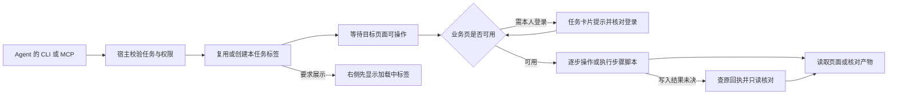

# M15 内置浏览器技术方案

T1.1 开发前评审稿，2026-11-24。依据 R1.1、P1.1 和 A1.1，功能基线 `60e7f65452e96f2f76c9fa82725f972822d2091a`。第一批把开页、登录接续和结果核验接到同一任务流程。第二批让 Agent 将同样的操作写成步骤脚本，沿用第一批的目标校验、事件和回执。继续用现有任务区、浏览器身份及每标签 CDP 能力。 [需求](../需求.md) · [调研和隔离复验](../调研/README.md)



## R01 一次提交即可开始开页

1. 通过现有浏览器能力目录新增 `tab open`，CLI 和 MCP 使用同一输入契约。输入包括明确的 `url` 或已有 `pageId`、`intent`（`reuse-or-new` 或 `new`）、`presentation`（`show` 或 `background`）及可选 `profileId`。二选一的目标参数和另开组合在执行前校验。已有 `tab create`、`tab switch`、`goto` 和 `snapshot` 继续可用。
2. `BrowserService` 先按现有能力开关、运行作用域和读写权限校验。宿主解析 `taskId`、`projectId` 和允许的 `profileId`。网址调用使用该任务在选择时生效的身份，默认沿用项目身份。指定页时沿用该页的绑定，并校验其未关闭、未换身份。地址只接受可用的 HTTP(S) URL，保留路径、查询和锚点。同一域名的不同业务页面不自动当作同一个目标。
3. `BrowserWorkspace` 在同任务、有效身份和完整目标下匹配已提交或待加载页。多个匹配先选当前展示页，再按该任务标签顺序取首个。并发匹配以该键为单位在短临界区内完成，先登记目标与待加载状态，再释放临界区；站点加载不占临界区。相同运行的同一请求先查原回执，`new` 的独立请求可分别开页。请求重放校验语义参数、来源和目标身份。
4. 早回执带 `pageId`、`operationId`、`reused` 与当前阶段。复用聊天链接路径已有的“先登记标签，异步创建视图”模式。 `show` 同时发任务内展示事件，Renderer 在核对任务、面板选择与本次展示意图仍有效后选中该标签。用户主动切换会使旧展示意图失效。 `background` 保持 Renderer 当前页和面板选择，Agent 仍得到自己的任务页及回执。迟到时，结果卡继续提供已有「查看网页标签」动作。
5. `loading` 更新由现有页面生命周期驱动。加载中的标签出现可早于原生内容挂载。可操作回执绑定主文档及页面代次，验证网页可读及调用者提供的就绪条件。早回执后由宿主持有导航任务直到就绪、失败或被取消。任务停止、授权撤销、标签关闭或更新的用户导航会终止旧工作。中途跳转或页面变更废止旧状态，失败／重试更新同一个标签，关闭后放弃迟到导航。Agent 可等原操作或按原 ID 读取快照。原有聊天链接继续走现有路径。

旧包实测，审批模式下新开页需要在结果卡手动查看，指定已有页并请求聚焦则直接显示原页。现有开页工具带目标地址时等待导航返回。新链路明确区分“宿主收到了开页请求”“右侧已选中”“目标页可操作”。复用现有工作区和右侧面板的状态与事件，正式开发补充任务和选择版本校验。 [BrowserService](../../../../src/main/core/browser/service.ts) · [BrowserWorkspace](../../../../src/main/core/browser/workspace.ts) · [Renderer 展示入口](../../../../src/renderer/features/browser/store.ts) · [Agent 工具指引](../../../../src/main/core/agent/run-integration.ts) · [旧包基线](实验/旧包开页基线_20261124.md)

## R02 在原标签等待本人登录并核验后继续

- 复用 `BrowserProfiles` 和同一 `WebContents` / 分区。HTTP 基本认证走已有认证回调和对话框。网页表单或同身份的授权弹窗走实际网页。可识别信号为现有身份验证挑战、约定的登录跳转或由当前快照观察到的登录提示。普通业务报错和慢页分别按各自状态处理。
- 主进程将登录请求登记到现有宿主业务请求机制，新增 `browser_login` 类型及结构化展示，复用「等待你处理」的任务交互。卡片标示目标站点和任务页，按钮为「查看网页标签」「已登录，继续」「取消」。宿主把后续依赖该页的步骤挂起，释放执行占用。用户接管并在网页中操作。任务通用审批和浏览器授权照现有链路处理。这次确认只表示用户报告登录完成。
- 请求保存 `taskId`、绑定、来源运行与代次、`pageId/profileId`、无敏感参数的站点标识、所处步骤、已有回执引用及可校验的业务就绪条件。登录、验证码、认证 URL 参数、Cookie 和有敏感值的表单输入均留在浏览器会话或本轮内存。持久化浏览器身份沿用 M12 的分区生命周期。
- 将归属检查和业务就绪检查放在各自的时点。宿主后台 `reconcile()` 在等待阶段只确认任务、原标签、身份和请求归属有效。用户点击确认时，校验发送者、请求 revision 和当前页面代次，再以只读方式验证业务范围与标记。尚未就绪或原运行仍在退出时保留原请求和 revision，允许之后再次确认。进入决策后继续沿用宿主的事务和去重。
- 原运行已经结束时持久化为 `approved_pending_bind`，发出一次绑定提示。新运行登记后核对运行绑定、标签和刚取得的业务证据，确认仍然有效后发布一次恢复结果。业务恢复点以请求 ID 和步骤去重，绑定提示与结果通知有各自身份。重新导航、再次过期、关闭标签或撤销后终止旧的绑定，重新获得现场时重新读页。
- 停止、取消、标签关闭或登录身份换绑使当前请求失效。App 重启重新核对绑定与检查点；可用时从已确认步骤的下一步继续，已发出但结果未定的动作先走 R03。只接受真实 UI 请求完成信号，脚本或 Agent 文本不能代答。实际 SSO 的显式用例在正式站点确认后补入参数和操作，不以合成表单替代。

现有请求系统负责创建、醒转、终止与重复请求控制。登录类型需要独立的页面核验和继续条件，避免复用跨任务浏览授权的决定语义。 [宿主业务请求](../../../../src/main/core/agent/host-business-requests.ts) · [浏览器授权的接入示例](../../../../src/main/core/agent/business-browser.ts) · [页面认证](../../../../src/main/core/browser/authentication.ts) · [运行暂停](../../../../src/main/core/browser/automation.ts) · [登录接续实验](实验/登录接续与报表夹具_20261124.md)

## R03 从当前页面探路并判定实际结果

- 在成功导航或重定向后先取得结构化快照。引用带页面身份和代次，失败或页面变化重新取快照。单页结构或可访问性信息不足时使用允许的截图，必要时参考站点帮助，再回原任务页操作。目标引用有歧义时收窄范围。弹窗从原页所属的受控页面集合识别，继承原身份并符合现有授权后再操作。
- 正常的等待以 URL、DOM 或业务状态为条件。可根据快照直接操作时不追加固定等待。每步保存涉及的页面、处理状态、错误码和结果证据。一张响应成功的工具回执代表动作完成，业务完成依据可复核的页面标记、记录号或文件内容。
- 复用 `BrowserOperations` 的 `(runId, requestId)`、授权和日志。执行前拒绝的动作记 `not-started`。已派发但失去结果的动作保留 `unknown`。当前运行内用 `operation get` 读原编号，再执行只读结果核验。跨轮沿已授权的宿主请求引用，由宿主核对同任务绑定后读取该条回执，保留原运行信息；旧回执超期或无法核验时维持未决。结果日志记录只读核验依据，原操作账保留原始结果。
- 脚本和 Agent 的后续动作都不能把 unknown 的写入当成可重试。在服务器断开的测试夹具中，实际只允许一次写入。若业务结果仍找不到，向用户展示未决步骤和原回执，等待处理。

现有账本不跨运行自动合并重复业务动作，阶段中应把这类动作与它的检查点及原回执显式关联。 [页面引用](../../../../src/main/core/browser/references.ts) · [浏览器操作账](../../../../src/main/core/browser/operations.ts) · [下载回执](../../../../src/main/core/browser/downloads.ts) · [合成报表与回执实测](实验/登录接续与报表夹具_20261124.md)

## R04 受控脚本运行器

提议首版增加 `script run` 能力。接收由 Agent 生成的 JSON 文档，字段为 `version`、固定目标 `pageId` 和有序 `steps`。首版的步骤类型为 `goto`、`snapshot`、`wait`、`read`、`click`、`fill`、`select`、`assert` 和 `download`。 `script run` 以写能力登记。入口按校验后的完整计划及风险级别走现有权限档位。宿主批准仅绑定被审阅的计划摘要及其明确目标，子步骤沿用该范围内的校验和审计，临时扩大范围仍须重新授权。脚本目标、原站点范围和结果输出根由宿主确定。一个只读脚本示例：

```json
{
  "version": 1,
  "pageId": "<tab id>",
  "steps": [
    { "id": "inspect", "op": "snapshot" },
    { "id": "report", "op": "wait", "target": { "role": "heading", "name": "报表中心" } },
    { "id": "verify", "op": "assert", "target": { "role": "status" }, "text": "报表已生成" }
  ]
}
```

- 主进程在派发前验证整个文档、唯一的步骤 ID、支持的动作及站点和产物范围。定位对象在当前页面代次解析，由已有命令拿到当前引用。零个或多个匹配时报告具体步骤。页面变化后重新快照或等待。脚本固定同一页及身份，认证跳转由 R02 处理。普通表单的 `fill` 只接受此次报表所需等非凭据输入，认证字段交用户在页面中处理。
- `select` 复用页面的选择命令，按可见月份或明确值选择并读回。 `download` 调用现有下载能力，把同一页面和本次操作与下载完成回执绑定，再检查文件内容。脚本的站点范围由预先校验的目标和允许的正常跳转决定，跨范围操作停在该步。
- 编排器逐步进入已有每页执行队列，避免持有外层队列等待自己的子调用。每步推进前重新检查授权、任务运行、页和身份、暂停、步骤时限及本轮期限。复用主进程现有等待与操作预算。脚本总限额和负载沿用调用大小／时限，在实现时统一维护。批量快路径只合并已经证明等价的连续步骤，合并后仍要保留逐步观察和结果。
- 分配稳定的脚本执行 ID 和步骤请求编号，重复请求同一版本、页和步骤校验文本摘要后返回原记录。步骤结果包含 ID、执行状态、耗时、证据引用或错误码。脚本挂起、取消、超时、标签关闭或身份变化时，未派发步骤记录为未执行。恢复时以原回执和读到的业务结果决定起点。
- 现有 CDP 仍由宿主和固定 helper 使用。步骤接口只转发允许的页面能力。跨标签和跨身份、任意 Shell／Node 或 CDP 脚本、浏览器级设置、绕过授权和任意文件路径均在首版能力范围之外。现有 `exec` 是固定允许清单，helper 的 `batch` 负责内部执行；两者沿用既有调用方式。
- 针对 Playwright，复验记录已经定位默认握手和可操作页发现两处限制。以后研究适配，可以先跑与本方案相同的单标签流程，再核对页面枚举、标准等待和下载动作的语义。现阶段按结构化步骤实现，保留现有代理的页面边界。 [兼容性实测](实验/合并后复验_20261124.md) · [CDP 代理](../../../../src/main/core/browser/cdp-proxy.ts) · [内置 helper](../../../../src/main/core/browser/agent-browser.ts)

## 接口、状态与影响范围

| 位置 | 计划 | 数据与失败恢复 |
| --- | --- | --- |
| 命令目录、CLI、MCP 与 Skill | 从现有命令映射维护单一契约，生成能力目录。CLI/MCP 输出同样的目标身份和结果；更新运行指引优先使用新入口，旧入口继续可达。 | 使用宿主签发的任务和运行凭据。权限不足在页面操作前拒绝。现有 Agent、Provider 绑定不参与浏览器身份选择。 |
| 浏览器工作区与 Renderer | 复用现有每任务标签、挂载、状态发布及结果卡入口。引入短期待导航索引、展示事件和有界就绪状态。 | `app_settings` 沿用已存标签格式。临时待加载及右侧展示意图由当前请求管理。异常退出后保留已提交标签和原回执，旧展示意图失效。 |
| 登录与恢复 | 在 `agent_requests` 和当前任务事件中保存已脱敏的请求上下文，暂停同页依赖步骤。 | 停止或绑定变化走现有请求失效路径。保持身份分区原有存储。 |
| 操作与步骤回执 | 读写操作继续走 `browser_operations`。脚本头记录计划摘要，步骤关联单独回执，产物沿用任务证据接口。 | 优先复用已有结构化字段并验证摘要大小、生命周期和查询范围。现有通用业务拦截会保存完整调用参数。脚本须在进入该分支前校验并创建专用审阅记录，只写入脱敏预览、计划摘要及原执行索引。重启后若缺脚本，不自动派发剩余写入。按原摘要重建时仍核对运行绑定、有效权限和步骤证据。若账本无法可靠保存步骤状态和索引，在实现评审中单列必要迁移及兼容性测试。 |

## 性能与实施顺序

1. **基准。** 已取得旧包的四组样本。候选包沿用同夹具和业务证据，以「批准动作提交到目标页在右侧可见」为主要时间。旧新开页的驱动会立即点击结果卡，记录这次人工动作单独的时间。同一站点请求到达至业务标记可读作为两包共享的导航指标，候选另记宿主开始导航。复用页若无需导航则报告零新增请求和重新显示时间。另记业务操作至结果已核对、发出任务至完成及涉及的本人等待。分组区分 App 冷／热启、缺页／复用和执行器。 [旧包基线](实验/旧包开页基线_20261124.md)
2. **第一批。** 优先联通当前任务可见开页和后台开页，添加登录接力与状态回读。在扣住响应的可重复场景中，用户明确展示的标签要先出现，释放后在同页变为可操作。一条开页请求同时解决匹配、新建及展示，实际业务就绪和证据仍独立核验。确认旧 CLI/MCP 及手动点击链接覆盖。
3. **第二批。** 在同一业务夹具跑 Agent 逐步操作和脚本复跑，两条路线各按冷／热分组，测试用相同业务步骤、页面就绪条件和输出。计时比较优先采至少 20 对可配对样本，报告中位数、P95、失败项、工具调用数、写入次数和证据核验。相对门槛提议为候选「授权至右侧可见」与脚本「业务页就绪至业务结果核对」的配对样本中位数分别不高于旧开页和逐步操作。P95 用于识别尾部退化，实包基线可用后再评审是否需要单独设绝对时延目标。
4. **验收界线。** 先用单元与服务测试锁定匹配、授权、恢复和禁止重派发，再用真实打包 App 从任务口令与界面复验全部约定场景。真实登录至少验证所选站点的首次登录和过期。若需要真人验证码，安排用户处理并继续跑独立用例。正式场景才评判模型能否自主探路，隔离实验中预先写好的路径继续作为基准。

实际站点、业务成功标记和本人步骤在 A15 启动前确认。本版本以受控步骤脚本为开发评审方案。通用 Playwright 独立兼容性研究沿用上述范围，生产实现与验收由用户评审后启动。 [现有拦截器](../../../../src/main/core/applications/agent-business-tools.ts) [验收用例](../验收/测试用例.md)

## 修订记录

- 2026-11-24 T1.1 纳入旧包基线、登录等待与绑定试验及 CSV 实测，明确表单选择与性能对照。逐条核对 R01–R04 的目标和原先的作用域约束。 [T1.0 历史](../历史/技术方案_T1.0_20261124.md)
