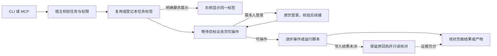

# M15 内置浏览器技术方案

T1.2 开发评审定稿，2026-11-24。依据 R1.2、P1.2 和 A1.2。已核对的生产源码基线为 `60e7f65452e96f2f76c9fa82725f972822d2091a`。R01–R03 先打通同一任务内的开页、登录接续和结果核验，R04 再用受控步骤复跑同一业务流程。宿主维护任务、浏览器身份、授权和回执，右侧面板负责展示。站点加载、Agent 续接和业务写入各自有独立的结束条件。 [需求](../需求.md) · [调研](../调研/README.md) · [原型](../原型/原型说明与变更.md) · [用例](../验收/测试用例.md)

## 现有实现与复验结论

旧包的新页 Agent 路径在两轮本地试验均需经结果卡显示到右侧。显式聚焦已有页可直接复用。现有工作区已有先登记标签、后挂载视图的路径，可借用其登记机制。当前自动展示事件和审批处理需要补充选择版本及早回执后的执行寿命。 [工作区](../../../../src/main/core/browser/workspace.ts#L96) · [展示事件](../../../../src/renderer/features/browser/workspace.tsx#L34) · [旧包开页基线](实验/旧包开页基线_20261124.md)

旧通用审批校验失败会结束请求，临时浏览器暂停随原运行退出清理。登录实验用真实 WebContents 和账本验证了早确认、原页核验及去重，运行登记与通知由隔离驱动模拟。报表实验取得了真实 CSV，站点回包截断与工具回执丢失将在验收中分别验证。现有操作账按运行和请求编号索引，普通工具调用只访问本轮回执。 [宿主业务请求](../../../../src/main/core/agent/host-business-requests.ts#L97) · [Agent 队列](../../../../src/main/core/agent/agent-task-service.ts#L192) · [临时暂停](../../../../src/main/core/browser/automation.ts#L49) · [操作账](../../../../src/main/core/browser/operations.ts) · [登录与报表证据](实验/登录接续与报表夹具_20261124.md)

## 入口与回执

下列新增入口为本版接口设计。CLI 和 MCP 由同一能力目录映射到宿主，权限检查沿用当前项目浏览器开关、运行计划、读写权限与浏览器身份。能力可用性以本轮实际生效的入口为准。 [能力启动](../../../../src/main/core/applications/task-capability-launcher.ts#L301) · [运行计划](../../../../src/main/core/applications/run-plan.ts#L15)

| 入口 | 输入与适用范围 | 结果 |
| --- | --- | --- |
| `tab open` | 二选一传 `url` 或 `pageId`，另有 `intent`（`reuse-or-new`／`new`）、`presentation`（`show`／`background`）及可选 `profileId` 和现有 `wait` 能表达的业务就绪条件。指定既有页时校验绑定并拒绝冲突的另开或身份参数。按当前任务的控制权限执行。 | 早回执包含 `pageId`、`operationId`、`reused` 和当前导航阶段。后续按原操作查进度。 |
| 登录确认 | 现有任务请求 UI 发送者提交原请求 ID、revision 和「已登录，继续」或「取消」。 | 保留原等待卡、等待新运行绑定、已继续或已失效。 |
| `script run` | `executionId`、版本 1 的计划、固定 `pageId`、有序步骤。按写能力登记，按有效权限档位执行。 | 返回执行及步骤回执，包含状态、耗时、错误或证据引用。 |
| `operation get` 与脚本执行查询 | 旧入口按当前运行查原请求。跨轮通过宿主检查点和原执行引用查只读摘要。 | 返回原记录和可核验状态。找不到证据时保留未决。 |

## R01 一次提交即可开始开页

1. 宿主解析 `taskId/projectId/profileId`。URL 只接受可用的 HTTP(S) 网址，保留业务路径、查询和锚点。未指定浏览器身份时使用该任务当前有效身份，沿用项目默认值。按当前任务、身份和完整目标匹配已提交或待加载标签。多个匹配先取当前展示页，再按任务标签顺序取首个。在同键的短临界区内登记并共享待加载页。独立的 `new` 调用各开新页。
2. 先持久登记目标、标签 ID 和操作关联，再返回早回执。命令原编号冻结解析前后的目标、身份、复用及展示意图，重复调用只读同一结果。相同编号的不同语义返回冲突。右侧是否展示与导航阶段分开记录。`show` 事件携带原任务、标签和发起该展示意图时的选择版本。以任务区原始用户提交或显式展示动作的版本为准，审批及迟到结果沿用该版本。用户切任务、切面板或切标签即递增该版本，包含切走又切回。Renderer 仅在原任务、版本及展示意图仍有效时选中目标页。迟到事件只留「查看网页标签」结果入口。`background` 不修改视角、选中项或激活任务。
3. 导航状态沿 `loading → ready / failed / cancelled` 推进，导航前完成登记。新页的有效展示意图先提交加载态，再发布终态，快速响应同样按顺序观察。后台页独立导航。以原标签的主文档和页面代次核验页面可读及约定业务条件。等待有界，用户切换或视图失效后及时撤掉展示等待。`unknown` 留给无法确定的结果，正常加载有自己的进度。
4. 宿主在早回执前登记导航工作及其授权范围，接管调用返回后的异步执行。处理器正常返回时保留这份工作，禁止把一次性审批当作后续调用的通行权限。发起导航或发布结果前都核对任务、授权、页面代次和导航版本。停止任务、撤销授权、失去原运行权限、关闭标签或用户在同标签改址都终止旧工作，丢弃迟到结果。共享待加载页按请求各自校验授权和结果可见性；底层导航只由有效的宿主工作持有，页面关闭或该导航被更新时整次作废。失败后按用户的重试操作在同一未关闭标签开启新代次。App 恢复已提交标签，遗留半途导航保留原回执并按事实标记，旧展示意图在重启时失效。 [宿主批准收尾](../../../../src/main/core/agent/host-business-requests.ts#L178) · [资源持有契约](../../../../src/main/core/applications/run-registry.ts#L446) · [现有导航状态](../../../../src/main/core/browser/page-registry.ts#L136)

## R02 在原标签等待本人登录并核验后继续

- 复用 `BrowserProfiles` 和同一浏览器分区。Basic 认证进入既有原生认证框。网页登录和从原页发起的同身份合规弹窗由本人操作。触发依据可以是站点认证挑战、可识别登录跳转或当前快照中的明确登录提示。慢页与业务错误沿各自流程处理。弹窗结束后核对原业务页；合成夹具在原 `auth-start` 标签打开 `desk`，通过同身份 Cookie 和 `#business-ready` 验证。弹窗独自成功时卡片仍等待原页。
- 新增宿主请求类型 `browser_login`，复用原任务时间线和「查看网页标签」「已登录，继续」「取消」。等待时释放旧执行占用，持久化标记该页的依赖步骤处于暂停。原运行销毁后暂停继续生效。本人仍可在原标签或其认证流程中操作，任务的独立步骤可按原授权执行。
- 宿主调和只校验归属、作用域和失效条件。真实 UI 确认另做只读核验，检查发送者、当前 revision、原 `pageId/profileId`、当前页面代次、准许的业务范围和就绪标记。过早确认、原页仍恢复中或原运行尚在退出时保留同一请求与 revision，并提供原因。重复提交同一确认在事务中仅一处成功。Agent 文本及脚本不能替代本人确认。
- 核验成功后持久化确认及恢复点。无可接手的运行时进入 `approved_pending_bind`。准备接手运行由宿主内部调度，绑定提示仅供界面观察。接手运行登记后再次核对任务、绑定、页面身份、当前代次和业务标记。以请求 ID 和依赖检查点形成唯一续接键，在事务中登记可派发记录，调用真实任务队列前标记已经交接。只派发一条续接，继续第一个未完成依赖步骤。若旧续接已经交接给队列且接收结果无法确认，保留待核对状态，按 R03 核对业务结果。
- 启动后只允许此前已确认、能证明续接尚未交接、仍在同一任务和有效绑定、页面及业务标记重新核验通过的请求自动继续一次。审批尚未确认时继续显示等待卡，已交接未知时保留待核对。App 恢复时沿用原标签 ID，等待新页面实例就绪后重新核验。在原标签及授权仍有效的情况下，确认后的登录态再度过期就回到原卡片并递增 revision，等待本人重新确认。用户停止、取消、关原页、换身份、撤销权限或绑定改变时终止该次请求。任务已被用户停止时保持停止。普通任务输入继续按现有重启规则暂停。 [请求表与事务](../../../../drizzle/0037_agent_workspace.sql#L157) · [绑定时机](../../../../src/main/core/agent/host-business-requests.ts#L120) · [后台调和](../../../../src/main/core/agent/host-business-requests.ts#L207) · [认证处理](../../../../src/main/core/browser/authentication.ts)

## R03 从当前页面探路并判定实际结果

- 导航或重定向后先读取结构化快照，按当前页面代次解析引用。引用失效或候选控件有歧义时重新观察并缩小目标范围。可用截图或获准帮助页辅助定位，再回原业务页。支持的弹窗沿用现有授权、原页关系和原身份。等待以 URL、页面内容或业务标记为条件，采用有界超时。
- 分别记录页面观察、工具动作及业务结果。业务完成要求核对页面标记、实际记录号或下载内容。下载证据关联原动作及文件回执，并读取用例指定的文件内容。执行前被拒绝且能够证明未派发时记录 `not-started`。已派发而工具结果不明时保留 `unknown`。工具动作完成而站点回包丢失时，动作事实保留，业务结果单独记为待核对。
- 写动作在派发前登记检查点，关联任务、绑定、原运行、标签、身份及原 `(runId, requestId)`。查询只读，当前调用的普通 `operation get` 维持本轮作用域。跨轮由宿主接续引用定位原记录，先核对当前任务、授权、绑定及原标签和身份。Agent 或脚本提交的任意旧运行标识不能扩展读取范围。
- 未决时锁住该检查点的依赖写入与重新派发。按原回执及站点可读结果核对，证据足够后更新业务结论并继续后继步骤。旧记录缺失或过期时依旧展示未决。原操作账保留动作事实，另存只读核验的证据摘要。可安全复跑的业务由用户明确发起新执行并重新经过当前授权。 [页面引用](../../../../src/main/core/browser/references.ts) · [原回执入口](../../../../src/main/core/browser/service.ts#L256) · [下载回执](../../../../src/main/core/browser/downloads.ts)

## R04 受控脚本运行器

- 版本 1 计划固定一个任务标签和浏览器身份。步骤类型为 `goto`、`snapshot`、`wait`、`read`、`click`、`fill`、`select`、`assert` 和 `download`。主进程验证字段、支持动作、唯一的步骤 ID、目标和产物输出根。错误定位到步骤与字段。`fill` 限受控业务表单数据，认证密码与验证码由本人通过站点输入。每步在当前页面代次解析定位，匹配数不为一时暂停该步并报告。下载沿用 R03 的证据规则。
- 宿主解析并冻结允许的顶层业务目标。计划中明确的越界导航在派发前拒绝。执行中监视实际顶层文档，遇到站点触发的非授权跳转时停止脚本，下一步执行前再次核对实际顶层文档与代次。跳转本身是否已经发出站点请求按现场记录。普通静态资源沿用浏览器现有策略。合法认证转移挂起脚本并交给 R02，回到获准业务页后才接续。来自脚本的后续业务步骤继续使用原固定标签，站点弹窗不能自动成为新脚本目标。 [页面导航](../../../../src/main/core/browser/page-registry.ts#L71)
- 规范化计划后固定摘要及执行 ID。批准绑定发起任务及标签、身份、已生效的权限范围和计划摘要，进入专用脱敏审阅路径。通用业务拦截器目前保存完整调用，不能用于脚本的原始计划持久化。审阅和历史记录只保留动作种类、步骤、经脱敏的目标、结果摘要、计划摘要与关联编号。凭据和完整表单值不进入审阅、任务历史、审计或回执。完整允许输入只在本轮内存中存续。遇重启且计划已失，以原编号查询；继续执行需要重新获得相同摘要的计划，并重新核对当前授权和检查点。 [现有业务拦截](../../../../src/main/core/applications/agent-business-tools.ts)
- 步骤逐个进入现有每页执行队列，编排器不占用外层队列等待子步骤。每次派发核对授权、页与身份、是否暂停、步超时及整体期限。停止、关闭、暂停或期限届满后未派发步骤标为未执行。已派发写入不确定时执行停在原步骤，沿 R03 核对后仅从可确定的后继步骤继续。脚本总长度和调用期限沿用当前能力预算。
- 执行 ID 在首次提交前确定。以同一任务和同一 ID 核对冻结计划摘要及绑定，同号并发通过持久记录去重，结果查询不重派原步骤。更改摘要、身份或目标拒绝。同计划有意再跑使用新执行 ID 和本次有效授权。执行结果包括每步 ID、状态、耗时、证据引用与错误。现有 `exec`、helper 批处理及受控 CDP 保持旧契约。首版接固定步骤，通用 Playwright、任意 CDP／Shell／Node 及跨标签脚本另行评估。 [兼容性实测](实验/合并后复验_20261124.md) · [CDP 代理](../../../../src/main/core/browser/cdp-proxy.ts)

## 持久化与兼容性

| 数据位置 | 记录与查找 | 旧数据处理 |
| --- | --- | --- |
| 浏览器工作区 | 已登记标签用现有 `app_settings` 格式。导航关联原操作及页面代次，展示意图只在本次任务区有效。 | 原手动链接、标签选择和旧工具正常可用，以各自原操作模型展示。 |
| `agent_requests` 与任务事件 | 持久化原请求、任务绑定、来源运行、原网页及身份、业务就绪条件、依赖步骤引用、确认版本、唯一续接键、派发阶段与接手运行。业务标记只存可核验的安全描述。请求和续接记录的状态更新使用事务。 | 旧请求照原处理。新登录核验不改变跨任务浏览授权或其他通用批准的行为。 |
| `browser_operations` 及新执行索引 | 旧原始回执按 `(run_id, request_id)` 保留。新记录按任务和执行 ID 或检查点保存绑定、标签身份、计划摘要、状态及原回执引用。高层状态与已派发标记先持久化后执行；同号请求原子登记。 | 现有操作表现行清理周期为七天。高层执行结果保留精简摘要。未决保护和同号重放使用的去重标记随所属任务记录保留，原详情清理后仍能识别旧 ID，未决执行仍返回待核对。新增持久化字段或索引用增量迁移，字段不足的旧回执仅可读取事实。 |
| 审批和运行计划 | CLI/MCP 使用本轮实际登记的入口和授权。审阅摘要绑定计划范围，运行指引同步提供新接口。 | 保留旧命令、Skill 指引入口和插件开关。Codex、Claude Code 与已支持的 ACP 执行器继续按运行计划选取入口。新能力不改变 Provider 或浏览器身份选择。 |

[旧操作表定义](../../../../drizzle/0030_browser_operations.sql) · [操作账清理](../../../../src/main/core/browser/operations.ts#L15) · [旧 CLI / MCP 指引](../../../../src/main/core/agent/run-integration.ts#L35)

## 性能与实施顺序

- **展示顺序与耗时分跑。** A01 使用站点门闩，先核对右侧加载中及原标签 ID 再放行，另有快页验证。A27 两包配置同样的回环服务、输入、权限、执行器和入口。站点从收到请求起按同一固定时延响应，与面板状态无关。记录实际请求到达、响应可用、右侧可见、网页业务标记可读、验收结果及整轮结束时间。四段耗时依 R1.2 汇总。旧版驱动在结果卡可点后立即点击，并单列这段时间。候选在明确展示的新页流程中应自动在右侧显示。无需重新请求的复用页单列展示耗时及零新增请求。
- **比较方法。** 两个主要比较分别为批准模式下新开页的「批准提交至右侧可见」和同报表流的「业务页就绪至结果核对」。逐步及脚本须得到同样的记录及产物，并报告工具调用次数和实际写入次数。App 冷启是新进程起首轮，热态复用已经启动的实例。两类比较按冷、热分别统计，每组至少 20 对成功配对。按 AB/BA 交替顺序采样，使用同样的目标状态和权限档位。逐条留存对照和候选包、运行器、驱动及夹具的版本与摘要。全访问情况下，开页起点为宿主接收本次意图，单独报告。复用的额外分组及多个执行器各自的性能结论沿用同样的样本规则。
- **判定。** 记录全部尝试、失败与超时。仅有证据的测试工具或夹具故障允许补采。任一组成功配对不足 20 或候选产品失败比对照多时，该组不通过。主要指标每组候选中位数不得高于对照，P95 采用最近秩法且不得超过对照的 110%。该阈值用于同机合成对照。模型行为与真人登录时间单独取证。 [旧包计时与证据](实验/旧包开页基线_20261124.md)
- **第一批验证。** 先实现 R01–R03。服务集成优先用真实任务队列复验「批准已保存，后继派发尚未开始」重启窗口、双击确认和停止。站点回包截断与工具回执丢失各跑受控场景并查实际写入数。A12 完成同一原业务页核验，A15 在已授权站点验首次登录与过期，需本人完成的 SSO/MFA 步骤另留证。A16 用真实模型验收自主探路，A17–A21 用候选 App 核对回执、页面行为和产物。 [登录与报表复验](实验/登录接续与报表夹具_20261124.md)
- **第二批验证。** 加入 R04 的脚本、摘要审阅与跳转守卫。双回环站点验证超范围跳转后无后继脚本动作、写入和其他标签影响，单独覆盖 R02 认证交接。复验同号重放、跨轮只读回执、原记录已清理、停止及脱敏。之后以候选 App 执行全部约定用例。
- **A28 取证。** Codex 与 Claude Code 分别从真实任务入口取当前生效传输、浏览器结果和权限证据；CLI 与 MCP 在各自实际启用的传输路径核验契约，未启用入口按运行计划拒绝调用。打包 App 另核对用户手动点击。实际可用的 ACP 路径继续以其当前能力计划为准，不因阶段文件改变可用性。旧实验的真实 MCP 证据来自 Claude Code，CLI 及其它运行计划结果见各自专项日志。 [入口补验](实验/登录接续与报表夹具_20261124.md#入口与运行生命周期补验) · [候选包验收](../验收/测试用例.md)

## 修订记录

- 2026-11-24 T1.2 收口上轮评审。对照 R01–R04、P01–P04 和 A01–A28，保留原目标及两批顺序，补齐导航阶段与所有权、登录恢复、原回执、脚本跳转、脱敏和配对测速。真实站点和本人验证在 A15 执行前准备，现有实验和实包数据按原适用范围复用。 [评审记录](../../../review/review-20261124-0616.md) · [T1.1 历史](../历史/技术方案_T1.1_20261124.md)
- 2026-11-24 T1.1 纳入旧包基线、登录等待与绑定试验及 CSV 实测。 [T1.0 历史](../历史/技术方案_T1.0_20261124.md)
