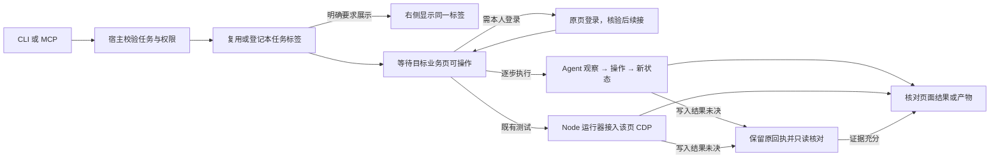

# M15 内置浏览器技术方案

T1.3 开发评审定稿，2026-11-24。依据 R1.3、P1.3 和 A1.3。生产源码基线为 `60e7f65452e96f2f76c9fa82725f972822d2091a`。同一任务标签提供两条执行路径。Agent 观察、操作并读取新的结构化页面状态。任务也可将已冻结的 Skill 用例交给 Node 运行器，经授权连接同一内置标签执行实际 CDP 操作。R01 开页和 R02 登录接力共用，R03 页面观察及结果确认也为脚本回执提供依据。 [需求](../需求.md) · [调研](../调研/README.md) · [原型](../原型/原型说明与变更.md) · [用例](../验收/测试用例.md)

## 现有实现与复验结论

旧包的新页 Agent 路径在两轮本地试验均需经结果卡显示到右侧。显式聚焦已有页可直接复用。现有工作区已有先登记标签、后挂载视图的路径，可借用其登记机制。当前自动展示事件和审批处理需要补充选择版本及早回执后的执行寿命。 [工作区](../../../../src/main/core/browser/workspace.ts#L96) · [展示事件](../../../../src/renderer/features/browser/workspace.tsx#L34) · [旧包开页基线](实验/旧包开页基线_20261124.md)

旧通用审批校验失败会结束请求，临时浏览器暂停随原运行退出清理。登录实验用真实 WebContents 和账本验证了早确认、原页核验及去重，运行登记与通知由隔离驱动模拟。报表实验取得了真实 CSV，站点回包截断与工具回执丢失将在验收中分别验证。现有操作账按运行和请求编号索引，普通工具调用只访问本轮回执。 [宿主业务请求](../../../../src/main/core/agent/host-business-requests.ts#L97) · [Agent 队列](../../../../src/main/core/agent/agent-task-service.ts#L192) · [临时暂停](../../../../src/main/core/browser/automation.ts#L49) · [操作账](../../../../src/main/core/browser/operations.ts) · [登录与报表证据](实验/登录接续与报表夹具_20261124.md)

现有 `BrowserPageRegistry` 为每页创建原生 `WebContentsView`、固定浏览器身份分区、队列和单页 CDP 代理。宿主已支持可访问性快照、截图和按 WebContents 归属捕获下载。将用例驱动接到本页代理还需要宿主执行授权、方法治理、续接及收尾边界。单页代理对现有内部 helper 服务，相关运行持有范围和审计由外层宿主建立。 [页面注册](../../../../src/main/core/browser/page-registry.ts#L55) · [CDP 代理](../../../../src/main/core/browser/cdp-proxy.ts#L109) · [浏览器命令与截图](../../../../src/main/core/browser/service.ts#L521)

`source-driven-ui-test` 的 `run-suite.mjs` 从冻结目录加载 `runtime/cdp.mjs`，将浏览器操作注入用例上下文。驱动本身直接使用页面 CDP，覆盖读取 DOM、真实输入、等待、响应观察与截图。当前启动与收尾绑定独立 Chrome 进程和临时配置，下载使用浏览器级设置。开发前独立 Chrome 已跑通 `CATALOG-CHOICE` 和 `TEAMS-CHOICE`，基线摘要为 `21d2f1897de8c35a3398a11c79be00a8a753ab0b1561924405a1587e5b45a074`。E07 的证据层级、实际操作和候选包剩余验证以实验记录为准。 [Skill 与 CDP 接入实验](实验/Skill接入CDP与页面观察_20261124.md)

E07 通过隔离 IPC 接入原冻结 `CATALOG-CHOICE`，在宿主注册并已挂载的真实 WebContents 上选中 `Option 1`，原断言通过并取得同页 PNG。另一次真实点击使当前 DOM 从目录切至团队，回读到团队页新的可访问性标题。撤销时等待中的读取断开，同页没有后继输入，原页保留，另一任务标签未被接管。通过原生下载归属组件另行核对本机样本内容。该实验覆盖页面与驱动接点，正式运行器模式、任务区 UI、完整授权及真实站点接力由候选包实测。 [E07 原始范围与结果](实验/Skill接入CDP与页面观察_20261124.md)

## 入口与回执

下列新增入口为本版接口设计。CLI 和 MCP 由同一能力目录映射到宿主，权限检查沿用当前项目浏览器开关、运行计划、读写权限与浏览器身份。能力可用性以本轮实际生效的入口为准。 [能力启动](../../../../src/main/core/applications/task-capability-launcher.ts#L301) · [运行计划](../../../../src/main/core/applications/run-plan.ts#L15)

| 入口 | 输入与适用范围 | 结果 |
| --- | --- | --- |
| `tab open` | 二选一传 `url` 或 `pageId`，另有 `intent`（`reuse-or-new`／`new`）、`presentation`（`show`／`background`）及可选 `profileId` 和现有 `wait` 能表达的业务就绪条件。指定既有页时校验绑定并拒绝冲突的另开或身份参数。按当前任务的控制权限执行。 | 早回执包含 `pageId`、`operationId`、`reused` 和当前导航阶段。后续按原操作查进度。 |
| 登录确认 | 现有任务请求 UI 发送者提交原请求 ID、revision 和「已登录，继续」或「取消」。 | 保留原等待卡、等待新运行绑定、已继续或已失效。 |
| `snapshot` 与后置观察参数 | 指定原 `pageId` 和观察范围。常见 `click/fill/select/goto` 允许选择 `observeAfter`，包含需要的页面范围、可选业务标记及有界等待。按原动作权限执行，再独立核对仍有页面观察权限。 | 同一工具回执包含动作状态和观察状态。成功观察带实际页面的 ID、代次、URL、结构化控件及新引用。 |
| `script run` | `executionId`、工作区内待核验的冻结包引用及摘要、目标 `pageId`、用例范围、整体时限及输出配置。按具备页面控制能力的执行申请授权。 | 返回执行编号及状态。持续进度、逐例断言、失败步骤、截图和下载均以宿主回执获取。 |
| `script status`／`script stop` | 以宿主签发的原执行引用查状态或停止，校验任务归属与当前权限。 | 查询返回原执行摘要。停止结束派发并清理本次会话，保留原任务页。 |
| `operation get` | 旧入口按当前运行查原请求。跨轮通过宿主检查点和原执行引用查只读摘要。 | 返回原记录和可核验状态。找不到证据时保留未决。 |

## R01 一次提交即可开始开页

1. 宿主解析 `taskId/projectId/profileId`。URL 只接受可用的 HTTP(S) 网址，保留业务路径、查询和锚点。未指定浏览器身份时使用该任务当前有效身份，沿用项目默认值。按当前任务、身份和完整目标匹配已提交或待加载标签。多个匹配先取当前展示页，再按任务标签顺序取首个。在同键的短临界区内登记并共享待加载页。独立的 `new` 调用各开新页。
2. 先持久登记目标、标签 ID 和操作关联，再返回早回执。命令原编号冻结解析前后的目标、身份、复用及展示意图，重复调用只读同一结果。相同编号的不同语义返回冲突。右侧是否展示与导航阶段分开记录。`show` 事件携带原任务、标签和发起该展示意图时的选择版本。以任务区原始用户提交或显式展示动作的版本为准，审批及迟到结果沿用该版本。用户切任务、切面板或切标签即递增该版本，包含切走又切回。Renderer 仅在原任务、版本及展示意图仍有效时选中目标页。迟到事件只留「查看网页标签」结果入口。`background` 不修改视角、选中项或激活任务。
3. 导航状态沿 `loading → ready / failed / cancelled` 推进，导航前完成登记。新页的有效展示意图先提交加载态，再发布终态，快速响应同样按顺序观察。后台页独立导航。以原标签的主文档和页面代次核验页面可读及约定业务条件。等待有界，用户切换或视图失效后及时撤掉展示等待。`unknown` 留给无法确定的结果，正常加载有自己的进度。
4. 宿主在早回执前登记导航工作及其授权范围，接管调用返回后的异步执行。处理器正常返回时保留这份工作，禁止把一次性审批当作后续调用的通行权限。发起导航或发布结果前都核对任务、授权、页面代次和导航版本。停止任务、撤销授权、失去原运行权限、关闭标签或用户在同标签改址都终止旧工作，丢弃迟到结果。共享待加载页按请求各自校验授权和结果可见性；底层导航只由有效的宿主工作持有，页面关闭或该导航被更新时整次作废。失败后按用户的重试操作在同一未关闭标签开启新代次。App 恢复已提交标签，遗留半途导航保留原回执并按事实标记，旧展示意图在重启时失效。 [宿主批准收尾](../../../../src/main/core/agent/host-business-requests.ts#L178) · [资源持有契约](../../../../src/main/core/applications/run-registry.ts#L446) · [现有导航状态](../../../../src/main/core/browser/page-registry.ts#L136)

## R02 在原标签等待本人登录并核验后继续

- 复用 `BrowserProfiles` 和同一浏览器分区。Basic 认证进入既有原生认证框。网页登录和从原页发起的同身份合规弹窗由本人操作。触发依据可以是站点认证挑战、可识别登录跳转或当前快照中的明确登录提示。慢页与业务错误沿各自流程处理。弹窗结束后核对原业务页；合成夹具在原 `auth-start` 标签打开 `desk`，通过同身份 Cookie 和 `#business-ready` 验证。弹窗独自成功时卡片仍等待原页。
- 新增宿主请求类型 `browser_login`，复用原任务时间线和「查看网页标签」「已登录，继续」「取消」。等待时释放旧执行占用，持久化标记该页的依赖步骤处于暂停。原运行销毁后暂停继续生效。本人仍可在原标签或其认证流程中操作，任务的独立步骤可按原授权执行。
- 宿主调和只校验归属、作用域和失效条件。真实 UI 确认另做只读核验，检查发送者、当前 revision、原 `pageId/profileId`、当前页面代次、准许的业务范围和就绪标记。过早确认、原页仍恢复中或原运行尚在退出时保留同一请求与 revision，并提供原因。重复提交同一确认在事务中仅一处成功。Agent 文本及脚本不能替代本人确认。
- 核验成功后持久化确认及恢复点。无可接手的运行时进入 `approved_pending_bind`。准备接手运行由宿主内部调度，绑定提示仅供界面观察。接手运行登记后再次核对任务、绑定、页面身份、当前代次和业务标记。以请求 ID 和依赖检查点形成唯一续接键，在事务中登记可派发记录，调用真实任务队列前标记已经交接。只派发一条续接，继续第一个未完成依赖步骤。若旧续接已经交接给队列且接收结果无法确认，保留待核对状态，按 R03 核对业务结果。
- 启动后只允许此前已确认、能证明续接尚未交接、仍在同一任务和有效绑定、页面及业务标记重新核验通过的请求自动继续一次。审批尚未确认时继续显示等待卡，已交接未知时保留待核对。App 恢复时沿用原标签 ID，等待新页面实例就绪后重新核验。在原标签及授权仍有效的情况下，确认后的登录态再度过期就回到原卡片并递增 revision，等待本人重新确认。用户停止、取消、关原页、换身份、撤销权限或绑定改变时终止该次请求。任务已被用户停止时保持停止。普通任务输入继续按现有重启规则暂停。 [请求表与事务](../../../../drizzle/0037_agent_workspace.sql#L157) · [绑定时机](../../../../src/main/core/agent/host-business-requests.ts#L120) · [后台调和](../../../../src/main/core/agent/host-business-requests.ts#L207) · [认证处理](../../../../src/main/core/browser/authentication.ts)

## R03 观察、操作与再观察

- 观察使用当前获准页的可访问性树和宿主管理的元素引用，按本次身份、范围、页面代次生成结构化状态。页面结构和可访问控件不足以判定时，可在同页截图或读取获准的帮助页。弹窗仍依据原页关系、任务及身份获得授权。引用失效或候选项有歧义时重新观察，按容器或语义缩小范围。
当浏览器操作需要宿主审批且下一步依赖结果时，回执要求执行器结束当前回合。宿主按现有队列在后续回合自动投递结果，携带原工具请求号及原任务归属。结果未决时，执行器从原标签及原操作回执做只读核对，依据真实页面决定下一步。原请求审批只覆盖已批准的具体操作，宿主结果通知不授予额外权限。 [实现核对](../验收/执行与缺陷记录.md#候选包验收)

- `observeAfter` 复用同一次命令已解析的页面目标。将动作和有界观察编排在同一页队列内，直接复用内部快照函数，避免从队列内再次调用排队入口。动作后检查导航代次、授权与就绪条件。导航命令等已认可的主文档就绪，无导航操作按对应控件或业务标记等待。用户在此期间主动换页或页面再次替换时，重新核对动作与观察的页面归属。观察记录 `ready`、`timed-out`、`changed` 或 `unavailable`，随回执返回页面 ID、代次和摘要。快照过大时返回截断提示和证据引用。动作成功而观察超时或被取消时，保留动作回执，下一步在当前获准页重新观察。已经派发而效果未知时停止依赖写入，再走原回执只读核对。
- 分别记录页面观察、工具动作及业务结果。业务完成要求核对页面标记、实际记录号或下载内容。下载证据关联原动作及文件回执，并读取用例指定的文件内容。执行前被拒绝且能够证明未派发时记录 `not-started`。已派发而工具结果不明时保留 `unknown`。工具动作完成而站点回包丢失时，动作事实保留，业务结果单独记为待核对。
- 写动作在派发前登记检查点，关联任务、绑定、原运行、标签、身份及原 `(runId, requestId)`。查询只读，当前调用的普通 `operation get` 维持本轮作用域。跨轮由宿主接续引用定位原记录，先核对当前任务、授权、绑定及原标签和身份。Agent 或脚本提交的任意旧运行标识不能扩展读取范围。
- 未决时锁住该检查点的依赖写入与重新派发。按原回执及站点可读结果核对，证据足够后更新业务结论并继续后继步骤。旧记录缺失或过期时依旧展示未决。原操作账保留动作事实，另存只读核验的证据摘要。可安全复跑的业务由用户明确发起新执行并重新经过当前授权。 [页面引用](../../../../src/main/core/browser/references.ts) · [原回执入口](../../../../src/main/core/browser/service.ts#L256) · [下载回执](../../../../src/main/core/browser/downloads.ts)

## R04 将冻结测试包接入任务页

### 冻结包与运行器

- 兼容基线为 `source-driven-ui-test` 的已封存 Node.js `.mjs` 测试包。按 Skill 的封存清单校验引用范围、清单版本、文件摘要、用例输入及原判据。宿主固化获准版本、所选用例、目标标签和浏览器身份，执行器从本次核验的冻结快照读取。审批展示可读摘要、站点和允许动作。文件改动或版本变更需按新摘要重新校验和授权。
- Node 运行器增加显式的 WillYou 驱动模式，将已冻结的用例、业务断言和组件操作接到 WillYou 管理的页面会话。拟支持的运行器由宿主选择并核验版本，调用方提供工作区内冻结包引用。执行端保持真实 CDP 调用及事件处理。现有用例生成、编译和冻结由 Skill 完成。独立 Chrome 模式继续依据原进程所有权执行。
- 宿主在新执行开始前颁发短时、可撤销的单页会话。它绑定任务、项目、运行、执行编号、审批摘要、`pageId/profileId`、实际 WebContents 和已允许业务范围。附着需确认页面已就绪且属于该任务。任务区可查看目标页。运行器通过本次独立进程的私有双向通道收发 CDP 请求和事件，由宿主核对绑定及每次派发。底层现有单页代理及内部 helper 凭据由宿主持有。WillYou 模式的收尾回执核对连接释放和任务页保留。独立 Chrome 模式的收尾按临时浏览器及配置的归属核验。
- 启动桥接运行器预检本机 Node.js 22 或以上版本，使用精简运行环境和本次独立输出根。入参为版本化合同和启动时固化的资料引用。关闭、退出、超时及取消由宿主跟踪本次进程句柄。子进程用于生命周期和故障隔离。已审阅冻结代码是本阶段信任前提，更广泛代码执行涉及独立的操作系统隔离。 [现有业务拦截](../../../../src/main/core/applications/agent-business-tools.ts)

### 单页驱动与原生资源

| 能力 | 连接内行为 | 结果和约束 |
| --- | --- | --- |
| 观察与交互 | 用例使用现有 CDP 驱动的 DOM、页面等待、真实鼠标和键盘、同页截图能力。需要网络证据时只读取当前获准页由正常 UI 触发的请求及关联响应。 | 记录真实输入或可核对的状态和结果。执行路径按方法和必要参数限定在当前授权页，有脚本表达式的操作按可变更页面的权限审查。 |
| 目标与导航 | 优先沿用本页代理的目标与分区识别。批准时冻结业务范围，直接越界导航在派发前拒绝。对站点自行发起的顶层跳转，检查实际地址与代次，超范围后停止后继读取与交互。 | 同站点被允许的正常导航可更新代次。合法认证转移交 R02。脚本目标保持原标签，业务弹窗须经授权才可操作。站点首次越界请求是否已发出以现场取证。 |
| 下载与保存 | 运行器的下载操作委托宿主。先为当前 WebContents 登记结果预期，再触发真实点击，最后等原生下载和校验。截图、下载及报告集中关联本次任务输出根。 | 返回文件、下载 ID、尺寸或摘要及证据引用。拒绝越界或链接转义路径。各标签继续使用现有下载行为。 |
| 运行范围 | 本次执行使用单页会话明确支持的方法。涉及额外文件输入的用例须先核对宿主是否提供对应授权。 | 缺少支持的方法在预检或首次遇到时给出明确失败及步骤。范围见 R1.3。 |

宿主将动作和必要的观察交给每页队列。等待、事件观察和输出校验均使用有界等待。用独立于队列的页面写入占用完成同一用例中的多段真实输入，当前执行的 CDP 调用逐条进入队列。其他 Agent 对该页的冲突写入在队列外等待有效占用释放，超时返回占用原因。占用释放后重新核对任务、页面归属与授权，再按原队列派发。外层协调器释放队列后再派发子步骤。读结果按页面代次关联。用户控制其他标签时保持其视角，原获准页状态变化时重新核验。脚本用例通过正常 UI 触发动作，证据分别标记页面观察、CDP 结果和业务判定。 [按 WebContents 归属捕获下载](../../../../src/main/core/browser/downloads.ts#L82) · [当前浏览器权限](../../../../src/main/core/browser/service.ts#L177)

### 回执与停止

1. 同一任务内以原执行编号原子登记幂等记录，绑定冻结摘要、确定的用例范围和同一目标。同号重复提交只返回原记录。同号改档、改选择或改页返回冲突。用户明确复跑时分配新编号并重新校验授权。
2. 宿主持久记录 `queued → running`。正常结束写 `succeeded/failed`，停止或失效写 `stopped` 并记录原因，结果不确定进入 `needs-review`。`awaiting-login/paused` 记录当前步与可信检查点，按恢复规则再次进入 `running`。每例记录通过、失败、阻塞或未执行，附步骤标识、耗时、脱敏结果与证据引用。进度与最后确认的原步骤由运行器回报。审批、请求数据库、日志和历史仅记录允许的摘要与产物引用。
3. 页关闭、任务停止、撤销、身份切换、时限到期及运行器异常时终止后续派发，并切断或撤销本次连接。对已派发动作保留实际回执。停在合法登录或暂停前优先保留可信检查点。缺少可信检查点或动作是否派发不能证明时，回到只读核对并维持未决。正常收尾只释放本次会话和运行器。原标签由任务工作区管理。运行器的业务资源清理遵循冻结条目的授权和账本。已取消或撤销后的剩余清理项写入报告，按另获许可的恢复操作处理。
4. 断开或重启后，旧会话句柄立即失效。原执行记录和关联证据可按授权查询。可信检查点由宿主确认，记录原冻结包摘要、用例 ID、已确认的回执、明确的后继步骤 ID、原标签和身份。原冻结包需要声明且实际具有从该步骤进入的运行器入口，同时核对同一页、身份、业务范围和当前授权。能证明下一动作未派发时才开始续接。现有 Skill 默认从用例入口开始，缺少可调用的恢复入口时保持阻塞，已派发效果不明时走 R03 的只读核对。A24/A25 分别用声明了续接入口的冻结测试包，及 Skill 自带原样例验证这两条路径。 [原操作账](../../../../src/main/core/browser/operations.ts) · [宿主批准资源持有](../../../../src/main/core/applications/run-registry.ts#L446)

## 持久化与兼容性

| 数据位置 | 记录与查找 | 旧数据处理 |
| --- | --- | --- |
| 浏览器工作区 | 已登记标签用现有 `app_settings` 格式。导航关联原操作及页面代次，展示意图只在本次任务区有效。 | 原手动链接、标签选择和旧工具正常可用，以各自原操作模型展示。 |
| `agent_requests` 与任务事件 | 持久化原请求、任务绑定、来源运行、原网页及身份、业务就绪条件、依赖步骤引用、确认版本、唯一续接键、派发阶段与接手运行。业务标记只存可核验的安全描述。请求和续接记录的状态更新使用事务。 | 旧请求照原处理。新登录核验不改变跨任务浏览授权或其他通用批准的行为。 |
| `browser_operations` 及新执行索引 | 旧原始回执按 `(run_id, request_id)` 保留。新记录按任务和执行 ID 或检查点保存绑定、标签身份、冻结包摘要、用例范围、状态、可信检查点及原回执引用。高层状态与已派发标记先持久化后执行。同号请求原子登记。 | 现有操作表现行清理周期为七天。高层执行结果保留精简摘要。未决保护和同号重放使用的去重标记随所属任务记录保留，原详情清理后仍能识别旧 ID，未决执行仍返回待核对。新增持久化字段或索引用增量迁移，字段不足的旧回执仅读取实际记录。 |
| 审批和运行计划 | CLI/MCP 使用本轮实际登记的入口和授权。审阅确认冻结包、目标和获准动作，运行指引同步提供新接口。 | 保留旧命令、Skill 指引入口和插件开关。Codex、Claude Code 与已支持的 ACP 执行器继续按运行计划选取入口。 |

[旧操作表定义](../../../../drizzle/0030_browser_operations.sql) · [操作账清理](../../../../src/main/core/browser/operations.ts#L15) · [旧 CLI / MCP 指引](../../../../src/main/core/agent/run-integration.ts#L35)

## 性能与实施顺序

- **展示顺序与耗时分跑。** A01 使用站点门闩，先核对右侧加载中及原标签 ID 再放行，另有快页验证。A27 使用相同的回环服务、输入、权限、执行器和入口。站点从收到请求起按同一固定时延响应，与面板状态无关。记录实际请求到达、响应可用、右侧可见、网页业务标记可读、验收结果及整轮结束时间。四段耗时依 R1.3 汇总。旧版驱动在结果卡可点后立即点击，并单列这段时间。候选在明确展示的新页流程中应自动在右侧显示。无需重新请求的复用页单列展示耗时及零新增请求。
- **比较方法。** 两个主要比较分别为旧版与候选版在批准模式下的「批准提交至右侧可见」，以及同一候选版内逐步与 CDP 脚本执行同一报表流的「业务页就绪至结果核对」。逐步及 CDP 脚本须得到同样的记录及产物，并报告工具调用次数和实际写入次数。App 冷启是新进程起首轮，热态复用已经启动的实例。两类比较按冷、热分别统计，每组至少 20 对成功配对。按 AB/BA 交替顺序采样，使用同样的目标状态和权限档位。逐条留存对照和候选包、运行器、驱动及夹具的版本与摘要。全访问情况下，开页起点为宿主接收本次意图，单独报告。复用的额外分组及多个执行器各自的性能结论沿用同样的样本规则。R03 的组合操作另与独立操作后读页做同目标对照，记录真实工具往返、观察状态、同一页面代次和动作耗时。组合操作需减少一次独立观察调用。
- **判定。** 记录全部尝试、失败与超时。仅有证据的测试工具或夹具故障允许补采。任一组成功配对不足 20 或候选产品失败比对照多时，该组不通过。主要指标每组候选中位数不得高于对照，P95 采用最近秩法且不得超过对照的 110%。该阈值用于同机合成对照。模型行为与真人登录时间单独取证。 [旧包计时与证据](实验/旧包开页基线_20261124.md)
- **第一批验证。** 先实现 R01–R03。服务集成优先用真实任务队列复验「批准已保存，后继派发尚未开始」重启窗口、双击确认和停止。站点回包截断与工具回执丢失各跑受控场景并查实际写入数。A12 完成同一原业务页核验，A15 在已授权站点验首次登录与过期，需本人完成的 SSO/MFA 步骤另留证。A16 用真实模型验收自主探路，A17–A21 用候选 App 核对回执、页面行为和产物。 [登录与报表复验](实验/登录接续与报表夹具_20261124.md)
- **第二批验证。** 实现已冻结包的附着模式、宿主下载和结果展示。先以 Skill 自带的 `CATALOG-CHOICE` 验证 A29，再跑 A30 失败截图、A31 同页排队与收尾、A32 归属正确的下载。A22–A26 用真实 CDP 报表脚本复验同号重放、跨轮回执、停止、合法认证接力及两本机站点间的越界跳转。其余既有入口按 A28 回归。所有候选包判定按正式用例执行。
- **A28 取证。** Codex 与 Claude Code 分别从真实任务入口取当前生效传输、浏览器结果和权限证据；CLI 与 MCP 在各自实际启用的传输路径核验契约，未启用入口按运行计划拒绝调用。打包 App 另核对用户手动点击。实际可用的 ACP 路径继续以其当前能力计划为准，不因阶段文件改变可用性。旧实验的真实 MCP 证据来自 Claude Code，CLI 及其它运行计划结果见各自专项日志。 [入口补验](实验/登录接续与报表夹具_20261124.md#入口与运行生命周期补验) · [候选包验收](../验收/测试用例.md)

## 修订记录

- 2026-11-24 T1.3 根据 R1.3 增加 CDP 兼容驱动、冻结包执行合同及同页会话资源管理，R03 纳入操作与新页面观察的组合入口。核对原 R01／R02、权限、旧路径和未决写入边界。实施及候选包正式验收以后续授权为准。 [T1.2 历史](../历史/技术方案_T1.2_20261124.md) · [E07 实验](实验/Skill接入CDP与页面观察_20261124.md)
- 2026-11-24 T1.2 收口上轮评审。对照 R01–R04、P01–P04 和 A01–A28，保留原目标及两批顺序，补齐导航阶段与所有权、登录恢复、原回执、脚本跳转、脱敏和配对测速。真实站点和本人验证在 A15 执行前准备，现有实验和实包数据按原适用范围复用。 [评审记录](../../../review/review-20261124-0616.md) · [T1.1 历史](../历史/技术方案_T1.1_20261124.md)
- 2026-11-24 T1.1 纳入旧包基线、登录等待与绑定试验及 CSV 实测。 [T1.0 历史](../历史/技术方案_T1.0_20261124.md)
