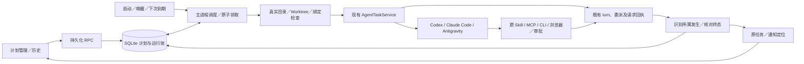

# M16 技术方案：定时任务与内置浏览器单窗口承载重构

更新：2026-11-25。依据：[M16 需求](../需求.md)，F36-R1.0／R07–R14、F16-R1.0／R01–R06。**状态：F36 技术方案 T1.0（R1.0/P1.0/A1.0 已收口，前置实验完成，待 M16 整体评审）。用户授权开发前隔离候选与实验；主窗口、关闭重开/布局竞态、复杂页面绘制、兼容回退、资源和实际原生全屏已取得分层证据。F16 七轮业务规则与专项技术实验已收口，形成 T1.0 完整开发前方案及关联原型、用例，待用户整体评审。均未进入正式生产开发；详细门槛和遗留项见各自章节。**

## A. F36 内置浏览器单窗口承载重构 T1.0

**2026-11-25 开发前技术方案定稿。** 依据 [F36-R1.0／R07–R14](../需求.md)、[P1.0 现有原型说明](../原型/原型说明与变更.md#f36-现有原型与受影响状态-p10)、[A1.0 验收用例](../验收/测试用例.md#f36-浏览器单窗口承载验收用例-a10)，合并 R0.4 及 BE00–BE08、Ultra Review 的实验结论。本节唯一现行 F36 技术设计；[R0.4 完整历史](../历史/F36技术方案_R0.4_20261125.md)及实验原始记录保留。以下为实施合同，尚未授权生产开发，实验补丁不是已集成的生产代码。

### 1. 背景与调整目标

在原 M12／M15 能力上消除普通网页的独立透明后台窗，修复关闭后重开和前景展示不同步等已知竞争。重构承载而非改版 UI；原业务、数据、授权与 F16 独立规则详见 R1.0。设计须同时保持页面状态、真实画面、系统层级和长期资源收尾，不能借简单隐藏窗口宣布完成。

### 2. 整体架构与已定选型

**采用 BaseWindow＋显式 AppShell WebContentsView＋普通网页 WebContentsView 的单原生主窗口组合。** 页面和执行仍由主进程持有，借鉴 Orca 的稳定页面生命周期与按需绘制思想，不引入 WebView。不为普通网页保留另一透明停放窗口或双承载运行时。

```text
                         单一原生主窗口 BaseWindow
  ┌───────────────────────────────────────────────────────────────┐
  │ 顶层：当前有效右侧原生视图（网页／HTML／MCP，由前景槽裁决）   │
  │ 中层：AppShell WebContentsView（现有可信 UI、菜单、工作区）    │
  │ 底层：其他普通网页 WebContentsView（保持实例、按需绘制）       │
  └───────────────────────────────────────────────────────────────┘
            统一宿主：窗口／壳引用、布局代际与原生层级
                         ↑                  ↑
      UI IPC／当前选择／展示意图       BrowserPageRegistry
      BrowserWorkspace 持久标签       页面身份／helper／队列
                         ↑                  ↑
       现有 MCP／CLI／合法 Agent 请求 → BrowserService → 原业务回执
```

- **承载与展示分离**：普通页从创建到终态一直附着同一宿主，切换仅改变层次、几何和本次前景责任，不因 React 组件卸载或主窗隐藏创建／销毁原生页。
- **存活与绘制分离**：页面存活、前台展示、绘制占用是独立状态。采用唯一占用令牌和实际底层结算控制闲置；不以后台冻结或系统激活替代真实画面。
- **业务结果与用户位置分离**：合法开页、当前用户展示意图、实际页面身份和回执分别关联；后来的真实用户选择优先。
- **复用现有业务**：BrowserService、BrowserWorkspace、现有应用能力、页级执行、回执、权限、下载、脚本及身份分区不另建一套。只改承载、生命周期、内部布局和开页展示的必要契约。

#### 2.1 选型及原始依据

| 选择 | 证据／取舍 | T1.0 决定 |
| --- | --- | --- |
| BrowserWindow＋额外透明停放窗 | 原 M12 为后台实际绘制引入，现有用户反馈额外系统窗口。只补隐藏属性不能消除宿主迁移及额外 Space。 | 旧版仅作为升级、回退、回归的对照，不作为新承载的运行时兜底。 |
| Orca／T3 Code 的 WebView | 本地参考源码与 BE00 表明稳定生命周期思路可借鉴；WebView 方案的覆盖、透明场景存在未满足绘制判据，且 WillYou 已有 WebContentsView 及主进程业务。 | 借鉴生命周期／按需绘制，不迁移引擎或复制其他产品 UI。 |
| BaseWindow＋WebContentsView | 锁定 Electron 42.11.14 的真实原生多视图探针、独立壳和实际开发构建证实可保留页面及实际输入/画面；BaseWindow 子内容必须显式收尾。 | 单窗口方案；统一所有权、可信壳与前景槽。 |

依据 [M12 原选型](../../M12_浏览器自动化/调研/WillYou冲突核对_20261103.md)、[F36 源码调研](../调研/README.md)、[BE00](实验/BE00_20261125/README.md)、[BE01／BE02 API 与冷隐藏](实验/BE01_BE02_20261125/README.md)；具体 Electron API 事实以锁定版本实际证据及原生类型声明为准。

#### 2.2 开发前实证与定稿决策

| 实验 | 本轮支持的设计结论与保留边界 |
| --- | --- |
| BE01 | 原生主宿主与可信 AppShell 引用必须分开；宿主加载失败、并发创建、取消退出和壳订阅存在独立生命周期，按 §5.1 统一。红绿及退出处理器／事件实验支持合同，正式完整服务与真实系统回执仍按 A1.0 验证。 |
| BE02 | 冷隐藏的同原生页实际操作及像素、新帧均有证据。复杂 CSS/rAF Canvas、timer、异步 payload 即使 native `setVisible(false)` 仍可能推进。确定按需绘制与独立 token，不能声称隐藏等同暂停或节省 CPU。 |
| BE03 | 旧版开发构建两个原生窗、候选一个；原生 hide／minimize／restore 及全屏完成事件后的稳定自有窗口合成、返回原页均有证据。不等于 Mission Control、实际物理焦点、多屏系统验收。 |
| BE04／BE05 | 关闭中旧 ID、重复关闭、全取消旧 loader、旧空状态撤销新意图等红测及隔离修正支持逻辑关闭、等待者与展示意图独立。真实生成器/provider 投影、旧冻结会话及用户请求端到端在正式候选复验；不是声称用户现场只有这些根因。 |
| BE06 | 实际旧 null 错降新前景、壳重载旧页覆盖首页、overlay 同 owner 再入等已定位，有真实或替身的红绿证据。固定 UI-origin 代际/顺序、原生层级串行和独立浮层实例；多类型 native view 整合与瞬时过渡留给正式候选。 |
| BE07 | 真实旧数据、候选写入后旧版读、受控异常退出后候选恢复均支持 v1 不迁移及完整数据根回退。维护归属保护未关闭；受控退出不是断电或 OS kill，不外推所有未持久状态。 |
| BE08 | 既有同形状 30 分钟策略观测、真实动态页面循环以及独立终态文件清扫合同支持按需绘制、真实 WC/queue/helper 结算及专属终态清理。持续绘制趋势红、旧 helper 元数据残留和独立外部清场保留；未证明 CPU 节省或长期无泄漏。 |

完整数据、实验方法、红测和绿测按[BE01–BE08](实验/BE01_BE08_20261125/README.md)、[Ultra Review](实验/BE01_BE08_ULTRA_20261125/README.md)及[实验计划](浏览器单窗口承载实验计划.md)保存，不另抄为产品通过率。所有候选补丁基于前一冻结候选独立试验，存在交叉修改，正式实现按以下合同合并职责、完整复验。

### 3. 当前实现与迁移基础

首轮参考 feature/0.1.7 的 `2e45d9eae725bd70aac60eef089f1a077f07b18a` 和 bugfix 的 `50b8ea211e20e7e184a1cb942cc124dbd13495b3`（当时同 tree `f68808df2c803640e312675791d6d53fdfaa67e0`）。实际旧版／候选研究统一冻结 `a0acddb3a2325c6bf732adaa7e954ce4d767a2c3`、macOS arm64、Electron 42.11.14／Chromium 148，详见[冻结输入](实验/BE01_BE08_20261125/snapshot/frozen-source-metadata.json)与[Ultra 源码哈希](实验/BE01_BE08_ULTRA_20261125/host/source-metadata.json)。

| 现有模块 | 复用与适配点 |
| --- | --- |
| [main/app/window.ts](../../../../src/main/app/window.ts)、[main/index.ts](../../../../src/main/index.ts) | 旧 BrowserWindow 直接承载 renderer/preload；macOS Close 隐藏，Cmd+Q 真退出，已有可信主 frame 校验。改为显式壳与 BaseWindow，不改变业务退出规则。 |
| [page-registry.ts](../../../../src/main/core/browser/page-registry.ts)、[park-window.ts](../../../../src/main/core/browser/park-window.ts) | 页级 WebContentsView、引用、helper 与队列已可复用；旧页在停放窗和主窗迁移。改为同宿主层级、绘制及终态所有权，取消普通页独立 park 窗。 |
| [workspace.ts](../../../../src/main/core/browser/workspace.ts)、[controller.ts](../../../../src/main/core/browser/controller.ts) | 持久逻辑 tabs/activeId、按需 ensure、placement 与 overlay。保留业务来源，内部接入实例化布局与占用。 |
| [renderer browser workspace](../../../../src/renderer/features/browser/workspace.tsx)、[store](../../../../src/renderer/features/browser/store.ts)、[open-presentation.ts](../../../../src/renderer/features/browser/open-presentation.ts)、[workspace-panels-store.ts](../../../../src/renderer/features/agent-tasks/workspace-panels-store.ts) | React 布局、ResizeObserver、空面板收尾及事件 guard 继续复用；隔离用户选择与程序自动清理，发起端保存布局／展示身份，取消旧实例不影响新的。 |
| [tab-open.ts](../../../../src/main/core/browser/tab-open.ts)、[service.ts](../../../../src/main/core/browser/service.ts)、[命令生成器](../../M12_浏览器自动化/技研/命令映射/gen_command_map.py)、agent-browser／页级执行 | 原授权、队列和回执不变，补 url/pageId 互斥、closing/取消状态及绘制持有；更新唯一契约生成源并保留旧冻结会话兼容。 |
| [HTML service](../../../../src/main/core/files/html/service.ts)、[MCP UI view](../../../../src/main/core/files/mcp/ui-view.ts)、[文件 controller](../../../../src/main/core/files/controller.ts) | 旧调用依赖父 BrowserWindow、`webContents`、zoom／focus；按实际 API 改宿主／壳引用及原生前景，保留业务入口。 |

### 4. 模块职责与主流程

| 模块／内部职责 | 唯一责任 |
| --- | --- |
| 主窗口宿主（`main/app/window.ts`、入口及新增轻量宿主适配） | 原生窗口、可信壳、宿主代际、就绪、窗口事件和对话框父窗；统一原生根层级协调，不承担标签持久状态。 |
| BrowserPageRegistry | 页级实际 WebContents、原生代际、引用、helper、队列，管理挂载与唯一终态 owner。 |
| 布局与绘制协调 | 管理一个右侧原生前景槽、多页绘制 token、viewport、overlay 实例、原生层级事务；属于宿主与注册表的内部职责，不新增持久状态源／公共工具。 |
| BrowserWorkspace＋controller | 逻辑标签、选择、身份、创建／关闭／重开、UI IPC；持久化保持 v1，使用注册表/runtime 的真实状态。 |
| BrowserService／现有执行模块及工具定义 | 复用原权限、合法目标、请求编号及回执；需要实际画面的操作在页级队列内取得绘制许可并按底层结算释放。 |
| renderer 及其他原生工作区 | 保留原界面，记录当前用户选择、真实实例／布局时序；其他 native view 与浏览器共用前景槽及相应焦点，互不覆盖。 |

主流程：合法请求经原 service 解析任务/有效身份 → workspace 确定逻辑目标及请求回执 → registry 在现有或本代际唯一宿主确保页面及执行上下文 → 按需绘制，真实操作及回执 → 如当前有效展示意图存在，UI 选中对应页并提交正确布局 → 切走仅释放布局／前台占用 → 显式关页或退役先撤逻辑能力，结算 owner 后清理原生内容。宿主真实退出由 §5.1 统一协调，普通隐藏不走退出链。

### 5. 详细设计

#### 5.1 主窗口宿主、可信界面和退出

1. 由 BaseWindow 承担现有窗口几何、标题、原生菜单、macOS 交通灯／全屏、设备变更、关闭隐藏和真实退出；独立 AppShell WebContentsView 加载现有 renderer/preload/主题并同步内容区尺寸。适配旧 `ready-to-show` 语义，保留壳 zoom、消息和原生焦点。
2. 采用轻量内部引用模块（实验中的 `main/app/window-host.ts` 所示职责），明确 `getMainWindow()`、`getMainShell()`、`getMainWindowContents()`、`mainWindowForContents()` 所表达的窗口／壳／父窗语义；实现名称可沿项目约定，但不以 BrowserWindow 实例强制转换谋求兼容。BE01 在锁定版本实测 `BrowserWindow.fromWebContents` 可能返回没有 .webContents 的 BaseWindow，`BrowserWindow.fromId` 对该宿主为空。对 dialog 已有 BaseWindow 参数支持；同步审查所有 win.webContents／父窗／焦点调用点。引用模块不依赖窗口构建资源、图标等重依赖，避免污染 renderer 类型树。
3. 原可信 UI 判据只接受当前壳及允许的主 frame／URL；旧壳、普通页和弹窗不是可信 UI。保持主壳安全配置，普通网页继续 sandbox、contextIsolation、无 Node integration、原会话与授权配置；窗口归属映射本身不是授权。
4. 每代宿主仅一次创建，内部运行态为 initializing → native-ready → shell-loaded → ui-bound，失败进入 failed，承诺退出进入 committed-shutdown。BrowserService 早于主窗创建的冷启动场景共享同一次创建／有界就绪 Promise；调用者取消只结束自身等待，不反复建窗。合法后台请求可等待必要 native/page 就绪而不亮窗；可见窗口展示须等待真实壳成功加载，前景绑定另须真实 UI 订阅与当前 snapshot／选择就绪。壳 load fail 先阻断发布，按 owner 收尾队列、helper 和全部已分配 WC／view，释放失败宿主后才准新代际重试。
5. 可信壳主 frame 非同文档导航、壳崩溃或宿主重建立即撤销旧壳布局和 overlay 代际、安全降层，保持仍有效页和未提交表单。新可信壳 document／订阅／snapshot 同步后才接受新布局；原事件无自动重放、reload 丢失内存 intent，不盲播旧 show。保留真实操作回执与查看对应页的入口，不能证明原用户意图仍有效就不抢视角，新输入和真实回选有效。若宿主或页面实际销毁则按已保存状态恢复新原生代际，旧引用／迟到回调失效。
6. 主窗口隐藏与真实退出严格分离。退出前沿用当前 busy/保存/丢弃/commit 真实回执；拒绝、取消或 commit 未确认不得先拆页面/helper；恢复原运行状态，允许再请求退出。真退出 commit 后阻断新请求（F16 相应调度由其现行合同负责），结算页队列、取消／关闭 owner 和实际 WC，释放其他受管 view、可信壳与根窗口；BaseWindow 不保证自动释放 child WebContents。退出与初始化/清理串行化，不能再生宿主；原 `window-all-closed` 自动退出事件须与实际收尾协调，不让根窗口先关闭打断子页/资源最终回执。合法可见 native popup 和独立业务窗保留既有归属、opener 和关闭规则，非普通背景窗。

#### 5.2 原生前景槽、页面绘制与浮层

同一 BaseWindow 的层级由统一入口裁决。当前右侧原生视图在 AppShell 之上并限制在实际槽位，其他普通网页在壳之后，无用户交互责任；合法原生模态窗口按原规则。布局来自可信 renderer 的当前 rect、壳 zoom、窗口几何和跨屏 DPR，有效边界按原校验。原生页不因层级切换跨系统窗口转移；BE02 支持在同一根内以 addChildView 顺序重排。

| 有效页状态／角色（运行态，不是新持久枚举） | 行为 |
| --- | --- |
| 未加载／初始化 | 持久逻辑标签或新建页未加载时使用原占位；有效导航按身份，在同宿主建立视图/执行上下文。明确展示者按原 UI 呈现加载及成功/失败；取消或失败收尾实际已分配内容。 |
| 前台 | 当前任务、面板、标签与有效布局匹配才取得前景槽及独立前台绘制占用；页可绘制、有相应键鼠焦点，切走不销毁。 |
| 后台闲置 | 在壳之后且无绘制持有者／底层未结算操作时，以 native `setVisible(false)` 作为闲置初始策略，保持同一 WebContents/session/document，既有 backgroundThrottling:false 不擅改。不会假定 rAF、计时、CSS 或异步工作暂停。 |
| 后台绘制 | 有一个或多个实际画面需求时保持同页在壳后、正确尺寸且可绘制；不激活主窗口、不拦截用户操作，最后一个有效占用结算才可回闲置。 |
| 关闭中／关闭 | 逻辑上拒绝新操作，撤销布局与获取新 token，按 §5.3 结算 owner、实际 WC/helper 及专属资源。 |

一贯采用以下内部契约：

- 每一布局请求在可信 UI 发起时携带当前 host/renderer generation、surface instance、单调 sequence、taskId/pageId 和 rect；同页重新挂载也换实例。旧 null **只**能撤自己仍占有的前景槽，不得降层 B 或重新挂载的 A。renderer 内部 IPC 与主进程接线同步更新，不写入 v1 数据或 Agent 公共 schema。
- 对同一原生根的布局变更串行处理，且在任何异步边界后、实际提交层级/可见性前重新核对宿主/页面代际、发起序号及前景责任。只有当前有效事务发布前景；旧事件不能先短暂抢占再以最终正确掩盖错误。HTML/MCP 等原生视图统一服从该裁决；其他模块不独立重排。
- 每次需要帧的操作（前景、导航、输入、截图、原冻结脚本等）获得本页及宿主代际的独立 acquisition token，返回幂等 release。获取时核验实际有效实例、viewport、正确层级与可绘制状态；实际操作需要时等待可核验新帧或真实业务回执，不以固定 sleep 或返回成功替代画面。纯读取没有绘制需求时不无条件升前景。背景状态不通过系统激活或抢键鼠验证。
- 每个 token 只释放自己；失效、乱序或重复 release 不影响别的操作或新代际。外层取消/超时不能证明实际 capture/底层工作已结算，不提前卸最后有效占用；结合当前队列/abort 等待真实结束、明确失败／取消或已确认页终止。若原资源判据不满足，先查当前绘制/执行占用真实原因，在不破坏 R09 的范围修正策略并复验，不用永久全页 paintable 避开问题。
- 保留现有多 owner overlay、截图占位及原页降层行为。每次打开取独立 acquisition 实例/页面代际；同名 owner 再入是新实例，迟到 capture/close 不发布旧图片、不重新下沉或释放新 owner；只在最后一个当前有效浮层释放时复位。有效浮层期间原生页不穿透、不接受后台键鼠。与文件、菜单、权限、认证、下载、查找等真实入口联合验证。

#### 5.3 标签生命周期、取消、终态所有权

采用 BrowserWorkspace（保存逻辑标签与 activeId）和 BrowserPageRegistry（实时原生实例）两层，无第三套持久页列表。pageId、宿主/原生实例代际和 documentGeneration／引用范围明确区分：导航产生新文档、原生页重建形成新实例，旧操作的实际权限、引用和回调不得借新身份生效。内部 epoch/代际是运行态，不写入 v1。

1. ensure 对同一仍有效逻辑页只建立一份原生实例，等待者受其请求实际取消约束。合法复用仅匹配当前任务、同一有效 profile、完整目标 URL 的有效标签；多个同目标时按原 M15 复用选择（优先当前匹配页，按既有规则）。明确另开／无合法匹配时新 ID。
2. 关页受理同步标记 closing（首个 await 前），从合法 lookup、URL 匹配和新操作排除、撤旧展示，UI dispose 并不等价 close。重复 close 共享同一终态事务／一次实际 native dispose 与关闭历史记录，不重复入队或自等待。只有实际 owner 结算；物理收尾未完成或失败时旧 ID 仍不可复用，记录具体失败和收尾状态，不由回调恢复成有效旧页；用户随后明确新开走新 ID。原主动重开关闭历史仍按既有新 ID 合同。
3. 同 URL 并发合法复用可共享创建、但 operation/requestId、回执和取消独立。一方取消不影响仍有效等待者；全部取消则同步停止加入这次旧 loader 并撤销旧发布责任，底层结算后回收本次自动创建且未被用户接手的占位或资源（不新增人为关闭历史）；已有或用户已接手页面按正常生命周期，不擅删。随后合法新请求分配新的有效创建，而非加入已失效初始化。同编号同参重试保持原回执；同编号改语义参数明确冲突；新目标或意图用新编号。
4. 终态由注册表唯一 owner 阻断新占用，撤旧布局/引用/执行许可，结算队列、页级 proxy/client/daemon/helper 与全部实际 WC。close 回执不是内容销毁事件，按有界等待核实际 WebContents 销毁、实际端点/进程停止和存活记录；异步尾回调按原代际失效。不对其他页/宿主发全局操作。
5. 区分 `BrowserHelper.close()`（暂时连接关闭，超时、重导航、取消后可能复用）与页面终态 dispose（该页不可再恢复）。只有确认底层 queue/proxy/client/daemon 结算且专属路径真正属于该页时，幂等清理该页的端点元数据（包括已确认的 .version）及私有 helper home。未知文件、未结算或归属不清保留明确诊断/可核对延迟回收，不清理兄弟页、共享或用户目录。不以实验外部清场冒充产品自然回收。
6. popup/opener/session、身份切换、Cookie 导入的暂停、profile／任务删除等延续原锁、队列、收尾和原身份/授权合同，不跨任务共享普通页 WebContents。本阶段不改变已有脚本、会话或持久历史规则。

#### 5.4 开页输入、展示事件闭环与原回执

已确证旧组件三类竞争：[BE04/BE05 证据](实验/BE01_BE08_20261125/software/reopen/README.md)：旧空 snapshot 自动收起误提升版本，在 select 前或 select 在途拒绝新展示；显式关页撤销太晚使旧 intent 可抢回界面。Ultra 另有实际旧 native null、壳 reload 及并发取消红测。此处依据实证确定职责，而非将这些交错推定为原始现场唯一根因。

1. 在当前命令定义的唯一生成源表达 url 或 pageId 二选一；指定 pageId 沿用原身份，不与另开/新的身份冲突。保留严格宿主校验、任务/身份有效性及原错误码。现有[生成源](../../M12_浏览器自动化/技研/命令映射/gen_command_map.py) 的 browser.tab.open 互斥表达不足，[应用定义](../../../../resources/applications/browser/definition.mjs)、[tool-service](../../../../src/main/core/applications/tool-service.ts)、[bridge-runtime](../../../../src/main/core/applications/bridge-runtime.ts) 的源码核对表明内部通路没有主动剥掉组合 schema，但 provider 方言是否支持组合关键字须在真实候选验证。若某 provider 不支持，使用其兼容表达与同等清楚的工具说明，宿主仍严格拒绝。按原应用契约版本和旧会话冻结兼容规则发布，不覆盖冻结会话或只手改生成文件。
2. 原工具说明与恢复错误统一：以实际回执当前页为准；目标失效查询当前合法标签；新用户开页走新请求。明确指定关闭页、参数冲突和其他无效目标应返回具体可追溯错误，不隐式重开、改目标或重复业务操作。
3. UI 发新输入登记展示意图身份，主进程接收开页关联真实 taskId/pageId/operationId/clientInputId，与原早回执／loading/ready/failed/cancelled 一致。明确 show 的当前有效目标先选中，未就绪显示加载，快慢响应都先选中再发布就绪，在同一标签更新实际终态。**内部展示握手**绑定当前可信壳、目标和本次意图，renderer 完成实际选中／前景责任提交后向主进程确认；页面实际 ready 仍由原业务判据决定。有效 show 的公开终态在业务实际就绪且展示确认后发布；用户后选／关闭或壳代际失效、明确无法展示时有界结束展示等待，实际业务结果仍留回执及主动查看入口，不将展示失败误写为页面失败，也不伪称自动展示成功。正常当前有效 show 必须通过展示确认，后台模式不等待 UI 握手；确认本身不授予页面权限或替代实际页面就绪。
4. 复用 browser:open-presentation：在异步 snapshot/select 前后均核实际标签、有效 taskId、请求意图、当前用户选择及壳代际。显式手动切换／关页入口立即同步撤销旧 intent；程序自动空标签收尾只关闭本次仍对应的空面板、不提升用户撤销版本。采用已复验的职责拆分（`AgentBrowserSurface`、workspace-panels 的 onClose/onAutoClose，内部 Panels.close 自动标记）；两次 guard 均保留，与 §5.2 的实际布局 owner 关联。后选任务、面板、标签即使再切回也不恢复旧意图。
5. 新壳订阅未就绪时不推断旧事件必达、也不无条件重放；先核当前 snapshot 和真实意图。未展示的成功结果保留原任务内查看真实标签入口；用户明确查看仍有效目标才选中对应 activeId 和前景，关闭后返回原失效提示。直接工具、真实用户提交、经批准的 host business 等既有入口均复验。
6. 诊断只记录必要脱敏事务身份、状态和失败类别，不采集真实网站内容、账号、密码或私人 URL；同一请求回执及实际效果为准，不以日志或模型文字代替授权和实际结果。

#### 5.5 接口及兼容合同

以下为正式实施的行为契约，内部新类型/函数的具体命名按现有工程规范落地，不新增另一个公共工具入口。

| 接口／事件 | 现有输入／输出 | T1.0 适配 |
| --- | --- | --- |
| UI browser.snapshot/create/select/close/reopen | controller.ts，taskId、address?/tabId（select 可空）；BrowserWorkspaceState | 原公开业务契约及持久状态来源不变；逻辑选择、实际挂载、终态按 §5.1–5.3。 |
| UI browser.placement | taskId/tabId/rect（可 null） | 内部可信 UI layout origin、宿主/renderer 代际、surface instance、发起 sequence；null 只撤自己的有效布局。 |
| UI browser.overlay | taskId/tabId/open/capture?/owner?；图片或 null | 同一 owner 支持多次独立 acquisition；capture/close 限定正确实例与页代际，保留原图片及浮层行为。 |
| UI browser.navigate/action/find/focusChrome 等 | browser controller 与 shared browser-workspace.ts | 原业务不变，使用明确壳／当前页焦点；合法背景和用户当前操作不互相抢占。 |
| MCP smartdd_browser_tab_open_v2／CLI browser.tab.open | url 或 pageId、intent、presentation、profileId、ready；pageId/url/reused/operationId/presentation/phase | 输入目标互斥、原身份、早回执和幂等；旧冻结会话兼容、严格宿主校验，按 §5.4 处理支持的 schema 及错误。 |
| 既有 tab list/current/goto 等及页级执行 | BrowserService、workspace、现有 CDP/Helper | 仅原合法有效页，原回执和错误码；同原任务/页面/身份/授权校验。不新增全局浏览器操作或跨任务特权。 |
| browser:changed | shared/events.ts，taskId | 保留通知及最新 snapshot，旧状态不得写回新布局。 |
| browser:open-presentation | shared/events.ts，taskId/pageId/operationId/clientInputId | 原事件与回执身份保持；增加可信 UI 内部展示确认／撤销回执职责，绑定实际壳／目标／意图代际，名称按内部 IPC 约定落地，不新增公共工具；按 §5.4 完成有界握手及诊断。 |
| 原生宿主内部引用／布局／paint acquire/release／终态 dispose | 内部职责，不属于公开 MCP/CLI/RPC | 明确窗口/壳、唯一 owner、实际 ready/结算、代际与每次 acquisition；不得将后台 paintable 试验入口带入产品。 |

#### 5.6 数据兼容、升级回退与异常

| 原数据/运行对象 | 现行方案 |
| --- | --- |
| app_settings: browserWorkspace.v1:<taskId> | 原 version=1、tabs(id,url,title,profileId,favicon)、activeId、closed（最多10）保持；不存原生 handle、renderer 代际、层级或 token。 |
| browserProfiles.v1、persist:wy-browser-<id> | 原 profile ID、scope/owner/partition 保持；持久 cookie/会话、身份隔离、原资源归属一致。 |
| browser_operations | 沿用 run_id/request_id/task_id/page_id/command/state/effect_state/progress/summary/error_code/时间和原账本、权限及幂等合同；旧结果只由原合法归属查询。 |
| 原生运行态 | 仅有效实时 WebContents、引用、布局、绘制、队列、owner；按新代际恢复，不存持久句柄，不恢复关闭 ID。 |

决定：F36 不新增 SQLite 表或改变 v1 schema/partition；F16 自己的新增表/通用任务 scope/owner 扩展及迁移不由本节裁决。F36 保留实际 scope/owner 的接入边界，不假定所有未来合法任务都有 projectId，S6 由 F16 明确真实无项目任务的独立合法身份和能力投影；不引入假项目或扩大原页面权限。正式升级直接使用原完整数据根和维护归属校验；实验首次只复制 DB/Partitions 被既有归属校验阻止，补齐完整独立数据根后通过，没有关校验或清库。BE07 真实旧→候选写入→旧版读取→候选受控异常退出→候选恢复支持双向兼容；正式候选用旧实际安装版本生成的独立完整样本复验（服务端不重新签发旧 Cookie），确认 DB/WAL 及资源 owner、原 task/profile/历史一致。在只涉及 F36 无数据迁移的候选范围，回退使用已验证旧包及同完整数据，先正常关闭当前候选并按原约定持久化/备份；不创建双承载运行时。组合包若涉及 F16 新表/新功能，按 F16 的迁移和备份恢复方案，不承诺旧应用降级可读全部 M16 新功能数据；联合候选核原浏览器数据与 F16 迁移/owner 共存。确需变更存储或协议/回退合同须说明证据、迁移及影响，经评审后才能实施；不为消除启动问题放宽原数据库保护。

| 异常／竞争 | 现行处理及回验 |
| --- | --- |
| 冷启动未就绪、load fail、壳重载或失效 | 唯一就绪/失败状态，阻断旧布局及真实清理所有权；当前可信壳绑定后才接受新布局；BE01/02/08、B10。 |
| 初始化中关闭、撤销、身份退役 | 同步排除旧页、独立等待者、实际终态结算；迟到结果不复活；BE04/08、B04/B10。 |
| 底层等待超时或多 token | 每持有者释放自己，保持在途底层占用，按原回执明确效果；BE02/08、B03/B10。 |
| A→B→A、旧 null、overlay capture/release | 以当前 host/page/UI-origin 实例/sequence 串行裁决；BE03/05/06、B06/B09。 |
| 参数/旧目标错误、用户已后选 | 明确错误或保存原结果，不暗中改页、不抢前景，合法新请求正常展示；BE04/05、B04–B06。 |
| 认证、权限、下载、原脚本和其他业务故障 | 沿原 M12/M15 合同处理，已派发效果未知按原账本核对，不盲重试；BE07/09、B05/B07/B08/B10。 |
| 真退出、崩溃、重启 | 退出取消保留有效页，commit 后依 owner 收尾；重启按已保存持久状态恢复新原生身份，终态资源仅可核对 owner；BE08/09、B07/B10/B11。 |

### 6. 开发单元、依赖与受影响模块

正式实施顺序如下；每步保持编译和相关回归可验证，不直接合并未经核对的实验补丁。

| 顺序 | 工作及主要代码范围 | 开发完成检查／用例映射 |
| --- | --- | --- |
| S1 主宿主 | `main/app/window.ts`、`main/index.ts` 及轻量 window-host 适配；唯一宿主/可信壳、共享就绪、加载失败、reload 降层和退出 commit。 | BE01；B01、B02、B08–B10；真实主壳载入、父窗/可信身份、主窗关闭与收尾。 |
| S2 单窗承载与绘制 | `browser/page-registry.ts`、旧 park、`workspace.ts`、`controller.ts` 和执行队列；同根层级、paint token、实际画面/底层结算、terminal dispose；迁移所有普通页调用后移除旧 park 窗。 | BE02/03/08；B01–B03、B09–B11；同实例、实际新帧、并发和终态清场。 |
| S3 逻辑关页／重开／展示 | `tab-open.ts`、`service.ts`、唯一命令生成源、原工具说明、renderer browser/workspace-panels；closing、重复 close、共享创建取消、回执和当前 intent。 | BE04/05；B04–B06、B10；旧红绿时序、实时 UI/真实工具接线及兼容。展示小补丁可独立回归，但终态须与 S1/S2 集成。 |
| S4 共用原生视图与业务兼容 | 文件、HTML/MCP viewer、其他父窗 API、原 UI 拖动／菜单/焦点、popup/下载/profile/许可／原脚本；统一前景和浮层实例。 | BE06/07；B07–B10；原 UI 与回执、登录/下载/其他视图不退化。 |
| S5 整合及正式候选 | 独立构建最终 App、冻结源/包/依赖、跨任务及视图、冷隐藏、重启、异常及资源，按原系统/平台合同复验。 | BE08/09；独立 B01–B11，M12/M15 受影响用例及既有 CI/构建门槛。 |
| S6 F16 联动 | F16 正式调度及真实有／无项目通用 scope、独立浏览器身份接同一浏览器宿主；按 F16 来源、工作区/身份、原批准、迁移及实际退出合同，不另造调度或页面宿主。 | BE10/B12 与 F16 现行用例联合验收；不把未实现 F16 当成阻塞 F36 独立开发的前置。 |

最早审查窗口/壳调用面：`main/rpc.ts` 焦点窗口查询；`core/files/controller.ts`、`core/projects/transfer-controller.ts`、`core/ai/agent-transfer-controller.ts`、`core/applications/controller.ts` 的父窗/系统 dialog；`core/files/html/service.ts`、`core/files/mcp/ui-view.ts` 的几何、zoom、webContents/focus；浏览器、语音及其他接收主窗引用的路径。逐项根据真实 API 决定适配，合法独立图表／业务原生窗不一律删除。完整来源见[兼容审计](实验/BE01_BE08_20261125/software/compatibility/audit.md)。保留既有生产依赖、公开数据与版本策略；按 S1–S5 小步验证和可回退实现，不把测试专用隐藏/激活参数带入业务。正式 worktree 按同锁准备依赖及 `pnpm test:prepare`，每单元按其影响面运行相关单元/集成、`pnpm typecheck`（node/web），S5 依根流程完成检查、构建和 `pnpm package`。原长测归档驱动固定历史根和透明停放窗判据，按兼容审计重用可用采样/夹具，在新独立根适配宿主身份、实际受控输入和进程归属；不放宽原时长/资源判据、路径守卫或把历史缺件当已跑通过。

### 7. 风险处理与正式验证边界

- BaseWindow、BrowserWindow 类型/API 差异、原生焦点及父窗是 S1/S4 最早回归风险；不通过强制类型转换、降低可信 UI 判据或删掉工作区入口来绕过。
- 真正原生合成与系统状态需 S 层证据；旧候选自有全屏稳定截图不能代替系统 Mission Control、Dock/窗口菜单、物理输入或完整多屏验收。原 UI 复用按 P1.0、同条件对照候选。
- 动态页隐藏仍可能推进，按需策略是画面和生命周期控制，不作 CPU 节省承诺。真实 service 占用与终态清扫是正式开发要求；原 M12 后台时延/长测合同不变，实际红项不得用别的指标或外部清场抵消。
- 独立合成数据和真实原生窗口、软件替身、正式安装包与本人真实登录/系统验证分层取证；受控异常不是断电。暂缓平台/本人项按实际状态记录，不外推。
- F36 不扩张原权限或引入退出后常驻能力。跨模块 F16 按其现行需求和测试引用，不另写调度或无人值守规则。

### 8. 验证门槛与证据

唯一正式验收判据见 [F36-A1.0](../验收/测试用例.md#f36-浏览器单窗口承载验收用例-a10)；实验方法及原始数据在[实验计划 BE00–BE10](浏览器单窗口承载实验计划.md)。按根 AGENTS 流程以独立 HOME/userData、真实打包候选、当前一致源码/锁/原生与包 SHA 执行真实 UI；系统/本人另证，不能只看 IPC、DOM、合成探针结果。旧 M12/M15 受影响判据未被本轮替换，按 A1.0 回归矩阵执行。

| 正式门槛 | 当前准备程度 | 正式判定 |
| --- | --- | --- |
| G1 主宿主可行 | 前置 BE01／02 的真实开发构建、冷隐藏及独立就绪/占用合同已获得决策证据 | S1/S2 接入真实服务、完整持有及原生宿主验证，按 B01–B03/B10 相关层级。 |
| G2 行为稳定 | BE03 实际自有原生窗、BE04/05 红绿及契约已支撑选型 | S3/S4 和 B04–B06/B09 及 B01 系统实际行为，最终 provider／UI/回执与生命周期复验。 |
| G3 兼容与资源 | BE06–08、Ultra 新旧数据及动态资源证据；保留原实验趋势失败／资源残留 | S2/S4/S5 实施完整原业务/原生层级、数据及实际资源清场，B03/B07–B11 各适用层级。 |
| G4 正式候选 | 尚无正式包或产品验收 | BE09，B01–B11 及受影响旧用例、正式候选达到原合同。 |
| G5 F16 联动 | F16 独立评审和开发前置 | BE10、B12 与 F16 实际任务验收，保留现行 F16 权限及退出约束。 |

### 9. 开发前收口与评审

BE00–BE08 与 Ultra Review 的开发前技术验证已收口，不另起同类预研；关键架构取舍、已知红测、正式实现及复验路径均明确。G1–G3 的完整产品层级与 G4/G5 尚未通过，均已进入上述正式开发与验收任务。当前只交付 R1.0/T1.0/P1.0/A1.0 评审稿，由用户确认 M16 整体后授权生产改造。未执行的系统/本人项目、实际服务与 resource 长测不是被删除的要求，不能用历史独立实验计作完成。

[定稿一致性复核](复核/F36定稿一致性复核_20261125.md)记录 R07–R14、实施单元、原型状态、用例和原始证据的对应关系。修订依据和未确认事项均保留，不修改原实验及 F16 历史。

## B. F16 定时任务技术方案 T1.0

2026-11-25；依据 [F16-R1.0 需求 R01–R06](../需求.md)、[T3 Code／Orca 与 WillYou 源码调研](../调研/F16_T3Code与Orca定时任务源码对照_20261125.md)、[E01–E09 专项证据](实验/F16_20261125/README.md)。起点 feature/0.1.7，生产提交 a0acddb3a2325c6bf732adaa7e954ce4d767a2c3。本方案为**完整开发前评审稿**。新增模块、接口、字段名是计划实现合同，不宣称已经进入生产。历史 [D0.2](../历史/F16技术方案_D0.2_20261125.md) 保留。

### B1. 架构与选型

T3 Code 和 Orca 都使用正常任务执行入口；WillYou 同样新增调度，而不是另外一套 Agent、浏览器或权限系统。结合 E01、E02、E03、E08，采用 Electron **主进程单一调度器＋现有宿主 SQLite＋现有 AgentTaskService**，不在 renderer 计时，不建独立常驻进程或 Webhook。采用动态下次到期计时器和有界复核（有启用计划时最长 5 秒），而不是持续扫全表或等每分钟固定轮询；独立计划不等待另一 Agent 的异步模型响应。使用 E01 验证的结构化日程、Intl 时区计算候选，整理为共享纯函数供主进程与 UI 使用。



F36 独立推进浏览器承载重构；F16 依赖稳定业务合同，不重建浏览器工具。业务规则只以 R1.0 为准，下文说明实现方式及必要回归。

### B2. 现有实现、实验结论与必须适配的缺口

| 现有路径／专项 | 已验证基础 | 正式开发需补 |
| --- | --- | --- |
| src/main/app/window.ts、src/main/index.ts；E07 | macOS 关闭 hide，其他平台 app.quit；已有 before-quit 确认、异步清理 | 主进程单 scheduler 生命周期，powerMonitor resume 和时钟复核；退出取消恢复 |
| core/agent/agent-task-service.ts create/submit/enqueueHost、agent-store.ts acceptTurn；E03/E05/E08 | create 可空 project/dir；submit 写 user、验证选择修订；enqueueHost 写 delegation/notification/system 且会排队；agent_turns 唯一 (task_id,client_input_id) | 可信计划接受入口、显式发生来源、原子忙碌跳过，不能简单调用普通 submit/enqueueHost 或冒充人工输入 |
| core/agent/agent-run-service.ts、drivers、resolveProfileLaunch；E04/E05 | 真实三种 CLI 的新会话、续聊、实际模型/档位、选择修订及 launch 兼容身份变化 | 复用原 driver registry/探测，不固定已测 CLI 版本，确认绑定身份及真实能力 |
| core/agent/git-workspaces.ts、drizzle/0037_agent_workspace.sql、core/files/sources.ts；E06 | 工作树功能为子任务准备，task FK RESTRICT；真实 Git 两种模式、SVN、普通路径有效；顶层创建当前会重回登记原目录 | 复用 Git 下层准备／恢复，独立 plan/run owner，顶层实际 cwd 和文件/工作树展示；不拿假 child task 作生产 owner |
| core/agent/wiring.ts:174、capabilities registry；E09 | 项目为空时提前 return；原 registry 对未登记目录可以选择 global Skill/MCP、排除别的项目 | 显式 standalone scope，分开全局投影与需项目能力，保持原运行身份/凭据边界 |
| core/browser/workspace.ts、profiles.ts、BrowserAccess；E06/E09 | 当前空 project 拒绝；真实 profile/access 元数据候选可持久分区及隔离 | 扩展既有 owner 和实际浏览器/renderer 接线；项目与通用任务有明确范围，按持久发生裁定新增跨任务授权 |
| 原 AgentBusinessTools、CLI/MCP、插件审批、邮件；E09 | 真实宿主 ledger、合成插件/邮件及 native CLI、单／多 Agent 终态收口验证 | 只传原权限／范围及发生归属，保留审批、业务回执和委派树；不新做定时任务专属工具 |
| renderer/core/agent-tasks-store.ts、任务导航；E09 | 后台 request.opened 的通知及任务导航有效；目前失败 turn 不通知 | 发生状态、失败/修正/待核对 notification 去重，实际回合、请求精确定位，不重复发已有普通通知 |

### B3. 模块、数据和兼容迁移

拟增主进程 core/schedules/（calendar、store、scheduler、dispatch/reconcile、workspace/scopes adapter、controller），共享 src/shared 日程/运行契约和 IPC schema，renderer 计划页、表单、列表与原任务定位。共用任务和浏览器仅扩展必要契约。

| 记录（拟议名称） | 字段与约束 |
| --- | --- |
| schedule_plans | plan_id PK、title/prompt 或已有文本引用、revision、结构化 schedule（interval anchor / once UTC / calendar rule）、zone_policy/computed_zone/next_due_ms、enabled/ended/archived_at/repair code、grace、可空 project_id/dir_id、workspace_mode/repo identity/base_ref、destination/bound_task、profile/provider compatibility 摘要、model/effort/tier/delegation、notify、created/updated。revision CAS；有效启用且未归档/结束/修正的 next_due 部分索引；存配置引用及非秘密摘要，不复制 Key。 |
| schedule_occurrences | run_id PK、plan_id FK RESTRICT、occurrence_key UNIQUE(plan_id,key)、trigger、due/claimed/missed_from、plan_revision、不可变执行快照、client_task_id/task_id/client_input_id（唯一）、actual_turn_id/native receipt、workspace link、state、attempts、started/finished、reason/error/ref。active_plan 与 active_target 部分唯一索引，active 含 waiting/unknown；历史不级联删。任务不可用仍保存原引用和原因。 |
| schedule_workspace_links | workspace_id、project/repo identity、owner_kind(plan/run)+owner ID 唯一、path 唯一、base_ref/base_commit/branch、准备/就绪/需核对/清理状态、持久准备意图及结果；actual task links 多对一。专属 owner=plan，逐次 owner=run，原 child 工作树记录不变。 |
| scheduled_turn_origins | occurrence_id、实际 turn_id/task_id/clientInputId 唯一匹配、root_turn_id、继承归属边（所属委派/结果通知）。实现显式可信 originKind=schedule，与原 agent_turns.source_kind 现有 system 分支兼容；不是以 system 或同 native runId 推定计划。接受与映射同事务；原任务历史/事件投影显示定时来源。 |
| schedule_notification_events | event_key 唯一（run_id＋真实状态转换或实际 request id，配置异常 plan revision/reason）、发生/任务/回合/request、产生时间及通知交付状态；保留原任务应用内入口。 |

UTC 毫秒为时间存储；展示按需求时区。迁移使用现有 Drizzle 规范与同一宿主连接；旧实际项目、配置、任务、原生会话、凭据、浏览器数据继续复用。新增表优先，不因引入可信 origin 重建旧 source_kind 表或复制全部任务。以旧数据独立备份副本核对迁移和重启、外键和记录不丢失。迁移失败按已有备份恢复；不承诺旧应用降级可读新功能。

### B4. 调度、接受与恢复

#### B4.1 时间引擎及生命周期

- 日程结构和语义按 R1.0 §3.4；E01 候选 schedule-engine.mjs 的时区、DST gap/fold、月历、五字段 Cron、固定绝对时间及可表示边界测试保留。宿主与前端预览使用同一实现；按日和候选时分跳转，不逐分钟盲扫。interval 保存起算锚，once 保存 UTC；只有语义改变时重置，手动/非日程编辑/启停不漂移。
- occurrence key：interval/once 为绝对 due；日历为规范化时区（跟随模式用 local 命名域）＋有效墙钟日期/时分。领取与更新下次 due 同事务，时钟回拨、DST 重复、重启不重跑旧键。跟随本机变更时区时重算未来，不派旧区错过时点；生产预览/下次时间过滤已领取墙钟键，避免显示一条实际只会去重的“下次”。E02 补验已过滤已领取键并得出真实下一时点；UI 及生产接线为开发项。
- 主进程 ready、数据库和真实任务恢复完成后启动一次；先恢复既有活动 occurrence 与原 accept receipt，再调度未来。保存、修正、启停、唤醒和有界时钟复核进入同一调度器；无启用计划且无核对工作停计时。有多个同时到期计划不 await 模型串行。hide、最小化继续；真实退出确认期间暂冻新领取（取消则恢复），确认退出后停止计时及新提交，并按原逻辑清理活动运行。renderer reload 仅重订阅。
- 性能记录 actual due→durable claim/进入准备、claim→accepted、accepted→started、first output 分段。E01/E02/E08/E07 轻量实测支持 ≤5 秒正常派发目标；不能以实验中毫秒值声称真实模型/实际 Worktree 装依赖延迟。正式候选按 A 用例在多计划、独立真实运行及无活跃计划时实测。

#### B4.2 原子领取和真实任务接受合同

| 阶段 | 实现及失败处理 |
| --- | --- |
| claim | IMMEDIATE SQLite/store 事务：查 plan revision、未归档且无需修正；自动触发还须 enabled/未结束/due/grace，手动允许暂停或已结束并按唯一 request key；查活跃发生；预留稳定 run/task/input id 与快照，登记目标占用并推进 next_due。自动冲突记录 skipped（不创建多余任务），手动忙碌提示且不再发起，重复 request 返回原结果。 |
| prepare | 检查 live 项目/通用 scope、实际工作目录、已绑定任务和选择版本、profile/兼容身份、Worktree 及依赖。工作树按 owner 的持久准备意图核对结果；准备失败保存原因。同一预留 ID 幂等创建，不能先启动 CLI 再登记身份。 |
| accept | 新增仅宿主可调用的 acceptScheduledOccurrence。与普通 submit 共用每 task 串行门槛；再次核查 plan revision、删除/修正状态（自动还需处于启用未结束状态）、实际 task 当前回合、排队、等待/树及 selection revision；确认计划自领取后未被修改。若尚未实际接受时发生编辑/暂停自动/删除，在同一门槛结算 skipped，记已准备资源，不再调用 CLI；已接受冻结快照继续结算。定时请求不排队。将 AgentStore 接受的 turn/item/event、可信 scheduled origin、发生受理回执纳入**同一持久 store 事务**；外层最终 commit 后才发布事件及原 drain/driver。普通 submit 保持原排队语义；它若先抢占，计划结算跳过，保留已准备资源的记录、不调模型。不能以外层 SQLite 事务包已有异步函数或先查空闲再 enqueueHost 代替。 |
| run | 原 task/turn/run/request、所属委派逐级订阅；同 run 真实 accept receipt 含 task/input/turn 及选择版本。跟踪所属回合／树，允许原生进程代次变化；不以最后 task.status 或模型文字判断成功。 |
| recover | 启动、事件缺失或异常时按稳定 task/input/turn 查询真实持久接受记录；有真实受理不重发。证明未受理且无效果、原发生仍有效（正常计时容差或恢复宽限分别判断）才同 run/input 自动重试一次。未知保持 unknown/占用，核对原记录，不把无即时响应当无效果。已部分执行/主动停止不自动重试；用户重跑产生新记录。 |

E08 真 SQLite 双进程与崩溃边界候选证明调度存储和去重可行；E03/E05 发现原 enqueueHost 真实排队，**真实 AgentStore 原子门槛仍须实现和集成验收**。两个计划争同 task、普通用户与调度争接受、重载/恢复重复、selection revision 改变都应在真实接口测试，不只测候选。

#### B4.3 状态机和结算

计划 enabled/paused/repair/ended/archived 独立于 occurrence。运行内部 claimed/preparing/dispatching 显示待派发/准备；running 在真实接受/执行或本次所属工作树未收口时保持；waiting 关联真实待处理 request；unknown 保持占用并显示需核对原因；completed/failed/stopped/skipped 由实际终态/停止/领取冲突判定，终态时间/结果不可被重复事件改写。pause/delete 对未来触发生效，不杀已开始运行；历史保留。仅一次计划终结须匹配当前存储的绝对发生时点，已改期的旧 run 结算不得终结新日程。停止使用原 task/turn/保护性 expectedRunId 和所属委派身份，须确认操作的仍是该发生，不误停后来的普通任务（native run 可复用）。

### B5. 工作区、会话、工具与真实归属

#### B5.1 目录及工作树

- project scope 保留原项目和登记目录、真实 repo/cwd；失效提示，不自动换另一目录。standalone scope 保留 project_id/dir_id=NULL，使用每计划独立管理根（P1.0 示意 ~/.willyou/scheduled/<plan-id>）或明确本机目录；真实 task.cwd 与 FileSourceResolver 接线。普通任务侧栏增加通用任务分组，不造普通项目。适配 wiring.ts 与原 capabilities registry，将 scope 类型作为实际 registry 选择参数，而非只依赖 cwd 的 selected(cwd)：即使 standalone 选择物理位置等于已登记项目根仍只投影 global Skill/MCP；E09 同目录复验使用实际 registry.selected(undefined) 先限制为 global 再复用原去重，普通 project 仍由已登记 scope 选择原目录；未关联不代表不限权限；项目专属 connection/profile 不纳入。
- 复用原 BrowserWorkspace、BrowserProfiles 和 BrowserAccess：owner 为 project(projectId) 或 standaloneTask(taskId) 的明确类型，独立持久分区。新任务独立浏览器身份，同一任务续聊保留身份。不凭同一计划、相同工作目录或空 project 获取其他任务页/登录/权限。E06 的真实 scope/profile 元数据成功，不代表现有原生浏览器已支持无项目；后续须接真实 view、工具和 UI。
- 专属 owner=plan、逐次 owner=run，复用 ~/.willyou/worktrees/ 及 Git 下层准备/恢复；实际解析选定 base_ref 记录 base_commit（不取当前 HEAD 替代）。先登记稳定 workspace/path/branch 意图再创建；失败后核实际目录、repo、分支/提交、准备记录，确认同一才复用；未知不另建。顶层任务传实际 worktree cwd，保留 source project/dir 归属，文件区和历史显示 branch/路径。专属 owner 独立于首个 task 的寿命，首任务删除或基准 ref 后来推进时仍沿登记原树。计划删除/暂停保留工作树，用户主动清理时检查实际引用。不得套用子任务自动提交/合并。E06 借现有第一真实任务当 candidate owner 仅证明底层可复用，生产不得依赖一任务寿命。

#### B5.2 绑定、Agent 和上下文

新任务运行有效 Plan 配置及选定 Provider、model、effort、tier、委派，原 driver registry 与 CLI 能力探测；E04 的实际版本 Codex 0.171.0、Claude Code 2.1.331、Antigravity 1.5.14 是证据，不做强版本匹配。reuse 首次预留/创建后持久绑定，existing 用户选择；之后进入同一真实绑定解析：task 存在/未归档、scope、cwd、Agent、Provider 与 resolveProfileLaunch 兼容身份（端点/账户等）、tier/委派配置；选择修订在接受事务再次校验。同兼容身份内模型/档位允许跟随，账记实际值；直接编辑 plan 的权限变化也走真实本人确认和原 full-access 确认，不改已接受快照；关键身份变化进入 needs confirm，展示已确认与实际字段并比对最新 revision；失效 needs repair，用户修正或恢复原目标后才执行，不能自动替代为默认 Agent/Model/目录。新任务没有旧对话；原 native 会话恢复和 M14 现有交接链保持。

运行状态追溯 occurrence 对应的真实输入、原回合、所委派子任务和所属结果续接／通知，直到这些工作收口，不把当前 task 全局最后状态作为终态。E09 已证实主回合完毕后子任务未完时仍 working、结果通知可能在后续实际原生回合消费；原主/子关系和持久通知必须继承发生归属。

#### B5.3 权限及通知来源

沿原 tier/operation maximum、项目/连接／scope 和能力授权；原 Skill/MCP/CLI/浏览器、AgentBusinessTools 统一裁定，允许 full 的普通业务操作在生效 full 下直接执行并留账，其余走原真实审批。发送邮件每次本人审阅；手动立即运行不等于审批，不伪造人工来源。调用原 browser 新跨任务授权申请入口时，只按真实 occurrence/accepted turn＋相关委派及结果通知归属判定 scheduled，默认拒绝新授权且不产生待审或 grant；同任务已有合法授权保持。随后同一 native session 的普通人工回合不继承 scheduled origin；不能只查 runId 或 system 来源。E09 的隔离 predicate 仅证明裁定 seam 可复用，B12/BE10 联动需完整实际 provenance。

### B6. 拟议 RPC 和 UI 接线

| 接口职责（名称拟定） | 输入与输出 |
| --- | --- |
| schedule.preview | 结构化日程、zone/reference time；校验结果及至多三次有效时间 |
| schedule.list/get/history | 搜索/状态/分页、plan/run ID；配置摘要/详情、不可变运行快照与实际 task/turn/workspace 关联 |
| schedule.save / setEnabled / archive | 字段组合与 scope/配置、expected revision；返回真实保存结果和下次时间，冲突重读。归档不物理删除 |
| schedule.runNow | planId、expected revision、唯一 clientRequestId；occurrence 或明确 busy/invalid/原 receipt，不默认进入队列 |
| schedule.reconfirm | planId、expected revision、UI 已查看的目标实际摘要；宿主核对最新值一致才能确认未来配置 |
| schedule.stopRun / reconcile | 已知 runId，核 task/turn/所属树；原停止回执、核对结果或保留 unknown，不直接代答审批 |
| schedule.changed | 真实发生状态/计划 revision/持久 sequence；订阅后取一致 snapshot，重载合并，重复事件不重跑 |

F16 P1.1 的列表、编辑、计划详情及运行详情见原型说明；正式复用普通 Agent picker、权限、原生目录选择与工作区服务。运行详情为定时任务工作区内独立页面，按 runId 读不可变快照与同计划历史相邻记录；结果和执行过程按持久 task/input/turn/request 与其所属委派关联读取已有统一任务区消息、事件、成果文件索引和权限态，复用现有渲染、文件打开及请求操作，不重复保存一套会话、文本摘要或发起模型请求。可用的结果直接呈现；同 task 后续回合、未确认回执或无实际产物不冒充本次结果。未归档与已归档的回合在可读时按原权限展示；删除／不可用时保留运行快照和可用历史，明确缺失原因，禁止错误链接。「查看完整任务」/「处理原请求」准确导航原 task/turn/request，不另创任务；返回保持本次 run 及查看位置。原型的合成记录与只读本次回合预览是交互示意，不是新的生产任务或成果存储。系统通知沿现有偏好和通知通道，增加持久发生事件去重和一次 delivery owner；不能让已有 renderer request.opened 和计划通知为同请求同时发两条。失败、待处理、需修正或未知按需求默认通知，正常完成按计划偏好，开始及正常跳过仅记账；系统拒绝或无权限仍有应用内记录。E09 实际 renderer 通知测试为合成系统 adapter，不代替系统通知送达、隐藏时交付和点击聚焦正式验收。

### B7. 开发单元及测试策略（须待用户整体评审批准）

| 单元 | 交付与测试 |
| --- | --- |
| S1 日程／存储 | 同源引擎、迁移、CAS、到期索引/计划和运行快照，E01/E02、旧数据升级与时间边界绿测 |
| S2 领取／任务接受 | lifecycle、统一调度、真实 AgentStore 接受原子门槛、origin/恢复、三 driver 及 E03–E05/E07/E08 反例 |
| S3 工作区／会话 | 项目可选、明确 standalone、真实 cwd、计划 owner 工作树、绑定一致性与 E06 回归 |
| S4 工具／运行完结／通知 | 标准 Skill/MCP/CLI、独立浏览器身份、原审批、委派/结果归属、系统通知、E09＋B12 |
| S5 UI／整合验收 | 原型认可的真实页面/状态及准确回合定位；应用冻结包与实际 U/I/A/S 全用例、旧 M13–15 受影响回归 |
| S6 归档 | 记录源/包哈希、环境、真实结果/缺陷/复验；独立系统本人项最后处理，不预填通过、不重复统计；发布另授权 |

详见 [A1.0 验收用例](../验收/测试用例.md#f16-定时任务验收用例-a10)。实现前固定行为判据，按 S 单元逐段绿测，候选中未正式接线位置必须实测，不另行重建既有服务。

### B8. 实验支撑与正式验证边界

E01–E09 详见 [实验清单与归档](实验/F16_20261125/README.md)。前置技术可行性已取得证据，正式开发必须完成生产调度与原 TaskStore 原子接线、standalone browser/能力投影、真实 F16 provenance、所有权/迁移和通知。隔离真实三 CLI 使用合成协议端点，不代表真实外部供应商和账户验证；E07 启动真实隔离 Electron 生命周期，唤醒是事件注入，不是实际机器休眠；系统通知、权限点击、物理睡眠、本人登录、发布目标平台、完整 App 多计划/负载/故障回归均在正式验收。原型、组件测试与实验是不同层级，当前没有正式验收包或用例通过结果。

## 修订记录

- 2026-11-25：F36 纳入 M16，形成方案草案与实验计划；未批准正式开发。
- 2026-11-25：针对 R0.2 澄清现有 UI 保持边界；复核 BE00 及生产源码基线，执行 BE01／BE02 局部补充探针，记录实际 Electron 窗口身份 API 差异与冷隐藏结果；补充宿主调用点清单和后续门槛，仍为设计阶段。
- 2026-11-25：用户同意开展开发前实验。技术草案 R0.3，冻结 `a0acddb3a`，实际旧/候选 shell、注册表与 helper、展示红绿、旧数据和文件预览、绘制策略及兼容面等证据归档；依据实测修订内部宿主与展示职责及生产改造顺序。F36 需求仍为 R0.2，未启动正式生产开发。
- 2026-11-25：Ultra Review 技术草案 R0.4，补充复杂动态页面、关闭/布局竞争、主壳就绪/退出、实际原生系统、动态资源与旧新往返，按证据收口 S1–S6；需求业务边界仍为 R0.2。详见 [补充证据](实验/BE01_BE08_ULTRA_20261125/README.md)，未启动正式生产开发。
- 2026-11-25：F36 定稿 T1.0，依据 R1.0 及原候选实验，收敛主宿主、原生层级、绘制占用、逻辑关闭、接口／展示、兼容回退和正式实施单元；[R0.4 完整历史](../历史/F36技术方案_R0.4_20261125.md)、[定稿一致性复核](复核/F36定稿一致性复核_20261125.md)；未正式开发。
- 2026-11-25：F16 前六轮用户规则确认并形成 D0.1 初步技术设计，取消旧无人值守插件统一拒绝规则、沿用已有权限体系；第七轮交互规则、专项实验、正式设计与验收用例收口待完成，未启动正式生产开发。
- 2026-11-25：第七轮用户确认，F16-R0.3 作为专项技研的业务基线；D0.2 纳入计划启停／删除、历史、单次终态和通知设计，E01–E09 待执行，所有正式开发前产物待技术验证及整体评审。
- 以下为 F16 原技术入口历史编号记录，保留当时状态，现行阶段为 M16。

2026-11-14 编号调整（用户确认）：原 M14 定时任务顺延为 M15，原 M14-R01–R06 对应 M15-R01–R06；F16、业务范围和待规划状态保持。新增的 [M14 统一 Agent 工作区](../../M14_统一Agent工作区/README.md)先行；下方带日期的旧编号保留为历史。

2026-11-10 编号调整（用户确认）：新增 M13「已有应用、Skill、MCP 插件化重构」，定时任务由 M13 顺延为 M14；原 M13-R01–R06 对应 M14-R01–R06。F16、业务范围和待规划状态保持；下方带日期的旧编号保留为历史。

2026-11-01 编号调整：原 M11 定时任务顺延为 M12；业务内容、准备程度与未执行状态保持。

2026-11-02 编号再调整（用户确认）：「浏览器自动化」插队为 M12，定时任务顺延为 M13；业务内容、准备程度与未执行状态保持。

- 2026-11-25：F16 R1.0/T1.0 开发前评审定稿：执行 E01–E09，合并 D0.2 与实证细化，明确事务、空项目、计划工作树、真实发生与委派来源、恢复和通知边界；待整体评审，未正式开发。
