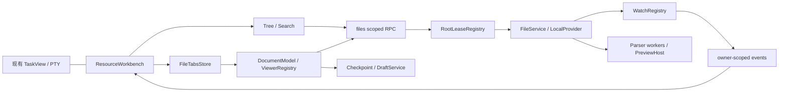

# M9 / F22-A 文件工作区：技术方案 R3.4

**P1当前接续（2026-10-17）：** 七条开发前路线的接口、样本、资源和实验已归档，先读[执行账](../开发前目标与执行记录.md)及[验收参数](../验收/开发前P1_验收补充.md)。本文件以下R3.4各批结果保留当时边界；04原失败已由替代计算路线复验，03/07/09等首次可行性缺口按P1更新，未成为完整生产实现。实际系统IME与01/02参考限制继续单列。

**R3.4当前增量（2026-10-17）：** 用户授权修复九项缺口，已完成的原型/实际PTY代码和限定范围实验见[总账](../九项问题处理结果_R3.4.md)。下文R3/R3.3描述保留其当时证据，现行保存保护以需求R07.17及本文件R3.4增量为准；不再沿用“冲突时无条件换回”。本轮授权可继续工程修复，完整业务/打包验收未完成。

更新：2026-10-17；依据需求 **R3.4-20261017**，沿用本机范围、D01/D07及完整路径拖放。102稳定子项、425条总账（419本期/6后续）保留。用户授权处理九项工程缺口，当前原型与现有App的PTY权限已修；本方案其余FileService/DocumentSession/provider/API仍需按具体进度实施，不能称完整M9已交付。当前事实与剩余见§12及总账，旧实验单独保留。

产品范围以[需求](../需求.md)为准；[原型说明](../原型/原型说明与变更.md)和[测试用例](../验收/测试用例.md)共同约束交付。文件区为IDE式本机文件树及各种格式渲染/编辑，终端位于其左侧并保持原有会话切换和运行机制。远程文件工作区、完整浏览器F22-B、Git提交/分支/暂存管理、F20文档业务与Codex专有聊天能力不在M9内；已有终端/项目服务器能力不受文件区范围调整影响。文件状态图标、只读blame、generated过滤、MCP viewer保留；参考文件内selection-edit按用户确认映射为选区上下文交接，不建立WillYou二次批准或专用CLI改动审阅。

## 1. 基线与历史结论的修订

| 版本 | 证据与意义 | 本轮处理 |
| --- | --- | --- |
| F22 初查，2026-10-16 | [文件实现证据](../调研/Codex文件工作区实现证据.md)、[类型路由补查](../调研/文件类型路由补充证据.md)、[历史证据索引](../../../design/f22/证据索引.md) | 保留原始哈希、REA evidence 与静态来源；旧“只读先行”只能是实施阶段，不能作为最终缩减范围 |
| M9 R1，2026-10-17 | [类型与编辑状态全集](../调研/M9_文件类型与编辑状态全集.md)、[项目会话与文件生命周期](../调研/M9_项目会话与文件生命周期.md)；树/搜索专项见[调研目录](../调研/README.md) | 替换旧技术草图，明确 DTO、安全边界、生命周期、选型和开工验证项 |
| M9 R2 独立实验，2026-10-17 | [脚本与运行记录](实验/README.md)、[迁移决策](实验/实验结论与迁移决策.md) | 真实文件操作、独立进程竞争/监控、三类 Office 转换与 UNO 命令编辑；仅合成输入，不等于正式 App 或 Codex 动态验收 |
| M9 R3 独立实验，2026-10-17 | [实验结论 §8](实验/实验结论与迁移决策.md#8-r3-补充实验保存安全监听恢复与解析成本m9-gap-08--gap-09)：目录 fd 锚定与交换式提交、监听恢复策略、Markdown 引擎耗时/Worker 取消与崩溃 | 仅合成输入；macOS arm64；Windows/Linux 未验；不等于正式 App |
| M9 R3.1 一致性修订，2026-10-17 | [需求 §7](../需求.md)及现有 R3 实验/原型事实 | 旧 selection-edit 模型直连、react-markdown 候选不再是现行路线；不新增实验结果或开发授权 |
| M9 R3.2 用户确认，2026-10-17 | [需求D01及R07.19](../需求.md) | 确认终端与文件视图独立；R3/R3.1专用CLI审阅候选废弃，旧报告/快照仅为历史，不代表当前需求通过 |
| M9 R3.2 同轮用户增量，2026-10-17 | [需求R05.14](../需求.md)、验收Y33–Y40 | 文件树/真实文件标签拖到当前终端插入完整绝对路径；现状仅有复制路径、托盘插入和标签重排，生产文件drop未实现；与真正图像附加能力分开 |
| M9 R3.3 用户范围确认，2026-10-17 | [需求D07及R08.9/R08.12](../需求.md) | D07=A：仅本机文件工作区；远程正向能力及SFTP/主机密钥/恢复不再是本期前置。保留非本机来源拒绝/身份隔离、旧远程实验及已冻结R3.2快照；产品待决0不代表设计完成或正式开发获批 |
| SmartDD 当前源码 | HEAD `d75bbaa81e924d1f9a9509ae1d068d69d4ea8ec7`、package `0.0.5`，读取当前工作区 | 已有 `createScopedRPCController`，旧“RPC 丢失 sender，必须整体重构”的判断已过时 |
| Yoda 当前源码 | HEAD `960fd3224508edc52fb7e99d9e8f8cf1723ad683`、package `0.20.3`、Apache-2.0 | 参考本地源码，抽取文件能力；只抽取文件与只读 Git 元数据；不搬提交/分支/暂存、聊天/worktree/浏览器业务 |

逆向目标是名称为 ChatGPT 的 Codex 壳：`com.openai.codex`，版本 `26.1007.30912` build `20156`，ASAR SHA-256 `75e397e2280dde93b70a85aa926f4282c728eacc84dfeb15ba7fb6ddd84628af`。原包无 source map。本轮 REA 分析没有执行目标 bundle，没有对 Codex 做动态交互验收。语句存在、静态调用关联、迁移建议和未知行为必须区分；详细 evidence/字节定位在各调研报告的 JSON，原始片段留 ignored `release/f22-research/`、`release/m9-research/`。

当前授权边界见[九项验证路线](../调研/九项验证路线与首项复核.md)：用户随后明确允许REA/Computer Use核查Codex，更新了M9-D14当时的用户禁看要求；但CUA曾对`com.openai.codex`明确安全拒绝，不能换接口、REA或隔离副本绕过。本轮引用归档静态来源并验证WillYou自身，Codex动态与完整像素对照仍缺证据。用户授权与工具限制分别记录，不用旧用户要求解释当前限制。

## 2. 迁移架构与源码落点



| 现有入口 | 可复用内容 | 拟新增/适配 |
| --- | --- | --- |
| `src/main/db/schema.ts:62,170`，`src/main/core/tasks/task-service.ts:157` | projectDirs、多目录、任务 cwd 快照 | `RootResolver` 通过项目/任务服务确定目录；项目改址不悄悄替换历史任务 cwd |
| `src/shared/ipc/rpc.ts:11,33`，`src/main/core/projects/transfer-controller.ts:11` | sender-aware controller、窗口导航/销毁清理样例 | `src/main/core/files/controller.ts`；入参 Zod 校验、只接受 main 签发 lease；不复用项目导入 token |
| `src/renderer/lib/layout/workspace.tsx:71,81` | TaskView keepMounted | 旁置 `features/workspace-files/ResourceWorkbench`，文件 tabs 独立于 TasksStore |
| `src/renderer/views/task-view.tsx:155,208,221` | ResizeObserver、0×0保护、ptyId实例 | 分栏只 fit/resize，按帧去重；可见性变化不抢文件搜索/编辑器焦点 |
| `src/renderer/core/tasks-store.ts:140` | 任务关闭会 kill session | 文件 close 不调用 task close；停 CLI 不等于释放文件草稿 |
| `src/main/core/settings/settings-service.ts:17` | SQLite/schema/写队列模式 | `FileWorkspaceStateService` 专用 checkpoint/draft 表，避免任意动态 key 绕过 settings schema |
| `src/renderer/index.html:5` | 当前 CSP | worker、本地 asset、隔离预览分别配置；不在主 renderer 中执行文档脚本 |

新模块建议：`shared/workspace-files.ts`（DTO/schema/事件）、`main/core/files/{controller,root-resolver,file-service,watch-registry,search-service,document-session-service,state-service}.ts`、`renderer/features/workspace-files/{stores,tree,tabs,viewers,editor}`。这是一组职责边界，开发时可按实际体量拆分，不要求照抄文件名或生成空壳。

**终端与文件服务边界（D01已确认）：** CLI使用其自身权限机制和用户指令直接读写文件，文件服务不拦截该I/O、不增加WillYou批准。FileService/DocumentSession的授权、版本校验和保存保护用于WillYou界面发起的读取及手工/查看器保存；CLI与其他外部程序造成的磁盘变化均由相同watch/刷新路径发现。上下文插入只写当前终端输入，投递完成即结束，不建立AI任务、CLI完成检测、修改快照、专用审阅或还原服务。

## 3. 身份、授权和基础 DTO

以下类型是设计规范，正式开发需要运行期 schema 和测试，不能把 TypeScript 当授权。

```ts
type RootRequest =
  | { kind: 'project-dir'; projectId: string; dirId: string }
  | { kind: 'task-cwd'; taskId: string };
type WorkspaceScope =
  | { kind: 'task'; taskId: string }
  | { kind: 'project'; projectId: string };
type RootLease = {
  leaseId: string;                 // main随机生成，仅在当前window/main生命周期有效
  generation: number;              // 根身份/授权变化即失效
  rootIdentity: string;            // main规范化身份，供去重；不能直接当授权
  hostIdentity: string;            // main签发的本机身份；非本机来源不签发lease
  source: RootRequest;
  displayName: string;
  displayPath: string;
  capabilities: {
    read: boolean; writeText: boolean; writeBinary: boolean;
    searchNames: boolean; searchContent: boolean;
    watch: 'native' | 'poll' | 'none'; atomicReplace: boolean;
    pathCase: 'sensitive' | 'insensitive' | 'unknown';
  };
};
type RequestContext = { leaseId: string; generation: number; requestId: string };
type FileRef = { relativePath: string }; // POSIX化相对路径；规范化/边界由main复核
// revision是opaque比较令牌；实现可包含stat+hash，不能由renderer构造可信版本。
type Revision = string;
type FileStat = {
  fileId: string; relativePath: string; kind: 'file'|'directory'|'symlink';
  sizeBytes: number; mtimeMs: number; revision: Revision;
  readable: boolean; writable: boolean; linkTargetWithinRoot?: boolean;
};
type FileFailure = {
  code: FileErrorCode; message: string; retryable: boolean;
  requestId?: string; opId?: string; currentRevision?: Revision;
};
type Reply<T> = { ok: true; value: T } | { ok: false; error: FileFailure };
```

`relativePath=''` 表示根目录；不接受 NUL、绝对路径、协议 URL、驱动器/UNC 注入，`..` 不得越界。允许合法中文/空格/点文件；不能仅凭 replace/字符串 startsWith 判断安全。fileId由main生成，使用 host+canonical root+规范化相对路径；同名不合并，同真实根别名可共享模型。大小写/Unicode按实际文件系统语义处理，不全局 lowercase。

R3.3只接受实际本机目录及已落地文件；main核对项目目录/任务cwd的本机来源，远程cwd、服务器配置、URI或renderer声称的host不产生root。host字段保留作身份防串和拒绝非本机来源，不代表已提供远程provider。没有可信本机根时返回明确不支持/不可用，不主动SSH连接、挂载或下载；本机OS已经解析且获授权的挂载路径仍按真实根和能力校验，M9不新增网络连接或承诺其网络正向能力。

lease在main保存 `{senderWebContentsId,frame,source,canonicalRoot,rootIdentity,generation,createdAt}`，renderer不能指定owner。每次调用核对主frame、可信应用文档、窗口未销毁、lease属于该sender、generation仍有效、项目/任务仍存在且目录来源未被重定向。根被删/改址/撤销、窗口导航/销毁即取消请求、撤销资源URL、停止该owner订阅。持久化lease禁止跨重启复用。

读取前 `realpath(root/target)` containment；写入前验证目标/父目录、拒绝根外symlink；操作时再次核对根/目标身份，尽量使用已打开的文件描述符和平台可用的no-follow能力。**realpath+再检查不是消除全部TOCTOU的证明**；跨平台无法等价时，返回明确能力/错误并在安全探针中界定，不能给不受限文件路径兜底。

R2 已在真实临时文件中复现：父目录在检查后被替换为 symlink 时，仅最终组件 `O_NOFOLLOW` 仍可写出根；同路径新建根可由 dev/ino 检查拦下。正式可写 Provider 必须补平台目录描述符/句柄锚定策略及相同攻击重放，不能将本节的 JS 校验顺序当作已经完成防逃逸。[实验 FS01–FS03、FS09](实验/实验结论与迁移决策.md#2-文件系统实测不是仅检查自写函数)

## 4. 文件服务方法与返回契约

所有方法返回 `Reply`；涉及lease的方法默认附带 `RequestContext`。表中只省略重复的 `ctx`，具体实现不得省略其校验。大结果通过有界分页/事件/资源句柄传递，不一次性把全项目或大二进制JSON送IPC。

| 方法 | 输入 | 成功返回/事件 | 约束 |
| --- | --- | --- | --- |
| `openRoot` | `RootRequest` | `RootLease` | 仅已登记本机目录/经验证的本机任务cwd；拒绝非本机来源，不建立连接/挂载；无任意绝对路径入参 |
| `closeRoot` | leaseId,generation | `{closed:true}` | 幂等；释放本owner引用，不关闭其它窗口共享底层watch |
| `stat` | FileRef，`refresh:boolean` | FileStat | 缺失/无权限区分；`refresh`跳缓存 |
| `listDirectory` | relativeDir,includeHidden,cursor?,pageSize | `{entries,nextCursor,truncated,reason?,snapshotRevision}` | 单层懒加载；分页cursor绑定root/dir/revision，不能跨目录复用 |
| `readText` | FileRef,`maxBytes`（服务端限额内） | `{content,revision,sizeBytes,encoding,bom,eol,readOnly,truncated:false}` | 全量可编辑文本不允许truncated；编码不明返回状态，不能误写成UTF-8 |
| `readTextPrefix` | FileRef,maxBytes | `{content,revision,totalBytes,truncated:true,readOnly:true}` | 大文件查看专用；不可拿前缀调用保存 |
| `sniff` | FileRef | `{contentKind,mime?,extension,rendererCandidates,reason}` | 后缀+有限magic/text样本；解析失败不是空文件 |
| `acquireAsset` | FileRef,revision?,purpose:'image'|'media'|'pdf'|'document',rangeSupported | `{assetId,url,mime,sizeBytes,revision,expiresAt}` | owner+lease绑定，不接受调用者自定URL/MIME；URL不持久化 |
| `releaseAsset` | assetId | `{released:true}` | 引用归零撤销；先销毁消费者再撤URL |
| `writeText` | FileRef,baseRevision,content,encoding,bom,eol,opId,editVersion | `{outcome:'saved',revision,editVersion}`或`{outcome:'conflict',currentRevision}` | 不接受截断模型；同文件串行；opId重试返回原结果，内容不同复用opId报错 |
| `writeBinary` | FileRef,baseRevision,uploadId,opId | saved/conflict+revision | 上传必须受控且完整；仅当前viewer声明可写；禁止当作任意文件写接口 |
| `beginUpload/appendUpload/finishUpload/abortUpload` | purpose,maxBytes→uploadId；chunk sequence+ArrayBuffer；final SHA-256 | `{uploadId}`、ack、`{sha256,bytes}` | main限额/顺序/owner；上传不是写盘，finish不等于save；dispose删除临时文件 |
| `cancel` | requestId | `{state:'cancel-requested'\|'already-finished'}` | 只取消本owner；写入在commit前可取消，commit后不能谎称未写 |
| `getOperation` | opId | `{state:'running'\|'saved'\|'conflict'\|'failed'\|'unknown',result?}` | 超时后查询，不盲目再次写；重启未知时重读revision核对 |
| `revealInSystem/openExternal` | FileRef,targetId? | `{opened:true}` | target来自main允许列表；只打开已验证资源，不拼shell命令 |
| `copyPath` | FileRef,format:'relative'|'absolute' | `{text}` | 返回授权根内路径；写剪贴板可在现有受信任UI动作完成 |
| `exportCopy` | FileRef或当前已验证draftId | `{cancelled:boolean,displayPath?}` | main原生保存框；明确另存副本，不等于写回原文件 |

树的新增/重命名/删除/移动在已归档Codex host证据中没有绑定入口，第三方树库能力不等于宿主启用。M9不凭库能力增加破坏性文件管理RPC；外部删改重命名须同步。用户另明确要求的R05.14拖放只向终端输入路径，不移动/复制文件，因此不受“参考未启用文件管理drag”的推断限制。

错误码固定：`INVALID_ARGUMENT`、`UNTRUSTED_SENDER`、`LEASE_EXPIRED`、`ROOT_CHANGED`、`ROOT_MISSING`、`PATH_ESCAPE`、`SYMLINK_OUTSIDE_ROOT`、`NOT_FOUND`、`NOT_A_FILE`、`NOT_A_DIRECTORY`、`PERMISSION_DENIED`、`READ_ONLY`、`UNSUPPORTED_TYPE`、`UNSUPPORTED_ENCODING`、`TOO_LARGE`、`PARSE_FAILED`、`CANCELLED`、`TIMEOUT`、`IO_ERROR`、`DISK_FULL`、`CONFLICT`、`OP_ID_REUSED`、`HOST_UNAVAILABLE`、`CAPABILITY_UNAVAILABLE`、`WORKER_CRASHED`。错误对象结构化过IPC，不能依赖Error自定义属性序列化；message不暴露凭据/内部堆栈。

## 5. 搜索与监控契约

### 5.1 搜索

Codex文件名搜索为sessionStart/update/stop，兼容退回单次；全文搜索是另一条流。SmartDD在UI中区分名称过滤和全文搜索，不能只过滤已经展开的树节点就宣称覆盖项目。

```ts
type SearchStart = {
  roots: Array<{leaseId:string; generation:number}>;
  mode: 'names'|'content'; query: string; queryVersion: number;
  includeHidden: boolean; excludePolicy: 'reference-default'|'all';
  fileMask?: string; maxResults: number;
};
type SearchEvent = {
  sessionId: string; queryVersion: number; sequence: number;
  state: 'batch'|'complete'|'cancelled'|'error';
  hits: Array<{leaseId:string; generation:number; fileId:string;
    relativePath:string; name:string; score?:number;
    line?:number; column?:number; preview?:string}>;
  truncated: boolean; reason?: 'result-limit'|'time-budget'|'file-limit';
  error?: FileFailure;
};
```

`search.start(input)→{sessionId}`、`search.update(sessionId,query,queryVersion)`、`search.stop(sessionId)`；名称模式用worker异步遍历/缓存索引+可解释fuzzy排序，目录改变使相应索引失效。仅读取文件名无需解析文件内容；全文只对可读文本进行流式扫描，必须有每文件字节/总时间/结果预算。R1优先复用Yoda遍历与取消结构；名称遍历不依赖Git，文件状态/只读blame/generated由独立只读元数据provider提供。无需新增rg二进制即可实现基线；若实测达不到性能预算，再比较官方ripgrep打包路线并单列许可/跨平台成本，不能假定用户已安装rg。

R1a 树专项已补齐 native 候选检索与客户端排序的边界：客户端 `ZXc` 丢弃 native score/indices，`QXc` 对 label 调用本地 fragment matcher，零分候选仍保留；同分按 JS label 字典序，再保留原 index。路径 query 还有 basename 前缀 fallback。正式实现必须把候选召回与客户端兼容排序分开，按[目录搜索全集 §11](../调研/M9_目录搜索与视觉交互全集.md#11-文件名模糊评分已重建的客户端与原生边界)的行为固定 fixture 验证；不能以普通 substring 或直接 native score 声称已对齐。私有 matcher 不直接搬入生产。

名称搜索初始排除表按Codex参考（.git/.hg/.next/.pnpm-store/.svn/.turbo/.yarn/build/coverage/dist/node_modules），普通树仍可展示这些目录。过滤策略是状态字段，不能伪装成所有文件的完整结果。前端以sessionId+queryVersion+generation拒绝乱序；输入法组合期间不提交中间字符；停止后事件丢弃。所有budget触顶显式truncated，不能悄悄少结果。

### 5.2 Watch

`watch.subscribe(ctx,{consumerId,paths,recursivePurpose:'expanded-directories'|'open-files'})→{watchId,sequence,coverage}`；`watch.update(watchId,paths)`；`watch.unsubscribe(watchId)`。consumerId只在owner内部标记用途，不能冒充另一窗口owner。

事件：`{watchId,leaseId,generation,sequence,events:[{type:'created'|'changed'|'deleted'|'renamed'|'unknown',relativePath,oldRelativePath?,revision?,opId?}],resyncRequired,rootState?:'ready'|'missing'|'changed'}`。底层只报告删/建时不得伪造确定的rename；同名新文件通过file identity/revision更新。丢事件、队列洪峰、后端不支持递归或断线恢复均可要求resync。

共享registry按host+canonicalRoot持有原生watch；消费者的路径并集决定关注范围。复用Yoda `@parcel/watcher` debounce/backpressure和late-subscribe cleanup，改为sender-bound lease。流程先建立watch→取目录/文件快照→核对sequence变化→必要时补扫；不能在扫描之后才开始订阅而漏掉间隙。自己的保存通过opId/revision匹配，不能无条件屏蔽5秒的其它程序修改。引用归零释放；启动promise迟到仍须unsubscribe。

R2 原生目录 `fs.watch` 在获准本机执行时可用，受限进程未收到事件；原子替换后的单文件 inode watch 则漏掉新 inode 的后续编辑。有界快照 polling 已在受限环境发现编辑/替换/新建。正式方案因此使用父目录订阅、revision 重新读取、覆盖/健康声明和预算化 polling，不能依赖一次 file watch 永久有效；`@parcel/watcher` 尚未在当前项目安装或打包验证。[实验 FS10–FS12](实验/实验结论与迁移决策.md#2-文件系统实测不是仅检查自写函数)

**R3 监听恢复策略（已由原型验证，见实验 §8.2）：** `WatchGuard` 订阅父目录，事件只触发 stat 快照重扫并与上一快照比较；对外声明 `coverage: native|poll|none` 与 `resyncRequired`。事件数超过阈值（实验取 50/500）标记 resync；原生创建失败或运行期 error 时降级到有界轮询；快照读取失败（如 EACCES）记录错误并保持降级，下一次成功后自动补扫；`stop()` 同时关闭 watcher、事件去抖定时器和轮询定时器。实验中 3000 个文件只收到 2889 个事件，因此逐事件记账不可取。轮询只扫已展开目录与已打开文件并退避；2000 文件 stat 快照 p95 10.4ms 只是测量，不是已批准预算。`@parcel/watcher` 的锁版本与安装包原生加载仍须验证。

## 6. 文档、保存与冲突状态

文件内容状态与view状态分离：`loading|ready|dirty|saving|conflict|missing|unreadable|too-large|unsupported|parse-error`；另有`readOnlyReason`、`saveError`、`pendingExternalChange`，避免一枚status同时承担多个含义。模型保留 `{baseText,localText,baseRevision,editVersion,lastSavedEditVersion,encoding,eol,bom}`。

- 同一文件写入串行，写请求快照editVersion。成功只更新对应base；若用户在等待期间继续输入，当前内容仍dirty，再次排保存。old request不得把新文本替换成请求时文本。
- 手动保存与3秒自动保存共用saveUntilClean；dirty关闭、Markdown/源码模式切换先等当前保存。失败保留buffer；关闭时继续查看/放弃修改，明确确认后才清草稿。此流程对齐已观察Codex文本分支；自动保存数值仍在原型/实测中核对。
- mtime只是提示；main生成强revision时读取内容hash，按canonical file串行执行preflight→临时同目录写→必要flush→复核目标→替换→返回revision。保存现有文件权限等元数据需保留。原子替换防半写与外部程序并发CAS不是同一保证，仍测试最后检查窗口。
- 外部变更区分`disk==base`、`disk==local`、`local==base`、三者各异：磁盘未变不制造冲突；磁盘等于本地则更新基线；右侧clean（`local==base`）直接按磁盘更新；仅右侧dirty且磁盘内容也变、与local不一致时保留local/disk/base并暂停autosave，进入普通冲突。使用“保留我的修改/使用磁盘版本/继续编辑”表达普通手工编辑保护，不作为CLI批准。参考源码曾有clean外改review分支，R3.2明确不将其接入WillYou。
- 文件打开、重新激活或用户刷新必须重新核对磁盘revision，变化时获取当前内容/资源版本；旧缓存不能冒充最新。已打开clean文件由watch失效通知后重读/重解析；目录刷新和监听补扫处理新增/删除/重命名。读取错误保留明确错误和可识别的旧显示，dirty文件保留本地修改；全过程不等待或推断CLI完成，不按CLI来源决定是否弹审批。
- `CONFLICT`之后没有无条件forceWrite通道。用户明确保留本地时先取得最新revision并确认将覆盖的磁盘版本，再带该revision保存；版本又变化则再次冲突。
- 被删文件进入missing并保留dirty。不能默认创建同路径覆盖新身份；恢复写入需明确“保存副本/重新建立”的产品规则；本轮不借此扩展任意create功能。
- 编码：UTF-8与已识别BOM/EOL保持；无法可靠解码时只读/错误并可外开。不能无提示改写GBK/UTF-16；是否扩充编码器在fixture结果基础上确认。

文本阈值对标 ≤10MiB编辑、(10,20]MiB只读、>20MiB拒绝编辑器；review、媒体、artifact有各自阈值，不混为一个max。服务端和parser在真实读取/解压后复核，不只相信metadata。

R2 已证相同 mtime/size 可以包含不同内容，因此 revision 对可编辑基线加入 hash；同目录 atomic rename 的独立读进程观察到完整旧/新内容，未见半写。但外部程序在最后校验与 rename 之间写入仍被覆盖，原子替换不等于系统级 CAS。应用内串行/opId、跨程序协调与剩余竞争边界分别验收，不能宣称仅 hash+rename 消除了外部并发风险。[实验 FS04–FS08](实验/实验结论与迁移决策.md#2-文件系统实测不是仅检查自写函数)

**R3保存提交方案（历史；自动换回/立即删除部分已由R3.4 SR02证伪并撤回，生产采用§12保留版本路线）：** WillYou手工编辑/查看器发起的本地保存交给native broker（N-API或独立子进程），不在Node里用路径字符串提交；本方案不拦截CLI的直接文件操作。流程：从已授权根fd逐级`openat(O_DIRECTORY|O_NOFOLLOW)`持有目录fd→同目录`O_EXCL`临时文件、写入、`fsync`、复制mode→`renameatx_np(RENAME_SWAP)`（Linux为`renameat2(RENAME_EXCHANGE)`，**未验证**）交换→对被换下旧inode重算hash，不符则换回并返回conflict，相符则删除临时文件→提交后复核根内路径身份并回读内容。已验证FS09父目录换symlink不越根、FS08已持有旧fd的写入被检测并还原；AFS07交换后回读前的新路径写入检测为冲突，保留对方内容与本地草稿。**AFS10回读结束后写入仍只能由监听发现**，不承诺系统级无丢失；不保证ACL/xattr/owner/目录fsync。Windows需另行设计句柄锚定/替换方案，并重放相同样本。技术上的交换回退仅保护本次WillYou保存，不是“还原CLI修改”产品流程。

## 7. 标签、checkpoint、草稿与终端共存

### 7.1 标签模型

```ts
type FileTab = {
  tabId:string; contentInstanceId:string; fileId:string;
  rootSource:RootRequest; relativePath:string;
  isPreview:boolean; rendererId:string; mode:'rich'|'source';
  viewState:{scrollTop:number; cursor?:{line:number;column:number};
    page?:number; sheet?:string; zoom?:number; wrap?:boolean};
};
type WorkspaceCheckpoint = {
  schemaVersion:1; scope:WorkspaceScope; revision:number;
  tabs:Array<Omit<FileTab,'contentInstanceId'>>;
  order:string[]; activeTabId:string|null;
  tree:{activeRootSource:RootRequest|null;
    roots:Record<string,{rootSource:RootRequest;expandedPaths:string[];
      selectedPath:string|null;scrollTop:number;searchQuery:string}>};
  layout:{panelOpen:boolean;panelRatio:number;treeOpen:boolean;
    treeRatio:number;fullWidth:boolean};
};
```

树 `roots` 的持久键由 host+规范化根来源组成，不使用临时 lease；切根分别恢复展开/选中/滚动/query，旧 root 不可用时保留状态和错误占位。

单scope最多一个preview；固定tab不降级；dirty preview在替换前固定，保留当前修改。双击固定、同fileId复用、重排保tabId；contentInstanceId在内容替换时更新。异步close/save/load/restore完成必须核对scope/generation/contentInstanceId。关闭后选相邻项/打开来源，最后关闭恢复终端或原焦点；恢复栈存route+index+panel，最多25条是参考基线。

scope按task独立；项目页单独scope。底层同fileId模型可以共享，但一个buffer的所有视图必须看到同dirty/revision，不能各自独立autosave互相覆盖；若当前实现先按scope隔离，则另scope外部变更必须进入同样冲突规则。**R2 默认选择同窗口共享 DocumentRegistry、跨窗口独立 buffer 并通过 main revision 解决竞争。** task/root 的树、tab、定位独立；共享模型按窗口内 documentInstanceId 持有一份 draft，scope 只持引用，不能多个 task 对同一模型各自 autosave。若变更该取舍，先更新 DTO/草稿归属与用例，不混用身份。

checkpoint只存固定tab，preview不恢复；rootSource持久化、lease不持久化。恢复依次openRoot→stat→建tab→还原有效视图；不可用root/file保留“标签不可用”可重试占位，不静默删除。用户在异步恢复期间手动选择时不被旧checkpoint抢回。

### 7.2 持久化方法

`workspaceState.load(scope)→checkpoint|null`；`workspaceState.save(scope,expectedRevision,checkpoint,opId)→{revision}`；`workspaceState.delete(scope,expectedRevision)`（仅工作区布局，不删除项目文件）。main按scope序列化，多窗口expectedRevision失败需merge或重读，不last-writer静默丢标签。

`draft.put({documentInstanceId,scopeRefs,fileId,rootSource,relativePath,baseRevision,baseTextHash,localText,encoding,bom,eol,editVersion,opId})→{draftId,revision}`；`draft.attachScope(draftId,scope)`；`draft.detachScope(draftId,scope)`；`draft.list(scope)`；`draft.read(draftId)`；`draft.delete(draftId,expectedRevision)`。草稿为SmartDD设计增强，Codex本轮只证实tab state内存快照，未证实跨重启落盘。沿用500ms节流候选、可见失败状态与独立容量配额；配额数值须以样本测量冻结，满额或写入失败时保留内存修改并明确提示，不淘汰 dirty 草稿。关闭窗口前尽力flush但不能把unload异步当可靠唯一持久化。草稿包含项目源码，仅存应用本地userData；不得同步/导入导出到项目包或记录日志正文。编码/BOM/EOL随buffer和草稿保留；只有可往返的已识别编码可写，不可识别或不能无损编码时只读并解释，禁止静默转UTF-8。

拟新增SQLite表：`file_workspace_checkpoints(scope_key PK,schema_version,revision,json,updated_at)`；`file_drafts(draft_id PK,document_instance_id,file_id,root_source_json,relative_path,base_revision,content_blob,encoding,eol,bom,edit_version,revision,updated_at)`；`file_draft_scope_refs(draft_id,scope_key,PRIMARY KEY(draft_id,scope_key))`。删除某个 scope 仅解除引用；最后引用释放也不能在未明确放弃时删除 dirty 草稿。migration先在临时DB验证，未批准开发时不生成正式迁移文件。

### 7.3 PTY不变量

保持TaskView和ptyId key；文件开合、换tab、切模式不spawn/kill CLI。布局拖动按frame fit并跳过0×0/相同rows+cols。隐藏终端不销毁会话；文件搜索、编辑器、菜单和关闭确认获得焦点后，TaskTerminal的visible effect不能抢回。任务被删除时先处理该scope dirty提示/草稿归属，再撤lease；不把关闭文件当停止任务。

## 8. 格式实现矩阵与解析边界

[调研类型全集](../调研/M9_文件类型与编辑状态全集.md) F01–F22是完整证据集合；本机范围各类必须在需求/测试矩阵中有状态，不能只选容易的六类。下表同步到R3.3：附件/历史/扩展viewer来源均须有已授权本机文件映射，远程正向分支留后续；原型已使用Markdown/PDF/高亮依赖，LSP依赖仅用于仓库外实验，均不表示生产已接入；LibreOffice基础探针与复杂保真/打包待验分别记录。

| 类型 | 实现路线 | 写入/边界 |
| --- | --- | --- |
| 文本/345语言映射 | 本地打包Monaco；文件名/复合后缀/内容探测统一ViewerRegistry；Markdown可使用独立rich视图 | 语言映射不等于语言服务器/编译支持；完整文本保存策略见§6 |
| Markdown/mdx | R3 原型采用 markdown-it＋KaTeX＋Mermaid＋js-yaml；源码与rich共享权威source，见§8.3；R1/R2 react-markdown候选已被替代 | 原始HTML转义、不执行MDX/JS；模式切换先保存/检查实例；图片相对路径走受限asset。整块编辑仍未达到参考选区/装饰语义，正式编辑适配方案须补实验，不把渲染库当编辑器等价证明 |
| 图片/AVIF/BMP/GIF/ICO/JPEG/PNG/WebP | 普通文件入口为 img/受限 asset 协议、object-contain/加载失败，不加专用 zoom；Markdown 嵌图画廊另按条件提供缩放/导航/菜单；SVG以img呈现并可看源码 | SVG不注入主DOM；TIFF按参考明确unsupported，不能伪装图片加载成功 |
| PDF | PDF.js 本地 worker；artifact 连续页 canvas/text/link 层、缩略页导航/条件展开与 dock、Zoom/Fit/Ctrl+wheel；review fallback 独立单页 canvas+prev/next | renderForms=false；不增参考没有的 search/rotate/print/页码输入/独立加减按钮。签名编辑未证；按当前候选保持30%–800% clamp、25%预设实际30%、Fit≤100%。Yoda embed不足以替代全交互 |
| CSV/TSV | worker解析为虚拟表格，源文本仍可查看/编辑；明确separator/quote/newline | 首选Papa Parse候选；保留字符串精度和格式，不自行执行公式；表格编辑回源须独立round-trip验证 |
| Notebook ipynb | schema验证code/markdown/raw cell，输出按参考MIME优先级；Markdown与代码高亮走§8.4；JSON/Vega仅源码 | HTML output iframe sandbox=""禁脚本，不能运行 cell；外层cell默认展开，仅非空source且descriptionMarkdown.trim()非空才有默认折叠的内部Code，是否有output不控制此分支；Copy code可用，无Notebook专用编辑/查找/缩放/换行开关，不能把Run计数变执行入口 |
| 音频/视频 | Chromium media 元素+range asset；audio 自定义 play/seek/time+条件copy/save，无可见volume；video 下方自定义音量/mute/八档speed/PiP/fullscreen/另存 | 后缀与真实 codec、条件能力分别验；128MiB 是某 binary-read 参数，本地 protocol 可跳过该查询，不能当所有媒体的统一限制 |
| HTML源码 | 文本路径 | 不依赖BrowserService |
| HTML文档预览 | 独立DocumentPreviewHost，隔离origin/session，无Node/preload能力；受限本地资源映射 | 与Notebook禁脚本输出不同；需要脚本的文件以可执行文档子模式和独立能力策略处理，禁任意网络/文件/弹窗；不得靠宽松iframe+同源替代。不提供地址栏/浏览历史/导航浏览器 |
| TeX | 源码可编辑；编译worker/受控宿主产出PDF再走PDF viewer | 不调用任意用户shell、不自动下载TeX；外部工具/资源/网络策略及平台安装成本在A0验证。编译不可用有明确状态，完整目标保持待验 |
| DOCX | docx-preview候选富预览；复杂排版与字体另用隔离Office引擎对比 | 预览库不提供等价写回；DOCX可写条件在Codex尚未知，需求评审保持该证据边界 |
| XLSX/XLSM | ExcelJS候选解析+虚拟工作表；与更完整引擎做公式/样式/图表/宏fixtures对比 | ExcelJS并非Walnut/CRDT替代；XLSM不得执行宏，不承诺无损写回；可写XLSX需DocumentSession与保留未知OpenXML部件策略 |
| PPTX | 本机已试验 LibreOffice/UNO 的幻灯片文本命令编辑、同格式输出与 PDF；拟封装独立 OfficeEngineAdapter，前端工具条/选区/对象模型仍需验证 | UNO 最小编辑通过不代表复杂 PPTX 保真或 UI 完成；bytes+etag写回仍经FileService。未知部件/关系变化须阻止静默覆盖，不可用 PDF 预览代替目标编辑 |
| doc/xls/ppt、key/numbers/pages、ODF、RTF、归档、未知binary | 对齐unsupported类型/说明/外开；明确被专用viewer接管与未接管的区别 | 不新增通用hex编辑器/解压执行；不把docx/pptx/xlsx一概归unsupported |
| MCP自定义viewer、附件/历史/library来源 | ViewerRegistry保留来源/能力字段；仅映射已授权本机文件或已落地本地副本，文件MCP viewer仍纳入适配，见§8.1 | 不引入Codex账户/云文档库或自动获取远程来源；已配置MCP不等于已拥有viewer注册、资源URI写回和隔离UI协议，真实本机文件viewer闭环仍为开工闸门 |

解析统一在worker/隔离进程中做：`parse.start({assetId,revision,rendererId,options,budget})→{jobId}`；`parse.cancel(jobId)`；`parse.release(jobId)`；事件 `{jobId,sequence,state:'progress'|'ready'|'failed'|'cancelled',modelHandle?,error?}`。parser不得持有任意磁盘路径，assetId只读且绑定revision。限制原始bytes、解压总bytes/条目/嵌套、页/行/cell数量、解析时间和内存；达到限制显示too-large/parse-error并保留原文件。XML禁外部实体/网络；Office外部关系、链接、宏与嵌入对象不自动执行；转换过程使用每job临时目录，结束/崩溃清理。

### 8.1 文件只读 Git 元数据、MCP viewer 与选区上下文交接

本段覆盖旧F22“一概不做Git状态”的历史建议，来自最新用户指令，不是从第三方依赖自行扩大范围。

| 能力 | 拟实现契约 | 条件与未知 |
| --- | --- | --- |
| 文件状态/变化文件浏览 | `fileMetadata.status(ctx,{paths?,view:'tree'\|'changes'})→{repositoryId,revision,entries:[{relativePath,status:'added'\|'modified'\|'deleted'\|'renamed'\|'untracked'\|'ignored',previousPath?,generated?}],truncated}` | 仅已验证仓库、结果限定授权根；普通树与变化文件视图分开。Git管理命令不提供 |
| 只读 blame | `fileMetadata.blame(ctx,{file,lineStart,lineEnd,baseRevision})→{lines:[{line,commitId,author,at,summary}],revision}` | 有仓库/文本/有效行时提供；不运行文本转换器，不把blame按钮常驻所有viewer。未提交文本与行号失配明确不可用 |
| generated过滤 | `fileMetadata.attributes(ctx,{paths})→{path,generated:boolean\|null,source}`；变化文件视图按结果过滤 | Codex在识别到linguist-generated时才提供，非普通隐藏文件开关；未知属性不能当false/true猜测 |
| 仓库定位外链 | `fileMetadata.externalLocation(ctx,{file,line?})→{url,label}\|null` | 解析已登记远端并限制http(s)，有可信映射才显示；不复制凭据/远端私有token到URL |
| MCP viewer发现 | `viewers.list(ctx,{file,contentKind})→{viewerId,title,suffixes,capabilities,availability,reason}` | 按最长复合后缀/用户偏好；已配置server≠可用viewer；扩展不可自动得到全磁盘权限 |
| MCP viewer资源 | `viewers.open(ctx,{file,viewerId,mode})→{sessionId,resourceUri,etag,capabilities}`；`viewers.read(sessionId)`；`viewers.write(sessionId,{ifMatch,uploadId,opId})`；`viewers.close(sessionId)` | URI严格匹配会话文件、返回bytes/text限额、ifMatch冲突；扩展UI在隔离宿主，不能拿主preload。失败可选内建viewer但保留失败原因 |
| 选区上下文交接（R3.2，D01已确认） | 文件/选区及用户指令经专用终端输入通道投递；界面只有idle/inserting及inserted/failed/unknown等交接状态，结果绑定发起任务/输入实例 | 无selectionEdit.start/apply或CLI完成追踪，不保存改动审阅快照、不调用模型、不期待patch回包。磁盘更新由独立FileService/watch流程处理，见§6/§8.5；普通手工编辑冲突不受影响 |

只读Git provider使用受控参数数组、不拼shell；repo discovery/输出限额/timeout/cancel与root lease绑定。禁止运行仓库配置中的外部helpers、fsmonitor、textconv或hooks，不用全局`safe.directory=*`绕过归属保护；参数必须阻止路径被当选项。Git目录可能在选择目录祖先或worktree外部，需额外验证repo身份及元数据边界，文件内容仍只读授权根内。无Git/未受信仓库显示不可用，不把空状态伪装为干净。Yoda现有只读metadata可抽取，但写管理方法不随之注册。

SmartDD现状：`src/main/core/capabilities/discovery.ts:104`起只发现/校验MCP配置；`capability-service.ts:232–262`为CLI注入项目context MCP并标记loaded=unverified。它们**没有证明**viewer注册、resource URI read/write、ifMatch或沙箱UI已经实现。当前任务CLI由PTY运行，终端插入确认不证明CLI已读取、识别引用或提交，不能解析ANSI输出伪装成可靠的编辑RPC。

**历史方案已废弃：** R1/R2的`FileAssistantAdapter`模型直连/结构化patch，以及R3/R3.1的“CLI先改原件→WillYou审阅/保留/还原”都不是现行路线。用户本轮确认的是终端与文件视图独立，并非从上述先后审批方案中二选一。A0/A4仅接上下文投递与真实磁盘同步，不实现专用selectionEdit状态机。MCP viewer自定义资源写回仍单独验证；它是查看器手工编辑能力，不构成CLI审批或模型回包协议。

### 8.2 Office编辑会话契约

`documents.open(ctx,ref,{rendererId,intent:'preview'|'edit'})→{sessionId,state,capabilities,baseRevision,stateVersion,materializedStateVersion}`；`documents.apply(sessionId,{updateId,originId,baseStateVersion,patch})→{stateVersion}`；`documents.flush(sessionId,{opId,expectedPublicRevision})→{state:'saved'|'stale'|'conflict'|'too-large',materializedStateVersion,publicRevision}`；`documents.refresh(sessionId)`；`documents.close(sessionId,{mode:'flush'|'discard-confirmed'})`。

state分`starting|live|refreshing|blocked|fallback`，problem分`conflict|persistence|unsupported|too-large|parse`。`stateVersion`与`materializedStateVersion`独立：内存接受编辑不等于磁盘保存。op/update幂等、队列串行、关闭前flush；flush失败阻止默认关闭并保留草稿/编辑日志；hard dispose不能偷偷宣称saved。PPTX整bytes路线用baseRevision/etag和500ms参考debounce；XLSX结构化路线先验证单人编辑日志/重放，再决定是否需要CRDT，**不能只因为Codex用了CRDT就额外引入协同业务**。任何renderer声称支持的编辑功能都必须通过round-trip：内容、样式、关系、嵌入对象和未知部件不被静默丢弃。

R2 已通过私有 UNO pipe 对 DOCX/XLSX/PPTX 原生模型执行基础编辑并独立读取输出；另一次 OOXML 往返发现 DOCX 未知部件丢失。具体 adapter、部件 manifest、损失阻断、另存副本与保留草稿策略见[实验决策 §6](实验/实验结论与迁移决策.md#6-office-adapter-可执行落点)。`materialize` 产生候选 bytes 以后仍必须做保真门禁与正式文件 revision 校验；不能直接把 UNO storeAsURL 指向用户原路径。

**R3 Office 保存策略（实验已验证文本/数值类编辑，见实验 §9；R3.1明确差异判据）：** 写回原文件分两条路。(1) **精确补丁**：定位被编辑的 XML 部件，字节级唯一匹配替换，其余部件逐字节保留；匹配不唯一即拒绝；跨 run 文本改为结构化补丁并保留 run 属性；XLSX 改共享字符串前统计引用数（≠1 就追加新字符串），改输入数值时使旧公式缓存失效并设置 `fullCalcOnLoad`。(2) **引擎重写**：LibreOffice 可用于预览/导出 PDF；需要重排的复杂编辑仍为待验证路线，不允许将同格式输出直接写回原件。每个编辑操作建立预期变更清单（部件、关系、内容与必要关联变化），检查候选输出是否仅含可解释的变化、引用是否完整；删除幻灯片等用户操作允许对应部件/关系被删除，不能把任何删除一律当破坏。**非预期丢件、无关内容破坏或无法解释的差异阻止覆盖**，保留编辑/草稿，提示后由用户明确选择另存副本；另存有损副本不算完整原格式编辑已通过。已观察到的未知部件、缩略图、webSettings 丢失是基础文字编辑不应造成的损失，仍属失败负对照。结构性编辑的清单生成、语义/布局检查及独立读取器验证尚未实现，不能仅凭ZIP部件数相同判定保真。

### 8.3 Markdown 渲染与编辑管线（R3，原型已验证）

权威数据仍是 source 文本。解析：markdown-it（`html:false`）产出 token 与行号映射，顶层每个块记录 `from/to/line`（UTF-16 偏移）；块间空行和引用定义各为独立块，保证所有块 `raw` 拼接后逐字节等于原文（含 CRLF/CR、末行无换行，已用 400 个种子随机文档验证）。渲染：每块用该块 token 渲染为 HTML 后插入；frontmatter 用 YAML 解析，失败显示错误；公式用 KaTeX（`throwOnError:false`）；图表按需加载 Mermaid。编辑：点击/聚焦某块即以该块源文本进入 textarea，输入只经 `replaceMarkdownBlock` 替换该块范围，不从 HTML 反序列化。任务项勾选只改写 token 记录的源码行。链接/图片目标保留作者原文，不使用 markdown-it 的百分号编码值做路径解析。

**已知限制：** 这不是 CodeMirror 的装饰/选区模型，跨块选区、公式内选区、光标进入时的标记显露仍沿用“整块切源码”的简化；围栏代码未做语法高亮；每次文本变化重新解析全文，10MiB 约 0.3s，必须在正式实现中改为 Worker 或增量并带取消/超时（需求 R08.11）。

### 8.4 PDF 与 Notebook 管线（R3，原型已验证）

**PDF**：pdf.js（pdfjs-dist 5.4.296，Apache-2.0）与其 Worker 都是独立懒加载块，首屏不加载（原型构建：pdf 约 440KB/gzip 128KB，Worker 约 1046KB/gzip 288KB）；禁用eval；R3.4实际配置useSystemFonts=true，CMap/standard_fonts从本地静态资源加载，非嵌入CJK使用本机字体fallback，未捆绑中文字体，目标平台字形须另验。流程：`getDocument` → `onPassword`（缺失/错误两态）→ 取各页尺寸与大纲 → 页面组件按“接近视口才渲染”渲染画布、文本层（pdf.js TextLayer）和链接层，离开视口后释放画布；缩放按 `pdfRenderPlan` 计算显示尺寸与渲染倍率，面积超过约 1677 万像素或边长超过 16384 时降采样并提示；`classifyPdfError` 把异常分为 password/invalid/missing/network/aborted/unknown；目的地用 `resolveDestinationPage` 统一解析页引用、整数页码与命名目的地。销毁来自来源切换、卸载与用户取消密码，且取消密码需要标记，避免销毁产生的异常覆盖成通用错误（原型已修复该缺陷）。评论/区域坐标统一按每页真实尺寸（点）换算，不再用固定 600×780。

**R3.3遗留清单（当前进展见R3.4 PDF报告）**：① 为得到页尺寸会遍历所有页，几千页的文档需改为只取首页并按需更新；② 非嵌入 CJK/标准字体需要配置 `cMapUrl`/`standardFontDataUrl` 资源并评估体积；③ 真实 Worker 崩溃/终止、内存与 p95 需在 Chromium 与安装 App 中测量并冻结预算；④ review（canvas 路线）的真实渲染没有单独验证；⑤ PDF 内表单、JavaScript 动作、批注层不渲染也不执行。

**Notebook**：Markdown 单元走与文档相同的 markdown-it 管线（`renderMarkdownReadOnly`：HTML 关闭、链接 href 改为 #、图片白名单、任务框禁用）；代码与 JSON 输出用 highlight.js 11.11.1（BSD-3-Clause）子集高亮，HTML 输出仍进入 `sandbox=""` 的 iframe，不执行单元。高亮色浅/深色各一套。主包因此增至约 1632KB（gzip 492KB），Mermaid 与 pdf.js 保持按需。

### 8.5 终端上下文交接与独立本机文件视图（R3.3，D01/D07已确认；未实现生产代码）

对应需求R05.10–R05.14、R07.5–R07.6、R07.14/R07.19、R06.18及R08.9本期拒绝边界（见[需求](../需求.md)）；R08.12只留远程后续。R3隔离实验继续证明其实际测试的注入/适配边界；R3业务审阅原型属于废弃候选的历史证据，不能算R3.3通过；TI实验也未覆盖新文件拖放。实验与数字见[实验§11](实验/实验结论与迁移决策.md#11-r3-第三批与-smartdd-业务的接入闭环m9-gap-07)，新原型/用例复验另记。

**① 文件引用→终端输入（D01已确认）。** 文件/选区/评论加入上下文托盘（`file | range | comment`，相对路径、行范围、revision、所选文本哈希仅用于投递前的上下文校验）；可预览、移除、标记`fresh|stale|missing`。插入只将文本写入当前运行任务的终端输入，永不追加回车，用户自行在终端提交；状态止于`inserted | failed | unknown`。不会因引用已插入而启动AI任务、等待CLI完成、保存文件改动快照或要求后续批准。SmartDD不调用模型、不解析终端输出，不引入聊天界面。

| 约束 | 引用/选区正文规则（TI01–TI08及`file-reference-model.mjs`；R05.14完整路径另见下节） |
| --- | --- |
| 文本清理 | 文件内容不可信：去除 ESC、除 `\t\n` 外的 C0、DEL、C1（含 0x9B）、双向控制字符；孤立代理对→U+FFFD；清理项在界面可见 |
| 括号粘贴 | 开关来自目标程序实际发出的 `ESC[?2004h`（xterm 的 `bracketedPasteMode`），不写死；开启时保留换行并包 `ESC[200~…ESC[201~` |
| 非括号模式 | 换行会被终端当回车自动提交（TI05 已证），必须折叠为空格 |
| 大小 | 所选文字 ≤4,000 字符且 ≤200 行（超出截断并标记），总长 ≤8,000 字符（超出拒绝并给数字） |
| 引用语法 | 默认通用写法 `相对路径:L12-30`；`@路径` 仅为可选样式，Claude Code/Codex 是否识别需分别验证，**未验证** |

**专用“终端插入”RPC（要求，未实现）。** R3.4已在现有键盘`ptyInputEvent`补来源/任务归属及运行实例校验；该原始键盘通道允许正常控制键，不能代替上下文内容保护。正文交接通道以`{taskId,ptyId,text}`复用可信sender、任务访问、PTY归属/运行实例边界，再校验非空和≤8,000字符，按正文规则清理、按目标实际括号模式包装，写一次且不回车。R05.14使用下述可信文件身份分支，不由renderer提交任意绝对路径文本。身份校验覆盖全部入口，正文/路径还需各自内容与去重规则；1.5秒无确认显示unknown且不重发，确认只表示投递，不从PTY输出猜CLI读取/提交。

**①补充：文件→终端拖放完整路径（R05.14，2026-10-17用户明确要求，工程待实现）。**

- **来源与落点。** 文件树真实文件行、已开真实文件标签提供应用内文件引用；图片预览如支持拖出，携带同一个原文件身份，不能把canvas/Blob URL/缩略图当文件路径。拖至当前任务的终端输入区时才接收；拖入标签栏继续原有标签排序，拖到别处或取消不投递。目录、未落地的虚拟产物、HTTP/data/Blob资源及跨主机文件无本机可信路径时拒绝并说明，不下载、不临时伪造路径；D07已确认本期仅本机。
- **传输契约。** 路径分支拟接收`{source:{leaseId,generation,fileRef},target:{taskId,ptyId,terminalInstanceId},dropId}`，`fileRef`是main能核对的既有文件身份/根内相对引用；drag payload本身不构成授权。main核对来源sender/lease/generation、可信root和目标仍存在且为本机真实文件，解析完整绝对路径；同时核对目标任务访问、PTY归属/运行状态与实例有效性，写入前再次拒绝已失效来源或目标。renderer自造的`text/plain`、绝对路径、file://或其他宿主路径均不能直接进入此分支。
- **路径保真。** 将main解析的完整绝对路径作为单段文本插入，并在路径后另附一个U+0020分隔空格便于续写；路径本体不变，不加`@`、不改为相对路径、不附文件内容/行范围、不上传图片、不包装shell命令或猜测shell引号。中文、空格、引号等合法字符原样保留；包含ESC、C0/C1/DEL（含TAB/CR/LF）、双向控制字符、孤立代理对等不可安全传输字符时，整体拒绝并说明；连同分隔符超出输入限额也整体拒绝，不截断。不能复用只接受相对路径的`normalizeReference`，也不能将正文`pasteData`清洗结果变成另一个文件路径。验证后只允许终端所需的括号粘贴传输包装，内容为“原样绝对路径＋一个分隔空格”。
- **交互与去重。** 一次drop只调用路径分支一次，消费浏览器drop事件、防止默认粘贴和冒泡再触发；main以当前操作`dropId`去重，重复请求返回原投递结果，不再次写PTY。应用不发送清行/全选/删除/回车，不主动替换已有终端输入；路径插入当前输入位置后聚焦终端，让用户继续打字或用现有语音入口，再自行提交。落点/PTY实例已失效则不写入新任务；结果仍只用inserted/failed/unknown，不按Claude Code/Codex/OpenCode名称判断，不跟踪命令完成。
- **验证边界。** Y33–Y40覆盖不同文件源/类型、全路径字符保真、已有输入/语音焦点、一次投递、无回车、非目标/取消/失效、伪造及跨主机拒绝、标签排序回归；真实PTY、中文输入/语音和跨平台仍需正式实现后验证，原型合成路径不作本机文件投递证据。

**② 真实磁盘同步独立于终端（R07.19，用户已确认）。** Claude Code/Codex使用各自权限和用户指令直接操作文件，无WillYou二次批准。右侧打开、重新激活或刷新时核对当前磁盘revision并读取变化；目录watch/刷新/补扫更新新增、删除、改名，已打开clean内容重读或重解析。用户未在右侧手工改动时，不显示专用review/keep/revert、不拦截外改、不自动还原文件；只有右侧dirty与磁盘内容外改才按§6普通冲突保护。既不依赖`inserted`状态，也不要求识别变化由哪个CLI造成，更不等待CLI完成；切根/任务后旧读取与投递回执按实例丢弃。上下文交接失败不妨碍右侧独立浏览，文件更新也不把未知投递结果改成成功。

PDF/Office评论及Request edits只收集和交接上下文，不维护CLI完成/审批状态；PDF的`review fallback`为既有单页查看路由，Office红线及普通手工冲突对比均保留自身用途，与已废弃的CLI任务审阅服务分开。

**真正图像附加仍为独立工程项。** 本轮R05.14明确所有文件（含图片）都只拖完整路径，这条路径交接不依赖CLI图像能力，也不声称图片已上传/附加。既有Markdown嵌图V05/V06真正图像附加仍须验证CLI能力与投递失败恢复，不能拿新拖路径用例充抵；无须用户再为“拖图片路径还是上传图片”作选择，本轮拖放行为已经明确。

**③ LSP语义能力（D05，供应策略已明确，工程验证待做）。** 复用本机已存在或用户显式配置的LSP，不自动安装/捆绑；按语言/项目匹配、记录服务版本，握手后按声明能力开放菜单。实验LS01–LS10加LS08b共11项只证明当前TS服务，既不限定只支持TS，也不外推其他服务。位置按UTF-16列，每请求带文档版本；版本已变丢弃响应，支持取消和超时；服务崩溃未完成请求立即失败、可重启；根外结果标`outside-root`只读。共享服务按消费者释放，最终关闭时`shutdown`+`exit`清理进程树（macOS进程组已测，Linux/Windows需各自验证）。无服务/无匹配/能力缺失明确说明。服务发现/配置入口、语言匹配、项目配置与真实能力矩阵继续工程验证，不能靠“可配置”或长期禁用宣称完成；自动下载/捆绑若后续提出，再作范围变更。

**④ 扩展viewer（MCP）策略（D05，供应约束已明确，工程闭环待验）。** `resources`只是必要条件；还需显式viewer适配清单声明匹配后缀/来源、呈现入口及能力，隔离UI、会话资源映射验证后才可用；配置MCP服务≠完整viewer。R3.3会话资源限已授权本机文件，不借MCP接入云/远程文件库，不自动上传或下载；本机资源映射和隔离viewer仍须完整实现。R3的resources-only探针仅使用`initialize`与`resources/*`，未请求`tools/list`（真实`rea mcp`一次约3MB/207工具）；这是旧探针边界，不是对真实viewer永久禁止工具发现。MCP Apps候选以工具`_meta.ui.resourceUri`指向HTML资源，适配器可有界分页发现工具（响应字节/页数/总量/超时上限），只转发清单明确允许的app-only读取调用。不得桥接任意工具、模型消息或让UI自行访问宿主文件；`rea`握手不是文档viewer成功证据。官方固定PDF viewer供应与隔离实验见[专项](../验收/证据/r34-provider-capability.md)。URI严格匹配会话，大小按解码bytes；单行上限按最大资源推导（20MiB×4/3+256KiB≈28.2MB），超限即失败。只对显式支持自定义写回的适配器开放`ifMatch`，仅`saved`更新基线、`conflict`保留编辑；通知限速200/s计数，超时和迟到响应分开处理。**写回为SmartDD适配器自定义契约，不是MCP标准接口**；普通resources服务不能被误称可写。无匹配/失败时解释并可回内建viewer。R3.4已完成官方固定PDF viewer的只读最小闭环18/18，含真实HTML/文件字节/渲染、隔离与关闭；生产root lease、资源订阅、自定义ifMatch写回、打包及完整生命周期仍需实现验证，不以长期禁用代替完成。工程协议选择不转交用户拍板。

**⑤ 非本机拒绝与远程后续（D07=A已确认）。** 本期RootResolver只签发本机root；非本机host/远程cwd/历史remote route返回本期不支持，不暗连SSH、挂载或下载，不把服务器配置当文件授权。host/root身份隔离与拒绝分支仍属R08.9当前义务；不限制已有终端/项目服务器功能。远程list/read/search/write/watch、SFTP、主机密钥固定/变化拒绝、条件写/原子替换与断线恢复移出M9前置及生产范围，R08.12保留F22-A后续、未排新M。[SF01–SF09历史实验](实验/实验结论与迁移决策.md)及[结果](实验/sftp-provider-result-20261017.json)保持原事实：ssh2内置服务并非OpenSSH完整验证；CAS缺失、无watch、提交后断线/非原子删除后结果未知及生产主机密钥校验缺口仍存在，未来若纳入远程文件能力再解决，不将这些历史发现写成本期已修复或当前开工条件。


## 9. 依赖、来源与许可决策

Yoda源码按Apache-2.0适配并更新SmartDD NOTICE；Codex私有bundle只研究行为/结构，不搬实现/字体/品牌资产。版本列是拟试验基线，非“已装/已安全验收”；新增依赖须核对对应实际tarball及传递依赖、worker打包和安装包许可。许可元数据不等于完整分发结论。

| 组件 | 试验版本/来源 | 许可与取舍 |
| --- | --- | --- |
| 虚拟树 | @tanstack/react-virtual 3.13.23（Yoda锁文件） | 上游[主分支MIT声明](https://raw.githubusercontent.com/TanStack/virtual/main/LICENSE)已核对；该锁版本tarball许可仍须保存，不能用主分支版本替换锁版本 |
| 本地watch | @parcel/watcher 2.5.6 | [MIT，原生模块](https://raw.githubusercontent.com/parcel-bundler/watcher/v2.5.6/package.json)；增加mac arm64/x64、Windows、Linux安装包探针 |
| 文本编辑 | monaco-editor 0.55.1 + @monaco-editor/react 4.7.0 | [Monaco MIT](https://raw.githubusercontent.com/microsoft/monaco-editor/v0.55.1/package.json)、[React wrapper MIT](https://raw.githubusercontent.com/suren-atoyan/monaco-react/v4.7.0/package.json)；本地worker，不用CDN；不声称等于Codex Pierre/CodeMirror内部 |
| Markdown（原型 R3 已用） | markdown-it 14.1.0、markdown-it-texmath 1.0.0、katex 0.16.22、mermaid 11.12.0、js-yaml 4.1.0（均 MIT，精确锁定，见实验 §8.3及[原型锁文件](../../../../prototypes/m6-codex/package-lock.json)）；R1 拟试验的 react-markdown 链未采用 | 原型选型：markdown-it 关闭原始 HTML，Mermaid 用 strict 且 `htmlLabels:false`（类图的 foreignObject 标签在本原型页面中渲染为空白，原因未查明；改用 SVG 文本标签后恢复），mermaid 按需加载；全链锁依赖与许可须随生产实际引入入包，清洗不等于允许任意资源URL。旧 react-markdown/rehype 许可材料只属历史候选，不作为当前依赖证明 |
| PDF（原型 R3 已用） | pdfjs-dist 5.4.296（精确锁定，legacy 构建用于 Node 实验） | [Apache-2.0及Node要求](https://raw.githubusercontent.com/mozilla/pdf.js/v5.4.296/package.json)；这是受控试验版本，开发前核对当前修复和实际pdfjs-dist包，未做漏洞/兼容扫描 |
| CSV/TSV | Papa Parse5.5.3 | [MIT](https://raw.githubusercontent.com/mholt/PapaParse/5.5.3/package.json)；worker/流式接口适合大表，格式保真另验 |
| XLSX | ExcelJS4.4.0 | [MIT，XLSX/CSV读写定位](https://raw.githubusercontent.com/exceljs/exceljs/v4.4.0/package.json)；仅候选，不推断宏、图表、公式计算和无损往返能力 |
| DOCX | docx-preview0.4.1（本轮读取master元数据，待固定tag/tarball） | [Apache-2.0声明](https://raw.githubusercontent.com/VolodymyrBaydalka/docxjs/master/package.json)；无等价编辑/写回承诺，复杂排版比较后定 |
| Office转换/高保真备用 | 本机 LibreOffice 26.2.4.2 / UNO 已实测；打包版本、体积、跨平台分发方式待固定 | [官方MPL2.0及多组件许可说明](https://www.libreoffice.org/licenses/)；本轮只调用既有引擎，无安装。三类基础命令编辑通过；DOCX 丢件已记录。字体/宏/复杂保真、进程沙箱、安装包和其它平台仍待验 |
| 代码高亮（原型 R3 已用） | highlight.js 11.11.1（精确锁定，BSD-3-Clause） | 仅注册 10 种语言以控制体积；输出由库转义，只含 `span.hljs-*`；未知语言退回纯文本。许可证需随安装包提供 |
| 语言服务适配实验（仓库外） | typescript-language-server 4.3.4（Apache-2.0）、typescript 5.9.3（Apache-2.0） | 只装在 `/tmp/m9-lsp` 做实验，**未加入 SmartDD 依赖**；现行候选复用本机已有/显式配置服务、不自动安装或捆绑；发现/配置/匹配与版本矩阵继续验证，见§8.5 |
| 远程历史实验／F22-A后续 | ssh2 1.17.0（SmartDD 已有依赖，MIT） | 实验用其客户端和内置SFTP服务；**未新增依赖**，OpenSSH行为未验。R3.3不接入远程文件provider、不以此扩大M9；已有SSH依赖及能力不因本期排除远程文件区而移除 |
| 图标/字体 | 优先现有可用资源；Yoda devicon2.17.0仅候选 | 每个资源来源、许可与参考差异另记；不因为包开源就称品牌图标/字体可原样复制 |

R2 另核对 Univer、ONLYOFFICE、Collabora 的一手能力和 OSS/服务/二进制许可边界，见[候选矩阵](实验/实验结论与迁移决策.md#5-合法替代组件的明确分工)。本轮未部署这些候选，不能把文档介绍当兼容验证。

Office试验结论不满足完整目标时，保留问题和第二候选/自研适配工作量，提请范围评审；**不得将“外部打开”写成已完成PPTX/XLSX编辑，也不得隐藏该类测试用例**。

## 10. 本机provider、远程后续边界与跨平台条件

用户D07=A已确认本期只做本机文件区。现有SmartDD服务器配置与终端SSH能力保持原用途，不据此启用远程文件tab；RootResolver只接收可信本机目录/已落地本机文件。非本机host、远程cwd和历史remote描述符显示本期不支持/不可用并保留必要描述，不触发连接、下载、挂载或网络重试，不自动上传源码到第三方解析服务。文档内外部URL按现有安全边界作为链接处理，不自动变成远程文件来源。

当前实现契约为`LocalFileProvider`：`resolveRoot/stat/list/readRange/readText/writeWithRevision/search/watch/reveal`，通过本机Node/native broker访问并遵守§3–§6授权、保存与恢复约束。保留host标签防串，不要求为M9实现远程provider或接入SSH/SFTP服务。远程能力仅留F22-A后续边界及R08.12历史实验，未安排新M；其连接/主机密钥/CAS/上传/远程watch与恢复工作不再是本期技术闸门。本机文件系统/挂载设备失联仍需错误状态、草稿保留和重新核对本机root身份，不能借范围调整删掉本地恢复。

SmartDD `src/shared/projects.ts:60`仍以`/`判绝对路径，Windows本机drive与平台路径语义在开工探针中解决；相对路径输入拒绝盘符/UNC注入不等于禁止合法绝对root。M9不建立UNC网络连接、WSL远端文件连接或新挂载，也不承诺其网络正向功能；若操作系统已提供可按本机路径解析且获授权的挂载路径，不一概禁用，仍核对真实根、能力、权限及断开恢复。macOS大小写/Unicode、Windows锁文件/rename/路径长度、Linux权限/symlink与watch限额各自测；本机路径使用相应平台语义，远端路径规则只留后续。Mac通过不意味着其它平台通过。

## 11. 分阶段实施与开工闸门

阶段为工作拆解，不代表授权已扩大，也不代表允许中途把完整目标标完成。

| 阶段 | 必须完成的工程工作 | 退出证据 |
| --- | --- | --- |
| A0 技术闸门（已有R3隔离证据，未整体通过） | 按已确认D01/D07收口本机独立文件视图、上下文交接及R01–R09本期行为/类型；对本机根/保存、编辑器与worker、watch原生加载、HTML隔离、Office复杂编辑、只读Git、MCP真实viewer、终端/图像引用及TeX补关键可行性探针。远程provider/SFTP/主机密钥/远程恢复不再是本期前置 | 关键未知有实测结果/失败原因/可行替代路线，各平台方案、选型许可/版本/预算可判定；生产实现及安装包测试列入A1–A5，不将旧审阅原型或远程历史实验当当前通过 |
| A1 根与生命周期 | shared schema、scoped controller、RootResolver、取消/请求身份、AssetRegistry、结构化错误、checkpoint/draft服务 | owner越权/旧root/迟到响应/释放测试通过；所有写入仍在fixture |
| A2 树/搜索/标签 | 懒树、虚拟化、名称/全文搜索模式、preview/pin/去重/重排/恢复、面包屑菜单；PTY并排 | 大目录、隐藏/忽略策略、键盘焦点、恢复和终端不重建通过；对齐原型 |
| A3 基础viewer与文本编辑 | Markdown/source、图片/SVG、PDF、CSV、Notebook、音视频、HTML/TeX分支、unsupported；完整保存冲突/关闭 | 逐类fixture、边界值、损坏文件、外部改动、草稿恢复及安全测试通过 |
| A4 Office与条件能力 | DOCX/PPTX/XLSX/XLSM适配；可写路由版本队列/flush/materialize、已落地本机来源的只读规则与预期差异门禁；MCP viewer隔离/本机资源适配；终端上下文交接、R05.14拖完整路径与独立的图像附加能力；独立磁盘同步及dirty手工编辑冲突 | 解析往返、实际投递/拖放、磁盘同步、冲突/失败恢复、资源上限、许可与安装包结果；不实现模型直连或专用CLI审阅/保留/还原，未通过项保持未交付 |
| A5 完整验收 | 浅/深、hover/selection/long path/menu/IME；跨平台声明逐项验证；文档/原型/App一致 | [测试用例](../验收/测试用例.md)逐条真实结果；差异明确，未验证不写完全一致 |

A0不是“全部研究做完才允许画原型”；本轮原型可先表达完整状态和交互，真实parser/文件写入在后续授权开发时验证。技术闸门失败要回写需求/方案/用例，开发前完成具体取舍，不默默回到旧“只读够用”。

**R3.3历史接续分类（最新授权与修复见§12）：** D01已确认“终端独立直接操作、右侧独立磁盘视图”，D07=A已确认“仅本机文件工作区”；当前产品待决为0。参考/合法资源差异和当前候选快照仍需整体设计评审，不请求再次操作Codex。D02/D03/D04/D05/D06继续作为本期工程工作：Office预期差异/复杂往返、受控TeX、双HTML隔离、只读Git、LSP实际能力、第三方viewer/图像交接、草稿容量/编码与恢复；关键未知仍须实验。生产broker、IPC/数据库迁移、完整多窗口/恢复、真实App及各平台安装包属于授权后的实现与验收，相同故障样本保留复验。远程正向能力不再构成本期阻塞；两项产品决定解决不等于整体设计完成或整个M9已批准开发。

### 11.1 历史验证计划与未完成项（R3.3）

研究阶段已做：指定版本静态逆向、原始字节/哈希记录、REA聚焦图/trace、SmartDD/Yoda源码对照、一手依赖许可核对，以及 R2 **真实临时文件/独立进程竞争/watch/poll 与三类 Office 转换、UNO 原生命令编辑实验**。结果包含失败和负对照，详细运行环境及可重现脚本见[实验索引](实验/README.md)。

**未做**：正式文件功能代码、生产依赖接入、数据库迁移、Codex动态交互、用户真实文档写入、生产安装包或Windows/Linux验收。原型和仓库外实验已引入的依赖见§9，不能笼统写“没有安装任何依赖”。原型真实界面QA以验收记录为准；实验脚本不替代页面证据。受限环境watch/LibreOffice失败与批准本机运行的结果分开保留；既有批准隔离实验不构成Codex观察授权。

R3另做：PDF解析6项（实验§10，含Node/fake-worker解析耗时、内存和取消观察）、目录fd锚定与交换式提交10项（9通过＋AFS10残余窗口；AFS07回读前覆盖已报冲突）、监听恢复6项、Markdown引擎成本与Worker取消/超时/崩溃8项；OOXML精确补丁10通过＋3个对照缺口；第三批终端注入7通过＋1负对照、LSP11通过、MCP13通过、SFTP7通过＋2观察缺口。SFTP记录为R3.3之前的历史实验，现属F22-A后续证据，其通过与缺口均不计本期远程能力验收或开工闸门。入口见[实验索引](实验/README.md)。**R3.3时未做（R3.4已补部分，见下节）**：Chromium真实PDF Worker终止/崩溃及渲染成本与预算、LibreOffice成本/取消与复杂编辑保真、Linux/Windows保存方案、`@parcel/watcher`安装包验证、Chromium下Markdown主线程成本与增量适配、真实第三方viewer及CLI图像输入等；Node解析结果不能充当这些验证。

后续验证按对应风险选取：

- 单元/状态机：preview替换与dirty固定、去重、异步close实例守卫；保存时继续输入；冲突真值表；checkpoint schema/version；parser路由/阈值；search queryVersion和取消。
- 文件集成：临时多根、symlink越界/根替换、权限/磁盘满、相同mtime不同内容、外部原子替换、双窗口并发、重复opId；snapshot/watch间隙与洪峰resync。
- worker/预览：错误文件、压缩炸弹、外部XML关系、恶意SVG/HTML/Notebook、PDF worker崩溃；每格式都验加载/错误/上限/释放，不能只截图happy path。
- Office：源bytes保存基线、未知OpenXML部件、宏不执行、字体回退、批注/图表/公式/合并单元格、编辑后在独立读取器比对；不能仅用同一parser自读自写证明兼容。
- 实际App：运行CLI时拖拽文件栏、搜索/编辑/IME与全局快捷键冲突；单击/双击、关闭dirty、快速切任务；刷新/退出/崩溃恢复；PTY数量/ID和焦点观测。
- 包与平台：阶段端到端验收即使用打包应用，正式发布时再按AGENTS发布流程检查；文件worker、原生watch、资源协议、字体和平台外开从安装包验证，每平台单列，不等到发版才做阶段安装包验收。

剩余研究未知以专项报告T项及验收清单维护；本方案已把接口与验证路径具体化，但不把未跑过的技术选型标为通过。

## 12. R3.4 修复与实现接续

- **终端边界已接正式源码**：主窗口、主frame、文档URL及task→PTY运行映射在主进程验证；input/resize/kill和task RPC同源收口。上下文插入继续在此身份边界上做控制符/长度清理、实例绑定回执和无自动回车；不能用键盘通道取代这些语义。[实现与6项原生验证](实验/r34-office-pty-save.md)。
- **保存保护修正**：R3旧自动再次交换在双写入者下会丢新版，故不再作为生产路线。独立草稿与准备日志先持久化，提交后保留displaced inode，冲突停止后续写入并保留current/displaced/draft，启动恢复核对实际身份和哈希。quota不足在提交前拒绝，不能静默清理未决版本；外部fd寿命不可推定。7项检查与1缺陷负对照见[新实验](实验/r34-office-pty-save.md)，无系统CAS、断电或跨平台保证。
- **Office结构与逐动作路线**：精确部件/关系变更已扩展到增sheet、复制/重排/隐藏slide及独立notes，10项实验通过。新增[完整动作矩阵](实验/r34-office-actions-矩阵与验证.md)列patch/engine、预期部件/关系/语义、错误与用例，另有13检查通过、1失败；支持按稳定身份仅取UNO候选f/v/type回原包，未编辑部件逐字节保留。当前LO对删除被引用sheet的#REF!自回读为#NAME?，同引擎自己生成文件亦复现；此分支必须拒绝覆盖并保留草稿，待修复/替换可信计算读取实现后复验，不能改断言或永久禁用后结项。其余复杂依赖/图表/主版/排版逐动作实现，不升级为任意Office无损。
- **Markdown**：高亮、主题绑定Mermaid、parser源范围映射、跨块选择和焦点/行尾保护已进入原型。[当前边界](../验收/证据/r34-markdown-实施与验证.md)：转换结构回退完整源码单元，尚非CodeMirror全语义。另做[真实Chromium Worker实验](实验/r34-markdown-worker-report.md)12/12：10MiB解析192.6ms，无主线程≥50ms长任务；同步基线出现194ms长任务。Worker保留含原型方法的tokens，只转移范围索引并按视口返回HTML/元数据；用job/revision/generation拒绝迟到结果，取消真正终止Worker。生产采用原文事务为权威的CodeMirror编辑器与视口装饰路线，原型尚未接入Worker/完整编辑器；真实IME、复杂选择和连续编辑另验。
- **PDF/Notebook**：显式真Worker，不隐式fake降级；加载与页面RPC受watchdog控制，destroy有界后终止自有Worker。2000页懒挂载正文/canvas及CJK实际渲染通过，仍顺序取得页尺寸；未宣称恒定解析成本。Notebook统一HTML入口清理资源型CSS并以CSP/空sandbox隔离。[资源、预算、18项浏览器证据](实验/r34-pdf-notebook-runtime.md)。
- **目录搜索**：合成provider验证异步候选/流式结果、取消/切根/乱序、虚拟行/粘性目录、tooltip与外开状态；实际磁盘/ignore与系统应用API仍需接入。[30项证据](../原型/r34-interaction-补齐与验证.md)。
- **本机原生watch**：固定@parcel/watcher2.5.6，Node与Electron各10项真实原生检查通过；规范化根后再归属过滤，错误不可像Yoda历史分支那样吞掉；snapshot补扫/late-subscribe清理已验证。仍须实现生产lease/健康UI及包内原生资源。[报告](实验/r34-watch-原生加载与生命周期验证.md)。
- **LibreOffice生命周期**：独立profile转换DOCX/XLSX/PPTX、真实进程取消/挂起超时与任务目录清理10/10；新profile约1.55–1.87秒，复用profile约0.89–1.21秒，采样RSS约281.5–320.6MiB。固定20秒/1GiB/5秒取消实验预算未事后放宽；不代表任意复杂文件保真、持久UNO服务或全进程树证明。[成本与边界](实验/r34-office-runtime-report.md)。
- **TeX候选已选并验证**：Tectonic0.17.0固定引擎、离线资源包、每任务受限进程，禁止任意项目命令/自动联网下载；macOS策略下12项达到预期，含真实Plain TeX输出、越界/网络/执行负对照及取消/超时。最小测试包缺数学物理字体的样本按预期失败，不能写成数学/完整LaTeX支持；完整宏包、CJK/字体许可、生产预算与资源分发继续实现。[真实隔离证据](../验收/证据/r34-tex-选型与真实隔离验证.md)。
- **真实扩展viewer**：官方server-pdf2.0.3原HTML与真实MCP读取已在隔离宿主显示合成PDF，18/18通过；严格fixture/工具白名单，OS禁写/禁网，模型消息拒绝，卸载确认/400ms静默/进程退出有记录。MCP Apps需要有界工具发现及UI资源关联，旧resources-only“不请求tools/list”不再当所有viewer规则。生产授权、订阅、自定义ifMatch、完整生命周期仍另验；Yoda剪贴板图片与官方SDK图像输入仅供应核查，不等于PTY真实图像接收。[供应与闭环](../验收/证据/r34-provider-capability.md)。

- **Office评论原型交接**：修复本地列表未投递的问题，按既有Promise接口插入当前终端输入；明确成功/失败/unknown，1.5秒超时、迟到实例守卫、unknown不重发、不回车，13项浏览器包含实际M9页面通过。仍为合成终端，不证明生产RPC或Office写回。[实现与证据](../原型/r34-office-context-投递修复与验证.md)。

许可/版本、资源清单与执行数据由[实验索引](实验/README.md)进入。安装包ASAR/签名、目标系统与长期资源预算按真实实现验收，不将本机加载结果复制为跨平台通过。D01/D07和本轮修复授权不重复确认；业务范围变化另作具体评审，发布仍单独授权。

### 12.1 恢复数据预算及生命周期

工程起始值项目512MiB、全局2GiB；每op预约currentBytes+2×candidateMaxBytes+64KiB，statfs另留128MiB余量。主进程事务预约与opId幂等；候选超预约在提交前补额，否则保留草稿并拒绝。已解决且重扫身份/hash未变化者保留7天/最近2份；dirty/conflict/prepared/inflight/失败永不按年龄自动淘汰。生产计数需启动重建、实写ENOSPC/fsync异常和安全恢复UI，详情及6项真实尺寸/额度实验见[恢复预算](实验/r34-office-pty-save.md)。这些是技术默认，不代表TTL清理或满盘/断电已验收。

## P1. 开发前工程路线与接入顺序

当前业务依据R3.4，工程补充P1；详细最新契约分别为[03编辑器](开发前_03_Markdown编辑器.md)、[04 Office](开发前_04_Office.md)、[05 PDF/Notebook](开发前_05_PDF与Notebook.md)、[06文件树/搜索](开发前_06_文件树与搜索.md)、[07文件/终端/扩展](开发前_07_文件终端与扩展接入.md)、[08保存/恢复](开发前_08_保存与恢复.md)、[09资源](开发前_09_引擎资源.md)。已知LO错误没有被抹除，改用POI+依赖精确适配+仅提取缓存，原失败样本真实重开通过。

接入顺序：可信本机root/file身份服务与版本 → 原生保存/恢复及搜索/watch → 文档session/CodeMirror与PDF/Notebook → 终端专用投递与LSP/明确viewer → Office逐动作与离线资源构建。可按独立模块并行，但同一接口/共享原型由一个负责人修改；其他Agent先给补丁/报告，避免同时改App.jsx、shared events、RPC和同一需求正文。每步复用隔离fixture并补真实IPC/持久化/失败流程，不等待全部功能完成才测试。

PDF统一256MiB是工程候选、总canvas/进程/GPU是提前固定的验证目标，均不冒充已测全复杂度；MCP20MiB资源路径不悄悄接管所有PDF。草稿userData与同卷暂存的生产布局按08，实验目录不直接搬入项目。所有新API/表字段在专项中标明目标设计，不能当现有代码。

本轮只落实前期目标；进入完整M9生产接入时沿用已有同范围授权及用户最新推进顺序，不重新索取D01/D07，也不自行发布。物理输入法仍需可隔离环境/用户操作；Codex工具限制不得绕过，不能由开发完成自动解除。
