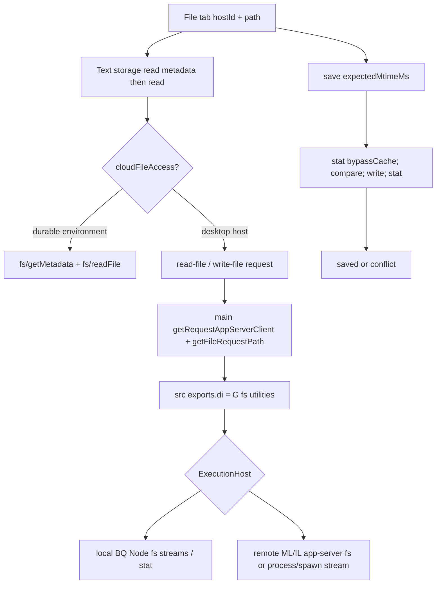

# M9 R1：项目、会话与文件生命周期

2026-10-17。仅研究及设计输入，未实现正式 App，未执行 Codex 运行时验收。本篇负责会话/根身份、标签、恢复、读写监控与 SmartDD/Yoda 落点。格式和树行为分别由同目录专项报告维护；不把浏览器、Git 提交/分支/暂存管理、F20 文档业务加入 M9。最新用户纯文件全量指令已纳入文件状态、只读 blame/generated 及文件内 MCP/selection-edit 条件能力；早期“一概排除Git状态”不再作为本轮范围。

## 1. 结论与可复查范围

可以迁移用户行为，但需要独立实现 SmartDD 文件状态层。Codex 文件标签处在 thread scope 的 right/bottom panel controller 中；项目目录、会话 cwd、文件 host、显示用 workspaceRoot、文件路径是不同身份。预览/固定标签、异步关闭、恢复、文件监听各有单独生命周期，不能用一个 `selectedFile` 状态覆盖。

本次目标仍为 `/Applications/ChatGPT.app`，bundle ID `com.openai.codex`，版本 `26.1007.30912` build `20156`，ASAR SHA-256 `75e397e2280dde93b70a85aa926f4282c728eacc84dfeb15ba7fb6ddd84628af`。对原始 bundle 精确 AST 切出 9 个聚焦输入，新增 1 次 REA application analysis 和 3 次 exact-module 双向 trace：

| 新证据 | 内容 | 结果边界 |
| --- | --- | --- |
| `ev_bfb5af2e5b0107762601cff72137a78cb08940310a5f364fedb901119053658e` | 9 文件，58,138 bytes，18,073 AST nodes | 0 parse failures、0 truncated scopes；图 coverage **partial** |
| `ev_51c6ff64a213130c162166cacee7ce50a84c6d23a1dd6371aa0da395d465b4d3` | `tab-controller.js` | 2 seed matches；partial |
| `ev_f6ac8e8c6f4d714952a2582f78231a3942747288adaf7bbbb7b0ff446baf159b` | `thread-checkpoint.js` | 2 seed matches；partial |
| `ev_be5b6d7e9c76ba5b3bbaf26b61b2adf004f18e7cb4a207b0a5d3ce98b8d22550` | `open-file-watch-registry.js` | 2 seed matches；partial |

分析响应超过 MCP 传输预算后使用 retained evidence 导出，没有重跑相同分析或 reset/close 会话。完整 4 条 evidence 留在 Git 忽略的 `release/m9-research/lifecycle/rea-lifecycle-bundle.json`；[源定位 JSON](证据/m9-lifecycle-source.json)记录原包成员、绝对 ASAR offset、UTF-8 切片边界、原文/格式化哈希、少量为解析添加的语法外壳和证据摘要。切片保留原始符号，未复制进产品；缺少依赖的静态图不能当完整调用图。

下文证据简称均为本机可复查的格式化文件，行号必须与 JSON 中对应 hash 一起使用：

| 简称 | 文件 |
| --- | --- |
| C | `release/f22-research/file-formatted/app-initial-6350d04672d0.js` |
| S | `release/m9-research/lifecycle/shared.formatted.js` |
| B | `release/m9-research/lifecycle/backend.formatted.js`，原成员 `.vite/build/src-BJv5Mk7n.js` |
| M | `release/f22-research/formatted/.vite/build/main-CqEoQDOU.js` |
| E | `release/f22-research/file-formatted/text-file-editor-tab-content.electron-d591818a9d3b.js` |
| IO | `release/f22-research/file-formatted/text-file-storage-2de491513fbc.js` |

## 2. 静态观察：项目、thread、host、cwd、root

| 对象 | 已观察关系 | 定位 |
| --- | --- | --- |
| 项目入口 | 本地 project 的 rootPaths 选 cwd；远程 project 选 remotePath+hostId | C `gPn/yPn` 53801、53817 |
| thread scope | `zA` 按 persistentWorkspace、home、新建 thread、本地 thread、cloud thread 等 routeKind 分支计算 cwd/host；本地 thread 还考虑 projectContext、会话 cwd 和 worktree 状态 | C 53823；`FA/IA` 53879 |
| 工作根列表 | `HG` 来自 `hBi` 的 resolvedPath 数组；其输入包含 source roots、runtime roots、会话 cwd 及仓库信息；`other` route 返回空数组 | C `UG` 103553、103586 |
| 文件显示 root | `Aii` 将 path 相对 cwd 解析后，在 workspaceRoots 找最长匹配祖先；无匹配退回 cwd | S 231370 |
| 文本文件身份 | 默认 tabId 是 `text-editor:${hostId}:${path}`；workspaceRoot 不在该默认 ID 中；显式 tabId 可覆盖 | C `vha` 116395、`kha` 116453 |
| 恢复描述符 | `{kind,params:{hostId,path,workspaceRoot,line,column,...},payloadVersion:1,tabId}`；自定义 headerActions/onDownload/onClose 时不自动建立 durable route | C 116458 |

这不是“项目 ID 等于文件根”模型。一个项目可有多个 roots，一个会话可具有不同的实际 cwd，路径必须放在 host 的路径语义里解释。Codex 部分 workspaceRoots 的计算依赖 Git，但 SmartDD 的项目多目录和任务 cwd 映射本身不必依赖 Git；文件状态/blame/generated可单独接只读元数据provider，不混入根授权。

**SmartDD 建议**：文件工作区 UI 以 `taskId` 为主要 scope，项目页用 `projectId` scope；可信根由 main 从 `projectDirs.id` 或任务 cwd 快照解析。持久描述符保存目录来源，运行时使用 main 签发的 root lease。文件去重用 `hostIdentity + canonicalRootIdentity + normalizedRelativePath`，不要以显示文件名、tab 顺序、临时 lease 字符串去重。两个目录别名指向同一真实根时可共享模型；路径大小写规则由 host 决定，不对所有平台强行 lowercase。

## 3. 静态观察：预览、固定、排序与关闭

controller `XRn` 位于 C 55072；以下是该函数实际分支，不代表每项已做界面操作验证。

| 动作 | 状态规则 | 定位 |
| --- | --- | --- |
| 打开/去重 | 以 ID 定位已有 tab；contentInstance、panelInstanceId、dndId 分开；变更文件内容实例不能仅复用旧确认回调 | C 55113 |
| 单预览位 | 新 preview 替换旧 preview；已有固定 tab 不降级；替换时释放旧 tab 状态并执行 onClose | C `j10/P10` 55232、55247 |
| 固定 | 将 `isPreview` 置 false | C `se2` 55419 附近 |
| 重排 | 拒绝 workspace home/pending drag 的不适用操作；数组重排后清理并排/opener family 关系 | C `L10/me2` 55273 |
| 异步关闭 | onBeforeClose 可返回 boolean 或 Promise；Promise 完成后再次比对每个 tab 的 contentInstance，旧确认不能关闭已替换的新文件 | C `E10` 55175 |
| dirty 文本关闭 | 当前 editor 的 onBeforeClose **先尝试保存**；保存成功直接允许关闭，失败再弹放弃确认；再次核对文件、host、回调身份 | E 821–843 |
| 关闭后激活 | 有并排/打开来源关系时优先该关系；否则邻接项；聚焦恢复有当前焦点/面板条件 | C `oe2` 55379 附近 |
| 关闭释放 | dispose tab state、清理 data/onClose；空面板关闭；与 PTY 进程不是同一动作 | C `ce2/le2` 55422 附近 |
| 撤销关闭 | 存 `{panel,index,route}`，route 包含 durable descriptor 与 tabId；栈最多 25 项；按原 panel 尝试再回退另一 panel | C `YRn` 55066、`Yji` 99764 |

“撤销关闭”重开的是可序列化 route，不是任意 React 内存、完整编辑历史或未保存 buffer。关闭恢复失败有记录重入栈/错误处理，不能承诺所有类型无条件恢复。Yoda 的 dirty-preview 自动升级为固定可用作 SmartDD 设计参考，但不能只凭 Yoda 的规则断言 Codex 所有文件类型都自动升级。

**原型必须表达**：普通 preview、固定、dirty、saving、失败后放弃确认；关闭非活动/活动/最后标签；预览被替换；恢复不可用；搜索或终端拥有焦点时关闭不抢焦点。SmartDD 可将保存失败对话框细化为重试/保留/放弃，但需要标注与 Codex 静态分支的产品差异。

## 4. 静态观察：持久化与恢复

1. `thread-tab-routes-v1:${encodeURIComponent(threadId)}` 是每会话持久化 key（S `ANt/MNt` 93682）。`n5a→ORn` 排除 preview；只保存可持久化 route。`t5a` 建立 right/bottom 标签顺序、活动项、打开状态、焦点、full/split 等 topology（C 54895、134302）。
2. `Leo` 用唯一 token 和 isDisconnected 防止切会话后的恢复污染；`zeo` 保存 selectionVersion，用户在恢复期间已选择其它项时不覆盖其选择（C 135281、135321）。
3. `Beo/Veo` 按 topology 顺序恢复。失败时建立保留原 route 的 `unrestored-route`，标题 `Tab unavailable`，不悄悄把条目删除（C 135333、135348）。
4. `Heo/Ueo/Weo` 恢复有效顺序、活动项、面板可见性与焦点；缺项时回退现有活动项或第一项；空面板焦点回 main（C 135356）。
5. `Geo` 监听持久化 atom 与本地 checkpoint，过滤自己写入的重复回声，dispose 时释放订阅（C 135385）。`Reo` 把 client-thread 草稿 checkpoint 迁移到正式 conversation（C 135305）。
6. `td→yI→hI` 写 persisted atom store 回调（S 98408、98338）；main 处理 `persisted-atom-update`，校验窗口持有权/更新合法性后写 `globalState['electron-persisted-atom-state']` 并广播（M 86953、87840–87879）。这条观察证明主进程存储服务参与，不应误称仅用前端 localStorage。具体底层磁盘格式、崩溃刷盘时机未在本篇追踪。
7. 右侧外层面板宽度 key `app-shell:right-panel-width:v3`，保存归一化比例并兼容旧像素值（C 32014–32049）。这是全局布局偏好，与每会话标签 topology 不同；也不是文件树内层 200px 最小宽度那一套参数。

**SmartDD 建议**：持久化固定标签 route、每 task 的活动项/顺序、目录树展开/选中/滚动、源码/预览模式和布局；临时 lease、watchId、requestId、Blob URL、编辑器实例不持久化。草稿单独设计：记录文本、base revision、编码/EOL、更新时间和 task/文件身份，恢复时与磁盘核对；不能把 route 恢复当草稿恢复。新开工技术方案中应明确草稿容量、清理、失败提示和多窗口并发，不能依靠卸载时最后一次保存。

## 5. 静态调用链：读取与保存

| 链节 | 观察 | 证据 |
| --- | --- | --- |
| renderer 读 | cloud 分支带 environmentId 直接发送 fs/getMetadata/readFile；desktop 分支先 read-file-metadata 再 read-file；取消在 await 前后检查；读取后再次校验真实字节限制 | IO 4–29 |
| renderer 写 | 传 content、expectedMtimeMs、hostId、path；cloud 分支也先 metadata 比较后写 | IO 30–38 |
| main 读写 | 解析请求 host，再按该 ExecutionHost 解析文件路径；读 `i.di.readFile`，写比较当前 mtime 与 expected 后写入 | M 60618–60657、61530、61738；相对路径规范化 `MI` 57769 |
| 真实 fs 门面 | main 的 `i` 是 `src-BJv5Mk7n.js`，其导出 `di` 返回 `G`；G 调用 ExecutionHost readFile/writeFile/stat/readDirectory | B 1250–1293、63998 |
| 本地 host 实现 | 启动时 `u=new i.O()`，导出O即BQ，注册local ExecutionHost并注入fetchHandler；BQ使用Node createReadStream/createWriteStream/pipeline/stat/readdir，WSL路径经getFileSystemPath转换 | M 127637、127874、61650；B 59908、59959–59982、63638 |
| 远程/连接 host 实现 | getAppServerClient从ExecutionHostRegistry取具体host；连接实现的`IL.fromConnection`注册fs/readFile、writeFile、getMetadata、readDirectory等，spawn交给连接 | M 128831；B 44630–44643、47892 |
| 连接host的平台与流 | `ML.readFile` 在 Windows 或 streamFiles=false 时走 base64；其它平台走 `/bin/cat` stream。小于 65,536 bytes 的直接内容写用 fs/writeFile，较大流在适用平台走 process/spawn + `/bin/sh -c /bin/cat > "$1"`，路径由位置参数传递 | B 44515–44580、44605 |

保存是 **stat→比较→write→stat**，静态代码未显示跨进程原子 compare-and-swap。因此不能称“不会发生任何外部写竞争”。SmartDD 应增加 revision（文件身份+mtime/size+内容 hash）、应用内按 canonical file 串行的写队列和保存幂等 opId；原子替换只能减少半写风险，不能单独消除其它程序在最后检查与替换之间的竞争。跨程序最强保证需在开发探针中明示边界，不能写一个更强类型就宣称有保证。

**不能把所有本地读写都说成先经过app-server**：命名getRequestAppServerClient保留历史名，但local实际注入BQ Node host，远程才落到连接provider；cloud storage还有独立请求分支。BQ补查为原始AST/源码观察，单独记录于JSON supplemental，不混充前述9文件REA范围。

原生 app-server 的协议执行、远程认证/传输、Windows/WSL 实际行为本篇没有运行验证；本机也没有操作 Codex UI。以上调用链是导入/导出与函数体交叉核对得到的静态链路，不是端到端请求录像。

## 6. 静态调用链：打开文件监控与释放

1. `kha` 打开/关闭/撤销文本 tab 后调用 `Eha`；仅 `local-thread` 分支向当前 host 的 facade 发 `setOpenFileTabs(conversationId,[{hostId,path}])`（C 116439–116470）。不能把该分支推广成所有 routeKind 的完全相同监控。
2. backend facade `yo` 附带 owner，把 setOpenFileTabs 委托给 service，dispose 时 `releaseOpenFileTabs(owner)`（B 11770）。service 转 `openFileWatches.setOpenFileTabFiles`（B 39991）。
3. `mb` 以 conversation→owner→files 维护需求，`getWatchPath` 使用会话 cwd/host 规范化绝对路径；相同 `hostId + NUL + watchPath` 合并监控（B 21347–21562；M 30894）。目录外授权不能从这个字符串规范化函数推断出来。
4. `sync()` 根据需求并集合复用/启动/停止监控；`fs/watch {path,watchId}` 尚未成功就关闭时设置 `shouldUnwatchOnStart`，成功后补发 fs/unwatch。异常只清理仍是同一实例的登记（B 21490–21543）。
5. 接到 `fs/changed`，`NS` 按 watchId 找所有 owner 的文件，构造 `open-file-changed {hostId,path}`，事件总线按 owner 过滤（B 25281、12233）。文本内容组件匹配 host/path 后 `syncExternalChange()`（E 622）。
6. Registry 提供 `ignoreFileChangeEvents`，按 owner+watch key 维持 **5 秒**忽略窗口，定时器只清理对应同一 expiry；本篇没有证实每个保存动作都调用它，不将该时间窗宣传为完整保存去重机制（B 21346、21424）。
7. 本地BQ还有独立`startFileWatch`，直接Node fs.watch并返回recursive取请求值、typedPathChanges=false；error/ dispose关闭句柄（B 60027–60064）。这与打开tab的mb→app-server fs/watch不是同一层次，不根据Node watcher存在就替换实际tab通知链。
8. 连接ExecutionHost 的另一层 `startFileWatchSession` 保留连接身份，fs/changed 按 watchId 分发；返回 coverage 明确是 `{recursive:false,typedPathChanges:false}`，断线批量关闭，dispose 仅在同一连接发 fs/unwatch（B 44282–44361）。它与 `mb` 的 consumer registry 层次不同，不能混作同一对象。

**SmartDD 建议**：main canonical-root watcher 共享底层资源，但 rootLease/consumerId/watchId 必须绑定窗口 sender；树监控、打开文件监控、搜索索引订阅分组。事件带 sequence、rootGeneration 和可能的 opId，应用自己的保存可按 revision 识别，避免无条件屏蔽 5 秒造成漏报。背压丢弃细节时发 `resyncRequired`，重新 list/stat，不把有限队列当完整事件历史。

## 7. 当前 SmartDD 的迁移落点

读到的 HEAD 为 `d75bbaa81e924d1f9a9509ae1d068d69d4ea8ec7`，package `0.0.5`；检查的是当前工作区，文档已有并行改动。以下覆盖早期 F22 基于 `7f75b3b` 的局部结论。

| 现有能力 | 当前源码入口 | M9 处理 |
| --- | --- | --- |
| 多项目目录/任务 cwd | `src/main/db/schema.ts:62,170`；`src/main/core/tasks/task-service.ts:157` | 可信根来源已存在；任务 cwd 快照不能随项目路径改动静默重定向 |
| sender-aware RPC | `src/shared/ipc/rpc.ts:11,33` 的 createScopedRPCController/registerRPCRouter | **已经支持 Electron context**，不需要重构全部 RPC。为 files 新增领域 controller |
| owner 清理样例 | `src/main/core/projects/transfer-controller.ts:11` | 可借鉴 senderFrame、destroyed/navigation 清理；不复用迁移 token 作为文件授权 |
| 主/渲染器布局 | `src/renderer/lib/layout/workspace.tsx:71,81` | TaskView keepMounted，新增旁置文件工作区 |
| 任务 tab 关闭 | `src/renderer/core/tasks-store.ts:140` | 会 kill task，文件 tab 不能调用它 |
| 终端尺寸/焦点 | `src/renderer/views/task-view.tsx:155,208,221` | 有 0×0 保护；布局拖动按帧 fit，保持 ptyId key；自动 focus 要避免抢文件输入焦点 |
| SQLite 设置存储 | `src/main/core/settings/settings-service.ts:17,31,41` | 已有 schema 验证与按 key 写队列；文件 checkpoint/draft 可建专用表/服务，不塞任意 JSON 绕过 settings schema |
| 平台路径 | `src/shared/projects.ts:60` | 当前校验仍要求 `/` 开头；Windows drive/UNC 需单独设计并验收，不宣称当前跨平台已完备 |
| 依赖 | `package.json` | Electron ^42、React ^19.2、MobX ^6.16、react-resizable-panels 已有；没有 M9 文件 provider/editor/parser/watch 领域 |

## 8. Yoda 可复用范围与依赖

Yoda HEAD `960fd3224508edc52fb7e99d9e8f8cf1723ad683`，package `0.20.3`。依据 `../yoda/AGENTS.md` 读取架构与测试说明，仅源码阅读，没有运行已安装 Yoda。许可证为仓库 `LICENSE.md` 和 package 声明的 Apache-2.0；SmartDD 已有 `NOTICE` 来源声明，真正搬入代码时补对应文件和修改说明。

| 候选单元 | 精确入口 | 可复用与必须改动 |
| --- | --- | --- |
| fs provider、list、read | `src/main/core/fs/impl/local-fs.ts:196,255,359` | 可复用接口/限额/取消；resolvePath 只是 lexical 前缀，需增加 realpath、symlink和读写复核；200 KiB 截断不能直接保存回原文件 |
| watcher | 同文件 `:774,991`；`src/main/core/fs/controller.ts:691` | 有 debounce/backpressure/late subscribe cleanup；把 project/workspace/label 换成 main 授权 owner 分组 |
| 懒树/虚拟行 | `src/renderer/features/tasks/editor/stores/files-store.ts:24,163`；`editor-file-tree.tsx:152` | 复用 nodes/childIndex 和 flatten/virtual；Git状态与普通树分层接只读provider；Yoda默认隐藏清单不能直接套Codex |
| file tab | `src/renderer/features/tasks/tabs/file-tab-store.ts:17,102`；`tab-manager-store.ts:688,742,801` | 稳定 tabId 与 preview path替换可用；dirty preview先固定。整类耦合conversation/diff/shell pin；其 top-level 明写无完整 preview，不应称所有场景相同 |
| model lifecycle | `src/renderer/features/tasks/editor/stores/file-model-lifecycle-store.ts:18,68,127` | FileTabsHost 小接口与register/unregister可抽；只抽文件buffer生命周期，按只读差异/blame需要保留独立Git基线模型；写入接revision/opId与草稿服务 |
| Markdown/SVG/PDF | `src/renderer/lib/editor/markdown-renderer.tsx:25`、`svg-renderer.tsx:24`、`pdf-renderer.tsx:8` | Markdown与SVG结构可用；Yoda PDF `<embed>`不等于Codex自有分页/文本/注释层，须重做相应行为；HTML/Office不能从Yoda fileKind推断已具备 |

依赖版本是 **Yoda 锁文件中的已解析版本**，不是本次已安装进 SmartDD：

| 依赖 | 版本 | 已核对许可与迁移注意 |
| --- | --- | --- |
| `@parcel/watcher` | 2.5.6 | [官方版本 package：MIT](https://raw.githubusercontent.com/parcel-bundler/watcher/v2.5.6/package.json)；原生模块，各目标平台打包探针必需 |
| `monaco-editor` | 0.55.1 | [官方版本 package：MIT](https://raw.githubusercontent.com/microsoft/monaco-editor/v0.55.1/package.json)；worker本地打包，语法/快捷键/滚动仍需对齐Codex |
| `@monaco-editor/react` | 4.7.0 | [官方版本 package：MIT](https://raw.githubusercontent.com/suren-atoyan/monaco-react/v4.7.0/package.json)；禁止默认联网CDN加载 |
| `react-markdown` | 10.1.0 | [官方版本 package：MIT](https://raw.githubusercontent.com/remarkjs/react-markdown/10.1.0/package.json)；链接/图片由受限asset resolver解析 |
| `remark-gfm` / `rehype-raw` / `rehype-sanitize` | 4.0.1 / 7.0.0 / 6.0.0 | 官方版本包元数据入口：[GFM](https://raw.githubusercontent.com/remarkjs/remark-gfm/4.0.1/package.json)、[raw](https://raw.githubusercontent.com/rehypejs/rehype-raw/7.0.0/package.json)、[sanitize](https://raw.githubusercontent.com/rehypejs/rehype-sanitize/6.0.0/package.json)；使用前保留MIT许可文件，raw之后必须清洗 |
| `@tanstack/react-virtual` | 3.13.23 | 锁版本已核对；本次版本级许可链接未成功读取，落地前核对实际tarball LICENSE，不把Yoda Apache许可视为所有依赖许可 |
| `devicon` | 2.17.0 | 版本已核对；逐图标授权/商标及视觉与Codex对应未完成，不直接把完整图标包纳入既定迁移 |

许可证核对范围为列出的直接组件元数据及 Yoda 仓库；没有完成完整传递依赖/字体/图标资源清单审计。Codex 私有业务实现仅作结构和行为研究，不将包内代码/品牌资源搬进生产。

## 9. 开工前验证与未决边界

下列是验证前置工作，**不是删除功能的理由**：

- 真实文件竞争：两窗口/外部程序并发写、相同mtime不同内容、保存中继续输入、权限改变、磁盘满和重命名替换；opId重复提交不能重复破坏内容。
- 资源释放：关闭根、切任务、窗口导航/销毁、watch启动晚于dispose、连接断开、事件洪峰；引用未归零不能关闭其它窗口监控。
- 恢复：preview不恢复、固定route按序恢复、目录改址或丢失有占位，草稿与磁盘冲突明确；非法旧schema不崩溃，不接受持久化lease。
- 安全与路径：symlink指向根外、根在操作间被替换、`..`、URI/UNC/驱动器、大小写、中文空格与长路径；任意renderer字符串不能获得目录外读写权。
- 终端共存：运行中的CLI持续输出时开合/拖拽文件面板，PTY数量/进程ID不变，非活动0×0不resize；搜索/编辑器焦点不被TaskTerminal抢走。
- Mac/Windows/Linux：Electron安装包内editor worker、watch native模块、系统外开分别实测；Mac结果不证明另两平台。远程provider必须具备已授权根/能力声明/取消/版本/监控语义，服务器配置存在不等于支持文件工作区。
- 视觉/交互：本轮没有通过工具控制 Codex UI；已有用户截图及静态尺寸/快捷键只是参考输入。动态未验证的动作、窗口persist行为、原生app-server细节单列待验，不声称完全一致。

本文的 SmartDD 状态/DTO取舍见[技术方案 R1](../技研/REA调研与迁移方案.md)。本篇只交付研究文档与证据定位；未修改功能代码或运行应用测试。
